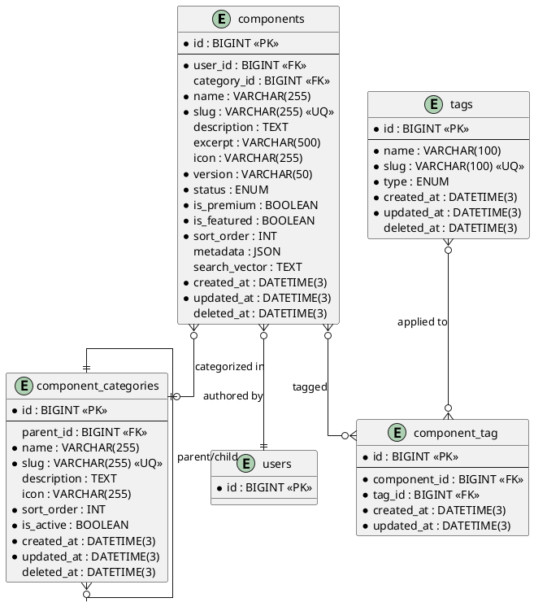

# 06.20 - Components

**Project:** GsmUi
**Domain:** Components
**Version:** 1.0.0

---

# Purpose

This document defines the database schema for the Component Engine — the foundation of GsmUi. Every UI element (buttons, inputs, modals, dashboards) is registered as a component with metadata, categorization, and tagging.

---

# Tables

## components

**Purpose:** Core UI component registry. Each component is a Blade/Livewire component with metadata, documentation, and versioning.

**Business Rules:**
- Slug is unique and immutable after creation
- Components are created by authors (users)
- Status transitions: `draft` → `review` → `published` → `deprecated`
- `is_premium` determines if the component requires a paid plan
- `category_id` references component_categories
- Soft-deletable

**Columns:**

| Column | Type | Nullable | Default | Notes |
|---|---|---|---|---|
| id | BIGINT UNSIGNED | NO | AUTO_INCREMENT | PK |
| user_id | BIGINT UNSIGNED | NO | — | FK → users.id (author) |
| category_id | BIGINT UNSIGNED | YES | NULL | FK → component_categories.id |
| name | VARCHAR(255) | NO | — | Display name |
| slug | VARCHAR(255) | NO | — | URL-friendly identifier |
| description | TEXT | YES | NULL | Full description |
| excerpt | VARCHAR(500) | YES | NULL | Short summary |
| icon | VARCHAR(255) | YES | NULL | Icon identifier |
| version | VARCHAR(50) | NO | '0.1.0' | Current version (semver) |
| status | ENUM('draft','review','published','deprecated') | NO | 'draft' | Publication state |
| is_premium | BOOLEAN | NO | false | Requires paid plan |
| is_featured | BOOLEAN | NO | false | Featured on homepage |
| sort_order | INT | NO | 0 | Display order |
| metadata | JSON | YES | NULL | SEO, custom fields |
| search_vector | TEXT | YES | NULL | Fulltext search |
| created_at | DATETIME(3) | NO | CURRENT_TIMESTAMP(3) | |
| updated_at | DATETIME(3) | NO | CURRENT_TIMESTAMP(3) | ON UPDATE |
| deleted_at | DATETIME(3) | YES | NULL | Soft delete |

**Indexes:**

```
PRIMARY: id
UNIQUE: components_slug_unique (slug)
INDEX: components_user_id_index (user_id)
INDEX: components_category_id_index (category_id)
INDEX: components_status_index (status)
INDEX: components_is_premium_index (is_premium)
INDEX: components_sort_order_index (sort_order)
FULLTEXT: components_search_vector_fulltext (search_vector)
```

**Relationships:**
- belongsTo: User, ComponentCategory
- hasMany: ComponentVariant, ComponentExample, ComponentDoc
- belongsToMany: Tag (via component_tag)

**Migration:**

```php
Schema::create('components', function (Blueprint $table) {
    $table->id();
    $table->foreignId('user_id')->constrained()->cascadeOnDelete();
    $table->foreignId('category_id')->nullable()->constrained('component_categories')->nullOnDelete();
    $table->string('name');
    $table->string('slug')->unique();
    $table->text('description')->nullable();
    $table->string('excerpt', 500)->nullable();
    $table->string('icon')->nullable();
    $table->string('version', 50)->default('0.1.0');
    $table->enum('status', ['draft', 'review', 'published', 'deprecated'])->default('draft');
    $table->boolean('is_premium')->default(false);
    $table->boolean('is_featured')->default(false);
    $table->integer('sort_order')->default(0);
    $table->json('metadata')->nullable();
    $table->text('search_vector')->nullable();
    $table->timestamps();
    $table->softDeletes();
});
```

**Eloquent Model:**

```php
class Component extends Model
{
    use HasFactory, SoftDeletes;

    protected $guarded = [];
    protected $casts = [
        'is_premium' => 'boolean',
        'is_featured' => 'boolean',
        'metadata' => 'array',
    ];
}
```

**Full Eloquent Model:**

```php
<?php

namespace App\Models;

use Illuminate\Database\Eloquent\Model;
use Illuminate\Database\Eloquent\SoftDeletes;
use Illuminate\Database\Eloquent\Factories\HasFactory;
use Illuminate\Database\Eloquent\Relations\{BelongsTo, BelongsToMany, HasMany};
use Illuminate\Database\Eloquent\Builder;

class Component extends Model
{
    use HasFactory, SoftDeletes;

    protected $guarded = [];

    protected $casts = [
        'is_premium'    => 'boolean',
        'is_featured'   => 'boolean',
        'metadata'      => 'array',
        'sort_order'    => 'integer',
        'created_at'    => 'datetime',
        'updated_at'    => 'datetime',
        'deleted_at'    => 'datetime',
    ];

    protected $appends = ['status_label', 'is_free'];

    // ─── Relationships ───────────────────────────────────────

    public function user(): BelongsTo
    {
        return $this->belongsTo(User::class);
    }

    public function category(): BelongsTo
    {
        return $this->belongsTo(ComponentCategory::class, 'category_id');
    }

    public function variants(): HasMany
    {
        return $this->hasMany(ComponentVariant::class)->orderBy('sort_order');
    }

    public function examples(): HasMany
    {
        return $this->hasMany(ComponentExample::class)->orderBy('sort_order');
    }

    public function docs(): HasMany
    {
        return $this->hasMany(ComponentDoc::class);
    }

    public function tags(): BelongsToMany
    {
        return $this->belongsToMany(Tag::class, 'component_tag')
            ->withTimestamps()
            ->orderBy('tags.name');
    }

    // ─── Accessors ───────────────────────────────────────────

    public function getStatusLabelAttribute(): string
    {
        return match ($this->status) {
            'draft'      => 'Draft',
            'review'     => 'In Review',
            'published'  => 'Published',
            'deprecated' => 'Deprecated',
            default      => ucfirst($this->status),
        };
    }

    public function getIsFreeAttribute(): bool
    {
        return !$this->is_premium;
    }

    public function getRouteAttribute(): string
    {
        return route('components.show', $this->slug);
    }

    public function getDocUrlAttribute(): string
    {
        return route('docs.component', $this->slug);
    }

    // ─── Query Scopes ────────────────────────────────────────

    public function scopePublished(Builder $query): Builder
    {
        return $query->where('status', 'published');
    }

    public function scopeDraft(Builder $query): Builder
    {
        return $query->where('status', 'draft');
    }

    public function scopeInReview(Builder $query): Builder
    {
        return $query->where('status', 'review');
    }

    public function scopeDeprecated(Builder $query): Builder
    {
        return $query->where('status', 'deprecated');
    }

    public function scopePremium(Builder $query): Builder
    {
        return $query->where('is_premium', true);
    }

    public function scopeFree(Builder $query): Builder
    {
        return $query->where('is_premium', false);
    }

    public function scopeFeatured(Builder $query): Builder
    {
        return $query->where('is_featured', true);
    }

    public function scopeInCategory(Builder $query, int $categoryId): Builder
    {
        return $query->where('category_id', $categoryId);
    }

    public function scopeAuthoredBy(Builder $query, int $userId): Builder
    {
        return $query->where('user_id', $userId);
    }

    public function scopeSearch(Builder $query, string $term): Builder
    {
        return $query->whereRaw(
            'MATCH(search_vector) AGAINST(? IN NATURAL LANGUAGE MODE)',
            [$term]
        );
    }

    public function scopeLatestFirst(Builder $query): Builder
    {
        return $query->orderBy('created_at', 'desc');
    }

    public function scopeOrdered(Builder $query): Builder
    {
        return $query->orderBy('sort_order')->orderBy('name');
    }

    public function scopeWithMinimalData(Builder $query): Builder
    {
        return $query->select('id', 'name', 'slug', 'icon', 'status', 'is_premium', 'is_featured', 'sort_order');
    }

    // ─── Methods ─────────────────────────────────────────────

    public function updateSearchVector(): void
    {
        $parts = array_filter([
            $this->name,
            $this->description,
            $this->excerpt,
            $this->category?->name,
            $this->tags->pluck('name')->implode(' '),
        ]);

        $this->update(['search_vector' => strtolower(implode(' ', $parts))]);
    }

    public function canTransitionTo(string $newStatus): bool
    {
        return match ($this->status) {
            'draft'      => in_array($newStatus, ['review']),
            'review'     => in_array($newStatus, ['draft', 'published']),
            'published'  => in_array($newStatus, ['deprecated']),
            'deprecated' => in_array($newStatus, ['published']),
            default      => false,
        };
    }

    public function transitionTo(string $newStatus): void
    {
        if (!$this->canTransitionTo($newStatus)) {
            throw new \App\Exceptions\InvalidStatusTransition(
                "Cannot transition from {$this->status} to {$newStatus}"
            );
        }

        $this->update(['status' => $newStatus]);
    }

    public function incrementDownloadCount(): void
    {
        $this->increment('download_count');
    }
}
```

**Events:** ComponentCreated, ComponentUpdated, ComponentPublished, ComponentDeprecated, ComponentDeleted

---

## Detailed Column Specifications

### id (BIGINT UNSIGNED, PK, AUTO_INCREMENT)
- Standard MySQL BIGINT auto-incrementing primary key.
- Supports up to 18.4 quintillion rows — no practical limit.
- Used as the sole foreign key target across all child tables.
- Referenced by `component_variants.component_id`, `component_examples.component_id`, `component_docs.component_id`, `component_tag.component_id`.

### user_id (BIGINT UNSIGNED, NOT NULL, FK → users.id)
- References the `users.id` column in the host application's authentication system.
- `ON DELETE CASCADE` — if the author account is deleted, all their components are removed.
- Indexed for efficient lookup of "my components" queries.
- Application-layer validation: must reference an existing, non-suspended user.

### category_id (BIGINT UNSIGNED, NULLABLE, FK → component_categories.id)
- References the hierarchical category taxonomy.
- `ON DELETE SET NULL` — if a category is deleted, components revert to uncategorized.
- NULLable allows components to exist without a category during draft creation.
- Indexed for category-based filtering in the marketplace UI.

### name (VARCHAR(255), NOT NULL)
- Display name shown in the marketplace, docs, and component library.
- Application-layer validation: 1–255 characters, no HTML tags.
- Used in search indexing and autocomplete suggestions.
- NOT UNIQUE — multiple components can share a name (e.g., different authors).
- Should be human-readable: "Date Picker" not "date-picker".

### slug (VARCHAR(255), NOT NULL, UNIQUE)
- URL-friendly identifier: lowercase, hyphens only, no special characters.
- UNIQUE constraint prevents slug collisions across the entire platform.
- Immutable after creation — slug changes require creating a new component.
- Application-layer validation: `/^[a-z0-9]+(?:-[a-z0-9]+)*$/`, max 255 chars.
- Used in routes: `/components/{slug}`, API endpoints, and documentation URLs.
- Generation: auto-generated from `name` via Laravel's `Str::slug()`, with numeric suffix on collision.

### description (TEXT, NULLABLE)
- Full Markdown description of the component.
- Rendered on the component detail page.
- Supports rich formatting: code blocks, images, tables, links.
- Application-layer validation: max 65,535 characters (TEXT column limit).
- Stored as-is; Markdown rendering happens at display time.
- Included in full-text search index for keyword matching.

### excerpt (VARCHAR(500), NULLABLE)
- Short summary for card views, search results, and social media previews.
- Application-layer validation: 0–500 characters.
- Auto-generated from `description` if not explicitly provided (first 200 chars + ellipsis).
- Used in Open Graph `og:description` meta tags.

### icon (VARCHAR(255), NULLABLE)
- Icon identifier referencing the icon library (e.g., `heroicon-o-calendar`, `lucide-heart`).
- Format: `{library}-{style}-{name}` — stored as a string, resolved at render time.
- NULLable: components without an icon display a placeholder.
- Used in category listings, search results, and navigation menus.

### version (VARCHAR(50), NOT NULL, DEFAULT '0.1.0')
- Semantic version string (MAJOR.MINOR.PATCH).
- Application-layer validation: `/^\d+\.\d+\.\d+(-[a-zA-Z0-9.]+)?$/`.
- Updated on each publish cycle; triggers a new `product_versions` entry in the marketplace.
- Immutable — version bumps create new records via the versioning system.
- Used for dependency resolution in the template system.

### status (ENUM, NOT NULL, DEFAULT 'draft')
- Publication workflow state machine.
- Valid transitions:
  - `draft` → `review` (author submits for review)
  - `review` → `published` (admin approves)
  - `review` → `draft` (admin rejects, returns to author)
  - `published` → `deprecated` (admin or author deprecates)
  - `deprecated` → `published` (admin re-activates)
- Invalid transitions throw `InvalidStatusTransition` exception.
- Indexed for filtering: "show all published components", "admin review queue".
- Status changes emit events for notification and audit logging.

### is_premium (BOOLEAN, NOT NULL, DEFAULT false)
- Whether the component requires a paid subscription to access.
- Free components: `is_premium = false` — available to all users.
- Premium components: `is_premium = true` — requires Pro or Business plan.
- Checked against the user's subscription status at access time.
- Indexed for filtering: "show free components only".

### is_featured (BOOLEAN, NOT NULL, DEFAULT false)
- Whether the component is featured on the homepage and marketing pages.
- Admin-controlled flag; manually toggled.
- Used in homepage carousel, "Featured Components" section.
- Indexed for efficient featured-component queries.
- Maximum 20 featured components enforced at application layer.

### sort_order (INT, NOT NULL, DEFAULT 0)
- Manual display ordering within a category.
- Lower values appear first; ties broken by `created_at DESC`.
- Application-layer validation: non-negative integer.
- Indexed for ORDER BY queries.

### metadata (JSON, NULLABLE)
- Extensible key-value storage for SEO and custom fields.
- Common keys: `og_title`, `og_image`, `keywords`, `difficulty`, `frameworks`, `browser_support`.
- Schema not enforced at database level; validated by application-layer rules.
- Accessed via `$component->metadata['og_title']` through Eloquent cast.
- NULLable: empty metadata is represented as NULL, not empty JSON object.

### search_vector (TEXT, NULLABLE)
- Pre-concatenated, lowercased text for MySQL FULLTEXT search.
- Contains: `name`, `description`, `excerpt`, category name, tag names.
- Updated via model observer when any source field changes.
- MySQL FULLTEXT index enables `MATCH() AGAINST()` queries.
- Rebuilt periodically via Artisan command: `gsmui:rebuild-search-vectors`.

### created_at / updated_at (DATETIME(3), NOT NULL)
- Standard Laravel timestamps with millisecond precision.
- `created_at` set on record creation; never changes.
- `updated_at` updated on every modification via Eloquent mutator.
- Used for sorting, caching keys, and audit logging.

### deleted_at (DATETIME(3), NULLABLE)
- Soft-delete marker. NULL = active record; non-NULL = soft-deleted.
- All default queries exclude soft-deleted records via `SoftDeletes` trait.
- Explicit access via `withTrashed()`, `onlyTrashed()`, `restore()`.
- Permanent deletion via `forceDelete()` — used in GDPR compliance workflows.
- Index not required — MySQL can use the primary key for `WHERE deleted_at IS NULL` queries.

---

## Index Strategy Deep Dive

### Primary Key Index
```
PRIMARY: id
```
- Clustered index on InnoDB — determines physical row storage order.
- Auto-incrementing ensures sequential inserts with minimal page splits.
- Referenced by all foreign keys; join performance is optimal.

### Unique Index on slug
```
UNIQUE: components_slug_unique (slug)
```
- Prevents duplicate slugs across the platform.
- B-tree index enables O(log n) lookup for URL resolution.
- Application must handle `DuplicateKeyException` on creation.

### Foreign Key Indexes
```
INDEX: components_user_id_index (user_id)
INDEX: components_category_id_index (category_id)
```
- Required for efficient JOIN operations with parent tables.
- MySQL automatically creates indexes for foreign keys, but explicit definition ensures consistent naming.
- Enable "my components" and "components in category" queries.

### Status Index
```
INDEX: components_status_index (status)
```
- Low cardinality (4 values) but frequently filtered.
- Enables efficient `WHERE status = 'published'` queries.
- Used in dashboard, marketplace listing, and admin review queue.

### Premium/Featured Indexes
```
INDEX: components_is_premium_index (is_premium)
INDEX: components_sort_order_index (sort_order)
```
- Boolean indexes have low cardinality but high query frequency.
- `sort_order` index supports ORDER BY in category listings.
- Consider composite index `(category_id, sort_order)` for category-scoped queries.

### Full-Text Search Index
```
FULLTEXT: components_search_vector_fulltext (search_vector)
```
- MySQL InnoDB FULLTEXT index for natural language search.
- Minimum word length: 3 characters (MySQL default).
- Stop words filtered automatically.
- Relevance scoring via `MATCH() AGAINST() IN NATURAL LANGUAGE MODE`.
- InnoDB requires FULLTEXT index on a TEXT or VARCHAR column.
- Performance: O(log n) for typical queries, degrades with very large datasets.

### Composite Index Recommendations
```sql
-- For marketplace listing page
CREATE INDEX components_category_status_featured ON components(category_id, status, is_featured);

-- For author dashboard
CREATE INDEX components_user_status ON components(user_id, status, created_at DESC);

-- For premium component queries
CREATE INDEX components_premium_status ON components(is_premium, status, sort_order);
```

---

## Data Validation Rules

### Server-Side (Laravel Request Rules)
```php
// ComponentRequest.php
public function rules(): array
{
    return [
        'name'        => ['required', 'string', 'max:255'],
        'slug'        => ['required', 'string', 'max:255', 'unique:components,slug'],
        'description' => ['nullable', 'string', 'max:65535'],
        'excerpt'     => ['nullable', 'string', 'max:500'],
        'icon'        => ['nullable', 'string', 'max:255'],
        'version'     => ['required', 'string', 'max:50', 'regex:/^\d+\.\d+\.\d+(-[a-zA-Z0-9.]+)?$/'],
        'status'      => ['required', 'in:draft,review,published,deprecated'],
        'is_premium'  => ['boolean'],
        'is_featured' => ['boolean'],
        'category_id' => ['nullable', 'exists:component_categories,id'],
        'sort_order'  => ['integer', 'min:0'],
        'metadata'    => ['nullable', 'array'],
        'tags'        => ['nullable', 'array'],
        'tags.*'      => ['exists:tags,id'],
    ];
}
```

### Client-Side (JavaScript Validation)
```javascript
// Component form validation
const componentSchema = {
    name:        { required: true, maxLength: 255, pattern: /^[^<>]+$/ },
    slug:        { required: true, maxLength: 255, pattern: /^[a-z0-9]+(-[a-z0-9]+)*$/ },
    version:     { required: true, pattern: /^\d+\.\d+\.\d+(-[a-zA-Z0-9.]+)?$/ },
    excerpt:     { maxLength: 500 },
    description: { maxLength: 65535 },
    sort_order:  { type: 'integer', min: 0 },
};
```

### Database-Level Constraints
```sql
-- Enforced by MySQL
ALTER TABLE components ADD CONSTRAINT components_slug_unique UNIQUE (slug);
ALTER TABLE components ADD CONSTRAINT components_user_id_foreign FOREIGN KEY (user_id) REFERENCES users(id) ON DELETE CASCADE;
ALTER TABLE components ADD CONSTRAINT components_category_id_foreign FOREIGN KEY (category_id) REFERENCES component_categories(id) ON DELETE SET NULL;
ALTER TABLE components ADD CONSTRAINT components_status_check CHECK (status IN ('draft', 'review', 'published', 'deprecated'));
```

---

## Observer and Event System

### Model Observer
```php
<?php

namespace App\Observers;

use App\Models\Component;
use App\Services\SearchIndexService;

class ComponentObserver
{
    public function created(Component $component): void
    {
        event(new \App\Events\ComponentCreated($component));
    }

    public function updated(Component $component): void
    {
        if ($component->isDirty('status')) {
            $this->handleStatusChange($component);
        }
        if ($component->isDirty(['name', 'description', 'excerpt'])) {
            app(SearchIndexService::class)->reindexComponent($component);
        }
        event(new \App\Events\ComponentUpdated($component));
    }

    public function deleted(Component $component): void
    {
        app(SearchIndexService::class)->removeComponent($component);
        event(new \App\Events\ComponentDeleted($component));
    }

    protected function handleStatusChange(Component $component): void
    {
        match ($component->status) {
            'published' => event(new \App\Events\ComponentPublished($component)),
            'deprecated' => event(new \App\Events\ComponentDeprecated($component)),
            default => null,
        };
    }
}
```

### Event Classes
```php
// ComponentCreated.php
class ComponentCreated
{
    use Dispatchable, SerializesModels;

    public function __construct(public Component $component) {}
}

// ComponentPublished.php
class ComponentPublished
{
    use Dispatchable, SerializesModels;

    public function __construct(public Component $component) {}
}

// ComponentDeprecated.php
class ComponentDeprecated
{
    use Dispatchable, SerializesModels;

    public function __construct(public Component $component) {}
}
```

### Event Listeners
```php
// SendNotificationOnPublish.php
class SendNotificationOnPublish
{
    public function handle(ComponentPublished $event): void
    {
        $author = $event->component->user;
        Mail::to($author->email)->send(new ComponentPublishedMail($event->component));
    }
}

// IndexComponentOnCreate.php
class IndexComponentOnCreate
{
    public function handle(ComponentCreated $event): void
    {
        app(SearchIndexService::class)->indexComponent($event->component);
    }
}
```

---

## Query Scopes

### Model Scopes
```php
// In Component model
public function scopePublished(Builder $query): Builder
{
    return $query->where('status', 'published');
}

public function scopePremium(Builder $query): Builder
{
    return $query->where('is_premium', true);
}

public function scopeFree(Builder $query): Builder
{
    return $query->where('is_premium', false);
}

public function scopeFeatured(Builder $query): Builder
{
    return $query->where('is_featured', true);
}

public function scopeInCategory(Builder $query, int $categoryId): Builder
{
    return $query->where('category_id', $categoryId);
}

public function scopeAuthoredBy(Builder $query, int $userId): Builder
{
    return $query->where('user_id', $userId);
}

public function scopeSearch(Builder $query, string $term): Builder
{
    return $query->whereRaw(
        'MATCH(search_vector) AGAINST(? IN NATURAL LANGUAGE MODE)',
        [$term]
    );
}

public function scopeLatestFirst(Builder $query): Builder
{
    return $query->orderBy('created_at', 'desc');
}

public function scopeWithMinimalData(Builder $query): Builder
{
    return $query->select('id', 'name', 'slug', 'icon', 'status', 'is_premium', 'is_featured', 'sort_order');
}
```

---

## Factory Stub

```php
<?php

namespace Database\Factories;

use App\Models\Component;
use App\Models\User;
use App\Models\ComponentCategory;
use Illuminate\Database\Eloquent\Factories\Factory;

class ComponentFactory extends Factory
{
    protected $model = Component::class;

    public function definition(): array
    {
        $name = fake()->unique()->words(3, true);

        return [
            'user_id'     => User::factory(),
            'category_id' => ComponentCategory::factory(),
            'name'        => ucfirst($name),
            'slug'        => \Illuminate\Support\Str::slug($name),
            'description' => fake()->paragraphs(3, true),
            'excerpt'     => fake()->sentence(20),
            'icon'        => fake()->randomElement(['heroicon-o-calendar', 'lucide-heart', 'heroicon-o-check', null]),
            'version'     => fake()->semver(),
            'status'      => fake()->randomElement(['draft', 'review', 'published', 'deprecated']),
            'is_premium'  => fake()->boolean(20),
            'is_featured' => fake()->boolean(10),
            'sort_order'  => fake()->numberBetween(0, 100),
            'metadata'    => [
                'difficulty' => fake()->randomElement(['beginner', 'intermediate', 'advanced']),
                'frameworks' => fake()->randomElements(['laravel', 'livewire', 'alpine'], 2),
            ],
            'search_vector' => null,
        ];
    }

    public function published(): static
    {
        return $this->state(fn (array $attributes) => ['status' => 'published']);
    }

    public function premium(): static
    {
        return $this->state(fn (array $attributes) => ['is_premium' => true]);
    }

    public function featured(): static
    {
        return $this->state(fn (array $attributes) => ['is_featured' => true]);
    }
}
```

---

## Seeders

```php
<?php

namespace Database\Seeders;

use App\Models\Component;
use App\Models\ComponentCategory;
use App\Models\User;
use App\Models\Tag;
use Illuminate\Database\Seeder;

class ComponentSeeder extends Seeder
{
    public function run(): void
    {
        $author = User::firstOrCreate(
            ['email' => 'admin@gsmui.dev'],
            ['name' => 'GsmUi Admin', 'password' => bcrypt('password')]
        );

        $categories = [
            'form'       => ['name' => 'Form Elements', 'icon' => 'heroicon-o-pencil'],
            'layout'     => ['name' => 'Layout', 'icon' => 'heroicon-o-view-columns'],
            'navigation' => ['name' => 'Navigation', 'icon' => 'heroicon-o-menu'],
            'feedback'   => ['name' => 'Feedback', 'icon' => 'heroicon-o-information-circle'],
            'data'       => ['name' => 'Data Display', 'icon' => 'heroicon-o-table-cells'],
            'overlay'    => ['name' => 'Overlays', 'icon' => 'heroicon-o-modal'],
        ];

        $categoryModels = collect();
        foreach ($categories as $slug => $data) {
            $categoryModels[$slug] = ComponentCategory::create([
                'name'        => $data['name'],
                'slug'        => $slug,
                'description' => "Components for {$data['name']}",
                'icon'        => $data['icon'],
                'sort_order'  => $categoryModels->count(),
            ]);
        }

        $components = [
            ['name' => 'Button', 'slug' => 'button', 'category' => 'form', 'icon' => 'heroicon-o-cursor-click'],
            ['name' => 'Input', 'slug' => 'input', 'category' => 'form', 'icon' => 'heroicon-o-pencil'],
            ['name' => 'Select', 'slug' => 'select', 'category' => 'form', 'icon' => 'heroicon-o-chevron-down'],
            ['name' => 'Checkbox', 'slug' => 'checkbox', 'category' => 'form', 'icon' => 'heroicon-o-check'],
            ['name' => 'Radio', 'slug' => 'radio', 'category' => 'form', 'icon' => 'heroicon-o-dot-circle'],
            ['name' => 'Toggle', 'slug' => 'toggle', 'category' => 'form', 'icon' => 'heroicon-o-toggle-left'],
            ['name' => 'Date Picker', 'slug' => 'date-picker', 'category' => 'form', 'icon' => 'heroicon-o-calendar'],
            ['name' => 'Color Picker', 'slug' => 'color-picker', 'category' => 'form', 'icon' => 'heroicon-o-paint-brush'],
            ['name' => 'Slider', 'slug' => 'slider', 'category' => 'form', 'icon' => 'heroicon-o-adjustments'],
            ['name' => 'Modal', 'slug' => 'modal', 'category' => 'overlay', 'icon' => 'heroicon-o-x-mark'],
            ['name' => 'Popover', 'slug' => 'popover', 'category' => 'overlay', 'icon' => 'heroicon-o-chat-bubble-left'],
            ['name' => 'Tooltip', 'slug' => 'tooltip', 'category' => 'overlay', 'icon' => 'heroicon-o-information-circle'],
            ['name' => 'Dropdown', 'slug' => 'dropdown', 'category' => 'navigation', 'icon' => 'heroicon-o-bars-3'],
            ['name' => 'Tabs', 'slug' => 'tabs', 'category' => 'navigation', 'icon' => 'heroicon-o-square-2-stack'],
            ['name' => 'Breadcrumb', 'slug' => 'breadcrumb', 'category' => 'navigation', 'icon' => 'heroicon-o-chevron-right'],
            ['name' => 'Alert', 'slug' => 'alert', 'category' => 'feedback', 'icon' => 'heroicon-o-exclamation-triangle'],
            ['name' => 'Toast', 'slug' => 'toast', 'category' => 'feedback', 'icon' => 'heroicon-o-bell'],
            ['name' => 'Progress', 'slug' => 'progress', 'category' => 'feedback', 'icon' => 'heroicon-o-arrow-path'],
            ['name' => 'Table', 'slug' => 'table', 'category' => 'data', 'icon' => 'heroicon-o-table-cells'],
            ['name' => 'Card', 'slug' => 'card', 'category' => 'layout', 'icon' => 'heroicon-o-square-3-stack-3d'],
        ];

        $tags = ['accessible', 'responsive', 'animated', 'dark-mode', 'typescript'];
        $tagModels = collect();
        foreach ($tags as $tagName) {
            $tagModels[$tagName] = Tag::create([
                'name' => ucfirst($tagName),
                'slug' => $tagName,
                'type' => 'component',
            ]);
        }

        foreach ($components as $index => $data) {
            $component = Component::create([
                'user_id'     => $author->id,
                'category_id' => $categoryModels[$data['category']]->id,
                'name'        => $data['name'],
                'slug'        => $data['slug'],
                'description' => "The **{$data['name']}** component provides a flexible UI element for GsmUi applications.",
                'excerpt'     => "{$data['name']} component for GsmUi.",
                'icon'        => $data['icon'],
                'version'     => '1.0.0',
                'status'      => 'published',
                'is_premium'  => $index % 5 === 0,
                'is_featured' => $index < 5,
                'sort_order'  => $index,
                'metadata'    => ['difficulty' => 'beginner'],
            ]);

            $component->tags()->attach(
                $tagModels->random(2)->pluck('id')->toArray()
            );
        }
    }
}
```

---

## Performance Considerations

### N+1 Prevention
```php
// Bad: N+1 queries
$components = Component::all();
foreach ($components as $component) {
    echo $component->category->name; // Lazy load
}

// Good: Eager loading
$components = Component::with(['category', 'user', 'tags'])->get();

// Good: Selective columns
$components = Component::select('id', 'name', 'slug', 'category_id')
    ->with('category:id,name,slug')
    ->get();
```

### Caching Strategy
```php
// Cache component by slug (TTL: 1 hour)
$component = Cache::remember("component:slug:{$slug}", 3600, function () use ($slug) {
    return Component::where('slug', $slug)
        ->with(['category', 'tags'])
        ->firstOrFail();
});

// Cache invalidation on update
Component::observe(ComponentCacheObserver::class);

// Or manual invalidation
Cache::forget("component:slug:{$component->slug}");
Cache::forget("component:id:{$component->id}");
```

### Database Connection Pooling
- Use read replicas for SELECT queries in high-traffic scenarios.
- Route writes to the primary connection.
- Configure `DB_READ_HOST` and `DB_WRITE_HOST` in `.env`.
- Laravel handles connection selection via `DB::connection('read')`.

### Bulk Operations
```php
// Bulk status update (e.g., deprecate old components)
Component::where('status', 'published')
    ->where('created_at', '<', now()->subYear())
    ->update(['status' => 'deprecated']);

// Bulk search vector rebuild
Component::with('tags')->chunk(500, function ($components) {
    foreach ($components as $component) {
        $component->updateSearchVector();
    }
});
```

---

## Security Considerations

### Input Sanitization
- All user input is sanitized via `strip_tags()` before storage.
- Markdown content is rendered with sanitized HTML output.
- `description` and `excerpt` fields undergo XSS filtering.
- File uploads (icons, images) are validated for MIME type and size.

### Authorization
```php
// Policy: ComponentPolicy
class ComponentPolicy
{
    public function viewAny(User $user): bool { return true; }
    public function view(User $user, Component $component): bool { return true; }
    public function create(User $user): bool { return $user->isVerified(); }
    public function update(User $user, Component $component): bool {
        return $user->id === $component->user_id || $user->isAdmin();
    }
    public function delete(User $user, Component $component): bool {
        return $user->id === $component->user_id || $user->isAdmin();
    }
    public function publish(User $user, Component $component): bool {
        return $user->isAdmin();
    }
}
```

### Rate Limiting
- Component creation: 10 per hour per user.
- Component updates: 60 per hour per user.
- Search queries: 120 per minute per user.
- Enforced via Laravel's `RateLimiter` facade.

---

## Migration Dependencies

```
users (host application)
  └── component_categories (self-referential)
       └── components (FK → users, FK → component_categories)
            ├── component_variants (FK → components)
            ├── component_examples (FK → components)
            ├── component_docs (FK → components)
            └── component_tag (FK → components, FK → tags)
                 └── tags (independent)
```

### Rollback Order
```php
Schema::dropIfExists('component_tag');
Schema::dropIfExists('component_docs');
Schema::dropIfExists('component_examples');
Schema::dropIfExists('component_variants');
Schema::dropIfExists('components');
Schema::dropIfExists('component_categories');
Schema::dropIfExists('tags');
```

---

## API Response Structure

### Single Component Response
```json
{
    "data": {
        "id": 1,
        "name": "Date Picker",
        "slug": "date-picker",
        "description": "A fully-featured date picker component...",
        "excerpt": "Date picker for GsmUi applications.",
        "icon": "heroicon-o-calendar",
        "version": "2.15.0",
        "status": "published",
        "is_premium": false,
        "is_featured": true,
        "sort_order": 0,
        "created_at": "2026-01-15T10:30:00.000000Z",
        "updated_at": "2026-07-20T14:22:00.000000Z",
        "category": {
            "id": 1,
            "name": "Form Elements",
            "slug": "form",
            "icon": "heroicon-o-pencil"
        },
        "user": {
            "id": 1,
            "name": "GsmUi Admin",
            "avatar_url": "/storage/avatars/admin.jpg"
        },
        "tags": [
            {"id": 1, "name": "Accessible", "slug": "accessible"},
            {"id": 2, "name": "Responsive", "slug": "responsive"}
        ],
        "variants": [
            {"id": 1, "name": "Default", "slug": "default", "is_default": true},
            {"id": 2, "name": "Outline", "slug": "outline", "is_default": false}
        ],
        "examples_count": 5,
        "docs_url": "/docs/components/date-picker",
        "route": "/components/date-picker"
    }
}
```

### Paginated Component List Response
```json
{
    "data": [...],
    "meta": {
        "current_page": 1,
        "last_page": 5,
        "per_page": 20,
        "total": 95,
        "from": 1,
        "to": 20
    },
    "links": {
        "first": "/api/components?page=1",
        "last": "/api/components?page=5",
        "prev": null,
        "next": "/api/components?page=2"
    }
}
```

### Filtered Search Response
```json
{
    "data": [...],
    "meta": {
        "current_page": 1,
        "last_page": 3,
        "per_page": 20,
        "total": 45,
        "filters_applied": {
            "category": "form",
            "status": "published",
            "is_premium": false,
            "search": "date picker"
        }
    }
}
```

---

## Search Implementation

### MySQL FULLTEXT Configuration
```sql
-- Minimum word length (my.cnf / my.ini)
[mysqld]
ft_min_word_len = 3
innodb_ft_min_token_size = 3

-- Full-text search query
SELECT *, MATCH(search_vector) AGAINST('date picker' IN NATURAL LANGUAGE MODE) AS relevance
FROM components
WHERE status = 'published'
AND MATCH(search_vector) AGAINST('date picker' IN NATURAL LANGUAGE MODE)
ORDER BY relevance DESC
LIMIT 20;
```

### Search Index Rebuild Command
```php
<?php

namespace App\Console\Commands;

use Illuminate\Console\Command;
use App\Models\Component;

class RebuildSearchVectors extends Command
{
    protected $signature = 'gsmui:rebuild-search-vectors {--component-id=}';
    protected $description = 'Rebuild full-text search vectors for components';

    public function handle(): int
    {
        $query = Component::with(['category', 'tags']);

        if ($this->option('component-id')) {
            $query->where('id', $this->option('component-id'));
        }

        $count = $query->count();
        $bar = $this->output->createProgressBar($count);
        $bar->start();

        $query->chunk(200, function ($components) use ($bar) {
            foreach ($components as $component) {
                $component->updateSearchVector();
                $bar->advance();
            }
        });

        $bar->finish();
        $this->newLine();
        $this->info("Rebuilt search vectors for {$count} components.");

        return self::SUCCESS;
    }
}
```

### Search Result Ranking Algorithm
```php
<?php

namespace App\Services;

class ComponentSearchService
{
    public function search(string $term, array $filters = []): array
    {
        $query = Component::published()
            ->selectRaw('*, MATCH(search_vector) AGAINST(? IN NATURAL LANGUAGE MODE) AS relevance', [$term])
            ->whereRaw('MATCH(search_vector) AGAINST(? IN NATURAL LANGUAGE MODE)', [$term]);

        // Apply filters
        if (isset($filters['category_id'])) {
            $query->where('category_id', $filters['category_id']);
        }
        if (isset($filters['is_premium'])) {
            $query->where('is_premium', $filters['is_premium']);
        }
        if (isset($filters['tags']) && is_array($filters['tags'])) {
            $query->whereHas('tags', fn ($q) => $q->whereIn('tags.id', $filters['tags']));
        }

        // Ranking: relevance * featured boost * recency boost
        $results = $query
            ->with(['category', 'tags', 'user'])
            ->orderByRaw('
                relevance *
                CASE WHEN is_featured THEN 1.5 ELSE 1.0 END *
                CASE
                    WHEN created_at > DATE_SUB(NOW(), INTERVAL 30 DAY) THEN 1.2
                    WHEN created_at > DATE_SUB(NOW(), INTERVAL 90 DAY) THEN 1.1
                    ELSE 1.0
                END
            DESC')
            ->paginate(20);

        return $results;
    }
}
```

---

## Version Management

### Version Lifecycle
```php
<?php

namespace App\Services;

class ComponentVersionService
{
    public function bumpMajor(Component $component): void
    {
        $parts = explode('.', $component->version);
        $parts[0]++;
        $parts[1] = 0;
        $parts[2] = 0;
        $component->update(['version' => implode('.', $parts)]);
    }

    public function bumpMinor(Component $component): void
    {
        $parts = explode('.', $component->version);
        $parts[1]++;
        $parts[2] = 0;
        $component->update(['version' => implode('.', $parts)]);
    }

    public function bumpPatch(Component $component): void
    {
        $parts = explode('.', $component->version);
        $parts[2]++;
        $component->update(['version' => implode('.', $parts)]);
    }

    public function createRelease(Component $component, string $type): void
    {
        match ($type) {
            'major' => $this->bumpMajor($component),
            'minor' => $this->bumpMinor($component),
            'patch' => $this->bumpPatch($component),
        };

        // Create marketplace version record
        if ($component->product) {
            $component->product->versions()->create([
                'version'     => $component->version,
                'changelog'   => "Release {$component->version}",
                'is_current'  => true,
            ]);
        }

        event(new \App\Events\ComponentVersionCreated($component));
    }
}
```

### Version Comparison Helper
```php
public function isNewerThan(string $otherVersion): bool
{
    return version_compare($this->version, $otherVersion, '>');
}

public function isCompatibleWith(string $minimumVersion): bool
{
    return version_compare($this->version, $minimumVersion, '>=');
}
```

---

## Category Management

### Full Category Model
```php
<?php

namespace App\Models;

use Illuminate\Database\Eloquent\Model;
use Illuminate\Database\Eloquent\SoftDeletes;
use Illuminate\Database\Eloquent\Relations\{BelongsTo, HasMany};

class ComponentCategory extends Model
{
    use SoftDeletes;

    protected $guarded = [];

    protected $casts = [
        'is_active'  => 'boolean',
        'sort_order' => 'integer',
    ];

    // ─── Relationships ───────────────────────────────────────

    public function parent(): BelongsTo
    {
        return $this->belongsTo(self::class, 'parent_id');
    }

    public function children(): HasMany
    {
        return $this->hasMany(self::class, 'parent_id')
            ->orderBy('sort_order')
            ->orderBy('name');
    }

    public function components(): HasMany
    {
        return $this->hasMany(Component::class, 'category_id');
    }

    // ─── Scopes ──────────────────────────────────────────────

    public function scopeActive($query)
    {
        return $query->where('is_active', true);
    }

    public function scopeRoots($query)
    {
        return $query->whereNull('parent_id');
    }

    public function scopeOrdered($query)
    {
        return $query->orderBy('sort_order')->orderBy('name');
    }

    // ─── Methods ─────────────────────────────────────────────

    public function isRoot(): bool
    {
        return is_null($this->parent_id);
    }

    public function isChild(): bool
    {
        return !is_null($this->parent_id);
    }

    public function getBreadcrumbsAttribute(): array
    {
        $breadcrumbs = [];
        $current = $this;

        while ($current) {
            array_unshift($breadcrumbs, [
                'id'   => $current->id,
                'name' => $current->name,
                'slug' => $current->slug,
            ]);
            $current = $current->parent;
        }

        return $breadcrumbs;
    }

    public function getComponentsCountAttribute(): int
    {
        return $this->components()->published()->count();
    }
}
```

### Category Migration with Tree Support
```php
Schema::create('component_categories', function (Blueprint $table) {
    $table->id();
    $table->foreignId('parent_id')->nullable()->constrained('component_categories')->nullOnDelete();
    $table->string('name');
    $table->string('slug')->unique();
    $table->text('description')->nullable();
    $table->string('icon')->nullable();
    $table->integer('sort_order')->default(0);
    $table->boolean('is_active')->default(true);
    $table->timestamps();
    $table->softDeletes();

    $table->index('parent_id');
    $table->index('sort_order');
    $table->index('is_active');
});
```

### Category Seed Data
```php
// CategorySeeder.php
$rootCategories = [
    [
        'name'        => 'Form Elements',
        'slug'        => 'form',
        'description' => 'Input, select, checkbox, radio, toggle, and other form controls.',
        'icon'        => 'heroicon-o-pencil',
        'children'    => [
            ['name' => 'Text Input', 'slug' => 'text-input', 'icon' => 'heroicon-o-pencil-square'],
            ['name' => 'Select', 'slug' => 'select', 'icon' => 'heroicon-o-chevron-down'],
            ['name' => 'Checkbox', 'slug' => 'checkbox', 'icon' => 'heroicon-o-check'],
            ['name' => 'Radio', 'slug' => 'radio', 'icon' => 'heroicon-o-dot-circle'],
            ['name' => 'Toggle', 'slug' => 'toggle', 'icon' => 'heroicon-o-toggle-left'],
            ['name' => 'Date Picker', 'slug' => 'date-picker', 'icon' => 'heroicon-o-calendar'],
            ['name' => 'Color Picker', 'slug' => 'color-picker', 'icon' => 'heroicon-o-swatch'],
            ['name' => 'File Upload', 'slug' => 'file-upload', 'icon' => 'heroicon-o-arrow-up-tray'],
        ],
    ],
    [
        'name'        => 'Layout',
        'slug'        => 'layout',
        'description' => 'Container, grid, stack, and responsive layout components.',
        'icon'        => 'heroicon-o-view-columns',
        'children'    => [
            ['name' => 'Container', 'slug' => 'container'],
            ['name' => 'Grid', 'slug' => 'grid'],
            ['name' => 'Stack', 'slug' => 'stack'],
            ['name' => 'Divider', 'slug' => 'divider'],
        ],
    ],
    [
        'name'        => 'Navigation',
        'slug'        => 'navigation',
        'description' => 'Navbar, sidebar, tabs, breadcrumb, and pagination components.',
        'icon'        => 'heroicon-o-menu',
        'children'    => [
            ['name' => 'Navbar', 'slug' => 'navbar'],
            ['name' => 'Sidebar', 'slug' => 'sidebar'],
            ['name' => 'Tabs', 'slug' => 'tabs'],
            ['name' => 'Breadcrumb', 'slug' => 'breadcrumb'],
            ['name' => 'Pagination', 'slug' => 'pagination'],
        ],
    ],
];

foreach ($rootCategories as $data) {
    $children = $data['children'] ?? [];
    unset($data['children']);

    $parent = ComponentCategory::create($data);

    foreach ($children as $index => $childData) {
        $parent->children()->create(array_merge($childData, [
            'sort_order' => $index,
        ]));
    }
}
```

---

## Tag Management

### Full Tag Model
```php
<?php

namespace App\Models;

use Illuminate\Database\Eloquent\Model;
use Illuminate\Database\Eloquent\SoftDeletes;
use Illuminate\Database\Eloquent\Relations\BelongsToMany;

class Tag extends Model
{
    use SoftDeletes;

    protected $guarded = [];

    protected $casts = [
        'type' => 'string',
    ];

    // ─── Relationships ───────────────────────────────────────

    public function components(): BelongsToMany
    {
        return $this->belongsToMany(Component::class, 'component_tag')
            ->withTimestamps();
    }

    public function themes(): BelongsToMany
    {
        return $this->belongsToMany(Theme::class, 'theme_tag')
            ->withTimestamps();
    }

    public function templates(): BelongsToMany
    {
        return $this->belongsToMany(Template::class, 'template_tag')
            ->withTimestamps();
    }

    // ─── Scopes ──────────────────────────────────────────────

    public function scopeOfType($query, string $type)
    {
        return $query->where('type', $type);
    }

    public function scopePopular($query, int $limit = 10)
    {
        return $query->withCount('components')
            ->orderBy('components_count', 'desc')
            ->limit($limit);
    }

    // ─── Methods ─────────────────────────────────────────────

    public function getComponentsCountAttribute(): int
    {
        return $this->components()->published()->count();
    }
}
```

### Tag Pivot Table Migration
```php
Schema::create('component_tag', function (Blueprint $table) {
    $table->id();
    $table->foreignId('component_id')->constrained()->cascadeOnDelete();
    $table->foreignId('tag_id')->constrained()->cascadeOnDelete();
    $table->timestamps();
    $table->unique(['component_id', 'tag_id']);
    $table->index('tag_id');
});
```

---

## Download Tracking

### Download Count Management
```php
<?php

namespace App\Services;

use App\Models\Component;
use App\Models\User;
use Illuminate\Support\Facades\DB;

class ComponentDownloadService
{
    public function recordDownload(Component $component, ?User $user = null): void
    {
        DB::transaction(function () use ($component, $user) {
            // Increment global counter
            $component->increment('download_count');

            // Record individual download
            DB::table('component_downloads')->insert([
                'component_id' => $component->id,
                'user_id'      => $user?->id,
                'ip_address'   => request()->ip(),
                'user_agent'   => request()->userAgent(),
                'created_at'   => now(),
            ]);

            // Update user's download quota if authenticated
            if ($user && $user->subscription) {
                $user->subscription->incrementUsage('downloads', 1);
            }
        });

        event(new \App\Events\ComponentDownloaded($component, $user));
    }

    public function getDownloadStats(Component $component, int $days = 30): array
    {
        return DB::table('component_downloads')
            ->where('component_id', $component->id)
            ->where('created_at', '>=', now()->subDays($days))
            ->selectRaw('DATE(created_at) as date, COUNT(*) as count')
            ->groupBy('date')
            ->orderBy('date')
            ->get()
            ->pluck('count', 'date')
            ->toArray();
    }
}
```

### Download Tracking Table
```php
Schema::create('component_downloads', function (Blueprint $table) {
    $table->id();
    $table->foreignId('component_id')->constrained()->cascadeOnDelete();
    $table->foreignId('user_id')->nullable()->constrained()->nullOnDelete();
    $table->ipAddress('ip_address');
    $table->string('user_agent', 500)->nullable();
    $table->timestamps();

    $table->index('component_id');
    $table->index('user_id');
    $table->index('created_at');
});
```

---

## Rating System

### Component Rating Model
```php
<?php

namespace App\Models;

use Illuminate\Database\Eloquent\Model;
use Illuminate\Database\Eloquent\Relations\BelongsTo;

class ComponentRating extends Model
{
    protected $guarded = [];

    protected $casts = [
        'rating' => 'integer',
    ];

    public function component(): BelongsTo
    {
        return $this->belongsTo(Component::class);
    }

    public function user(): BelongsTo
    {
        return $this->belongsTo(User::class);
    }
}
```

### Rating Migration
```php
Schema::create('component_ratings', function (Blueprint $table) {
    $table->id();
    $table->foreignId('component_id')->constrained()->cascadeOnDelete();
    $table->foreignId('user_id')->constrained()->cascadeOnDelete();
    $table->unsignedTinyInteger('rating'); // 1-5
    $table->text('review')->nullable();
    $table->timestamps();

    $table->unique(['component_id', 'user_id']); // One rating per user
    $table->index('rating');
});
```

### Rating Calculation Service
```php
<?php

namespace App\Services;

use App\Models\Component;
use Illuminate\Support\Facades\DB;

class ComponentRatingService
{
    public function calculateAverage(Component $component): void
    {
        $stats = DB::table('component_ratings')
            ->where('component_id', $component->id)
            ->selectRaw('AVG(rating) as average, COUNT(*) as count')
            ->first();

        $component->update([
            'rating_average' => round($stats->average ?? 0, 2),
            'rating_count'   => (int) $stats->count,
        ]);
    }

    public function rate(Component $component, int $rating, ?string $review = null): void
    {
        $user = auth()->user();

        DB::transaction(function () use ($component, $user, $rating, $review) {
            DB::table('component_ratings')->updateOrInsert(
                ['component_id' => $component->id, 'user_id' => $user->id],
                ['rating' => $rating, 'review' => $review, 'updated_at' => now()]
            );

            $this->calculateAverage($component);
        });
    }
}
```

---

## Component Analytics

### View Tracking Table
```php
Schema::create('component_views', function (Blueprint $table) {
    $table->id();
    $table->foreignId('component_id')->constrained()->cascadeOnDelete();
    $table->foreignId('user_id')->nullable()->constrained()->nullOnDelete();
    $table->string('page', 50); // 'detail', 'docs', 'playground'
    $table->ipAddress('ip_address');
    $table->string('referrer', 2048)->nullable();
    $table->timestamps();

    $table->index(['component_id', 'created_at']);
    $table->index(['component_id', 'page']);
});
```

### Analytics Service
```php
<?php

namespace App\Services;

use App\Models\Component;
use Illuminate\Support\Facades\DB;

class ComponentAnalyticsService
{
    public function recordView(Component $component, string $page = 'detail'): void
    {
        DB::table('component_views')->insert([
            'component_id' => $component->id,
            'user_id'      => auth()->id(),
            'page'         => $page,
            'ip_address'   => request()->ip(),
            'referrer'     => request()->header('referer'),
            'created_at'   => now(),
        ]);
    }

    public function getViewStats(Component $component, int $days = 30): array
    {
        $views = DB::table('component_views')
            ->where('component_id', $component->id)
            ->where('created_at', '>=', now()->subDays($days))
            ->selectRaw('page, COUNT(*) as views, COUNT(DISTINCT user_id) as unique_users')
            ->groupBy('page')
            ->get();

        $dailyViews = DB::table('component_views')
            ->where('component_id', $component->id)
            ->where('created_at', '>=', now()->subDays($days))
            ->selectRaw('DATE(created_at) as date, COUNT(*) as views')
            ->groupBy('date')
            ->orderBy('date')
            ->get();

        return [
            'by_page'  => $views->pluck('views', 'page'),
            'daily'    => $dailyViews->pluck('views', 'date'),
            'total'    => $views->sum('views'),
            'unique'   => DB::table('component_views')
                ->where('component_id', $component->id)
                ->where('created_at', '>=', now()->subDays($days))
                ->countDistinct('user_id'),
        ];
    }

    public function getTopComponents(int $limit = 10, int $days = 30): \Illuminate\Support\Collection
    {
        return DB::table('component_views')
            ->where('created_at', '>=', now()->subDays($days))
            ->select('component_id', DB::raw('COUNT(*) as views'))
            ->groupBy('component_id')
            ->orderByDesc('views')
            ->limit($limit)
            ->join('components', 'component_views.component_id', '=', 'components.id')
            ->select('components.id', 'components.name', 'components.slug', 'views')
            ->get();
    }
}
```

---

## Cache Keys and TTL Strategy

| Cache Key Pattern | TTL | Invalidation Trigger |
|---|---|---|
| `component:slug:{slug}` | 1 hour | Component updated/deleted |
| `component:id:{id}` | 1 hour | Component updated/deleted |
| `component:featured` | 30 min | Featured flag changed |
| `component:category:{id}` | 30 min | Category or component changed |
| `component:search:{hash}` | 15 min | Any component published/updated |
| `component:stats:{id}` | 5 min | View/download/rating recorded |
| `component:list:{filters_hash}` | 10 min | Any component CRUD |

### Cache Observer
```php
<?php

namespace App\Observers;

use App\Models\Component;

class ComponentCacheObserver
{
    public function updated(Component $component): void
    {
        Cache::forget("component:slug:{$component->getOriginal('slug')}");
        Cache::forget("component:slug:{$component->slug}");
        Cache::forget("component:id:{$component->id}");
        Cache::forget("component:featured");
        Cache::forget("component:category:{$component->category_id}");
    }

    public function deleted(Component $component): void
    {
        Cache::forget("component:slug:{$component->slug}");
        Cache::forget("component:id:{$component->id}");
        Cache::forget("component:featured");
        Cache::forget("component:category:{$component->category_id}");
    }
}
```

---

## Database Table Size Estimates

| Table | Row Size (bytes) | 100K Rows | 1M Rows |
|---|---|---|---|
| components | ~800 | ~80 MB | ~800 MB |
| component_categories | ~200 | ~20 MB | ~200 MB |
| tags | ~150 | ~15 MB | ~150 MB |
| component_tag | ~50 | ~5 MB | ~50 MB |
| component_downloads | ~100 | ~10 MB | ~100 MB |
| component_views | ~120 | ~12 MB | ~120 MB |
| component_ratings | ~80 | ~8 MB | ~80 MB |

### Storage Optimization Recommendations
- Archive component_views older than 90 days to a separate table.
- Compress TEXT columns using page compression: `ROW_FORMAT=COMPRESSED`.
- Use partitioning on component_views by month for large datasets.
- Consider MyISAM for component_views (read-heavy, append-only) if InnoDB performance is insufficient.

---

## Backup and Recovery

### Recommended Backup Strategy
```bash
# Full backup (daily)
mysqldump --single-transaction --routines --triggers gsmui > backup_$(date +%Y%m%d).sql

# Incremental backup (hourly binary log)
mysqlbinlog --start-datetime="$(date -d '-1 hour' +%Y-%m-%d\ %H:%M:%S)" mysql-bin.* > incremental_$(date +%H%M).sql

# Restore
mysql gsmui < backup_20260725.sql
mysql gsmui < incremental_1400.sql
```

### Table Optimization
```sql
-- Optimize tables after large deletes
OPTIMIZE TABLE components, component_categories, tags;

-- Analyze table statistics
ANALYZE TABLE components;

-- Check table integrity
CHECK TABLE components, component_categories;
```

---

## component_categories

**Purpose:** Hierarchical category system for organizing components.

**Business Rules:**
- Supports nested categories via `parent_id`
- Slug is unique across all categories
- Sort order determines display order within a parent
- Soft-deletable

**Columns:**

| Column | Type | Nullable | Default | Notes |
|---|---|---|---|---|
| id | BIGINT UNSIGNED | NO | AUTO_INCREMENT | PK |
| parent_id | BIGINT UNSIGNED | YES | NULL | FK → self (nullable) |
| name | VARCHAR(255) | NO | — | Category name |
| slug | VARCHAR(255) | NO | — | URL-friendly identifier |
| description | TEXT | YES | NULL | Category description |
| icon | VARCHAR(255) | YES | NULL | Icon identifier |
| sort_order | INT | NO | 0 | Display order |
| is_active | BOOLEAN | NO | true | Visibility flag |
| created_at | DATETIME(3) | NO | CURRENT_TIMESTAMP(3) | |
| updated_at | DATETIME(3) | NO | CURRENT_TIMESTAMP(3) | ON UPDATE |
| deleted_at | DATETIME(3) | YES | NULL | Soft delete |

**Indexes:**

```
PRIMARY: id
UNIQUE: component_categories_slug_unique (slug)
INDEX: component_categories_parent_id_index (parent_id)
INDEX: component_categories_sort_order_index (sort_order)
INDEX: component_categories_is_active_index (is_active)
```

**Migration:**

```php
Schema::create('component_categories', function (Blueprint $table) {
    $table->id();
    $table->foreignId('parent_id')->nullable()->constrained('component_categories')->nullOnDelete();
    $table->string('name');
    $table->string('slug')->unique();
    $table->text('description')->nullable();
    $table->string('icon')->nullable();
    $table->integer('sort_order')->default(0);
    $table->boolean('is_active')->default(true);
    $table->timestamps();
    $table->softDeletes();
});
```

---

## tags

**Purpose:** Shared tagging system used by components, themes, templates, and content entries.

**Business Rules:**
- Tags are global — not scoped to a specific content type
- Slug is unique
- `type` discriminator allows optional categorization of tags
- Soft-deletable

**Columns:**

| Column | Type | Nullable | Default | Notes |
|---|---|---|---|---|
| id | BIGINT UNSIGNED | NO | AUTO_INCREMENT | PK |
| name | VARCHAR(100) | NO | — | Tag name |
| slug | VARCHAR(100) | NO | — | URL-friendly identifier |
| type | ENUM('component','theme','template','content','general') | NO | 'general' | Tag category |
| created_at | DATETIME(3) | NO | CURRENT_TIMESTAMP(3) | |
| updated_at | DATETIME(3) | NO | CURRENT_TIMESTAMP(3) | ON UPDATE |
| deleted_at | DATETIME(3) | YES | NULL | Soft delete |

**Indexes:**

```
PRIMARY: id
UNIQUE: tags_slug_unique (slug)
INDEX: tags_type_index (type)
```

**Migration:**

```php
Schema::create('tags', function (Blueprint $table) {
    $table->id();
    $table->string('name', 100);
    $table->string('slug', 100)->unique();
    $table->enum('type', ['component', 'theme', 'template', 'content', 'general'])->default('general');
    $table->timestamps();
    $table->softDeletes();
});
```

---

## component_tag

**Purpose:** Pivot table for components ↔ tags many-to-many.

**Business Rules:**
- Pure pivot — no additional data
- Cascade deletes when component or tag is removed
- No soft deletes

**Columns:**

| Column | Type | Nullable | Default | Notes |
|---|---|---|---|---|
| id | BIGINT UNSIGNED | NO | AUTO_INCREMENT | PK |
| component_id | BIGINT UNSIGNED | NO | — | FK → components.id |
| tag_id | BIGINT UNSIGNED | NO | — | FK → tags.id |
| created_at | DATETIME(3) | NO | CURRENT_TIMESTAMP(3) | |
| updated_at | DATETIME(3) | NO | CURRENT_TIMESTAMP(3) | ON UPDATE |

**Indexes:**

```
PRIMARY: id
UNIQUE: component_tag_component_id_tag_id_unique (component_id, tag_id)
INDEX: component_tag_tag_id_index (tag_id)
```

**Migration:**

```php
Schema::create('component_tag', function (Blueprint $table) {
    $table->id();
    $table->foreignId('component_id')->constrained()->cascadeOnDelete();
    $table->foreignId('tag_id')->constrained()->cascadeOnDelete();
    $table->timestamps();
    $table->unique(['component_id', 'tag_id']);
});
```

---

# Cross-Domain Relationships

## components → products
A component may be linked to a marketplace product via `products.component_id` (nullable FK). Free components have no product link.

## components → documentation
Components are indexed by the documentation engine. `component_docs` and `component_doc_sections` are the primary documentation tables (06.23).

## components → playground
Playground projects reference components by ID or slug for live preview rendering.

---

# PlantUML ERD



---

# Next Document

**06.21 - Component Variants** defines the variant, option, and prop tables for component configuration.
