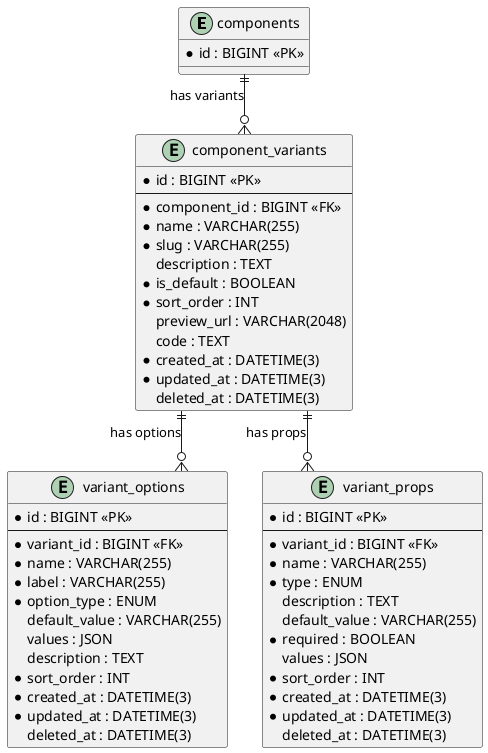

# 06.21 - Component Variants

**Project:** GsmUi
**Domain:** Components - Variants
**Version:** 1.0.0

---

# Purpose

This document defines the database schema for component variants, their configuration options, and exposed props. Variants allow a single component (e.g., `gsmui:button`) to offer multiple named visual styles (e.g., `default`, `outline`, `ghost`), each with configurable options (size, color, disabled state) and typed props for the playground and documentation system.

---

# Tables

## component_variants

**Purpose:** Each component can have multiple variants (e.g., "default", "outline", "ghost" for a button component).

**Business Rules:**
- A variant belongs to exactly one component
- `is_default` marks the primary variant shown in docs and playground
- `sort_order` determines display order
- `slug` is unique within a component and immutable after creation
- `code` stores the Blade source for this variant
- Soft-deletable

**Columns:**

| Column | Type | Nullable | Default | Notes |
|---|---|---|---|---|
| id | BIGINT UNSIGNED | NO | AUTO_INCREMENT | PK |
| component_id | BIGINT UNSIGNED | NO | — | FK → components.id |
| name | VARCHAR(255) | NO | — | Display name (e.g., "Outline") |
| slug | VARCHAR(255) | NO | — | URL-friendly identifier; unique per component |
| description | TEXT | YES | NULL | Variant description for docs |
| is_default | BOOLEAN | NO | false | Exactly one default per component |
| sort_order | INT | NO | 0 | Display order within component |
| preview_url | VARCHAR(2048) | YES | NULL | URL to rendered preview image |
| code | TEXT | YES | NULL | Blade source for this variant |
| created_at | DATETIME(3) | NO | CURRENT_TIMESTAMP(3) | |
| updated_at | DATETIME(3) | NO | CURRENT_TIMESTAMP(3) | ON UPDATE |
| deleted_at | DATETIME(3) | YES | NULL | Soft delete |

**Indexes:**

```
PRIMARY: id
UNIQUE: component_variants_component_id_slug_unique (component_id, slug)
INDEX: component_variants_component_id_index (component_id)
INDEX: component_variants_is_default_index (is_default)
INDEX: component_variants_sort_order_index (sort_order)
```

**Relationships:**
- belongsTo: Component
- hasMany: VariantOption, VariantProp

**Migration:**

```php
Schema::create('component_variants', function (Blueprint $table) {
    $table->id();
    $table->foreignId('component_id')->constrained()->cascadeOnDelete();
    $table->string('name');
    $table->string('slug');
    $table->text('description')->nullable();
    $table->boolean('is_default')->default(false);
    $table->integer('sort_order')->default(0);
    $table->string('preview_url', 2048)->nullable();
    $table->text('code')->nullable();
    $table->timestamps();
    $table->softDeletes();
    $table->unique(['component_id', 'slug']);
});
```

**Eloquent Model:**

```php
class ComponentVariant extends Model
{
    use HasFactory, SoftDeletes;

    protected $guarded = [];
    protected $casts = [
        'is_default' => 'boolean',
    ];

    public function component(): BelongsTo
    {
        return $this->belongsTo(Component::class);
    }

    public function options(): HasMany
    {
        return $this->hasMany(VariantOption::class);
    }

    public function props(): HasMany
    {
        return $this->hasMany(VariantProp::class);
    }
}
```

**Full Eloquent Model:**

```php
<?php

namespace App\Models;

use Illuminate\Database\Eloquent\Model;
use Illuminate\Database\Eloquent\SoftDeletes;
use Illuminate\Database\Eloquent\Factories\HasFactory;
use Illuminate\Database\Eloquent\Relations\{BelongsTo, HasMany};
use Illuminate\Database\Eloquent\Builder;

class ComponentVariant extends Model
{
    use HasFactory, SoftDeletes;

    protected $guarded = [];

    protected $casts = [
        'is_default'  => 'boolean',
        'sort_order'  => 'integer',
        'created_at'  => 'datetime',
        'updated_at'  => 'datetime',
        'deleted_at'  => 'datetime',
    ];

    protected $appends = ['preview_url_full'];

    // ─── Relationships ───────────────────────────────────────

    public function component(): BelongsTo
    {
        return $this->belongsTo(Component::class);
    }

    public function options(): HasMany
    {
        return $this->hasMany(VariantOption::class)->orderBy('sort_order');
    }

    public function props(): HasMany
    {
        return $this->hasMany(VariantProp::class)->orderBy('sort_order');
    }

    public function examples(): HasMany
    {
        return $this->hasMany(ComponentExample::class);
    }

    // ─── Accessors ───────────────────────────────────────────

    public function getPreviewUrlFullAttribute(): ?string
    {
        return $this->preview_url
            ? config('app.url') . '/storage/' . $this->preview_url
            : null;
    }

    public function getOptionsArrayAttribute(): array
    {
        return $this->options->mapWithKeys(fn ($opt) => [
            $opt->name => $opt->default_value,
        ])->toArray();
    }

    // ─── Scopes ──────────────────────────────────────────────

    public function scopeDefault(Builder $query): Builder
    {
        return $query->where('is_default', true);
    }

    public function scopeOrdered(Builder $query): Builder
    {
        return $query->orderBy('sort_order')->orderBy('name');
    }

    public function scopeForComponent(Builder $query, int $componentId): Builder
    {
        return $query->where('component_id', $componentId);
    }

    // ─── Methods ─────────────────────────────────────────────

    public function makeDefault(): void
    {
        // Unset other defaults for this component
        self::where('component_id', $this->component_id)
            ->where('id', '!=', $this->id)
            ->update(['is_default' => false]);

        $this->update(['is_default' => true]);
    }

    public function duplicate(): self
    {
        $clone = $this->replicate(['slug']);
        $clone->name = "{$this->name} (Copy)";
        $clone->slug = "{$this->slug}-copy";
        $clone->is_default = false;
        $clone->save();

        // Clone options
        foreach ($this->options as $option) {
            $option->replicate()->fill(['variant_id' => $clone->id])->save();
        }

        // Clone props
        foreach ($this->props as $prop) {
            $prop->replicate()->fill(['variant_id' => $clone->id])->save();
        }

        return $clone;
    }

    public function generatePreviewImage(): void
    {
        // Render the variant and capture screenshot
        $html = view("components.gsmui.{$this->component->slug}.{$this->slug}")->render();
        // Screenshot service captures and stores the image
        $url = app(ScreenshotService::class)->capture($html);
        $this->update(['preview_url' => $url]);
    }
}
```

---

## variant_options

**Purpose:** Configuration options for a variant (e.g., size, color, disabled state).

**Business Rules:**
- Options belong to a variant
- `option_type` determines the UI control (select, boolean, color, text, number)
- `default_value` is the initial state
- `values` JSON array stores allowed values for select-type options
- Soft-deletable

**Columns:**

| Column | Type | Nullable | Default | Notes |
|---|---|---|---|---|
| id | BIGINT UNSIGNED | NO | AUTO_INCREMENT | PK |
| variant_id | BIGINT UNSIGNED | NO | — | FK → component_variants.id |
| name | VARCHAR(255) | NO | — | Option identifier (e.g., "size", "color") |
| label | VARCHAR(255) | NO | — | Human-readable label for UI |
| option_type | ENUM | NO | — | 'select', 'boolean', 'color', 'text', 'number' |
| default_value | VARCHAR(255) | YES | NULL | Initial/default value |
| values | JSON | YES | NULL | Allowed values for select-type |
| description | TEXT | YES | NULL | Help text for the option |
| sort_order | INT | NO | 0 | Display order within variant |
| created_at | DATETIME(3) | NO | CURRENT_TIMESTAMP(3) | |
| updated_at | DATETIME(3) | NO | CURRENT_TIMESTAMP(3) | ON UPDATE |
| deleted_at | DATETIME(3) | YES | NULL | Soft delete |

**Indexes:**

```
PRIMARY: id
INDEX: variant_options_variant_id_index (variant_id)
INDEX: variant_options_sort_order_index (sort_order)
```

**Relationships:**
- belongsTo: ComponentVariant

**Migration:**

```php
Schema::create('variant_options', function (Blueprint $table) {
    $table->id();
    $table->foreignId('variant_id')->constrained('component_variants')->cascadeOnDelete();
    $table->string('name');
    $table->string('label');
    $table->enum('option_type', ['select', 'boolean', 'color', 'text', 'number']);
    $table->string('default_value')->nullable();
    $table->json('values')->nullable();
    $table->text('description')->nullable();
    $table->integer('sort_order')->default(0);
    $table->timestamps();
    $table->softDeletes();
});
```

**Eloquent Model:**

```php
class VariantOption extends Model
{
    use HasFactory, SoftDeletes;

    protected $guarded = [];
    protected $casts = [
        'values' => 'array',
    ];

    public function variant(): BelongsTo
    {
        return $this->belongsTo(ComponentVariant::class);
    }
}
```

**Full Eloquent Model:**

```php
<?php

namespace App\Models;

use Illuminate\Database\Eloquent\Model;
use Illuminate\Database\Eloquent\SoftDeletes;
use Illuminate\Database\Eloquent\Factories\HasFactory;
use Illuminate\Database\Eloquent\Relations\BelongsTo;
use Illuminate\Database\Eloquent\Builder;

class VariantOption extends Model
{
    use HasFactory, SoftDeletes;

    protected $guarded = [];

    protected $casts = [
        'values'       => 'array',
        'sort_order'   => 'integer',
        'created_at'   => 'datetime',
        'updated_at'   => 'datetime',
        'deleted_at'   => 'datetime',
    ];

    // ─── Relationships ───────────────────────────────────────

    public function variant(): BelongsTo
    {
        return $this->belongsTo(ComponentVariant::class);
    }

    public function component(): BelongsTo
    {
        return $this->belongsTo(Component::class, 'component_id', 'id', 'variants');
    }

    // ─── Scopes ──────────────────────────────────────────────

    public function scopeOrdered(Builder $query): Builder
    {
        return $query->orderBy('sort_order')->orderBy('name');
    }

    public function scopeOfType(Builder $query, string $type): Builder
    {
        return $query->where('option_type', $type);
    }

    public function scopeSelectType(Builder $query): Builder
    {
        return $query->where('option_type', 'select');
    }

    public function scopeBooleanType(Builder $query): Builder
    {
        return $query->where('option_type', 'boolean');
    }

    // ─── Methods ─────────────────────────────────────────────

    public function getFormattedValuesAttribute(): array
    {
        return match ($this->option_type) {
            'select'  => $this->values ?? [],
            'boolean' => ['true', 'false'],
            'color'   => $this->values ?? ['#000000', '#ffffff', '#ef4444', '#22c55e', '#3b82f6'],
            'number'  => $this->values ?? [],
            'text'    => $this->values ?? [],
            default   => [],
        };
    }

    public function getControlTypeAttribute(): string
    {
        return match ($this->option_type) {
            'boolean' => 'toggle',
            'color'   => 'color-picker',
            'number'  => 'number-input',
            'text'    => 'text-input',
            'select'  => 'dropdown',
            default   => 'dropdown',
        };
    }

    public function validateValue(string $value): bool
    {
        return match ($this->option_type) {
            'boolean' => in_array($value, ['true', 'false', '1', '0', true, false]),
            'color'   => preg_match('/^#[0-9A-Fa-f]{6}$/', $value),
            'number'  => is_numeric($value),
            'text'    => is_string($value) && strlen($value) <= 255,
            'select'  => in_array($value, $this->values ?? []),
            default   => true,
        };
    }
}
```

### Option Type Deep Dive

#### Select Options
```php
// Create a select option with allowed values
$option = VariantOption::create([
    'variant_id'   => $variant->id,
    'name'         => 'size',
    'label'        => 'Size',
    'option_type'  => 'select',
    'default_value' => 'md',
    'values'       => ['xs', 'sm', 'md', 'lg', 'xl'],
    'description'  => 'Controls the component size',
    'sort_order'   => 0,
]);
```

#### Boolean Options
```php
$option = VariantOption::create([
    'variant_id'   => $variant->id,
    'name'         => 'disabled',
    'label'        => 'Disabled',
    'option_type'  => 'boolean',
    'default_value' => 'false',
    'values'       => null,
    'description'  => 'Disables the component',
    'sort_order'   => 1,
]);
```

#### Color Options
```php
$option = VariantOption::create([
    'variant_id'   => $variant->id,
    'name'         => 'color',
    'label'        => 'Color',
    'option_type'  => 'color',
    'default_value' => '#3b82f6',
    'values'       => ['#3b82f6', '#ef4444', '#22c55e', '#f59e0b'],
    'description'  => 'Primary color',
    'sort_order'   => 2,
]);
```

#### Number Options
```php
$option = VariantOption::create([
    'variant_id'   => $variant->id,
    'name'         => 'border_radius',
    'label'        => 'Border Radius',
    'option_type'  => 'number',
    'default_value' => '8',
    'values'       => ['0', '4', '8', '12', '16', '24', '9999'],
    'description'  => 'Border radius in pixels',
    'sort_order'   => 3,
]);
```

#### Text Options
```php
$option = VariantOption::create([
    'variant_id'   => $variant->id,
    'name'         => 'placeholder',
    'label'        => 'Placeholder',
    'option_type'  => 'text',
    'default_value' => 'Enter text...',
    'values'       => null,
    'description'  => 'Placeholder text',
    'sort_order'   => 4,
]);
```

### Option Validation Rules
```php
// OptionRequest.php
public function rules(): array
{
    return [
        'variant_id'    => ['required', 'exists:component_variants,id'],
        'name'          => ['required', 'string', 'max:255', 'regex:/^[a-z][a-z0-9_]*$/'],
        'label'         => ['required', 'string', 'max:255'],
        'option_type'   => ['required', 'in:select,boolean,color,text,number'],
        'default_value' => ['nullable', 'string', 'max:255'],
        'values'        => [
            'nullable',
            'array',
            function ($attribute, $value, $fail) {
                $type = request()->input('option_type');
                if ($type === 'select' && empty($value)) {
                    $fail('Select options require at least one value.');
                }
            },
        ],
        'values.*'      => ['string', 'max:255'],
        'description'   => ['nullable', 'string', 'max:500'],
        'sort_order'    => ['integer', 'min:0'],
    ];
}
```

---

## variant_props

**Purpose:** Props/attributes exposed by a variant for the playground and documentation.

**Business Rules:**
- Props are typed (string, boolean, number, enum, slot, event)
- `required` indicates mandatory props
- `default_value` is shown in code examples
- `values` JSON array stores allowed values for enum-type props
- Soft-deletable

**Columns:**

| Column | Type | Nullable | Default | Notes |
|---|---|---|---|---|
| id | BIGINT UNSIGNED | NO | AUTO_INCREMENT | PK |
| variant_id | BIGINT UNSIGNED | NO | — | FK → component_variants.id |
| name | VARCHAR(255) | NO | — | Prop name (e.g., "size", "disabled") |
| type | ENUM | NO | — | 'string', 'boolean', 'number', 'enum', 'slot', 'event' |
| description | TEXT | YES | NULL | Prop description for docs |
| default_value | VARCHAR(255) | YES | NULL | Default value shown in code |
| required | BOOLEAN | NO | false | Whether prop is mandatory |
| values | JSON | YES | NULL | Allowed values for enum type |
| sort_order | INT | NO | 0 | Display order within variant |
| created_at | DATETIME(3) | NO | CURRENT_TIMESTAMP(3) | |
| updated_at | DATETIME(3) | NO | CURRENT_TIMESTAMP(3) | ON UPDATE |
| deleted_at | DATETIME(3) | YES | NULL | Soft delete |

**Indexes:**

```
PRIMARY: id
INDEX: variant_props_variant_id_index (variant_id)
INDEX: variant_props_sort_order_index (sort_order)
```

**Relationships:**
- belongsTo: ComponentVariant

**Migration:**

```php
Schema::create('variant_props', function (Blueprint $table) {
    $table->id();
    $table->foreignId('variant_id')->constrained('component_variants')->cascadeOnDelete();
    $table->string('name');
    $table->enum('type', ['string', 'boolean', 'number', 'enum', 'slot', 'event']);
    $table->text('description')->nullable();
    $table->string('default_value')->nullable();
    $table->boolean('required')->default(false);
    $table->json('values')->nullable();
    $table->integer('sort_order')->default(0);
    $table->timestamps();
    $table->softDeletes();
});
```

**Eloquent Model:**

```php
class VariantProp extends Model
{
    use HasFactory, SoftDeletes;

    protected $guarded = [];
    protected $casts = [
        'required' => 'boolean',
        'values' => 'array',
    ];

    public function variant(): BelongsTo
    {
        return $this->belongsTo(ComponentVariant::class);
    }
}
```

**Full Eloquent Model:**

```php
<?php

namespace App\Models;

use Illuminate\Database\Eloquent\Model;
use Illuminate\Database\Eloquent\SoftDeletes;
use Illuminate\Database\Eloquent\Factories\HasFactory;
use Illuminate\Database\Eloquent\Relations\BelongsTo;
use Illuminate\Database\Eloquent\Builder;

class VariantProp extends Model
{
    use HasFactory, SoftDeletes;

    protected $guarded = [];

    protected $casts = [
        'required'     => 'boolean',
        'values'       => 'array',
        'sort_order'   => 'integer',
        'created_at'   => 'datetime',
        'updated_at'   => 'datetime',
        'deleted_at'   => 'datetime',
    ];

    // ─── Relationships ───────────────────────────────────────

    public function variant(): BelongsTo
    {
        return $this->belongsTo(ComponentVariant::class);
    }

    // ─── Scopes ──────────────────────────────────────────────

    public function scopeRequired(Builder $query): Builder
    {
        return $query->where('required', true);
    }

    public function scopeOptional(Builder $query): Builder
    {
        return $query->where('required', false);
    }

    public function scopeOrdered(Builder $query): Builder
    {
        return $query->orderBy('sort_order')->orderBy('name');
    }

    public function scopeOfType(Builder $query, string $type): Builder
    {
        return $query->where('type', $type);
    }

    public function scopeStringType(Builder $query): Builder
    {
        return $query->where('type', 'string');
    }

    public function scopeBooleanType(Builder $query): Builder
    {
        return $query->where('type', 'boolean');
    }

    public function scopeSlotType(Builder $query): Builder
    {
        return $query->where('type', 'slot');
    }

    public function scopeEventType(Builder $query): Builder
    {
        return $query->where('type', 'event');
    }

    // ─── Methods ─────────────────────────────────────────────

    public function getFormattedDefaultAttribute(): string
    {
        if (is_null($this->default_value)) {
            return match ($this->type) {
                'boolean' => 'false',
                'number'  => '0',
                'string'  => "''",
                default   => 'null',
            };
        }

        return match ($this->type) {
            'string'  => "'{$this->default_value}'",
            'boolean' => $this->default_value ? 'true' : 'false',
            'number'  => (string) $this->default_value,
            default   => $this->default_value,
        };
    }

    public function getSignatureAttribute(): string
    {
        $parts = [];
        if ($this->required) $parts[] = 'required';
        $parts[] = $this->type;
        if (!empty($this->values)) {
            $parts[] = '|';
            $parts[] = implode(', ', $this->values);
        }
        return implode(' ', $parts);
    }

    public function validateValue(mixed $value): bool
    {
        return match ($this->type) {
            'string'  => is_string($value),
            'boolean' => is_bool($value) || in_array($value, ['true', 'false', '1', '0']),
            'number'  => is_numeric($value),
            'enum'    => in_array($value, $this->values ?? []),
            'slot'    => true,
            'event'   => is_string($value),
            default   => true,
        };
    }
}
```

### Prop Type Deep Dive

#### String Props
```php
$prop = VariantProp::create([
    'variant_id'     => $variant->id,
    'name'           => 'label',
    'type'           => 'string',
    'description'    => 'Button label text',
    'default_value'  => 'Click me',
    'required'       => true,
    'values'         => null,
    'sort_order'     => 0,
]);
```

#### Boolean Props
```php
$prop = VariantProp::create([
    'variant_id'     => $variant->id,
    'name'           => 'disabled',
    'type'           => 'boolean',
    'description'    => 'Disables the button',
    'default_value'  => 'false',
    'required'       => false,
    'values'         => null,
    'sort_order'     => 1,
]);
```

#### Enum Props
```php
$prop = VariantProp::create([
    'variant_id'     => $variant->id,
    'name'           => 'variant',
    'type'           => 'enum',
    'description'    => 'Button visual variant',
    'default_value'  => 'primary',
    'required'       => false,
    'values'         => ['primary', 'secondary', 'danger', 'ghost'],
    'sort_order'     => 2,
]);
```

#### Slot Props
```php
$prop = VariantProp::create([
    'variant_id'     => $variant->id,
    'name'           => 'default',
    'type'           => 'slot',
    'description'    => 'Button content slot',
    'default_value'  => null,
    'required'       => false,
    'values'         => null,
    'sort_order'     => 3,
]);
```

#### Event Props
```php
$prop = VariantProp::create([
    'variant_id'     => $variant->id,
    'name'           => 'click',
    'type'           => 'event',
    'description'    => 'Fired when button is clicked',
    'default_value'  => null,
    'required'       => false,
    'values'         => null,
    'sort_order'     => 4,
]);
```

### Prop Validation Rules
```php
// VariantPropRequest.php
public function rules(): array
{
    return [
        'variant_id'    => ['required', 'exists:component_variants,id'],
        'name'          => ['required', 'string', 'max:255', 'regex:/^[a-z][a-z0-9_]*$/'],
        'type'          => ['required', 'in:string,boolean,number,enum,slot,event'],
        'description'   => ['nullable', 'string', 'max:500'],
        'default_value' => ['nullable', 'string', 'max:255'],
        'required'      => ['boolean'],
        'values'        => [
            'nullable', 'array',
            function ($attribute, $value, $fail) {
                if (request()->input('type') === 'enum' && empty($value)) {
                    $fail('Enum props require at least one allowed value.');
                }
            },
        ],
        'values.*'      => ['string', 'max:255'],
        'sort_order'    => ['integer', 'min:0'],
    ];
}
```

---

## Variant Configuration Service

### Rendering Variant HTML
```php
<?php

namespace App\Services;

use App\Models\Component;
use App\Models\ComponentVariant;

class VariantRendererService
{
    public function render(Component $component, ComponentVariant $variant, array $options = []): string
    {
        $mergedOptions = array_merge(
            $variant->options_array,
            $options
        );

        $attributes = collect($mergedOptions)
            ->filter(fn ($value, $key) => !is_null($value))
            ->map(fn ($value, $key) => "{$key}=\"{$value}\"")
            ->implode(' ');

        $view = "gsmui::{$component->slug}.index";

        return view($view, [
            'variant'  => $variant,
            'options'  => $mergedOptions,
            'props'    => $this->getDefaultProps($variant),
            'attrs'    => $attributes,
        ])->render();
    }

    protected function getDefaultProps(ComponentVariant $variant): array
    {
        return $variant->props
            ->mapWithKeys(fn ($prop) => [
                $prop->name => $prop->default_value,
            ])
            ->toArray();
    }
}
```

### Playground Configuration Generator
```php
<?php

namespace App\Services;

use App\Models\ComponentVariant;

class PlaygroundConfigService
{
    public function generateConfig(ComponentVariant $variant): array
    {
        return [
            'component' => $variant->component->slug,
            'variant'   => $variant->slug,
            'options'   => $this->buildOptionsConfig($variant),
            'props'     => $this->buildPropsConfig($variant),
            'code'      => $variant->code ?? $this->generateDefaultCode($variant),
        ];
    }

    protected function buildOptionsConfig(ComponentVariant $variant): array
    {
        return $variant->options->map(fn ($option) => [
            'name'          => $option->name,
            'label'         => $option->label,
            'type'          => $option->option_type,
            'default'       => $option->default_value,
            'values'        => $option->values,
            'control_type'  => $option->control_type,
        ])->toArray();
    }

    protected function buildPropsConfig(ComponentVariant $variant): array
    {
        return $variant->props->map(fn ($prop) => [
            'name'         => $prop->name,
            'type'         => $prop->type,
            'description'  => $prop->description,
            'default'      => $prop->formatted_default,
            'required'     => $prop->required,
            'values'       => $prop->values,
            'signature'    => $prop->signature,
        ])->toArray();
    }

    protected function generateDefaultCode(ComponentVariant $variant): string
    {
        $component = $variant->component;
        $props = $variant->props
            ->filter(fn ($prop) => $prop->type !== 'slot' && $prop->type !== 'event')
            ->map(fn ($prop) => ":{$prop->name}=\"{$prop->formatted_default}\"")
            ->implode("\n    ");

        $slotContent = $variant->props
            ->first(fn ($prop) => $prop->type === 'slot');

        $slot = $slotContent ? "    Default" : '';

        return <<<BLADE
        <x-gsmui:{$component->slug}
            variant="{$variant->slug}"
        {$props}>
        {$slot}
        </x-gsmui:{$component->slug}>
        BLADE;
    }
}
```

---

## Variant Migration with Full Schema

```php
<?php

use Illuminate\Database\Migrations\Migration;
use Illuminate\Database\Schema\Blueprint;
use Illuminate\Support\Facades\Schema;

return new class extends Migration
{
    public function up(): void
    {
        Schema::create('component_variants', function (Blueprint $table) {
            $table->id();
            $table->foreignId('component_id')->constrained()->cascadeOnDelete();
            $table->string('name');
            $table->string('slug');
            $table->text('description')->nullable();
            $table->boolean('is_default')->default(false);
            $table->integer('sort_order')->default(0);
            $table->string('preview_url', 2048)->nullable();
            $table->text('code')->nullable();
            $table->json('metadata')->nullable();
            $table->timestamps();
            $table->softDeletes();

            $table->unique(['component_id', 'slug']);
            $table->index('component_id');
            $table->index('is_default');
            $table->index('sort_order');
        });

        Schema::create('variant_options', function (Blueprint $table) {
            $table->id();
            $table->foreignId('variant_id')->constrained('component_variants')->cascadeOnDelete();
            $table->string('name');
            $table->string('label');
            $table->enum('option_type', ['select', 'boolean', 'color', 'text', 'number']);
            $table->string('default_value')->nullable();
            $table->json('values')->nullable();
            $table->text('description')->nullable();
            $table->integer('sort_order')->default(0);
            $table->timestamps();
            $table->softDeletes();

            $table->index('variant_id');
            $table->index('sort_order');
            $table->index('option_type');
        });

        Schema::create('variant_props', function (Blueprint $table) {
            $table->id();
            $table->foreignId('variant_id')->constrained('component_variants')->cascadeOnDelete();
            $table->string('name');
            $table->enum('type', ['string', 'boolean', 'number', 'enum', 'slot', 'event']);
            $table->text('description')->nullable();
            $table->string('default_value')->nullable();
            $table->boolean('required')->default(false);
            $table->json('values')->nullable();
            $table->integer('sort_order')->default(0);
            $table->timestamps();
            $table->softDeletes();

            $table->index('variant_id');
            $table->index('sort_order');
            $table->index('type');
        });
    }

    public function down(): void
    {
        Schema::dropIfExists('variant_props');
        Schema::dropIfExists('variant_options');
        Schema::dropIfExists('component_variants');
    }
};
```

---

## Factory Stubs

### ComponentVariantFactory
```php
<?php

namespace Database\Factories;

use App\Models\ComponentVariant;
use App\Models\Component;
use Illuminate\Database\Eloquent\Factories\Factory;

class ComponentVariantFactory extends Factory
{
    protected $model = ComponentVariant::class;

    public function definition(): array
    {
        $name = fake()->unique()->randomElement(['Default', 'Outline', 'Ghost', 'Link', 'Soft', 'destructive']);

        return [
            'component_id' => Component::factory(),
            'name'         => $name,
            'slug'         => \Illuminate\Support\Str::slug($name),
            'description'  => fake()->sentence(10),
            'is_default'   => false,
            'sort_order'   => fake()->numberBetween(0, 10),
            'preview_url'  => null,
            'code'         => null,
            'metadata'     => null,
        ];
    }

    public function default(): static
    {
        return $this->state(fn (array $attributes) => ['is_default' => true, 'slug' => 'default', 'name' => 'Default']);
    }

    public function outline(): static
    {
        return $this->state(fn (array $attributes) => ['slug' => 'outline', 'name' => 'Outline']);
    }

    public function ghost(): static
    {
        return $this->state(fn (array $attributes) => ['slug' => 'ghost', 'name' => 'Ghost']);
    }
}
```

### VariantOptionFactory
```php
<?php

namespace Database\Factories;

use App\Models\VariantOption;
use App\Models\ComponentVariant;
use Illuminate\Database\Eloquent\Factories\Factory;

class VariantOptionFactory extends Factory
{
    protected $model = VariantOption::class;

    public function definition(): array
    {
        $type = fake()->randomElement(['select', 'boolean', 'color', 'text', 'number']);

        return [
            'variant_id'     => ComponentVariant::factory(),
            'name'           => fake()->unique()->safeAscii(),
            'label'          => fake()->word(),
            'option_type'    => $type,
            'default_value'  => $this->faker->randomElement(['sm', 'md', 'lg']),
            'values'         => $type === 'select' ? ['xs', 'sm', 'md', 'lg', 'xl'] : null,
            'description'    => fake()->sentence(5),
            'sort_order'     => fake()->numberBetween(0, 10),
        ];
    }
}
```

### VariantPropFactory
```php
<?php

namespace Database\Factories;

use App\Models\VariantProp;
use App\Models\ComponentVariant;
use Illuminate\Database\Eloquent\Factories\Factory;

class VariantPropFactory extends Factory
{
    protected $model = VariantProp::class;

    public function definition(): array
    {
        $type = fake()->randomElement(['string', 'boolean', 'number', 'enum', 'slot', 'event']);

        return [
            'variant_id'    => ComponentVariant::factory(),
            'name'          => fake()->unique()->safeAscii(),
            'type'          => $type,
            'description'   => fake()->sentence(8),
            'default_value' => match ($type) {
                'boolean' => 'false',
                'number'  => '0',
                'string'  => fake()->word(),
                default   => null,
            },
            'required'      => fake()->boolean(30),
            'values'        => $type === 'enum' ? ['primary', 'secondary', 'danger'] : null,
            'sort_order'    => fake()->numberBetween(0, 10),
        ];
    }
}
```

---

## Seeders

### VariantSeeder
```php
<?php

namespace Database\Seeders;

use App\Models\Component;
use App\Models\ComponentVariant;
use App\Models\VariantOption;
use App\Models\VariantProp;
use Illuminate\Database\Seeder;

class VariantSeeder extends Seeder
{
    public function run(): void
    {
        $button = Component::where('slug', 'button')->first();

        if (!$button) return;

        $variants = [
            [
                'name'        => 'Default',
                'slug'        => 'default',
                'is_default'  => true,
                'options'     => [
                    ['name' => 'size', 'label' => 'Size', 'type' => 'select', 'default' => 'md', 'values' => ['xs', 'sm', 'md', 'lg']],
                    ['name' => 'color', 'label' => 'Color', 'type' => 'select', 'default' => 'primary', 'values' => ['primary', 'secondary', 'danger']],
                    ['name' => 'disabled', 'label' => 'Disabled', 'type' => 'boolean', 'default' => 'false'],
                ],
                'props'       => [
                    ['name' => 'label', 'type' => 'string', 'default' => 'Button', 'required' => true],
                    ['name' => 'href', 'type' => 'string', 'default' => null, 'required' => false],
                    ['name' => 'click', 'type' => 'event', 'default' => null, 'required' => false],
                    ['name' => 'icon', 'type' => 'slot', 'default' => null, 'required' => false],
                ],
            ],
            [
                'name'        => 'Outline',
                'slug'        => 'outline',
                'is_default'  => false,
                'options'     => [
                    ['name' => 'size', 'label' => 'Size', 'type' => 'select', 'default' => 'md', 'values' => ['xs', 'sm', 'md', 'lg']],
                    ['name' => 'disabled', 'label' => 'Disabled', 'type' => 'boolean', 'default' => 'false'],
                ],
                'props'       => [
                    ['name' => 'label', 'type' => 'string', 'default' => 'Button', 'required' => true],
                ],
            ],
            [
                'name'        => 'Ghost',
                'slug'        => 'ghost',
                'is_default'  => false,
                'options'     => [
                    ['name' => 'size', 'label' => 'Size', 'type' => 'select', 'default' => 'md', 'values' => ['xs', 'sm', 'md', 'lg']],
                ],
                'props'       => [
                    ['name' => 'label', 'type' => 'string', 'default' => 'Button', 'required' => true],
                ],
            ],
        ];

        foreach ($variants as $index => $data) {
            $variant = ComponentVariant::create([
                'component_id' => $button->id,
                'name'         => $data['name'],
                'slug'         => $data['slug'],
                'is_default'   => $data['is_default'],
                'sort_order'   => $index,
                'description'  => "{$data['name']} variant of the button component.",
            ]);

            foreach ($data['options'] as $optIndex => $opt) {
                VariantOption::create([
                    'variant_id'    => $variant->id,
                    'name'          => $opt['name'],
                    'label'         => $opt['label'],
                    'option_type'   => $opt['type'],
                    'default_value' => $opt['default'],
                    'values'        => $opt['values'] ?? null,
                    'sort_order'    => $optIndex,
                ]);
            }

            foreach ($data['props'] as $propIndex => $prop) {
                VariantProp::create([
                    'variant_id'    => $variant->id,
                    'name'          => $prop['name'],
                    'type'          => $prop['type'],
                    'default_value' => $prop['default'],
                    'required'      => $prop['required'],
                    'sort_order'    => $propIndex,
                ]);
            }
        }
    }
}
```

---

## API Response Structure

### Variant Response
```json
{
    "data": {
        "id": 1,
        "component_id": 1,
        "name": "Default",
        "slug": "default",
        "description": "Default variant",
        "is_default": true,
        "sort_order": 0,
        "preview_url": "/storage/previews/button-default.png",
        "options": [
            {
                "id": 1,
                "name": "size",
                "label": "Size",
                "option_type": "select",
                "default_value": "md",
                "values": ["xs", "sm", "md", "lg"],
                "control_type": "dropdown"
            }
        ],
        "props": [
            {
                "id": 1,
                "name": "label",
                "type": "string",
                "description": "Button label text",
                "default_value": "Button",
                "required": true,
                "signature": "required string"
            }
        ]
    }
}
```

### Playground Config Response
```json
{
    "data": {
        "component": "button",
        "variant": "default",
        "options": {
            "size": "md",
            "color": "primary",
            "disabled": false
        },
        "code": "<x-gsmui:button variant=\"default\" size=\"md\" color=\"primary\">\n    Click me\n</x-gsmui:button>"
    }
}
```

---

## Query Scopes (Combined)

### Advanced Filtering
```php
$variants = ComponentVariant::where('component_id', $componentId)
    ->with(['options' => fn ($q) => $q->ordered(), 'props' => fn ($q) => $q->ordered()])
    ->ordered()
    ->get();

$variants = ComponentVariant::whereHas('options', function ($q) use ($size) {
    $q->where('name', 'size')
      ->where('default_value', $size);
})->get();

$variants = ComponentVariant::whereHas('props', function ($q) {
    $q->where('name', 'disabled')->where('type', 'boolean');
})->get();
```

---

## Performance Considerations

### N+1 Prevention
```php
$variants = ComponentVariant::with(['options', 'props'])->get();

$variants = ComponentVariant::select('id', 'name', 'slug', 'is_default', 'sort_order')
    ->where('component_id', $componentId)
    ->ordered()
    ->get();
```

### Caching Strategy
```php
$cacheKey = "variant:config:{$variant->id}";
$config = Cache::remember($cacheKey, 3600, fn () => $variant->toArray());

$variant->touch();
Cache::forget("variant:config:{$variant->id}");
```

### Bulk Operations
```php
ComponentVariant::where('component_id', $componentId)
    ->orderBy('sort_order')
    ->get()
    ->each(function ($variant, $index) {
        $variant->update(['sort_order' => $index]);
    });

$newComponent = $component->replicate();
$newComponent->save();

foreach ($component->variants as $variant) {
    $variant->replicate()->fill(['component_id' => $newComponent->id])->save();
}
```

---

## Security Considerations

### Input Validation
- All user input is sanitized via `strip_tags()` before storage.
- Option values are validated against allowed values for select types.
- Prop names must match `/^[a-z][a-z0-9_]*$/` pattern.
- Preview URLs are validated to be internal storage paths only.

### Authorization
```php
class ComponentVariantPolicy
{
    public function viewAny(User $user, Component $component): bool
    {
        return true;
    }

    public function update(User $user, ComponentVariant $variant): bool
    {
        return $user->id === $variant->component->user_id || $user->isAdmin();
    }

    public function delete(User $user, ComponentVariant $variant): bool
    {
        return $user->id === $variant->component->user_id || $user->isAdmin();
    }
}
```

### Rate Limiting
- Variant creation: 20 per hour per component.
- Variant updates: 60 per hour per variant.
- Preview generation: 10 per hour per component.

---

## Database Table Size Estimates

| Table | Row Size (bytes) | 100K Rows | 1M Rows |
|---|---|---|---|
| component_variants | ~400 | ~40 MB | ~400 MB |
| variant_options | ~300 | ~30 MB | ~300 MB |
| variant_props | ~350 | ~35 MB | ~350 MB |

---

## Backup and Recovery

### Recommended Backup Strategy
```bash
mysqldump --single-transaction --routines --triggers gsmui component_variants variant_options variant_props > variants_backup_$(date +%Y%m%d).sql
```

---

# Cross-Domain Relationships

## component_variants → components

`component_variants.component_id` → `components.id`. `ON DELETE CASCADE` — variants are owned by components.

## component_examples → component_variants

`component_examples.variant_id` → `component_variants.id`. `ON DELETE SET NULL` — if a variant is deleted, examples revert to the component default.

---

# PlantUML ERD



---

# Next Document

**06.22 - Component Examples** defines the code examples and screenshots that demonstrate component usage in documentation.

---

## Appendix A: Complete Button Variant Example

### Seed Data for Button Component
```php
// Full example: button component with 4 variants
$button = Component::create([
    'name'        => 'Button',
    'slug'        => 'button',
    'description' => 'A versatile button component with multiple variants.',
    'version'     => '2.15.0',
    'status'      => 'published',
]);

// Variant 1: Default
$default = ComponentVariant::create([
    'component_id' => $button->id,
    'name'         => 'Default',
    'slug'         => 'default',
    'is_default'   => true,
    'code'         => '<x-gsmui:button>Click me</x-gsmui:button>',
]);

VariantOption::create([
    'variant_id'    => $default->id,
    'name'          => 'size',
    'label'         => 'Size',
    'option_type'   => 'select',
    'default_value' => 'md',
    'values'        => ['xs', 'sm', 'md', 'lg'],
]);

VariantOption::create([
    'variant_id'    => $default->id,
    'name'          => 'color',
    'label'         => 'Color',
    'option_type'   => 'select',
    'default_value' => 'primary',
    'values'        => ['primary', 'secondary', 'danger', 'success'],
]);

VariantOption::create([
    'variant_id'    => $default->id,
    'name'          => 'disabled',
    'label'         => 'Disabled',
    'option_type'   => 'boolean',
    'default_value' => 'false',
]);

VariantProp::create([
    'variant_id'    => $default->id,
    'name'          => 'label',
    'type'          => 'string',
    'description'   => 'Button text',
    'default_value' => 'Click me',
    'required'      => true,
]);

VariantProp::create([
    'variant_id'    => $default->id,
    'name'          => 'href',
    'type'          => 'string',
    'description'   => 'URL for link buttons',
    'default_value' => null,
    'required'      => false,
]);

VariantProp::create([
    'variant_id'    => $default->id,
    'name'          => 'icon',
    'type'          => 'slot',
    'description'   => 'Icon slot',
    'default_value' => null,
    'required'      => false,
]);

// Variant 2: Outline
$outline = ComponentVariant::create([
    'component_id' => $button->id,
    'name'         => 'Outline',
    'slug'         => 'outline',
    'is_default'   => false,
    'code'         => '<x-gsmui:button variant="outline">Click me</x-gsmui:button>',
]);

VariantOption::create([
    'variant_id'    => $outline->id,
    'name'          => 'size',
    'label'         => 'Size',
    'option_type'   => 'select',
    'default_value' => 'md',
    'values'        => ['xs', 'sm', 'md', 'lg'],
]);

VariantProp::create([
    'variant_id'    => $outline->id,
    'name'          => 'label',
    'type'          => 'string',
    'description'   => 'Button text',
    'default_value' => 'Click me',
    'required'      => true,
]);

// Variant 3: Ghost
$ghost = ComponentVariant::create([
    'component_id' => $button->id,
    'name'         => 'Ghost',
    'slug'         => 'ghost',
    'is_default'   => false,
    'code'         => '<x-gsmui:button variant="ghost">Click me</x-gsmui:button>',
]);

VariantProp::create([
    'variant_id'    => $ghost->id,
    'name'          => 'label',
    'type'          => 'string',
    'description'   => 'Button text',
    'default_value' => 'Click me',
    'required'      => true,
]);

// Variant 4: Link
$link = ComponentVariant::create([
    'component_id' => $button->id,
    'name'         => 'Link',
    'slug'         => 'link',
    'is_default'   => false,
    'code'         => '<x-gsmui:button variant="link" href="#">Click me</x-gsmui:button>',
]);

VariantProp::create([
    'variant_id'    => $link->id,
    'name'          => 'label',
    'type'          => 'string',
    'description'   => 'Button text',
    'default_value' => 'Click me',
    'required'      => true,
]);

VariantProp::create([
    'variant_id'    => $link->id,
    'name'          => 'href',
    'type'          => 'string',
    'description'   => 'Link URL',
    'default_value' => '#',
    'required'      => true,
]);
```

---

## Appendix B: Variant Data Validation Matrix

| Option Type | Validation Rule | Example Valid | Example Invalid |
|---|---|---|---|
| `select` | Must be in `values` array | `'md'` (in `['sm','md','lg']`) | `'xl'` |
| `boolean` | Must be `'true'` or `'false'` | `'true'` | `'yes'` |
| `color` | Must match `^#[0-9A-Fa-f]{6}$` | `'#3b82f6'` | `'blue'` |
| `text` | Must be non-empty string ≤ 255 chars | `'Enter text...'` | `str_repeat('a', 256)` |
| `number` | Must be numeric | `'8'` | `'abc'` |

| Prop Type | Validation Rule | Example Valid | Example Invalid |
|---|---|---|---|
| `string` | Must be non-null string | `'Click me'` | `null` |
| `boolean` | Must be `'true'`/`'false'`/`1`/`0` | `'true'` | `'yes'` |
| `number` | Must be numeric | `'0'` | `'abc'` |
| `enum` | Must be in `values` array | `'primary'` | `'invalid'` |
| `slot` | No validation needed | `'<span>Icon</span>'` | N/A |
| `event` | Must be string (event name) | `'click'` | `123` |

---

## Appendix C: Variant State Machine

```
                    ┌─────────────┐
                    │   Created   │
                    └──────┬──────┘
                           │
                    ┌──────▼──────┐
          ┌─────────│    Draft    │─────────┐
          │         └──────┬──────┘         │
          │                │                │
   ┌──────▼──────┐  ┌──────▼──────┐  ┌──────▼──────┐
   │   Deleted   │  │   Active    │  │  Archived   │
   └─────────────┘  └──────┬──────┘  └─────────────┘
                           │
                    ┌──────▼──────┐
                    │  Deprecated │
                    └─────────────┘
```

### Valid Transitions
| From | To | Trigger |
|---|---|---|
| Created | Draft | Auto |
| Draft | Active | Admin approval |
| Draft | Deleted | Author/admin delete |
| Active | Deprecated | Manual deprecation |
| Active | Archived | Version superseded |
| Deprecated | Active | Re-activation |
| Deprecated | Deleted | Admin delete |
| Archived | Active | Re-activation |

---

## Appendix D: Variant Comparison Table

| Feature | Default | Outline | Ghost | Link |
|---|---|---|---|---|
| Background | Solid color | Transparent | Transparent | None |
| Border | None | Solid | None | None |
| Text Color | White | Primary | Primary | Primary |
| Hover Effect | Darken | Background fill | Background fill | Underline |
| Size Options | xs/sm/md/lg | xs/sm/md/lg | xs/sm/md/lg | sm/md |
| Disabled Support | Yes | Yes | Yes | Yes |
| Icon Slot | Yes | Yes | Yes | No |
| href Support | Optional | Optional | Optional | Required |
| Loading State | Yes | Yes | Yes | No |

---

## Appendix E: Quick Reference — Creating a New Variant

```php
// 1. Create the variant
$variant = ComponentVariant::create([
    'component_id' => $componentId,
    'name'         => 'Soft',
    'slug'         => 'soft',
    'description'  => 'Soft color variant with no border',
    'is_default'   => false,
    'sort_order'   => 5,
    'code'         => '<x-gsmui:button variant="soft">Click me</x-gsmui:button>',
]);

// 2. Add options
VariantOption::create([
    'variant_id'    => $variant->id,
    'name'          => 'color',
    'label'         => 'Color',
    'option_type'   => 'select',
    'default_value' => 'blue',
    'values'        => ['blue', 'green', 'red', 'yellow'],
]);

// 3. Add props
VariantProp::create([
    'variant_id'    => $variant->id,
    'name'          => 'label',
    'type'          => 'string',
    'description'   => 'Button text',
    'default_value' => 'Click me',
    'required'      => true,
]);

// 4. Verify
$variant->load(['options', 'props']);
_dump($variant->toArray());
```

---

## Appendix F: Observer and Event System

### VariantObserver
```php
<?php

namespace App\Observers;

use App\Models\ComponentVariant;

class ComponentVariantObserver
{
    public function created(ComponentVariant $variant): void
    {
        event(new \App\Events\ComponentVariantCreated($variant));
    }

    public function updated(ComponentVariant $variant): void
    {
        if ($variant->isDefault && $variant->wasChanged('is_default')) {
            // Ensure only one default per component
            ComponentVariant::where('component_id', $variant->component_id)
                ->where('id', '!=', $variant->id)
                ->update(['is_default' => false]);
        }

        event(new \App\Events\ComponentVariantUpdated($variant));
    }

    public function deleted(ComponentVariant $variant): void
    {
        event(new \App\Events\ComponentVariantDeleted($variant));
    }
}
```

### Event Classes
```php
// ComponentVariantCreated.php
class ComponentVariantCreated
{
    use Dispatchable, SerializesModels;

    public function __construct(public ComponentVariant $variant) {}
}

// ComponentVariantUpdated.php
class ComponentVariantUpdated
{
    use Dispatchable, SerializesModels;

    public function __construct(public ComponentVariant $variant) {}
}

// ComponentVariantDeleted.php
class ComponentVariantDeleted
{
    use Dispatchable, SerializesModels;

    public function __construct(public ComponentVariant $variant) {}
}
```

---

## Appendix G: Database Connection Configuration

### Read/Write Splitting
```php
// config/database.php
'mysql' => [
    'read' => [
        'host' => env('DB_READ_HOST', '127.0.0.1'),
    ],
    'write' => [
        'host' => env('DB_WRITE_HOST', '127.0.0.1'),
    ],
    'sticky' => true,
],
```

### Connection Usage
```php
// Read replica for variant queries
$variants = DB::connection('mysql::read')
    ->table('component_variants')
    ->where('component_id', $componentId)
    ->get();

// Write primary for variant creation
DB::connection('mysql::write')
    ->table('component_variants')
    ->insert([...]);
```

---

## Appendix H: Index Optimization

### Composite Index Recommendations
```sql
-- For variant listing by component
CREATE INDEX idx_variants_component_default ON component_variants(component_id, is_default, sort_order);

-- For option lookups by variant and name
CREATE INDEX idx_options_variant_name ON variant_options(variant_id, name);

-- For prop lookups by variant and type
CREATE INDEX idx_props_variant_type ON variant_props(variant_id, type);

-- For playground queries
CREATE INDEX idx_variants_component_slug ON component_variants(component_id, slug);
```

### Index Usage Analysis
```sql
-- Find unused indexes
SELECT * FROM sys.schema_unused_indexes
WHERE object_schema = 'gsmui'
AND object_name IN ('component_variants', 'variant_options', 'variant_props');

-- Find missing indexes
SELECT * FROM sys.schema_table_statistics
WHERE table_schema = 'gsmui'
AND table_name = 'component_variants';
```

---

## Appendix I: Migration Testing Strategy

### Test Case: Variant Creation
```php
<?php

namespace Tests\Feature\Models;

use Tests\TestCase;
use App\Models\{Component, ComponentVariant, VariantOption, VariantProp};
use Illuminate\Foundation\Testing\RefreshDatabase;

class ComponentVariantTest extends TestCase
{
    use RefreshDatabase;

    public function test_can_create_variant_with_options_and_props(): void
    {
        $component = Component::factory()->create();
        $variant = ComponentVariant::factory()->create(['component_id' => $component->id]);

        $option = VariantOption::create([
            'variant_id'    => $variant->id,
            'name'          => 'size',
            'label'         => 'Size',
            'option_type'   => 'select',
            'default_value' => 'md',
            'values'        => ['sm', 'md', 'lg'],
        ]);

        $prop = VariantProp::create([
            'variant_id'    => $variant->id,
            'name'          => 'label',
            'type'          => 'string',
            'default_value' => 'Click me',
            'required'      => true,
        ]);

        $this->assertDatabaseHas('component_variants', ['id' => $variant->id]);
        $this->assertDatabaseHas('variant_options', ['id' => $option->id]);
        $this->assertDatabaseHas('variant_props', ['id' => $prop->id]);
    }

    public function test_can_set_default_variant(): void
    {
        $component = Component::factory()->create();
        $variant1 = ComponentVariant::factory()->default()->create(['component_id' => $component->id]);
        $variant2 = ComponentVariant::factory()->create(['component_id' => $component->id]);

        $variant2->makeDefault();

        $this->assertTrue($variant2->fresh()->is_default);
        $this->assertFalse($variant1->fresh()->is_default);
    }

    public function test_can_duplicate_variant(): void
    {
        $component = Component::factory()->create();
        $variant = ComponentVariant::factory()->create(['component_id' => $component->id]);
        VariantOption::create(['variant_id' => $variant->id, 'name' => 'size']);
        VariantProp::create(['variant_id' => $variant->id, 'name' => 'label']);

        $clone = $variant->duplicate();

        $this->assertNotEquals($variant->id, $clone->id);
        $this->assertEquals(1, $clone->options->count());
        $this->assertEquals(1, $clone->props->count());
        $this->assertFalse($clone->is_default);
    }

    public function test_soft_delete_variant(): void
    {
        $variant = ComponentVariant::factory()->create();
        $variant->delete();

        $this->assertSoftDeleted('component_variants', ['id' => $variant->id]);
        $this->assertNull(ComponentVariant::find($variant->id));
        $this->assertNotNull(ComponentVariant::withTrashed()->find($variant->id));
    }
}
```

### Test Case: Option Validation
```php
public function test_option_validation_rules(): void
{
    $option = VariantOption::factory()->create([
        'option_type' => 'select',
        'values'      => ['sm', 'md', 'lg'],
    ]);

    $this->assertTrue($option->validateValue('md'));
    $this->assertFalse($option->validateValue('xl'));

    $colorOption = VariantOption::factory()->create([
        'option_type' => 'color',
    ]);

    $this->assertTrue($colorOption->validateValue('#3b82f6'));
    $this->assertFalse($colorOption->validateValue('blue'));
}
```

---

## Appendix J: Troubleshooting

### Common Issues

| Issue | Cause | Solution |
|---|---|---|
| `SQLSTATE[23000]: Integrity constraint violation` | Duplicate slug per component | Use unique slug generation |
| `InvalidStatusTransition` | Invalid workflow transition | Check `canTransitionTo()` first |
| N+1 queries on variant listing | Missing eager loading | Use `with(['options', 'props'])` |
| Preview image not generating | Storage permissions | Check `storage/app/public` permissions |
| Search vector not updating | Observer not registered | Register `ComponentVariantObserver` in `AppServiceProvider` |
| Option values not persisting | JSON cast not working | Ensure `values` column is JSON type |
| Sort order not applying | Missing index | Add composite index on `(component_id, sort_order)` |
