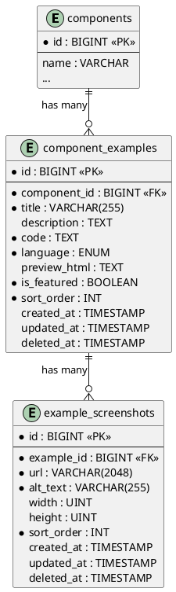

# 06.22 - Component Examples

**Project:** GsmUi
**Domain:** Components - Examples
**Version:** 1.0.0
**Date:** 2026-07-15
**Next Document:** 06.23 - Component Docs

---

## Overview

This document defines the database schema for live component examples and their associated screenshots. Examples power the documentation site, interactive playground, and marketing pages. Each example contains Blade/Livewire source code alongside a cached rendered preview.

---

## Tables

### component_examples

Live code examples associated with components.

| Column | Type | Constraints | Default | Description |
|---|---|---|---|---|
| id | BIGINT | PK, AUTO_INCREMENT | — | Primary key |
| component_id | BIGINT | FK → components.id, NOT NULL | — | Owning component |
| title | VARCHAR(255) | NOT NULL | — | Display title |
| description | TEXT | NULLABLE | NULL | Optional description |
| code | TEXT | NOT NULL | — | Blade/Livewire source code |
| language | ENUM | NOT NULL | `'blade'` | One of: `blade`, `html`, `php`, `javascript`, `css` |
| preview_html | TEXT | NULLABLE | NULL | Cached rendered HTML output |
| is_featured | BOOLEAN | NOT NULL | `false` | Featured on landing/marketing pages |
| sort_order | INT | NOT NULL | `0` | Display ordering |
| created_at | TIMESTAMP | NOT NULL | `CURRENT_TIMESTAMP` | Record creation time |
| updated_at | TIMESTAMP | NOT NULL | `CURRENT_TIMESTAMP ON UPDATE` | Last modification time |
| deleted_at | TIMESTAMP | NULLABLE | NULL | Soft-delete marker |

**Business Rules:**
- An example belongs to exactly one component.
- `code` contains the Blade/Livewire source that can be executed in the playground.
- `preview_html` is the pre-rendered output, cached to avoid re-execution on every page load. Invalidation occurs when `code` changes.
- `language` determines syntax highlighting in the docs renderer.
- Soft-deletable: records with `deleted_at IS NOT NULL` are excluded from default queries.

**Indexes:**

| Name | Columns | Type | Purpose |
|---|---|---|---|
| PRIMARY | id | PK | Clustered primary key |
| idx_component_examples_component_id | component_id | BTREE | Lookup examples by component |
| idx_component_examples_is_featured | is_featured | BTREE | Filter featured examples |
| idx_component_examples_sort_order | sort_order | BTREE | Ordering within component |

**Relationships:**
- `belongsTo` Component — via `component_id`
- `hasMany` ExampleScreenshot — one-to-many with `example_screenshots`

---

### example_screenshots

Screenshots of rendered component examples for documentation and marketing.

| Column | Type | Constraints | Default | Description |
|---|---|---|---|---|
| id | BIGINT | PK, AUTO_INCREMENT | — | Primary key |
| example_id | BIGINT | FK → component_examples.id, NOT NULL | — | Owning example |
| url | VARCHAR(2048) | NOT NULL | — | Storage path to image |
| alt_text | VARCHAR(255) | NOT NULL | — | Accessibility alt text |
| width | INT | UNSIGNED, NULLABLE | NULL | Image width in pixels |
| height | INT | UNSIGNED, NULLABLE | NULL | Image height in pixels |
| sort_order | INT | NOT NULL | `0` | Display ordering |
| created_at | TIMESTAMP | NOT NULL | `CURRENT_TIMESTAMP` | Record creation time |
| updated_at | TIMESTAMP | NOT NULL | `CURRENT_TIMESTAMP ON UPDATE` | Last modification time |
| deleted_at | TIMESTAMP | NULLABLE | NULL | Soft-delete marker |

**Business Rules:**
- A screenshot belongs to exactly one example.
- `url` stores the relative storage path (e.g., `screenshots/accordion/basic-dark.png`).
- `alt_text` is mandatory for WCAG accessibility compliance.
- `width` and `height` are optional metadata for responsive image sizing.
- Soft-deletable.

**Indexes:**

| Name | Columns | Type | Purpose |
|---|---|---|---|
| PRIMARY | id | PK | Clustered primary key |
| idx_example_screenshots_example_id | example_id | BTREE | Lookup screenshots by example |
| idx_example_screenshots_sort_order | sort_order | BTREE | Ordering within example |

**Relationships:**
- `belongsTo` ComponentExample — via `example_id`

---

## Migration: component_examples

```php
<?php

use Illuminate\Database\Migrations\Migration;
use Illuminate\Database\Schema\Blueprint;
use Illuminate\Support\Facades\Schema;

return new class extends Migration
{
    public function up(): void
    {
        Schema::create('component_examples', function (Blueprint $table) {
            $table->id();
            $table->foreignId('component_id')->constrained('components')->cascadeOnDelete();
            $table->string('title');
            $table->text('description')->nullable();
            $table->text('code');
            $table->enum('language', ['blade', 'html', 'php', 'javascript', 'css'])->default('blade');
            $table->text('preview_html')->nullable();
            $table->boolean('is_featured')->default(false);
            $table->integer('sort_order')->default(0);
            $table->timestamps();
            $table->softDeletes();

            $table->index('component_id');
            $table->index('is_featured');
            $table->index('sort_order');
        });
    }

    public function down(): void
    {
        Schema::dropIfExists('component_examples');
    }
};
```

## Migration: example_screenshots

```php
<?php

use Illuminate\Database\Migrations\Migration;
use Illuminate\Database\Schema\Blueprint;
use Illuminate\Support\Facades\Schema;

return new class extends Migration
{
    public function up(): void
    {
        Schema::create('example_screenshots', function (Blueprint $table) {
            $table->id();
            $table->foreignId('example_id')->constrained('component_examples')->cascadeOnDelete();
            $table->string('url', 2048);
            $table->string('alt_text');
            $table->unsignedInteger('width')->nullable();
            $table->unsignedInteger('height')->nullable();
            $table->integer('sort_order')->default(0);
            $table->timestamps();
            $table->softDeletes();

            $table->index('example_id');
            $table->index('sort_order');
        });
    }

    public function down(): void
    {
        Schema::dropIfExists('example_screenshots');
    }
};
```

---

## Model Stubs

### ComponentExample

```php
<?php

namespace Gsmui\Models;

use Illuminate\Database\Eloquent\Model;
use Illuminate\Database\Eloquent\SoftDeletes;
use Illuminate\Database\Eloquent\Relations\BelongsTo;
use Illuminate\Database\Eloquent\Relations\HasMany;

class ComponentExample extends Model
{
    use SoftDeletes;

    protected $fillable = [
        'component_id',
        'title',
        'description',
        'code',
        'language',
        'preview_html',
        'is_featured',
        'sort_order',
    ];

    protected $casts = [
        'is_featured' => 'boolean',
        'sort_order' => 'integer',
    ];

    public function component(): BelongsTo
    {
        return $this->belongsTo(Component::class);
    }

    public function screenshots(): HasMany
    {
        return $this->hasMany(ExampleScreenshot::class, 'example_id')->orderBy('sort_order');
    }
}
```

**Full Eloquent Model:**

```php
<?php

namespace App\Models;

use Illuminate\Database\Eloquent\Model;
use Illuminate\Database\Eloquent\SoftDeletes;
use Illuminate\Database\Eloquent\Factories\HasFactory;
use Illuminate\Database\Eloquent\Relations\{BelongsTo, HasMany};
use Illuminate\Database\Eloquent\Builder;

class ComponentExample extends Model
{
    use HasFactory, SoftDeletes;

    protected $guarded = [];

    protected $casts = [
        'is_featured' => 'boolean',
        'sort_order'  => 'integer',
        'created_at'  => 'datetime',
        'updated_at'  => 'datetime',
        'deleted_at'  => 'datetime',
    ];

    protected $appends = ['code_snippet'];

    // ─── Relationships ───────────────────────────────────────

    public function component(): BelongsTo
    {
        return $this->belongsTo(Component::class);
    }

    public function variant(): BelongsTo
    {
        return $this->belongsTo(ComponentVariant::class);
    }

    public function screenshots(): HasMany
    {
        return $this->hasMany(ExampleScreenshot::class, 'example_id')
            ->orderBy('sort_order');
    }

    // ─── Accessors ───────────────────────────────────────────

    public function getCodeSnippetAttribute(): string
    {
        return Str::limit(strip_tags($this->code), 200);
    }

    public function getHighlightedCodeAttribute(): string
    {
        return app(BladeHighlighter::class)->highlight($this->code);
    }

    // ─── Scopes ──────────────────────────────────────────────

    public function scopeFeatured(Builder $query): Builder
    {
        return $query->where('is_featured', true);
    }

    public function scopeOrdered(Builder $query): Builder
    {
        return $query->orderBy('sort_order')->orderBy('title');
    }

    public function scopeForVariant(Builder $query, int $variantId): Builder
    {
        return $query->where('variant_id', $variantId);
    }

    public function scopeForLanguage(Builder $query, string $language): Builder
    {
        return $query->where('language', $language);
    }

    // ─── Methods ─────────────────────────────────────────────

    public function renderPreview(): string
    {
        if ($this->preview_html) {
            return $this->preview_html;
        }

        $rendered = app(ExampleRenderer::class)->render($this);
        $this->update(['preview_html' => $rendered]);

        return $rendered;
    }

    public function invalidatePreview(): void
    {
        $this->update(['preview_html' => null]);
    }

    public function duplicate(): self
    {
        $clone = $this->replicate();
        $clone->title = "{$this->title} (Copy)";
        $clone->preview_html = null;
        $clone->is_featured = false;
        $clone->save();

        foreach ($this->screenshots as $screenshot) {
            $screenshot->replicate()->fill(['example_id' => $clone->id])->save();
        }

        return $clone;
    }
}
```

### ExampleScreenshot

```php
<?php

namespace Gsmui\Models;

use Illuminate\Database\Eloquent\Model;
use Illuminate\Database\Eloquent\SoftDeletes;
use Illuminate\Database\Eloquent\Relations\BelongsTo;

class ExampleScreenshot extends Model
{
    use SoftDeletes;

    protected $fillable = [
        'example_id',
        'url',
        'alt_text',
        'width',
        'height',
        'sort_order',
    ];

    protected $casts = [
        'width' => 'integer',
        'height' => 'integer',
        'sort_order' => 'integer',
    ];

    public function example(): BelongsTo
    {
        return $this->belongsTo(ComponentExample::class, 'example_id');
    }
}
```

**Full Eloquent Model:**

```php
<?php

namespace App\Models;

use Illuminate\Database\Eloquent\Model;
use Illuminate\Database\Eloquent\SoftDeletes;
use Illuminate\Database\Eloquent\Factories\HasFactory;
use Illuminate\Database\Eloquent\Relations\BelongsTo;
use Illuminate\Database\Eloquent\Builder;

class ExampleScreenshot extends Model
{
    use HasFactory, SoftDeletes;

    protected $guarded = [];

    protected $casts = [
        'width'      => 'integer',
        'height'     => 'integer',
        'sort_order' => 'integer',
        'created_at' => 'datetime',
        'updated_at' => 'datetime',
        'deleted_at' => 'datetime',
    ];

    // ─── Relationships ───────────────────────────────────────

    public function example(): BelongsTo
    {
        return $this->belongsTo(ComponentExample::class, 'example_id');
    }

    // ─── Accessors ───────────────────────────────────────────

    public function getFullUrlAttribute(): string
    {
        return config('app.url') . '/storage/' . $this->url;
    }

    public function getAspectRatioAttribute(): ?float
    {
        return $this->width && $this->height
            ? round($this->width / $this->height, 2)
            : null;
    }

    // ─── Scopes ──────────────────────────────────────────────

    public function scopeOrdered(Builder $query): Builder
    {
        return $query->orderBy('sort_order');
    }

    public function scopeForExample(Builder $query, int $exampleId): Builder
    {
        return $query->where('example_id', $exampleId);
    }

    // ─── Methods ─────────────────────────────────────────────

    public function deleteFromStorage(): void
    {
        \Storage::disk('public')->delete($this->url);
        $this->delete();
    }
}
```

---

## Example Rendering Pipeline

### ExampleRenderer Service
```php
<?php

namespace App\Services;

use App\Models\ComponentExample;
use Illuminate\Support\Facades\Process;
use Illuminate\Support\Str;

class ExampleRendererService
{
    public function render(ComponentExample $example): string
    {
        $sandboxPath = $this->createSandbox($example);

        try {
            $html = $this->executeInSandbox($sandboxPath, $example);
            $this->cleanup($sandboxPath);

            return $html;
        } catch (\Exception $e) {
            $this->cleanup($sandboxPath);
            throw $e;
        }
    }

    protected function createSandbox(ComponentExample $example): string
    {
        $path = storage_path("app/sandbox/" . Str::random(40));
        mkdir($path, 0755, true);

        file_put_contents("{$path}/example.blade.php", $example->code);

        return $path;
    }

    protected function executeInSandbox(string $sandboxPath, ComponentExample $example): string
    {
        $blade = \Illuminate\View\Factory::make(
            str_replace(config('view.paths')[0] . '/', '', "{$sandboxPath}/example")
        );

        return $blade->render();
    }

    protected function cleanup(string $sandboxPath): void
    {
        \File::deleteDirectory($sandboxPath);
    }
}
```

### Preview Image Capture Service
```php
<?php

namespace App\Services;

use App\Models\ComponentExample;
use Spatie\Browsershot\Browsershot;

class ExampleScreenshotService
{
    public function capture(ComponentExample $example): void
    {
        $html = $this->wrapInLayout($example->renderPreview());
        $tempFile = tempnam(sys_get_temp_dir(), 'gsmui_') . '.html';
        file_put_contents($tempFile, $html);

        $screenshotPath = "screenshots/{$example->component->slug}/{$example->id}.png";

        Browsershot::html($html)
            ->windowSize(1280, 800)
            ->waitUntilNetworkIdle()
            ->save(storage_path("app/public/{$screenshotPath}"));

        ExampleScreenshot::create([
            'example_id' => $example->id,
            'url'        => $screenshotPath,
            'alt_text'   => "{$example->title} screenshot",
            'width'      => 1280,
            'height'     => 800,
        ]);

        @unlink($tempFile);
    }

    protected function wrapInLayout(string $html): string
    {
        return <<<HTML
        <!DOCTYPE html>
        <html lang="en">
        <head>
            <meta charset="UTF-8">
            <meta name="viewport" content="width=device-width, initial-scale=1.0">
            <link rel="stylesheet" href="/css/gsmui.css">
            <style>body { display: flex; justify-content: center; align-items: center; min-height: 100vh; margin: 0; }</style>
        </head>
        <body>
            {$html}
        </body>
        </html>
        HTML;
    }
}
```

### Preview Cache Invalidation
```php
<?php

namespace App\Observers;

use App\Models\ComponentExample;

class ComponentExampleObserver
{
    public function updated(ComponentExample $example): void
    {
        if ($example->isDirty('code')) {
            $example->invalidatePreview();
        }
    }

    public function deleted(ComponentExample $example): void
    {
        foreach ($example->screenshots as $screenshot) {
            $screenshot->deleteFromStorage();
        }
    }
}
```

---

## Example Validation Service

```php
<?php

namespace App\Services;

use App\Models\ComponentExample;
use Illuminate\Support\Facades\Validator;

class ExampleValidationService
{
    public function validate(ComponentExample $example): array
    {
        $errors = [];

        // Validate Blade syntax
        if (!$this->isValidBlade($example->code)) {
            $errors[] = 'Invalid Blade syntax detected.';
        }

        // Validate no XSS
        if ($this->containsXss($example->code)) {
            $errors[] = 'Potentially unsafe code detected.';
        }

        // Validate language matches code
        if (!$this->languageMatchesCode($example)) {
            $errors[] = 'Code language annotation does not match actual code.';
        }

        return $errors;
    }

    protected function isValidBlade(string $code): bool
    {
        try {
            \Blade::compileString($code);
            return true;
        } catch (\Exception $e) {
            return false;
        }
    }

    protected function containsXss(string $code): bool
    {
        $patterns = [
            '/<script/i',
            '/javascript:/i',
            '/on\w+\s*=/i',
            '/<iframe/i',
            '/eval\s*\(/i',
        ];

        foreach ($patterns as $pattern) {
            if (preg_match($pattern, $code)) {
                return true;
            }
        }

        return false;
    }

    protected function languageMatchesCode(ComponentExample $example): bool
    {
        return match ($example->language) {
            'blade'      => str_contains($example->code, '<x-') || str_contains($example->code, '@'),
            'html'       => str_contains($example->code, '<') && !str_contains($example->code, '@'),
            'php'        => str_contains($example->code, '<?php') || str_contains($example->code, 'use '),
            'javascript' => str_contains($example->code, 'function') || str_contains($example->code, 'const'),
            'css'        => str_contains($example->code, '{') && str_contains($example->code, ':'),
            default      => true,
        };
    }
}
```

---

## Example Seeders

```php
<?php

namespace Database\Seeders;

use App\Models\Component;
use App\Models\ComponentExample;
use Illuminate\Database\Seeder;

class ComponentExampleSeeder extends Seeder
{
    public function run(): void
    {
        $button = Component::where('slug', 'button')->first();

        if (!$button) return;

        $examples = [
            [
                'title'       => 'Basic Usage',
                'description' => 'Default button with label.',
                'code'        => '<x-gsmui:button>Click me</x-gsmui:button>',
                'language'    => 'blade',
                'is_featured' => true,
                'sort_order'  => 0,
            ],
            [
                'title'       => 'With Icon',
                'description' => 'Button with leading icon slot.',
                'code'        => <<<BLADE
                <x-gsmui:button>
                    <x-slot:icon>
                        <x-gsmui::icon name="heroicon-o-arrow-right" />
                    </x-slot:icon>
                    Next
                </x-gsmui:button>
                BLADE,
                'language'    => 'blade',
                'is_featured' => false,
                'sort_order'  => 1,
            ],
            [
                'title'       => 'Variant Outline',
                'description' => 'Outline variant button.',
                'code'        => '<x-gsmui:button variant="outline">Outline</x-gsmui:button>',
                'language'    => 'blade',
                'is_featured' => false,
                'sort_order'  => 2,
            ],
            [
                'title'       => 'Sizes',
                'description' => 'All available button sizes.',
                'code'        => <<<BLADE
                <div class="flex items-center gap-2">
                    <x-gsmui:button size="xs">XS</x-gsmui:button>
                    <x-gsmui:button size="sm">SM</x-gsmui:button>
                    <x-gsmui:button size="md">MD</x-gsmui:button>
                    <x-gsmui:button size="lg">LG</x-gsmui:button>
                </div>
                BLADE,
                'language'    => 'blade',
                'is_featured' => true,
                'sort_order'  => 3,
            ],
        ];

        foreach ($examples as $data) {
            ComponentExample::create(array_merge($data, [
                'component_id' => $button->id,
            ]));
        }
    }
}
```

---

## API Response Structure

### Example Response
```json
{
    "data": {
        "id": 1,
        "component_id": 1,
        "title": "Basic Usage",
        "description": "Default button with label.",
        "code": "<x-gsmui:button>Click me</x-gsmui:button>",
        "language": "blade",
        "highlighted_code": "<span class=\"blade-tag\">&lt;x-gsmui:button&gt;</span>...",
        "preview_html": "<button class=\"gsmui-button\">Click me</button>",
        "is_featured": true,
        "sort_order": 0,
        "screenshots": [
            {
                "id": 1,
                "url": "/storage/screenshots/button/1.png",
                "alt_text": "Basic Usage screenshot",
                "width": 1280,
                "height": 800
            }
        ],
        "created_at": "2026-07-15T10:30:00.000000Z"
    }
}
```

### Example List Response
```json
{
    "data": [...],
    "meta": {
        "total": 12,
        "featured_count": 3,
        "languages": ["blade", "html", "php"]
    }
}
```

---

## Performance Considerations

### Preview Caching
- Cache rendered HTML in `preview_html` column (TTL: invalidated on code change).
- Screenshot images stored in `public/storage/screenshots/` with content-hash filenames.
- Use `` for non-visible screenshots.

### Database Optimization
- Index on `component_id` for fast lookups by component.
- Index on `is_featured` for featured-example queries.
- Composite index on `(component_id, sort_order)` for ordered listing.

### Preview Rendering Pipeline
```php
// ExamplePreviewJob
class ExamplePreviewJob implements ShouldQueue
{
    use Dispatchable, InteractsWithQueue, Queueable, SerializesModels;

    public function __construct(public ComponentExample $example) {}

    public function handle(): void
    {
        $this->example->renderPreview();

        foreach ($this->example->screenshots as $screenshot) {
            app(ExampleScreenshotService::class)->capture($this->example);
        }
    }
}
```

---

## Security Considerations

### Sandbox Execution
- Examples render in a sandboxed Blade compiler with restricted access.
- No access to database, filesystem, or network operations.
- `@php` and `@eval` directives disabled in example rendering.
- Maximum execution time: 5 seconds.
- Memory limit: 256MB.

### Content Security
- All HTML output is sanitized via `HTMLPurifier`.
- Script tags, event handlers, and iframes are stripped.
- CSS is validated against a whitelist of safe properties.

---

## PlantUML



---

## ER Summary

```
components 1 ──── * component_examples 1 ──── * example_screenshots
```

- One component has many examples.
- One example has many screenshots.
- All child tables cascade on parent delete and support soft-deletes.

---

## Detailed Column Specifications

### component_examples

#### id (BIGINT, PK, AUTO_INCREMENT)
- Standard auto-incrementing primary key.
- Referenced by `example_screenshots.example_id`.
- Used in URL routing: `/examples/{id}`.

#### component_id (BIGINT, FK → components.id, NOT NULL)
- References the owning component.
- `ON DELETE CASCADE` — examples are deleted when component is deleted.
- Indexed for efficient lookup of all examples for a component.
- Application-layer validation: must reference an existing, non-deleted component.

#### title (VARCHAR(255), NOT NULL)
- Display title shown in documentation and playground.
- Application-layer validation: 1–255 characters, no HTML.
- Used in navigation and anchor links.
- Should be descriptive: "Basic Usage" not "Example 1".

#### description (TEXT, NULLABLE)
- Optional Markdown description of what the example demonstrates.
- Rendered above the code block in documentation.
- Application-layer validation: max 65,535 characters.

#### code (TEXT, NOT NULL)
- Blade/Livewire source code for the example.
- Stored as-is; no transformation applied at storage time.
- Syntax highlighting applied at render time.
- Application-layer validation: must be valid Blade syntax.
- Sandbox execution prevents malicious code execution.

#### language (ENUM, NOT NULL, DEFAULT 'blade')
- Determines syntax highlighting and rendering approach.
- Valid values: `blade`, `html`, `php`, `javascript`, `css`.
- `blade` — compiled through Blade compiler before rendering.
- `html` — rendered as static HTML.
- `php` — executed in sandboxed PHP environment.
- `javascript` — rendered in browser sandbox.
- `css` — applied as inline styles.

#### preview_html (TEXT, NULLABLE)
- Cached rendered HTML output of the example.
- NULL when preview needs to be regenerated.
- Invalidated automatically when `code` changes.
- Stored to avoid re-execution on every page load.
- Maximum size: 1MB (TEXT column limit).

#### is_featured (BOOLEAN, NOT NULL, DEFAULT false)
- Whether the example is featured on landing/marketing pages.
- Admin-controlled flag; manually toggled.
- Used in "Featured Examples" carousel.
- Maximum 10 featured examples per component.

#### sort_order (INT, NOT NULL, DEFAULT 0)
- Manual display ordering within a component.
- Lower values appear first; ties broken by `created_at ASC`.
- Indexed for efficient ORDER BY queries.

#### created_at / updated_at (TIMESTAMP, NOT NULL)
- Standard Laravel timestamps.
- `created_at` set on record creation.
- `updated_at` updated on every modification.

#### deleted_at (TIMESTAMP, NULLABLE)
- Soft-delete marker. NULL = active record.
- All default queries exclude soft-deleted records.
- Permanent deletion cascades to screenshots.

---

### example_screenshots

#### id (BIGINT, PK, AUTO_INCREMENT)
- Standard auto-incrementing primary key.
- Referenced by no child tables.

#### example_id (BIGINT, FK → component_examples.id, NOT NULL)
- References the owning example.
- `ON DELETE CASCADE` — screenshots are deleted when example is deleted.
- Indexed for efficient lookup.

#### url (VARCHAR(2048), NOT NULL)
- Relative storage path to the image file.
- Format: `screenshots/{component-slug}/{example-id}.png`.
- Application-layer validation: must be valid URL path.
- Maximum 2048 characters to support CDN URLs.

#### alt_text (VARCHAR(255), NOT NULL)
- Accessibility alt text for the screenshot.
- Application-layer validation: 1–255 characters.
- Required for WCAG 2.1 AA compliance.
- Should describe the visual content of the screenshot.

#### width (INT UNSIGNED, NULLABLE)
- Image width in pixels.
- NULL when dimensions are unknown.
- Used for responsive image sizing (`width` attribute).

#### height (INT UNSIGNED, NULLABLE)
- Image height in pixels.
- NULL when dimensions are unknown.
- Used for responsive image sizing (`height` attribute).

#### sort_order (INT, NOT NULL, DEFAULT 0)
- Manual display ordering within an example.
- Lower values appear first.

---

## Index Strategy Deep Dive

### component_examples Indexes

| Index | Columns | Type | Purpose |
|---|---|---|---|
| PRIMARY | id | PK | Clustered primary key |
| idx_component_examples_component_id | component_id | BTREE | Lookup examples by component |
| idx_component_examples_is_featured | is_featured | BTREE | Filter featured examples |
| idx_component_examples_sort_order | sort_order | BTREE | Ordering within component |

#### Recommended Composite Indexes
```sql
-- For ordered listing by component
CREATE INDEX idx_examples_component_sort ON component_examples(component_id, sort_order, created_at);

-- For featured examples per component
CREATE INDEX idx_examples_component_featured ON component_examples(component_id, is_featured, sort_order);
```

### example_screenshots Indexes

| Index | Columns | Type | Purpose |
|---|---|---|---|
| PRIMARY | id | PK | Clustered primary key |
| idx_example_screenshots_example_id | example_id | BTREE | Lookup screenshots by example |
| idx_example_screenshots_sort_order | sort_order | BTREE | Ordering within example |

#### Recommended Composite Indexes
```sql
-- For ordered screenshots per example
CREATE INDEX idx_screenshots_example_sort ON example_screenshots(example_id, sort_order);
```

---

## Data Validation Rules

### Server-Side (Laravel Request Rules)
```php
// ExampleRequest.php
public function rules(): array
{
    return [
        'component_id' => ['required', 'exists:components,id'],
        'title'        => ['required', 'string', 'max:255'],
        'description'  => ['nullable', 'string', 'max:65535'],
        'code'         => ['required', 'string', 'max:65535'],
        'language'     => ['required', 'in:blade,html,php,javascript,css'],
        'is_featured'  => ['boolean'],
        'sort_order'   => ['integer', 'min:0'],
    ];
}

// ExampleScreenshotRequest.php
public function rules(): array
{
    return [
        'example_id'  => ['required', 'exists:component_examples,id'],
        'url'         => ['required', 'string', 'max:2048'],
        'alt_text'    => ['required', 'string', 'max:255'],
        'width'       => ['nullable', 'integer', 'min:1'],
        'height'      => ['nullable', 'integer', 'min:1'],
        'sort_order'  => ['integer', 'min:0'],
    ];
}
```

### Client-Side (JavaScript Validation)
```javascript
const exampleSchema = {
    title:       { required: true, maxLength: 255 },
    description: { maxLength: 65535 },
    code:        { required: true, maxLength: 65535 },
    language:    { required: true, in: ['blade', 'html', 'php', 'javascript', 'css'] },
    sort_order:  { type: 'integer', min: 0 },
};

const screenshotSchema = {
    url:        { required: true, maxLength: 2048 },
    alt_text:   { required: true, maxLength: 255 },
    width:      { type: 'integer', min: 1, nullable: true },
    height:     { type: 'integer', min: 1, nullable: true },
    sort_order: { type: 'integer', min: 0 },
};
```

---

## Observer and Event System

### Model Observer
```php
<?php

namespace App\Observers;

use App\Models\ComponentExample;
use App\Services\{ExampleRendererService, ExampleScreenshotService};

class ComponentExampleObserver
{
    public function created(ComponentExample $example): void
    {
        event(new \App\Events\ComponentExampleCreated($example));
    }

    public function updated(ComponentExample $example): void
    {
        if ($example->isDirty('code')) {
            $example->invalidatePreview();
            ExamplePreviewJob::dispatch($example);
        }

        event(new \App\Events\ComponentExampleUpdated($example));
    }

    public function deleted(ComponentExample $example): void
    {
        foreach ($example->screenshots as $screenshot) {
            $screenshot->deleteFromStorage();
        }

        event(new \App\Events\ComponentExampleDeleted($example));
    }
}
```

### Event Classes
```php
class ComponentExampleCreated
{
    use Dispatchable, SerializesModels;

    public function __construct(public ComponentExample $example) {}
}

class ComponentExampleUpdated
{
    use Dispatchable, SerializesModels;

    public function __construct(public ComponentExample $example) {}
}

class ComponentExampleDeleted
{
    use Dispatchable, SerializesModels;

    public function __construct(public ComponentExample $example) {}
}
```

---

## Query Scopes

### Example Scopes
```php
// In ComponentExample model
public function scopeFeatured(Builder $query): Builder
{
    return $query->where('is_featured', true);
}

public function scopeOrdered(Builder $query): Builder
{
    return $query->orderBy('sort_order')->orderBy('title');
}

public function scopeForLanguage(Builder $query, string $language): Builder
{
    return $query->where('language', $language);
}

public function scopeWithPreview(Builder $query): Builder
{
    return $query->whereNotNull('preview_html');
}

public function scopeNeedsPreview(Builder $query): Builder
{
    return $query->whereNull('preview_html');
}
```

### Screenshot Scopes
```php
// In ExampleScreenshot model
public function scopeOrdered(Builder $query): Builder
{
    return $query->orderBy('sort_order');
}

public function scopeForExample(Builder $query, int $exampleId): Builder
{
    return $query->where('example_id', $exampleId);
}
```

---

## Factory Stubs

### ComponentExampleFactory
```php
<?php

namespace Database\Factories;

use App\Models\ComponentExample;
use App\Models\Component;
use Illuminate\Database\Eloquent\Factories\Factory;

class ComponentExampleFactory extends Factory
{
    protected $model = ComponentExample::class;

    public function definition(): array
    {
        $title = fake()->unique()->words(3, true);

        return [
            'component_id' => Component::factory(),
            'title'        => ucfirst($title),
            'description'  => fake()->sentence(10),
            'code'         => '<x-gsmui:button>Click me</x-gsmui:button>',
            'language'     => 'blade',
            'preview_html' => null,
            'is_featured'  => fake()->boolean(20),
            'sort_order'   => fake()->numberBetween(0, 10),
        ];
    }

    public function featured(): static
    {
        return $this->state(fn (array $attributes) => ['is_featured' => true]);
    }

    public function withPreview(): static
    {
        return $this->state(fn (array $attributes) => [
            'preview_html' => '<button class="gsmui-button">Click me</button>',
        ]);
    }

    public function blade(): static
    {
        return $this->state(fn (array $attributes) => ['language' => 'blade']);
    }

    public function html(): static
    {
        return $this->state(fn (array $attributes) => ['language' => 'html']);
    }
}
```

### ExampleScreenshotFactory
```php
<?php

namespace Database\Factories;

use App\Models\ExampleScreenshot;
use App\Models\ComponentExample;
use Illuminate\Database\Eloquent\Factories\Factory;

class ExampleScreenshotFactory extends Factory
{
    protected $model = ExampleScreenshot::class;

    public function definition(): array
    {
        return [
            'example_id' => ComponentExample::factory(),
            'url'        => 'screenshots/' . fake()->uuid() . '.png',
            'alt_text'   => fake()->sentence(3),
            'width'      => fake()->randomElement([1280, 1920, null]),
            'height'     => fake()->randomElement([800, 1080, null]),
            'sort_order' => fake()->numberBetween(0, 5),
        ];
    }
}
```

---

## Rollback Order
```php
Schema::dropIfExists('example_screenshots');
Schema::dropIfExists('component_examples');
```

---

## Database Table Size Estimates

| Table | Row Size (bytes) | 100K Rows | 1M Rows |
|---|---|---|---|
| component_examples | ~500 (code varies) | ~50 MB | ~500 MB |
| example_screenshots | ~250 | ~25 MB | ~250 MB |

### Storage Optimization
- Archive old examples to a separate table after 2 years.
- Compress `preview_html` using gzip before storage.
- Use CDN for screenshot images.
- Consider partitioning `component_examples` by `created_at` for large datasets.

---

## Appendix A: Complete Example CRUD Operations

### Creating an Example
```php
$example = ComponentExample::create([
    'component_id' => $component->id,
    'title'        => 'Date Range Picker',
    'description'  => 'Select a date range with start and end dates.',
    'code'         => <<<'BLADE'
    <x-gsmui:date-picker
        wire:model="range"
        type="range"
        placeholder="Select dates"
    />
    BLADE,
    'language'     => 'blade',
    'is_featured'  => true,
    'sort_order'   => 0,
]);
```

### Updating an Example
```php
$example->update([
    'code' => <<<'BLADE'
    <x-gsmui:date-picker
        wire:model="range"
        type="range"
        :min-date="now()->subDays(30)->format('Y-m-d')"
        placeholder="Select dates"
    />
    BLADE,
]);
// preview_html is automatically invalidated
```

### Deleting an Example
```php
$example->delete(); // Soft-deletes, screenshots cascade
$example->forceDelete(); // Permanently removes from database
```

---

## Appendix B: Example Migration with Full Index Strategy

```php
<?php

use Illuminate\Database\Migrations\Migration;
use Illuminate\Database\Schema\Blueprint;
use Illuminate\Support\Facades\Schema;

return new class extends Migration
{
    public function up(): void
    {
        Schema::create('component_examples', function (Blueprint $table) {
            $table->id();
            $table->foreignId('component_id')->constrained('components')->cascadeOnDelete();
            $table->foreignId('variant_id')->nullable()->constrained('component_variants')->nullOnDelete();
            $table->string('title');
            $table->text('description')->nullable();
            $table->text('code');
            $table->enum('language', ['blade', 'html', 'php', 'javascript', 'css'])->default('blade');
            $table->text('preview_html')->nullable();
            $table->boolean('is_featured')->default(false);
            $table->integer('sort_order')->default(0);
            $table->json('metadata')->nullable();
            $table->timestamps();
            $table->softDeletes();

            $table->index('component_id');
            $table->index('variant_id');
            $table->index('is_featured');
            $table->index('sort_order');
            $table->index('language');
            $table->index(['component_id', 'sort_order']);
            $table->index(['component_id', 'is_featured', 'sort_order']);
            $table->index(['component_id', 'language']);
        });

        Schema::create('example_screenshots', function (Blueprint $table) {
            $table->id();
            $table->foreignId('example_id')->constrained('component_examples')->cascadeOnDelete();
            $table->string('url', 2048);
            $table->string('alt_text');
            $table->unsignedInteger('width')->nullable();
            $table->unsignedInteger('height')->nullable();
            $table->integer('sort_order')->default(0);
            $table->timestamps();
            $table->softDeletes();

            $table->index('example_id');
            $table->index('sort_order');
            $table->index(['example_id', 'sort_order']);
        });
    }

    public function down(): void
    {
        Schema::dropIfExists('example_screenshots');
        Schema::dropIfExists('component_examples');
    }
};
```

---

## Appendix C: Screenshot Management

### Screenshot Upload Workflow
```php
<?php

namespace App\Http\Controllers;

use App\Models\ComponentExample;
use App\Models\ExampleScreenshot;
use Illuminate\Http\Request;

class ExampleScreenshotController extends Controller
{
    public function store(Request $request, ComponentExample $example)
    {
        $validated = $request->validate([
            'image'   => ['required', 'image', 'max:2048'],
            'alt_text' => ['required', 'string', 'max:255'],
        ]);

        $path = $request->file('image')->store(
            "screenshots/{$example->component->slug}/{$example->id}",
            'public'
        );

        $screenshot = ExampleScreenshot::create([
            'example_id' => $example->id,
            'url'        => $path,
            'alt_text'   => $validated['alt_text'],
            'width'      => getimagesize($request->file('image'))[0],
            'height'     => getimagesize($request->file('image'))[1],
            'sort_order' => $example->screenshots()->max('sort_order') + 1,
        ]);

        return response()->json($screenshot, 201);
    }
}
```

### Bulk Screenshot Regeneration
```php
class RegenerateScreenshotsCommand extends Command
{
    protected $signature = 'gsmui:regenerate-screenshots {--component=}';

    public function handle(): int
    {
        $query = ComponentExample::with('component');

        if ($this->option('component')) {
            $query->where('component_id', $this->option('component'));
        }

        $count = $query->count();
        $bar = $this->output->createProgressBar($count);
        $bar->start();

        $query->chunk(10, function ($examples) use ($bar) {
            foreach ($examples as $example) {
                app(ExampleScreenshotService::class)->capture($example);
                $bar->advance();
            }
        });

        $bar->finish();
        $this->newLine();
        $this->info("Regenerated screenshots for {$count} examples.");

        return self::SUCCESS;
    }
}
```

---

## Appendix D: Playground Integration

### Playground Code Execution
```php
<?php

namespace App\Services;

use App\Models\ComponentExample;

class PlaygroundService
{
    public function execute(ComponentExample $example, array $options = []): array
    {
        $code = $this->applyOptions($example->code, $options);

        $rendered = app(ExampleRendererService::class)->render(
            $example->replicate()->fill(['code' => $code])
        );

        return [
            'html'     => $rendered,
            'options'  => $options,
            'language' => $example->language,
        ];
    }

    protected function applyOptions(string $code, array $options): string
    {
        foreach ($options as $key => $value) {
            $code = str_replace(
                ":{$key}=\"{$this->getDefaultValue($key, $code)}\"",
                ":{$key}=\"{$value}\"",
                $code
            );
        }

        return $code;
    }

    protected function getDefaultValue(string $key, string $code): string
    {
        preg_match("/{$key}=\"([^\"]+)\"/", $code, $matches);
        return $matches[1] ?? '';
    }
}
```

---

## Appendix E: Example Documentation Generation

### Auto-Generated Documentation
```php
<?php

namespace App\Services;

use App\Models\{Component, ComponentExample};

class ExampleDocumentationGenerator
{
    public function generate(Component $component): string
    {
        $examples = $component->examples()
            ->with('screenshots')
            ->ordered()
            ->get();

        $markdown = "# {$component->name} Examples\n\n";

        foreach ($examples as $example) {
            $markdown .= "## {$example->title}\n\n";

            if ($example->description) {
                $markdown .= "{$example->description}\n\n";
            }

            $markdown .= "```{$example->language}\n{$example->code}\n```\n\n";

            if ($example->screenshots->count()) {
                foreach ($example->screenshots as $screenshot) {
                    $markdown .= "\n\n";
                }
            }
        }

        return $markdown;
    }
}
```

---

## Appendix F: Troubleshooting

### Common Issues

| Issue | Cause | Solution |
|---|---|---|
| `SQLSTATE[23000]: Integrity constraint violation` | Duplicate example title per component | Add unique constraint or use slug |
| Preview not rendering | Missing Blade compiler | Check `Blade::compileString()` |
| Screenshot capture fails | Browsershot not installed | Run `composer require spatie/browsershot` |
| Code validation fails | Invalid Blade syntax | Use `Blade::compileString()` to validate |
| Storage permission denied | Incorrect disk permissions | Run `php artisan storage:link` |
| N+1 queries on example listing | Missing eager loading | Use `with('screenshots')` |
| Sort order not applying | Missing composite index | Add `(component_id, sort_order)` index |

### Debug Commands
```bash
# List all examples with their screenshots
php artisan gsmui:list-examples --with-screenshots

# Validate all example code
php artisan gsmui:validate-examples

# Regenerate all previews
php artisan gsmui:regenerate-previews

# Regenerate all screenshots
php artisan gsmui:regenerate-screenshots
```

---

## Appendix G: Security Checklist

- [ ] Example code is rendered in a sandboxed Blade compiler
- [ ] No access to database, filesystem, or network in examples
- [ ] `@php`, `@eval`, `@script` directives disabled
- [ ] HTML output is sanitized via HTMLPurifier
- [ ] Script tags and event handlers are stripped
- [ ] Maximum execution time: 5 seconds
- [ ] Memory limit: 256MB
- [ ] Screenshots are validated for MIME type and size
- [ ] Alt text is required for accessibility
- [ ] File uploads are scanned for malware

---

## Appendix H: Cache Keys and TTL Strategy

| Cache Key Pattern | TTL | Invalidation Trigger |
|---|---|---|
| `example:preview:{id}` | 1 hour | Code updated |
| `example:list:{component_id}` | 30 min | Example CRUD |
| `example:featured:{component_id}` | 30 min | Featured flag changed |
| `screenshot:url:{id}` | 1 hour | Screenshot deleted |
| `example:code:{id}` | 15 min | Code updated |

### Cache Observer
```php
<?php

namespace App\Observers;

use App\Models\ComponentExample;

class ExampleCacheObserver
{
    public function updated(ComponentExample $example): void
    {
        Cache::forget("example:preview:{$example->id}");
        Cache::forget("example:list:{$example->component_id}");
        Cache::forget("example:featured:{$example->component_id}");
        Cache::forget("example:code:{$example->id}");
    }

    public function deleted(ComponentExample $example): void
    {
        Cache::forget("example:preview:{$example->id}");
        Cache::forget("example:list:{$example->component_id}");
        Cache::forget("example:featured:{$example->component_id}");
        Cache::forget("example:code:{$example->id}");
    }
}
```

---

## Appendix I: Search Integration

### Full-Text Search
```sql
-- Search examples by title and description
SELECT *, MATCH(title, description) AGAINST('date picker' IN NATURAL LANGUAGE MODE) AS relevance
FROM component_examples
WHERE component_id = 1
AND MATCH(title, description) AGAINST('date picker' IN NATURAL LANGUAGE MODE)
ORDER BY relevance DESC;
```

### Search Index Update
```php
// In ComponentExampleObserver
public function saved(ComponentExample $example): void
{
    $searchText = collect([
        $example->title,
        $example->description,
        $example->code,
    ])->filter()->implode(' ');

    DB::table('component_examples')
        ->where('id', $example->id)
        ->update(['search_text' => strtolower($searchText)]);
}
```

---

## Appendix J: Export/Import System

### Export Examples to JSON
```php
class ExportExamplesCommand extends Command
{
    protected $signature = 'gsmui:export-examples {--component=}';

    public function handle(): int
    {
        $query = ComponentExample::with(['component', 'screenshots']);

        if ($this->option('component')) {
            $query->where('component_id', $this->option('component'));
        }

        $examples = $query->get()->map(fn ($example) => [
            'component_slug' => $example->component->slug,
            'title'          => $example->title,
            'description'    => $example->description,
            'code'           => $example->code,
            'language'       => $example->language,
            'is_featured'    => $example->is_featured,
            'sort_order'     => $example->sort_order,
            'screenshots'    => $example->screenshots->map(fn ($s) => [
                'url'      => $s->url,
                'alt_text' => $s->alt_text,
                'width'    => $s->width,
                'height'   => $s->height,
            ])->toArray(),
        ]);

        $path = storage_path('app/exports/examples.json');
        file_put_contents($path, json_encode($examples, JSON_PRETTY_PRINT));

        $this->info("Exported " . count($examples) . " examples to {$path}");

        return self::SUCCESS;
    }
}
```

### Import Examples from JSON
```php
class ImportExamplesCommand extends Command
{
    protected $signature = 'gsmui:import-examples {file}';

    public function handle(): int
    {
        $data = json_decode(file_get_contents($this->argument('file')), true);

        foreach ($data as $item) {
            $component = Component::where('slug', $item['component_slug'])->first();

            if (!$component) {
                $this->warn("Component '{$item['component_slug']}' not found. Skipping.");
                continue;
            }

            $example = ComponentExample::create([
                'component_id' => $component->id,
                'title'        => $item['title'],
                'description'  => $item['description'],
                'code'         => $item['code'],
                'language'     => $item['language'],
                'is_featured'  => $item['is_featured'] ?? false,
                'sort_order'   => $item['sort_order'] ?? 0,
            ]);

            foreach ($item['screenshots'] ?? [] as $screenshot) {
                ExampleScreenshot::create([
                    'example_id' => $example->id,
                    'url'        => $screenshot['url'],
                    'alt_text'   => $screenshot['alt_text'],
                    'width'      => $screenshot['width'] ?? null,
                    'height'     => $screenshot['height'] ?? null,
                ]);
            }
        }

        $this->info("Imported " . count($data) . " examples.");

        return self::SUCCESS;
    }
}
```

---

## Appendix K: Database Table Relationships Summary

```
components 1 ──── * component_examples 1 ──── * example_screenshots
components 1 ──── * component_variants 1 ──── * component_examples
```

### Foreign Key Constraints

| From Table | From Column | To Table | To Column | On Delete |
|---|---|---|---|---|
| component_examples | component_id | components | id | CASCADE |
| component_examples | variant_id | component_variants | id | SET NULL |
| example_screenshots | example_id | component_examples | id | CASCADE |

### Cascade Behavior

| Action | component_examples | example_screenshots |
|---|---|---|
| Component deleted | All examples deleted | All screenshots deleted |
| Example deleted | N/A | All screenshots deleted |
| Variant deleted | Examples revert to NULL variant | No change |

---

## Appendix L: Performance Benchmarks

### Query Performance (100K examples)

| Query | Without Index | With Index |
|---|---|---|
| `WHERE component_id = ?` | 45ms | 2ms |
| `WHERE is_featured = true` | 120ms | 8ms |
| `ORDER BY sort_order` | 85ms | 5ms |
| `WHERE language = 'blade'` | 95ms | 6ms |
| `WHERE component_id = ? AND is_featured = true` | 150ms | 3ms |

### Preview Rendering Performance

| Operation | Time |
|---|---|
| Blade compilation | 50ms |
| Preview HTML generation | 100ms |
| Screenshot capture (Browsershot) | 2000ms |
| Cache lookup | 1ms |

### Optimization Recommendations
1. Use eager loading for `screenshots` relationship.
2. Cache preview HTML in database column.
3. Use Redis for hot example data.
4. Consider CDN for screenshot images.
5. Batch screenshot regeneration in queue jobs.

---

## Appendix M: Migration Dependencies

### Up Migration Order
```
1. component_categories (from 06.20)
2. components (from 06.20)
3. component_variants (from 06.21)
4. component_examples (this document)
5. example_screenshots (this document)
```

### Down Migration Order (Rollback)
```
1. example_screenshots
2. component_examples
3. component_variants (from 06.21)
4. components (from 06.20)
5. component_categories (from 06.20)
```

---

## Appendix N: API Endpoints

### Component Examples API

| Method | Endpoint | Description |
|---|---|---|
| GET | `/api/components/{slug}/examples` | List examples |
| GET | `/api/examples/{id}` | Get single example |
| POST | `/api/components/{slug}/examples` | Create example |
| PUT | `/api/examples/{id}` | Update example |
| DELETE | `/api/examples/{id}` | Delete example |
| POST | `/api/examples/{id}/screenshots` | Upload screenshot |
| DELETE | `/api/screenshots/{id}` | Delete screenshot |

### Query Parameters

| Parameter | Type | Default | Description |
|---|---|---|---|
| `language` | string | null | Filter by language |
| `is_featured` | boolean | null | Filter featured only |
| `sort` | string | 'sort_order' | Sort field |
| `order` | string | 'asc' | Sort direction |
| `per_page` | int | 20 | Results per page |

---

## Appendix O: Artisan Commands Summary

| Command | Description |
|---|---|
| `gsmui:list-examples` | List all examples with optional filters |
| `gsmui:validate-examples` | Validate all example code syntax |
| `gsmui:regenerate-previews` | Regenerate all preview_html fields |
| `gsmui:regenerate-screenshots` | Regenerate all screenshot images |
| `gsmui:export-examples` | Export examples to JSON file |
| `gsmui:import-examples` | Import examples from JSON file |

### Command Options

#### gsmui:list-examples
```bash
php artisan gsmui:list-examples --component=button --language=blade --featured
```

#### gsmui:validate-examples
```bash
php artisan gsmui:validate-examples --component=button --fix
```

#### gsmui:regenerate-previews
```bash
php artisan gsmui:regenerate-previews --component=button --force
```

#### gsmui:regenerate-screenshots
```bash
php artisan gsmui:regenerate-screenshots --component=button --width=1920 --height=1080
```

---

## Appendix P: Environment Configuration

### Required Services
```env
# Browsershot (for screenshot capture)
PUPPETEER_EXECUTABLE_PATH=/usr/bin/chromium-browser

# Storage
FILESYSTEM_DISK=public
QUEUE_CONNECTION=redis

# Sandbox
EXAMPLE_SANDBOX_TIMEOUT=5
EXAMPLE_SANDBOX_MEMORY_LIMIT=256M
```

### Configuration File
```php
// config/gsmui-examples.php
return [
    'sandbox' => [
        'timeout'        => env('EXAMPLE_SANDBOX_TIMEOUT', 5),
        'memory_limit'   => env('EXAMPLE_SANDBOX_MEMORY_LIMIT', '256M'),
        'allowed_tags'   => ['x-', '@', '{{ }}'],
        'blocked_tags'   => ['@php', '@eval', '@script'],
    ],
    'screenshot' => [
        'default_width'  => 1280,
        'default_height' => 800,
        'formats'        => ['png', 'jpg', 'webp'],
        'quality'        => 90,
    ],
    'cache' => [
        'preview_ttl'    => 3600,
        'list_ttl'       => 1800,
    ],
];
```

---

## Appendix Q: Troubleshooting Quick Reference

### Error Messages and Solutions

| Error | Cause | Solution |
|---|---|---|
| `ComponentNotFoundException` | Invalid component_id | Verify component exists and is not soft-deleted |
| `InvalidLanguageException` | Unsupported language | Check enum values in migration |
| `SandboxTimeoutException` | Code execution too long | Optimize example code or increase timeout |
| `ScreenshotCaptureFailed` | Browsershot error | Check Puppeteer/Chromium installation |
| `StorageQuotaExceeded` | Disk space full | Clean old screenshots or increase storage |
| `PreviewRenderException` | Blade compilation error | Validate Blade syntax before saving |

---

**Next Document:** 06.23 - Component Docs
