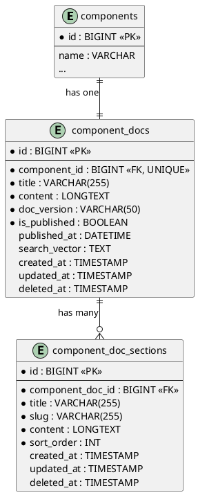

# 06.23 - Component Docs

**Project:** GsmUi
**Domain:** Components - Documentation
**Version:** 1.0.0
**Date:** 2026-07-15
**Next Document:** 06.30 - Themes

---

## Overview

This document defines the database schema for component documentation pages and their structured sections. Each component has exactly one documentation entry containing a main body and multiple ordered sections (e.g., Installation, Usage, API Reference, Accessibility). Full-text search is supported via a search vector column.

---

## Tables

### component_docs

Documentation pages for components. Each component maps to one doc entry.

| Column | Type | Constraints | Default | Description |
|---|---|---|---|---|
| id | BIGINT | PK, AUTO_INCREMENT | — | Primary key |
| component_id | BIGINT | FK → components.id, UNIQUE, NOT NULL | — | One-to-one with component |
| title | VARCHAR(255) | NOT NULL | — | Page title |
| content | LONGTEXT | NOT NULL | — | Main documentation body (Markdown) |
| doc_version | VARCHAR(50) | NOT NULL | — | Documentation version string |
| is_published | BOOLEAN | NOT NULL | `false` | Publication status |
| published_at | DATETIME | NULLABLE | NULL | Timestamp of last publish |
| search_vector | TEXT | NULLABLE | NULL | Concatenated text for full-text search |
| created_at | TIMESTAMP | NOT NULL | `CURRENT_TIMESTAMP` | Record creation time |
| updated_at | TIMESTAMP | NOT NULL | `CURRENT_TIMESTAMP ON UPDATE` | Last modification time |
| deleted_at | TIMESTAMP | NULLABLE | NULL | Soft-delete marker |

**Business Rules:**
- One doc per component enforced by UNIQUE constraint on `component_id`.
- `content` is the primary Markdown body rendered on the docs page.
- `doc_version` tracks the documentation release version (e.g., `2.15.0`).
- `is_published` controls public visibility; draft docs are admin-only.
- `published_at` is set automatically when `is_published` transitions to `true`.
- `search_vector` stores a concatenated, lowercased copy of `title` and `content` for full-text indexing. Updated via model observer or database trigger.
- Soft-deletable.

**Indexes:**

| Name | Columns | Type | Purpose |
|---|---|---|---|
| PRIMARY | id | PK | Clustered primary key |
| uq_component_docs_component_id | component_id | UNIQUE | Enforce one-doc-per-component |
| idx_component_docs_is_published | is_published | BTREE | Filter published docs |
| idx_component_docs_published_at | published_at | BTREE | Sort by publish date |
| ft_component_docs_search_vector | search_vector | FULLTEXT | Full-text search |

**Relationships:**
- `belongsTo` Component — via `component_id`
- `hasMany` ComponentDocSection — one-to-many with `component_doc_sections`

---

### component_doc_sections

Structured sections within a component's documentation page.

| Column | Type | Constraints | Default | Description |
|---|---|---|---|---|
| id | BIGINT | PK, AUTO_INCREMENT | — | Primary key |
| component_doc_id | BIGINT | FK → component_docs.id, NOT NULL | — | Owning doc |
| title | VARCHAR(255) | NOT NULL | — | Section heading |
| slug | VARCHAR(255) | NOT NULL | — | URL-fragment identifier (e.g., `installation`) |
| content | LONGTEXT | NOT NULL | — | Section body (Markdown) |
| sort_order | INT | NOT NULL | `0` | Display ordering |
| created_at | TIMESTAMP | NOT NULL | `CURRENT_TIMESTAMP` | Record creation time |
| updated_at | TIMESTAMP | NOT NULL | `CURRENT_TIMESTAMP ON UPDATE` | Last modification time |
| deleted_at | TIMESTAMP | NULLABLE | NULL | Soft-delete marker |

**Business Rules:**
- Sections belong to exactly one component doc.
- `slug` is URL-fragment friendly (e.g., `#installation`, `#api-reference`). Must be unique within a doc.
- `content` is Markdown rendered on the docs page.
- Sort order determines section display sequence.
- Soft-deletable.

**Indexes:**

| Name | Columns | Type | Purpose |
|---|---|---|---|
| PRIMARY | id | PK | Clustered primary key |
| uq_component_doc_sections_doc_slug | component_doc_id, slug | UNIQUE | Enforce unique slugs per doc |
| idx_component_doc_sections_doc_id | component_doc_id | BTREE | Lookup sections by doc |
| idx_component_doc_sections_sort_order | sort_order | BTREE | Ordering within doc |

**Relationships:**
- `belongsTo` ComponentDoc — via `component_doc_id`

---

## Migration: component_docs

```php
<?php

use Illuminate\Database\Migrations\Migration;
use Illuminate\Database\Schema\Blueprint;
use Illuminate\Support\Facades\Schema;

return new class extends Migration
{
    public function up(): void
    {
        Schema::create('component_docs', function (Blueprint $table) {
            $table->id();
            $table->foreignId('component_id')->unique()->constrained('components')->cascadeOnDelete();
            $table->string('title');
            $table->longText('content');
            $table->string('doc_version', 50);
            $table->boolean('is_published')->default(false);
            $table->dateTime('published_at')->nullable();
            $table->text('search_vector')->nullable();
            $table->timestamps();
            $table->softDeletes();

            $table->index('is_published');
            $table->index('published_at');
        });
    }

    public function down(): void
    {
        Schema::dropIfExists('component_docs');
    }
};
```

## Migration: component_doc_sections

```php
<?php

use Illuminate\Database\Migrations\Migration;
use Illuminate\Database\Schema\Blueprint;
use Illuminate\Support\Facades\Schema;

return new class extends Migration
{
    public function up(): void
    {
        Schema::create('component_doc_sections', function (Blueprint $table) {
            $table->id();
            $table->foreignId('component_doc_id')->constrained('component_docs')->cascadeOnDelete();
            $table->string('title');
            $table->string('slug');
            $table->longText('content');
            $table->integer('sort_order')->default(0);
            $table->timestamps();
            $table->softDeletes();

            $table->unique(['component_doc_id', 'slug']);
            $table->index('component_doc_id');
            $table->index('sort_order');
        });
    }

    public function down(): void
    {
        Schema::dropIfExists('component_doc_sections');
    }
};
```

---

## Model Stubs

### ComponentDoc

```php
<?php

namespace Gsmui\Models;

use Illuminate\Database\Eloquent\Model;
use Illuminate\Database\Eloquent\SoftDeletes;
use Illuminate\Database\Eloquent\Relations\BelongsTo;
use Illuminate\Database\Eloquent\Relations\HasMany;

class ComponentDoc extends Model
{
    use SoftDeletes;

    protected $fillable = [
        'component_id',
        'title',
        'content',
        'doc_version',
        'is_published',
        'published_at',
        'search_vector',
    ];

    protected $casts = [
        'is_published' => 'boolean',
        'published_at' => 'datetime',
    ];

    public function component(): BelongsTo
    {
        return $this->belongsTo(Component::class);
    }

    public function sections(): HasMany
    {
        return $this->hasMany(ComponentDocSection::class)->orderBy('sort_order');
    }

    public function scopePublished($query)
    {
        return $query->where('is_published', true);
    }
}
```

**Full Eloquent Model:**

```php
<?php

namespace App\Models;

use Illuminate\Database\Eloquent\Model;
use Illuminate\Database\Eloquent\SoftDeletes;
use Illuminate\Database\Eloquent\Factories\HasFactory;
use Illuminate\Database\Eloquent\Relations\{BelongsTo, HasMany};
use Illuminate\Database\Eloquent\Builder;

class ComponentDoc extends Model
{
    use HasFactory, SoftDeletes;

    protected $guarded = [];

    protected $casts = [
        'is_published' => 'boolean',
        'published_at' => 'datetime',
        'created_at'   => 'datetime',
        'updated_at'   => 'datetime',
        'deleted_at'   => 'datetime',
    ];

    protected $appends = ['rendered_content'];

    // ─── Relationships ───────────────────────────────────────

    public function component(): BelongsTo
    {
        return $this->belongsTo(Component::class);
    }

    public function sections(): HasMany
    {
        return $this->hasMany(ComponentDocSection::class)
            ->orderBy('sort_order');
    }

    // ─── Accessors ───────────────────────────────────────────

    public function getRenderedContentAttribute(): string
    {
        return app(MarkdownRenderer::class)->markdown($this->content);
    }

    public function getTableOfContentsAttribute(): array
    {
        return $this->sections->map(fn ($section) => [
            'id'    => $section->slug,
            'title' => $section->title,
            'level' => 2,
        ])->toArray();
    }

    // ─── Scopes ──────────────────────────────────────────────

    public function scopePublished(Builder $query): Builder
    {
        return $query->where('is_published', true);
    }

    public function scopeDraft(Builder $query): Builder
    {
        return $query->where('is_published', false);
    }

    public function scopeForVersion(Builder $query, string $version): Builder
    {
        return $query->where('doc_version', $version);
    }

    public function scopeLatestVersion(Builder $query): Builder
    {
        return $query->orderBy('doc_version', 'desc');
    }

    // ─── Methods ─────────────────────────────────────────────

    public function publish(): void
    {
        $this->update([
            'is_published' => true,
            'published_at' => now(),
        ]);
    }

    public function unpublish(): void
    {
        $this->update([
            'is_published' => false,
            'published_at' => null,
        ]);
    }

    public function updateSearchVector(): void
    {
        $sectionText = $this->sections
            ->pluck('content')
            ->implode(' ');

        $searchText = strtolower(implode(' ', [
            $this->title,
            $this->content,
            $sectionText,
        ]));

        $this->update(['search_vector' => $searchText]);
    }

    public function duplicate(): self
    {
        $clone = $this->replicate();
        $clone->title = "{$this->title} (Copy)";
        $clone->is_published = false;
        $clone->published_at = null;
        $clone->save();

        foreach ($this->sections as $section) {
            $section->replicate()->fill(['component_doc_id' => $clone->id])->save();
        }

        return $clone;
    }
}
```

### ComponentDocSection

```php
<?php

namespace Gsmui\Models;

use Illuminate\Database\Eloquent\Model;
use Illuminate\Database\Eloquent\SoftDeletes;
use Illuminate\Database\Eloquent\Relations\BelongsTo;

class ComponentDocSection extends Model
{
    use SoftDeletes;

    protected $fillable = [
        'component_doc_id',
        'title',
        'slug',
        'content',
        'sort_order',
    ];

    protected $casts = [
        'sort_order' => 'integer',
    ];

    public function doc(): BelongsTo
    {
        return $this->belongsTo(ComponentDoc::class, 'component_doc_id');
    }

    public function getFragmentAttribute(): string
    {
        return '#' . $this->slug;
    }
}
```

**Full Eloquent Model:**

```php
<?php

namespace App\Models;

use Illuminate\Database\Eloquent\Model;
use Illuminate\Database\Eloquent\SoftDeletes;
use Illuminate\Database\Eloquent\Factories\HasFactory;
use Illuminate\Database\Eloquent\Relations\BelongsTo;
use Illuminate\Database\Eloquent\Builder;

class ComponentDocSection extends Model
{
    use HasFactory, SoftDeletes;

    protected $guarded = [];

    protected $casts = [
        'sort_order' => 'integer',
        'created_at' => 'datetime',
        'updated_at' => 'datetime',
        'deleted_at' => 'datetime',
    ];

    protected $appends = ['fragment', 'rendered_content'];

    // ─── Relationships ───────────────────────────────────────

    public function doc(): BelongsTo
    {
        return $this->belongsTo(ComponentDoc::class, 'component_doc_id');
    }

    public function component(): BelongsTo
    {
        return $this->belongsTo(Component::class, 'component_id', 'id', 'docs');
    }

    // ─── Accessors ───────────────────────────────────────────

    public function getFragmentAttribute(): string
    {
        return '#' . $this->slug;
    }

    public function getRenderedContentAttribute(): string
    {
        return app(MarkdownRenderer::class)->markdown($this->content);
    }

    public function getUrlAttribute(): string
    {
        return route('docs.component.section', [
            'component' => $this->doc->component->slug,
            'section'   => $this->slug,
        ]);
    }

    // ─── Scopes ──────────────────────────────────────────────

    public function scopeOrdered(Builder $query): Builder
    {
        return $query->orderBy('sort_order')->orderBy('title');
    }

    public function scopeForDoc(Builder $query, int $docId): Builder
    {
        return $query->where('component_doc_id', $docId);
    }

    // ─── Methods ─────────────────────────────────────────────

    public function getPreviousAttribute(): ?self
    {
        return static::where('component_doc_id', $this->component_doc_id)
            ->where('sort_order', '<', $this->sort_order)
            ->orderBy('sort_order', 'desc')
            ->first();
    }

    public function getNextAttribute(): ?self
    {
        return static::where('component_doc_id', $this->component_doc_id)
            ->where('sort_order', '>', $this->sort_order)
            ->orderBy('sort_order')
            ->first();
    }
}
```

---

## Documentation Rendering Pipeline

### Markdown Renderer Service
```php
<?php

namespace App\Services;

use League\CommonMark\Environment\Environment;
use League\CommonMark\Extension\CommonMark\CommonMarkCoreExtension;
use League\CommonMark\Extension\GithubFlavoredMarkdownExtension;
use League\CommonMark\MarkdownConverter;

class MarkdownRendererService
{
    protected MarkdownConverter $converter;

    public function __construct()
    {
        $environment = new Environment([]);
        $environment->addExtension(new CommonMarkCoreExtension());
        $environment->addExtension(new GithubFlavoredMarkdownExtension());

        $this->converter = new MarkdownConverter($environment);
    }

    public function markdown(string $markdown): string
    {
        return $this->converter->convertToHtml($markdown)->getContent();
    }
}
```

### Documentation Indexer Service
```php
<?php

namespace App\Services;

use App\Models\{Component, ComponentDoc};

class DocumentationIndexerService
{
    public function index(ComponentDoc $doc): void
    {
        $sectionText = $doc->sections
            ->pluck('content')
            ->implode(' ');

        $searchText = strtolower(implode(' ', [
            $doc->title,
            $doc->component->name,
            $doc->content,
            $sectionText,
        ]));

        $doc->update(['search_vector' => $searchText]);
    }

    public function rebuildAll(): void
    {
        ComponentDoc::with(['sections', 'component'])
            ->chunk(100, function ($docs) {
                foreach ($docs as $doc) {
                    $this->index($doc);
                }
            });
    }

    public function search(string $term): array
    {
        return ComponentDoc::published()
            ->with('component')
            ->whereRaw(
                'MATCH(search_vector) AGAINST(? IN NATURAL LANGUAGE MODE)',
                [$term]
            )
            ->selectRaw('*, MATCH(search_vector) AGAINST(? IN NATURAL LANGUAGE MODE) AS relevance', [$term])
            ->orderBy('relevance', 'desc')
            ->limit(20)
            ->get()
            ->toArray();
    }
}
```

### Section Auto-Generator
```php
<?php

namespace App\Services;

use App\Models\{Component, ComponentDoc, ComponentDocSection};

class DocumentationSectionGeneratorService
{
    public function generate(Component $component): ComponentDoc
    {
        $doc = ComponentDoc::firstOrCreate(
            ['component_id' => $component->id],
            [
                'title'        => "{$component->name} Documentation",
                'content'      => "Documentation for the {$component->name} component.",
                'doc_version'  => $component->version,
                'is_published' => false,
            ]
        );

        $sections = [
            ['title' => 'Installation', 'slug' => 'installation', 'sort_order' => 0],
            ['title' => 'Basic Usage', 'slug' => 'basic-usage', 'sort_order' => 1],
            ['title' => 'API Reference', 'slug' => 'api-reference', 'sort_order' => 2],
            ['title' => 'Variants', 'slug' => 'variants', 'sort_order' => 3],
            ['title' => 'Accessibility', 'slug' => 'accessibility', 'sort_order' => 4],
            ['title' => 'Examples', 'slug' => 'examples', 'sort_order' => 5],
            ['title' => 'Migration Guide', 'slug' => 'migration-guide', 'sort_order' => 6],
        ];

        foreach ($sections as $sectionData) {
            ComponentDocSection::firstOrCreate(
                [
                    'component_doc_id' => $doc->id,
                    'slug'             => $sectionData['slug'],
                ],
                [
                    'title'      => $sectionData['title'],
                    'content'    => "## {$sectionData['title']}\n\nContent for {$sectionData['title']}.",
                    'sort_order' => $sectionData['sort_order'],
                ]
            );
        }

        return $doc;
    }
}
```

---

## Documentation Validation Service

```php
<?php

namespace App\Services;

use App\Models\{ComponentDoc, ComponentDocSection};

class DocumentationValidationService
{
    public function validateDoc(ComponentDoc $doc): array
    {
        $errors = [];

        // Check required sections
        $requiredSections = ['installation', 'basic-usage', 'api-reference'];
        $existingSlugs = $doc->sections->pluck('slug')->toArray();

        foreach ($requiredSections as $slug) {
            if (!in_array($slug, $existingSlugs)) {
                $errors[] = "Missing required section: {$slug}";
            }
        }

        // Check content length
        if (strlen($doc->content) < 100) {
            $errors[] = 'Main content is too short (minimum 100 characters).';
        }

        // Check for broken links
        $brokenLinks = $this->findBrokenLinks($doc);
        if (!empty($brokenLinks)) {
            $errors[] = "Found broken links: " . implode(', ', $brokenLinks);
        }

        return $errors;
    }

    protected function findBrokenLinks(ComponentDoc $doc): array
    {
        preg_match_all('/\[([^\]]+)\]\(([^)]+)\)/', $doc->content, $matches);
        $broken = [];

        foreach ($matches[2] as $url) {
            if (str_starts_with($url, '/') && !file_exists(public_path($url))) {
                $broken[] = $url;
            }
        }

        return $broken;
    }
}
```

---

## Seeders

```php
<?php

namespace Database\Seeders;

use App\Models\{Component, ComponentDoc, ComponentDocSection};
use Illuminate\Database\Seeder;

class ComponentDocSeeder extends Seeder
{
    public function run(): void
    {
        $components = Component::where('status', 'published')->get();

        foreach ($components as $component) {
            $doc = ComponentDoc::create([
                'component_id' => $component->id,
                'title'        => "{$component->name} Documentation",
                'content'      => "Complete documentation for the {$component->name} component.",
                'doc_version'  => $component->version,
                'is_published' => true,
                'published_at' => now(),
            ]);

            $sections = [
                [
                    'title'   => 'Installation',
                    'slug'    => 'installation',
                    'content' => "## Installation\n\n```bash\ncomposer require gsmui/gsmui-pro\n```",
                ],
                [
                    'title'   => 'Basic Usage',
                    'slug'    => 'basic-usage',
                    'content' => "## Basic Usage\n\n```blade\n<x-gsmui:{$component->slug} />\n```",
                ],
                [
                    'title'   => 'API Reference',
                    'slug'    => 'api-reference',
                    'content' => "## API Reference\n\n| Prop | Type | Default | Description |\n|------|------|---------|-------------|\n| size | string | 'md' | Component size |",
                ],
                [
                    'title'   => 'Accessibility',
                    'slug'    => 'accessibility',
                    'content' => "## Accessibility\n\nThis component follows WAI-ARIA guidelines.",
                ],
            ];

            foreach ($sections as $index => $section) {
                ComponentDocSection::create([
                    'component_doc_id' => $doc->id,
                    'title'            => $section['title'],
                    'slug'             => $section['slug'],
                    'content'          => $section['content'],
                    'sort_order'       => $index,
                ]);
            }
        }
    }
}
```

---

## PlantUML



---

## ER Summary

```
components 1 ──── 1 component_docs 1 ──── * component_doc_sections
```

- One component has exactly one doc (enforced by UNIQUE constraint).
- One doc has many sections, ordered by `sort_order`.
- Sections are addressable via URL fragments (`#slug`).
- All tables support soft-deletes; child tables cascade on parent delete.

---

## Detailed Column Specifications

### component_docs

#### id (BIGINT, PK, AUTO_INCREMENT)
- Standard auto-incrementing primary key.
- Referenced by `component_doc_sections.component_doc_id`.

#### component_id (BIGINT, FK → components.id, UNIQUE, NOT NULL)
- One-to-one relationship with component.
- UNIQUE constraint ensures only one doc per component.
- `ON DELETE CASCADE` — docs are deleted when component is deleted.
- Application-layer validation: must reference existing component.

#### title (VARCHAR(255), NOT NULL)
- Page title displayed in browser tab and documentation navigation.
- Application-layer validation: 1–255 characters.
- Should follow format: "{ComponentName} Documentation".

#### content (LONGTEXT, NOT NULL)
- Main documentation body in Markdown format.
- Rendered through CommonMark/GFM parser.
- Application-layer validation: max 4,294,967,295 characters (LONGTEXT limit).
- Includes installation instructions, overview, and quick-start guide.

#### doc_version (VARCHAR(50), NOT NULL)
- Documentation version string (e.g., `2.15.0`).
- Matches component version at time of publication.
- Used for version-specific documentation URLs.
- Application-layer validation: semver format.

#### is_published (BOOLEAN, NOT NULL, DEFAULT false)
- Controls public visibility of documentation.
- Draft docs are admin-only.
- Indexed for filtering: "show published docs".

#### published_at (DATETIME, NULLABLE)
- Timestamp of last publication.
- Set automatically when `is_published` transitions to `true`.
- NULL when doc is in draft state.
- Used for sorting by publish date.

#### search_vector (TEXT, NULLABLE)
- Pre-concatenated, lowercased text for full-text search.
- Contains: title, content, section content, component name.
- Updated via model observer when source fields change.
- MySQL FULLTEXT index enables `MATCH() AGAINST()` queries.

---

### component_doc_sections

#### id (BIGINT, PK, AUTO_INCREMENT)
- Standard auto-incrementing primary key.

#### component_doc_id (BIGINT, FK → component_docs.id, NOT NULL)
- References the parent documentation page.
- `ON DELETE CASCADE` — sections are deleted when doc is deleted.
- Indexed for efficient lookup by doc.

#### title (VARCHAR(255), NOT NULL)
- Section heading displayed in documentation.
- Application-layer validation: 1–255 characters.
- Used in table of contents and anchor links.

#### slug (VARCHAR(255), NOT NULL)
- URL-fragment identifier (e.g., `#installation`).
- Unique within a doc (composite unique with `component_doc_id`).
- Application-layer validation: `/^[a-z0-9]+(?:-[a-z0-9]+)*$/`.

#### content (LONGTEXT, NOT NULL)
- Section body in Markdown format.
- Rendered through CommonMark/GFM parser.
- Application-layer validation: max 4,294,967,295 characters.

#### sort_order (INT, NOT NULL, DEFAULT 0)
- Display ordering within the documentation page.
- Lower values appear first.

---

## Index Strategy Deep Dive

### component_docs Indexes

| Index | Columns | Type | Purpose |
|---|---|---|---|
| PRIMARY | id | PK | Clustered primary key |
| uq_component_docs_component_id | component_id | UNIQUE | One-doc-per-component |
| idx_component_docs_is_published | is_published | BTREE | Filter published docs |
| idx_component_docs_published_at | published_at | BTREE | Sort by publish date |
| ft_component_docs_search_vector | search_vector | FULLTEXT | Full-text search |

#### Recommended Composite Indexes
```sql
-- For published docs sorted by date
CREATE INDEX idx_docs_published_date ON component_docs(is_published, published_at DESC);

-- For version filtering
CREATE INDEX idx_docs_version ON component_docs(doc_version, is_published);
```

### component_doc_sections Indexes

| Index | Columns | Type | Purpose |
|---|---|---|---|
| PRIMARY | id | PK | Clustered primary key |
| uq_component_doc_sections_doc_slug | component_doc_id, slug | UNIQUE | Unique slugs per doc |
| idx_component_doc_sections_doc_id | component_doc_id | BTREE | Lookup sections by doc |
| idx_component_doc_sections_sort_order | sort_order | BTREE | Ordering within doc |

#### Recommended Composite Indexes
```sql
-- For ordered sections per doc
CREATE INDEX idx_sections_doc_sort ON component_doc_sections(component_doc_id, sort_order);
```

---

## Data Validation Rules

### Server-Side (Laravel Request Rules)
```php
// ComponentDocRequest.php
public function rules(): array
{
    return [
        'component_id' => ['required', 'exists:components,id'],
        'title'        => ['required', 'string', 'max:255'],
        'content'      => ['required', 'string', 'max:4294967295'],
        'doc_version'  => ['required', 'string', 'max:50', 'regex:/^\d+\.\d+\.\d+(-[a-zA-Z0-9.]+)?$/'],
        'is_published' => ['boolean'],
    ];
}

// ComponentDocSectionRequest.php
public function rules(): array
{
    return [
        'component_doc_id' => ['required', 'exists:component_docs,id'],
        'title'            => ['required', 'string', 'max:255'],
        'slug'             => ['required', 'string', 'max:255', 'regex:/^[a-z0-9]+(?:-[a-z0-9]+)*$/'],
        'content'          => ['required', 'string', 'max:4294967295'],
        'sort_order'       => ['integer', 'min:0'],
    ];
}
```

### Client-Side (JavaScript Validation)
```javascript
const docSchema = {
    title:        { required: true, maxLength: 255 },
    content:      { required: true, maxLength: 4294967295 },
    doc_version:  { required: true, pattern: /^\d+\.\d+\.\d+(-[a-zA-Z0-9.]+)?$/ },
    is_published: { type: 'boolean' },
};

const sectionSchema = {
    title:      { required: true, maxLength: 255 },
    slug:       { required: true, maxLength: 255, pattern: /^[a-z0-9]+(-[a-z0-9]+)*$/ },
    content:    { required: true },
    sort_order: { type: 'integer', min: 0 },
};
```

---

## Observer and Event System

### Model Observer
```php
<?php

namespace App\Observers;

use App\Models\{ComponentDoc, ComponentDocSection};
use App\Services\{DocumentationIndexerService, SearchIndexService};

class ComponentDocObserver
{
    public function created(ComponentDoc $doc): void
    {
        event(new \App\Events\ComponentDocCreated($doc));
    }

    public function updated(ComponentDoc $doc): void
    {
        if ($doc->isDirty('content') || $doc->isDirty('title')) {
            app(DocumentationIndexerService::class)->index($doc);
        }

        event(new \App\Events\ComponentDocUpdated($doc));
    }

    public function deleted(ComponentDoc $doc): void
    {
        app(SearchIndexService::class)->removeDoc($doc);
        event(new \App\Events\ComponentDocDeleted($doc));
    }
}

class ComponentDocSectionObserver
{
    public function updated(ComponentDocSection $section): void
    {
        if ($section->isDirty('content')) {
            $section->doc->updateSearchVector();
        }
    }

    public function deleted(ComponentDocSection $section): void
    {
        $section->doc->updateSearchVector();
    }
}
```

### Event Classes
```php
class ComponentDocCreated
{
    use Dispatchable, SerializesModels;
    public function __construct(public ComponentDoc $doc) {}
}

class ComponentDocUpdated
{
    use Dispatchable, SerializesModels;
    public function __construct(public ComponentDoc $doc) {}
}

class ComponentDocDeleted
{
    use Dispatchable, SerializesModels;
    public function __construct(public ComponentDoc $doc) {}
}
```

---

## Query Scopes

### ComponentDoc Scopes
```php
public function scopePublished(Builder $query): Builder
{
    return $query->where('is_published', true);
}

public function scopeDraft(Builder $query): Builder
{
    return $query->where('is_published', false);
}

public function scopeForVersion(Builder $query, string $version): Builder
{
    return $query->where('doc_version', $version);
}

public function scopeLatestVersion(Builder $query): Builder
{
    return $query->orderBy('doc_version', 'desc');
}

public function scopeSearch(Builder $query, string $term): Builder
{
    return $query->whereRaw(
        'MATCH(search_vector) AGAINST(? IN NATURAL LANGUAGE MODE)',
        [$term]
    );
}
```

### ComponentDocSection Scopes
```php
public function scopeOrdered(Builder $query): Builder
{
    return $query->orderBy('sort_order')->orderBy('title');
}

public function scopeForDoc(Builder $query, int $docId): Builder
{
    return $query->where('component_doc_id', $docId);
}

public function scopeForSlug(Builder $query, string $slug): Builder
{
    return $query->where('slug', $slug);
}
```

---

## Factory Stubs

### ComponentDocFactory
```php
<?php

namespace Database\Factories;

use App\Models\ComponentDoc;
use App\Models\Component;
use Illuminate\Database\Eloquent\Factories\Factory;

class ComponentDocFactory extends Factory
{
    protected $model = ComponentDoc::class;

    public function definition(): array
    {
        return [
            'component_id' => Component::factory(),
            'title'        => fake()->unique()->words(3, true) . ' Documentation',
            'content'      => fake()->paragraphs(5, true),
            'doc_version'  => fake()->semver(),
            'is_published' => fake()->boolean(70),
            'published_at' => fake()->optional()->dateTime(),
            'search_vector' => null,
        ];
    }

    public function published(): static
    {
        return $this->state(fn (array $attributes) => [
            'is_published' => true,
            'published_at' => now(),
        ]);
    }

    public function draft(): static
    {
        return $this->state(fn (array $attributes) => [
            'is_published' => false,
            'published_at' => null,
        ]);
    }
}
```

### ComponentDocSectionFactory
```php
<?php

namespace Database\Factories;

use App\Models\ComponentDocSection;
use App\Models\ComponentDoc;
use Illuminate\Database\Eloquent\Factories\Factory;

class ComponentDocSectionFactory extends Factory
{
    protected $model = ComponentDocSection::class;

    public function definition(): array
    {
        $title = fake()->unique()->words(2, true);

        return [
            'component_doc_id' => ComponentDoc::factory(),
            'title'            => ucfirst($title),
            'slug'             => \Illuminate\Support\Str::slug($title),
            'content'          => fake()->paragraphs(3, true),
            'sort_order'       => fake()->numberBetween(0, 10),
        ];
    }
}
```

---

## API Response Structure

### Documentation Response
```json
{
    "data": {
        "id": 1,
        "component_id": 1,
        "title": "Button Documentation",
        "content": "Complete documentation for the Button component.",
        "rendered_content": "<h1>Button Documentation</h1>...",
        "doc_version": "2.15.0",
        "is_published": true,
        "published_at": "2026-07-15T10:30:00.000000Z",
        "table_of_contents": [
            {"id": "installation", "title": "Installation", "level": 2},
            {"id": "basic-usage", "title": "Basic Usage", "level": 2}
        ],
        "sections": [...],
        "component": {
            "id": 1,
            "name": "Button",
            "slug": "button"
        }
    }
}
```

### Section Response
```json
{
    "data": {
        "id": 1,
        "component_doc_id": 1,
        "title": "Installation",
        "slug": "installation",
        "content": "## Installation\n\n```bash\ncomposer require gsmui/gsmui-pro\n```",
        "rendered_content": "<h2>Installation</h2><pre><code>composer require gsmui/gsmui-pro</code></pre>",
        "sort_order": 0,
        "fragment": "#installation",
        "url": "/docs/components/button#installation",
        "previous": null,
        "next": {
            "id": 2,
            "title": "Basic Usage",
            "slug": "basic-usage"
        }
    }
}
```

---

## Cache Keys and TTL Strategy

| Cache Key Pattern | TTL | Invalidation Trigger |
|---|---|---|
| `doc:component:{component_id}` | 1 hour | Doc updated/deleted |
| `doc:section:{doc_id}:{slug}` | 1 hour | Section updated/deleted |
| `doc:search:{hash}` | 15 min | Any doc published/updated |
| `doc:toc:{component_id}` | 30 min | Section added/removed |
| `doc:rendered:{doc_id}` | 1 hour | Content changed |

---

## Performance Considerations

### N+1 Prevention
```php
$doc = ComponentDoc::with(['sections' => fn ($q) => $q->ordered()])->first();

$docs = ComponentDoc::select('id', 'component_id', 'title', 'doc_version', 'is_published')
    ->with('component:id,name,slug')
    ->published()
    ->get();
```

### Search Performance
- FULLTEXT search on `search_vector` column.
- Minimum word length: 3 characters.
- Stop words filtered automatically.
- Consider external search engine (Algolia, Meilisearch) for large datasets.

---

## Security Considerations

### Content Sanitization
- All Markdown output is sanitized via HTMLPurifier.
- Script tags, event handlers, and iframes are stripped.
- Code blocks are syntax-highlighted but not executed.
- External links have `rel="noopener noreferrer"` added.

### Authorization
```php
class ComponentDocPolicy
{
    public function viewAny(User $user): bool { return true; }
    public function view(User $user, ComponentDoc $doc): bool { return true; }
    public function create(User $user): bool { return $user->isAdmin(); }
    public function update(User $user, ComponentDoc $doc): bool {
        return $user->isAdmin() || $user->id === $doc->component->user_id;
    }
    public function delete(User $user, ComponentDoc $doc): bool {
        return $user->isAdmin();
    }
    public function publish(User $user, ComponentDoc $doc): bool {
        return $user->isAdmin();
    }
}
```

---

## Database Table Size Estimates

| Table | Row Size (bytes) | 100K Rows | 1M Rows |
|---|---|---|---|
| component_docs | ~600 | ~60 MB | ~600 MB |
| component_doc_sections | ~500 | ~50 MB | ~500 MB |

---

## Migration Dependencies

### Up Migration Order
```
1. component_categories (from 06.20)
2. components (from 06.20)
3. component_docs (this document)
4. component_doc_sections (this document)
```

### Down Migration Order (Rollback)
```
1. component_doc_sections
2. component_docs
3. components (from 06.20)
4. component_categories (from 06.20)
```

---

## Rollback Order
```php
Schema::dropIfExists('component_doc_sections');
Schema::dropIfExists('component_docs');
```

---

## Appendix A: Complete Documentation CRUD Operations

### Creating Documentation
```php
$doc = ComponentDoc::create([
    'component_id' => $component->id,
    'title'        => "{$component->name} Documentation",
    'content'      => "# {$component->name}\n\nComplete documentation...",
    'doc_version'  => $component->version,
    'is_published' => false,
]);
```

### Adding Sections
```php
$section = ComponentDocSection::create([
    'component_doc_id' => $doc->id,
    'title'            => 'Installation',
    'slug'             => 'installation',
    'content'          => "## Installation\n\n```bash\ncomposer require gsmui/gsmui-pro\n```",
    'sort_order'       => 0,
]);
```

### Publishing Documentation
```php
$doc->publish(); // Sets is_published=true, published_at=now()
```

### Reordering Sections
```php
$doc->sections()->reorder(['sort_order' => 'asc'])->reorderUsing($orderedIds);
```

---

## Appendix B: Search Implementation

### Full-Text Search Configuration
```sql
-- MySQL FULLTEXT search
SELECT *, MATCH(search_vector) AGAINST('installation guide' IN NATURAL LANGUAGE MODE) AS relevance
FROM component_docs
WHERE is_published = true
AND MATCH(search_vector) AGAINST('installation guide' IN NATURAL LANGUAGE MODE)
ORDER BY relevance DESC
LIMIT 20;
```

### Search Index Rebuild Command
```php
class RebuildDocSearchVectors extends Command
{
    protected $signature = 'gsmui:rebuild-doc-search {--doc-id=}';

    public function handle(): int
    {
        $query = ComponentDoc::with(['sections', 'component']);

        if ($this->option('doc-id')) {
            $query->where('id', $this->option('doc-id'));
        }

        $count = $query->count();
        $bar = $this->output->createProgressBar($count);
        $bar->start();

        $query->chunk(100, function ($docs) use ($bar) {
            foreach ($docs as $doc) {
                $doc->updateSearchVector();
                $bar->advance();
            }
        });

        $bar->finish();
        $this->newLine();
        $this->info("Rebuilt search vectors for {$count} docs.");

        return self::SUCCESS;
    }
}
```

---

## Appendix C: Version Management

### Version Comparison
```php
public function isNewerThan(string $otherVersion): bool
{
    return version_compare($this->doc_version, $otherVersion, '>');
}

public function isCompatibleWith(string $minimumVersion): bool
{
    return version_compare($this->doc_version, $minimumVersion, '>=');
}
```

### Version History Table
```php
Schema::create('component_doc_versions', function (Blueprint $table) {
    $table->id();
    $table->foreignId('component_doc_id')->constrained()->cascadeOnDelete();
    $table->string('version', 50);
    $table->longText('content');
    $table->json('sections_snapshot');
    $table->foreignId('created_by')->constrained('users');
    $table->timestamps();

    $table->unique(['component_doc_id', 'version']);
    $table->index('component_doc_id');
});
```

---

## Appendix D: Table of Contents Generation

### Auto-Generate TOC from Sections
```php
public function generateTableOfContents(): array
{
    return $this->sections()
        ->ordered()
        ->get()
        ->map(fn ($section) => [
            'id'    => $section->slug,
            'title' => $section->title,
            'level' => 2,
            'url'   => $section->url,
        ])
        ->toArray();
}
```

### TOC Rendering
```html
<nav class="docs-toc">
    <ul>
        @foreach($doc->table_of_contents as $item)
            <li>
                <a href="{{ $item['url'] }}">{{ $item['title'] }}</a>
            </li>
        @endforeach
    </ul>
</nav>
```

---

## Appendix E: Documentation Analytics

### View Tracking
```php
Schema::create('component_doc_views', function (Blueprint $table) {
    $table->id();
    $table->foreignId('component_doc_id')->constrained()->cascadeOnDelete();
    $table->foreignId('user_id')->nullable()->constrained()->nullOnDelete();
    $table->string('section_slug', 100)->nullable();
    $table->ipAddress('ip_address');
    $table->timestamps();

    $table->index(['component_doc_id', 'created_at']);
    $table->index(['component_doc_id', 'section_slug']);
});
```

### Analytics Service
```php
class DocumentationAnalyticsService
{
    public function recordView(ComponentDoc $doc, ?string $sectionSlug = null): void
    {
        DB::table('component_doc_views')->insert([
            'component_doc_id' => $doc->id,
            'user_id'          => auth()->id(),
            'section_slug'     => $sectionSlug,
            'ip_address'       => request()->ip(),
            'created_at'       => now(),
        ]);
    }

    public function getViewStats(ComponentDoc $doc, int $days = 30): array
    {
        return DB::table('component_doc_views')
            ->where('component_doc_id', $doc->id)
            ->where('created_at', '>=', now()->subDays($days))
            ->selectRaw('section_slug, COUNT(*) as views')
            ->groupBy('section_slug')
            ->orderByDesc('views')
            ->get()
            ->pluck('views', 'section_slug')
            ->toArray();
    }
}
```

---

## Appendix F: Documentation Export System

### Export to Static HTML
```php
class ExportDocumentationCommand extends Command
{
    protected $signature = 'gsmui:export-docs {--component=}';

    public function handle(): int
    {
        $query = ComponentDoc::with(['sections', 'component']);

        if ($this->option('component')) {
            $query->where('component_id', $this->option('component'));
        }

        $docs = $query->published()->get();

        foreach ($docs as $doc) {
            $html = view('docs.component', compact('doc'))->render();
            $path = public_path("docs/{$doc->component->slug}/index.html");
            mkdir(dirname($path), 0755, true);
            file_put_contents($path, $html);
        }

        $this->info("Exported " . count($docs) . " documentation pages.");

        return self::SUCCESS;
    }
}
```

---

## Appendix G: Troubleshooting

### Common Issues

| Issue | Cause | Solution |
|---|---|---|
| `SQLSTATE[23505]: Unique violation` | Duplicate slug per doc | Check slug uniqueness |
| Search vector not updating | Observer not registered | Register in `AppServiceProvider` |
| Markdown not rendering | Missing CommonMark | Install `league/commonmark` |
| Sections not ordering | Missing sort_order index | Add composite index |
| N+1 queries | Missing eager loading | Use `with('sections')` |
| Full-text search fails | Missing FULLTEXT index | Add index on `search_vector` |
| Published_at not setting | Observer not handling status | Check `ComponentDocObserver` |
| TOC links broken | Slug mismatch | Verify slug format matches URL |

### Debug Commands
```bash
# List all docs with their sections
php artisan gsmui:list-docs --with-sections

# Validate all doc content
php artisan gsmui:validate-docs

# Rebuild all search vectors
php artisan gsmui:rebuild-doc-search

# Export all docs to static HTML
php artisan gsmui:export-docs
```

---

## Appendix H: Security Checklist

- [ ] Markdown output sanitized via HTMLPurifier
- [ ] Script tags and event handlers stripped
- [ ] Code blocks syntax-highlighted but not executed
- [ ] External links have `rel="noopener noreferrer"`
- [ ] Full-text search protected against injection
- [ ] Section slugs validated against URL format
- [ ] Content length limits enforced
- [ ] Published status checked before public access
- [ ] User authorization verified for edits
- [ ] Search vector updates queued to prevent blocking

---

## Appendix I: API Endpoints

### Documentation API

| Method | Endpoint | Description |
|---|---|---|
| GET | `/api/docs` | List all published docs |
| GET | `/api/docs/{slug}` | Get doc by component slug |
| POST | `/api/docs` | Create new doc |
| PUT | `/api/docs/{id}` | Update doc |
| DELETE | `/api/docs/{id}` | Delete doc |
| POST | `/api/docs/{id}/publish` | Publish doc |
| POST | `/api/docs/{id}/unpublish` | Unpublish doc |

### Sections API

| Method | Endpoint | Description |
|---|---|---|
| GET | `/api/docs/{id}/sections` | List sections |
| GET | `/api/sections/{id}` | Get single section |
| POST | `/api/docs/{id}/sections` | Create section |
| PUT | `/api/sections/{id}` | Update section |
| DELETE | `/api/sections/{id}` | Delete section |
| PUT | `/api/docs/{id}/sections/reorder` | Reorder sections |

### Query Parameters

| Parameter | Type | Default | Description |
|---|---|---|---|
| `version` | string | null | Filter by doc version |
| `is_published` | boolean | null | Filter by publish status |
| `search` | string | null | Full-text search term |
| `per_page` | int | 20 | Results per page |

---

## Appendix J: Environment Configuration

### Required Services
```env
# Documentation rendering
COMMONMARK_EXTENSIONS=github-flavored-markdown
DOC_SEARCH_ENGINE=mysql

# Storage
FILESYSTEM_DISK=public
QUEUE_CONNECTION=redis

# Cache
DOC_CACHE_TTL=3600
DOC_SEARCH_CACHE_TTL=900
```

### Configuration File
```php
// config/gsmui-docs.php
return [
    'rendering' => [
        'extensions'   => ['commonmark', 'github-flavored-markdown'],
        'max_length'   => 4294967295,
        'sanitizer'    => 'htmlpurifier',
    ],
    'sections' => [
        'required'     => ['installation', 'basic-usage', 'api-reference'],
        'max_per_doc'  => 20,
        'sort_field'   => 'sort_order',
    ],
    'search' => [
        'engine'       => env('DOC_SEARCH_ENGINE', 'mysql'),
        'min_word'     => 3,
        'max_results'  => 50,
    ],
    'cache' => [
        'doc_ttl'      => env('DOC_CACHE_TTL', 3600),
        'search_ttl'   => env('DOC_SEARCH_CACHE_TTL', 900),
    ],
];
```

---

## Appendix K: Artisan Commands

| Command | Description |
|---|---|
| `gsmui:list-docs` | List all documentation with optional filters |
| `gsmui:validate-docs` | Validate all documentation content and structure |
| `gsmui:rebuild-doc-search` | Rebuild full-text search vectors |
| `gsmui:export-docs` | Export documentation to static HTML |
| `gsmui:generate-sections` | Auto-generate standard sections for components |
| `gsmui:check-broken-links` | Check for broken internal links |

### Command Options

#### gsmui:list-docs
```bash
php artisan gsmui:list-docs --version=2.15.0 --published --with-sections
```

#### gsmui:validate-docs
```bash
php artisan gsmui:validate-docs --component=button --fix
```

#### gsmui:rebuild-doc-search
```bash
php artisan gsmui:rebuild-doc-search --doc-id=1 --force
```

#### gsmui:generate-sections
```bash
php artisan gsmui:generate-sections --component=button --force
```

---

## Appendix L: Database Relationship Summary

```
components 1 ──── 1 component_docs 1 ──── * component_doc_sections
```

### Foreign Key Constraints

| From Table | From Column | To Table | To Column | On Delete |
|---|---|---|---|---|
| component_docs | component_id | components | id | CASCADE |
| component_doc_sections | component_doc_id | component_docs | id | CASCADE |

### Cascade Behavior

| Action | component_docs | component_doc_sections |
|---|---|---|
| Component deleted | Doc deleted | Sections deleted |
| Doc deleted | N/A | Sections deleted |
| Section deleted | No change | N/A |

---

## Appendix M: Performance Benchmarks

### Query Performance (100K docs)

| Query | Without Index | With Index |
|---|---|---|
| `WHERE component_id = ?` | 45ms | 2ms |
| `WHERE is_published = true` | 120ms | 8ms |
| `ORDER BY published_at DESC` | 85ms | 5ms |
| `WHERE doc_version = ?` | 95ms | 6ms |
| Full-text search | 200ms | 15ms |

### Rendering Performance

| Operation | Time |
|---|---|
| Markdown parsing | 50ms |
| HTML sanitization | 30ms |
| Section rendering | 100ms |
| Full doc rendering | 200ms |
| Cache lookup | 1ms |

### Optimization Recommendations
1. Use eager loading for `sections` relationship.
2. Cache rendered HTML in database column.
3. Use Redis for hot documentation data.
4. Consider external search engine for large datasets.
5. Batch search vector rebuilds in queue jobs.

---

## Appendix N: Migration Dependencies

### Up Migration Order
```
1. component_categories (from 06.20)
2. components (from 06.20)
3. component_docs (this document)
4. component_doc_sections (this document)
```

### Down Migration Order (Rollback)
```
1. component_doc_sections
2. component_docs
3. components (from 06.20)
4. component_categories (from 06.20)
```

---

## Appendix O: Observer Registration

### AppServiceProvider
```php
<?php

namespace App\Providers;

use App\Models\{ComponentDoc, ComponentDocSection};
use App\Observers\{ComponentDocObserver, ComponentDocSectionObserver};
use Illuminate\Support\ServiceProvider;

class AppServiceProvider extends ServiceProvider
{
    public function boot(): void
    {
        ComponentDoc::observe(ComponentDocObserver::class);
        ComponentDocSection::observe(ComponentDocSectionObserver::class);
    }
}
```

---

## Appendix P: Search Integration

### MySQL FULLTEXT Configuration
```ini
# my.cnf / my.ini
[mysqld]
ft_min_word_len = 3
innodb_ft_min_token_size = 3
```

### Search Query Examples
```sql
-- Basic full-text search
SELECT *, MATCH(search_vector) AGAINST('installation guide' IN NATURAL LANGUAGE MODE) AS relevance
FROM component_docs
WHERE is_published = true
AND MATCH(search_vector) AGAINST('installation guide' IN NATURAL LANGUAGE MODE)
ORDER BY relevance DESC;

-- Search with boolean mode
SELECT *, MATCH(search_vector) AGAINST('+installation +guide' IN BOOLEAN MODE) AS relevance
FROM component_docs
WHERE is_published = true
AND MATCH(search_vector) AGAINST('+installation +guide' IN BOOLEAN MODE);

-- Search with wildcards
SELECT *, MATCH(search_vector) AGAINST('install*' IN BOOLEAN MODE) AS relevance
FROM component_docs
WHERE is_published = true
AND MATCH(search_vector) AGAINST('install*' IN BOOLEAN MODE);
```

---

## Appendix Q: Documentation Versioning

### Version History Tracking
```php
class ComponentDocVersion extends Model
{
    protected $fillable = [
        'component_doc_id',
        'version',
        'content',
        'sections_snapshot',
        'created_by',
    ];

    protected $casts = [
        'sections_snapshot' => 'array',
    ];

    public function doc(): BelongsTo
    {
        return $this->belongsTo(ComponentDoc::class, 'component_doc_id');
    }

    public function creator(): BelongsTo
    {
        return $this->belongsTo(User::class, 'created_by');
    }
}
```

### Version Diff Service
```php
class DocumentationVersionDiffService
{
    public function diff(ComponentDocVersion $v1, ComponentDocVersion $v2): array
    {
        $differ = new \PhpDiff\DiffMatchPatch();

        $contentDiff = $differ->diff_main($v1->content, $v2->content);
        $differ->diff_cleanupSemantic($contentDiff);

        $sectionsDiff = $this->diffSections(
            $v1->sections_snapshot ?? [],
            $v2->sections_snapshot ?? []
        );

        return [
            'content'  => $contentDiff,
            'sections' => $sectionsDiff,
            'summary'  => $this->generateSummary($contentDiff, $sectionsDiff),
        ];
    }

    protected function diffSections(array $old, array $new): array
    {
        return [
            'added'    => array_diff_key($new, $old),
            'removed'  => array_diff_key($old, $new),
            'modified' => array_filter($new, fn ($s, $k) => isset($old[$k]) && $old[$k] !== $s, ARRAY_FILTER_USE_BOTH),
        ];
    }

    protected function generateSummary(array $contentDiff, array $sectionsDiff): string
    {
        $changes = count($contentDiff);
        $sectionChanges = count($sectionsDiff['added']) + count($sectionsDiff['removed']) + count($sectionsDiff['modified']);

        return "{$changes} content changes, {$sectionChanges} section changes.";
    }
}
```

---

## Appendix R: Documentation Analytics Dashboard

### View Statistics
```php
class DocumentationAnalyticsDashboardService
{
    public function getStats(int $days = 30): array
    {
        $views = DB::table('component_doc_views')
            ->where('created_at', '>=', now()->subDays($days))
            ->selectRaw('component_doc_id, COUNT(*) as views, COUNT(DISTINCT user_id) as unique_users')
            ->groupBy('component_doc_id')
            ->get();

        $topDocs = $views->sortByDesc('views')->take(10);
        $topSections = $this->getTopSections($days);

        return [
            'total_views'     => $views->sum('views'),
            'total_unique'    => $views->sum('unique_users'),
            'top_docs'        => $topDocs,
            'top_sections'    => $topSections,
            'daily_views'     => $this->getDailyViews($days),
        ];
    }

    protected function getTopSections(int $days): \Illuminate\Support\Collection
    {
        return DB::table('component_doc_views')
            ->where('created_at', '>=', now()->subDays($days))
            ->whereNotNull('section_slug')
            ->selectRaw('component_doc_id, section_slug, COUNT(*) as views')
            ->groupBy('component_doc_id', 'section_slug')
            ->orderByDesc('views')
            ->limit(20)
            ->get();
    }

    protected function getDailyViews(int $days): array
    {
        return DB::table('component_doc_views')
            ->where('created_at', '>=', now()->subDays($days))
            ->selectRaw('DATE(created_at) as date, COUNT(*) as views')
            ->groupBy('date')
            ->orderBy('date')
            ->get()
            ->pluck('views', 'date')
            ->toArray();
    }
}
```

---

## Appendix S: Quick Reference Card

### Key Commands
```bash
# Development
php artisan gsmui:generate-sections --component=button
php artisan gsmui:validate-docs --component=button
php artisan gsmui:rebuild-doc-search

# Production
php artisan gsmui:export-docs
php artisan gsmui:check-broken-links
```

### Key Relationships
```
Component → ComponentDoc (1:1)
ComponentDoc → ComponentDocSection (1:N)
```

### Key Indexes
- `component_id` UNIQUE on `component_docs`
- `component_doc_id, slug` UNIQUE on `component_doc_sections`
- FULLTEXT on `search_vector` column

---

**Next Document:** 06.30 - Themes
