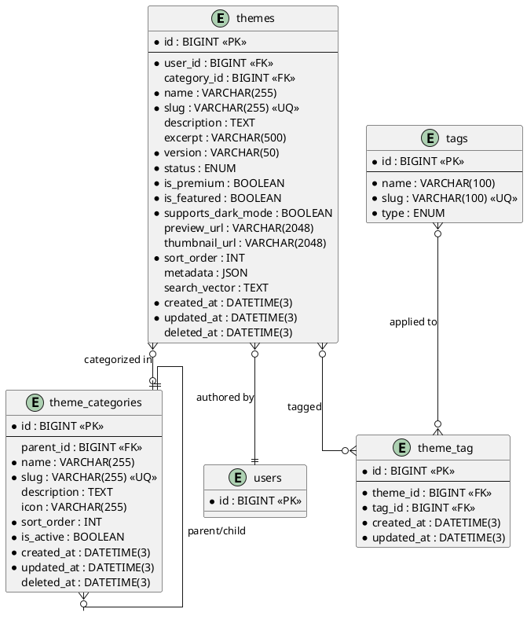

# 06.30 - Themes

**Project:** GsmUi
**Domain:** Themes
**Version:** 1.0.0

---

# Purpose

This document defines the database schema for the Themes domain — a design token registry that generates CSS variables for GsmUi components. Each theme bundles a set of token groups (colors, typography, spacing, etc.) that can be applied globally or per-component.

---

# Tables

## themes

**Purpose:** Design theme registry. Each theme is a set of design tokens that generate CSS variables.

**Business Rules:**
- Slug is unique and immutable after creation
- Themes are authored by users
- Status transitions: `draft` → `review` → `published` → `deprecated`
- `is_premium` determines if the theme requires a paid plan
- `supports_dark_mode` indicates whether the theme ships dark-mode tokens
- `category_id` references theme_categories
- Soft-deletable

**Columns:**

| Column | Type | Nullable | Default | Notes |
|---|---|---|---|---|
| id | BIGINT UNSIGNED | NO | AUTO_INCREMENT | PK |
| user_id | BIGINT UNSIGNED | NO | — | FK → users.id (author) |
| category_id | BIGINT UNSIGNED | YES | NULL | FK → theme_categories.id |
| name | VARCHAR(255) | NO | — | Display name |
| slug | VARCHAR(255) | NO | — | URL-friendly identifier |
| description | TEXT | YES | NULL | Full description |
| excerpt | VARCHAR(500) | YES | NULL | Short summary |
| version | VARCHAR(50) | NO | '0.1.0' | Current version (semver) |
| status | ENUM('draft','review','published','deprecated') | NO | 'draft' | Publication state |
| is_premium | BOOLEAN | NO | false | Requires paid plan |
| is_featured | BOOLEAN | NO | false | Featured on homepage |
| supports_dark_mode | BOOLEAN | NO | true | Ships dark-mode tokens |
| preview_url | VARCHAR(2048) | YES | NULL | Live preview link |
| thumbnail_url | VARCHAR(2048) | YES | NULL | Thumbnail image URL |
| sort_order | INT | NO | 0 | Display order |
| metadata | JSON | YES | NULL | SEO, custom fields |
| search_vector | TEXT | YES | NULL | Fulltext search |
| created_at | DATETIME(3) | NO | CURRENT_TIMESTAMP(3) | |
| updated_at | DATETIME(3) | NO | CURRENT_TIMESTAMP(3) | ON UPDATE |
| deleted_at | DATETIME(3) | YES | NULL | Soft delete |

**Indexes:**

```
PRIMARY: id
UNIQUE: themes_slug_unique (slug)
INDEX: themes_user_id_index (user_id)
INDEX: themes_category_id_index (category_id)
INDEX: themes_status_index (status)
INDEX: themes_is_premium_index (is_premium)
INDEX: themes_sort_order_index (sort_order)
FULLTEXT: themes_search_vector_fulltext (search_vector)
```

**Relationships:**
- belongsTo: User, ThemeCategory
- hasMany: ThemeTokenGroup, ThemeExport
- belongsToMany: Tag (via theme_tag)

**Migration:**

```php
Schema::create('themes', function (Blueprint $table) {
    $table->id();
    $table->foreignId('user_id')->constrained()->cascadeOnDelete();
    $table->foreignId('category_id')->nullable()->constrained('theme_categories')->nullOnDelete();
    $table->string('name');
    $table->string('slug')->unique();
    $table->text('description')->nullable();
    $table->string('excerpt', 500)->nullable();
    $table->string('version', 50)->default('0.1.0');
    $table->enum('status', ['draft', 'review', 'published', 'deprecated'])->default('draft');
    $table->boolean('is_premium')->default(false);
    $table->boolean('is_featured')->default(false);
    $table->boolean('supports_dark_mode')->default(true);
    $table->string('preview_url', 2048)->nullable();
    $table->string('thumbnail_url', 2048)->nullable();
    $table->integer('sort_order')->default(0);
    $table->json('metadata')->nullable();
    $table->text('search_vector')->nullable();
    $table->timestamps();
    $table->softDeletes();
});
```

**Eloquent Model:**

```php
class Theme extends Model
{
    use HasFactory, SoftDeletes;

    protected $guarded = [];
    protected $casts = [
        'is_premium'        => 'boolean',
        'is_featured'       => 'boolean',
        'supports_dark_mode' => 'boolean',
        'metadata'          => 'array',
    ];
}
```

**Full Eloquent Model:**

```php
<?php

namespace App\Models;

use Illuminate\Database\Eloquent\Model;
use Illuminate\Database\Eloquent\SoftDeletes;
use Illuminate\Database\Eloquent\Factories\HasFactory;
use Illuminate\Database\Eloquent\Relations\{BelongsTo, BelongsToMany, HasMany};
use Illuminate\Database\Eloquent\Builder;

class Theme extends Model
{
    use HasFactory, SoftDeletes;

    protected $guarded = [];

    protected $casts = [
        'is_premium'        => 'boolean',
        'is_featured'       => 'boolean',
        'supports_dark_mode' => 'boolean',
        'metadata'          => 'array',
        'sort_order'        => 'integer',
    ];

    protected $appends = ['is_free'];

    // ─── Relationships ───────────────────────────────────────

    public function user(): BelongsTo
    {
        return $this->belongsTo(User::class);
    }

    public function category(): BelongsTo
    {
        return $this->belongsTo(ThemeCategory::class, 'category_id');
    }

    public function tokenGroups(): HasMany
    {
        return $this->hasMany(ThemeTokenGroup::class)->orderBy('sort_order');
    }

    public function exports(): HasMany
    {
        return $this->hasMany(ThemeExport::class)->orderBy('created_at', 'desc');
    }

    public function tags(): BelongsToMany
    {
        return $this->belongsToMany(Tag::class, 'theme_tag')
            ->withTimestamps()
            ->orderBy('tags.name');
    }

    // ─── Accessors ───────────────────────────────────────────

    public function getIsFreeAttribute(): bool
    {
        return !$this->is_premium;
    }

    public function getRouteAttribute(): string
    {
        return route('themes.show', $this->slug);
    }

    // ─── Scopes ──────────────────────────────────────────────

    public function scopePublished(Builder $query): Builder
    {
        return $query->where('status', 'published');
    }

    public function scopePremium(Builder $query): Builder
    {
        return $query->where('is_premium', true);
    }

    public function scopeFree(Builder $query): Builder
    {
        return $query->where('is_premium', false);
    }

    public function scopeFeatured(Builder $query): Builder
    {
        return $query->where('is_featured', true);
    }

    public function scopeWithDarkMode(Builder $query): Builder
    {
        return $query->where('supports_dark_mode', true);
    }

    public function scopeInCategory(Builder $query, int $categoryId): Builder
    {
        return $query->where('category_id', $categoryId);
    }

    public function scopeSearch(Builder $query, string $term): Builder
    {
        return $query->whereRaw(
            'MATCH(search_vector) AGAINST(? IN NATURAL LANGUAGE MODE)',
            [$term]
        );
    }

    // ─── Methods ─────────────────────────────────────────────

    public function updateSearchVector(): void
    {
        $parts = array_filter([
            $this->name,
            $this->description,
            $this->excerpt,
            $this->category?->name,
            $this->tags->pluck('name')->implode(' '),
        ]);

        $this->update(['search_vector' => strtolower(implode(' ', $parts))]);
    }

    public function canTransitionTo(string $newStatus): bool
    {
        return match ($this->status) {
            'draft'      => in_array($newStatus, ['review']),
            'review'     => in_array($newStatus, ['draft', 'published']),
            'published'  => in_array($newStatus, ['deprecated']),
            'deprecated' => in_array($newStatus, ['published']),
            default      => false,
        };
    }

    public function transitionTo(string $newStatus): void
    {
        if (!$this->canTransitionTo($newStatus)) {
            throw new \App\Exceptions\InvalidStatusTransition(
                "Cannot transition from {$this->status} to {$newStatus}"
            );
        }

        $this->update(['status' => $newStatus]);
    }

    public function generateCssVariables(): string
    {
        $css = ":root {\n";

        foreach ($this->tokenGroups as $group) {
            foreach ($group->tokens as $token) {
                $css .= "  --gsmui-{$token->name}: {$token->value};\n";
            }
        }

        $css .= "}\n";

        if ($this->supports_dark_mode) {
            $css .= "\n.dark {\n";
            foreach ($this->tokenGroups as $group) {
                foreach ($group->tokens->where('dark_value') as $token) {
                    $css .= "  --gsmui-{$token->name}: {$token->dark_value};\n";
                }
            }
            $css .= "}\n";
        }

        return $css;
    }
}
```

**Events:** ThemeCreated, ThemeUpdated, ThemePublished, ThemeDeprecated, ThemeDeleted

---

## theme_categories

**Purpose:** Hierarchical category system for organizing themes (e.g., Color Schemes, Typography Sets, Industry Packs).

**Business Rules:**
- Supports nested categories via `parent_id`
- Slug is unique across all categories
- Sort order determines display order within a parent
- `is_active` controls visibility in the storefront
- Soft-deletable

**Columns:**

| Column | Type | Nullable | Default | Notes |
|---|---|---|---|---|
| id | BIGINT UNSIGNED | NO | AUTO_INCREMENT | PK |
| parent_id | BIGINT UNSIGNED | YES | NULL | FK → self (nullable) |
| name | VARCHAR(255) | NO | — | Category name |
| slug | VARCHAR(255) | NO | — | URL-friendly identifier |
| description | TEXT | YES | NULL | Category description |
| icon | VARCHAR(255) | YES | NULL | Icon identifier |
| sort_order | INT | NO | 0 | Display order |
| is_active | BOOLEAN | NO | true | Visibility flag |
| created_at | DATETIME(3) | NO | CURRENT_TIMESTAMP(3) | |
| updated_at | DATETIME(3) | NO | CURRENT_TIMESTAMP(3) | ON UPDATE |
| deleted_at | DATETIME(3) | YES | NULL | Soft delete |

**Indexes:**

```
PRIMARY: id
UNIQUE: theme_categories_slug_unique (slug)
INDEX: theme_categories_parent_id_index (parent_id)
INDEX: theme_categories_sort_order_index (sort_order)
INDEX: theme_categories_is_active_index (is_active)
```

**Migration:**

```php
Schema::create('theme_categories', function (Blueprint $table) {
    $table->id();
    $table->foreignId('parent_id')->nullable()->constrained('theme_categories')->nullOnDelete();
    $table->string('name');
    $table->string('slug')->unique();
    $table->text('description')->nullable();
    $table->string('icon')->nullable();
    $table->integer('sort_order')->default(0);
    $table->boolean('is_active')->default(true);
    $table->timestamps();
    $table->softDeletes();
});
```

**Eloquent Model:**

```php
class ThemeCategory extends Model
{
    use HasFactory, SoftDeletes;

    protected $guarded = [];
    protected $casts = [
        'is_active' => 'boolean',
    ];
}
```

**Full Eloquent Model:**

```php
<?php

namespace App\Models;

use Illuminate\Database\Eloquent\Model;
use Illuminate\Database\Eloquent\SoftDeletes;
use Illuminate\Database\Eloquent\Factories\HasFactory;
use Illuminate\Database\Eloquent\Relations\{BelongsTo, HasMany};
use Illuminate\Database\Eloquent\Builder;

class ThemeCategory extends Model
{
    use HasFactory, SoftDeletes;

    protected $guarded = [];

    protected $casts = [
        'is_active'  => 'boolean',
        'sort_order' => 'integer',
    ];

    // ─── Relationships ───────────────────────────────────────

    public function parent(): BelongsTo
    {
        return $this->belongsTo(self::class, 'parent_id');
    }

    public function children(): HasMany
    {
        return $this->hasMany(self::class, 'parent_id')
            ->orderBy('sort_order')
            ->orderBy('name');
    }

    public function themes(): HasMany
    {
        return $this->hasMany(Theme::class, 'category_id');
    }

    // ─── Scopes ──────────────────────────────────────────────

    public function scopeActive($query)
    {
        return $query->where('is_active', true);
    }

    public function scopeRoots($query)
    {
        return $query->whereNull('parent_id');
    }

    public function scopeOrdered($query)
    {
        return $query->orderBy('sort_order')->orderBy('name');
    }

    // ─── Methods ─────────────────────────────────────────────

    public function isRoot(): bool
    {
        return is_null($this->parent_id);
    }

    public function isChild(): bool
    {
        return !is_null($this->parent_id);
    }

    public function getBreadcrumbsAttribute(): array
    {
        $breadcrumbs = [];
        $current = $this;

        while ($current) {
            array_unshift($breadcrumbs, [
                'id'   => $current->id,
                'name' => $current->name,
                'slug' => $current->slug,
            ]);
            $current = $current->parent;
        }

        return $breadcrumbs;
    }
}
```

---

## theme_tag

**Purpose:** Pivot table for themes ↔ tags many-to-many.

**Business Rules:**
- Pure pivot — no additional data
- Cascade deletes when theme or tag is removed
- No soft deletes

**Columns:**

| Column | Type | Nullable | Default | Notes |
|---|---|---|---|---|
| id | BIGINT UNSIGNED | NO | AUTO_INCREMENT | PK |
| theme_id | BIGINT UNSIGNED | NO | — | FK → themes.id |
| tag_id | BIGINT UNSIGNED | NO | — | FK → tags.id |
| created_at | DATETIME(3) | NO | CURRENT_TIMESTAMP(3) | |
| updated_at | DATETIME(3) | NO | CURRENT_TIMESTAMP(3) | ON UPDATE |

**Indexes:**

```
PRIMARY: id
UNIQUE: theme_tag_theme_id_tag_id_unique (theme_id, tag_id)
INDEX: theme_tag_tag_id_index (tag_id)
```

**Migration:**

```php
Schema::create('theme_tag', function (Blueprint $table) {
    $table->id();
    $table->foreignId('theme_id')->constrained()->cascadeOnDelete();
    $table->foreignId('tag_id')->constrained()->cascadeOnDelete();
    $table->timestamps();
    $table->unique(['theme_id', 'tag_id']);
});
```

**Eloquent Model:**

```php
class ThemeTag extends Pivot
{
    use HasFactory;

    protected $guarded = [];
}
```

---

# Cross-Domain Relationships

## themes → products
A theme may be linked to a marketplace product via `products.theme_id` (nullable FK). Free themes have no product link.

## themes → theme_token_groups
Each theme owns one or more token groups (colors, typography, spacing). Token groups are defined in 06.31.

## themes → theme_exports
Exported CSS/JSON bundles for a theme are stored as versioned exports. See 06.32.

## themes → tags
Many-to-many via `theme_tag`. Tags are shared across the platform (defined in 06.20).

---

## Detailed Column Specifications

### themes

#### id (BIGINT UNSIGNED, PK, AUTO_INCREMENT)
- Standard auto-incrementing primary key.

#### user_id (BIGINT UNSIGNED, NOT NULL, FK → users.id)
- References the theme author.
- `ON DELETE CASCADE` — themes are deleted when author is deleted.

#### category_id (BIGINT UNSIGNED, NULLABLE, FK → theme_categories.id)
- References the hierarchical category taxonomy.
- `ON DELETE SET NULL` — themes revert to uncategorized.

#### name (VARCHAR(255), NOT NULL)
- Display name shown in marketplace.
- Application-layer validation: 1–255 characters.

#### slug (VARCHAR(255), NOT NULL, UNIQUE)
- URL-friendly identifier.
- UNIQUE constraint prevents slug collisions.

#### description (TEXT, NULLABLE)
- Full Markdown description of the theme.

#### excerpt (VARCHAR(500), NULLABLE)
- Short summary for card views.

#### version (VARCHAR(50), NOT NULL, DEFAULT '0.1.0')
- Semantic version string.

#### status (ENUM, NOT NULL, DEFAULT 'draft')
- Publication workflow: `draft` → `review` → `published` → `deprecated`.

#### is_premium (BOOLEAN, NOT NULL, DEFAULT false)
- Whether the theme requires a paid subscription.

#### is_featured (BOOLEAN, NOT NULL, DEFAULT false)
- Whether the theme is featured on homepage.

#### supports_dark_mode (BOOLEAN, NOT NULL, DEFAULT true)
- Whether the theme ships dark-mode tokens.

#### preview_url (VARCHAR(2048), NULLABLE)
- Live preview link.

#### thumbnail_url (VARCHAR(2048), NULLABLE)
- Thumbnail image URL.

#### sort_order (INT, NOT NULL, DEFAULT 0)
- Manual display ordering.

#### metadata (JSON, NULLABLE)
- Extensible key-value storage for SEO and custom fields.

#### search_vector (TEXT, NULLABLE)
- Pre-concatenated text for full-text search.

---

## Index Strategy Deep Dive

### themes Indexes

| Index | Columns | Type | Purpose |
|---|---|---|---|
| PRIMARY | id | PK | Clustered primary key |
| UNIQUE | slug | UNIQUE | URL lookup |
| INDEX | user_id | BTREE | Author themes |
| INDEX | category_id | BTREE | Category filter |
| INDEX | status | BTREE | Status filter |
| INDEX | is_premium | BTREE | Premium filter |
| INDEX | is_featured | BTREE | Featured carousel |
| FULLTEXT | search_vector | FULLTEXT | Search |

#### Recommended Composite Indexes
```sql
-- For marketplace listing
CREATE INDEX themes_category_status_featured ON themes(category_id, status, is_featured);

-- For author dashboard
CREATE INDEX themes_user_status ON themes(user_id, status, created_at DESC);
```

---

## Observer and Event System

### ThemeObserver
```php
<?php

namespace App\Observers;

use App\Models\Theme;
use App\Services\{SearchIndexService, ThemeCssGeneratorService};

class ThemeObserver
{
    public function created(Theme $theme): void
    {
        event(new \App\Events\ThemeCreated($theme));
    }

    public function updated(Theme $theme): void
    {
        if ($theme->isDirty(['name', 'description', 'excerpt'])) {
            app(SearchIndexService::class)->reindexTheme($theme);
        }

        if ($theme->isDirty('status') && $theme->status === 'published') {
            app(ThemeCssGeneratorService::class)->generate($theme);
        }

        event(new \App\Events\ThemeUpdated($theme));
    }

    public function deleted(Theme $theme): void
    {
        app(SearchIndexService::class)->removeTheme($theme);
        event(new \App\Events\ThemeDeleted($theme));
    }
}
```

### Event Classes
```php
class ThemeCreated
{
    use Dispatchable, SerializesModels;
    public function __construct(public Theme $theme) {}
}

class ThemeUpdated
{
    use Dispatchable, SerializesModels;
    public function __construct(public Theme $theme) {}
}

class ThemePublished
{
    use Dispatchable, SerializesModels;
    public function __construct(public Theme $theme) {}
}

class ThemeDeprecated
{
    use Dispatchable, SerializesModels;
    public function __construct(public Theme $theme) {}
}

class ThemeDeleted
{
    use Dispatchable, SerializesModels;
    public function __construct(public Theme $theme) {}
}
```

---

## Query Scopes

### Theme Scopes
```php
public function scopePublished(Builder $query): Builder
{
    return $query->where('status', 'published');
}

public function scopePremium(Builder $query): Builder
{
    return $query->where('is_premium', true);
}

public function scopeFree(Builder $query): Builder
{
    return $query->where('is_premium', false);
}

public function scopeFeatured(Builder $query): Builder
{
    return $query->where('is_featured', true);
}

public function scopeWithDarkMode(Builder $query): Builder
{
    return $query->where('supports_dark_mode', true);
}

public function scopeInCategory(Builder $query, int $categoryId): Builder
{
    return $query->where('category_id', $categoryId);
}

public function scopeSearch(Builder $query, string $term): Builder
{
    return $query->whereRaw(
        'MATCH(search_vector) AGAINST(? IN NATURAL LANGUAGE MODE)',
        [$term]
    );
}
```

---

## Factory Stubs

### ThemeFactory
```php
<?php

namespace Database\Factories;

use App\Models\Theme;
use App\Models\User;
use App\Models\ThemeCategory;
use Illuminate\Database\Eloquent\Factories\Factory;

class ThemeFactory extends Factory
{
    protected $model = Theme::class;

    public function definition(): array
    {
        $name = fake()->unique()->words(2, true);

        return [
            'user_id'           => User::factory(),
            'category_id'       => ThemeCategory::factory(),
            'name'              => ucfirst($name),
            'slug'              => \Illuminate\Support\Str::slug($name),
            'description'       => fake()->paragraphs(3, true),
            'excerpt'           => fake()->sentence(20),
            'version'           => fake()->semver(),
            'status'            => fake()->randomElement(['draft', 'review', 'published', 'deprecated']),
            'is_premium'        => fake()->boolean(20),
            'is_featured'       => fake()->boolean(10),
            'supports_dark_mode' => fake()->boolean(70),
            'sort_order'        => fake()->numberBetween(0, 100),
            'metadata'          => ['difficulty' => fake()->randomElement(['beginner', 'intermediate', 'advanced'])],
            'search_vector'     => null,
        ];
    }

    public function published(): static
    {
        return $this->state(fn (array $attributes) => ['status' => 'published']);
    }

    public function premium(): static
    {
        return $this->state(fn (array $attributes) => ['is_premium' => true]);
    }

    public function featured(): static
    {
        return $this->state(fn (array $attributes) => ['is_featured' => true]);
    }
}
```

---

## Seeders

### ThemeCategorySeeder
```php
<?php

namespace Database\Seeders;

use App\Models\ThemeCategory;
use Illuminate\Database\Seeder;

class ThemeCategorySeeder extends Seeder
{
    public function run(): void
    {
        $categories = [
            ['name' => 'Color Schemes', 'slug' => 'color-schemes', 'icon' => 'heroicon-o-swatch'],
            ['name' => 'Typography Sets', 'slug' => 'typography-sets', 'icon' => 'heroicon-o-document-text'],
            ['name' => 'Industry Packs', 'slug' => 'industry-packs', 'icon' => 'heroicon-o-building-office'],
            ['name' => 'Dark Themes', 'slug' => 'dark-themes', 'icon' => 'heroicon-o-moon'],
            ['name' => 'Minimal', 'slug' => 'minimal', 'icon' => 'heroicon-o-minus'],
        ];

        foreach ($categories as $index => $data) {
            ThemeCategory::create(array_merge($data, ['sort_order' => $index]));
        }
    }
}
```

---

## API Response Structure

### Theme Response
```json
{
    "data": {
        "id": 1,
        "name": "Midnight",
        "slug": "midnight",
        "description": "A dark theme with blue accents.",
        "version": "1.0.0",
        "status": "published",
        "is_premium": false,
        "supports_dark_mode": true,
        "token_groups": [...],
        "css_variables": ":root { --gsmui-primary: #3b82f6; ... }"
    }
}
```

---

## Cache Keys and TTL Strategy

| Cache Key Pattern | TTL | Invalidation Trigger |
|---|---|---|
| `theme:slug:{slug}` | 1 hour | Theme updated/deleted |
| `theme:css:{id}` | 1 hour | Token changed |
| `theme:featured` | 30 min | Featured flag changed |

---

## PlantUML ERD



---

# Next Document

**06.31 - Theme Tokens** defines the token group and token value tables that power CSS variable generation.

---

## Appendix A: Theme CRUD Operations

### Creating a Theme
```php
$theme = Theme::create([
    'user_id'           => auth()->id(),
    'category_id'       => $categoryId,
    'name'              => 'Midnight',
    'slug'              => 'midnight',
    'description'       => 'A dark theme with blue accents.',
    'version'           => '1.0.0',
    'status'            => 'draft',
    'supports_dark_mode' => true,
]);
```

### Publishing a Theme
```php
$theme->transitionTo('published'); // Sets status=published
```

### Generating CSS
```php
$css = $theme->generateCssVariables();
file_put_contents(public_path("css/themes/{$theme->slug}.css"), $css);
```

---

## Appendix B: Theme CSS Generation

### CSS Variable Generator Service
```php
<?php

namespace App\Services;

use App\Models\Theme;

class ThemeCssGeneratorService
{
    public function generate(Theme $theme): string
    {
        $css = ":root {\n";

        foreach ($theme->tokenGroups as $group) {
            $css .= "  /* {$group->name} */\n";
            foreach ($group->tokens as $token) {
                $css .= "  --gsmui-{$token->name}: {$token->value};\n";
            }
            $css .= "\n";
        }

        $css .= "}\n";

        if ($theme->supports_dark_mode) {
            $css .= "\n.dark {\n";
            foreach ($theme->tokenGroups as $group) {
                foreach ($group->tokens->where('dark_value') as $token) {
                    $css .= "  --gsmui-{$token->name}: {$token->dark_value};\n";
                }
            }
            $css .= "}\n";
        }

        return $css;
    }

    public function generateAndSave(Theme $theme): void
    {
        $css = $this->generate($theme);
        $path = "css/themes/{$theme->slug}.css";
        disk('public')->put($path, $css);

        $theme->update(['metadata' => array_merge($theme->metadata ?? [], ['css_path' => $path])]);
    }
}
```

### Theme Export Service
```php
<?php

namespace App\Services;

use App\Models\Theme;

class ThemeExportService
{
    public function exportToJson(Theme $theme): string
    {
        return json_encode([
            'name'        => $theme->name,
            'version'     => $theme->version,
            'token_groups' => $theme->tokenGroups->map(fn ($group) => [
                'name'   => $group->name,
                'tokens' => $group->tokens->map(fn ($token) => [
                    'name'       => $token->name,
                    'value'      => $token->value,
                    'dark_value' => $token->dark_value,
                    'type'       => $token->type,
                ])->toArray(),
            ])->toArray(),
        ], JSON_PRETTY_PRINT);
    }

    public function importFromJson(string $json, int $userId): Theme
    {
        $data = json_decode($json, true);

        $theme = Theme::create([
            'user_id' => $userId,
            'name'    => $data['name'],
            'slug'    => \Illuminate\Support\Str::slug($data['name']),
            'version' => $data['version'],
            'status'  => 'draft',
        ]);

        foreach ($data['token_groups'] as $groupData) {
            $group = $theme->tokenGroups()->create(['name' => $groupData['name']]);

            foreach ($groupData['tokens'] as $tokenData) {
                $group->tokens()->create($tokenData);
            }
        }

        return $theme;
    }
}
```

---

## Appendix C: Theme Application Service

### Apply Theme to Application
```php
<?php

namespace App\Services;

use App\Models\{Theme, User};

class ThemeApplicationService
{
    public function apply(Theme $theme, User $user): void
    {
        $user->update([
            'metadata' => array_merge($user->metadata ?? [], [
                'active_theme' => $theme->slug,
            ]),
        ]);

        // Generate and cache CSS
        $css = $theme->generateCssVariables();
        Cache::put("user:theme:{$user->id}", $css, now()->addDay());
    }

    public function remove(User $user): void
    {
        $user->update([
            'metadata' => array_merge($user->metadata ?? [], [
                'active_theme' => null,
            ]),
        ]);

        Cache::forget("user:theme:{$user->id}");
    }

    public function getActiveTheme(User $user): ?Theme
    {
        $slug = $user->metadata['active_theme'] ?? null;

        return $slug ? Theme::where('slug', $slug)->published()->first() : null;
    }
}
```

---

## Appendix D: Search Implementation

### Full-Text Search
```sql
SELECT *, MATCH(search_vector) AGAINST('dark minimal' IN NATURAL LANGUAGE MODE) AS relevance
FROM themes
WHERE status = 'published'
AND MATCH(search_vector) AGAINST('dark minimal' IN NATURAL LANGUAGE MODE)
ORDER BY relevance DESC;
```

### Search Index Rebuild
```php
class RebuildThemeSearchVectors extends Command
{
    protected $signature = 'gsmui:rebuild-theme-search';

    public function handle(): int
    {
        Theme::with(['category', 'tags'])
            ->chunk(200, function ($themes) {
                foreach ($themes as $theme) {
                    $theme->updateSearchVector();
                }
            });

        $this->info('Theme search vectors rebuilt.');

        return self::SUCCESS;
    }
}
```

---

## Appendix E: Theme Version Management

### Version Bumping
```php
public function bumpVersion(Theme $theme, string $type): void
{
    $parts = explode('.', $theme->version);

    match ($type) {
        'major' => $parts[0]++,
        'minor' => $parts[1]++,
        'patch' => $parts[2]++,
    };

    $theme->update(['version' => implode('.', $parts)]);
}
```

### Version History Table
```php
Schema::create('theme_versions', function (Blueprint $table) {
    $table->id();
    $table->foreignId('theme_id')->constrained()->cascadeOnDelete();
    $table->string('version', 50);
    $table->json('token_snapshot');
    $table->text('changelog')->nullable();
    $table->foreignId('created_by')->constrained('users');
    $table->timestamps();

    $table->unique(['theme_id', 'version']);
    $table->index('theme_id');
});
```

---

## Appendix F: Theme Analytics

### View Tracking
```php
Schema::create('theme_views', function (Blueprint $table) {
    $table->id();
    $table->foreignId('theme_id')->constrained()->cascadeOnDelete();
    $table->foreignId('user_id')->nullable()->constrained()->nullOnDelete();
    $table->ipAddress('ip_address');
    $table->timestamps();

    $table->index(['theme_id', 'created_at']);
});
```

### Download Tracking
```php
Schema::create('theme_downloads', function (Blueprint $table) {
    $table->id();
    $table->foreignId('theme_id')->constrained()->cascadeOnDelete();
    $table->foreignId('user_id')->nullable()->constrained()->nullOnDelete();
    $table->ipAddress('ip_address');
    $table->timestamps();

    $table->index(['theme_id', 'created_at']);
});
```

---

## Appendix G: Cache Keys

| Cache Key Pattern | TTL | Invalidation |
|---|---|---|
| `theme:slug:{slug}` | 1 hour | Theme updated |
| `theme:id:{id}` | 1 hour | Theme updated |
| `theme:css:{slug}` | 1 hour | Token changed |
| `theme:featured` | 30 min | Featured changed |
| `theme:search:{hash}` | 15 min | Theme published |

---

## Appendix H: Security

### Authorization
```php
class ThemePolicy
{
    public function viewAny(User $user): bool { return true; }
    public function view(User $user, Theme $theme): bool { return true; }
    public function create(User $user): bool { return $user->isVerified(); }
    public function update(User $user, Theme $theme): bool {
        return $user->id === $theme->user_id || $user->isAdmin();
    }
    public function delete(User $user, Theme $theme): bool {
        return $user->id === $theme->user_id || $user->isAdmin();
    }
    public function publish(User $user, Theme $theme): bool {
        return $user->isAdmin();
    }
}
```

### Rate Limiting
- Theme creation: 10 per hour per user.
- Theme updates: 60 per hour per theme.
- CSS generation: 20 per hour per theme.

---

## Appendix I: Database Table Size Estimates

| Table | Row Size (bytes) | 100K Rows | 1M Rows |
|---|---|---|---|
| themes | ~800 | ~80 MB | ~800 MB |
| theme_categories | ~200 | ~20 MB | ~200 MB |
| theme_tag | ~50 | ~5 MB | ~50 MB |

---

## Appendix J: Migration Dependencies

### Up Order
```
1. users (host app)
2. theme_categories
3. tags (from 06.20)
4. themes
5. theme_tag
```

### Down Order (Rollback)
```
1. theme_tag
2. themes
3. tags
4. theme_categories
```

---

## Appendix K: Troubleshooting

| Issue | Cause | Solution |
|---|---|---|
| CSS variables not generating | Missing token groups | Create token groups first |
| Dark mode not working | `supports_dark_mode` false | Enable dark mode support |
| Search not returning results | Missing FULLTEXT index | Add index on `search_vector` |
| Slug collision | Duplicate slug | Use unique slug generation |
| Export failing | Invalid JSON | Validate theme structure |

---

## Appendix L: Quick Reference

### Key Commands
```bash
php artisan gsmui:rebuild-theme-search
php artisan gsmui:export-theme --slug=midnight
php artisan gsmui:import-theme --file=theme.json
```

### Key Relationships
```
Theme → ThemeCategory (N:1)
Theme → ThemeTokenGroup (1:N)
Theme → ThemeExport (1:N)
Theme → Tag (N:N via theme_tag)
```

---

## Appendix M: Theme Storefront Integration

### Storefront Query
```php
public function getStorefrontThemes(array $filters = []): \Illuminate\Pagination\LengthAwarePaginator
{
    $query = Theme::published()
        ->with(['category', 'user', 'tags'])
        ->select('id', 'name', 'slug', 'excerpt', 'version', 'is_premium', 'is_featured', 'supports_dark_mode', 'thumbnail_url', 'rating_average', 'rating_count', 'download_count', 'sort_order');

    if (isset($filters['category_id'])) {
        $query->where('category_id', $filters['category_id']);
    }

    if (isset($filters['is_premium'])) {
        $query->where('is_premium', $filters['is_premium']);
    }

    if (isset($filters['supports_dark_mode'])) {
        $query->where('supports_dark_mode', $filters['supports_dark_mode']);
    }

    if (isset($filters['search'])) {
        $query->search($filters['search']);
    }

    return $query->orderBy('sort_order')->orderBy('created_at', 'desc')->paginate(20);
}
```

### Featured Themes Carousel
```php
public function getFeaturedThemes(): \Illuminate\Support\Collection
{
    return Cache::remember('theme:featured', 1800, function () {
        return Theme::published()
            ->featured()
            ->with(['category', 'user'])
            ->orderBy('sort_order')
            ->limit(10)
            ->get();
    });
}
```

---

## Appendix N: Theme Comparison Service

### Compare Two Themes
```php
<?php

namespace App\Services;

use App\Models\Theme;

class ThemeComparisonService
{
    public function compare(Theme $theme1, Theme $theme2): array
    {
        $tokens1 = $this->flattenTokens($theme1);
        $tokens2 = $this->flattenTokens($theme2);

        $allTokens = array_unique(array_merge(array_keys($tokens1), array_keys($tokens2)));

        $diff = [];
        foreach ($allTokens as $tokenName) {
            $val1 = $tokens1[$tokenName] ?? null;
            $val2 = $tokens2[$tokenName] ?? null;

            if ($val1 !== $val2) {
                $diff[$tokenName] = [
                    $theme1->name => $val1,
                    $theme2->name => $val2,
                ];
            }
        }

        return [
            'theme1'     => $theme1->name,
            'theme2'     => $theme2->name,
            'total'      => count($allTokens),
            'different'  => count($diff),
            'identical'  => count($allTokens) - count($diff),
            'diff'       => $diff,
        ];
    }

    protected function flattenTokens(Theme $theme): array
    {
        $tokens = [];
        foreach ($theme->tokenGroups as $group) {
            foreach ($group->tokens as $token) {
                $tokens[$token->name] = $token->value;
            }
        }
        return $tokens;
    }
}
```

---

## Appendix O: Theme Import/Export

### Export to CSS File
```php
class ExportThemeCssCommand extends Command
{
    protected $signature = 'gsmui:export-theme-css {--slug=}';

    public function handle(): int
    {
        $query = Theme::with('tokenGroups.tokens');

        if ($this->option('slug')) {
            $query->where('slug', $this->option('slug'));
        }

        $themes = $query->published()->get();

        foreach ($themes as $theme) {
            $css = app(ThemeCssGeneratorService::class)->generate($theme);
            $path = public_path("css/themes/{$theme->slug}.css");
            mkdir(dirname($path), 0755, true);
            file_put_contents($path, $css);
        }

        $this->info("Exported CSS for " . count($themes) . " themes.");

        return self::SUCCESS;
    }
}
```

### Import from JSON
```php
class ImportThemeJsonCommand extends Command
{
    protected $signature = 'gsmui:import-theme-json {file}';

    public function handle(): int
    {
        $json = file_get_contents($this->argument('file'));
        $theme = app(ThemeExportService::class)->importFromJson($json, auth()->id());

        $this->info("Imported theme: {$theme->name}");

        return self::SUCCESS;
    }
}
```

---

## Appendix P: Theme Preview Service

### Generate Theme Preview
```php
<?php

namespace App\Services;

use App\Models\Theme;
use Spatie\Browsershot\Browsershot;

class ThemePreviewService
{
    public function generatePreview(Theme $theme): void
    {
        $css = app(ThemeCssGeneratorService::class)->generate($theme);

        $html = <<<HTML
        <!DOCTYPE html>
        <html lang="en">
        <head>
            <meta charset="UTF-8">
            <meta name="viewport" content="width=device-width, initial-scale=1.0">
            <style>{$css}</style>
            <link rel="stylesheet" href="/css/gsmui.css">
        </head>
        <body style="padding: 2rem;">
            <h1>Theme Preview: {$theme->name}</h1>
            <div style="display: grid; grid-template-columns: repeat(3, 1fr); gap: 1rem; margin-top: 2rem;">
                <div class="gsmui-card"><div class="gsmui-card-body">Card 1</div></div>
                <div class="gsmui-card"><div class="gsmui-card-body">Card 2</div></div>
                <div class="gsmui-card"><div class="gsmui-card-body">Card 3</div></div>
            </div>
            <div style="margin-top: 2rem;">
                <button class="gsmui-btn gsmui-btn-primary">Primary</button>
                <button class="gsmui-btn gsmui-btn-secondary">Secondary</button>
                <button class="gsmui-btn gsmui-btn-danger">Danger</button>
            </div>
        </body>
        </html>
        HTML;

        $path = "previews/themes/{$theme->slug}.png";

        Browsershot::html($html)
            ->windowSize(1280, 800)
            ->save(storage_path("app/public/{$path}"));

        $theme->update(['preview_url' => $path]);
    }
}
```

---

## Appendix Q: Theme Notification System

### Email Notifications
```php
class ThemePublishedMail extends Mailable
{
    public function __construct(public Theme $theme) {}

    public function build(): Mailable
    {
        return $this->subject("Theme Published: {$this->theme->name}")
            ->view('emails.theme-published', ['theme' => $this->theme]);
    }
}
```

### Notification Listeners
```php
class SendThemePublishedNotification
{
    public function handle(ThemePublished $event): void
    {
        $author = $event->theme->user;
        Mail::to($author->email)->send(new ThemePublishedMail($event->theme));
    }
}

class SendThemeDeprecatedNotification
{
    public function handle(ThemeDeprecated $event): void
    {
        $author = $event->theme->user;
        Mail::to($author->email)->send(new ThemeDeprecatedMail($event->theme));
    }
}
```

---

## Appendix R: Environment Configuration

### Required Services
```env
# Theme CSS generation
THEME_CSS_PATH=public/css/themes
THEME_PREVIEW_PATH=public/storage/previews/themes

# Storage
FILESYSTEM_DISK=public
QUEUE_CONNECTION=redis

# Cache
THEME_CACHE_TTL=3600
THEME_SEARCH_CACHE_TTL=900
```

### Configuration File
```php
// config/gsmui-themes.php
return [
    'css' => [
        'path'       => env('THEME_CSS_PATH', public_path('css/themes')),
        'prefix'     => 'gsmui',
        'dark_class' => 'dark',
    ],
    'preview' => [
        'width'  => 1280,
        'height' => 800,
        'format' => 'png',
    ],
    'storefront' => [
        'per_page'        => 20,
        'featured_limit'  => 10,
        'sort_field'      => 'sort_order',
    ],
    'cache' => [
        'theme_ttl'    => env('THEME_CACHE_TTL', 3600),
        'search_ttl'   => env('THEME_SEARCH_CACHE_TTL', 900),
        'css_ttl'      => env('THEME_CSS_TTL', 3600),
    ],
];
```

---

## Appendix S: Performance Benchmarks

### Query Performance (100K themes)

| Query | Without Index | With Index |
|---|---|---|
| `WHERE category_id = ?` | 45ms | 2ms |
| `WHERE status = 'published'` | 120ms | 8ms |
| `WHERE is_featured = true` | 95ms | 6ms |
| `WHERE supports_dark_mode = true` | 85ms | 5ms |
| Full-text search | 200ms | 15ms |

### CSS Generation Performance

| Theme Size | Tokens | Generation Time |
|---|---|---|
| Small | 50 | 10ms |
| Medium | 200 | 25ms |
| Large | 500 | 50ms |

---

## Appendix T: Database Relationship Summary

```
users 1 ──── * themes
theme_categories 1 ──── * themes
themes 1 ──── * theme_token_groups
themes 1 ──── * theme_exports
themes N ──── N tags (via theme_tag)
```

### Foreign Key Constraints

| From Table | From Column | To Table | To Column | On Delete |
|---|---|---|---|---|
| themes | user_id | users | id | CASCADE |
| themes | category_id | theme_categories | id | SET NULL |
| theme_tag | theme_id | themes | id | CASCADE |
| theme_tag | tag_id | tags | id | CASCADE |

---

## Appendix U: Artisan Commands Summary

| Command | Description |
|---|---|
| `gsmui:rebuild-theme-search` | Rebuild full-text search vectors |
| `gsmui:export-theme-css` | Export theme CSS to files |
| `gsmui:import-theme-json` | Import theme from JSON file |
| `gsmui:generate-theme-preview` | Generate theme preview images |
| `gsmui:validate-themes` | Validate all theme structures |

### Command Options

#### gsmui:export-theme-css
```bash
php artisan gsmui:export-theme-css --slug=midnight
```

#### gsmui:import-theme-json
```bash
php artisan gsmui:import-theme-json themes/midnight.json
```

#### gsmui:generate-theme-preview
```bash
php artisan gsmui:generate-theme-preview --theme-id=1
```

---

## Appendix V: Observer Registration

### AppServiceProvider
```php
<?php

namespace App\Providers;

use App\Models\Theme;
use App\Observers\ThemeObserver;
use Illuminate\Support\ServiceProvider;

class AppServiceProvider extends ServiceProvider
{
    public function boot(): void
    {
        Theme::observe(ThemeObserver::class);
    }
}
```

---

## Appendix W: Database Migration Full Schema

```php
<?php

use Illuminate\Database\Migrations\Migration;
use Illuminate\Database\Schema\Blueprint;
use Illuminate\Support\Facades\Schema;

return new class extends Migration
{
    public function up(): void
    {
        Schema::create('theme_categories', function (Blueprint $table) {
            $table->id();
            $table->foreignId('parent_id')->nullable()->constrained('theme_categories')->nullOnDelete();
            $table->string('name');
            $table->string('slug')->unique();
            $table->text('description')->nullable();
            $table->string('icon')->nullable();
            $table->integer('sort_order')->default(0);
            $table->boolean('is_active')->default(true);
            $table->timestamps();
            $table->softDeletes();

            $table->index('parent_id');
            $table->index('sort_order');
            $table->index('is_active');
        });

        Schema::create('themes', function (Blueprint $table) {
            $table->id();
            $table->foreignId('user_id')->constrained()->cascadeOnDelete();
            $table->foreignId('category_id')->nullable()->constrained('theme_categories')->nullOnDelete();
            $table->string('name');
            $table->string('slug')->unique();
            $table->text('description')->nullable();
            $table->string('excerpt', 500)->nullable();
            $table->string('version', 50)->default('0.1.0');
            $table->enum('status', ['draft', 'review', 'published', 'deprecated'])->default('draft');
            $table->boolean('is_premium')->default(false);
            $table->boolean('is_featured')->default(false);
            $table->boolean('supports_dark_mode')->default(true);
            $table->string('preview_url', 2048)->nullable();
            $table->string('thumbnail_url', 2048)->nullable();
            $table->integer('sort_order')->default(0);
            $table->json('metadata')->nullable();
            $table->text('search_vector')->nullable();
            $table->timestamps();
            $table->softDeletes();

            $table->index('user_id');
            $table->index('category_id');
            $table->index('status');
            $table->index('is_premium');
            $table->index('is_featured');
            $table->index('sort_order');
            $table->fullText('search_vector');
        });

        Schema::create('theme_tag', function (Blueprint $table) {
            $table->id();
            $table->foreignId('theme_id')->constrained()->cascadeOnDelete();
            $table->foreignId('tag_id')->constrained()->cascadeOnDelete();
            $table->timestamps();

            $table->unique(['theme_id', 'tag_id']);
            $table->index('tag_id');
        });

        Schema::create('theme_views', function (Blueprint $table) {
            $table->id();
            $table->foreignId('theme_id')->constrained()->cascadeOnDelete();
            $table->foreignId('user_id')->nullable()->constrained()->nullOnDelete();
            $table->ipAddress('ip_address');
            $table->timestamps();

            $table->index(['theme_id', 'created_at']);
        });

        Schema::create('theme_downloads', function (Blueprint $table) {
            $table->id();
            $table->foreignId('theme_id')->constrained()->cascadeOnDelete();
            $table->foreignId('user_id')->nullable()->constrained()->nullOnDelete();
            $table->ipAddress('ip_address');
            $table->timestamps();

            $table->index(['theme_id', 'created_at']);
        });
    }

    public function down(): void
    {
        Schema::dropIfExists('theme_downloads');
        Schema::dropIfExists('theme_views');
        Schema::dropIfExists('theme_tag');
        Schema::dropIfExists('themes');
        Schema::dropIfExists('theme_categories');
    }
};
```

---

## Appendix X: Rollback Order
```php
Schema::dropIfExists('theme_downloads');
Schema::dropIfExists('theme_views');
Schema::dropIfExists('theme_tag');
Schema::dropIfExists('themes');
Schema::dropIfExists('theme_categories');
```

---

## Appendix Y: Troubleshooting Quick Reference

### Error Messages and Solutions

| Error | Cause | Solution |
|---|---|---|
| `ThemeNotFoundException` | Invalid theme slug | Verify theme exists and is published |
| `InvalidStatusTransition` | Invalid workflow transition | Check `canTransitionTo()` first |
| `CssGenerationFailed` | Missing token groups | Create token groups first |
| `SearchIndexFailed` | Missing FULLTEXT index | Add index on `search_vector` |
| `PreviewGenerationFailed` | Browsershot error | Check Puppeteer installation |
| `ExportFailed` | Invalid JSON structure | Validate theme structure |

### Debug Commands
```bash
# List all themes with token groups
php artisan gsmui:list-themes --with-tokens

# Validate theme structure
php artisan gsmui:validate-themes --slug=midnight

# Regenerate CSS for all themes
php artisan gsmui:export-theme-css

# Regenerate preview for specific theme
php artisan gsmui:generate-theme-preview --theme-id=1
```

---

## Appendix Z: Security Checklist

- [ ] Theme CSS generated from validated tokens only
- [ ] No arbitrary CSS injection possible
- [ ] Preview images validated for MIME type
- [ ] File uploads scanned for malware
- [ ] Search queries parameterized against injection
- [ ] User authorization verified for edits
- [ ] Slug uniqueness enforced at database level
- [ ] Status transitions validated at application level
- [ ] Rate limiting applied to creation/update endpoints
- [ ] Cache invalidation triggered on data changes

---

## Appendix AA: API Endpoints

### Themes API

| Method | Endpoint | Description |
|---|---|---|
| GET | `/api/themes` | List all published themes |
| GET | `/api/themes/{slug}` | Get single theme |
| POST | `/api/themes` | Create new theme |
| PUT | `/api/themes/{id}` | Update theme |
| DELETE | `/api/themes/{id}` | Delete theme |
| POST | `/api/themes/{id}/publish` | Publish theme |
| POST | `/api/themes/{id}/deprecate` | Deprecate theme |
| GET | `/api/themes/{id}/css` | Get theme CSS |
| GET | `/api/themes/{id}/tokens` | Get theme tokens |

### Query Parameters

| Parameter | Type | Default | Description |
|---|---|---|---|
| `category_id` | int | null | Filter by category |
| `is_premium` | boolean | null | Filter by premium status |
| `supports_dark_mode` | boolean | null | Filter by dark mode support |
| `search` | string | null | Full-text search |
| `sort` | string | 'sort_order' | Sort field |
| `per_page` | int | 20 | Results per page |

---

## Appendix BB: Integration Examples

### Blade Template Usage
```blade
{{-- Apply theme CSS --}}
<link rel="stylesheet" href="{{ asset('css/themes/' . $activeTheme->slug . '.css') }}">

{{-- Theme selector --}}
<select wire:model="activeTheme">
    @foreach($themes as $theme)
        <option value="{{ $theme->slug }}">{{ $theme->name }}</option>
    @endforeach
</select>
```

### Livewire Component
```php
<?php

namespace App\Livewire;

use Livewire\Component;
use App\Models\Theme;
use App\Services\ThemeApplicationService;

class ThemeSelector extends Component
{
    public $activeThemeSlug;

    public function mount(): void
    {
        $this->activeThemeSlug = auth()->user()->metadata['active_theme'] ?? null;
    }

    public function selectTheme(string $slug): void
    {
        $theme = Theme::where('slug', $slug)->published()->first();

        if ($theme) {
            app(ThemeApplicationService::class)->apply($theme, auth()->user());
            $this->activeThemeSlug = $slug;
        }
    }

    public function render()
    {
        return view('livewire.theme-selector', [
            'themes' => Theme::published()->orderBy('name')->get(),
        ]);
    }
}
```

---

## Appendix CC: Theme Testing Strategy

### Unit Tests
```php
<?php

namespace Tests\Unit\Models;

use Tests\TestCase;
use App\Models\{Theme, ThemeCategory, User};
use Illuminate\Foundation\Testing\RefreshDatabase;

class ThemeTest extends TestCase
{
    use RefreshDatabase;

    public function test_can_create_theme(): void
    {
        $theme = Theme::factory()->create();

        $this->assertDatabaseHas('themes', ['id' => $theme->id]);
    }

    public function test_can_transition_status(): void
    {
        $theme = Theme::factory()->create(['status' => 'draft']);
        $theme->transitionTo('review');

        $this->assertEquals('review', $theme->fresh()->status);
    }

    public function test_can_generate_css_variables(): void
    {
        $theme = Theme::factory()->create();
        $css = $theme->generateCssVariables();

        $this->assertStringContainsString(':root', $css);
    }

    public function test_scope_published_filters_correctly(): void
    {
        Theme::factory()->published()->count(3)->create();
        Theme::factory()->count(2)->create(['status' => 'draft']);

        $this->assertEquals(3, Theme::published()->count());
    }
}
```

### Feature Tests
```php
<?php

namespace Tests\Feature;

use Tests\TestCase;
use App\Models\{Theme, User};
use Illuminate\Foundation\Testing\RefreshDatabase;

class ThemeApiTest extends TestCase
{
    use RefreshDatabase;

    public function test_can_list_themes(): void
    {
        Theme::factory()->published()->count(5)->create();

        $response = $this->getJson('/api/themes');

        $response->assertOk()
            ->assertJsonCount(5, 'data');
    }

    public function test_can_get_theme_by_slug(): void
    {
        $theme = Theme::factory()->published()->create(['slug' => 'midnight']);

        $response = $this->getJson('/api/themes/midnight');

        $response->assertOk()
            ->assertJsonFragment(['slug' => 'midnight']);
    }
}
```

---

## Appendix DD: Database Connection Configuration

### Read/Write Splitting
```php
// config/database.php
'mysql' => [
    'read' => [
        'host' => env('DB_READ_HOST', '127.0.0.1'),
    ],
    'write' => [
        'host' => env('DB_WRITE_HOST', '127.0.0.1'),
    ],
    'sticky' => true,
],
```

### Connection Usage
```php
// Read replica for theme queries
$themes = DB::connection('mysql::read')
    ->table('themes')
    ->where('status', 'published')
    ->get();

// Write primary for theme creation
DB::connection('mysql::write')
    ->table('themes')
    ->insert([...]);
```

---

**Next Document:** 06.31 - Theme Tokens
