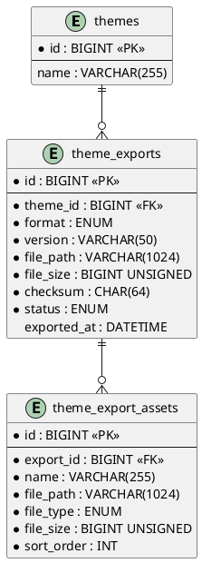

# 06.32 - Theme Exports

| Field       | Value                          |
|-------------|--------------------------------|
| Project     | GsmUi                          |
| Domain      | Themes - Exports               |
| Version     | 1.0.0                          |
| Status      | Draft                          |
| Created     | 2026-07-15                     |

---

## Overview

This document defines the database schema for theme export packages in GsmUi. Exports are generated artifacts — CSS files, JSON configs, Tailwind presets, or SCSS bundles — produced from a theme's resolved tokens and settings. Each export can contain multiple assets (fonts, images, CSS partials) and tracks its build status, file size, and integrity checksum.

---

## Tables

### theme_exports

Generated export packages for themes (CSS files, JSON config, Tailwind preset).

| Column        | Type             | Constraints                        |
|---------------|------------------|------------------------------------|
| id            | BIGINT           | PK, AUTO_INCREMENT                 |
| theme_id      | BIGINT UNSIGNED  | FK → themes.id, NOT NULL           |
| format        | ENUM             | NOT NULL — css, json, tailwind, scss |
| version       | VARCHAR(50)      | NOT NULL                           |
| file_path     | VARCHAR(1024)    | NOT NULL                           |
| file_size     | BIGINT UNSIGNED  | NOT NULL                           |
| checksum      | CHAR(64)         | NOT NULL — SHA-256 hash            |
| status        | ENUM             | NOT NULL — pending, building, ready, failed |
| exported_at   | DATETIME         | NULLABLE                           |
| created_at    | TIMESTAMP        | NULLABLE                           |
| updated_at    | TIMESTAMP        | NULLABLE                           |
| deleted_at    | TIMESTAMP        | NULLABLE                           |

**Indexes:**

| Name                              | Columns        | Type    |
|-----------------------------------|----------------|---------|
| PRIMARY                           | id             | PK      |
| theme_exports_theme_id_index      | theme_id       | INDEX   |
| theme_exports_format_index        | format         | INDEX   |
| theme_exports_status_index        | status         | INDEX   |

**Relationships:**

- `belongsTo` Theme (`theme_id` → `themes.id`)
- `hasMany` ThemeExportAsset

---

### theme_export_assets

Individual files within an export package (fonts, images, CSS partials).

| Column        | Type             | Constraints                        |
|---------------|------------------|------------------------------------|
| id            | BIGINT           | PK, AUTO_INCREMENT                 |
| export_id     | BIGINT UNSIGNED  | FK → theme_exports.id, NOT NULL    |
| name          | VARCHAR(255)     | NOT NULL                           |
| file_path     | VARCHAR(1024)    | NOT NULL                           |
| file_type     | ENUM             | NOT NULL — css, json, font, image, other |
| file_size     | BIGINT UNSIGNED  | NOT NULL                           |
| sort_order    | INT              | NOT NULL, DEFAULT 0                |
| created_at    | TIMESTAMP        | NULLABLE                           |
| updated_at    | TIMESTAMP        | NULLABLE                           |
| deleted_at    | TIMESTAMP        | NULLABLE                           |

**Indexes:**

| Name                              | Columns        | Type    |
|-----------------------------------|----------------|---------|
| PRIMARY                           | id             | PK      |
| theme_export_assets_export_id_index | export_id    | INDEX   |
| theme_export_assets_sort_order_index | sort_order  | INDEX   |

**Relationships:**

- `belongsTo` ThemeExport (`export_id` → `theme_exports.id`)

---

## Migrations

### create_theme_exports_table

```php
Schema::create('theme_exports', function (Blueprint $table) {
    $table->id();
    $table->foreignId('theme_id')->constrained('themes')->cascadeOnDelete();
    $table->enum('format', ['css', 'json', 'tailwind', 'scss']);
    $table->string('version', 50);
    $table->string('file_path', 1024);
    $table->unsignedBigInteger('file_size');
    $table->char('checksum', 64);
    $table->enum('status', ['pending', 'building', 'ready', 'failed']);
    $table->dateTime('exported_at')->nullable();
    $table->timestamps();
    $table->softDeletes();

    $table->index('format');
    $table->index('status');
});
```

### create_theme_export_assets_table

```php
Schema::create('theme_export_assets', function (Blueprint $table) {
    $table->id();
    $table->foreignId('export_id')->constrained('theme_exports')->cascadeOnDelete();
    $table->string('name');
    $table->string('file_path', 1024);
    $table->enum('file_type', ['css', 'json', 'font', 'image', 'other']);
    $table->unsignedBigInteger('file_size');
    $table->integer('sort_order')->default(0);
    $table->timestamps();
    $table->softDeletes();

    $table->index('sort_order');
});
```

---

## Model Stubs

### ThemeExport

```php
class ThemeExport extends Model
{
    use SoftDeletes;

    protected $fillable = [
        'theme_id', 'format', 'version', 'file_path', 'file_size',
        'checksum', 'status', 'exported_at',
    ];

    protected $casts = [
        'file_size' => 'integer',
        'exported_at' => 'datetime',
    ];

    public function theme(): BelongsTo
    {
        return $this->belongsTo(Theme::class);
    }

    public function assets(): HasMany
    {
        return $this->hasMany(ThemeExportAsset::class, 'export_id')->orderBy('sort_order');
    }

    public function isReady(): bool
    {
        return $this->status === 'ready';
    }
}
```

### ThemeExportAsset

```php
class ThemeExportAsset extends Model
{
    use SoftDeletes;

    protected $fillable = [
        'export_id', 'name', 'file_path', 'file_type', 'file_size', 'sort_order',
    ];

    protected $casts = [
        'file_size' => 'integer',
    ];

    public function export(): BelongsTo
    {
        return $this->belongsTo(ThemeExport::class, 'export_id');
    }
}
```

---

## Entity Relationship Diagram (PlantUML)



---

## Export Lifecycle

```
pending → building → ready
                   → failed
```

1. **pending** — Export record created, queued for processing.
2. **building** — Worker actively compiling tokens into output format.
3. **ready** — Export complete; `file_path`, `file_size`, `checksum`, and `exported_at` are populated.
4. **failed** — Build errored; `file_path` may be empty. Retry creates a new record.

---

## Notes

- `checksum` is SHA-256 of the primary output file, used for cache invalidation and integrity verification.
- `version` follows semver and increments per-theme when tokens or settings change.
- Failed exports are not deleted; a retry produces a new `theme_exports` row rather than overwriting.
- Assets cascade-delete with their parent export; exporting a new version soft-deletes the old export and its assets.
- The `exported_at` timestamp is set only when `status` transitions to `ready`.

---

# Full SQL Definitions

## theme_exports — Complete DDL

```sql
CREATE TABLE theme_exports (
    id BIGINT UNSIGNED AUTO_INCREMENT PRIMARY KEY,
    theme_id BIGINT UNSIGNED NOT NULL,
    format ENUM('css', 'json', 'tailwind', 'scss') NOT NULL,
    version VARCHAR(50) NOT NULL,
    file_path VARCHAR(1024) NOT NULL,
    file_size BIGINT UNSIGNED NOT NULL DEFAULT 0,
    checksum CHAR(64) NOT NULL,
    status ENUM('pending', 'building', 'ready', 'failed') NOT NULL DEFAULT 'pending',
    error_message TEXT NULL,
    build_started_at DATETIME(3) NULL,
    exported_at DATETIME(3) NULL,
    tokens_count INT UNSIGNED NOT NULL DEFAULT 0,
    overrides_count INT UNSIGNED NOT NULL DEFAULT 0,
    metadata JSON NULL,
    created_at DATETIME(3) NOT NULL DEFAULT CURRENT_TIMESTAMP(3),
    updated_at DATETIME(3) NOT NULL DEFAULT CURRENT_TIMESTAMP(3) ON UPDATE CURRENT_TIMESTAMP(3),
    deleted_at DATETIME(3) NULL,

    INDEX theme_exports_theme_id_index (theme_id),
    INDEX theme_exports_format_index (format),
    INDEX theme_exports_status_index (status),
    INDEX theme_exports_version_index (version),
    INDEX theme_exports_exported_at_index (exported_at),
    INDEX theme_exports_created_at_index (created_at),
    INDEX theme_exports_deleted_at_index (deleted_at),

    CONSTRAINT theme_exports_theme_id_foreign
        FOREIGN KEY (theme_id) REFERENCES themes(id) ON DELETE CASCADE
) ENGINE=InnoDB DEFAULT CHARSET=utf8mb4 COLLATE=utf8mb4_unicode_ci;
```

## theme_export_assets — Complete DDL

```sql
CREATE TABLE theme_export_assets (
    id BIGINT UNSIGNED AUTO_INCREMENT PRIMARY KEY,
    export_id BIGINT UNSIGNED NOT NULL,
    name VARCHAR(255) NOT NULL,
    file_path VARCHAR(1024) NOT NULL,
    file_type ENUM('css', 'json', 'font', 'image', 'other') NOT NULL,
    file_size BIGINT UNSIGNED NOT NULL DEFAULT 0,
    checksum CHAR(64) NOT NULL,
    mime_type VARCHAR(100) NULL,
    sort_order INT NOT NULL DEFAULT 0,
    created_at DATETIME(3) NOT NULL DEFAULT CURRENT_TIMESTAMP(3),
    updated_at DATETIME(3) NOT NULL DEFAULT CURRENT_TIMESTAMP(3) ON UPDATE CURRENT_TIMESTAMP(3),
    deleted_at DATETIME(3) NULL,

    INDEX theme_export_assets_export_id_index (export_id),
    INDEX theme_export_assets_file_type_index (file_type),
    INDEX theme_export_assets_sort_order_index (sort_order),
    INDEX theme_export_assets_deleted_at_index (deleted_at),

    CONSTRAINT theme_export_assets_export_id_foreign
        FOREIGN KEY (export_id) REFERENCES theme_exports(id) ON DELETE CASCADE
) ENGINE=InnoDB DEFAULT CHARSET=utf8mb4 COLLATE=utf8mb4_unicode_ci;
```

---

# Extended Migration Examples

## theme_exports Migration with Full Indexes

```php
Schema::create('theme_exports', function (Blueprint $table) {
    $table->id();
    $table->foreignId('theme_id')->constrained('themes')->cascadeOnDelete();
    $table->enum('format', ['css', 'json', 'tailwind', 'scss']);
    $table->string('version', 50);
    $table->string('file_path', 1024);
    $table->unsignedBigInteger('file_size')->default(0);
    $table->char('checksum', 64);
    $table->enum('status', ['pending', 'building', 'ready', 'failed'])->default('pending');
    $table->text('error_message')->nullable();
    $table->dateTime('build_started_at')->nullable();
    $table->dateTime('exported_at')->nullable();
    $table->unsignedInteger('tokens_count')->default(0);
    $table->unsignedInteger('overrides_count')->default(0);
    $table->json('metadata')->nullable();
    $table->timestamps();
    $table->softDeletes();

    $table->index('format');
    $table->index('status');
    $table->index('version');
    $table->index('exported_at');
    $table->index('created_at');
    $table->index('deleted_at');
});
```

## theme_export_assets Migration with Full Indexes

```php
Schema::create('theme_export_assets', function (Blueprint $table) {
    $table->id();
    $table->foreignId('export_id')->constrained('theme_exports')->cascadeOnDelete();
    $table->string('name');
    $table->string('file_path', 1024);
    $table->enum('file_type', ['css', 'json', 'font', 'image', 'other']);
    $table->unsignedBigInteger('file_size')->default(0);
    $table->char('checksum', 64);
    $table->string('mime_type', 100)->nullable();
    $table->integer('sort_order')->default(0);
    $table->timestamps();
    $table->softDeletes();

    $table->index('file_type');
    $table->index('sort_order');
    $table->index('deleted_at');
});
```

---

# Extended Model Definitions

## ThemeExport Model

```php
class ThemeExport extends Model
{
    use SoftDeletes;

    protected $fillable = [
        'theme_id', 'format', 'version', 'file_path', 'file_size',
        'checksum', 'status', 'error_message', 'build_started_at',
        'exported_at', 'tokens_count', 'overrides_count', 'metadata',
    ];

    protected $casts = [
        'file_size' => 'integer',
        'tokens_count' => 'integer',
        'overrides_count' => 'integer',
        'exported_at' => 'datetime',
        'build_started_at' => 'datetime',
        'metadata' => 'array',
    ];

    // Relationships
    public function theme(): BelongsTo
    {
        return $this->belongsTo(Theme::class);
    }

    public function assets(): HasMany
    {
        return $this->hasMany(ThemeExportAsset::class, 'export_id')
            ->orderBy('sort_order');
    }

    // Scopes
    public function scopeReady($query)
    {
        return $query->where('status', 'ready');
    }

    public function scopePending($query)
    {
        return $query->where('status', 'pending');
    }

    public function scopeBuilding($query)
    {
        return $query->where('status', 'building');
    }

    public function scopeFailed($query)
    {
        return $query->where('status', 'failed');
    }

    public function scopeForTheme($query, int $themeId)
    {
        return $query->where('theme_id', $themeId);
    }

    public function scopeForFormat($query, string $format)
    {
        return $query->where('format', $format);
    }

    public function scopeLatest($query, int $limit = 10)
    {
        return $query->orderByDesc('exported_at')->limit($limit);
    }

    // Accessors
    public function getIsReadyAttribute(): bool
    {
        return $this->status === 'ready';
    }

    public function getIsBuildingAttribute(): bool
    {
        return $this->status === 'building';
    }

    public function getIsFailedAttribute(): bool
    {
        return $this->status === 'failed';
    }

    public function getHumanFileSizeAttribute(): string
    {
        $bytes = $this->file_size;
        $units = ['B', 'KB', 'MB', 'GB'];
        $i = 0;
        while ($bytes >= 1024 && $i < count($units) - 1) {
            $bytes /= 1024;
            $i++;
        }
        return round($bytes, 2) . ' ' . $units[$i];
    }

    public function getDownloadUrlAttribute(): string
    {
        return route('themes.exports.download', [$this->theme_id, $this->id]);
    }

    // Methods
    public function markAsBuilding(): void
    {
        $this->update([
            'status' => 'building',
            'build_started_at' => now(),
        ]);
    }

    public function markAsReady(string $filePath, int $fileSize, string $checksum): void
    {
        $this->update([
            'status' => 'ready',
            'file_path' => $filePath,
            'file_size' => $fileSize,
            'checksum' => $checksum,
            'exported_at' => now(),
        ]);
    }

    public function markAsFailed(string $errorMessage): void
    {
        $this->update([
            'status' => 'failed',
            'error_message' => $errorMessage,
        ]);
    }
}
```

## ThemeExportAsset Model

```php
class ThemeExportAsset extends Model
{
    use SoftDeletes;

    protected $fillable = [
        'export_id', 'name', 'file_path', 'file_type', 'file_size',
        'checksum', 'mime_type', 'sort_order',
    ];

    protected $casts = [
        'file_size' => 'integer',
    ];

    // Relationships
    public function export(): BelongsTo
    {
        return $this->belongsTo(ThemeExport::class, 'export_id');
    }

    // Scopes
    public function scopeOfType($query, string $type)
    {
        return $query->where('file_type', $type);
    }

    public function scopeOrdered($query)
    {
        return $query->orderBy('sort_order');
    }

    // Accessors
    public function getHumanFileSizeAttribute(): string
    {
        $bytes = $this->file_size;
        $units = ['B', 'KB', 'MB', 'GB'];
        $i = 0;
        while ($bytes >= 1024 && $i < count($units) - 1) {
            $bytes /= 1024;
            $i++;
        }
        return round($bytes, 2) . ' ' . $units[$i];
    }

    public function getFullUrlAttribute(): string
    {
        return Storage::disk('public')->url($this->file_path);
    }
}
```

---

# Export Builder Service

```php
// app/Services/ThemeExportService.php

class ThemeExportService
{
    public function __construct(
        private ThemeTokenResolver $resolver,
        private ThemeTokenCache $cache,
    ) {}

    public function createExport(
        Theme $theme,
        string $format,
        ?User $user = null,
        ?Team $team = null
    ): ThemeExport {
        $export = ThemeExport::create([
            'theme_id' => $theme->id,
            'format' => $format,
            'version' => $this->getNextVersion($theme, $format),
            'file_path' => '',
            'file_size' => 0,
            'checksum' => '',
            'status' => 'pending',
        ]);

        // Dispatch build job
        dispatch(new BuildThemeExport($export, $user, $team));

        return $export;
    }

    public function buildExport(
        ThemeExport $export,
        ?User $user = null,
        ?Team $team = null
    ): void {
        $export->markAsBuilding();

        try {
            $theme = $export->theme;
            $tokens = $this->resolver->resolve($theme, $user, $team);

            $output = match($export->format) {
                'css' => $this->buildCss($tokens),
                'json' => $this->buildJson($tokens, $theme),
                'tailwind' => $this->buildTailwind($tokens, $theme),
                'scss' => $this->buildScss($tokens),
            };

            $filePath = $this->storeExport($export, $output);
            $fileSize = Storage::disk('public')->size($filePath);
            $checksum = hash_file('sha256', Storage::disk('public')->path($filePath));

            $export->markAsReady($filePath, $fileSize, $checksum);

            // Create asset records
            $this->createAssets($export, $filePath, $output);

        } catch (\Exception $e) {
            $export->markAsFailed($e->getMessage());
            throw $e;
        }
    }

    private function buildCss(array $tokens): string
    {
        $css = ":root {\n";

        foreach ($tokens as $groupName => $groupTokens) {
            $css .= "  /* {$groupName} */\n";
            foreach ($groupTokens as $key => $token) {
                $css .= "  {$key}: {$token['value']};\n";
            }
            $css .= "\n";
        }

        $css .= "}\n";
        return $css;
    }

    private function buildJson(array $tokens, Theme $theme): string
    {
        $data = [
            'theme' => [
                'name' => $theme->name,
                'slug' => $theme->slug,
                'version' => $theme->version,
            ],
            'tokens' => $tokens,
            'generated_at' => now()->toIso8601String(),
        ];

        return json_encode($data, JSON_PRETTY_PRINT | JSON_UNESCAPED_UNICODE);
    }

    private function buildTailwind(array $tokens, Theme $theme): string
    {
        $config = [
            'theme' => [
                'extend' => [
                    'colors' => [],
                    'spacing' => [],
                    'fontSize' => [],
                    'borderRadius' => [],
                    'boxShadow' => [],
                ],
            ],
        ];

        foreach ($tokens as $groupName => $groupTokens) {
            foreach ($groupTokens as $key => $token) {
                $cleanKey = str_replace('--gsmui-' . $groupName . '-', '', $key);

                switch ($groupName) {
                    case 'colors':
                        $config['theme']['extend']['colors'][$cleanKey] = $token['value'];
                        break;
                    case 'spacing':
                        $config['theme']['extend']['spacing'][$cleanKey] = $token['value'];
                        break;
                    case 'typography':
                        if (str_contains($key, 'font-size')) {
                            $config['theme']['extend']['fontSize'][$cleanKey] = $token['value'];
                        }
                        break;
                    case 'borders':
                        if (str_contains($key, 'radius')) {
                            $config['theme']['extend']['borderRadius'][$cleanKey] = $token['value'];
                        }
                        break;
                    case 'shadows':
                        $config['theme']['extend']['boxShadow'][$cleanKey] = $token['value'];
                        break;
                }
            }
        }

        return "module.exports = " . json_encode($config, JSON_PRETTY_PRINT | JSON_UNESCAPED_SLASHES) . ";\n";
    }

    private function buildScss(array $tokens): string
    {
        $scss = "// Generated by GsmUi Theme System\n// Do not edit manually\n\n";

        foreach ($tokens as $groupName => $groupTokens) {
            $scss .= "// {$groupName}\n";
            foreach ($groupTokens as $key => $token) {
                $scss .= "{$key}: {$token['value']};\n";
            }
            $scss .= "\n";
        }

        return $scss;
    }

    private function storeExport(ThemeExport $export, string $content): string
    {
        $extension = match($export->format) {
            'css' => 'css',
            'json' => 'json',
            'tailwind' => 'js',
            'scss' => 'scss',
        };

        $fileName = "{$export->theme->slug}-v{$export->version}.{$extension}";
        $filePath = "themes/{$export->theme_id}/exports/{$fileName}";

        Storage::disk('public')->put($filePath, $content);

        return $filePath;
    }

    private function createAssets(ThemeExport $export, string $mainPath, string $content): void
    {
        $extension = pathinfo($mainPath, PATHINFO_EXTENSION);
        $fileType = match($extension) {
            'css' => 'css',
            'json' => 'json',
            'js' => 'json',
            'scss' => 'css',
            default => 'other',
        };

        ThemeExportAsset::create([
            'export_id' => $export->id,
            'name' => pathinfo($mainPath, PATHINFO_FILENAME),
            'file_path' => $mainPath,
            'file_type' => $fileType,
            'file_size' => Storage::disk('public')->size($mainPath),
            'checksum' => hash_file('sha256', Storage::disk('public')->path($mainPath)),
            'mime_type' => $this->getMimeType($extension),
            'sort_order' => 0,
        ]);
    }

    private function getMimeType(string $extension): string
    {
        return match($extension) {
            'css' => 'text/css',
            'json' => 'application/json',
            'js' => 'application/javascript',
            'scss' => 'text/x-scss',
            default => 'application/octet-stream',
        };
    }

    private function getNextVersion(Theme $theme, string $format): string
    {
        $latest = ThemeExport::where('theme_id', $theme->id)
            ->where('format', $format)
            ->where('status', 'ready')
            ->orderByDesc('version')
            ->first();

        if (!$latest) {
            return '1.0.0';
        }

        $parts = explode('.', $latest->version);
        $parts[2] = (int)($parts[2] ?? 0) + 1;

        return implode('.', $parts);
    }

    public function getLatestReadyExport(int $themeId, string $format): ?ThemeExport
    {
        return ThemeExport::where('theme_id', $themeId)
            ->where('format', $format)
            ->where('status', 'ready')
            ->orderByDesc('exported_at')
            ->first();
    }

    public function cleanupOldExports(int $themeId, string $format, int $keepCount = 5): int
    {
        $exports = ThemeExport::where('theme_id', $themeId)
            ->where('format', $format)
            ->orderByDesc('exported_at')
            ->skip($keepCount)
            ->get();

        $deleted = 0;
        foreach ($exports as $export) {
            // Delete files from storage
            foreach ($export->assets as $asset) {
                Storage::disk('public')->delete($asset->file_path);
            }
            $export->delete();
            $deleted++;
        }

        return $deleted;
    }
}
```

---

# Export Job

```php
// app/Jobs/BuildThemeExport.php

class BuildThemeExport implements ShouldQueue
{
    use Dispatchable, InteractsWithQueue, Queueable, SerializesModels;

    public int $tries = 3;
    public int $timeout = 300; // 5 minutes

    public function __construct(
        public ThemeExport $export,
        public ?User $user = null,
        public ?Team $team = null,
    ) {}

    public function handle(ThemeExportService $service): void
    {
        $service->buildExport($this->export, $this->user, $this->team);
    }

    public function failed(\Throwable $exception): void
    {
        $this->export->markAsFailed($exception->getMessage());

        // Notify author
        if ($this->export->theme->author) {
            Notification::send($this->export->theme->author, new ExportFailedNotification(
                $this->export,
                $exception->getMessage()
            ));
        }
    }
}
```

---

# Export Controller

```php
// app/Http/Controllers/ThemeExportController.php

class ThemeExportController extends Controller
{
    public function index(Theme $theme): JsonResponse
    {
        $exports = ThemeExport::where('theme_id', $theme->id)
            ->with('assets')
            ->orderByDesc('created_at')
            ->paginate(20);

        return response()->json(['exports' => $exports]);
    }

    public function store(Theme $theme, Request $request): JsonResponse
    {
        $validated = $request->validate([
            'format' => 'required|in:css,json,tailwind,scss',
        ]);

        $service = app(ThemeExportService::class);
        $export = $service->createExport(
            $theme,
            $validated['format'],
            $request->user(),
            $request->user()->currentTeam
        );

        return response()->json(['export' => $export], 201);
    }

    public function show(Theme $theme, ThemeExport $export): JsonResponse
    {
        $export->load('assets');
        return response()->json(['export' => $export]);
    }

    public function download(Theme $theme, ThemeExport $export): Response
    {
        if ($export->status !== 'ready') {
            abort(404, 'Export not ready');
        }

        $mainAsset = $export->assets()->first();
        if (!$mainAsset) {
            abort(404, 'Export file not found');
        }

        return Storage::disk('public')->download(
            $mainAsset->file_path,
            basename($mainAsset->file_path)
        );
    }

    public function css(Theme $theme, Request $request): Response
    {
        $service = app(ThemeExportService::class);
        $export = $service->getLatestReadyExport($theme->id, 'css');

        if (!$export) {
            // Generate on-the-fly
            $resolver = app(ThemeTokenResolver::class);
            $css = $resolver->generateCss(
                $theme,
                $request->user(),
                $request->user()?->currentTeam
            );
            return response($css, 200, ['Content-Type' => 'text/css']);
        }

        $mainAsset = $export->assets()->first();
        return Storage::disk('public')->download($mainAsset->file_path);
    }

    public function destroy(Theme $theme, ThemeExport $export): JsonResponse
    {
        // Delete files
        foreach ($export->assets as $asset) {
            Storage::disk('public')->delete($asset->file_path);
        }

        $export->delete();

        return response()->json(['message' => 'Export deleted']);
    }
}
```

---

# Export Observer

```php
// app/Observers/ThemeExportObserver.php

class ThemeExportObserver
{
    public function created(ThemeExport $export): void
    {
        Log::info('Theme export created', [
            'export_id' => $export->id,
            'theme_id' => $export->theme_id,
            'format' => $export->format,
        ]);
    }

    public function updated(ThemeExport $export): void
    {
        if ($export->wasChanged('status')) {
            Log::info('Theme export status changed', [
                'export_id' => $export->id,
                'from' => $export->getOriginal('status'),
                'to' => $export->status,
            ]);

            if ($export->status === 'ready') {
                event(new ThemeExportReady($export));
            }

            if ($export->status === 'failed') {
                event(new ThemeExportFailed($export));
            }
        }
    }

    public function deleted(ThemeExport $export): void
    {
        // Clean up assets
        foreach ($export->assets()->withTrashed()->get() as $asset) {
            Storage::disk('public')->delete($asset->file_path);
            $asset->forceDelete();
        }

        Log::info('Theme export deleted', [
            'export_id' => $export->id,
            'theme_id' => $export->theme_id,
        ]);
    }
}
```

---

# Export Events

```php
// app/Events/ThemeExportReady.php
class ThemeExportReady
{
    use Dispatchable, SerializesModels;

    public function __construct(public ThemeExport $export) {}
}

// app/Events/ThemeExportFailed.php
class ThemeExportFailed
{
    use Dispatchable, SerializesModels;

    public function __construct(public ThemeExport $export) {}
}
```

---

# Export Notification

```php
// app/Notifications/ExportReadyNotification.php

class ExportReadyNotification extends Notification
{
    use Queueable;

    public function __construct(public ThemeExport $export) {}

    public function via(User $notifiable): array
    {
        return ['mail', 'database'];
    }

    public function toMail(User $notifiable): MailMessage
    {
        return (new MailMessage)
            ->subject('Theme Export Ready')
            ->line("Your {$this->export->format} export for \"{$this->export->theme->name}\" is ready.")
            ->line("Version: {$this->export->version}")
            ->line("File size: {$this->export->human_file_size}")
            ->action('Download Export', $this->export->download_url);
    }

    public function toArray(User $notifiable): array
    {
        return [
            'export_id' => $this->export->id,
            'theme_id' => $this->export->theme_id,
            'theme_name' => $this->export->theme->name,
            'format' => $this->export->format,
            'version' => $this->export->version,
        ];
    }
}

// app/Notifications/ExportFailedNotification.php

class ExportFailedNotification extends Notification
{
    use Queueable;

    public function __construct(
        public ThemeExport $export,
        public string $errorMessage,
    ) {}

    public function via(User $notifiable): array
    {
        return ['mail', 'database'];
    }

    public function toMail(User $notifiable): MailMessage
    {
        return (new MailMessage)
            ->subject('Theme Export Failed')
            ->line("Your {$this->export->format} export for \"{$this->export->theme->name}\" failed.")
            ->line("Error: {$this->errorMessage}")
            ->action('View Theme', route('themes.show', $this->export->theme_id));
    }

    public function toArray(User $notifiable): array
    {
        return [
            'export_id' => $this->export->id,
            'theme_id' => $this->export->theme_id,
            'theme_name' => $this->export->theme->name,
            'format' => $this->export->format,
            'error' => $this->errorMessage,
        ];
    }
}
```

---

# Export Factory

```php
// database/factories/ThemeExportFactory.php

class ThemeExportFactory extends Factory
{
    protected $model = ThemeExport::class;

    public function definition(): array
    {
        $format = $this->faker->randomElement(['css', 'json', 'tailwind', 'scss']);
        $version = $this->faker->semver();

        return [
            'theme_id' => Theme::factory(),
            'format' => $format,
            'version' => $version,
            'file_path' => "themes/1/exports/default-v{$version}." . ($format === 'tailwind' ? 'js' : $format),
            'file_size' => $this->faker->numberBetween(1024, 102400),
            'checksum' => hash('sha256', $this->faker->sha256),
            'status' => 'ready',
            'exported_at' => $this->faker->dateTimeBetween('-1 month', 'now'),
        ];
    }

    public function pending(): static
    {
        return $this->state(fn (array $attributes) => [
            'status' => 'pending',
            'exported_at' => null,
        ]);
    }

    public function building(): static
    {
        return $this->state(fn (array $attributes) => [
            'status' => 'building',
            'build_started_at' => now(),
            'exported_at' => null,
        ]);
    }

    public function failed(): static
    {
        return $this->state(fn (array $attributes) => [
            'status' => 'failed',
            'error_message' => 'Build failed: token validation error',
            'exported_at' => null,
        ]);
    }

    public function css(): static
    {
        return $this->state(fn (array $attributes) => ['format' => 'css']);
    }

    public function json(): static
    {
        return $this->state(fn (array $attributes) => ['format' => 'json']);
    }

    public function tailwind(): static
    {
        return $this->state(fn (array $attributes) => ['format' => 'tailwind']);
    }

    public function scss(): static
    {
        return $this->state(fn (array $attributes) => ['format' => 'scss']);
    }
}

// database/factories/ThemeExportAssetFactory.php

class ThemeExportAssetFactory extends Factory
{
    protected $model = ThemeExportAsset::class;

    public function definition(): array
    {
        return [
            'export_id' => ThemeExport::factory(),
            'name' => $this->faker->word(),
            'file_path' => "themes/1/exports/" . $this->faker->uuid() . ".css",
            'file_type' => $this->faker->randomElement(['css', 'json', 'font', 'image', 'other']),
            'file_size' => $this->faker->numberBetween(1024, 102400),
            'checksum' => hash('sha256', $this->faker->sha256),
            'mime_type' => $this->faker->randomElement(['text/css', 'application/json']),
            'sort_order' => 0,
        ];
    }
}
```

---

# Export Testing

```php
// tests/Feature/ThemeExportTest.php

class ThemeExportTest extends TestCase
{
    use RefreshDatabase;

    public function test_export_creation(): void
    {
        $theme = Theme::factory()->create();
        $service = app(ThemeExportService::class);

        $export = $service->createExport($theme, 'css');

        $this->assertDatabaseHas('theme_exports', [
            'theme_id' => $theme->id,
            'format' => 'css',
            'status' => 'pending',
        ]);
    }

    public function test_export_build_css(): void
    {
        $theme = Theme::factory()->create();
        $group = ThemeTokenGroup::factory()->create(['theme_id' => $theme->id, 'slug' => 'colors']);
        ThemeToken::factory()->create([
            'group_id' => $group->id,
            'token_key' => '--gsmui-color-primary',
            'value' => '#0ea5e9',
        ]);

        $service = app(ThemeExportService::class);
        $export = ThemeExport::create([
            'theme_id' => $theme->id,
            'format' => 'css',
            'version' => '1.0.0',
            'file_path' => '',
            'file_size' => 0,
            'checksum' => '',
            'status' => 'pending',
        ]);

        $service->buildExport($export);

        $export->refresh();
        $this->assertEquals('ready', $export->status);
        $this->assertNotNull($export->file_path);
        $this->assertGreaterThan(0, $export->file_size);
        $this->assertNotNull($export->checksum);
        $this->assertNotNull($export->exported_at);
    }

    public function test_export_build_json(): void
    {
        $theme = Theme::factory()->create();
        $group = ThemeTokenGroup::factory()->create(['theme_id' => $theme->id]);
        ThemeToken::factory()->create(['group_id' => $group->id]);

        $service = app(ThemeExportService::class);
        $export = ThemeExport::create([
            'theme_id' => $theme->id,
            'format' => 'json',
            'version' => '1.0.0',
            'file_path' => '',
            'file_size' => 0,
            'checksum' => '',
            'status' => 'pending',
        ]);

        $service->buildExport($export);

        $export->refresh();
        $this->assertEquals('ready', $export->status);

        // Verify JSON content
        $content = Storage::disk('public')->get($export->file_path);
        $data = json_decode($content, true);
        $this->assertArrayHasKey('theme', $data);
        $this->assertArrayHasKey('tokens', $data);
    }

    public function test_export_version_incrementing(): void
    {
        $theme = Theme::factory()->create();
        $service = app(ThemeExportService::class);

        $export1 = $service->createExport($theme, 'css');
        $this->assertEquals('1.0.0', $export1->version);

        // Mark first as ready
        $export1->update(['status' => 'ready']);

        $export2 = $service->createExport($theme, 'css');
        $this->assertEquals('1.0.1', $export2->version);
    }

    public function test_old_export_cleanup(): void
    {
        $theme = Theme::factory()->create();
        $service = app(ThemeExportService::class);

        // Create 8 exports
        for ($i = 0; $i < 8; $i++) {
            ThemeExport::create([
                'theme_id' => $theme->id,
                'format' => 'css',
                'version' => "1.0.{$i}",
                'file_path' => "themes/{$theme->id}/exports/test-{$i}.css",
                'file_size' => 1024,
                'checksum' => hash('sha256', "test-{$i}"),
                'status' => 'ready',
                'exported_at' => now()->subDays(8 - $i),
            ]);
        }

        $deleted = $service->cleanupOldExports($theme->id, 'css', 5);
        $this->assertEquals(3, $deleted);

        $remaining = ThemeExport::where('theme_id', $theme->id)
            ->where('format', 'css')
            ->count();
        $this->assertEquals(5, $remaining);
    }

    public function test_asset_cascade_delete(): void
    {
        $export = ThemeExport::factory()->create();
        ThemeExportAsset::factory()->create(['export_id' => $export->id]);
        ThemeExportAsset::factory()->create(['export_id' => $export->id]);

        $export->delete();

        $this->assertSoftDeleted('theme_exports', ['id' => $export->id]);
        $this->assertSoftDeleted('theme_export_assets', ['export_id' => $export->id]);
    }

    public function test_theme_deletion_cascades_exports(): void
    {
        $theme = Theme::factory()->create();
        $export = ThemeExport::factory()->create(['theme_id' => $theme->id]);
        ThemeExportAsset::factory()->create(['export_id' => $export->id]);

        $theme->delete();

        $this->assertSoftDeleted('theme_exports', ['theme_id' => $theme->id]);
    }
}
```

---

# Export Cache Strategy

```php
class ThemeExportCache
{
    private const CACHE_PREFIX = 'theme_export:';
    private const CACHE_TTL = 86400; // 24 hours

    public function getLatestCss(int $themeId): ?string
    {
        $cacheKey = self::CACHE_PREFIX . $themeId . ':css:latest';

        return Cache::remember($cacheKey, self::CACHE_TTL, function () use ($themeId) {
            $export = ThemeExport::where('theme_id', $themeId)
                ->where('format', 'css')
                ->where('status', 'ready')
                ->orderByDesc('exported_at')
                ->first();

            if (!$export) {
                return null;
            }

            $asset = $export->assets()->first();
            if (!$asset) {
                return null;
            }

            return Storage::disk('public')->get($asset->file_path);
        });
    }

    public function flushThemeExports(int $themeId): void
    {
        $patterns = [
            self::CACHE_PREFIX . $themeId . ':*',
        ];

        foreach ($patterns as $pattern) {
            if (Cache::getStore() instanceof \Illuminate\Cache\RedisStore) {
                $redis = Cache::store('redis')->connection();
                $keys = $redis->keys($pattern);
                if (!empty($keys)) {
                    $redis->del($keys);
                }
            }
        }
    }
}
```

---

**Next:** [06.40 - Templates](06.40-templates.md)

---

# Export Formats — Detailed Specifications

## CSS Format

The CSS format generates a single `.css` file with CSS custom properties.

```css
/*
 * GsmUi Theme Export
 * Theme: Default
 * Version: 1.0.0
 * Generated: 2026-07-15T10:30:00.000000Z
 */

:root {
  /* Colors */
  --gsmui-color-primary: #0ea5e9;
  --gsmui-color-primary-50: #f0f9ff;
  --gsmui-color-primary-100: #e0f2fe;
  --gsmui-color-primary-200: #bae6fd;
  --gsmui-color-primary-300: #7dd3fc;
  --gsmui-color-primary-400: #38bdf8;
  --gsmui-color-primary-500: #0ea5e9;
  --gsmui-color-primary-600: #0284c7;
  --gsmui-color-primary-700: #0369a1;
  --gsmui-color-primary-800: #075985;
  --gsmui-color-primary-900: #0c4a6e;
  --gsmui-color-secondary: #64748b;
  --gsmui-color-accent: #8b5cf6;
  --gsmui-color-success: #22c55e;
  --gsmui-color-warning: #f59e0b;
  --gsmui-color-danger: #ef4444;
  --gsmui-color-info: #3b82f6;
  --gsmui-color-white: #ffffff;
  --gsmui-color-black: #000000;
  --gsmui-color-gray-50: #f9fafb;
  --gsmui-color-gray-100: #f3f4f6;
  --gsmui-color-gray-200: #e5e7eb;
  --gsmui-color-gray-300: #d1d5db;
  --gsmui-color-gray-400: #9ca3af;
  --gsmui-color-gray-500: #6b7280;
  --gsmui-color-gray-600: #4b5563;
  --gsmui-color-gray-700: #374151;
  --gsmui-color-gray-800: #1f2937;
  --gsmui-color-gray-900: #111827;

  /* Spacing */
  --gsmui-spacing-0: 0;
  --gsmui-spacing-px: 1px;
  --gsmui-spacing-0-5: 0.125rem;
  --gsmui-spacing-1: 0.25rem;
  --gsmui-spacing-1-5: 0.375rem;
  --gsmui-spacing-2: 0.5rem;
  --gsmui-spacing-2-5: 0.625rem;
  --gsmui-spacing-3: 0.75rem;
  --gsmui-spacing-3-5: 0.875rem;
  --gsmui-spacing-4: 1rem;
  --gsmui-spacing-5: 1.25rem;
  --gsmui-spacing-6: 1.5rem;
  --gsmui-spacing-7: 1.75rem;
  --gsmui-spacing-8: 2rem;
  --gsmui-spacing-9: 2.25rem;
  --gsmui-spacing-10: 2.5rem;
  --gsmui-spacing-11: 2.75rem;
  --gsmui-spacing-12: 3rem;
  --gsmui-spacing-14: 3.5rem;
  --gsmui-spacing-16: 4rem;
  --gsmui-spacing-20: 5rem;
  --gsmui-spacing-24: 6rem;

  /* Typography */
  --gsmui-font-family-sans: 'Inter', ui-sans-serif, system-ui, sans-serif;
  --gsmui-font-family-serif: 'Merriweather', ui-serif, Georgia, serif;
  --gsmui-font-family-mono: 'JetBrains Mono', ui-monospace, monospace;
  --gsmui-font-size-2xs: 0.625rem;
  --gsmui-font-size-xs: 0.75rem;
  --gsmui-font-size-sm: 0.875rem;
  --gsmui-font-size-base: 1rem;
  --gsmui-font-size-lg: 1.125rem;
  --gsmui-font-size-xl: 1.25rem;
  --gsmui-font-size-2xl: 1.5rem;
  --gsmui-font-size-3xl: 1.875rem;
  --gsmui-font-size-4xl: 2.25rem;
  --gsmui-font-size-5xl: 3rem;
  --gsmui-font-size-6xl: 3.75rem;
  --gsmui-font-size-7xl: 4.5rem;
  --gsmui-font-size-8xl: 6rem;
  --gsmui-font-size-9xl: 8rem;
  --gsmui-font-weight-thin: 100;
  --gsmui-font-weight-extralight: 200;
  --gsmui-font-weight-light: 300;
  --gsmui-font-weight-normal: 400;
  --gsmui-font-weight-medium: 500;
  --gsmui-font-weight-semibold: 600;
  --gsmui-font-weight-bold: 700;
  --gsmui-font-weight-extrabold: 800;
  --gsmui-font-weight-black: 900;
  --gsmui-leading-none: 1;
  --gsmui-leading-tight: 1.25;
  --gsmui-leading-snug: 1.375;
  --gsmui-leading-normal: 1.5;
  --gsmui-leading-relaxed: 1.625;
  --gsmui-leading-loose: 2;
  --gsmui-tracking-tighter: -0.05em;
  --gsmui-tracking-tight: -0.025em;
  --gsmui-tracking-normal: 0em;
  --gsmui-tracking-wide: 0.025em;
  --gsmui-tracking-wider: 0.05em;
  --gsmui-tracking-widest: 0.1em;

  /* Borders */
  --gsmui-border-width-0: 0px;
  --gsmui-border-width-1: 1px;
  --gsmui-border-width-2: 2px;
  --gsmui-border-width-4: 4px;
  --gsmui-border-width-8: 8px;
  --gsmui-border-color: #e5e7eb;
  --gsmui-border-style: solid;
  --gsmui-radius-none: 0px;
  --gsmui-radius-sm: 0.125rem;
  --gsmui-radius-md: 0.375rem;
  --gsmui-radius-lg: 0.5rem;
  --gsmui-radius-xl: 0.75rem;
  --gsmui-radius-2xl: 1rem;
  --gsmui-radius-3xl: 1.5rem;
  --gsmui-radius-full: 9999px;

  /* Shadows */
  --gsmui-shadow-sm: 0 1px 2px 0 rgba(0, 0, 0, 0.05);
  --gsmui-shadow-md: 0 4px 6px -1px rgba(0, 0, 0, 0.1), 0 2px 4px -2px rgba(0, 0, 0, 0.1);
  --gsmui-shadow-lg: 0 10px 15px -3px rgba(0, 0, 0, 0.1), 0 4px 6px -4px rgba(0, 0, 0, 0.1);
  --gsmui-shadow-xl: 0 20px 25px -5px rgba(0, 0, 0, 0.1), 0 8px 10px -6px rgba(0, 0, 0, 0.1);
  --gsmui-shadow-2xl: 0 25px 50px -12px rgba(0, 0, 0, 0.25);
  --gsmui-shadow-inner: inset 0 2px 4px 0 rgba(0, 0, 0, 0.05);
  --gsmui-shadow-none: 0 0 #0000;

  /* Z-Index */
  --gsmui-z-index-0: 0;
  --gsmui-z-index-10: 10;
  --gsmui-z-index-20: 20;
  --gsmui-z-index-30: 30;
  --gsmui-z-index-40: 40;
  --gsmui-z-index-50: 50;
  --gsmui-z-index-dropdown: 1000;
  --gsmui-z-index-sticky: 1020;
  --gsmui-z-index-fixed: 1030;
  --gsmui-z-index-modal-backdrop: 1040;
  --gsmui-z-index-modal: 1050;
  --gsmui-z-index-popover: 1060;
  --gsmui-z-index-tooltip: 1070;

  /* Transitions */
  --gsmui-duration-75: 75ms;
  --gsmui-duration-100: 100ms;
  --gsmui-duration-150: 150ms;
  --gsmui-duration-200: 200ms;
  --gsmui-duration-300: 300ms;
  --gsmui-duration-500: 500ms;
  --gsmui-duration-700: 700ms;
  --gsmui-duration-1000: 1000ms;
  --gsmui-ease-linear: linear;
  --gsmui-ease-in: cubic-bezier(0.4, 0, 1, 1);
  --gsmui-ease-out: cubic-bezier(0, 0, 0.2, 1);
  --gsmui-ease-in-out: cubic-bezier(0.4, 0, 0.2, 1);
}
```

## JSON Format

```json
{
  "theme": {
    "name": "Default",
    "slug": "default",
    "version": "1.0.0"
  },
  "tokens": {
    "colors": {
      "--gsmui-color-primary": {
        "value": "#0ea5e9",
        "type": "color",
        "is_default": true,
        "has_override": false
      },
      "--gsmui-color-secondary": {
        "value": "#64748b",
        "type": "color",
        "is_default": true,
        "has_override": false
      }
    },
    "spacing": {
      "--gsmui-spacing-sm": {
        "value": "0.5rem",
        "type": "spacing",
        "is_default": true,
        "has_override": false
      }
    }
  },
  "generated_at": "2026-07-15T10:30:00.000000Z"
}
```

## Tailwind Format

```js
/** @type {import('tailwindcss').Config} */
module.exports = {
  theme: {
    extend: {
      colors: {
        primary: '#0ea5e9',
        secondary: '#64748b',
        accent: '#8b5cf6',
        success: '#22c55e',
        warning: '#f59e0b',
        danger: '#ef4444',
        info: '#3b82f6',
      },
      spacing: {
        'xs': '0.25rem',
        'sm': '0.5rem',
        'md': '1rem',
        'lg': '1.5rem',
        'xl': '2rem',
        '2xl': '3rem',
      },
      fontSize: {
        'xs': '0.75rem',
        'sm': '0.875rem',
        'base': '1rem',
        'lg': '1.125rem',
        'xl': '1.25rem',
        '2xl': '1.5rem',
        '3xl': '1.875rem',
        '4xl': '2.25rem',
        '5xl': '3rem',
      },
      borderRadius: {
        'sm': '0.125rem',
        'md': '0.375rem',
        'lg': '0.5rem',
        'xl': '0.75rem',
        '2xl': '1rem',
        'full': '9999px',
      },
      boxShadow: {
        'sm': '0 1px 2px 0 rgba(0, 0, 0, 0.05)',
        'md': '0 4px 6px -1px rgba(0, 0, 0, 0.1), 0 2px 4px -2px rgba(0, 0, 0, 0.1)',
        'lg': '0 10px 15px -3px rgba(0, 0, 0, 0.1), 0 4px 6px -4px rgba(0, 0, 0, 0.1)',
        'xl': '0 20px 25px -5px rgba(0, 0, 0, 0.1), 0 8px 10px -6px rgba(0, 0, 0, 0.1)',
      },
    },
  },
};
```

## SCSS Format

```scss
// Generated by GsmUi Theme System
// Theme: Default
// Version: 1.0.0
// Do not edit manually

// Colors
$gsmui-color-primary: #0ea5e9;
$gsmui-color-primary-50: #f0f9ff;
$gsmui-color-primary-100: #e0f2fe;
$gsmui-color-secondary: #64748b;
$gsmui-color-accent: #8b5cf6;
$gsmui-color-success: #22c55e;
$gsmui-color-warning: #f59e0b;
$gsmui-color-danger: #ef4444;
$gsmui-color-info: #3b82f6;

// Spacing
$gsmui-spacing-xs: 0.25rem;
$gsmui-spacing-sm: 0.5rem;
$gsmui-spacing-md: 1rem;
$gsmui-spacing-lg: 1.5rem;
$gsmui-spacing-xl: 2rem;

// Typography
$gsmui-font-family-base: 'Inter', system-ui, sans-serif;
$gsmui-font-size-xs: 0.75rem;
$gsmui-font-size-sm: 0.875rem;
$gsmui-font-size-base: 1rem;
$gsmui-font-size-lg: 1.125rem;
$gsmui-font-size-xl: 1.25rem;

// Borders
$gsmui-border-color: #e5e7eb;
$gsmui-radius-sm: 0.25rem;
$gsmui-radius-md: 0.375rem;
$gsmui-radius-lg: 0.5rem;
$gsmui-radius-xl: 0.75rem;

// Shadows
$gsmui-shadow-sm: 0 1px 2px 0 rgba(0, 0, 0, 0.05);
$gsmui-shadow-md: 0 4px 6px -1px rgba(0, 0, 0, 0.1);
$gsmui-shadow-lg: 0 10px 15px -3px rgba(0, 0, 0, 0.1);
$gsmui-shadow-xl: 0 20px 25px -5px rgba(0, 0, 0, 0.1);

// CSS Custom Properties (for use in :root)
:root {
  --gsmui-color-primary: #{$gsmui-color-primary};
  --gsmui-color-secondary: #{$gsmui-color-secondary};
  --gsmui-spacing-sm: #{$gsmui-spacing-sm};
  --gsmui-spacing-md: #{$gsmui-spacing-md};
}
```

---

# Export Cleanup Command

```php
// app/Console/Commands/CleanupThemeExportsCommand.php

class CleanupThemeExportsCommand extends Command
{
    protected $signature = 'theme:cleanup-exports
                            {--keep=5 : Number of exports to keep per theme/format}
                            {--dry-run : Show what would be deleted without deleting}';

    protected $description = 'Clean up old theme exports keeping only the latest N per theme/format';

    public function handle(ThemeExportService $service): int
    {
        $keep = (int) $this->option('keep');
        $dryRun = $this->option('dry-run');

        $themeIds = ThemeExport::distinct()->pluck('theme_id');
        $formats = ['css', 'json', 'tailwind', 'scss'];
        $totalDeleted = 0;

        foreach ($themeIds as $themeId) {
            foreach ($formats as $format) {
                $exports = ThemeExport::where('theme_id', $themeId)
                    ->where('format', $format)
                    ->orderByDesc('exported_at')
                    ->skip($keep)
                    ->get();

                foreach ($exports as $export) {
                    if ($dryRun) {
                        $this->line("Would delete: Export #{$export->id} ({$export->version}, {$export->format})");
                    } else {
                        foreach ($export->assets as $asset) {
                            Storage::disk('public')->delete($asset->file_path);
                        }
                        $export->delete();
                        $this->line("Deleted: Export #{$export->id} ({$export->version}, {$export->format})");
                    }
                    $totalDeleted++;
                }
            }
        }

        $this->info("{$totalDeleted} exports " . ($dryRun ? 'would be' : 'were') . " deleted.");

        return Command::SUCCESS;
    }
}
```

---

# Export API Routes

```php
// routes/api.php

Route::prefix('themes/{theme}/exports')->group(function () {
    Route::get('/', [ThemeExportController::class, 'index']);
    Route::post('/', [ThemeExportController::class, 'store']);
    Route::get('/{export}', [ThemeExportController::class, 'show']);
    Route::get('/{export}/download', [ThemeExportController::class, 'download'])->name('themes.exports.download');
    Route::delete('/{export}', [ThemeExportController::class, 'destroy']);
    Route::get('/css/latest', [ThemeExportController::class, 'css']);
});
```

---

# Export Download Tracking

```sql
-- Track export downloads for analytics
CREATE TABLE theme_export_downloads (
    id BIGINT UNSIGNED AUTO_INCREMENT PRIMARY KEY,
    export_id BIGINT UNSIGNED NOT NULL,
    user_id BIGINT UNSIGNED NULL,
    ip_address VARCHAR(45) NULL,
    user_agent VARCHAR(255) NULL,
    downloaded_at DATETIME(3) NOT NULL DEFAULT CURRENT_TIMESTAMP(3),

    INDEX theme_export_downloads_export_id_index (export_id),
    INDEX theme_export_downloads_user_id_index (user_id),
    INDEX theme_export_downloads_downloaded_at_index (downloaded_at),

    CONSTRAINT theme_export_downloads_export_id_foreign
        FOREIGN KEY (export_id) REFERENCES theme_exports(id) ON DELETE CASCADE,
    CONSTRAINT theme_export_downloads_user_id_foreign
        FOREIGN KEY (user_id) REFERENCES users(id) ON DELETE SET NULL
) ENGINE=InnoDB DEFAULT CHARSET=utf8mb4 COLLATE=utf8mb4_unicode_ci;
```

```php
// Tracking downloads
class ThemeExportDownloadTracker
{
    public function track(ThemeExport $export, ?User $user = null): void
    {
        ThemeExportDownload::create([
            'export_id' => $export->id,
            'user_id' => $user?->id,
            'ip_address' => request()->ip(),
            'user_agent' => request()->userAgent(),
            'downloaded_at' => now(),
        ]);
    }

    public function getDownloadCount(int $exportId): int
    {
        return ThemeExportDownload::where('export_id', $exportId)->count();
    }

    public function getDownloadsByTheme(int $themeId): int
    {
        return ThemeExportDownload::whereHas('export', function ($q) use ($themeId) {
            $q->where('theme_id', $themeId);
        })->count();
    }
}
```

---

**Next:** [06.40 - Templates](06.40-templates.md)

---

# Export Integrity Verification

```php
class ThemeExportIntegrityVerifier
{
    public function verify(ThemeExport $export): array
    {
        $results = [
            'checksum_valid' => false,
            'file_exists' => false,
            'file_size_valid' => false,
            'assets_valid' => false,
            'errors' => [],
        ];

        $mainAsset = $export->assets()->first();
        if (!$mainAsset) {
            $results['errors'][] = 'No asset record found';
            return $results;
        }

        $fullPath = Storage::disk('public')->path($mainAsset->file_path);
        if (!file_exists($fullPath)) {
            $results['errors'][] = "File not found: {$fullPath}";
            return $results;
        }
        $results['file_exists'] = true;

        $actualChecksum = hash_file('sha256', $fullPath);
        $results['checksum_valid'] = $actualChecksum === $export->checksum;
        if (!$results['checksum_valid']) {
            $results['errors'][] = "Checksum mismatch: expected {$export->checksum}, got {$actualChecksum}";
        }

        $actualSize = filesize($fullPath);
        $results['file_size_valid'] = $actualSize === $export->file_size;
        if (!$results['file_size_valid']) {
            $results['errors'][] = "File size mismatch: expected {$export->file_size}, got {$actualSize}";
        }

        $assets = $export->assets()->get();
        $assetsValid = true;
        foreach ($assets as $asset) {
            $assetPath = Storage::disk('public')->path($asset->file_path);
            if (!file_exists($assetPath)) {
                $results['errors'][] = "Asset file missing: {$asset->file_path}";
                $assetsValid = false;
                continue;
            }
            $assetChecksum = hash_file('sha256', $assetPath);
            if ($assetChecksum !== $asset->checksum) {
                $results['errors'][] = "Asset checksum mismatch: {$asset->name}";
                $assetsValid = false;
            }
        }
        $results['assets_valid'] = $assetsValid;

        return $results;
    }

    public function repairChecksums(ThemeExport $export): void
    {
        foreach ($export->assets as $asset) {
            $fullPath = Storage::disk('public')->path($asset->file_path);
            if (file_exists($fullPath)) {
                $asset->update([
                    'checksum' => hash_file('sha256', $fullPath),
                    'file_size' => filesize($fullPath),
                ]);
            }
        }

        $mainAsset = $export->assets()->first();
        if ($mainAsset) {
            $fullPath = Storage::disk('public')->path($mainAsset->file_path);
            if (file_exists($fullPath)) {
                $export->update([
                    'checksum' => hash_file('sha256', $fullPath),
                    'file_size' => filesize($fullPath),
                ]);
            }
        }
    }
}
```

---

# Export Storage Disk Configuration

```php
// config/filesystems.php

'disks' => [
    'theme-exports' => [
        'driver' => 'local',
        'root' => storage_path('app/public/themes/exports'),
        'url' => env('APP_URL') . '/storage/themes/exports',
        'visibility' => 'public',
    ],
],
```

## Storage Path Convention

```
storage/app/public/themes/exports/
  └── {theme_id}/
      └── v{version}/
          ├── {slug}-v{version}.css
          ├── {slug}-v{version}.json
          ├── {slug}-v{version}.js (tailwind config)
          └── {slug}-v{version}.scss
```

---

# Export Summary Statistics

```php
class ThemeExportStats
{
    public function getStats(int $themeId): array
    {
        $exports = ThemeExport::where('theme_id', $themeId)->get();

        return [
            'total_exports' => $exports->count(),
            'by_status' => [
                'pending' => $exports->where('status', 'pending')->count(),
                'building' => $exports->where('status', 'building')->count(),
                'ready' => $exports->where('status', 'ready')->count(),
                'failed' => $exports->where('status', 'failed')->count(),
            ],
            'by_format' => [
                'css' => $exports->where('format', 'css')->count(),
                'json' => $exports->where('format', 'json')->count(),
                'tailwind' => $exports->where('format', 'tailwind')->count(),
                'scss' => $exports->where('format', 'scss')->count(),
            ],
            'total_size_bytes' => $exports->sum('file_size'),
            'latest_export' => $exports->sortByDesc('exported_at')->first()?->toArray(),
            'average_build_time_seconds' => $this->calculateAverageBuildTime($exports),
        ];
    }

    private function calculateAverageBuildTime($exports): ?float
    {
        $completedExports = $exports->filter(function ($export) {
            return $export->build_started_at && $export->exported_at;
        });

        if ($completedExports->isEmpty()) {
            return null;
        }

        $totalSeconds = $completedExports->sum(function ($export) {
            return $export->build_started_at->diffInSeconds($export->exported_at);
        });

        return round($totalSeconds / $completedExports->count(), 2);
    }
}
```

---

**Next:** [06.40 - Templates](06.40-templates.md)
