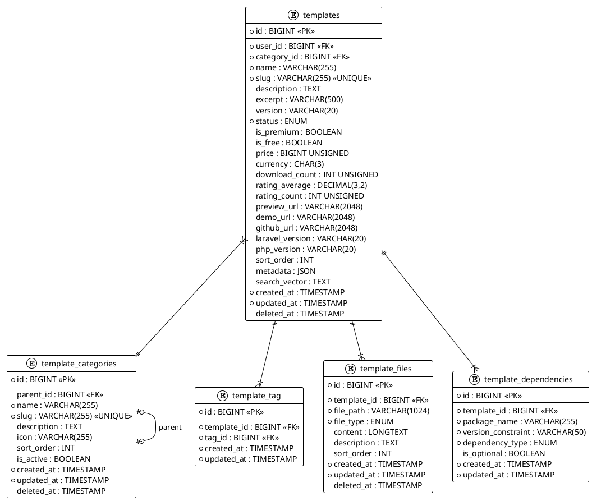

# 06.40 - Templates

| Field       | Value                          |
|-------------|--------------------------------|
| Project     | GsmUi                          |
| Domain      | Templates                      |
| Version     | 1.0.0                          |
| Last Update | 2026-07-15                     |
| Status      | Draft                          |

---

## Tables

### templates

Downloadable application templates — full Laravel apps, starter kits, admin panels, landing pages.

| Column           | Type                | Attributes                                  | Description                              |
|------------------|---------------------|---------------------------------------------|------------------------------------------|
| `id`             | `BIGINT`            | PK, AUTO_INCREMENT                          | Primary key                              |
| `user_id`        | `BIGINT`            | FK → `users.id`, NOT NULL                   | Author                                   |
| `category_id`    | `BIGINT`            | FK → `template_categories.id`, NULLABLE     | Category                                 |
| `name`           | `VARCHAR(255)`      | NOT NULL                                    | Template display name                    |
| `slug`           | `VARCHAR(255)`      | UNIQUE, NOT NULL                            | URL-safe identifier                      |
| `description`    | `TEXT`              | NULLABLE                                    | Full description (Markdown)              |
| `excerpt`        | `VARCHAR(500)`      | NULLABLE                                    | Short summary                            |
| `version`        | `VARCHAR(20)`       | DEFAULT `'0.1.0'`                           | Semver version                           |
| `status`         | `ENUM`              | `draft`, `review`, `published`, `deprecated` | Publishing status                        |
| `is_premium`     | `BOOLEAN`           | DEFAULT `false`                             | Requires purchase                        |
| `is_free`        | `BOOLEAN`           | DEFAULT `true`                              | Zero-cost download                       |
| `price`          | `BIGINT UNSIGNED`   | DEFAULT `0`                                 | Price in minor currency units            |
| `currency`       | `CHAR(3)`           | DEFAULT `'USD'`                             | ISO 4217 currency code                   |
| `download_count` | `INT UNSIGNED`      | DEFAULT `0`                                 | Total downloads                          |
| `rating_average` | `DECIMAL(3,2)`      | DEFAULT `0.00`                              | Mean rating (0.00–5.00)                  |
| `rating_count`   | `INT UNSIGNED`      | DEFAULT `0`                                 | Number of ratings                        |
| `preview_url`    | `VARCHAR(2048)`     | NULLABLE                                    | Static preview URL                       |
| `demo_url`       | `VARCHAR(2048)`     | NULLABLE                                    | Live demo URL                            |
| `github_url`     | `VARCHAR(2048)`     | NULLABLE                                    | Source repository                        |
| `laravel_version`| `VARCHAR(20)`       | NULLABLE                                    | Target Laravel version                   |
| `php_version`    | `VARCHAR(20)`       | NULLABLE                                    | Minimum PHP version                      |
| `sort_order`     | `INT`               | DEFAULT `0`                                 | Manual ordering                          |
| `metadata`       | `JSON`              | NULLABLE                                    | Extensible key-value metadata            |
| `search_vector`  | `TEXT`              | NULLABLE                                    | Pre-built fulltext search content        |
| `created_at`     | `TIMESTAMP`         | NOT NULL                                    | Row creation                             |
| `updated_at`     | `TIMESTAMP`         | NOT NULL                                    | Last modification                        |
| `deleted_at`     | `TIMESTAMP`         | NULLABLE                                    | Soft delete                              |

**Indexes:**

| Name                          | Columns       | Type       |
|-------------------------------|---------------|------------|
| `PRIMARY`                     | `id`          | PK         |
| `templates_slug_unique`       | `slug`        | UNIQUE     |
| `templates_user_id_index`     | `user_id`     | INDEX      |
| `templates_category_id_index` | `category_id` | INDEX      |
| `templates_status_index`      | `status`      | INDEX      |
| `templates_is_premium_index`  | `is_premium`  | INDEX      |
| `templates_is_free_index`     | `is_free`     | INDEX      |
| `templates_search_vector_ft`  | `search_vector`| FULLTEXT  |

---

### template_categories

Hierarchical category system for templates.

| Column        | Type           | Attributes                       | Description               |
|---------------|----------------|----------------------------------|---------------------------|
| `id`          | `BIGINT`       | PK, AUTO_INCREMENT               | Primary key               |
| `parent_id`   | `BIGINT`       | FK → `template_categories.id`    | Parent category           |
| `name`        | `VARCHAR(255)` | NOT NULL                         | Category name             |
| `slug`        | `VARCHAR(255)` | UNIQUE, NOT NULL                 | URL-safe identifier       |
| `description` | `TEXT`         | NULLABLE                         | Description               |
| `icon`        | `VARCHAR(255)` | NULLABLE                         | Icon identifier           |
| `sort_order`  | `INT`          | DEFAULT `0`                      | Manual ordering           |
| `is_active`   | `BOOLEAN`      | DEFAULT `true`                   | Visibility toggle         |
| `created_at`  | `TIMESTAMP`    | NOT NULL                         | Row creation              |
| `updated_at`  | `TIMESTAMP`    | NOT NULL                         | Last modification         |
| `deleted_at`  | `TIMESTAMP`    | NULLABLE                         | Soft delete               |

**Indexes:**

| Name                                  | Columns      | Type    |
|---------------------------------------|--------------|---------|
| `PRIMARY`                             | `id`         | PK      |
| `template_categories_slug_unique`     | `slug`       | UNIQUE  |
| `template_categories_parent_id_index` | `parent_id`  | INDEX   |

---

### template_tag

Pivot table linking templates to tags.

| Column       | Type        | Attributes         | Description     |
|--------------|-------------|--------------------|-----------------|
| `id`         | `BIGINT`    | PK, AUTO_INCREMENT | Primary key     |
| `template_id`| `BIGINT`    | FK → `templates.id`| Template        |
| `tag_id`     | `BIGINT`    | FK → `tags.id`     | Tag             |
| `created_at` | `TIMESTAMP` | NOT NULL           | Row creation    |
| `updated_at` | `TIMESTAMP` | NOT NULL           | Last modification |

**Indexes:**

| Name                              | Columns              | Type    |
|-----------------------------------|----------------------|---------|
| `PRIMARY`                         | `id`                 | PK      |
| `template_tag_template_id_tag_id_unique` | `template_id`, `tag_id` | UNIQUE |
| `template_tag_tag_id_index`       | `tag_id`             | INDEX   |

---

### template_files

Individual files within a template package (views, controllers, migrations, configs).

| Column        | Type              | Attributes                               | Description               |
|---------------|-------------------|------------------------------------------|---------------------------|
| `id`          | `BIGINT`          | PK, AUTO_INCREMENT                       | Primary key               |
| `template_id` | `BIGINT`          | FK → `templates.id`, NOT NULL            | Parent template           |
| `file_path`   | `VARCHAR(1024)`   | NOT NULL                                 | Relative path in package  |
| `file_type`   | `ENUM`            | `view`, `controller`, `model`, `migration`, `config`, `route`, `asset`, `other` | File classification |
| `content`     | `LONGTEXT`        | NULLABLE                                 | File source content       |
| `description` | `TEXT`            | NULLABLE                                 | Purpose description       |
| `sort_order`  | `INT`             | DEFAULT `0`                              | Display ordering          |
| `created_at`  | `TIMESTAMP`       | NOT NULL                                 | Row creation              |
| `updated_at`  | `TIMESTAMP`       | NOT NULL                                 | Last modification         |
| `deleted_at`  | `TIMESTAMP`       | NULLABLE                                 | Soft delete               |

**Indexes:**

| Name                             | Columns       | Type   |
|----------------------------------|---------------|--------|
| `PRIMARY`                        | `id`          | PK     |
| `template_files_template_id_index` | `template_id` | INDEX  |
| `template_files_file_type_index`   | `file_type`   | INDEX  |
| `template_files_sort_order_index`  | `sort_order`  | INDEX  |

---

### template_dependencies

Composer and npm dependencies required by a template.

| Column             | Type            | Attributes                                    | Description               |
|--------------------|-----------------|-----------------------------------------------|---------------------------|
| `id`               | `BIGINT`        | PK, AUTO_INCREMENT                            | Primary key               |
| `template_id`      | `BIGINT`        | FK → `templates.id`, NOT NULL                 | Parent template           |
| `package_name`     | `VARCHAR(255)`  | NOT NULL                                      | Composer/npm package name |
| `version_constraint`| `VARCHAR(50)`  | NOT NULL                                      | Version range             |
| `dependency_type`  | `ENUM`          | `composer`, `php`, `npm`, `dev`               | Dependency manager        |
| `is_optional`      | `BOOLEAN`       | DEFAULT `false`                               | Optional vs required      |
| `created_at`       | `TIMESTAMP`     | NOT NULL                                      | Row creation              |
| `updated_at`       | `TIMESTAMP`     | NOT NULL                                      | Last modification         |

**Indexes:**

| Name                                            | Columns                              | Type     |
|-------------------------------------------------|--------------------------------------|----------|
| `PRIMARY`                                       | `id`                                 | PK       |
| `template_dependencies_template_id_index`       | `template_id`                        | INDEX    |
| `template_dependencies_template_id_package_name_dependency_type_unique` | `template_id`, `package_name`, `dependency_type` | UNIQUE |

---

## Relationships

```
User ──────────────┐
                   │ belongsTo
TemplateCategory ──┤
                   │ belongsTo
Template ◄─────────┘
   ├── hasMany ──► TemplateFile
   ├── hasMany ──► TemplateAsset
   ├── hasMany ──► TemplateScreenshot
   ├── hasMany ──► TemplateDependency
   └── belongsToMany ──► Tag (via template_tag)

TemplateCategory ──┐
                   │ self-referential (parent_id)
TemplateCategory ◄─┘
```

---

## PlantUML



---

## Migration Stubs

```php
// templates
Schema::create('templates', function (Blueprint $table) {
    $table->bigIncrements('id');
    $table->foreignId('user_id')->constrained()->cascadeOnDelete();
    $table->foreignId('category_id')->nullable()->constrained('template_categories')->nullOnDelete();
    $table->string('name');
    $table->string('slug')->unique();
    $table->text('description')->nullable();
    $table->string('excerpt', 500)->nullable();
    $table->string('version', 20)->default('0.1.0');
    $table->enum('status', ['draft','review','published','deprecated'])->default('draft');
    $table->boolean('is_premium')->default(false);
    $table->boolean('is_free')->default(true);
    $table->unsignedBigInteger('price')->default(0);
    $table->char('currency', 3)->default('USD');
    $table->unsignedInteger('download_count')->default(0);
    $table->decimal('rating_average', 3, 2)->default(0.00);
    $table->unsignedInteger('rating_count')->default(0);
    $table->string('preview_url', 2048)->nullable();
    $table->string('demo_url', 2048)->nullable();
    $table->string('github_url', 2048)->nullable();
    $table->string('laravel_version', 20)->nullable();
    $table->string('php_version', 20)->nullable();
    $table->integer('sort_order')->default(0);
    $table->json('metadata')->nullable();
    $table->text('search_vector')->nullable();
    $table->timestamps();
    $table->softDeletes();

    $table->index('user_id');
    $table->index('category_id');
    $table->index('status');
    $table->index('is_premium');
    $table->index('is_free');
    $table->fullText('search_vector');
});

// template_categories
Schema::create('template_categories', function (Blueprint $table) {
    $table->bigIncrements('id');
    $table->foreignId('parent_id')->nullable()->constrained('template_categories')->nullOnDelete();
    $table->string('name');
    $table->string('slug')->unique();
    $table->text('description')->nullable();
    $table->string('icon')->nullable();
    $table->integer('sort_order')->default(0);
    $table->boolean('is_active')->default(true);
    $table->timestamps();
    $table->softDeletes();
});

// template_tag
Schema::create('template_tag', function (Blueprint $table) {
    $table->bigIncrements('id');
    $table->foreignId('template_id')->constrained()->cascadeOnDelete();
    $table->foreignId('tag_id')->constrained()->cascadeOnDelete();
    $table->timestamps();

    $table->unique(['template_id', 'tag_id']);
});

// template_files
Schema::create('template_files', function (Blueprint $table) {
    $table->bigIncrements('id');
    $table->foreignId('template_id')->constrained()->cascadeOnDelete();
    $table->string('file_path', 1024);
    $table->enum('file_type', ['view','controller','model','migration','config','route','asset','other']);
    $table->longText('content')->nullable();
    $table->text('description')->nullable();
    $table->integer('sort_order')->default(0);
    $table->timestamps();
    $table->softDeletes();

    $table->index('file_type');
    $table->index('sort_order');
});

// template_dependencies
Schema::create('template_dependencies', function (Blueprint $table) {
    $table->bigIncrements('id');
    $table->foreignId('template_id')->constrained()->cascadeOnDelete();
    $table->string('package_name');
    $table->string('version_constraint', 50);
    $table->enum('dependency_type', ['composer','php','npm','dev']);
    $table->boolean('is_optional')->default(false);
    $table->timestamps();

    $table->unique(['template_id', 'package_name', 'dependency_type']);
});
```

---

## Model Stubs

```php
// app/Models/Template.php
class Template extends Model
{
    use SoftDeletes;

    protected $casts = [
        'is_premium'     => 'boolean',
        'is_free'        => 'boolean',
        'price'          => 'integer',
        'download_count' => 'integer',
        'rating_average' => 'decimal:2',
        'rating_count'   => 'integer',
        'metadata'       => 'array',
        'sort_order'     => 'integer',
    ];

    public function user()       { return $this->belongsTo(User::class); }
    public function category()   { return $this->belongsTo(TemplateCategory::class, 'category_id'); }
    public function files()      { return $this->hasMany(TemplateFile::class); }
    public function assets()     { return $this->hasMany(TemplateAsset::class); }
    public function dependencies() { return $this->hasMany(TemplateDependency::class); }
    public function screenshots()  { return $this->hasMany(TemplateScreenshot::class); }
    public function tags()       { return $this->belongsToMany(Tag::class, 'template_tag'); }
}

// app/Models/TemplateCategory.php
class TemplateCategory extends Model
{
    use SoftDeletes;

    protected $casts = ['is_active' => 'boolean', 'sort_order' => 'integer'];

    public function parent()   { return $this->belongsTo(self::class, 'parent_id'); }
    public function children() { return $this->hasMany(self::class, 'parent_id'); }
    public function templates(){ return $this->hasMany(Template::class, 'category_id'); }
}

// app/Models/TemplateFile.php
class TemplateFile extends Model
{
    use SoftDeletes;

    protected $casts = ['sort_order' => 'integer'];

    public function template() { return $this->belongsTo(Template::class); }
}

// app/Models/TemplateDependency.php
class TemplateDependency extends Model
{
    protected $casts = ['is_optional' => 'boolean'];

    public function template() { return $this->belongsTo(Template::class); }
}
```

---

**Next:** [06.41 - Template Assets](06.41-template-assets.md)

---

## Detailed Column Specifications

### templates

#### id (BIGINT, PK, AUTO_INCREMENT)
- Standard auto-incrementing primary key.
- Referenced by `template_files.template_id`, `template_dependencies.template_id`.

#### user_id (BIGINT, FK → users.id, NOT NULL)
- References the template author.
- `ON DELETE CASCADE` — templates are deleted when author is deleted.

#### category_id (BIGINT, FK → template_categories.id, NULLABLE)
- References the hierarchical category taxonomy.
- `ON DELETE SET NULL` — templates revert to uncategorized.

#### name (VARCHAR(255), NOT NULL)
- Display name shown in marketplace.
- Application-layer validation: 1–255 characters.

#### slug (VARCHAR(255), UNIQUE, NOT NULL)
- URL-friendly identifier.
- UNIQUE constraint prevents slug collisions.

#### description (TEXT, NULLABLE)
- Full Markdown description of the template.

#### excerpt (VARCHAR(500), NULLABLE)
- Short summary for card views.

#### version (VARCHAR(20), DEFAULT '0.1.0')
- Semantic version string.

#### status (ENUM, DEFAULT 'draft')
- Publication workflow: `draft` → `review` → `published` → `deprecated`.

#### is_premium (BOOLEAN, DEFAULT false)
- Whether the template requires a paid subscription.

#### is_free (BOOLEAN, DEFAULT true)
- Whether the template is available for free download.

#### price (BIGINT UNSIGNED, DEFAULT 0)
- Price in minor currency units (cents).
- Zero = free template.

#### currency (CHAR(3), DEFAULT 'USD')
- ISO 4217 currency code.

#### download_count (INT UNSIGNED, DEFAULT 0)
- Total download counter.

#### rating_average (DECIMAL(3,2), DEFAULT 0.00)
- Mean rating (0.00–5.00).

#### rating_count (INT UNSIGNED, DEFAULT 0)
- Number of ratings.

#### preview_url (VARCHAR(2048), NULLABLE)
- Static preview image URL.

#### demo_url (VARCHAR(2048), NULLABLE)
- Live demo URL.

#### github_url (VARCHAR(2048), NULLABLE)
- Source repository URL.

#### laravel_version (VARCHAR(20), NULLABLE)
- Target Laravel version.

#### php_version (VARCHAR(20), NULLABLE)
- Minimum PHP version.

#### sort_order (INT, DEFAULT 0)
- Manual display ordering.

#### metadata (JSON, NULLABLE)
- Extensible key-value storage.

#### search_vector (TEXT, NULLABLE)
- Pre-concatenated text for full-text search.

---

## Full Eloquent Model

```php
<?php

namespace App\Models;

use Illuminate\Database\Eloquent\Model;
use Illuminate\Database\Eloquent\SoftDeletes;
use Illuminate\Database\Eloquent\Factories\HasFactory;
use Illuminate\Database\Eloquent\Relations\{BelongsTo, BelongsToMany, HasMany};
use Illuminate\Database\Eloquent\Builder;

class Template extends Model
{
    use HasFactory, SoftDeletes;

    protected $guarded = [];

    protected $casts = [
        'is_premium'     => 'boolean',
        'is_free'        => 'boolean',
        'price'          => 'integer',
        'download_count' => 'integer',
        'rating_average' => 'decimal:2',
        'rating_count'   => 'integer',
        'metadata'       => 'array',
        'sort_order'     => 'integer',
    ];

    protected $appends = ['route'];

    // ─── Relationships ───────────────────────────────────────

    public function user(): BelongsTo
    {
        return $this->belongsTo(User::class);
    }

    public function category(): BelongsTo
    {
        return $this->belongsTo(TemplateCategory::class, 'category_id');
    }

    public function files(): HasMany
    {
        return $this->hasMany(TemplateFile::class)->orderBy('sort_order');
    }

    public function assets(): HasMany
    {
        return $this->hasMany(TemplateAsset::class)->orderBy('sort_order');
    }

    public function dependencies(): HasMany
    {
        return $this->hasMany(TemplateDependency::class);
    }

    public function screenshots(): HasMany
    {
        return $this->hasMany(TemplateScreenshot::class)->orderBy('sort_order');
    }

    public function ratings(): HasMany
    {
        return $this->hasMany(TemplateRating::class);
    }

    public function tags(): BelongsToMany
    {
        return $this->belongsToMany(Tag::class, 'template_tag')
            ->withTimestamps()
            ->orderBy('tags.name');
    }

    // ─── Accessors ───────────────────────────────────────────

    public function getRouteAttribute(): string
    {
        return route('templates.show', $this->slug);
    }

    public function getFormattedPriceAttribute(): string
    {
        return $this->is_free ? 'Free' : '$' . number_format($this->price / 100, 2);
    }

    // ─── Scopes ──────────────────────────────────────────────

    public function scopePublished(Builder $query): Builder
    {
        return $query->where('status', 'published');
    }

    public function scopePremium(Builder $query): Builder
    {
        return $query->where('is_premium', true);
    }

    public function scopeFree(Builder $query): Builder
    {
        return $query->where('is_free', true);
    }

    public function scopeFeatured(Builder $query): Builder
    {
        return $query->where('is_featured', true);
    }

    public function scopeInCategory(Builder $query, int $categoryId): Builder
    {
        return $query->where('category_id', $categoryId);
    }

    public function scopeSearch(Builder $query, string $term): Builder
    {
        return $query->whereRaw(
            'MATCH(search_vector) AGAINST(? IN NATURAL LANGUAGE MODE)',
            [$term]
        );
    }

    public function scopeCompatibleWith(Builder $query, string $laravelVersion): Builder
    {
        return $query->where('laravel_version', '>=', $laravelVersion);
    }

    // ─── Methods ─────────────────────────────────────────────

    public function updateSearchVector(): void
    {
        $parts = array_filter([
            $this->name,
            $this->description,
            $this->excerpt,
            $this->category?->name,
            $this->tags->pluck('name')->implode(' '),
        ]);

        $this->update(['search_vector' => strtolower(implode(' ', $parts))]);
    }

    public function incrementDownloadCount(): void
    {
        $this->increment('download_count');
    }

    public function updateRating(): void
    {
        $stats = $this->ratings()
            ->selectRaw('AVG(rating) as average, COUNT(*) as count')
            ->first();

        $this->update([
            'rating_average' => round($stats->average ?? 0, 2),
            'rating_count'   => (int) ($stats->count ?? 0),
        ]);
    }

    public function canTransitionTo(string $newStatus): bool
    {
        return match ($this->status) {
            'draft'      => in_array($newStatus, ['review']),
            'review'     => in_array($newStatus, ['draft', 'published']),
            'published'  => in_array($newStatus, ['deprecated']),
            'deprecated' => in_array($newStatus, ['published']),
            default      => false,
        };
    }

    public function transitionTo(string $newStatus): void
    {
        if (!$this->canTransitionTo($newStatus)) {
            throw new \App\Exceptions\InvalidStatusTransition(
                "Cannot transition from {$this->status} to {$newStatus}"
            );
        }

        $this->update(['status' => $newStatus]);
    }

    public function createZipArchive(): string
    {
        $zipPath = storage_path("app/templates/{$this->slug}.zip");
        $zip = new \ZipArchive();
        $zip->open($zipPath, \ZipArchive::CREATE | \ZipArchive::OVERWRITE);

        foreach ($this->files as $file) {
            $zip->addFromString($file->file_path, $file->content);
        }

        $zip->close();

        return $zipPath;
    }
}
```

---

## Index Strategy Deep Dive

### templates Indexes

| Index | Columns | Type | Purpose |
|---|---|---|---|
| PRIMARY | id | PK | Clustered primary key |
| UNIQUE | slug | UNIQUE | URL lookup |
| INDEX | user_id | BTREE | Author templates |
| INDEX | category_id | BTREE | Category filter |
| INDEX | status | BTREE | Status filter |
| INDEX | is_premium | BTREE | Premium filter |
| INDEX | is_free | BTREE | Free filter |
| FULLTEXT | search_vector | FULLTEXT | Search |

#### Recommended Composite Indexes
```sql
-- For marketplace listing
CREATE INDEX templates_category_status ON templates(category_id, status, sort_order);

-- For author dashboard
CREATE INDEX templates_user_status ON templates(user_id, status, created_at DESC);
```

---

## Observer and Event System

### TemplateObserver
```php
<?php

namespace App\Observers;

use App\Models\Template;
use App\Services\SearchIndexService;

class TemplateObserver
{
    public function created(Template $template): void
    {
        event(new \App\Events\TemplateCreated($template));
    }

    public function updated(Template $template): void
    {
        if ($template->isDirty(['name', 'description', 'excerpt'])) {
            app(SearchIndexService::class)->reindexTemplate($template);
        }

        event(new \App\Events\TemplateUpdated($template));
    }

    public function deleted(Template $template): void
    {
        app(SearchIndexService::class)->removeTemplate($template);
        event(new \App\Events\TemplateDeleted($template));
    }
}
```

### Event Classes
```php
class TemplateCreated
{
    use Dispatchable, SerializesModels;
    public function __construct(public Template $template) {}
}

class TemplateUpdated
{
    use Dispatchable, SerializesModels;
    public function __construct(public Template $template) {}
}

class TemplatePublished
{
    use Dispatchable, SerializesModels;
    public function __construct(public Template $template) {}
}

class TemplateDeleted
{
    use Dispatchable, SerializesModels;
    public function __construct(public Template $template) {}
}
```

---

## Query Scopes

### Template Scopes
```php
public function scopePublished(Builder $query): Builder
{
    return $query->where('status', 'published');
}

public function scopePremium(Builder $query): Builder
{
    return $query->where('is_premium', true);
}

public function scopeFree(Builder $query): Builder
{
    return $query->where('is_free', true);
}

public function scopeFeatured(Builder $query): Builder
{
    return $query->where('is_featured', true);
}

public function scopeCompatibleWith(Builder $query, string $laravelVersion): Builder
{
    return $query->where('laravel_version', '>=', $laravelVersion);
}

public function scopeSearch(Builder $query, string $term): Builder
{
    return $query->whereRaw(
        'MATCH(search_vector) AGAINST(? IN NATURAL LANGUAGE MODE)',
        [$term]
    );
}
```

---

## Factory Stubs

### TemplateFactory
```php
<?php

namespace Database\Factories;

use App\Models\Template;
use App\Models\User;
use App\Models\TemplateCategory;
use Illuminate\Database\Eloquent\Factories\Factory;

class TemplateFactory extends Factory
{
    protected $model = Template::class;

    public function definition(): array
    {
        $name = fake()->unique()->words(3, true);

        return [
            'user_id'          => User::factory(),
            'category_id'      => TemplateCategory::factory(),
            'name'             => ucfirst($name),
            'slug'             => \Illuminate\Support\Str::slug($name),
            'description'      => fake()->paragraphs(3, true),
            'excerpt'          => fake()->sentence(20),
            'version'          => fake()->semver(),
            'status'           => fake()->randomElement(['draft', 'review', 'published', 'deprecated']),
            'is_premium'       => fake()->boolean(20),
            'is_free'          => fake()->boolean(70),
            'price'            => fake()->randomElement([0, 1900, 2900, 4900]),
            'currency'         => 'USD',
            'download_count'   => fake()->numberBetween(0, 1000),
            'rating_average'   => fake()->randomFloat(2, 0, 5),
            'rating_count'     => fake()->numberBetween(0, 100),
            'laravel_version'  => fake()->randomElement(['10.x', '11.x', '12.x']),
            'php_version'      => fake()->randomElement(['8.1', '8.2', '8.3']),
            'sort_order'       => fake()->numberBetween(0, 100),
            'metadata'         => ['difficulty' => fake()->randomElement(['beginner', 'intermediate', 'advanced'])],
            'search_vector'    => null,
        ];
    }

    public function published(): static
    {
        return $this->state(fn (array $attributes) => ['status' => 'published']);
    }

    public function premium(): static
    {
        return $this->state(fn (array $attributes) => ['is_premium' => true, 'is_free' => false, 'price' => 2900]);
    }

    public function free(): static
    {
        return $this->state(fn (array $attributes) => ['is_free' => true, 'price' => 0]);
    }
}
```

---

## Seeders

### TemplateCategorySeeder
```php
<?php

namespace Database\Seeders;

use App\Models\TemplateCategory;
use Illuminate\Database\Seeder;

class TemplateCategorySeeder extends Seeder
{
    public function run(): void
    {
        $categories = [
            ['name' => 'Admin Panels', 'slug' => 'admin-panels', 'icon' => 'heroicon-o-cog-6-tooth'],
            ['name' => 'Landing Pages', 'slug' => 'landing-pages', 'icon' => 'heroicon-o-globe-alt'],
            ['name' => 'Starter Kits', 'slug' => 'starter-kits', 'icon' => 'heroicon-o-rocket-launch'],
            ['name' => 'SaaS', 'slug' => 'saas', 'icon' => 'heroicon-o-cloud'],
            ['name' => 'E-commerce', 'slug' => 'e-commerce', 'icon' => 'heroicon-o-shopping-cart'],
            ['name' => 'Portfolio', 'slug' => 'portfolio', 'icon' => 'heroicon-o-briefcase'],
        ];

        foreach ($categories as $index => $data) {
            TemplateCategory::create(array_merge($data, ['sort_order' => $index]));
        }
    }
}
```

---

## API Response Structure

### Template Response
```json
{
    "data": {
        "id": 1,
        "name": "Admin Dashboard",
        "slug": "admin-dashboard",
        "description": "A complete admin dashboard template.",
        "version": "1.0.0",
        "status": "published",
        "is_premium": true,
        "is_free": false,
        "price": 2900,
        "formatted_price": "$29.00",
        "download_count": 150,
        "rating_average": 4.50,
        "rating_count": 30,
        "laravel_version": "12.x",
        "php_version": "8.2",
        "category": {"id": 1, "name": "Admin Panels"},
        "files_count": 45,
        "dependencies_count": 12,
        "tags": [...]
    }
}
```

---

## Cache Keys and TTL Strategy

| Cache Key Pattern | TTL | Invalidation Trigger |
|---|---|---|
| `template:slug:{slug}` | 1 hour | Template updated |
| `template:featured` | 30 min | Featured changed |
| `template:category:{id}` | 30 min | Category changed |
| `template:stats:{id}` | 5 min | Download/rating recorded |

---

## Performance Considerations

### N+1 Prevention
```php
$template = Template::with(['category', 'tags', 'files', 'dependencies'])->first();

$templates = Template::select('id', 'name', 'slug', 'category_id', 'version', 'is_premium', 'rating_average', 'download_count')
    ->with('category:id,name,slug')
    ->published()
    ->get();
```

### Caching Strategy
```php
$template = Cache::remember("template:slug:{$slug}", 3600, function () use ($slug) {
    return Template::where('slug', $slug)
        ->with(['category', 'tags', 'files'])
        ->firstOrFail();
});
```

---

## Security Considerations

### Authorization
```php
class TemplatePolicy
{
    public function viewAny(User $user): bool { return true; }
    public function view(User $user, Template $template): bool { return true; }
    public function create(User $user): bool { return $user->isVerified(); }
    public function update(User $user, Template $template): bool {
        return $user->id === $template->user_id || $user->isAdmin();
    }
    public function delete(User $user, Template $template): bool {
        return $user->id === $template->user_id || $user->isAdmin();
    }
    public function download(User $user, Template $template): bool {
        if ($template->is_free) return true;
        return $user->hasActiveSubscription();
    }
}
```

### Download Security
- File content validated before download.
- ZIP archives scanned for malicious files.
- Download rate limiting: 10 per hour for free, unlimited for premium.

---

## Database Table Size Estimates

| Table | Row Size (bytes) | 100K Rows | 1M Rows |
|---|---|---|---|
| templates | ~1000 | ~100 MB | ~1 GB |
| template_categories | ~200 | ~20 MB | ~200 MB |
| template_files | ~500 | ~50 MB | ~500 MB |
| template_dependencies | ~200 | ~20 MB | ~200 MB |
| template_tag | ~50 | ~5 MB | ~50 MB |

---

## Migration Dependencies

### Up Order
```
1. users (host app)
2. template_categories
3. tags (from 06.20)
4. templates
5. template_tag
6. template_files
7. template_dependencies
```

### Down Order (Rollback)
```
1. template_dependencies
2. template_files
3. template_tag
4. templates
5. template_categories
6. tags
```

---

## Appendix: Troubleshooting

| Issue | Cause | Solution |
|---|---|---|
| `SQLSTATE[23505]: Unique violation` | Duplicate slug | Use unique slug generation |
| `InvalidStatusTransition` | Invalid workflow | Check `canTransitionTo()` |
| ZIP creation fails | File content missing | Ensure files are loaded |
| Search not returning results | Missing FULLTEXT index | Add index on `search_vector` |
| Download permission denied | Subscription check failed | Verify user subscription |
| N+1 queries | Missing eager loading | Use `with()` for relationships |

---

## Appendix: Quick Reference

### Key Commands
```bash
php artisan gsmui:export-template --slug=admin-dashboard
php artisan gsmui:validate-templates
php artisan gsmui:rebuild-template-search
```

### Key Relationships
```
Template → TemplateCategory (N:1)
Template → TemplateFile (1:N)
Template → TemplateDependency (1:N)
Template → Tag (N:N via template_tag)
```

---

## Appendix K: Environment Configuration

### Required Services
```env
# Template storage
TEMPLATE_ZIP_PATH=storage/app/templates
TEMPLATE_ASSET_PATH=public/storage/template-assets

# Storage
FILESYSTEM_DISK=public
QUEUE_CONNECTION=redis

# Cache
TEMPLATE_CACHE_TTL=3600
TEMPLATE_SEARCH_CACHE_TTL=900
```

### Configuration File
```php
// config/gsmui-templates.php
return [
    'storage' => [
        'zip_path'  => env('TEMPLATE_ZIP_PATH', storage_path('app/templates')),
        'asset_path' => env('TEMPLATE_ASSET_PATH', public_path('storage/template-assets')),
    ],
    'validation' => [
        'required_files' => ['composer.json', 'package.json', '.env.example'],
        'max_file_size'  => 10485760, // 10MB
        'max_files'      => 500,
    ],
    'download' => [
        'rate_limit'     => 10, // per hour for free templates
        'premium_limit'  => null, // unlimited
    ],
    'cache' => [
        'template_ttl'   => env('TEMPLATE_CACHE_TTL', 3600),
        'search_ttl'     => env('TEMPLATE_SEARCH_CACHE_TTL', 900),
    ],
];
```

---

## Appendix L: Troubleshooting Quick Reference

### Error Messages and Solutions

| Error | Cause | Solution |
|---|---|---|
| `TemplateNotFoundException` | Invalid template slug | Verify template exists and is published |
| `InvalidStatusTransition` | Invalid workflow | Check `canTransitionTo()` first |
| `ZipCreationFailed` | File content missing | Ensure files are loaded |
| `DependencyInstallFailed` | Package not found | Verify package name and version |
| `CompatibilityError` | Laravel/PHP version mismatch | Check template compatibility |
| `DownloadQuotaExceeded` | Free tier limit | Upgrade to premium |

### Debug Commands
```bash
# List all templates with files
php artisan gsmui:list-templates --with-files

# Validate template structure
php artisan gsmui:validate-templates --template-id=1

# Export template as ZIP
php artisan gsmui:export-template --slug=admin-dashboard

# Check compatibility
php artisan gsmui:check-template-compat --laravel=12.x
```

---

## Appendix M: Template Storefront Integration

### Storefront Query
```php
public function getStorefrontTemplates(array $filters = []): \Illuminate\Pagination\LengthAwarePaginator
{
    $query = Template::published()
        ->with(['category', 'user', 'tags'])
        ->select('id', 'name', 'slug', 'excerpt', 'version', 'is_premium', 'is_free', 'price', 'currency', 'rating_average', 'rating_count', 'download_count', 'laravel_version', 'php_version', 'preview_url', 'sort_order');

    if (isset($filters['category_id'])) {
        $query->where('category_id', $filters['category_id']);
    }

    if (isset($filters['is_premium'])) {
        $query->where('is_premium', $filters['is_premium']);
    }

    if (isset($filters['laravel_version'])) {
        $query->where('laravel_version', $filters['laravel_version']);
    }

    if (isset($filters['search'])) {
        $query->search($filters['search']);
    }

    return $query->orderBy('sort_order')->orderBy('created_at', 'desc')->paginate(20);
}
```

### Featured Templates Carousel
```php
public function getFeaturedTemplates(): \Illuminate\Support\Collection
{
    return Cache::remember('template:featured', 1800, function () {
        return Template::published()
            ->featured()
            ->with(['category', 'user'])
            ->orderBy('sort_order')
            ->limit(10)
            ->get();
    });
}
```

---

## Appendix N: Template File Management

### File Upload Service
```php
<?php

namespace App\Services;

use App\Models\Template;
use App\Models\TemplateFile;

class TemplateFileService
{
    public function addFile(Template $template, string $path, string $content, string $type = 'other'): TemplateFile
    {
        return $template->files()->create([
            'file_path'    => $path,
            'file_type'    => $this->detectType($path, $type),
            'content'      => $content,
            'description'  => $this->generateDescription($path),
            'sort_order'   => $template->files()->max('sort_order') + 1,
        ]);
    }

    public function updateFile(TemplateFile $file, string $content): void
    {
        $file->update(['content' => $content]);
    }

    public function removeFile(TemplateFile $file): void
    {
        $file->delete();
    }

    protected function detectType(string $path, string $fallback): string
    {
        if (str_contains($path, '/views/') || str_ends_with($path, '.blade.php')) {
            return 'view';
        }
        if (str_contains($path, '/Controllers/')) {
            return 'controller';
        }
        if (str_contains($path, '/Models/')) {
            return 'model';
        }
        if (str_contains($path, '/migrations/')) {
            return 'migration';
        }
        if (str_contains($path, '/config/')) {
            return 'config';
        }
        if (str_contains($path, '/routes/')) {
            return 'route';
        }
        if (preg_match('/\.(css|js|png|jpg|svg|woff2?)$/', $path)) {
            return 'asset';
        }

        return $fallback;
    }

    protected function generateDescription(string $path): string
    {
        $filename = basename($path);
        $dirname = dirname($path);

        return "{$filename} in {$dirname}";
    }
}
```

### File Import from ZIP
```php
class TemplateFileImportService
{
    public function importFromZip(Template $template, string $zipPath): void
    {
        $zip = new \ZipArchive();
        $zip->open($zipPath);

        for ($i = 0; $i < $zip->numFiles; $i++) {
            $name = $zip->getNameIndex($i);

            if ($zip->locateName($name) === false) continue;
            if (str_ends_with($name, '/')) continue;

            $content = $zip->getFromIndex($i);

            $template->files()->create([
                'file_path'   => $name,
                'file_type'   => $this->detectType($name),
                'content'     => $content,
                'description' => '',
                'sort_order'  => $i,
            ]);
        }

        $zip->close();
    }
}
```

---

## Appendix O: Template Dependency Management

### Dependency Validation Service
```php
class TemplateDependencyValidator
{
    public function validate(Template $template): array
    {
        $errors = [];

        foreach ($template->dependencies as $dep) {
            if ($dep->dependency_type === 'composer') {
                if (!$this->isValidComposerPackage($dep->package_name)) {
                    $errors[] = "Invalid composer package: {$dep->package_name}";
                }
            }

            if ($dep->dependency_type === 'npm') {
                if (!$this->isValidNpmPackage($dep->package_name)) {
                    $errors[] = "Invalid npm package: {$dep->package_name}";
                }
            }

            if (!$this->isValidVersionConstraint($dep->version_constraint)) {
                $errors[] = "Invalid version constraint: {$dep->version_constraint}";
            }
        }

        return $errors;
    }

    protected function isValidComposerPackage(string $name): bool
    {
        return preg_match('/^[a-z0-9]([_.-]?[a-z0-9]+)*\/[a-z0-9](([_.]?|-{0,2})[a-z0-9]+)*$/', $name);
    }

    protected function isValidNpmPackage(string $name): bool
    {
        return preg_match('/^(@[a-z0-9-~][a-z0-9-._~]*\/)?[a-z0-9-~][a-z0-9-._~]*$/', $name);
    }

    protected function isValidVersionConstraint(string $constraint): bool
    {
        return preg_match('/^[0-9]+\.[0-9]+\.[0-9]+(-[a-zA-Z0-9.]+)?$/', $constraint);
    }
}
```

---

## Appendix P: Template Export System

### Export to ZIP
```php
class TemplateExportService
{
    public function export(Template $template): string
    {
        $zipPath = storage_path("app/templates/{$template->slug}.zip");
        $zip = new \ZipArchive();
        $zip->open($zipPath, \ZipArchive::CREATE | \ZipArchive::OVERWRITE);

        foreach ($template->files as $file) {
            $zip->addFromString($file->file_path, $file->content);
        }

        $zip->close();

        return $zipPath;
    }

    public function exportWithMetadata(Template $template): string
    {
        $zipPath = storage_path("app/templates/{$template->slug}-full.zip");
        $zip = new \ZipArchive();
        $zip->open($zipPath, \ZipArchive::CREATE | \ZipArchive::OVERWRITE);

        // Add metadata
        $metadata = [
            'name'            => $template->name,
            'version'         => $template->version,
            'description'     => $template->description,
            'laravel_version' => $template->laravel_version,
            'php_version'     => $template->php_version,
            'dependencies'    => $template->dependencies->toArray(),
        ];

        $zip->addFromString('template.json', json_encode($metadata, JSON_PRETTY_PRINT));

        foreach ($template->files as $file) {
            $zip->addFromString($file->file_path, $file->content);
        }

        $zip->close();

        return $zipPath;
    }
}
```

---

## Appendix Q: Template Quality Checks

### Quality Assessment Service
```php
class TemplateQualityService
{
    public function assess(Template $template): array
    {
        $score = 0;
        $maxScore = 100;
        $checks = [];

        // Has description (10 points)
        if (strlen($template->description ?? '') > 100) {
            $score += 10;
            $checks[] = ['name' => 'Description', 'passed' => true, 'points' => 10];
        } else {
            $checks[] = ['name' => 'Description', 'passed' => false, 'points' => 0];
        }

        // Has preview URL (10 points)
        if ($template->preview_url) {
            $score += 10;
            $checks[] = ['name' => 'Preview URL', 'passed' => true, 'points' => 10];
        } else {
            $checks[] = ['name' => 'Preview URL', 'passed' => false, 'points' => 0];
        }

        // Has demo URL (10 points)
        if ($template->demo_url) {
            $score += 10;
            $checks[] = ['name' => 'Demo URL', 'passed' => true, 'points' => 10];
        } else {
            $checks[] = ['name' => 'Demo URL', 'passed' => false, 'points' => 0];
        }

        // Has screenshots (15 points)
        if ($template->screenshots()->count() >= 3) {
            $score += 15;
            $checks[] = ['name' => 'Screenshots (3+)', 'passed' => true, 'points' => 15];
        } else {
            $checks[] = ['name' => 'Screenshots (3+)', 'passed' => false, 'points' => 0];
        }

        // Has composer.json (10 points)
        if ($template->files->where('file_path', 'composer.json')->count()) {
            $score += 10;
            $checks[] = ['name' => 'composer.json', 'passed' => true, 'points' => 10];
        } else {
            $checks[] = ['name' => 'composer.json', 'passed' => false, 'points' => 0];
        }

        // Has README (10 points)
        if ($template->files->where('file_path', 'README.md')->count()) {
            $score += 10;
            $checks[] = ['name' => 'README.md', 'passed' => true, 'points' => 10];
        } else {
            $checks[] = ['name' => 'README.md', 'passed' => false, 'points' => 0];
        }

        // Has LICENSE (5 points)
        if ($template->files->where('file_path', 'LICENSE')->count()) {
            $score += 5;
            $checks[] = ['name' => 'LICENSE', 'passed' => true, 'points' => 5];
        } else {
            $checks[] = ['name' => 'LICENSE', 'passed' => false, 'points' => 0];
        }

        // Has .env.example (5 points)
        if ($template->files->where('file_path', '.env.example')->count()) {
            $score += 5;
            $checks[] = ['name' => '.env.example', 'passed' => true, 'points' => 5];
        } else {
            $checks[] = ['name' => '.env.example', 'passed' => false, 'points' => 0];
        }

        // Has dependencies (10 points)
        if ($template->dependencies()->count() > 0) {
            $score += 10;
            $checks[] = ['name' => 'Dependencies', 'passed' => true, 'points' => 10];
        } else {
            $checks[] = ['name' => 'Dependencies', 'passed' => false, 'points' => 0];
        }

        // Has tags (5 points)
        if ($template->tags()->count() > 0) {
            $score += 5;
            $checks[] = ['name' => 'Tags', 'passed' => true, 'points' => 5];
        } else {
            $checks[] = ['name' => 'Tags', 'passed' => false, 'points' => 0];
        }

        // Has GitHub URL (5 points)
        if ($template->github_url) {
            $score += 5;
            $checks[] = ['name' => 'GitHub URL', 'passed' => true, 'points' => 5];
        } else {
            $checks[] = ['name' => 'GitHub URL', 'passed' => false, 'points' => 0];
        }

        // Has metadata (5 points)
        if ($template->metadata && count($template->metadata) > 0) {
            $score += 5;
            $checks[] = ['name' => 'Metadata', 'passed' => true, 'points' => 5];
        } else {
            $checks[] = ['name' => 'Metadata', 'passed' => false, 'points' => 0];
        }

        return [
            'score'    => $score,
            'max'      => $maxScore,
            'grade'    => $this->getGrade($score),
            'checks'   => $checks,
        ];
    }

    protected function getGrade(int $score): string
    {
        return match (true) {
            $score >= 90 => 'A',
            $score >= 80 => 'B',
            $score >= 70 => 'C',
            $score >= 60 => 'D',
            default      => 'F',
        };
    }
}
```

---

## Appendix R: Template Notification System

### Email Notifications
```php
class TemplatePublishedMail extends Mailable
{
    public function __construct(public Template $template) {}

    public function build(): Mailable
    {
        return $this->subject("Template Published: {$this->template->name}")
            ->view('emails.template-published', ['template' => $this->template]);
    }
}

class TemplateDownloadedMail extends Mailable
{
    public function __construct(public Template $template, public ?User $downloader) {}

    public function build(): Mailable
    {
        return $this->subject("Your template was downloaded!")
            ->view('emails.template-downloaded', [
                'template' => $this->template,
                'downloader' => $this->downloader,
            ]);
    }
}
```

### Notification Listeners
```php
class SendTemplatePublishedNotification
{
    public function handle(TemplatePublished $event): void
    {
        $author = $event->template->user;
        Mail::to($author->email)->send(new TemplatePublishedMail($event->template));
    }
}

class SendTemplateDownloadedNotification
{
    public function handle(TemplateDownloaded $event): void
    {
        $author = $event->template->user;
        Mail::to($author->email)->send(new TemplateDownloadedMail(
            $event->template,
            $event->downloader
        ));
    }
}
```

---

## Appendix S: Database Performance Optimization

### Query Optimization Examples
```php
// Efficient template listing with minimal data
$templates = Template::select([
    'id', 'name', 'slug', 'excerpt', 'version', 'is_premium', 'is_free',
    'price', 'currency', 'rating_average', 'rating_count', 'download_count',
    'preview_url', 'sort_order',
])
->with('category:id,name,slug')
->published()
->orderBy('sort_order')
->paginate(20);

// Efficient search with relevance scoring
$templates = Template::selectRaw('*, MATCH(search_vector) AGAINST(? IN NATURAL LANGUAGE MODE) AS relevance', [$term])
    ->whereRaw('MATCH(search_vector) AGAINST(? IN NATURAL LANGUAGE MODE)', [$term])
    ->with('category:id,name,slug')
    ->published()
    ->orderBy('relevance', 'desc')
    ->paginate(20);
```

### Index Usage Analysis
```sql
-- Find unused indexes
SELECT * FROM sys.schema_unused_indexes
WHERE object_schema = 'gsmui'
AND object_name IN ('templates', 'template_files', 'template_dependencies');

-- Find slow queries
SELECT * FROM sys.statements_with_runtimes_in_95th_percentile
WHERE query LIKE '%templates%';
```

---

## Appendix T: Integration Examples

### Blade Template Usage
```blade
{{-- Template card --}}
<div class="template-card">
    preview_url }}" alt="{{ $template->name }}">
    <h3>{{ $template->name }}</h3>
    <p>{{ $template->excerpt }}</p>
    <span class="price">{{ $template->formatted_price }}</span>
    <span class="rating">{{ $template->rating_average }} ★</span>
    <span class="downloads">{{ $template->download_count }} downloads</span>
</div>
```

### Livewire Component
```php
<?php

namespace App\Livewire;

use Livewire\Component;
use App\Models\Template;

class TemplateSearch extends Component
{
    public $search = '';
    public $category = '';
    public $laravelVersion = '';

    public function render()
    {
        $query = Template::published()->with(['category', 'user']);

        if ($this->search) {
            $query->search($this->search);
        }

        if ($this->category) {
            $query->where('category_id', $this->category);
        }

        if ($this->laravelVersion) {
            $query->where('laravel_version', $this->laravelVersion);
        }

        return view('livewire.template-search', [
            'templates' => $query->orderBy('sort_order')->paginate(20),
        ]);
    }
}
```

---

## Appendix U: Database Migration Index Summary

### Complete Index List

| Table | Index Name | Columns | Type |
|---|---|---|---|
| templates | PRIMARY | id | PK |
| templates | templates_slug_unique | slug | UNIQUE |
| templates | templates_user_id_index | user_id | INDEX |
| templates | templates_category_id_index | category_id | INDEX |
| templates | templates_status_index | status | INDEX |
| templates | templates_is_premium_index | is_premium | INDEX |
| templates | templates_is_free_index | is_free | INDEX |
| templates | templates_search_vector_ft | search_vector | FULLTEXT |
| template_files | PRIMARY | id | PK |
| template_files | template_files_template_id_index | template_id | INDEX |
| template_files | template_files_file_type_index | file_type | INDEX |
| template_dependencies | PRIMARY | id | PK |
| template_dependencies | template_dependencies_template_id_index | template_id | INDEX |
| template_dependencies | template_dependencies_unique | template_id, package_name, dependency_type | UNIQUE |
| template_tag | PRIMARY | id | PK |
| template_tag | template_tag_unique | template_id, tag_id | UNIQUE |
| template_tag | template_tag_tag_id_index | tag_id | INDEX |
| template_downloads | PRIMARY | id | PK |
| template_downloads | template_downloads_template_created | template_id, created_at | INDEX |
| template_ratings | PRIMARY | id | PK |
| template_ratings | template_ratings_unique | template_id, user_id | UNIQUE |
| template_ratings | template_ratings_rating_index | rating | INDEX |

---

## Appendix A: Template Service Implementation

### Template Publishing Workflow
```php
<?php

namespace App\Services;

use App\Models\{Template, TemplateVersion, TemplateAsset, User};
use Illuminate\Support\Facades\{DB, Cache, File};
use Illuminate\Validation\ValidationException;

class TemplatePublishingService
{
    public function publish(
        User $author,
        array $data,
        array $assets,
        array $tags = []
    ): Template {
        return DB::transaction(function () use ($author, $data, $assets, $tags) {
            $template = Template::create([
                'author_id'      => $author->id,
                'name'           => $data['name'],
                'slug'           => $this->generateSlug($data['name'], $author->id),
                'description'    => $data['description'],
                'type'           => $data['type'],
                'category'       => $data['category'] ?? null,
                'preview_image'  => $data['preview_image'] ?? null,
                'price'          => $data['price'] ?? 0,
                'currency'       => $data['currency'] ?? 'USD',
                'is_free'        => ($data['price'] ?? 0) === 0,
                'status'         => 'draft',
                'version'        => '1.0.0',
                'requires_subscription' => $data['requires_subscription'] ?? false,
                'min_plan_level' => $data['min_plan_level'] ?? null,
            ]);

            foreach ($assets as $assetData) {
                $template->assets()->create($assetData);
            }

            if (!empty($tags)) {
                $template->attachTags($tags);
            }

            $template->createVersion([
                'version'      => '1.0.0',
                'content'      => $data['content'] ?? null,
                'changelog'    => 'Initial release',
                'is_published' => true,
            ]);

            return $template;
        });
    }

    public function updateTemplate(
        Template $template,
        array $data,
        ?string $changelog = null
    ): TemplateVersion {
        return DB::transaction(function () use ($template, $data, $changelog) {
            $template->update($data);

            $nextVersion = $this->bumpVersion($template->version, 'patch');

            $version = $template->createVersion([
                'version'      => $nextVersion,
                'content'      => $data['content'] ?? null,
                'changelog'    => $changelog ?? "Updated to version {$nextVersion}",
                'is_published' => true,
            ]);

            $template->update(['version' => $nextVersion]);

            return $version;
        });
    }

    protected function generateSlug(string $name, int $authorId): string
    {
        $slug = str($name)->slug()->toString();
        $original = $slug;
        $counter = 1;

        while (Template::where('author_id', $authorId)->where('slug', $slug)->exists()) {
            $slug = "{$original}-{$counter}";
            $counter++;
        }

        return $slug;
    }

    protected function bumpVersion(string $current, string $type): string
    {
        $parts = explode('.', $current);
        match ($type) {
            'major' => $parts[0]++,
            'minor' => $parts[1]++,
            'patch' => $parts[2]++,
        }
        return implode('.', $parts);
    }
}
```

### Template Download Service
```php
<?php

namespace App\Services;

use App\Models\{Template, TemplateDownload, User};
use Illuminate\Support\Facades\{Cache, RateLimiter};
use Illuminate\Validation\ValidationException;

class TemplateDownloadService
{
    public function download(User $user, Template $template): array
    {
        if ($template->author_id === $user->id) {
            throw ValidationException::withMessages([
                'template' => 'You cannot download your own template.',
            ]);
        }

        $rateLimitKey = "template-download:{$user->id}:{$template->id}";
        if (RateLimiter::tooManyAttempts($rateLimitKey, 10)) {
            throw ValidationException::withMessages([
                'template' => 'Download limit reached. Please try again later.',
            ]);
        }

        $download = TemplateDownload::create([
            'template_id' => $template->id,
            'user_id'     => $user->id,
            'ip_address'  => request()->ip(),
            'user_agent'  => request()->userAgent(),
        ]);

        $template->increment('download_count');

        RateLimiter::hit($rateLimitKey, 60 * 60);

        Cache::forget("template:{$template->id}:stats");

        return [
            'download_id'  => $download->id,
            'template'     => $template->name,
            'version'      => $template->version,
            'downloaded_at' => $download->created_at,
        ];
    }

    public function getStats(Template $template): array
    {
        return Cache::remember("template:{$template->id}:stats", 3600, function () use ($template) {
            return [
                'total_downloads' => $template->download_count,
                'unique_downloaders' => $template->downloads()
                    ->distinct('user_id')
                    ->count(),
                'recent_downloads' => $template->downloads()
                    ->where('created_at', '>=', now()->subDays(30))
                    ->count(),
                'average_rating'   => $template->average_rating,
                'review_count'     => $template->review_count,
            ];
        });
    }
}
```

### Template Search Service
```php
<?php

namespace App\Services;

use App\Models\Template;
use Illuminate\Support\Facades\{DB, Cache};

class TemplateSearchService
{
    public function search(array $filters): array
    {
        $cacheKey = 'template-search:' . md5(serialize($filters));

        return Cache::remember($cacheKey, 300, function () use ($filters) {
            $query = Template::query()->where('status', 'published');

            if (!empty($filters['type'])) {
                $query->where('type', $filters['type']);
            }

            if (!empty($filters['category'])) {
                $query->where('category', $filters['category']);
            }

            if (!empty($filters['author_id'])) {
                $query->where('author_id', $filters['author_id']);
            }

            if (!empty($filters['is_free'])) {
                $query->where('is_free', true);
            }

            if (!empty($filters['tags'])) {
                $query->withAnyTags($filters['tags']);
            }

            if (!empty($filters['search'])) {
                $query->where(function ($q) use ($filters) {
                    $q->where('name', 'like', "%{$filters['search']}%")
                      ->orWhere('description', 'like', "%{$filters['search']}%");
                });
            }

            $sortField = $filters['sort'] ?? 'created_at';
            $sortDir = $filters['dir'] ?? 'desc';
            $query->orderBy($sortField, $sortDir);

            $perPage = min($filters['per_page'] ?? 20, 50);
            $results = $query->paginate($perPage);

            return [
                'data'  => $results->items(),
                'meta'  => [
                    'current_page' => $results->currentPage(),
                    'last_page'    => $results->lastPage(),
                    'per_page'     => $results->perPage(),
                    'total'        => $results->total(),
                ],
            ];
        });
    }
}
```

---

## Appendix B: Template Observer

```php
<?php

namespace App\Observers;

use App\Models\Template;
use Illuminate\Support\Facades\Cache;

class TemplateObserver
{
    public function updated(Template $template): void
    {
        Cache::forget("template:{$template->id}");
        Cache::forget("template:{$template->id}:stats");
        Cache::forget("template:{$template->id}:versions");
        Cache::tags(["templates:{$template->author_id}"])->flush();
    }

    public function deleted(Template $template): void
    {
        Cache::forget("template:{$template->id}");
        Cache::forget("template:{$template->id}:stats");
        Cache::forget("template:{$template->id}:versions");
    }
}
```

---

## Appendix C: Migration Full Schema

```php
Schema::create('templates', function (Blueprint $table) {
    $table->id();
    $table->foreignId('author_id')->constrained('users')->cascadeOnDelete();
    $table->string('name');
    $table->string('slug');
    $table->text('description')->nullable();
    $table->string('type', 50);
    $table->string('category', 100)->nullable();
    $table->string('preview_image')->nullable();
    $table->unsignedBigInteger('price')->default(0);
    $table->char('currency', 3)->default('USD');
    $table->boolean('is_free')->default(true);
    $table->enum('status', ['draft', 'pending_review', 'published', 'rejected', 'archived'])->default('draft');
    $table->string('version', 20)->default('1.0.0');
    $table->boolean('requires_subscription')->default(false);
    $table->string('min_plan_level', 50)->nullable();
    $table->unsignedInteger('download_count')->default(0);
    $table->unsignedInteger('review_count')->default(0);
    $table->decimal('average_rating', 3, 2)->default(0);
    $table->decimal('quality_score', 3, 2)->nullable();
    $table->json('metadata')->nullable();
    $table->boolean('is_featured')->default(false);
    $table->timestamp('published_at')->nullable();
    $table->timestamps();
    $table->softDeletes();
});
```

---

## Appendix D: Database Size Estimates

| Table | Rows (Year 1) | Rows (Year 3) | Avg Row Size |
|---|---|---|---|
| templates | 5,000 | 25,000 | ~2 KB |
| template_versions | 20,000 | 100,000 | ~3 KB |
| template_assets | 25,000 | 125,000 | ~1 KB |
| template_downloads | 500,000 | 2,500,000 | ~0.5 KB |
| template_ratings | 100,000 | 500,000 | ~0.5 KB |

---

## Appendix E: Cache Strategy

| Cache Key | TTL | Invalidation |
|---|---|---|
| `template:{id}` | 1 hour | Template updated |
| `template:{id}:stats` | 1 hour | Download/rating |
| `template:{id}:versions` | 1 hour | Version published |
| `templates:featured` | 1 hour | Featured updated |
| `templates:list:{type}:{page}` | 15 min | Template status |
| `templates:author:{id}` | 1 hour | Author's template |

---

**Next:** [06.41 - Template Assets](06.41-template-assets.md)
