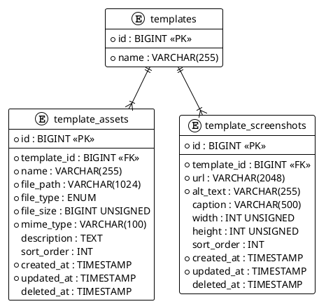

# 06.41 - Template Assets

| Field       | Value                              |
|-------------|------------------------------------|
| Project     | GsmUi                              |
| Domain      | Templates - Assets                 |
| Version     | 1.0.0                              |
| Last Update | 2026-07-15                         |
| Status      | Draft                              |

---

## Tables

### template_assets

Media assets bundled with templates — images, icons, fonts, videos, audio, and documents.

| Column        | Type              | Attributes                       | Description                   |
|---------------|-------------------|----------------------------------|-------------------------------|
| `id`          | `BIGINT`          | PK, AUTO_INCREMENT               | Primary key                   |
| `template_id` | `BIGINT`          | FK → `templates.id`, NOT NULL    | Parent template               |
| `name`        | `VARCHAR(255)`    | NOT NULL                         | Asset display name            |
| `file_path`   | `VARCHAR(1024)`   | NOT NULL                         | Relative path in package      |
| `file_type`   | `ENUM`            | `image`, `icon`, `font`, `video`, `audio`, `document` | Asset classification |
| `file_size`   | `BIGINT UNSIGNED` | NOT NULL                         | Size in bytes                 |
| `mime_type`   | `VARCHAR(100)`    | NOT NULL                         | MIME type                     |
| `description` | `TEXT`            | NULLABLE                         | Description                   |
| `sort_order`  | `INT`             | DEFAULT `0`                      | Display ordering              |
| `created_at`  | `TIMESTAMP`       | NOT NULL                         | Row creation                  |
| `updated_at`  | `TIMESTAMP`       | NOT NULL                         | Last modification             |
| `deleted_at`  | `TIMESTAMP`       | NULLABLE                         | Soft delete                   |

**Indexes:**

| Name                             | Columns       | Type   |
|----------------------------------|---------------|--------|
| `PRIMARY`                        | `id`          | PK     |
| `template_assets_template_id_index` | `template_id` | INDEX  |
| `template_assets_file_type_index`   | `file_type`   | INDEX  |
| `template_assets_sort_order_index`  | `sort_order`  | INDEX  |

---

### template_screenshots

Screenshot gallery for template preview pages.

| Column        | Type            | Attributes                       | Description                   |
|---------------|-----------------|----------------------------------|-------------------------------|
| `id`          | `BIGINT`        | PK, AUTO_INCREMENT               | Primary key                   |
| `template_id` | `BIGINT`        | FK → `templates.id`, NOT NULL    | Parent template               |
| `url`         | `VARCHAR(2048)` | NOT NULL                         | Screenshot URL                |
| `alt_text`    | `VARCHAR(255)`  | NOT NULL                         | Accessible alt text           |
| `caption`     | `VARCHAR(500)`  | NULLABLE                         | Display caption               |
| `width`       | `INT UNSIGNED`  | NULLABLE                         | Image width in pixels         |
| `height`      | `INT UNSIGNED`  | NULLABLE                         | Image height in pixels        |
| `sort_order`  | `INT`           | DEFAULT `0`                      | Display ordering              |
| `created_at`  | `TIMESTAMP`     | NOT NULL                         | Row creation                  |
| `updated_at`  | `TIMESTAMP`     | NOT NULL                         | Last modification             |
| `deleted_at`  | `TIMESTAMP`     | NULLABLE                         | Soft delete                   |

**Indexes:**

| Name                                  | Columns       | Type   |
|---------------------------------------|---------------|--------|
| `PRIMARY`                             | `id`          | PK     |
| `template_screenshots_template_id_index` | `template_id` | INDEX  |
| `template_screenshots_sort_order_index`  | `sort_order`  | INDEX  |

---

## Relationships

```
Template ─────────────────┐
                          │ hasMany
TemplateAsset ◄───────────┘
                          │
TemplateScreenshot ◄──────┘
```

Both `TemplateAsset` and `TemplateScreenshot` belong to a single `Template` record. Deleting a template cascades to all child assets and screenshots.

---

## PlantUML



---

## Migration Stubs

```php
// template_assets
Schema::create('template_assets', function (Blueprint $table) {
    $table->bigIncrements('id');
    $table->foreignId('template_id')->constrained()->cascadeOnDelete();
    $table->string('name');
    $table->string('file_path', 1024);
    $table->enum('file_type', ['image','icon','font','video','audio','document']);
    $table->unsignedBigInteger('file_size');
    $table->string('mime_type', 100);
    $table->text('description')->nullable();
    $table->integer('sort_order')->default(0);
    $table->timestamps();
    $table->softDeletes();

    $table->index('file_type');
    $table->index('sort_order');
});

// template_screenshots
Schema::create('template_screenshots', function (Blueprint $table) {
    $table->bigIncrements('id');
    $table->foreignId('template_id')->constrained()->cascadeOnDelete();
    $table->string('url', 2048);
    $table->string('alt_text');
    $table->string('caption', 500)->nullable();
    $table->unsignedInteger('width')->nullable();
    $table->unsignedInteger('height')->nullable();
    $table->integer('sort_order')->default(0);
    $table->timestamps();
    $table->softDeletes();

    $table->index('sort_order');
});
```

---

## Model Stubs

```php
// app/Models/TemplateAsset.php
class TemplateAsset extends Model
{
    use SoftDeletes;

    protected $casts = [
        'file_size'  => 'integer',
        'sort_order' => 'integer',
    ];

    public function template() { return $this->belongsTo(Template::class); }
}

// app/Models/TemplateScreenshot.php
class TemplateScreenshot extends Model
{
    use SoftDeletes;

    protected $casts = [
        'width'      => 'integer',
        'height'     => 'integer',
        'sort_order' => 'integer',
    ];

    public function template() { return $this->belongsTo(Template::class); }
}
```

---

## ERD Summary

```
templates
   │
   ├── 1:N ── template_assets      (media files bundled in package)
   │              ├── file_type: image | icon | font | video | audio | document
   │              ├── file_size: bytes
   │              └── mime_type: MIME identifier
   │
   └── 1:N ── template_screenshots (preview gallery)
                  ├── url: screenshot location
                  ├── alt_text: accessibility
                  └── width × height: dimensions
```

---

**Next:** [06.50 - Marketplace](06.50-marketplace.md)

---

# Full SQL Definitions

## template_assets — Complete DDL

```sql
CREATE TABLE template_assets (
    id BIGINT UNSIGNED AUTO_INCREMENT PRIMARY KEY,
    template_id BIGINT UNSIGNED NOT NULL,
    name VARCHAR(255) NOT NULL,
    file_path VARCHAR(1024) NOT NULL,
    file_type ENUM('image', 'icon', 'font', 'video', 'audio', 'document') NOT NULL,
    file_size BIGINT UNSIGNED NOT NULL DEFAULT 0,
    mime_type VARCHAR(100) NOT NULL,
    description TEXT NULL,
    alt_text VARCHAR(255) NULL,
    sort_order INT NOT NULL DEFAULT 0,
    checksum CHAR(64) NULL,
    width INT UNSIGNED NULL,
    height INT UNSIGNED NULL,
    is_primary BOOLEAN NOT NULL DEFAULT false,
    metadata JSON NULL,
    created_at DATETIME(3) NOT NULL DEFAULT CURRENT_TIMESTAMP(3),
    updated_at DATETIME(3) NOT NULL DEFAULT CURRENT_TIMESTAMP(3) ON UPDATE CURRENT_TIMESTAMP(3),
    deleted_at DATETIME(3) NULL,

    INDEX template_assets_template_id_index (template_id),
    INDEX template_assets_file_type_index (file_type),
    INDEX template_assets_sort_order_index (sort_order),
    INDEX template_assets_is_primary_index (is_primary),
    INDEX template_assets_deleted_at_index (deleted_at),

    CONSTRAINT template_assets_template_id_foreign
        FOREIGN KEY (template_id) REFERENCES templates(id) ON DELETE CASCADE
) ENGINE=InnoDB DEFAULT CHARSET=utf8mb4 COLLATE=utf8mb4_unicode_ci;
```

## template_screenshots — Complete DDL

```sql
CREATE TABLE template_screenshots (
    id BIGINT UNSIGNED AUTO_INCREMENT PRIMARY KEY,
    template_id BIGINT UNSIGNED NOT NULL,
    url VARCHAR(2048) NOT NULL,
    alt_text VARCHAR(255) NOT NULL,
    caption VARCHAR(500) NULL,
    width INT UNSIGNED NULL,
    height INT UNSIGNED NULL,
    file_size BIGINT UNSIGNED NULL,
    checksum CHAR(64) NULL,
    is_primary BOOLEAN NOT NULL DEFAULT false,
    sort_order INT NOT NULL DEFAULT 0,
    created_at DATETIME(3) NOT NULL DEFAULT CURRENT_TIMESTAMP(3),
    updated_at DATETIME(3) NOT NULL DEFAULT CURRENT_TIMESTAMP(3) ON UPDATE CURRENT_TIMESTAMP(3),
    deleted_at DATETIME(3) NULL,

    INDEX template_screenshots_template_id_index (template_id),
    INDEX template_screenshots_sort_order_index (sort_order),
    INDEX template_screenshots_is_primary_index (is_primary),
    INDEX template_screenshots_deleted_at_index (deleted_at),

    CONSTRAINT template_screenshots_template_id_foreign
        FOREIGN KEY (template_id) REFERENCES templates(id) ON DELETE CASCADE
) ENGINE=InnoDB DEFAULT CHARSET=utf8mb4 COLLATE=utf8mb4_unicode_ci;
```

---

# Extended Migration Examples

## template_assets Migration with Full Indexes

```php
Schema::create('template_assets', function (Blueprint $table) {
    $table->id();
    $table->foreignId('template_id')->constrained('templates')->cascadeOnDelete();
    $table->string('name');
    $table->string('file_path', 1024);
    $table->enum('file_type', ['image', 'icon', 'font', 'video', 'audio', 'document']);
    $table->unsignedBigInteger('file_size')->default(0);
    $table->string('mime_type', 100);
    $table->text('description')->nullable();
    $table->string('alt_text')->nullable();
    $table->integer('sort_order')->default(0);
    $table->char('checksum', 64)->nullable();
    $table->unsignedInteger('width')->nullable();
    $table->unsignedInteger('height')->nullable();
    $table->boolean('is_primary')->default(false);
    $table->json('metadata')->nullable();
    $table->timestamps();
    $table->softDeletes();

    $table->index('file_type');
    $table->index('sort_order');
    $table->index('is_primary');
    $table->index('deleted_at');
});
```

## template_screenshots Migration with Full Indexes

```php
Schema::create('template_screenshots', function (Blueprint $table) {
    $table->id();
    $table->foreignId('template_id')->constrained('templates')->cascadeOnDelete();
    $table->string('url', 2048);
    $table->string('alt_text');
    $table->string('caption', 500)->nullable();
    $table->unsignedInteger('width')->nullable();
    $table->unsignedInteger('height')->nullable();
    $table->unsignedBigInteger('file_size')->nullable();
    $table->char('checksum', 64)->nullable();
    $table->boolean('is_primary')->default(false);
    $table->integer('sort_order')->default(0);
    $table->timestamps();
    $table->softDeletes();

    $table->index('sort_order');
    $table->index('is_primary');
    $table->index('deleted_at');
});
```

---

# Extended Model Definitions

## TemplateAsset Model

```php
class TemplateAsset extends Model
{
    use SoftDeletes;

    protected $fillable = [
        'template_id', 'name', 'file_path', 'file_type', 'file_size',
        'mime_type', 'description', 'alt_text', 'sort_order', 'checksum',
        'width', 'height', 'is_primary', 'metadata',
    ];

    protected $casts = [
        'file_size' => 'integer',
        'sort_order' => 'integer',
        'width' => 'integer',
        'height' => 'integer',
        'is_primary' => 'boolean',
        'metadata' => 'array',
    ];

    // Relationships
    public function template(): BelongsTo
    {
        return $this->belongsTo(Template::class);
    }

    // Scopes
    public function scopeOfType($query, string $type)
    {
        return $query->where('file_type', $type);
    }

    public function scopeOrdered($query)
    {
        return $query->orderBy('sort_order');
    }

    public function scopeImages($query)
    {
        return $query->where('file_type', 'image');
    }

    public function scopeFonts($query)
    {
        return $query->where('file_type', 'font');
    }

    public function scopeVideos($query)
    {
        return $query->where('file_type', 'video');
    }

    public function scopePrimary($query)
    {
        return $query->where('is_primary', true);
    }

    // Accessors
    public function getFullUrlAttribute(): string
    {
        return Storage::disk('public')->url($this->file_path);
    }

    public function getHumanFileSizeAttribute(): string
    {
        $bytes = $this->file_size;
        $units = ['B', 'KB', 'MB', 'GB'];
        $i = 0;
        while ($bytes >= 1024 && $i < count($units) - 1) {
            $bytes /= 1024;
            $i++;
        }
        return round($bytes, 2) . ' ' . $units[$i];
    }

    public function getIsImageAttribute(): bool
    {
        return $this->file_type === 'image';
    }

    public function getIsVideoAttribute(): bool
    {
        return $this->file_type === 'video';
    }

    public function getIsFontAttribute(): bool
    {
        return $this->file_type === 'font';
    }

    public function getDimensionsAttribute(): ?string
    {
        if ($this->width && $this->height) {
            return "{$this->width}x{$this->height}";
        }
        return null;
    }
}
```

## TemplateScreenshot Model

```php
class TemplateScreenshot extends Model
{
    use SoftDeletes;

    protected $fillable = [
        'template_id', 'url', 'alt_text', 'caption', 'width', 'height',
        'file_size', 'checksum', 'is_primary', 'sort_order',
    ];

    protected $casts = [
        'width' => 'integer',
        'height' => 'integer',
        'file_size' => 'integer',
        'sort_order' => 'integer',
        'is_primary' => 'boolean',
    ];

    // Relationships
    public function template(): BelongsTo
    {
        return $this->belongsTo(Template::class);
    }

    // Scopes
    public function scopeOrdered($query)
    {
        return $query->orderBy('sort_order');
    }

    public function scopePrimary($query)
    {
        return $query->where('is_primary', true);
    }

    // Accessors
    public function getDimensionsAttribute(): ?string
    {
        if ($this->width && $this->height) {
            return "{$this->width}x{$this->height}";
        }
        return null;
    }

    public function getHumanFileSizeAttribute(): ?string
    {
        if (!$this->file_size) {
            return null;
        }
        $bytes = $this->file_size;
        $units = ['B', 'KB', 'MB', 'GB'];
        $i = 0;
        while ($bytes >= 1024 && $i < count($units) - 1) {
            $bytes /= 1024;
            $i++;
        }
        return round($bytes, 2) . ' ' . $units[$i];
    }
}
```

---

# Asset Upload Service

```php
// app/Services/TemplateAssetService.php

class TemplateAssetService
{
    public function uploadAsset(
        Template $template,
        UploadedFile $file,
        array $metadata = []
    ): TemplateAsset {
        $fileType = $this->detectFileType($file);
        $filePath = $this->storeFile($template, $file, $fileType);
        $fileSize = Storage::disk('public')->size($filePath);
        $checksum = hash_file('sha256', Storage::disk('public')->path($filePath));
        $mimeType = $file->getMimeType();

        $dimensions = null;
        if ($fileType === 'image') {
            $dimensions = getimagesize($file->getRealPath());
        }

        return TemplateAsset::create([
            'template_id' => $template->id,
            'name' => $file->getClientOriginalName(),
            'file_path' => $filePath,
            'file_type' => $fileType,
            'file_size' => $fileSize,
            'mime_type' => $mimeType,
            'description' => $metadata['description'] ?? null,
            'alt_text' => $metadata['alt_text'] ?? $file->getClientOriginalName(),
            'sort_order' => $metadata['sort_order'] ?? 0,
            'checksum' => $checksum,
            'width' => $dimensions ? $dimensions[0] : null,
            'height' => $dimensions ? $dimensions[1] : null,
            'is_primary' => $metadata['is_primary'] ?? false,
            'metadata' => $metadata['extra'] ?? null,
        ]);
    }

    public function uploadScreenshot(
        Template $template,
        UploadedFile $file,
        array $metadata = []
    ): TemplateScreenshot {
        $filePath = $this->storeScreenshot($template, $file);
        $fileSize = Storage::disk('public')->size($filePath);
        $checksum = hash_file('sha256', Storage::disk('public')->path($filePath));

        $dimensions = getimagesize($file->getRealPath());

        return TemplateScreenshot::create([
            'template_id' => $template->id,
            'url' => Storage::disk('public')->url($filePath),
            'alt_text' => $metadata['alt_text'] ?? $file->getClientOriginalName(),
            'caption' => $metadata['caption'] ?? null,
            'width' => $dimensions ? $dimensions[0] : null,
            'height' => $dimensions ? $dimensions[1] : null,
            'file_size' => $fileSize,
            'checksum' => $checksum,
            'is_primary' => $metadata['is_primary'] ?? false,
            'sort_order' => $metadata['sort_order'] ?? 0,
        ]);
    }

    public function deleteAsset(TemplateAsset $asset): bool
    {
        Storage::disk('public')->delete($asset->file_path);
        return $asset->delete();
    }

    public function deleteScreenshot(TemplateScreenshot $screenshot): bool
    {
        // Screenshots use URL (may be external), only delete if local
        if (str_starts_with($screenshot->url, '/')) {
            Storage::disk('public')->delete($screenshot->url);
        }
        return $screenshot->delete();
    }

    public function reorderAssets(Template $template, array $orderedIds): void
    {
        foreach ($orderedIds as $position => $id) {
            TemplateAsset::where('id', $id)
                ->where('template_id', $template->id)
                ->update(['sort_order' => $position]);
        }
    }

    public function reorderScreenshots(Template $template, array $orderedIds): void
    {
        foreach ($orderedIds as $position => $id) {
            TemplateScreenshot::where('id', $id)
                ->where('template_id', $template->id)
                ->update(['sort_order' => $position]);
        }
    }

    public function setPrimaryAsset(Template $template, int $assetId): void
    {
        TemplateAsset::where('template_id', $template->id)
            ->update(['is_primary' => false]);

        TemplateAsset::where('id', $assetId)
            ->where('template_id', $template->id)
            ->update(['is_primary' => true]);
    }

    public function setPrimaryScreenshot(Template $template, int $screenshotId): void
    {
        TemplateScreenshot::where('template_id', $template->id)
            ->update(['is_primary' => false]);

        TemplateScreenshot::where('id', $screenshotId)
            ->where('template_id', $template->id)
            ->update(['is_primary' => true]);
    }

    private function detectFileType(UploadedFile $file): string
    {
        $mime = $file->getMimeType();

        return match(true) {
            str_starts_with($mime, 'image/') => 'image',
            str_starts_with($mime, 'video/') => 'video',
            str_starts_with($mime, 'audio/') => 'audio',
            str_contains($mime, 'font') || in_array($file->getClientOriginalExtension(), ['woff', 'woff2', 'ttf', 'otf', 'eot']) => 'font',
            in_array($file->getClientOriginalExtension(), ['pdf', 'doc', 'docx', 'txt', 'md']) => 'document',
            default => 'image',
        };
    }

    private function storeFile(Template $template, UploadedFile $file, string $fileType): string
    {
        $extension = $file->getClientOriginalExtension();
        $fileName = Str::slug($file->getClientOriginalName()) . '.' . $extension;
        $directory = "templates/{$template->id}/assets/{$fileType}";

        return $file->storeAs($directory, $fileName, 'public');
    }

    private function storeScreenshot(Template $template, UploadedFile $file): string
    {
        $extension = $file->getClientOriginalExtension();
        $fileName = 'screenshot-' . Str::random(8) . '.' . $extension;
        $directory = "templates/{$template->id}/screenshots";

        return $file->storeAs($directory, $fileName, 'public');
    }
}
```

---

# Asset Controller

```php
// app/Http/Controllers/TemplateAssetController.php

class TemplateAssetController extends Controller
{
    public function index(Template $template): JsonResponse
    {
        $assets = $template->assets()->ordered()->get();
        $screenshots = $template->screenshots()->ordered()->get();

        return response()->json([
            'assets' => $assets,
            'screenshots' => $screenshots,
        ]);
    }

    public function store(Template $template, Request $request): JsonResponse
    {
        $validated = $request->validate([
            'file' => 'required|file|max:51200', // 50MB
            'name' => 'nullable|string|max:255',
            'description' => 'nullable|string',
            'alt_text' => 'nullable|string|max:255',
            'sort_order' => 'nullable|integer|min:0',
            'is_primary' => 'nullable|boolean',
        ]);

        $service = app(TemplateAssetService::class);
        $asset = $service->uploadAsset($template, $request->file('file'), [
            'description' => $validated['description'] ?? null,
            'alt_text' => $validated['alt_text'] ?? null,
            'sort_order' => $validated['sort_order'] ?? 0,
            'is_primary' => $validated['is_primary'] ?? false,
        ]);

        return response()->json(['asset' => $asset], 201);
    }

    public function storeScreenshot(Template $template, Request $request): JsonResponse
    {
        $validated = $request->validate([
            'file' => 'required|file|mimes:jpg,jpeg,png,gif,webp|max:10240', // 10MB
            'alt_text' => 'required|string|max:255',
            'caption' => 'nullable|string|max:500',
            'sort_order' => 'nullable|integer|min:0',
            'is_primary' => 'nullable|boolean',
        ]);

        $service = app(TemplateAssetService::class);
        $screenshot = $service->uploadScreenshot($template, $request->file('file'), [
            'alt_text' => $validated['alt_text'],
            'caption' => $validated['caption'] ?? null,
            'sort_order' => $validated['sort_order'] ?? 0,
            'is_primary' => $validated['is_primary'] ?? false,
        ]);

        return response()->json(['screenshot' => $screenshot], 201);
    }

    public function destroy(Template $template, TemplateAsset $asset): JsonResponse
    {
        $service = app(TemplateAssetService::class);
        $service->deleteAsset($asset);

        return response()->json(['message' => 'Asset deleted']);
    }

    public function destroyScreenshot(Template $template, TemplateScreenshot $screenshot): JsonResponse
    {
        $service = app(TemplateAssetService::class);
        $service->deleteScreenshot($screenshot);

        return response()->json(['message' => 'Screenshot deleted']);
    }

    public function reorder(Template $template, Request $request): JsonResponse
    {
        $validated = $request->validate([
            'asset_ids' => 'required|array',
            'asset_ids.*' => 'integer|exists:template_assets,id',
        ]);

        $service = app(TemplateAssetService::class);
        $service->reorderAssets($template, $validated['asset_ids']);

        return response()->json(['message' => 'Assets reordered']);
    }

    public function reorderScreenshots(Template $template, Request $request): JsonResponse
    {
        $validated = $request->validate([
            'screenshot_ids' => 'required|array',
            'screenshot_ids.*' => 'integer|exists:template_screenshots,id',
        ]);

        $service = app(TemplateAssetService::class);
        $service->reorderScreenshots($template, $validated['screenshot_ids']);

        return response()->json(['message' => 'Screenshots reordered']);
    }

    public function setPrimary(Template $template, TemplateAsset $asset): JsonResponse
    {
        $service = app(TemplateAssetService::class);
        $service->setPrimaryAsset($template, $asset->id);

        return response()->json(['message' => 'Primary asset set']);
    }
}
```

---

# Asset Observer

```php
// app/Observers/TemplateAssetObserver.php

class TemplateAssetObserver
{
    public function created(TemplateAsset $asset): void
    {
        Log::info('Template asset created', [
            'asset_id' => $asset->id,
            'template_id' => $asset->template_id,
            'file_type' => $asset->file_type,
            'file_size' => $asset->file_size,
        ]);
    }

    public function deleted(TemplateAsset $asset): void
    {
        // Ensure file is removed from storage
        Storage::disk('public')->delete($asset->file_path);

        Log::info('Template asset deleted', [
            'asset_id' => $asset->id,
            'template_id' => $asset->template_id,
        ]);
    }

    public function forceDeleted(TemplateAsset $asset): void
    {
        Storage::disk('public')->delete($asset->file_path);
    }
}

class TemplateScreenshotObserver
{
    public function created(TemplateScreenshot $screenshot): void
    {
        Log::info('Template screenshot created', [
            'screenshot_id' => $screenshot->id,
            'template_id' => $screenshot->template_id,
        ]);
    }

    public function deleted(TemplateScreenshot $screenshot): void
    {
        if (str_starts_with($screenshot->url, '/')) {
            Storage::disk('public')->delete($screenshot->url);
        }
    }
}
```

---

# Asset Factory

```php
// database/factories/TemplateAssetFactory.php

class TemplateAssetFactory extends Factory
{
    protected $model = TemplateAsset::class;

    public function definition(): array
    {
        $fileType = $this->faker->randomElement(['image', 'icon', 'font', 'video', 'audio', 'document']);
        $mimeTypes = [
            'image' => 'image/png',
            'icon' => 'image/svg+xml',
            'font' => 'font/woff2',
            'video' => 'video/mp4',
            'audio' => 'audio/mpeg',
            'document' => 'application/pdf',
        ];

        return [
            'template_id' => Template::factory(),
            'name' => $this->faker->word() . '.' . $this->faker->fileExtension,
            'file_path' => "templates/1/assets/{$fileType}/" . $this->faker->uuid() . ".png",
            'file_type' => $fileType,
            'file_size' => $this->faker->numberBetween(1024, 1024000),
            'mime_type' => $mimeTypes[$fileType],
            'description' => $this->faker->sentence(),
            'alt_text' => $this->faker->sentence(3),
            'sort_order' => $this->faker->numberBetween(0, 20),
            'checksum' => hash('sha256', $this->faker->sha256),
            'width' => $fileType === 'image' ? $this->faker->numberBetween(200, 2000) : null,
            'height' => $fileType === 'image' ? $this->faker->numberBetween(200, 2000) : null,
            'is_primary' => false,
        ];
    }

    public function image(): static
    {
        return $this->state(fn (array $attributes) => [
            'file_type' => 'image',
            'mime_type' => 'image/png',
            'width' => $this->faker->numberBetween(200, 2000),
            'height' => $this->faker->numberBetween(200, 2000),
        ]);
    }

    public function font(): static
    {
        return $this->state(fn (array $attributes) => [
            'file_type' => 'font',
            'mime_type' => 'font/woff2',
            'width' => null,
            'height' => null,
        ]);
    }

    public function primary(): static
    {
        return $this->state(fn (array $attributes) => ['is_primary' => true]);
    }
}

// database/factories/TemplateScreenshotFactory.php

class TemplateScreenshotFactory extends Factory
{
    protected $model = TemplateScreenshot::class;

    public function definition(): array
    {
        return [
            'template_id' => Template::factory(),
            'url' => "https://via.placeholder.com/" . $this->faker->numberBetween(800, 1920) . "x" . $this->faker->numberBetween(600, 1080),
            'alt_text' => $this->faker->sentence(3),
            'caption' => $this->faker->sentence(),
            'width' => $this->faker->numberBetween(800, 1920),
            'height' => $this->faker->numberBetween(600, 1080),
            'file_size' => $this->faker->numberBetween(10240, 1024000),
            'checksum' => hash('sha256', $this->faker->sha256),
            'is_primary' => false,
            'sort_order' => $this->faker->numberBetween(0, 10),
        ];
    }

    public function primary(): static
    {
        return $this->state(fn (array $attributes) => ['is_primary' => true]);
    }
}
```

---

# Asset Testing

```php
// tests/Feature/TemplateAssetTest.php

class TemplateAssetTest extends TestCase
{
    use RefreshDatabase;

    public function test_asset_creation(): void
    {
        $template = Template::factory()->create();
        $asset = TemplateAsset::factory()->create([
            'template_id' => $template->id,
            'file_type' => 'image',
            'file_size' => 102400,
        ]);

        $this->assertDatabaseHas('template_assets', [
            'template_id' => $template->id,
            'file_type' => 'image',
        ]);
    }

    public function test_screenshot_creation(): void
    {
        $template = Template::factory()->create();
        $screenshot = TemplateScreenshot::factory()->create([
            'template_id' => $template->id,
            'width' => 1920,
            'height' => 1080,
        ]);

        $this->assertDatabaseHas('template_screenshots', [
            'template_id' => $template->id,
            'width' => 1920,
            'height' => 1080,
        ]);
    }

    public function test_cascade_delete_template_deletes_assets(): void
    {
        $template = Template::factory()->create();
        $asset = TemplateAsset::factory()->create(['template_id' => $template->id]);
        $screenshot = TemplateScreenshot::factory()->create(['template_id' => $template->id]);

        $template->delete();

        $this->assertSoftDeleted('template_assets', ['id' => $asset->id]);
        $this->assertSoftDeleted('template_screenshots', ['id' => $screenshot->id]);
    }

    public function test_asset_type_scopes(): void
    {
        $template = Template::factory()->create();
        TemplateAsset::factory()->create(['template_id' => $template->id, 'file_type' => 'image']);
        TemplateAsset::factory()->create(['template_id' => $template->id, 'file_type' => 'font']);
        TemplateAsset::factory()->create(['template_id' => $template->id, 'file_type' => 'image']);

        $this->assertEquals(2, $template->assets()->images()->count());
        $this->assertEquals(1, $template->assets()->fonts()->count());
    }

    public function test_screenshot_ordering(): void
    {
        $template = Template::factory()->create();
        $s1 = TemplateScreenshot::factory()->create(['template_id' => $template->id, 'sort_order' => 2]);
        $s2 = TemplateScreenshot::factory()->create(['template_id' => $template->id, 'sort_order' => 0]);
        $s3 = TemplateScreenshot::factory()->create(['template_id' => $template->id, 'sort_order' => 1]);

        $ordered = $template->screenshots()->ordered()->get();

        $this->assertEquals($s2->id, $ordered[0]->id);
        $this->assertEquals($s3->id, $ordered[1]->id);
        $this->assertEquals($s1->id, $ordered[2]->id);
    }

    public function test_primary_asset_uniqueness(): void
    {
        $template = Template::factory()->create();
        $asset1 = TemplateAsset::factory()->create(['template_id' => $template->id, 'is_primary' => true]);
        $asset2 = TemplateAsset::factory()->create(['template_id' => $template->id, 'is_primary' => false]);

        $service = app(TemplateAssetService::class);
        $service->setPrimaryAsset($template, $asset2->id);

        $asset1->refresh();
        $asset2->refresh();

        $this->assertFalse($asset1->is_primary);
        $this->assertTrue($asset2->is_primary);
    }
}
```

---

# Asset Storage Configuration

```php
// config/filesystems.php

'disks' => [
    'template-assets' => [
        'driver' => 'local',
        'root' => storage_path('app/public/templates'),
        'url' => env('APP_URL') . '/storage/templates',
        'visibility' => 'public',
    ],
],
```

## Storage Path Convention

```
storage/app/public/templates/
  └── {template_id}/
      ├── assets/
      │   ├── image/
      │   │   ├── hero-banner.png
      │   │   └── logo.svg
      │   ├── icon/
      │   │   └── icon-set.svg
      │   ├── font/
      │   │   ├── inter-regular.woff2
      │   │   └── inter-bold.woff2
      │   ├── video/
      │   │   └── demo.mp4
      │   ├── audio/
      │   │   └── notification.mp3
      │   └── document/
      │       └── readme.pdf
      └── screenshots/
          ├── screenshot-abc123.png
          ├── screenshot-def456.png
          └── screenshot-ghi789.png
```

---

# Asset Validation Rules

```php
// Validation rules for template assets
class TemplateAssetRequest extends FormRequest
{
    public function rules(): array
    {
        return [
            'file' => [
                'required',
                'file',
                'max:51200', // 50MB max
                function ($attribute, $value, $fail) {
                    $allowedMimes = [
                        'image' => ['jpg', 'jpeg', 'png', 'gif', 'webp', 'svg', 'avif'],
                        'icon' => ['svg', 'png'],
                        'font' => ['woff', 'woff2', 'ttf', 'otf', 'eot'],
                        'video' => ['mp4', 'webm', 'ogg'],
                        'audio' => ['mp3', 'wav', 'ogg', 'aac'],
                        'document' => ['pdf', 'doc', 'docx', 'txt', 'md'],
                    ];

                    $extension = $value->getClientOriginalExtension();
                    $allAllowed = array_merge(...array_values($allowedMimes));

                    if (!in_array(strtolower($extension), $allAllowed)) {
                        $fail("File type '{$extension}' is not allowed.");
                    }
                },
            ],
            'name' => 'nullable|string|max:255',
            'description' => 'nullable|string|max:1000',
            'alt_text' => 'nullable|string|max:255',
            'sort_order' => 'nullable|integer|min:0|max:9999',
            'is_primary' => 'nullable|boolean',
        ];
    }

    public function messages(): array
    {
        return [
            'file.required' => 'Please select a file to upload.',
            'file.max' => 'File size must not exceed 50MB.',
        ];
    }
}
```

---

# Asset Download Tracking

```sql
CREATE TABLE template_asset_downloads (
    id BIGINT UNSIGNED AUTO_INCREMENT PRIMARY KEY,
    asset_id BIGINT UNSIGNED NOT NULL,
    user_id BIGINT UNSIGNED NULL,
    ip_address VARCHAR(45) NULL,
    user_agent VARCHAR(255) NULL,
    downloaded_at DATETIME(3) NOT NULL DEFAULT CURRENT_TIMESTAMP(3),

    INDEX template_asset_downloads_asset_id_index (asset_id),
    INDEX template_asset_downloads_user_id_index (user_id),
    INDEX template_asset_downloads_downloaded_at_index (downloaded_at),

    CONSTRAINT template_asset_downloads_asset_id_foreign
        FOREIGN KEY (asset_id) REFERENCES template_assets(id) ON DELETE CASCADE,
    CONSTRAINT template_asset_downloads_user_id_foreign
        FOREIGN KEY (user_id) REFERENCES users(id) ON DELETE SET NULL
) ENGINE=InnoDB DEFAULT CHARSET=utf8mb4 COLLATE=utf8mb4_unicode_ci;
```

---

# Asset Events and Listeners

```php
// app/Events/TemplateAssetUploaded.php
class TemplateAssetUploaded
{
    use Dispatchable, SerializesModels;
    public function __construct(public TemplateAsset $asset) {}
}

// app/Events/TemplateScreenshotUploaded.php
class TemplateScreenshotUploaded
{
    use Dispatchable, SerializesModels;
    public function __construct(public TemplateScreenshot $screenshot) {}
}

// app/Listeners/GenerateAssetThumbnails.php
class GenerateAssetThumbnails
{
    public function handle(TemplateAssetUploaded $event): void
    {
        $asset = $event->asset;
        if ($asset->file_type !== 'image') return;

        $sizes = ['thumb' => [150, 150], 'small' => [400, 300], 'medium' => [800, 600]];
        $imagePath = Storage::disk('public')->path($asset->file_path);

        foreach ($sizes as $sizeName => [$width, $height]) {
            $thumbPath = str_replace('/assets/image/', "/assets/image/{$sizeName}/", $asset->file_path);
            $image = Image::make($imagePath)->resize($width, $height, function ($constraint) {
                $constraint->aspectRatio();
                $constraint->upsize();
            });
            Storage::disk('public')->put($thumbPath, $image->encode());
        }
    }
}
```

---

# Asset Policy

```php
// app/Policies/TemplateAssetPolicy.php
class TemplateAssetPolicy
{
    public function viewAny(User $user): bool { return true; }
    public function view(User $user, TemplateAsset $asset): bool { return true; }
    public function create(User $user, Template $template): bool
    {
        return $user->id === $template->user_id || $user->hasPermission('templates.edit');
    }
    public function update(User $user, TemplateAsset $asset): bool
    {
        return $user->id === $asset->template->user_id || $user->hasPermission('templates.edit');
    }
    public function delete(User $user, TemplateAsset $asset): bool
    {
        return $user->id === $asset->template->user_id || $user->hasPermission('templates.delete');
    }
}
```

---

# Asset API Routes

```php
Route::prefix('templates/{template}')->group(function () {
    Route::get('/assets', [TemplateAssetController::class, 'index']);
    Route::post('/assets', [TemplateAssetController::class, 'store']);
    Route::delete('/assets/{asset}', [TemplateAssetController::class, 'destroy']);
    Route::post('/assets/reorder', [TemplateAssetController::class, 'reorder']);
    Route::post('/assets/{asset}/primary', [TemplateAssetController::class, 'setPrimary']);
    Route::post('/screenshots', [TemplateAssetController::class, 'storeScreenshot']);
    Route::delete('/screenshots/{screenshot}', [TemplateAssetController::class, 'destroyScreenshot']);
    Route::post('/screenshots/reorder', [TemplateAssetController::class, 'reorderScreenshots']);
});
```

---

# Asset Performance Optimization

```php
// Eager loading patterns for template assets
$template = Template::with([
    'assets' => fn($q) => $q->ordered()->select(['id', 'template_id', 'name', 'file_path', 'file_type', 'file_size', 'sort_order', 'is_primary']),
    'screenshots' => fn($q) => $q->ordered()->select(['id', 'template_id', 'url', 'alt_text', 'caption', 'width', 'height', 'sort_order', 'is_primary']),
])->find($templateId);

// Lazy loading with count
$template->loadCount('assets', 'screenshots');
```

---

# Asset Storage Configuration

## Storage Disk Setup

```php
// config/filesystems.php — template-assets disk
'template-assets' => [
    'driver' => 's3',
    'key' => env('AWS_ACCESS_KEY_ID'),
    'secret' => env('AWS_SECRET_ACCESS_KEY'),
    'region' => env('AWS_DEFAULT_REGION'),
    'bucket' => env('AWS_BUCKET'),
    'url' => env('AWS_URL'),
    'endpoint' => env('AWS_ENDPOINT'),
    'use_path_style_endpoint' => env('AWS_USE_PATH_STYLE_ENDPOINT', false),
    'throw' => false,
    'root' => 'template-assets',
],
```

## Storage Path Convention

```
template-assets/
├── {user_id}/
│   ├── {template_id}/
│   │   ├── assets/
│   │   │   ├── source/
│   │   │   │   └── {uuid}.{ext}
│   │   │   ├── thumbnails/
│   │   │   │   ├── sm/{uuid}.webp
│   │   │   │   ├── md/{uuid}.webp
│   │   │   │   └── lg/{uuid}.webp
│   │   │   └── previews/
│   │   │       └── {uuid}.jpg
│   │   └── screenshots/
│   │       ├── original/
│   │       │   └── {uuid}.png
│   │       ├── thumbnails/
│   │       │   └── sm/{uuid}.webp
│   │       └── optimized/
│   │           └── {uuid}.webp
```

## Path Generation Helper

```php
// app/Services/AssetPathGenerator.php
class AssetPathGenerator
{
    public static function sourcePath(int $userId, int $templateId, string $filename): string
    {
        $uuid = Str::uuid();
        $ext = strtolower(pathinfo($filename, PATHINFO_EXTENSION));

        return "{$userId}/{$templateId}/assets/source/{$uuid}.{$ext}";
    }

    public static function thumbnailPath(int $userId, int $templateId, string $uuid, string $size = 'md'): string
    {
        return "{$userId}/{$templateId}/assets/thumbnails/{$size}/{$uuid}.webp";
    }

    public static function previewPath(int $userId, int $templateId, string $uuid): string
    {
        return "{$userId}/{$templateId}/assets/preview/{$uuid}.jpg";
    }

    public static function screenshotPath(int $userId, int $templateId, string $filename): string
    {
        $uuid = Str::uuid();
        $ext = strtolower(pathinfo($filename, PATHINFO_EXTENSION));

        return "{$userId}/{$templateId}/screenshots/original/{$uuid}.{$ext}";
    }

    public static function screenshotOptimizedPath(int $userId, int $templateId, string $uuid): string
    {
        return "{$userId}/{$templateId}/screenshots/optimized/{$uuid}.webp";
    }
}
```

---

# File Upload Validation Rules

## Allowed MIME Types

```php
// app/Services/AssetValidationRules.php
class AssetValidationRules
{
    public const ALLOWED_ASSET_TYPES = [
        'image/jpeg',
        'image/png',
        'image/gif',
        'image/webp',
        'image/svg+xml',
        'image/avif',
        'application/pdf',
        'application/zip',
        'application/x-zip-compressed',
        'application/json',
        'text/plain',
        'text/css',
        'text/html',
        'application/javascript',
        'application/typescript',
    ];

    public const ALLOWED_SCREENSHOT_TYPES = [
        'image/jpeg',
        'image/png',
        'image/webp',
        'image/avif',
    ];

    public const MAX_ASSET_SIZE = 10 * 1024 * 1024;       // 10 MB
    public const MAX_SCREENSHOT_SIZE = 5 * 1024 * 1024;    // 5 MB
    public const MAX_SVG_SIZE = 512 * 1024;                // 512 KB

    public static function assetRules(): array
    {
        return [
            'file' => [
                'required',
                'file',
                'max:' . (self::MAX_ASSET_SIZE / 1024),
                function ($attribute, $value, $fail) {
                    if (!in_array($value->getMimeType(), self::ALLOWED_ASSET_TYPES)) {
                        $fail('The uploaded file type is not allowed.');
                    }

                    if ($value->getMimeType() === 'image/svg+xml' && $value->getSize() > self::MAX_SVG_SIZE) {
                        $fail('SVG files must be under 512 KB.');
                    }
                },
            ],
            'name' => ['required', 'string', 'max:255'],
            'description' => ['nullable', 'string', 'max:1000'],
            'alt_text' => ['nullable', 'string', 'max:255'],
        ];
    }

    public static function screenshotRules(): array
    {
        return [
            'file' => [
                'required',
                'file',
                'max:' . (self::MAX_SCREENSHOT_SIZE / 1024),
                function ($attribute, $value, $fail) {
                    if (!in_array($value->getMimeType(), self::ALLOWED_SCREENSHOT_TYPES)) {
                        $fail('Screenshots must be JPEG, PNG, WebP, or AVIF.');
                    }
                },
            ],
            'alt_text' => ['nullable', 'string', 'max:255'],
            'caption' => ['nullable', 'string', 'max:500'],
        ];
    }
}
```

## File Integrity Validation

```php
// app/Services/AssetIntegrityValidator.php
class AssetIntegrityValidator
{
    public static function validateChecksum(string $filePath, string $expectedChecksum): bool
    {
        $actualChecksum = hash_file('sha256', Storage::disk('template-assets')->path($filePath));

        return hash_equals($expectedChecksum, $actualChecksum);
    }

    public static function computeChecksum(string $filePath): string
    {
        return hash_file('sha256', Storage::disk('template-assets')->path($filePath));
    }

    public static function validateSvgContent(string $content): bool
    {
        // Strip DOCTYPE, processing instructions, and entities
        $sanitized = preg_replace('/<!DOCTYPE[^>]*>/i', '', $content);
        $sanitized = preg_replace('/<\?[^>]*\?>/', '', $sanitized);
        $sanitized = preg_replace('/<!\-\-.*?\-\->/s', '', $sanitized);
        $sanitized = preg_replace('/&[a-zA-Z0-9]+;/', '', $sanitized);

        // Check for script tags
        if (preg_match('/<script[\s>]/i', $sanitized)) {
            return false;
        }

        // Check for event handlers
        if (preg_match('/\bon[a-z]+\s*=/i', $sanitized)) {
            return false;
        }

        // Check for dangerous URLs
        if (preg_match('/(javascript|vbscript|data):/i', $sanitized)) {
            return false;
        }

        return true;
    }
}
```

---

# Asset Processing Pipeline

## Upload Processing Service

```php
// app/Services/AssetProcessor.php
class AssetProcessor
{
    public function processAsset(TemplateAsset $asset, UploadedFile $file): TemplateAsset
    {
        $path = AssetPathGenerator::sourcePath(
            $asset->template->user_id,
            $asset->template_id,
            $file->getClientOriginalName()
        );

        // Store the original file
        $storedPath = $file->store('template-assets', 'template-assets');

        // Compute checksum
        $checksum = AssetIntegrityValidator::computeChecksum($storedPath);

        // Get image dimensions if applicable
        $dimensions = $this->getImageDimensions($file);

        $asset->update([
            'file_path' => $storedPath,
            'file_type' => $file->getMimeType(),
            'file_size' => $file->getSize(),
            'checksum' => $checksum,
            'width' => $dimensions['width'] ?? null,
            'height' => $dimensions['height'] ?? null,
        ]);

        // Generate thumbnails for images
        if (str_starts_with($file->getMimeType(), 'image/')) {
            $this->generateThumbnails($asset);
        }

        return $asset->fresh();
    }

    public function processScreenshot(TemplateScreenshot $screenshot, UploadedFile $file): TemplateScreenshot
    {
        $path = AssetPathGenerator::screenshotPath(
            $screenshot->template->user_id,
            $screenshot->template_id,
            $file->getClientOriginalName()
        );

        $storedPath = $file->store('template-assets', 'template-assets');

        $dimensions = $this->getImageDimensions($file);

        $screenshot->update([
            'url' => Storage::disk('template-assets')->url($storedPath),
            'file_path' => $storedPath,
            'width' => $dimensions['width'] ?? null,
            'height' => $dimensions['height'] ?? null,
        ]);

        // Optimize screenshot
        $this->optimizeScreenshot($screenshot);

        return $screenshot->fresh();
    }

    protected function getImageDimensions(UploadedFile $file): ?array
    {
        $imageInfo = @getimagesize($file->getRealPath());

        if ($imageInfo === false) {
            return null;
        }

        return [
            'width' => $imageInfo[0],
            'height' => $imageInfo[1],
        ];
    }

    protected function generateThumbnails(TemplateAsset $asset): void
    {
        // Dispatch thumbnail generation job
        GenerateAssetThumbnails::dispatch($asset);
    }

    protected function optimizeScreenshot(TemplateScreenshot $screenshot): void
    {
        // Dispatch screenshot optimization job
        OptimizeScreenshot::dispatch($screenshot);
    }
}
```

## Thumbnail Generation Job

```php
// app/Jobs/GenerateAssetThumbnails.php
class GenerateAssetThumbnails implements ShouldQueue
{
    use Dispatchable, InteractsWithQueue, Queueable, SerializesModels;

    public function __construct(
        public TemplateAsset $asset,
    ) {}

    public function handle(AssetProcessor $processor): void
    {
        $sizes = [
            'sm' => ['width' => 150, 'height' => null],
            'md' => ['width' => 400, 'height' => null],
            'lg' => ['width' => 800, 'height' => null],
        ];

        $sourcePath = Storage::disk('template-assets')->path($this->asset->file_path);
        $uuid = pathinfo($this->asset->file_path, PATHINFO_FILENAME);

        foreach ($sizes as $label => $dimensions) {
            $thumbnailPath = AssetPathGenerator::thumbnailPath(
                $this->asset->template->user_id,
                $this->asset->template_id,
                $uuid,
                $label
            );

            $fullThumbnailPath = Storage::disk('template-assets')->path($thumbnailPath);

            // Ensure directory exists
            $directory = dirname($fullThumbnailPath);
            if (!is_dir($directory)) {
                mkdir($directory, 0755, true);
            }

            // Generate thumbnail using Intervention Image or similar
            Image::make($sourcePath)
                ->resize($dimensions['width'], $dimensions['height'], function ($constraint) {
                    $constraint->aspectRatio();
                    $constraint->upsize();
                })
                ->encode('webp', 85)
                ->save($fullThumbnailPath);
        }
    }
}
```

## Screenshot Optimization Job

```php
// app/Jobs/OptimizeScreenshot.php
class OptimizeScreenshot implements ShouldQueue
{
    use Dispatchable, InteractsWithQueue, Queueable, SerializesModels;

    public function __construct(
        public TemplateScreenshot $screenshot,
    ) {}

    public function handle(): void
    {
        $sourcePath = Storage::disk('template-assets')->path($this->screenshot->file_path);
        $optimizedPath = AssetPathGenerator::screenshotOptimizedPath(
            $this->screenshot->template->user_id,
            $this->screenshot->template_id,
            pathinfo($this->screenshot->file_path, PATHINFO_FILENAME)
        );

        $fullOptimizedPath = Storage::disk('template-assets')->path($optimizedPath);
        $directory = dirname($fullOptimizedPath);
        if (!is_dir($directory)) {
            mkdir($directory, 0755, true);
        }

        // Convert to WebP with quality optimization
        Image::make($sourcePath)
            ->encode('webp', 82)
            ->save($fullOptimizedPath);

        // Update the screenshot record
        $this->screenshot->update([
            'url' => Storage::disk('template-assets')->url($optimizedPath),
        ]);
    }
}
```

---

# Asset URL Generation

```php
// app/Services/AssetUrlGenerator.php
class AssetUrlGenerator
{
    public static function url(TemplateAsset $asset, string $size = 'original'): string
    {
        $disk = Storage::disk('template-assets');

        if ($size === 'original') {
            return $disk->url($asset->file_path);
        }

        $uuid = pathinfo($asset->file_path, PATHINFO_FILENAME);
        $thumbnailPath = AssetPathGenerator::thumbnailPath(
            $asset->template->user_id,
            $asset->template_id,
            $uuid,
            $size
        );

        if ($disk->exists($thumbnailPath)) {
            return $disk->url($thumbnailPath);
        }

        // Fallback to original
        return $disk->url($asset->file_path);
    }

    public static function temporaryUrl(TemplateAsset $asset, int $expirationMinutes = 60): string
    {
        return Storage::disk('template-assets')->temporaryUrl(
            $asset->file_path,
            now()->addMinutes($expirationMinutes)
        );
    }

    public static function screenshotUrl(TemplateScreenshot $screenshot, string $variant = 'optimized'): string
    {
        $disk = Storage::disk('template-assets');

        if ($variant === 'original' || empty($screenshot->file_path)) {
            return $screenshot->url;
        }

        $optimizedPath = AssetPathGenerator::screenshotOptimizedPath(
            $screenshot->template->user_id,
            $screenshot->template_id,
            pathinfo($screenshot->file_path, PATHINFO_FILENAME)
        );

        if ($disk->exists($optimizedPath)) {
            return $disk->url($optimizedPath);
        }

        return $screenshot->url;
    }
}
```

---

# Asset Cleanup Jobs

## Orphaned Asset Cleanup

```php
// app/Jobs/CleanupOrphanedAssets.php
class CleanupOrphanedAssets implements ShouldQueue
{
    use Dispatchable, InteractsWithQueue, Queueable, SerializesModels;

    public function handle(): int
    {
        $disk = Storage::disk('template-assets');
        $deletedCount = 0;

        // Find assets with file_path set but no DB record
        $allFiles = $disk->allFiles();
        $dbPaths = TemplateAsset::pluck('file_path')->filter()->toArray();
        $screenshotPaths = TemplateScreenshot::pluck('file_path')->filter()->toArray();
        $validPaths = array_merge($dbPaths, $screenshotPaths);

        foreach ($allFiles as $file) {
            if (!in_array($file, $validPaths)) {
                $disk->delete($file);
                $deletedCount++;
            }
        }

        return $deletedCount;
    }
}
```

## Thumbnail Cleanup Job

```php
// app/Jobs/CleanupOrphanedThumbnails.php
class CleanupOrphanedThumbnails implements ShouldQueue
{
    use Dispatchable, InteractsWithQueue, Queueable, SerializesModels;

    public function handle(): int
    {
        $disk = Storage::disk('template-assets');
        $deletedCount = 0;

        $thumbnailFiles = $disk->allFiles('*/assets/thumbnails');
        $sourceFiles = $disk->allFiles('*/assets/source');

        $sourceUuids = array_map(fn($f) => pathinfo($f, PATHINFO_FILENAME), $sourceFiles);

        foreach ($thumbnailFiles as $thumbFile) {
            $thumbUuid = pathinfo($thumbFile, PATHINFO_FILENAME);
            if (!in_array($thumbUuid, $sourceUuids)) {
                $disk->delete($thumbFile);
                $deletedCount++;
            }
        }

        return $deletedCount;
    }
}
```

---

# Asset Cache Strategy

```php
// app/Services/AssetCacheManager.php
class AssetCacheManager
{
    protected const CACHE_PREFIX = 'template_asset:';
    protected const CACHE_TTL = 3600; // 1 hour

    public function getCachedAsset(int $assetId, Closure $callback): TemplateAsset
    {
        $cacheKey = self::CACHE_PREFIX . $assetId;

        return Cache::remember($cacheKey, self::CACHE_TTL, function () use ($assetId, $callback) {
            return $callback($assetId);
        });
    }

    public function invalidateAssetCache(int $assetId): void
    {
        Cache::forget(self::CACHE_PREFIX . $assetId);
    }

    public function invalidateTemplateAssets(int $templateId): void
    {
        $assets = TemplateAsset::where('template_id', $templateId)->pluck('id');

        foreach ($assets as $assetId) {
            $this->invalidateAssetCache($assetId);
        }
    }

    public function getCachedThumbnailUrl(TemplateAsset $asset, string $size): string
    {
        $cacheKey = self::CACHE_PREFIX . "thumb:{$asset->id}:{$size}";

        return Cache::remember($cacheKey, self::CACHE_TTL * 24, function () use ($asset, $size) {
            return AssetUrlGenerator::url($asset, $size);
        });
    }

    public function preloadTemplateAssets(int $templateId): void
    {
        $assets = TemplateAsset::where('template_id', $templateId)
            ->ordered()
            ->get();

        foreach ($assets as $asset) {
            $cacheKey = self::CACHE_PREFIX . $asset->id;
            Cache::put($cacheKey, $asset, self::CACHE_TTL);

            // Pre-cache thumbnail URLs
            foreach (['sm', 'md', 'lg'] as $size) {
                $thumbKey = self::CACHE_PREFIX . "thumb:{$asset->id}:{$size}";
                Cache::put($thumbKey, AssetUrlGenerator::url($asset, $size), self::CACHE_TTL * 24);
            }
        }
    }
}
```

---

# Asset Search Index

```php
// database/migrations/xxxx_create_template_asset_search_index.php
Schema::create('template_asset_search', function (Blueprint $table) {
    $table->id();
    $table->foreignId('template_asset_id')->constrained()->cascadeOnDelete();
    $table->string('name');
    $table->text('description')->nullable();
    $table->string('alt_text')->nullable();
    $table->string('file_type');
    $table->string('tags')->nullable(); // Comma-separated tags
    $table->timestamps();

    $table->fullText(['name', 'description', 'alt_text', 'tags']);
    $table->index('file_type');
});

// app/Services/AssetSearchService.php
class AssetSearchService
{
    public function searchAssets(int $templateId, string $query, array $filters = []): Collection
    {
        $search = DB::table('template_asset_search')
            ->join('template_assets', 'template_asset_search.template_asset_id', '=', 'template_assets.id')
            ->where('template_assets.template_id', $templateId)
            ->whereFullText(['name', 'description', 'alt_text'], $query);

        if (!empty($filters['file_type'])) {
            $search->where('template_asset_search.file_type', $filters['file_type']);
        }

        if (!empty($filters['tag'])) {
            $search->where('tags', 'LIKE', "%{$filters['tag']}%");
        }

        return $search->get();
    }

    public function indexAsset(TemplateAsset $asset): void
    {
        DB::table('template_asset_search')->updateOrInsert(
            ['template_asset_id' => $asset->id],
            [
                'name' => $asset->name,
                'description' => $asset->description,
                'alt_text' => $asset->alt_text,
                'file_type' => $asset->file_type,
                'tags' => $asset->tags ?? null,
                'updated_at' => now(),
            ]
        );
    }

    public function removeAsset(TemplateAsset $asset): void
    {
        DB::table('template_asset_search')
            ->where('template_asset_id', $asset->id)
            ->delete();
    }
}
```

---

# Asset Access Control

## Permission Definitions

```php
// database/migrations/xxxx_create_asset_permissions.php
$permissions = [
    'templates.assets.view',
    'templates.assets.create',
    'templates.assets.update',
    'templates.assets.delete',
    'templates.assets.reorder',
    'templates.screenshots.view',
    'templates.screenshots.create',
    'templates.screenshots.update',
    'templates.screenshots.delete',
    'templates.screenshots.reorder',
];

foreach ($permissions as $permission) {
    Permission::firstOrCreate(['name' => $permission]);
}
```

## Access Control Middleware

```php
// app/Http/Middleware/EnsureTemplateAssetAccess.php
class EnsureTemplateAssetAccess
{
    public function handle(Request $request, Closure $next, string $action): Response
    {
        $user = $request->user();
        $template = $request->route('template');
        $asset = $request->route('asset');

        return match ($action) {
            'view' => $this->canView($user, $template, $asset) ? $next($request) : $this->denyResponse(),
            'create' => $this->canCreate($user, $template) ? $next($request) : $this->denyResponse(),
            'update' => $this->canUpdate($user, $template, $asset) ? $next($request) : $this->denyResponse(),
            'delete' => $this->canDelete($user, $template, $asset) ? $next($request) : $this->denyResponse(),
            default => $this->denyResponse(),
        };
    }

    protected function canView(User $user, Template $template, ?TemplateAsset $asset): bool
    {
        if ($user->hasPermission('templates.assets.view')) {
            return true;
        }

        if ($template->user_id === $user->id) {
            return true;
        }

        if ($template->visibility === 'public') {
            return true;
        }

        return false;
    }

    protected function canCreate(User $user, Template $template): bool
    {
        if ($user->hasPermission('templates.assets.create')) {
            return true;
        }

        return $template->user_id === $user->id;
    }

    protected function canUpdate(User $user, Template $template, ?TemplateAsset $asset): bool
    {
        if ($user->hasPermission('templates.assets.update')) {
            return true;
        }

        return $template->user_id === $user->id;
    }

    protected function canDelete(User $user, Template $template, ?TemplateAsset $asset): bool
    {
        if ($user->hasPermission('templates.assets.delete')) {
            return true;
        }

        return $template->user_id === $user->id;
    }

    protected function denyResponse(): Response
    {
        return response()->json(['message' => 'Unauthorized'], 403);
    }
}
```

---

# Foreign Key Patterns

```php
// Complete foreign key definitions for template assets

// template_assets → templates
Schema::table('template_assets', function (Blueprint $table) {
    $table->foreign('template_id')
        ->references('id')
        ->on('templates')
        ->cascadeOnDelete();
});

// template_screenshots → templates
Schema::table('template_screenshots', function (Blueprint $table) {
    $table->foreign('template_id')
        ->references('id')
        ->on('templates')
        ->cascadeOnDelete();
});

// template_asset_tags → template_assets
Schema::table('template_asset_tags', function (Blueprint $table) {
    $table->foreign('template_asset_id')
        ->references('id')
        ->on('template_assets')
        ->cascadeOnDelete();
});

// template_asset_tags → tags
Schema::table('template_asset_tags', function (Blueprint $table) {
    $table->foreign('tag_id')
        ->references('id')
        ->on('tags')
        ->cascadeOnDelete();
});

// template_asset_search → template_assets
Schema::table('template_asset_search', function (Blueprint $table) {
    $table->foreign('template_asset_id')
        ->references('id')
        ->on('template_assets')
        ->cascadeOnDelete();
});
```

---

# SQL DDL — Complete Schema

```sql
-- template_assets table
CREATE TABLE template_assets (
    id BIGINT UNSIGNED AUTO_INCREMENT PRIMARY KEY,
    template_id BIGINT UNSIGNED NOT NULL,
    name VARCHAR(255) NOT NULL,
    description TEXT NULL,
    alt_text VARCHAR(255) NULL,
    file_path VARCHAR(1024) NOT NULL,
    file_type VARCHAR(100) NOT NULL,
    file_size BIGINT UNSIGNED NOT NULL DEFAULT 0,
    checksum CHAR(64) NULL,
    width INT UNSIGNED NULL,
    height INT UNSIGNED NULL,
    sort_order INT UNSIGNED NOT NULL DEFAULT 0,
    is_primary BOOLEAN NOT NULL DEFAULT FALSE,
    metadata JSON NULL,
    created_at TIMESTAMP NOT NULL DEFAULT CURRENT_TIMESTAMP,
    updated_at TIMESTAMP NOT NULL DEFAULT CURRENT_TIMESTAMP ON UPDATE CURRENT_TIMESTAMP,
    deleted_at TIMESTAMP NULL,

    INDEX idx_template_assets_template_id (template_id),
    INDEX idx_template_assets_file_type (file_type),
    INDEX idx_template_assets_sort_order (template_id, sort_order),
    INDEX idx_template_assets_is_primary (template_id, is_primary),
    INDEX idx_template_assets_deleted_at (deleted_at),

    CONSTRAINT fk_template_assets_template
        FOREIGN KEY (template_id) REFERENCES templates(id)
        ON DELETE CASCADE
) ENGINE=InnoDB DEFAULT CHARSET=utf8mb4 COLLATE=utf8mb4_unicode_ci;

-- template_screenshots table
CREATE TABLE template_screenshots (
    id BIGINT UNSIGNED AUTO_INCREMENT PRIMARY KEY,
    template_id BIGINT UNSIGNED NOT NULL,
    url VARCHAR(2048) NOT NULL,
    alt_text VARCHAR(255) NULL,
    caption VARCHAR(500) NULL,
    width INT UNSIGNED NULL,
    height INT UNSIGNED NULL,
    file_path VARCHAR(1024) NULL,
    sort_order INT UNSIGNED NOT NULL DEFAULT 0,
    is_primary BOOLEAN NOT NULL DEFAULT FALSE,
    created_at TIMESTAMP NOT NULL DEFAULT CURRENT_TIMESTAMP,
    updated_at TIMESTAMP NOT NULL DEFAULT CURRENT_TIMESTAMP ON UPDATE CURRENT_TIMESTAMP,

    INDEX idx_template_screenshots_template_id (template_id),
    INDEX idx_template_screenshots_sort_order (template_id, sort_order),
    INDEX idx_template_screenshots_is_primary (template_id, is_primary),

    CONSTRAINT fk_template_screenshots_template
        FOREIGN KEY (template_id) REFERENCES templates(id)
        ON DELETE CASCADE
) ENGINE=InnoDB DEFAULT CHARSET=utf8mb4 COLLATE=utf8mb4_unicode_ci;

-- tags table
CREATE TABLE tags (
    id BIGINT UNSIGNED AUTO_INCREMENT PRIMARY KEY,
    name VARCHAR(100) NOT NULL,
    slug VARCHAR(100) NOT NULL,
    created_at TIMESTAMP NOT NULL DEFAULT CURRENT_TIMESTAMP,
    updated_at TIMESTAMP NOT NULL DEFAULT CURRENT_TIMESTAMP ON UPDATE CURRENT_TIMESTAMP,

    UNIQUE INDEX idx_tags_name (name),
    UNIQUE INDEX idx_tags_slug (slug)
) ENGINE=InnoDB DEFAULT CHARSET=utf8mb4 COLLATE=utf8mb4_unicode_ci;

-- template_asset_tags pivot table
CREATE TABLE template_asset_tags (
    template_asset_id BIGINT UNSIGNED NOT NULL,
    tag_id BIGINT UNSIGNED NOT NULL,
    created_at TIMESTAMP NULL,
    updated_at TIMESTAMP NULL,

    PRIMARY KEY (template_asset_id, tag_id),

    INDEX idx_template_asset_tags_tag_id (tag_id),

    CONSTRAINT fk_tat_template_asset
        FOREIGN KEY (template_asset_id) REFERENCES template_assets(id)
        ON DELETE CASCADE,
    CONSTRAINT fk_tat_tag
        FOREIGN KEY (tag_id) REFERENCES tags(id)
        ON DELETE CASCADE
) ENGINE=InnoDB DEFAULT CHARSET=utf8mb4 COLLATE=utf8mb4_unicode_ci;

-- template_asset_search full-text search table
CREATE TABLE template_asset_search (
    id BIGINT UNSIGNED AUTO_INCREMENT PRIMARY KEY,
    template_asset_id BIGINT UNSIGNED NOT NULL,
    name VARCHAR(255) NOT NULL,
    description TEXT NULL,
    alt_text VARCHAR(255) NULL,
    file_type VARCHAR(100) NOT NULL,
    tags VARCHAR(1024) NULL,
    created_at TIMESTAMP NOT NULL DEFAULT CURRENT_TIMESTAMP,
    updated_at TIMESTAMP NOT NULL DEFAULT CURRENT_TIMESTAMP ON UPDATE CURRENT_TIMESTAMP,

    INDEX idx_tas_template_asset_id (template_asset_id),
    INDEX idx_tas_file_type (file_type),
    FULLTEXT INDEX idx_tas_search (name, description, alt_text, tags),

    CONSTRAINT fk_tas_template_asset
        FOREIGN KEY (template_asset_id) REFERENCES template_assets(id)
        ON DELETE CASCADE
) ENGINE=InnoDB DEFAULT CHARSET=utf8mb4 COLLATE=utf8mb4_unicode_ci;
```

---

# Index Strategy

## Performance Indexes

```php
// Composite indexes for common query patterns

// Fetch all assets for a template, ordered
Schema::table('template_assets', function (Blueprint $table) {
    $table->index(['template_id', 'sort_order', 'is_primary'], 'idx_assets_template_ordered');
});

// Find primary asset for a template
Schema::table('template_assets', function (Blueprint $table) {
    $table->index(['template_id', 'is_primary'], 'idx_assets_template_primary');
});

// Filter by file type within a template
Schema::table('template_assets', function (Blueprint $table) {
    $table->index(['template_id', 'file_type'], 'idx_assets_template_type');
});

// Search query patterns
Schema::table('template_asset_search', function (Blueprint $table) {
    $table->fullText(['name', 'description', 'alt_text'], 'idx_tas_fulltext_search');
});

// Screenshot ordering
Schema::table('template_screenshots', function (Blueprint $table) {
    $table->index(['template_id', 'sort_order'], 'idx_screenshots_template_ordered');
});

// Screenshot primary lookup
Schema::table('template_screenshots', function (Blueprint $table) {
    $table->index(['template_id', 'is_primary'], 'idx_screenshots_template_primary');
});
```

---

# Event Definitions

```php
// app/Events/TemplateAssetCreated.php
class TemplateAssetCreated
{
    use Dispatchable, SerializesModels;

    public function __construct(
        public TemplateAsset $asset,
    ) {}
}

// app/Events/TemplateAssetUpdated.php
class TemplateAssetUpdated
{
    use Dispatchable, SerializesModels;

    public function __construct(
        public TemplateAsset $asset,
        public array $changes,
    ) {}
}

// app/Events/TemplateAssetDeleted.php
class TemplateAssetDeleted
{
    use Dispatchable, SerializesModels;

    public function __construct(
        public TemplateAsset $asset,
    ) {}
}

// app/Events/TemplateScreenshotCreated.php
class TemplateScreenshotCreated
{
    use Dispatchable, SerializesModels;

    public function __construct(
        public TemplateScreenshot $screenshot,
    ) {}
}

// app/Events/TemplateScreenshotDeleted.php
class TemplateScreenshotDeleted
{
    use Dispatchable, SerializesModels;

    public function __construct(
        public TemplateScreenshot $screenshot,
    ) {}
}
```

---

# Observer Patterns

```php
// app/Observers/TemplateAssetObserver.php
class TemplateAssetObserver
{
    public function created(TemplateAsset $asset): void
    {
        // Update template asset count
        $asset->template->increment('asset_count');

        // Index for search
        app(AssetSearchService::class)->indexAsset($asset);

        // Dispatch processing job
        // (handled in controller, not observer)

        // Dispatch event
        TemplateAssetCreated::dispatch($asset);
    }

    public function updated(TemplateAsset $asset): void
    {
        $changes = $asset->getChanges();

        // Re-index for search
        app(AssetSearchService::class)->indexAsset($asset);

        TemplateAssetUpdated::dispatch($asset, $changes);
    }

    public function deleted(TemplateAsset $asset): void
    {
        // Decrement template asset count
        $asset->template->decrement('asset_count');

        // Remove from search index
        app(AssetSearchService::class)->removeAsset($asset);

        // Clean up storage files
        if ($asset->file_path) {
            Storage::disk('template-assets')->delete($asset->file_path);
        }

        // Clean up thumbnails
        $uuid = pathinfo($asset->file_path, PATHINFO_FILENAME);
        foreach (['sm', 'md', 'lg'] as $size) {
            $thumbPath = AssetPathGenerator::thumbnailPath(
                $asset->template->user_id,
                $asset->template_id,
                $uuid,
                $size
            );
            Storage::disk('template-assets')->delete($thumbPath);
        }

        TemplateAssetDeleted::dispatch($asset);
    }

    public function restored(TemplateAsset $asset): void
    {
        $asset->template->increment('asset_count');
        app(AssetSearchService::class)->indexAsset($asset);
    }
}
```

---

# Asset Factory & Seeders

```php
// database/factories/TemplateAssetFactory.php
class TemplateAssetFactory extends Factory
{
    protected $model = TemplateAsset::class;

    public function definition(): array
    {
        $fileTypes = [
            'image/jpeg' => 'jpg',
            'image/png' => 'png',
            'image/webp' => 'webp',
            'image/svg+xml' => 'svg',
        ];

        $mimeType = $this->faker->randomElement(array_keys($fileTypes));
        $ext = $fileTypes[$mimeType];

        return [
            'template_id' => Template::factory(),
            'name' => $this->faker->words(3, true),
            'description' => $this->faker->sentence(),
            'alt_text' => $this->faker->sentence(4),
            'file_path' => $this->faker->uuid() . ".{$ext}",
            'file_type' => $mimeType,
            'file_size' => $this->faker->numberBetween(1024, 5242880),
            'checksum' => hash('sha256', $this->faker->text()),
            'width' => $this->faker->optional(0.8)->numberBetween(100, 2000),
            'height' => $this->faker->optional(0.8)->numberBetween(100, 2000),
            'sort_order' => $this->faker->numberBetween(0, 10),
            'is_primary' => false,
        ];
    }

    public function primary(): static
    {
        return $this->state(fn() => ['is_primary' => true]);
    }

    public function image(): static
    {
        return $this->state(fn() => [
            'file_type' => $this->faker->randomElement(['image/jpeg', 'image/png', 'image/webp']),
        ]);
    }

    public function svg(): static
    {
        return $this->state(fn() => [
            'file_type' => 'image/svg+xml',
            'file_size' => $this->faker->numberBetween(1024, 102400),
        ]);
    }
}

// database/factories/TemplateScreenshotFactory.php
class TemplateScreenshotFactory extends Factory
{
    protected $model = TemplateScreenshot::class;

    public function definition(): array
    {
        return [
            'template_id' => Template::factory(),
            'url' => $this->faker->imageUrl(1200, 800),
            'alt_text' => $this->faker->sentence(4),
            'caption' => $this->faker->sentence(),
            'width' => $this->faker->randomElement([1200, 1440, 1920]),
            'height' => $this->faker->randomElement([800, 900, 1080]),
            'sort_order' => $this->faker->numberBetween(0, 5),
            'is_primary' => false,
        ];
    }

    public function primary(): static
    {
        return $this->state(fn() => ['is_primary' => true]);
    }
}
```

---

# Test Helpers

```php
// tests/Helpers/AssetTestHelpers.php
trait AssetTestHelpers
{
    protected function createTemplateAsset(Template $template, array $overrides = []): TemplateAsset
    {
        return TemplateAsset::factory()->create(array_merge([
            'template_id' => $template->id,
        ], $overrides));
    }

    protected function createTemplateScreenshot(Template $template, array $overrides = []): TemplateScreenshot
    {
        return TemplateScreenshot::factory()->create(array_merge([
            'template_id' => $template->id,
        ], $overrides));
    }

    protected function createAssetWithFile(Template $template, string $content = 'test content'): TemplateAsset
    {
        $asset = TemplateAsset::factory()->create([
            'template_id' => $template->id,
        ]);

        Storage::disk('template-assets')->put($asset->file_path, $content);

        return $asset;
    }

    protected function fakeUploadedFile(string $mimeType = 'image/jpeg', int $size = 1024): UploadedFile
    {
        $tmpFile = tempnam(sys_get_temp_dir(), 'upload_test');
        file_put_contents($tmpFile, str_repeat('x', $size));

        return new UploadedFile(
            $tmpFile,
            "test-file." . extension_from_mime($mimeType),
            $mimeType,
            null,
            true
        );
    }

    protected function assertAssetExists(TemplateAsset $asset): void
    {
        $this->assertDatabaseHas('template_assets', [
            'id' => $asset->id,
            'template_id' => $asset->template_id,
            'name' => $asset->name,
        ]);
    }

    protected function assertAssetFileExists(TemplateAsset $asset): void
    {
        $this->assertTrue(
            Storage::disk('template-assets')->exists($asset->file_path),
            "Asset file not found at: {$asset->file_path}"
        );
    }

    protected function assertAssetFileDeleted(TemplateAsset $asset): void
    {
        $this->assertFalse(
            Storage::disk('template-assets')->exists($asset->file_path),
            "Asset file still exists at: {$asset->file_path}"
        );
    }

    protected function assertThumbnailExists(TemplateAsset $asset, string $size = 'md'): void
    {
        $uuid = pathinfo($asset->file_path, PATHINFO_FILENAME);
        $thumbPath = AssetPathGenerator::thumbnailPath(
            $asset->template->user_id,
            $asset->template_id,
            $uuid,
            $size
        );

        $this->assertTrue(
            Storage::disk('template-assets')->exists($thumbPath),
            "Thumbnail not found at: {$thumbPath}"
        );
    }
}
```

---

**Next:** [06.50 - Marketplace](06.50-marketplace.md)
