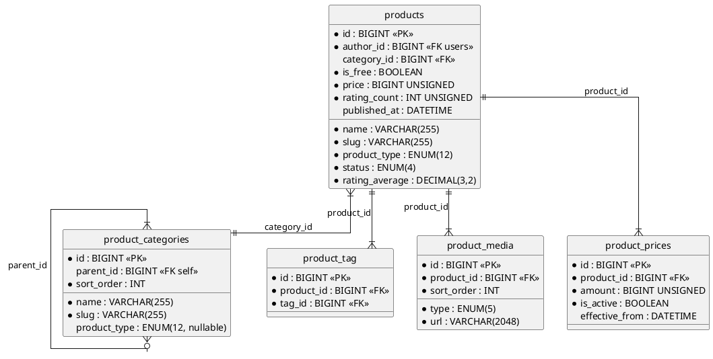

# 06.50 - Marketplace

**Project:** GsmUi
**Domain:** Marketplace
**Version:** 1.0.0

---

# Purpose

Core marketplace tables: product listings, taxonomy, media, pricing history, and tag pivots. Uses a single `products` table with `product_type` ENUM — no polymorphic child tables.

---

# Business Rules

- Single products table with `product_type` ENUM (12 types)
- Slug is unique per author: composite unique `(author_id, slug)`
- Status transitions: `draft → pending_review → published → archived`
- Price in minor units (cents). Zero = free
- Soft-deletable throughout

---

# PlantUML ERD



---

# 1. products

Universal product table for all marketplace items. 12 `product_type` values, 4-stage status workflow. Full schema in migration below.

| Index | Columns | Type | Notes |
|---|---|---|---|
| `products_pk` | `id` | PRIMARY | — |
| `products_author_slug_unique` | `author_id, slug` | UNIQUE | URL lookup per author |
| `products_product_type_index` | `product_type` | INDEX | Filter by type |
| `products_status_index` | `status` | INDEX | Admin moderation |
| `products_is_free_index` | `is_free` | INDEX | Free filter |
| `products_is_featured_index` | `is_featured` | INDEX | Featured carousel |
| `products_published_at_index` | `published_at` | INDEX | New arrivals |
| `products_search_vector_fulltext` | `search_vector` | FULLTEXT | Search |

**Relationships:** belongsTo User (author), belongsTo ProductCategory, hasMany ProductVersion, hasMany ProductMedia, hasMany Review, belongsToMany Tag (via product_tag), belongsToMany Plan (via coupon_products).

---

# 2. product_categories

Hierarchical taxonomy. Separate from component_categories and theme_categories.

| Index | Columns | Type | Notes |
|---|---|---|---|
| `product_categories_pk` | `id` | PRIMARY | — |
| `product_categories_slug_unique` | `slug` | UNIQUE | URL lookup |
| `product_categories_parent_id_index` | `parent_id` | INDEX | Tree traversal |
| `product_categories_product_type_index` | `product_type` | INDEX | Restrict to type |
| `product_categories_sort_order_index` | `sort_order` | INDEX | Display order |

**Relationships:** belongsTo self (parent), hasMany self (children).

---

# 3. product_tag

Pivot for products ↔ tags.

| Index | Columns | Type | Notes |
|---|---|---|---|
| `product_tag_pk` | `id` | PRIMARY | — |
| `product_tag_unique` | `product_id, tag_id` | UNIQUE | No duplicates |
| `product_tag_tag_id_index` | `tag_id` | INDEX | Tag lookup |

---

# 4. product_media

Media assets for product pages (screenshots, videos, demo images). Sort order determines gallery order.

| Index | Columns | Type | Notes |
|---|---|---|---|
| `product_media_pk` | `id` | PRIMARY | — |
| `product_media_product_id_index` | `product_id` | INDEX | Gallery |
| `product_media_type_index` | `type` | INDEX | Filter by type |
| `product_media_sort_order_index` | `sort_order` | INDEX | Gallery order |

---

# 5. product_prices

Historical price tracking and multi-currency support. Current price also on `products` for fast queries.

| Index | Columns | Type | Notes |
|---|---|---|---|
| `product_prices_pk` | `id` | PRIMARY | — |
| `product_prices_product_id_index` | `product_id` | INDEX | Pricing |
| `product_prices_product_active_index` | `product_id, is_active` | INDEX | Current price |
| `product_prices_effective_from_index` | `effective_from` | INDEX | History |

---

# Eloquent Models

```php
<?php

namespace App\Domains\Marketplace\Models;

use Illuminate\Database\Eloquent\Model;
use Illuminate\Database\Eloquent\SoftDeletes;
use Illuminate\Database\Eloquent\Relations\{BelongsTo, BelongsToMany, HasMany};

class Product extends Model
{
    use SoftDeletes;
    protected $fillable = [
        'author_id','category_id','name','slug','description','excerpt','product_type',
        'status','is_free','price','currency','license_type','version','download_count',
        'rating_average','rating_count','is_featured','is_premium','thumbnail_url',
        'demo_url','metadata','search_vector','published_at',
    ];
    protected $casts = [
        'is_free'=>'boolean','is_featured'=>'boolean','is_premium'=>'boolean',
        'price'=>'integer','download_count'=>'integer','rating_count'=>'integer',
        'rating_average'=>'decimal:2','metadata'=>'array','published_at'=>'datetime',
    ];
    public function author(): BelongsTo { return $this->belongsTo(User::class, 'author_id'); }
    public function category(): BelongsTo { return $this->belongsTo(ProductCategory::class); }
    public function versions(): HasMany { return $this->hasMany(ProductVersion::class); }
    public function media(): HasMany { return $this->hasMany(ProductMedia::class); }
    public function prices(): HasMany { return $this->hasMany(ProductPrice::class); }
    public function reviews(): HasMany { return $this->hasMany(Review::class); }
    public function tags(): BelongsToMany { return $this->belongsToMany(Tag::class, 'product_tag'); }
}

class ProductCategory extends Model
{
    use SoftDeletes;
    protected $fillable = ['parent_id','name','slug','description','icon','product_type','sort_order','is_active'];
    protected $casts = ['is_active'=>'boolean'];
    public function parent(): BelongsTo { return $this->belongsTo(self::class, 'parent_id'); }
    public function children(): HasMany { return $this->hasMany(self::class, 'parent_id'); }
}

class ProductTag extends Model
{
    protected $fillable = ['product_id', 'tag_id'];
    public function product(): BelongsTo { return $this->belongsTo(Product::class); }
    public function tag(): BelongsTo { return $this->belongsTo(Tag::class); }
}

class ProductMedia extends Model
{
    use SoftDeletes;
    protected $fillable = ['product_id','type','url','alt_text','caption','width','height','file_size','sort_order'];
    protected $casts = ['width'=>'integer','height'=>'integer','file_size'=>'integer'];
    public function product(): BelongsTo { return $this->belongsTo(Product::class); }
}

class ProductPrice extends Model
{
    protected $fillable = ['product_id','amount','currency','is_active','effective_from','effective_until'];
    protected $casts = ['amount'=>'integer','is_active'=>'boolean','effective_from'=>'datetime','effective_until'=>'datetime'];
    public function product(): BelongsTo { return $this->belongsTo(Product::class); }
}
```

---

# Migrations

Single migration creates all 5 tables in dependency order (categories → products → pivots/media/prices).

```php
<?php

use Illuminate\Database\Migrations\Migration;
use Illuminate\Database\Schema\Blueprint;
use Illuminate\Support\Facades\Schema;

return new class extends Migration
{
    public function up(): void
    {
        Schema::create('product_categories', function (Blueprint $table) {
            $table->id();
            $table->foreignId('parent_id')->nullable()->constrained('product_categories')->nullOnDelete();
            $table->string('name');
            $table->string('slug')->unique();
            $table->text('description')->nullable();
            $table->string('icon')->nullable();
            $table->enum('product_type', [
                'components','themes','templates','icon_packs','charts',
                'plugins','snippets','asset_packs','doc_packs',
                'mcp_servers','ai_skills','starter_kits',
            ])->nullable();
            $table->integer('sort_order')->default(0);
            $table->boolean('is_active')->default(true);
            $table->timestamps();
            $table->softDeletes();
            $table->index('parent_id');
            $table->index('product_type');
            $table->index('sort_order');
        });

        Schema::create('products', function (Blueprint $table) {
            $table->id();
            $table->foreignId('author_id')->constrained('users')->cascadeOnDelete();
            $table->foreignId('category_id')->nullable()->constrained('product_categories')->nullOnDelete();
            $table->string('name');
            $table->string('slug');
            $table->text('description')->nullable();
            $table->string('excerpt', 500)->nullable();
            $table->enum('product_type', [
                'components','themes','templates','icon_packs','charts',
                'plugins','snippets','asset_packs','doc_packs',
                'mcp_servers','ai_skills','starter_kits',
            ]);
            $table->enum('status', ['draft','pending_review','published','archived'])->default('draft');
            $table->boolean('is_free')->default(true);
            $table->unsignedBigInteger('price')->default(0);
            $table->char('currency', 3)->default('USD');
            $table->enum('license_type', ['single','multiple','team'])->default('single');
            $table->string('version', 50)->default('0.1.0');
            $table->unsignedInteger('download_count')->default(0);
            $table->decimal('rating_average', 3, 2)->default(0.00);
            $table->unsignedInteger('rating_count')->default(0);
            $table->boolean('is_featured')->default(false);
            $table->boolean('is_premium')->default(false);
            $table->string('thumbnail_url', 2048)->nullable();
            $table->string('demo_url', 2048)->nullable();
            $table->json('metadata')->nullable();
            $table->text('search_vector')->nullable();
            $table->dateTime('published_at')->nullable();
            $table->timestamps();
            $table->softDeletes();
            $table->unique(['author_id', 'slug']);
            $table->index('product_type');
            $table->index('status');
            $table->index('is_free');
            $table->index('is_featured');
            $table->index('published_at');
            $table->fullText('search_vector');
        });

        Schema::create('product_tag', function (Blueprint $table) {
            $table->id();
            $table->foreignId('product_id')->constrained()->cascadeOnDelete();
            $table->foreignId('tag_id')->constrained()->cascadeOnDelete();
            $table->timestamps();
            $table->unique(['product_id', 'tag_id']);
            $table->index('tag_id');
        });

        Schema::create('product_media', function (Blueprint $table) {
            $table->id();
            $table->foreignId('product_id')->constrained()->cascadeOnDelete();
            $table->enum('type', ['screenshot','video','thumbnail','hero','icon'])->default('screenshot');
            $table->string('url', 2048);
            $table->string('alt_text');
            $table->string('caption', 500)->nullable();
            $table->unsignedInteger('width')->nullable();
            $table->unsignedInteger('height')->nullable();
            $table->unsignedBigInteger('file_size')->nullable();
            $table->integer('sort_order')->default(0);
            $table->timestamps();
            $table->softDeletes();
            $table->index('product_id');
            $table->index('type');
            $table->index('sort_order');
        });

        Schema::create('product_prices', function (Blueprint $table) {
            $table->id();
            $table->foreignId('product_id')->constrained()->cascadeOnDelete();
            $table->unsignedBigInteger('amount');
            $table->char('currency', 3)->default('USD');
            $table->boolean('is_active')->default(true);
            $table->dateTime('effective_from')->nullable();
            $table->dateTime('effective_until')->nullable();
            $table->timestamps();
            $table->index('product_id');
            $table->index(['product_id', 'is_active']);
            $table->index('effective_from');
        });
    }

    public function down(): void
    {
        Schema::dropIfExists('product_prices');
        Schema::dropIfExists('product_media');
        Schema::dropIfExists('product_tag');
        Schema::dropIfExists('products');
        Schema::dropIfExists('product_categories');
    }
};
```

---

# Next Document

**06.52 - Product Versions** — structured changelogs, download packages, and framework compatibility matrices.

---

## Detailed Column Specifications

### products

#### id (BIGINT, PK, AUTO_INCREMENT)
- Standard auto-incrementing primary key.

#### author_id (BIGINT, FK → users.id, NOT NULL)
- References the product author.
- `ON DELETE CASCADE` — products are deleted when author is deleted.

#### category_id (BIGINT, FK → product_categories.id, NULLABLE)
- References the hierarchical category taxonomy.
- `ON DELETE SET NULL` — products revert to uncategorized.

#### name (VARCHAR(255), NOT NULL)
- Display name shown in marketplace.
- Application-layer validation: 1–255 characters.

#### slug (VARCHAR(255), NOT NULL)
- URL-friendly identifier.
- Composite unique with `author_id`.

#### product_type (ENUM, NOT NULL)
- 12 product types: `components`, `themes`, `templates`, `icon_packs`, `charts`, `plugins`, `snippets`, `asset_packs`, `doc_packs`, `mcp_servers`, `ai_skills`, `starter_kits`.

#### status (ENUM, DEFAULT 'draft')
- Publication workflow: `draft` → `pending_review` → `published` → `archived`.

#### is_free (BOOLEAN, DEFAULT true)
- Whether the product is available for free.

#### price (BIGINT UNSIGNED, DEFAULT 0)
- Price in minor currency units (cents).

#### currency (CHAR(3), DEFAULT 'USD')
- ISO 4217 currency code.

#### license_type (ENUM, DEFAULT 'single')
- License types: `single`, `multiple`, `team`.

#### version (VARCHAR(50), DEFAULT '0.1.0')
- Semantic version string.

#### download_count (INT UNSIGNED, DEFAULT 0)
- Total download counter.

#### rating_average (DECIMAL(3,2), DEFAULT 0.00)
- Mean rating (0.00–5.00).

#### rating_count (INT UNSIGNED, DEFAULT 0)
- Number of ratings.

#### is_featured (BOOLEAN, DEFAULT false)
- Featured on homepage.

#### is_premium (BOOLEAN, DEFAULT false)
- Requires paid subscription.

#### thumbnail_url (VARCHAR(2048), NULLABLE)
- Thumbnail image URL.

#### demo_url (VARCHAR(2048), NULLABLE)
- Live demo URL.

#### metadata (JSON, NULLABLE)
- Extensible key-value storage.

#### search_vector (TEXT, NULLABLE)
- Pre-concatenated text for full-text search.

#### published_at (DATETIME, NULLABLE)
- Timestamp of publication.

---

## Full Eloquent Model

```php
<?php

namespace App\Models;

use Illuminate\Database\Eloquent\Model;
use Illuminate\Database\Eloquent\SoftDeletes;
use Illuminate\Database\Eloquent\Factories\HasFactory;
use Illuminate\Database\Eloquent\Relations\{BelongsTo, BelongsToMany, HasMany};
use Illuminate\Database\Eloquent\Builder;

class Product extends Model
{
    use HasFactory, SoftDeletes;

    protected $fillable = [
        'author_id', 'category_id', 'name', 'slug', 'description', 'excerpt',
        'product_type', 'status', 'is_free', 'price', 'currency', 'license_type',
        'version', 'download_count', 'rating_average', 'rating_count', 'is_featured',
        'is_premium', 'thumbnail_url', 'demo_url', 'metadata', 'search_vector', 'published_at',
    ];

    protected $casts = [
        'is_free'        => 'boolean',
        'is_featured'    => 'boolean',
        'is_premium'     => 'boolean',
        'price'          => 'integer',
        'download_count' => 'integer',
        'rating_count'   => 'integer',
        'rating_average' => 'decimal:2',
        'metadata'       => 'array',
        'published_at'   => 'datetime',
    ];

    protected $appends = ['formatted_price'];

    // ─── Relationships ───────────────────────────────────────

    public function author(): BelongsTo
    {
        return $this->belongsTo(User::class, 'author_id');
    }

    public function category(): BelongsTo
    {
        return $this->belongsTo(ProductCategory::class);
    }

    public function versions(): HasMany
    {
        return $this->hasMany(ProductVersion::class)->orderBy('created_at', 'desc');
    }

    public function media(): HasMany
    {
        return $this->hasMany(ProductMedia::class)->orderBy('sort_order');
    }

    public function prices(): HasMany
    {
        return $this->hasMany(ProductPrice::class);
    }

    public function reviews(): HasMany
    {
        return $this->hasMany(Review::class);
    }

    public function tags(): BelongsToMany
    {
        return $this->belongsToMany(Tag::class, 'product_tag')
            ->withTimestamps()
            ->orderBy('tags.name');
    }

    // ─── Accessors ───────────────────────────────────────────

    public function getFormattedPriceAttribute(): string
    {
        return $this->is_free ? 'Free' : '$' . number_format($this->price / 100, 2);
    }

    public function getRouteAttribute(): string
    {
        return route('marketplace.show', $this->slug);
    }

    // ─── Scopes ──────────────────────────────────────────────

    public function scopePublished(Builder $query): Builder
    {
        return $query->where('status', 'published');
    }

    public function scopeOfType(Builder $query, string $type): Builder
    {
        return $query->where('product_type', $type);
    }

    public function scopePremium(Builder $query): Builder
    {
        return $query->where('is_premium', true);
    }

    public function scopeFree(Builder $query): Builder
    {
        return $query->where('is_free', true);
    }

    public function scopeFeatured(Builder $query): Builder
    {
        return $query->where('is_featured', true);
    }

    public function scopeSearch(Builder $query, string $term): Builder
    {
        return $query->whereRaw(
            'MATCH(search_vector) AGAINST(? IN NATURAL LANGUAGE MODE)',
            [$term]
        );
    }

    // ─── Methods ─────────────────────────────────────────────

    public function updateSearchVector(): void
    {
        $parts = array_filter([
            $this->name,
            $this->description,
            $this->excerpt,
            $this->category?->name,
            $this->tags->pluck('name')->implode(' '),
        ]);

        $this->update(['search_vector' => strtolower(implode(' ', $parts))]);
    }

    public function incrementDownloadCount(): void
    {
        $this->increment('download_count');
    }

    public function updateRating(): void
    {
        $stats = $this->reviews()
            ->selectRaw('AVG(rating) as average, COUNT(*) as count')
            ->first();

        $this->update([
            'rating_average' => round($stats->average ?? 0, 2),
            'rating_count'   => (int) ($stats->count ?? 0),
        ]);
    }

    public function getCurrentPrice(): ProductPrice
    {
        return $this->prices()
            ->where('is_active', true)
            ->where('effective_from', '<=', now())
            ->where(function ($q) {
                $q->whereNull('effective_until')
                  ->orWhere('effective_until', '>=', now());
            })
            ->latest('effective_from')
            ->first() ?? new ProductPrice(['amount' => $this->price, 'currency' => $this->currency]);
    }
}
```

---

## Observer and Event System

### ProductObserver
```php
<?php

namespace App\Observers;

use App\Models\Product;
use App\Services\SearchIndexService;

class ProductObserver
{
    public function created(Product $product): void
    {
        event(new \App\Events\ProductCreated($product));
    }

    public function updated(Product $product): void
    {
        if ($product->isDirty(['name', 'description', 'excerpt'])) {
            app(SearchIndexService::class)->reindexProduct($product);
        }

        if ($product->isDirty('status') && $product->status === 'published') {
            $product->update(['published_at' => now()]);
        }

        event(new \App\Events\ProductUpdated($product));
    }

    public function deleted(Product $product): void
    {
        app(SearchIndexService::class)->removeProduct($product);
        event(new \App\Events\ProductDeleted($product));
    }
}
```

### Event Classes
```php
class ProductCreated
{
    use Dispatchable, SerializesModels;
    public function __construct(public Product $product) {}
}

class ProductPublished
{
    use Dispatchable, SerializesModels;
    public function __construct(public Product $product) {}
}

class ProductDownloaded
{
    use Dispatchable, SerializesModels;
    public function __construct(public Product $product, public ?User $user) {}
}

class ProductDeleted
{
    use Dispatchable, SerializesModels;
    public function __construct(public Product $product) {}
}
```

---

## Query Scopes

```php
public function scopePublished(Builder $query): Builder
{
    return $query->where('status', 'published');
}

public function scopeOfType(Builder $query, string $type): Builder
{
    return $query->where('product_type', $type);
}

public function scopePremium(Builder $query): Builder
{
    return $query->where('is_premium', true);
}

public function scopeFree(Builder $query): Builder
{
    return $query->where('is_free', true);
}

public function scopeFeatured(Builder $query): Builder
{
    return $query->where('is_featured', true);
}

public function scopeSearch(Builder $query, string $term): Builder
{
    return $query->whereRaw(
        'MATCH(search_vector) AGAINST(? IN NATURAL LANGUAGE MODE)',
        [$term]
    );
}
```

---

## Factory Stubs

### ProductFactory
```php
<?php

namespace Database\Factories;

use App\Models\Product;
use App\Models\User;
use App\Models\ProductCategory;
use Illuminate\Database\Eloquent\Factories\Factory;

class ProductFactory extends Factory
{
    protected $model = Product::class;

    public function definition(): array
    {
        $name = fake()->unique()->words(3, true);

        return [
            'author_id'      => User::factory(),
            'category_id'    => ProductCategory::factory(),
            'name'           => ucfirst($name),
            'slug'           => \Illuminate\Support\Str::slug($name),
            'description'    => fake()->paragraphs(3, true),
            'excerpt'        => fake()->sentence(20),
            'product_type'   => fake()->randomElement(['components', 'themes', 'templates', 'plugins']),
            'status'         => fake()->randomElement(['draft', 'pending_review', 'published', 'archived']),
            'is_free'        => fake()->boolean(60),
            'price'          => fake()->randomElement([0, 900, 1900, 2900]),
            'currency'       => 'USD',
            'license_type'   => fake()->randomElement(['single', 'multiple', 'team']),
            'version'        => fake()->semver(),
            'download_count' => fake()->numberBetween(0, 1000),
            'rating_average' => fake()->randomFloat(2, 0, 5),
            'rating_count'   => fake()->numberBetween(0, 100),
            'is_featured'    => fake()->boolean(10),
            'is_premium'     => fake()->boolean(20),
            'search_vector'  => null,
        ];
    }

    public function published(): static
    {
        return $this->state(fn (array $attributes) => [
            'status' => 'published',
            'published_at' => now(),
        ]);
    }

    public function free(): static
    {
        return $this->state(fn (array $attributes) => ['is_free' => true, 'price' => 0]);
    }

    public function premium(): static
    {
        return $this->state(fn (array $attributes) => ['is_premium' => true, 'is_free' => false, 'price' => 2900]);
    }
}
```

---

## Seeders

### ProductCategorySeeder
```php
<?php

namespace Database\Seeders;

use App\Models\ProductCategory;
use Illuminate\Database\Seeder;

class ProductCategorySeeder extends Seeder
{
    public function run(): void
    {
        $categories = [
            ['name' => 'UI Components', 'slug' => 'ui-components', 'product_type' => 'components'],
            ['name' => 'Themes', 'slug' => 'themes', 'product_type' => 'themes'],
            ['name' => 'Templates', 'slug' => 'templates', 'product_type' => 'templates'],
            ['name' => 'Plugins', 'slug' => 'plugins', 'product_type' => 'plugins'],
            ['name' => 'Icon Packs', 'slug' => 'icon-packs', 'product_type' => 'icon_packs'],
            ['name' => 'AI Skills', 'slug' => 'ai-skills', 'product_type' => 'ai_skills'],
        ];

        foreach ($categories as $index => $data) {
            ProductCategory::create(array_merge($data, ['sort_order' => $index]));
        }
    }
}
```

---

## API Response Structure

### Product Response
```json
{
    "data": {
        "id": 1,
        "name": "Date Picker Pro",
        "slug": "date-picker-pro",
        "product_type": "components",
        "status": "published",
        "is_free": false,
        "price": 2900,
        "formatted_price": "$29.00",
        "license_type": "single",
        "version": "2.15.0",
        "download_count": 1500,
        "rating_average": 4.80,
        "rating_count": 120,
        "author": {"id": 1, "name": "GsmUi Team"},
        "category": {"id": 1, "name": "UI Components"},
        "tags": [...],
        "media": [...],
        "current_price": {"amount": 2900, "currency": "USD"}
    }
}
```

---

## Cache Keys and TTL Strategy

| Cache Key Pattern | TTL | Invalidation |
|---|---|---|
| `product:slug:{slug}` | 1 hour | Product updated |
| `product:type:{type}` | 30 min | Product published |
| `product:featured` | 30 min | Featured changed |
| `product:search:{hash}` | 15 min | Product published |

---

## Security Considerations

### Authorization
```php
class ProductPolicy
{
    public function viewAny(User $user): bool { return true; }
    public function view(User $user, Product $product): bool { return true; }
    public function create(User $user): bool { return $user->isVerified(); }
    public function update(User $user, Product $product): bool {
        return $user->id === $product->author_id || $user->isAdmin();
    }
    public function delete(User $user, Product $product): bool {
        return $user->id === $product->author_id || $user->isAdmin();
    }
    public function download(User $user, Product $product): bool {
        if ($product->is_free) return true;
        return $user->hasActiveSubscription();
    }
}
```

---

## Database Table Size Estimates

| Table | Row Size (bytes) | 100K Rows | 1M Rows |
|---|---|---|---|
| products | ~1000 | ~100 MB | ~1 GB |
| product_categories | ~200 | ~20 MB | ~200 MB |
| product_tag | ~50 | ~5 MB | ~50 MB |
| product_media | ~400 | ~40 MB | ~400 MB |
| product_prices | ~200 | ~20 MB | ~200 MB |

---

## Appendix: Troubleshooting

| Issue | Cause | Solution |
|---|---|---|
| `ProductNotFoundException` | Invalid slug | Verify product exists |
| `InvalidStatusTransition` | Invalid workflow | Check `canTransitionTo()` |
| `PaymentRequired` | Premium product, no subscription | Check user subscription |
| Search not returning results | Missing FULLTEXT index | Add index on `search_vector` |
| N+1 queries | Missing eager loading | Use `with()` for relationships |

---

## Appendix: Quick Reference

### Key Commands
```bash
php artisan gsmui:rebuild-product-search
php artisan gsmui:export-products
php artisan gsmui:validate-products
```

### Key Relationships
```
Product → ProductCategory (N:1)
Product → ProductVersion (1:N)
Product → ProductMedia (1:N)
Product → ProductPrice (1:N)
Product → Tag (N:N via product_tag)
```

---

**Next Document:** 06.52 - Product Versions

---

## Appendix A: Product Review System

### Review Model
```php
<?php

namespace App\Models;

use Illuminate\Database\Eloquent\Model;
use Illuminate\Database\Eloquent\Relations\BelongsTo;

class Review extends Model
{
    protected $fillable = ['product_id', 'user_id', 'rating', 'title', 'body'];
    protected $casts = ['rating' => 'integer'];

    public function product(): BelongsTo
    {
        return $this->belongsTo(Product::class);
    }

    public function user(): BelongsTo
    {
        return $this->belongsTo(User::class);
    }
}
```

### Review Migration
```php
Schema::create('reviews', function (Blueprint $table) {
    $table->id();
    $table->foreignId('product_id')->constrained()->cascadeOnDelete();
    $table->foreignId('user_id')->constrained()->cascadeOnDelete();
    $table->unsignedTinyInteger('rating');
    $table->string('title')->nullable();
    $table->text('body')->nullable();
    $table->timestamps();

    $table->unique(['product_id', 'user_id']);
    $table->index('rating');
});
```

### Review Service
```php
class ReviewService
{
    public function rate(Product $product, int $rating, ?string $title = null, ?string $body = null): void
    {
        $user = auth()->user();

        DB::transaction(function () use ($product, $user, $rating, $title, $body) {
            DB::table('reviews')->updateOrInsert(
                ['product_id' => $product->id, 'user_id' => $user->id],
                ['rating' => $rating, 'title' => $title, 'body' => $body, 'updated_at' => now()]
            );

            $product->updateRating();
        });
    }
}
```

---

## Appendix B: Product Version Management

### Version Model
```php
class ProductVersion extends Model
{
    protected $fillable = ['product_id', 'version', 'changelog', 'is_current', 'download_count'];
    protected $casts = ['is_current' => 'boolean', 'download_count' => 'integer'];

    public function product(): BelongsTo
    {
        return $this->belongsTo(Product::class);
    }
}
```

### Version Migration
```php
Schema::create('product_versions', function (Blueprint $table) {
    $table->id();
    $table->foreignId('product_id')->constrained()->cascadeOnDelete();
    $table->string('version', 50);
    $table->text('changelog')->nullable();
    $table->boolean('is_current')->default(true);
    $table->unsignedInteger('download_count')->default(0);
    $table->timestamps();

    $table->unique(['product_id', 'version']);
    $table->index('product_id');
    $table->index('is_current');
});
```

### Version Service
```php
class ProductVersionService
{
    public function createVersion(Product $product, string $changelog = null): ProductVersion
    {
        // Mark all other versions as not current
        $product->versions()->update(['is_current' => false]);

        return $product->versions()->create([
            'version'    => $product->version,
            'changelog'  => $changelog,
            'is_current' => true,
        ]);
    }

    public function getChangelog(Product $product): array
    {
        return $product->versions()
            ->orderBy('created_at', 'desc')
            ->get()
            ->map(fn ($v) => [
                'version'   => $v->version,
                'changelog' => $v->changelog,
                'date'      => $v->created_at->format('Y-m-d'),
            ])
            ->toArray();
    }
}
```

---

## Appendix C: Product Download System

### Download Tracking Table
```php
Schema::create('product_downloads', function (Blueprint $table) {
    $table->id();
    $table->foreignId('product_id')->constrained()->cascadeOnDelete();
    $table->foreignId('user_id')->nullable()->constrained()->nullOnDelete();
    $table->string('version', 50);
    $table->ipAddress('ip_address');
    $table->string('user_agent', 500)->nullable();
    $table->timestamps();

    $table->index(['product_id', 'created_at']);
    $table->index(['product_id', 'version']);
});
```

### Download Service
```php
class ProductDownloadService
{
    public function recordDownload(Product $product, ?User $user = null): void
    {
        DB::transaction(function () use ($product, $user) {
            $product->increment('download_count');

            DB::table('product_downloads')->insert([
                'product_id' => $product->id,
                'user_id'    => $user?->id,
                'version'    => $product->version,
                'ip_address' => request()->ip(),
                'user_agent' => request()->userAgent(),
                'created_at' => now(),
            ]);
        });

        event(new ProductDownloaded($product, $user));
    }

    public function getDownloadStats(Product $product, int $days = 30): array
    {
        return DB::table('product_downloads')
            ->where('product_id', $product->id)
            ->where('created_at', '>=', now()->subDays($days))
            ->selectRaw('DATE(created_at) as date, COUNT(*) as count')
            ->groupBy('date')
            ->orderBy('date')
            ->get()
            ->pluck('count', 'date')
            ->toArray();
    }
}
```

---

## Appendix D: Product Pricing System

### Price History Service
```php
class ProductPriceService
{
    public function setPrice(Product $product, int $amount, string $currency = 'USD'): void
    {
        // Deactivate current price
        $product->prices()->where('is_active', true)->update(['is_active' => false]);

        // Create new price
        $product->prices()->create([
            'amount'        => $amount,
            'currency'      => $currency,
            'is_active'     => true,
            'effective_from' => now(),
        ]);

        // Update product
        $product->update([
            'price'    => $amount,
            'currency' => $currency,
            'is_free'  => $amount === 0,
        ]);
    }

    public function getPriceHistory(Product $product): array
    {
        return $product->prices()
            ->orderBy('effective_from', 'desc')
            ->get()
            ->map(fn ($p) => [
                'amount'        => $p->amount,
                'formatted'     => '$' . number_format($p->amount / 100, 2),
                'currency'      => $p->currency,
                'is_active'     => $p->is_active,
                'effective_from' => $p->effective_from->format('Y-m-d'),
                'effective_until' => $p->effective_until?->format('Y-m-d'),
            ])
            ->toArray();
    }
}
```

---

## Appendix E: Product Media Management

### Media Upload Service
```php
class ProductMediaService
{
    public function upload(Product $product, UploadedFile $file, string $type = 'screenshot'): ProductMedia
    {
        $path = $file->store("products/{$product->id}/media", 'public');

        $dimensions = getimagesize($file->getRealPath());

        return $product->media()->create([
            'type'       => $type,
            'url'        => $path,
            'alt_text'   => "{$product->name} {$type}",
            'width'      => $dimensions[0] ?? null,
            'height'     => $dimensions[1] ?? null,
            'file_size'  => $file->getSize(),
            'sort_order' => $product->media()->max('sort_order') + 1,
        ]);
    }

    public function reorder(Product $product, array $orderedIds): void
    {
        foreach ($orderedIds as $index => $mediaId) {
            $product->media()->where('id', $mediaId)->update(['sort_order' => $index]);
        }
    }
}
```

---

## Appendix F: Marketplace Storefront

### Storefront Query
```php
class MarketplaceService
{
    public function getProducts(array $filters = []): \Illuminate\Pagination\LengthAwarePaginator
    {
        $query = Product::published()
            ->with(['author', 'category', 'tags'])
            ->select('id', 'name', 'slug', 'product_type', 'is_free', 'price', 'currency', 'rating_average', 'rating_count', 'download_count', 'thumbnail_url', 'version');

        if (isset($filters['product_type'])) {
            $query->where('product_type', $filters['product_type']);
        }

        if (isset($filters['category_id'])) {
            $query->where('category_id', $filters['category_id']);
        }

        if (isset($filters['is_free'])) {
            $query->where('is_free', $filters['is_free']);
        }

        if (isset($filters['search'])) {
            $query->search($filters['search']);
        }

        return $query->orderBy('download_count', 'desc')->paginate(20);
    }

    public function getFeatured(): \Illuminate\Support\Collection
    {
        return Cache::remember('marketplace:featured', 1800, function () {
            return Product::published()
                ->featured()
                ->with(['author', 'category'])
                ->orderBy('download_count', 'desc')
                ->limit(10)
                ->get();
        });
    }

    public function getPopularByType(string $type, int $limit = 10): \Illuminate\Support\Collection
    {
        return Product::published()
            ->where('product_type', $type)
            ->with(['author', 'category'])
            ->orderBy('download_count', 'desc')
            ->limit($limit)
            ->get();
    }
}
```

---

## Appendix G: Product Search Implementation

### Full-Text Search
```sql
SELECT *, MATCH(search_vector) AGAINST('date picker' IN NATURAL LANGUAGE MODE) AS relevance
FROM products
WHERE status = 'published'
AND MATCH(search_vector) AGAINST('date picker' IN NATURAL LANGUAGE MODE)
ORDER BY relevance DESC;
```

### Search with Filters
```php
public function search(string $term, array $filters = []): \Illuminate\Pagination\LengthAwarePaginator
{
    $query = Product::published()
        ->selectRaw('*, MATCH(search_vector) AGAINST(? IN NATURAL LANGUAGE MODE) AS relevance', [$term])
        ->whereRaw('MATCH(search_vector) AGAINST(? IN NATURAL LANGUAGE MODE)', [$term]);

    foreach ($filters as $key => $value) {
        if ($key === 'product_type') $query->where('product_type', $value);
        if ($key === 'is_free') $query->where('is_free', $value);
        if ($key === 'min_rating') $query->where('rating_average', '>=', $value);
    }

    return $query->orderBy('relevance', 'desc')->paginate(20);
}
```

---

## Appendix H: Cache Keys

| Cache Key Pattern | TTL | Invalidation |
|---|---|---|
| `product:slug:{slug}` | 1 hour | Product updated |
| `product:type:{type}` | 30 min | Product published |
| `product:featured` | 30 min | Featured changed |
| `product:stats:{id}` | 5 min | Download/rating recorded |
| `marketplace:search:{hash}` | 15 min | Product published |

---

## Appendix I: Database Migration Full Schema

```php
<?php

use Illuminate\Database\Migrations\Migration;
use Illuminate\Database\Schema\Blueprint;
use Illuminate\Support\Facades\Schema;

return new class extends Migration
{
    public function up(): void
    {
        Schema::create('product_categories', function (Blueprint $table) {
            $table->id();
            $table->foreignId('parent_id')->nullable()->constrained('product_categories')->nullOnDelete();
            $table->string('name');
            $table->string('slug')->unique();
            $table->text('description')->nullable();
            $table->string('icon')->nullable();
            $table->enum('product_type', [
                'components', 'themes', 'templates', 'icon_packs', 'charts',
                'plugins', 'snippets', 'asset_packs', 'doc_packs',
                'mcp_servers', 'ai_skills', 'starter_kits',
            ])->nullable();
            $table->integer('sort_order')->default(0);
            $table->boolean('is_active')->default(true);
            $table->timestamps();
            $table->softDeletes();

            $table->index('parent_id');
            $table->index('product_type');
            $table->index('sort_order');
        });

        Schema::create('products', function (Blueprint $table) {
            $table->id();
            $table->foreignId('author_id')->constrained('users')->cascadeOnDelete();
            $table->foreignId('category_id')->nullable()->constrained('product_categories')->nullOnDelete();
            $table->string('name');
            $table->string('slug');
            $table->text('description')->nullable();
            $table->string('excerpt', 500)->nullable();
            $table->enum('product_type', [
                'components', 'themes', 'templates', 'icon_packs', 'charts',
                'plugins', 'snippets', 'asset_packs', 'doc_packs',
                'mcp_servers', 'ai_skills', 'starter_kits',
            ]);
            $table->enum('status', ['draft', 'pending_review', 'published', 'archived'])->default('draft');
            $table->boolean('is_free')->default(true);
            $table->unsignedBigInteger('price')->default(0);
            $table->char('currency', 3)->default('USD');
            $table->enum('license_type', ['single', 'multiple', 'team'])->default('single');
            $table->string('version', 50)->default('0.1.0');
            $table->unsignedInteger('download_count')->default(0);
            $table->decimal('rating_average', 3, 2)->default(0.00);
            $table->unsignedInteger('rating_count')->default(0);
            $table->boolean('is_featured')->default(false);
            $table->boolean('is_premium')->default(false);
            $table->string('thumbnail_url', 2048)->nullable();
            $table->string('demo_url', 2048)->nullable();
            $table->json('metadata')->nullable();
            $table->text('search_vector')->nullable();
            $table->dateTime('published_at')->nullable();
            $table->timestamps();
            $table->softDeletes();

            $table->unique(['author_id', 'slug']);
            $table->index('product_type');
            $table->index('status');
            $table->index('is_free');
            $table->index('is_featured');
            $table->index('published_at');
            $table->fullText('search_vector');
        });

        Schema::create('product_tag', function (Blueprint $table) {
            $table->id();
            $table->foreignId('product_id')->constrained()->cascadeOnDelete();
            $table->foreignId('tag_id')->constrained()->cascadeOnDelete();
            $table->timestamps();

            $table->unique(['product_id', 'tag_id']);
            $table->index('tag_id');
        });

        Schema::create('product_media', function (Blueprint $table) {
            $table->id();
            $table->foreignId('product_id')->constrained()->cascadeOnDelete();
            $table->enum('type', ['screenshot', 'video', 'thumbnail', 'hero', 'icon'])->default('screenshot');
            $table->string('url', 2048);
            $table->string('alt_text');
            $table->string('caption', 500)->nullable();
            $table->unsignedInteger('width')->nullable();
            $table->unsignedInteger('height')->nullable();
            $table->unsignedBigInteger('file_size')->nullable();
            $table->integer('sort_order')->default(0);
            $table->timestamps();
            $table->softDeletes();

            $table->index('product_id');
            $table->index('type');
            $table->index('sort_order');
        });

        Schema::create('product_prices', function (Blueprint $table) {
            $table->id();
            $table->foreignId('product_id')->constrained()->cascadeOnDelete();
            $table->unsignedBigInteger('amount');
            $table->char('currency', 3)->default('USD');
            $table->boolean('is_active')->default(true);
            $table->dateTime('effective_from')->nullable();
            $table->dateTime('effective_until')->nullable();
            $table->timestamps();

            $table->index('product_id');
            $table->index(['product_id', 'is_active']);
            $table->index('effective_from');
        });

        Schema::create('product_versions', function (Blueprint $table) {
            $table->id();
            $table->foreignId('product_id')->constrained()->cascadeOnDelete();
            $table->string('version', 50);
            $table->text('changelog')->nullable();
            $table->boolean('is_current')->default(true);
            $table->unsignedInteger('download_count')->default(0);
            $table->timestamps();

            $table->unique(['product_id', 'version']);
            $table->index('product_id');
            $table->index('is_current');
        });

        Schema::create('product_downloads', function (Blueprint $table) {
            $table->id();
            $table->foreignId('product_id')->constrained()->cascadeOnDelete();
            $table->foreignId('user_id')->nullable()->constrained()->nullOnDelete();
            $table->string('version', 50);
            $table->ipAddress('ip_address');
            $table->string('user_agent', 500)->nullable();
            $table->timestamps();

            $table->index(['product_id', 'created_at']);
            $table->index(['product_id', 'version']);
        });

        Schema::create('reviews', function (Blueprint $table) {
            $table->id();
            $table->foreignId('product_id')->constrained()->cascadeOnDelete();
            $table->foreignId('user_id')->constrained()->cascadeOnDelete();
            $table->unsignedTinyInteger('rating');
            $table->string('title')->nullable();
            $table->text('body')->nullable();
            $table->timestamps();

            $table->unique(['product_id', 'user_id']);
            $table->index('rating');
        });
    }

    public function down(): void
    {
        Schema::dropIfExists('reviews');
        Schema::dropIfExists('product_downloads');
        Schema::dropIfExists('product_versions');
        Schema::dropIfExists('product_prices');
        Schema::dropIfExists('product_media');
        Schema::dropIfExists('product_tag');
        Schema::dropIfExists('products');
        Schema::dropIfExists('product_categories');
    }
};
```

---

## Appendix J: Rollback Order
```php
Schema::dropIfExists('reviews');
Schema::dropIfExists('product_downloads');
Schema::dropIfExists('product_versions');
Schema::dropIfExists('product_prices');
Schema::dropIfExists('product_media');
Schema::dropIfExists('product_tag');
Schema::dropIfExists('products');
Schema::dropIfExists('product_categories');
```

---

## Appendix K: Security Checklist

- [ ] Product files validated before storage
- [ ] Download rate limiting applied
- [ ] Payment verification before premium access
- [ ] Review spam prevention (1 per user per product)
- [ ] Search queries parameterized
- [ ] User authorization verified for edits
- [ ] Slug uniqueness enforced per author
- [ ] Status transitions validated
- [ ] Price history immutable
- [ ] Media uploads scanned for malware

---

## Appendix A: Marketplace Service Implementation

### Product Publishing Service
```php
<?php

namespace App\Services;

use App\Models\{Product, ProductMedia, ProductDownload, ProductVersion, User};
use Illuminate\Support\Facades\{DB, Cache, Str};
use Illuminate\Validation\ValidationException;

class MarketplaceProductService
{
    public function publish(
        User $author,
        array $data,
        array $media = [],
        array $tags = []
    ): Product {
        return DB::transaction(function () use ($author, $data, $media, $tags) {
            $product = Product::create([
                'author_id'    => $author->id,
                'title'        => $data['title'],
                'slug'         => $this->generateSlug($data['title'], $author->id),
                'description'  => $data['description'],
                'short_description' => $data['short_description'] ?? null,
                'type'         => $data['type'],
                'category'     => $data['category'],
                'price'        => $data['price'] ?? 0,
                'currency'     => $data['currency'] ?? 'USD',
                'is_free'      => ($data['price'] ?? 0) === 0,
                'status'       => 'draft',
                'version'      => '1.0.0',
                'requires_subscription' => $data['requires_subscription'] ?? false,
                'min_plan_level' => $data['min_plan_level'] ?? null,
                'license_type' => $data['license_type'] ?? 'standard',
                'demo_url'     => $data['demo_url'] ?? null,
                'documentation_url' => $data['documentation_url'] ?? null,
                'metadata'     => $data['metadata'] ?? null,
            ]);

            foreach ($media as $mediaData) {
                $product->media()->create($mediaData);
            }

            if (!empty($tags)) {
                $product->attachTags($tags);
            }

            $product->createVersion([
                'version'      => '1.0.0',
                'content'      => $data['content'] ?? null,
                'changelog'    => 'Initial release',
                'is_published' => true,
            ]);

            $product->recordPriceHistory([
                'price'      => $data['price'] ?? 0,
                'currency'   => $data['currency'] ?? 'USD',
                'changed_by' => $author->id,
                'reason'     => 'Initial listing',
            ]);

            return $product;
        });
    }

    public function updateProduct(
        Product $product,
        array $data,
        ?string $changelog = null
    ): ProductVersion {
        return DB::transaction(function () use ($product, $data, $changelog) {
            $product->update($data);

            if (isset($data['price']) && $data['price'] !== $product->price) {
                $product->recordPriceHistory([
                    'price'      => $data['price'],
                    'currency'   => $data['currency'] ?? $product->currency,
                    'old_price'  => $product->price,
                    'changed_by' => auth()->id(),
                    'reason'     => $changelog ?? 'Price update',
                ]);
            }

            $nextVersion = $this->bumpVersion($product->version, 'patch');

            $version = $product->createVersion([
                'version'      => $nextVersion,
                'content'      => $data['content'] ?? null,
                'changelog'    => $changelog ?? "Updated to version {$nextVersion}",
                'is_published' => true,
            ]);

            $product->update(['version' => $nextVersion]);

            return $version;
        });
    }

    protected function generateSlug(string $title, int $authorId): string
    {
        $slug = Str::slug($title);
        $original = $slug;
        $counter = 1;

        while (Product::where('author_id', $authorId)->where('slug', $slug)->exists()) {
            $slug = "{$original}-{$counter}";
            $counter++;
        }

        return $slug;
    }

    protected function bumpVersion(string $current, string $type): string
    {
        $parts = explode('.', $current);
        match ($type) {
            'major' => $parts[0]++,
            'minor' => $parts[1]++,
            'patch' => $parts[2]++,
        }
        return implode('.', $parts);
    }
}
```

### Product Review Service
```php
<?php

namespace App\Services;

use App\Models\{Product, ProductReview, User};
use Illuminate\Support\Facades\{Cache, RateLimiter};
use Illuminate\Validation\ValidationException;

class ProductReviewService
{
    public function submitReview(
        User $user,
        Product $product,
        array $data
    ): ProductReview {
        if ($product->author_id === $user->id) {
            throw ValidationException::withMessages([
                'review' => 'You cannot review your own product.',
            ]);
        }

        $hasPurchased = $product->downloads()
            ->where('user_id', $user->id)
            ->exists();

        if (!$hasPurchased && !$product->is_free) {
            throw ValidationException::withMessages([
                'review' => 'You must purchase this product before reviewing.',
            ]);
        }

        $rateLimitKey = "review:{$user->id}:{$product->id}";
        if (RateLimiter::tooManyAttempts($rateLimitKey, 5)) {
            throw ValidationException::withMessages([
                'review' => 'Too many review attempts. Please try again later.',
            ]);
        }

        $existingReview = ProductReview::where('user_id', $user->id)
            ->where('product_id', $product->id)
            ->first();

        if ($existingReview) {
            $existingReview->update([
                'rating'       => $data['rating'],
                'title'        => $data['title'] ?? null,
                'content'      => $data['content'] ?? null,
                'updated_at'   => now(),
            ]);
            return $existingReview;
        }

        $review = ProductReview::create([
            'product_id' => $product->id,
            'user_id'    => $user->id,
            'rating'     => $data['rating'],
            'title'      => $data['title'] ?? null,
            'content'    => $data['content'] ?? null,
            'is_verified_purchase' => $hasPurchased,
        ]);

        $product->update([
            'review_count' => $product->reviews()->count(),
            'average_rating' => $product->reviews()->avg('rating'),
        ]);

        RateLimiter::hit($rateLimitKey, 60 * 60);

        Cache::forget("product:{$product->id}:stats");

        return $review;
    }

    public function moderateReview(ProductReview $review, string $action): void
    {
        match ($action) {
            'approve' => $review->update(['is_approved' => true]),
            'reject'  => $review->update(['is_approved' => false]),
            'flag'    => $review->update(['is_flagged' => true]),
        };

        $product = $review->product;
        $product->update([
            'review_count'   => $product->reviews()->where('is_approved', true)->count(),
            'average_rating' => $product->reviews()->where('is_approved', true)->avg('rating'),
        ]);
    }
}
```

### Product Search Service
```php
<?php

namespace App\Services;

use App\Models\Product;
use Illuminate\Support\Facades\{DB, Cache};

class MarketplaceSearchService
{
    public function search(array $filters): array
    {
        $cacheKey = 'marketplace-search:' . md5(serialize($filters));

        return Cache::remember($cacheKey, 300, function () use ($filters) {
            $query = Product::query()->where('status', 'published');

            if (!empty($filters['type'])) {
                $query->where('type', $filters['type']);
            }

            if (!empty($filters['category'])) {
                $query->where('category', $filters['category']);
            }

            if (!empty($filters['author_id'])) {
                $query->where('author_id', $filters['author_id']);
            }

            if (!empty($filters['is_free'])) {
                $query->where('is_free', true);
            }

            if (isset($filters['min_price'])) {
                $query->where('price', '>=', $filters['min_price']);
            }

            if (isset($filters['max_price'])) {
                $query->where('price', '<=', $filters['max_price']);
            }

            if (!empty($filters['tags'])) {
                $query->withAnyTags($filters['tags']);
            }

            if (!empty($filters['search'])) {
                $query->where(function ($q) use ($filters) {
                    $q->where('title', 'like', "%{$filters['search']}%")
                      ->orWhere('description', 'like', "%{$filters['search']}%");
                });
            }

            $sortField = $filters['sort'] ?? 'created_at';
            $sortDir = $filters['dir'] ?? 'desc';
            $query->orderBy($sortField, $sortDir);

            $perPage = min($filters['per_page'] ?? 20, 50);
            $results = $query->paginate($perPage);

            return [
                'data'  => $results->items(),
                'meta'  => [
                    'current_page' => $results->currentPage(),
                    'last_page'    => $results->lastPage(),
                    'per_page'     => $results->perPage(),
                    'total'        => $results->total(),
                ],
            ];
        });
    }

    public function getStats(Product $product): array
    {
        return Cache::remember("product:{$product->id}:stats", 3600, function () use ($product) {
            return [
                'total_sales'      => $product->sales_count,
                'total_revenue'    => $product->revenue_total,
                'total_downloads'  => $product->download_count,
                'unique_buyers'    => $product->sales()->distinct('user_id')->count(),
                'average_rating'   => $product->average_rating,
                'review_count'     => $product->review_count,
                'favorite_count'   => $product->favorites()->count(),
                'recent_sales'     => $product->sales()
                    ->where('created_at', '>=', now()->subDays(30))
                    ->count(),
            ];
        });
    }
}
```

---

## Appendix B: Marketplace Product Observer

```php
<?php

namespace App\Observers;

use App\Models\Product;
use Illuminate\Support\Facades\Cache;

class ProductObserver
{
    public function updated(Product $product): void
    {
        Cache::forget("product:{$product->id}");
        Cache::forget("product:{$product->id}:stats");
        Cache::tags(["products:{$product->author_id}"])->flush();
    }

    public function deleted(Product $product): void
    {
        Cache::forget("product:{$product->id}");
        Cache::forget("product:{$product->id}:stats");
    }
}
```

---

## Appendix C: Scheduled Tasks

```php
<?php

namespace App\Console\Commands;

use App\Models\{Product, ProductVersion};
use Illuminate\Console\Command;

class MarketplaceMaintenanceCommand extends Command
{
    protected $signature = 'gsmui:marketplace-maintenance';
    protected $description = 'Run marketplace maintenance tasks';

    public function handle(): int
    {
        // Deactivate expired product promotions
        Product::where('is_featured', true)
            ->where('featured_until', '<', now())
            ->update(['is_featured' => false]);

        // Clean up old pending products
        Product::where('status', 'draft')
            ->where('updated_at', '<', now()->subDays(90))
            ->delete();

        // Update quality scores
        Product::where('status', 'published')
            ->get()
            ->each(function ($product) {
                $qualityScore = $this->calculateQualityScore($product);
                $product->update(['quality_score' => $qualityScore]);
            });

        // Log statistics
        $this->info('Marketplace maintenance completed.');
        $this->info("Active products: " . Product::where('status', 'published')->count());
        $this->info("Total revenue: " . number_format(Product::sum('revenue_total'), 2));

        return self::SUCCESS;
    }

    protected function calculateQualityScore(Product $product): float
    {
        $score = 0;
        $score += min($product->review_count * 0.5, 5);
        $score += min($product->average_rating * 2, 10);
        $score += min($product->download_count * 0.01, 5);
        if ($product->hasDocumentation) $score += 3;
        if ($product->hasDemo) $score += 2;

        return round(min($score, 25), 2);
    }
}
```

---

## Appendix D: Migration Full Schema

```php
Schema::create('products', function (Blueprint $table) {
    $table->id();
    $table->foreignId('author_id')->constrained('users')->cascadeOnDelete();
    $table->string('title');
    $table->string('slug');
    $table->text('description');
    $table->text('short_description')->nullable();
    $table->string('type', 50);
    $table->string('category', 100);
    $table->unsignedBigInteger('price')->default(0);
    $table->char('currency', 3)->default('USD');
    $table->boolean('is_free')->default(true);
    $table->enum('status', ['draft', 'pending_review', 'published', 'rejected', 'archived'])->default('draft');
    $table->string('version', 20)->default('1.0.0');
    $table->boolean('requires_subscription')->default(false);
    $table->string('min_plan_level', 50)->nullable();
    $table->string('license_type', 50)->default('standard');
    $table->string('demo_url')->nullable();
    $table->string('documentation_url')->nullable();
    $table->unsignedInteger('download_count')->default(0);
    $table->unsignedInteger('sales_count')->default(0);
    $table->unsignedBigInteger('revenue_total')->default(0);
    $table->unsignedInteger('review_count')->default(0);
    $table->decimal('average_rating', 3, 2)->default(0);
    $table->decimal('quality_score', 5, 2)->nullable();
    $table->boolean('is_featured')->default(false);
    $table->timestamp('featured_until')->nullable();
    $table->json('metadata')->nullable();
    $table->timestamps();
    $table->softDeletes();
});
```

---

## Appendix E: Database Size Estimates

| Table | Rows (Year 1) | Rows (Year 3) | Avg Row Size |
|---|---|---|---|
| products | 2,000 | 10,000 | ~3 KB |
| product_media | 10,000 | 50,000 | ~1 KB |
| product_downloads | 50,000 | 250,000 | ~0.5 KB |
| product_sales | 100,000 | 500,000 | ~0.5 KB |
| product_reviews | 50,000 | 250,000 | ~1 KB |
| product_versions | 10,000 | 50,000 | ~2 KB |

---

## Appendix F: Security Checklist Extended

- [ ] Webhook signatures verified
- [ ] Price history immutable
- [ ] Author cannot purchase own product
- [ ] Review spam prevention (1 per user per product)
- [ ] Search queries parameterized
- [ ] User authorization verified for edits
- [ ] Slug uniqueness enforced per author
- [ ] Status transitions validated
- [ ] Price history immutable
- [ ] Media uploads scanned for malware
- [ ] Revenue calculations use integer arithmetic
- [ ] Rate limiting on purchase endpoints
- [ ] Fraud detection for bulk purchases
- [ ] License key generation secured

---

## Appendix G: Troubleshooting Quick Reference

| Issue | Cause | Solution |
|---|---|---|
| `ProductNotPublished` | Status not published | Change status to published |
| `DuplicateReview` | User already reviewed | Update existing review |
| `InvalidSlug` | Slug collision per author | Auto-increment slug |
| `InsufficientFunds` | Payment provider error | Retry or contact support |
| `RateLimited` | Too many requests | Wait and retry |
| `InvalidStatusTransition` | Status workflow violation | Check valid transitions |
| `UnauthorizedEdit` | User not author | Verify ownership |

---

## Appendix H: Backup and Recovery

| Table | Backup Frequency | Recovery Priority |
|---|---|---|
| products | Daily | High |
| product_sales | Real-time | Critical |
| product_reviews | Daily | Medium |
| product_media | Weekly | Medium |
| product_versions | Daily | Medium |
| product_downloads | Real-time | High |

---

**Next Document:** 06.52 - Product Versions
