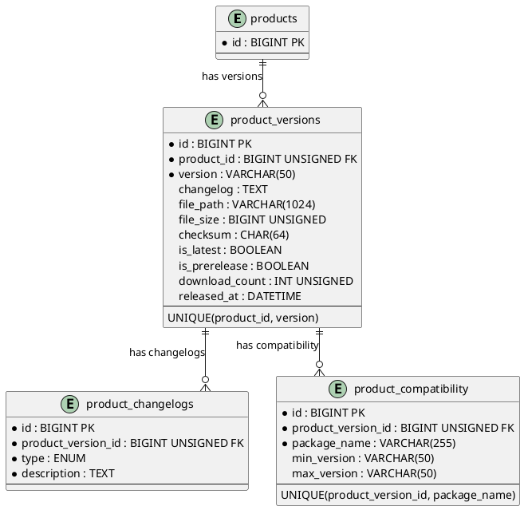

# 06.52 - Product Versions

| Field   | Value                  |
|---------|------------------------|
| Project | GsmUi                  |
| Domain  | Marketplace - Versions |
| Version | 1.0.0                  |
| Prev    | 06.51 - Coupons        |
| Next    | 06.53 - Orders         |

---

## Overview

Version history for marketplace products. Each version is a snapshot containing a changelog, downloadable file, compatibility matrix, and release metadata. The system tracks download counts, pre-release flags, and a per-product `is_latest` pointer for quick lookups.

---

## Tables

### product_versions

**Purpose:** Version history for marketplace products. Each version is a snapshot with changelog and download package.

| Column          | Type            | Attributes                          | Description                    |
|-----------------|-----------------|-------------------------------------|--------------------------------|
| id              | BIGINT          | PK, AUTO_INCREMENT                  | Primary key                    |
| product_id      | BIGINT UNSIGNED | FK → products.id, NOT NULL          | Owning product                 |
| version         | VARCHAR(50)     | NOT NULL                            | Semver string (e.g. `2.15.0`)  |
| changelog       | TEXT            | NULLABLE                            | Markdown changelog body        |
| file_path       | VARCHAR(1024)   | NULLABLE                            | Storage path of download file  |
| file_size       | BIGINT UNSIGNED | NULLABLE                            | File size in bytes             |
| checksum        | CHAR(64)        | NULLABLE                            | SHA-256 hash of the file       |
| is_latest       | BOOLEAN         | DEFAULT false                       | Latest stable version flag     |
| is_prerelease   | BOOLEAN         | DEFAULT false                       | Pre-release / beta flag        |
| download_count  | INT UNSIGNED    | DEFAULT 0                           | Total downloads                |
| released_at     | DATETIME        | NULLABLE                            | Public release timestamp       |
| created_at      | DATETIME        | NOT NULL                            | Record creation                |
| updated_at      | DATETIME        | NOT NULL                            | Last modification              |
| deleted_at      | DATETIME        | NULLABLE                            | Soft-delete timestamp          |

**Indexes:** PK, UNIQUE (product_id, version), INDEX product_id, INDEX is_latest, INDEX released_at

**Relationships:** belongsTo Product, hasMany ProductChangelog, hasMany ProductCompatibility

---

### product_changelogs

**Purpose:** Structured changelog entries for product versions following the Keep a Changelog convention.

| Column             | Type            | Attributes                               | Description           |
|--------------------|-----------------|------------------------------------------|-----------------------|
| id                 | BIGINT          | PK, AUTO_INCREMENT                       | Primary key           |
| product_version_id | BIGINT UNSIGNED | FK → product_versions.id, NOT NULL       | Owning version        |
| type               | ENUM            | added/changed/deprecated/removed/fixed/security | Entry category  |
| description        | TEXT            | NOT NULL                                 | Entry description     |
| created_at         | DATETIME        | NOT NULL                                 | Record creation       |
| updated_at         | DATETIME        | NOT NULL                                 | Last modification     |

**Indexes:** PK, INDEX product_version_id, INDEX type

**Relationships:** belongsTo ProductVersion

---

### product_compatibility

**Purpose:** Compatibility matrix for product versions. Declares min/max supported versions of Laravel, PHP, Livewire, etc.

| Column             | Type            | Attributes                               | Description                          |
|--------------------|-----------------|------------------------------------------|--------------------------------------|
| id                 | BIGINT          | PK, AUTO_INCREMENT                       | Primary key                          |
| product_version_id | BIGINT UNSIGNED | FK → product_versions.id, NOT NULL       | Owning version                       |
| package_name       | VARCHAR(255)    | NOT NULL                                 | e.g. `laravel/framework`, `php`      |
| min_version        | VARCHAR(50)     | NULLABLE                                 | Minimum supported version            |
| max_version        | VARCHAR(50)     | NULLABLE                                 | Maximum supported version (null=any) |
| created_at         | DATETIME        | NOT NULL                                 | Record creation                      |
| updated_at         | DATETIME        | NOT NULL                                 | Last modification                    |

**Indexes:** PK, INDEX product_version_id, UNIQUE (product_version_id, package_name)

**Relationships:** belongsTo ProductVersion

---

## Entity Relationship Diagram (PlantUML)



---

## Migrations

### product_versions

```php
Schema::create('product_versions', function (Blueprint $table) {
    $table->id();
    $table->foreignId('product_id')->constrained()->cascadeOnDelete();
    $table->string('version', 50);
    $table->text('changelog')->nullable();
    $table->string('file_path', 1024)->nullable();
    $table->unsignedBigInteger('file_size')->nullable();
    $table->char('checksum', 64)->nullable();
    $table->boolean('is_latest')->default(false);
    $table->boolean('is_prerelease')->default(false);
    $table->unsignedInteger('download_count')->default(0);
    $table->dateTime('released_at')->nullable();
    $table->timestamps();
    $table->softDeletes();

    $table->unique(['product_id', 'version']);
    $table->index('is_latest');
    $table->index('released_at');
});
```

### product_changelogs

```php
Schema::create('product_changelogs', function (Blueprint $table) {
    $table->id();
    $table->foreignId('product_version_id')->constrained('product_versions')->cascadeOnDelete();
    $table->enum('type', ['added','changed','deprecated','removed','fixed','security']);
    $table->text('description');
    $table->timestamps();

    $table->index('type');
});
```

### product_compatibility

```php
Schema::create('product_compatibility', function (Blueprint $table) {
    $table->id();
    $table->foreignId('product_version_id')->constrained('product_versions')->cascadeOnDelete();
    $table->string('package_name', 255);
    $table->string('min_version', 50)->nullable();
    $table->string('max_version', 50)->nullable();
    $table->timestamps();

    $table->unique(['product_version_id', 'package_name']);
});
```

---

## Model Stubs

### ProductVersion

```php
class ProductVersion extends Model
{
    use SoftDeletes;

    protected $fillable = [
        'product_id','version','changelog','file_path','file_size',
        'checksum','is_latest','is_prerelease','download_count','released_at',
    ];

    protected $casts = [
        'file_size'=>'integer','is_latest'=>'boolean',
        'is_prerelease'=>'boolean','download_count'=>'integer','released_at'=>'datetime',
    ];

    public function product(): BelongsTo { return $this->belongsTo(Product::class); }
    public function changelogs(): HasMany { return $this->hasMany(ProductChangelog::class); }
    public function compatibility(): HasMany { return $this->hasMany(ProductCompatibility::class); }
}
```

### ProductChangelog

```php
class ProductChangelog extends Model
{
    protected $fillable = ['product_version_id','type','description'];

    public function version(): BelongsTo { return $this->belongsTo(ProductVersion::class, 'product_version_id'); }
}
```

### ProductCompatibility

```php
class ProductCompatibility extends Model
{
    protected $fillable = ['product_version_id','package_name','min_version','max_version'];

    public function version(): BelongsTo { return $this->belongsTo(ProductVersion::class, 'product_version_id'); }
}
```

---

## Notes

- `is_latest` managed via model observer — unset previous flag on new release.
- `checksum` is SHA-256 of the uploaded file, computed during upload for client-side verification.
- `file_path` references a storage disk path (e.g. `products/{id}/versions/{version}.zip`).
- Pre-release versions excluded from `is_latest` consideration by default.

---

# Semver Parsing & Validation

## Version Comparison Helper

```php
// app/Services/SemverParser.php
class SemverParser
{
    public const PATTERN = '/^(0|[1-9]\d*)\.(0|[1-9]\d*)\.(0|[1-9]\d*)(?:-((?:0|[1-9]\d*|\d*[a-zA-Z-][0-9a-zA-Z-]*)(?:\.(?:0|[1-9]\d*|\d*[a-zA-Z-][0-9a-zA-Z-]*))*))?(?:\+([0-9a-zA-Z-]+(?:\.[0-9a-zA-Z-]+)*))?$/';

    public static function parse(string $version): ?array
    {
        if (!preg_match(self::PATTERN, $version, $matches)) {
            return null;
        }

        return [
            'major' => (int) $matches[1],
            'minor' => (int) $matches[2],
            'patch' => (int) $matches[3],
            'prerelease' => $matches[4] ?? null,
            'build' => $matches[5] ?? null,
        ];
    }

    public static function isValid(string $version): bool
    {
        return self::parse($version) !== null;
    }

    public static function compare(string $a, string $b): int
    {
        $parsedA = self::parse($a);
        $parsedB = self::parse($b);

        if ($parsedA === null || $parsedB === null) {
            throw new \InvalidArgumentException("Invalid semver string");
        }

        // Compare major.minor.patch
        if ($parsedA['major'] !== $parsedB['major']) {
            return $parsedA['major'] <=> $parsedB['major'];
        }
        if ($parsedA['minor'] !== $parsedB['minor']) {
            return $parsedA['minor'] <=> $parsedB['minor'];
        }
        if ($parsedA['patch'] !== $parsedB['patch']) {
            return $parsedA['patch'] <=> $parsedB['patch'];
        }

        // Pre-release versions have lower precedence
        if ($parsedA['prerelease'] !== $parsedB['prerelease']) {
            if ($parsedA['prerelease'] === null) return 1;
            if ($parsedB['prerelease'] === null) return -1;
            return strcmp($parsedA['prerelease'], $parsedB['prerelease']);
        }

        return 0;
    }

    public static function isGreater(string $a, string $b): bool
    {
        return self::compare($a, $b) > 0;
    }

    public static function isLess(string $a, string $b): bool
    {
        return self::compare($a, $b) < 0;
    }

    public static function isStable(string $version): bool
    {
        $parsed = self::parse($version);

        return $parsed !== null && $parsed['prerelease'] === null;
    }

    public static function nextVersion(string $currentVersion, string $bump = 'patch'): string
    {
        $parsed = self::parse($currentVersion);

        if ($parsed === null) {
            throw new \InvalidArgumentException("Invalid semver: {$currentVersion}");
        }

        return match ($bump) {
            'major' => ($parsed['major'] + 1) . '.0.0',
            'minor' => "{$parsed['major']}." . ($parsed['minor'] + 1) . '.0',
            'patch' => "{$parsed['major']}.{$parsed['minor']}." . ($parsed['patch'] + 1),
            default => throw new \InvalidArgumentException("Invalid bump type: {$bump}"),
        };
    }

    public static function sort(array &$versions, string $direction = 'desc'): void
    {
        usort($versions, function ($a, $b) use ($direction) {
            $result = self::compare($a, $b);
            return $direction === 'desc' ? -$result : $result;
        });
    }
}
```

## Version Range Matching

```php
// app/Services/VersionRangeMatcher.php
class VersionRangeMatcher
{
    /**
     * Check if a version satisfies a range constraint.
     * Supports: >=1.0.0, <2.0.0, ^1.0.0, ~1.2.0, 1.0.0 - 2.0.0
     */
    public static function satisfies(string $version, string $range): bool
    {
        $range = trim($range);

        // Exact match
        if ($range === $version) {
            return true;
        }

        // Greater than or equal
        if (preg_match('/^>=\s*(.+)$/', $range, $matches)) {
            return SemverParser::compare($version, $matches[1]) >= 0;
        }

        // Less than or equal
        if (preg_match('/^<=\s*(.+)$/', $range, $matches)) {
            return SemverParser::compare($version, $matches[1]) <= 0;
        }

        // Greater than
        if (preg_match('/^>\s*(.+)$/', $range, $matches)) {
            return SemverParser::compare($version, $matches[1]) > 0;
        }

        // Less than
        if (preg_match('/^<\s*(.+)$/', $range, $matches)) {
            return SemverParser::compare($version, $matches[1]) < 0;
        }

        // Caret range (^1.0.0) — allows patch-level changes
        if (preg_match('/^\^\s*(.+)$/', $range, $matches)) {
            return self::satisfiesCaret($version, $matches[1]);
        }

        // Tilde range (~1.2.0) — allows minor-level changes
        if (preg_match('/^~\s*(.+)$/', $range, $matches)) {
            return self::satisfiesTilde($version, $matches[1]);
        }

        // Range (1.0.0 - 2.0.0)
        if (preg_match('/^(.+)\s*-\s*(.+)$/', $range, $matches)) {
            return SemverParser::compare($version, $matches[1]) >= 0
                && SemverParser::compare($version, $matches[2]) <= 0;
        }

        return false;
    }

    protected static function satisfiesCaret(string $version, string $constraint): bool
    {
        $parsed = SemverParser::parse($constraint);
        $parsedVersion = SemverParser::parse($version);

        if (!$parsed || !$parsedVersion) {
            return false;
        }

        // Same major, version >= constraint
        if ($parsedVersion['major'] !== $parsed['major']) {
            return false;
        }

        return SemverParser::compare($version, $constraint) >= 0;
    }

    protected static function satisfiesTilde(string $version, string $constraint): bool
    {
        $parsed = SemverParser::parse($constraint);
        $parsedVersion = SemverParser::parse($version);

        if (!$parsed || !$parsedVersion) {
            return false;
        }

        // Same major.minor, version >= constraint
        if ($parsedVersion['major'] !== $parsed['major'] || $parsedVersion['minor'] !== $parsed['minor']) {
            return false;
        }

        return SemverParser::compare($version, $constraint) >= 0;
    }
}
```

---

# Version Observer

```php
// app/Observers/ProductVersionObserver.php
class ProductVersionObserver
{
    public function created(ProductVersion $version): void
    {
        // If this is a stable release, mark it as latest
        if (!$version->is_prerelease && !$version->is_latest) {
            $this->setAsLatest($version);
        }

        // Dispatch version created event
        VersionCreated::dispatch($version);
    }

    public function updated(ProductVersion $version): void
    {
        if ($version->isDirty('is_latest') && $version->is_latest) {
            // Unset previous latest version
            ProductVersion::where('product_id', $version->product_id)
                ->where('id', '!=', $version->id)
                ->update(['is_latest' => false]);
        }
    }

    public function deleted(ProductVersion $version): void
    {
        // Clean up storage files
        if ($version->file_path) {
            Storage::disk('products')->delete($version->file_path);
        }

        // If this was the latest, find the next stable version
        if ($version->is_latest) {
            $nextLatest = ProductVersion::where('product_id', $version->product_id)
                ->where('is_prerelease', false)
                ->where('id', '!=', $version->id)
                ->orderByDesc('released_at')
                ->first();

            if ($nextLatest) {
                $nextLatest->update(['is_latest' => true]);
            }
        }
    }

    protected function setAsLatest(ProductVersion $version): void
    {
        // Unset any existing latest for this product
        ProductVersion::where('product_id', $version->product_id)
            ->where('is_latest', true)
            ->update(['is_latest' => false]);

        // Set this version as latest
        $version->update(['is_latest' => true]);
    }
}
```

---

# Download Tracking

```php
// app/Models/ProductVersionDownload.php
class ProductVersionDownload extends Model
{
    protected $table = 'product_version_downloads';

    protected $fillable = [
        'product_version_id', 'user_id', 'ip_address',
        'user_agent', 'downloaded_at',
    ];

    protected $casts = [
        'downloaded_at' => 'datetime',
    ];

    public function version(): BelongsTo
    {
        return $this->belongsTo(ProductVersion::class);
    }

    public function user(): BelongsTo
    {
        return $this->belongsTo(User::class);
    }
}

// database/migrations/xxxx_create_product_version_downloads_table.php
Schema::create('product_version_downloads', function (Blueprint $table) {
    $table->id();
    $table->foreignId('product_version_id')->constrained()->cascadeOnDelete();
    $table->foreignId('user_id')->nullable()->constrained()->nullOnDelete();
    $table->ipAddress('ip_address');
    $table->string('user_agent')->nullable();
    $table->dateTime('downloaded_at');
    $table->timestamps();

    $table->index('product_version_id');
    $table->index('user_id');
    $table->index('downloaded_at');
});
```

---

# Version Storage Configuration

```php
// config/filesystems.php — products disk
'products' => [
    'driver' => 's3',
    'key' => env('AWS_ACCESS_KEY_ID'),
    'secret' => env('AWS_SECRET_ACCESS_KEY'),
    'region' => env('AWS_DEFAULT_REGION'),
    'bucket' => env('AWS_BUCKET'),
    'url' => env('AWS_URL'),
    'root' => 'products',
],

// app/Services/VersionStorageService.php
class VersionStorageService
{
    protected Disk $disk;

    public function __construct()
    {
        $this->disk = Storage::disk('products');
    }

    public function storeVersionFile(int $productId, string $version, UploadedFile $file): string
    {
        $path = "versions/{$productId}/{$version}/" . $file->getClientOriginalName();
        $this->disk->put($path, file_get_contents($file->getRealPath()));

        return $path;
    }

    public function getDownloadUrl(string $filePath, int $expirationMinutes = 60): string
    {
        return $this->disk->temporaryUrl($filePath, now()->addMinutes($expirationMinutes));
    }

    public function computeChecksum(string $filePath): string
    {
        $stream = $this->disk->readStream($filePath);
        $context = hash_init('sha256');

        while (!feof($stream)) {
            hash_update($context, fread($stream, 8192));
        }

        fclose($stream);

        return hash_final($context);
    }

    public function deleteVersionFile(string $filePath): bool
    {
        return $this->disk->delete($filePath);
    }

    public function fileExists(string $filePath): bool
    {
        return $this->disk->exists($filePath);
    }
}
```

---

# Changelog Rendering

```php
// app/Services/ChangelogRenderer.php
class ChangelogRenderer
{
    public const TYPE_LABELS = [
        'added' => 'Added',
        'changed' => 'Changed',
        'deprecated' => 'Deprecated',
        'removed' => 'Removed',
        'fixed' => 'Fixed',
        'security' => 'Security',
    ];

    public const TYPE_COLORS = [
        'added' => 'green',
        'changed' => 'blue',
        'deprecated' => 'yellow',
        'removed' => 'red',
        'fixed' => 'purple',
        'security' => 'orange',
    ];

    public function render(ProductVersion $version): string
    {
        $changelogs = $version->changelogs()->orderBy('type')->get();

        if ($changelogs->isEmpty()) {
            return $this->renderMarkdown($version->changelog);
        }

        $html = '<div class="changelog">';
        $html .= "<h3>Version {$version->version}</h3>";

        $grouped = $changelogs->groupBy('type');

        foreach (['added', 'changed', 'deprecated', 'removed', 'fixed', 'security'] as $type) {
            if (!$grouped->has($type)) {
                continue;
            }

            $label = self::TYPE_LABELS[$type];
            $color = self::TYPE_COLORS[$type];

            $html .= "<div class=\"changelog-section changelog-{$type}\">";
            $html .= "<h4 class=\"text-{$color}\">{$label}</h4>";
            $html .= '<ul>';

            foreach ($grouped[$type] as $entry) {
                $html .= '<li>' . e($entry->description) . '</li>';
            }

            $html .= '</ul>';
            $html .= '</div>';
        }

        $html .= '</div>';

        return $html;
    }

    protected function renderMarkdown(?string $markdown): string
    {
        if (empty($markdown)) {
            return '';
        }

        return app(MarkdownRenderer::class)->convert($markdown);
    }
}
```

---

# Version Notification System

```php
// app/Services/VersionNotificationService.php
class VersionNotificationService
{
    public function notifyNewVersion(ProductVersion $version): void
    {
        // Find users who have purchased this product
        $purchasers = User::whereHas('orders', function ($q) use ($version) {
            $q->where('status', 'completed')
              ->whereHas('items', function ($q2) use ($version) {
                  $q2->where('product_id', $version->product_id);
              });
        })->get();

        foreach ($purchasers as $user) {
            NewVersionAvailable::dispatch($user, $version);
        }
    }

    public function notifyDeprecation(ProductVersion $version): void
    {
        $purchasers = User::whereHas('orders', function ($q) use ($version) {
            $q->where('status', 'completed')
              ->whereHas('items', function ($q2) use ($version) {
                  $q2->where('product_id', $version->product_id);
              });
        })->get();

        foreach ($purchasers as $user) {
            VersionDeprecated::dispatch($user, $version);
        }
    }
}

// app/Events/NewVersionAvailable.php
class NewVersionAvailable
{
    use Dispatchable, SerializesModels;

    public function __construct(
        public User $user,
        public ProductVersion $version,
    ) {}
}

// app/Events/VersionDeprecated.php
class VersionDeprecated
{
    use Dispatchable, SerializesModels;

    public function __construct(
        public User $user,
        public ProductVersion $version,
    ) {}
}
```

---

# SQL DDL — Complete Schema

```sql
-- product_versions table
CREATE TABLE product_versions (
    id BIGINT UNSIGNED AUTO_INCREMENT PRIMARY KEY,
    product_id BIGINT UNSIGNED NOT NULL,
    version VARCHAR(50) NOT NULL,
    changelog TEXT NULL,
    file_path VARCHAR(1024) NULL,
    file_size BIGINT UNSIGNED NULL,
    checksum CHAR(64) NULL,
    is_latest BOOLEAN NOT NULL DEFAULT FALSE,
    is_prerelease BOOLEAN NOT NULL DEFAULT FALSE,
    download_count INT UNSIGNED NOT NULL DEFAULT 0,
    released_at TIMESTAMP NULL,
    created_at TIMESTAMP NOT NULL DEFAULT CURRENT_TIMESTAMP,
    updated_at TIMESTAMP NOT NULL DEFAULT CURRENT_TIMESTAMP ON UPDATE CURRENT_TIMESTAMP,
    deleted_at TIMESTAMP NULL,

    UNIQUE INDEX idx_product_versions_product_version (product_id, version),
    INDEX idx_product_versions_product_id (product_id),
    INDEX idx_product_versions_is_latest (product_id, is_latest),
    INDEX idx_product_versions_released_at (released_at),
    INDEX idx_product_versions_is_prerelease (is_prerelease),
    INDEX idx_product_versions_deleted_at (deleted_at),

    CONSTRAINT fk_product_versions_product
        FOREIGN KEY (product_id) REFERENCES products(id)
        ON DELETE CASCADE
) ENGINE=InnoDB DEFAULT CHARSET=utf8mb4 COLLATE=utf8mb4_unicode_ci;

-- product_changelogs table
CREATE TABLE product_changelogs (
    id BIGINT UNSIGNED AUTO_INCREMENT PRIMARY KEY,
    product_version_id BIGINT UNSIGNED NOT NULL,
    type ENUM('added','changed','deprecated','removed','fixed','security') NOT NULL,
    description TEXT NOT NULL,
    created_at TIMESTAMP NOT NULL DEFAULT CURRENT_TIMESTAMP,
    updated_at TIMESTAMP NOT NULL DEFAULT CURRENT_TIMESTAMP ON UPDATE CURRENT_TIMESTAMP,

    INDEX idx_product_changelogs_version_id (product_version_id),
    INDEX idx_product_changelogs_type (type),

    CONSTRAINT fk_product_changelogs_version
        FOREIGN KEY (product_version_id) REFERENCES product_versions(id)
        ON DELETE CASCADE
) ENGINE=InnoDB DEFAULT CHARSET=utf8mb4 COLLATE=utf8mb4_unicode_ci;

-- product_compatibility table
CREATE TABLE product_compatibility (
    id BIGINT UNSIGNED AUTO_INCREMENT PRIMARY KEY,
    product_version_id BIGINT UNSIGNED NOT NULL,
    package_name VARCHAR(255) NOT NULL,
    min_version VARCHAR(50) NULL,
    max_version VARCHAR(50) NULL,
    created_at TIMESTAMP NOT NULL DEFAULT CURRENT_TIMESTAMP,
    updated_at TIMESTAMP NOT NULL DEFAULT CURRENT_TIMESTAMP ON UPDATE CURRENT_TIMESTAMP,

    UNIQUE INDEX idx_product_compatibility_version_package (product_version_id, package_name),
    INDEX idx_product_compatibility_package (package_name),

    CONSTRAINT fk_product_compatibility_version
        FOREIGN KEY (product_version_id) REFERENCES product_versions(id)
        ON DELETE CASCADE
) ENGINE=InnoDB DEFAULT CHARSET=utf8mb4 COLLATE=utf8mb4_unicode_ci;

-- product_version_downloads table
CREATE TABLE product_version_downloads (
    id BIGINT UNSIGNED AUTO_INCREMENT PRIMARY KEY,
    product_version_id BIGINT UNSIGNED NOT NULL,
    user_id BIGINT UNSIGNED NULL,
    ip_address VARCHAR(45) NOT NULL,
    user_agent VARCHAR(512) NULL,
    downloaded_at TIMESTAMP NOT NULL,
    created_at TIMESTAMP NOT NULL DEFAULT CURRENT_TIMESTAMP,
    updated_at TIMESTAMP NOT NULL DEFAULT CURRENT_TIMESTAMP ON UPDATE CURRENT_TIMESTAMP,

    INDEX idx_pvd_version_id (product_version_id),
    INDEX idx_pvd_user_id (user_id),
    INDEX idx_pvd_downloaded_at (downloaded_at),

    CONSTRAINT fk_pvd_version
        FOREIGN KEY (product_version_id) REFERENCES product_versions(id)
        ON DELETE CASCADE,
    CONSTRAINT fk_pvd_user
        FOREIGN KEY (user_id) REFERENCES users(id)
        ON DELETE SET NULL
) ENGINE=InnoDB DEFAULT CHARSET=utf8mb4 COLLATE=utf8mb4_unicode_ci;
```

---

# Foreign Key Patterns

```php
// Complete foreign key definitions for product versions

// product_versions → products
Schema::table('product_versions', function (Blueprint $table) {
    $table->foreign('product_id')
        ->references('id')
        ->on('products')
        ->cascadeOnDelete();
});

// product_changelogs → product_versions
Schema::table('product_changelogs', function (Blueprint $table) {
    $table->foreign('product_version_id')
        ->references('id')
        ->on('product_versions')
        ->cascadeOnDelete();
});

// product_compatibility → product_versions
Schema::table('product_compatibility', function (Blueprint $table) {
    $table->foreign('product_version_id')
        ->references('id')
        ->on('product_versions')
        ->cascadeOnDelete();
});

// product_version_downloads → product_versions
Schema::table('product_version_downloads', function (Blueprint $table) {
    $table->foreign('product_version_id')
        ->references('id')
        ->on('product_versions')
        ->cascadeOnDelete();
});

// product_version_downloads → users
Schema::table('product_version_downloads', function (Blueprint $table) {
    $table->foreign('user_id')
        ->references('id')
        ->on('users')
        ->nullOnDelete();
});
```

---

# Compatibility Checking Queries

```php
// app/Services/CompatibilityChecker.php
class CompatibilityChecker
{
    public function isCompatible(ProductVersion $version, array $environment): bool
    {
        $compatibility = $version->compatibility;

        foreach ($environment as $packageName => $installedVersion) {
            $rule = $compatibility->firstWhere('package_name', $packageName);

            if (!$rule) {
                continue; // No constraint means any version is compatible
            }

            if ($rule->min_version && SemverParser::compare($installedVersion, $rule->min_version) < 0) {
                return false;
            }

            if ($rule->max_version && SemverParser::compare($installedVersion, $rule->max_version) > 0) {
                return false;
            }
        }

        return true;
    }

    public function findCompatibleVersion(Product $product, array $environment): ?ProductVersion
    {
        $versions = ProductVersion::where('product_id', $product->id)
            ->where('is_prerelease', false)
            ->orderByDesc('version')
            ->get();

        foreach ($versions as $version) {
            if ($this->isCompatible($version, $environment)) {
                return $version;
            }
        }

        return null;
    }

    public function getCompatibilityReport(ProductVersion $version, array $environment): array
    {
        $report = [];
        $compatibility = $version->compatibility;

        foreach ($compatibility as $rule) {
            $installed = $environment[$rule->package_name] ?? null;
            $compatible = true;
            $reason = null;

            if ($installed === null) {
                $compatible = false;
                $reason = 'Package not installed';
            } elseif ($rule->min_version && SemverParser::compare($installed, $rule->min_version) < 0) {
                $compatible = false;
                $reason = "Installed {$installed} is below minimum {$rule->min_version}";
            } elseif ($rule->max_version && SemverParser::compare($installed, $rule->max_version) > 0) {
                $compatible = false;
                $reason = "Installed {$installed} exceeds maximum {$rule->max_version}";
            }

            $report[] = [
                'package' => $rule->package_name,
                'installed' => $installed,
                'min_version' => $rule->min_version,
                'max_version' => $rule->max_version,
                'compatible' => $compatible,
                'reason' => $reason,
            ];
        }

        return $report;
    }
}
```

---

# Event Definitions

```php
// app/Events/VersionCreated.php
class VersionCreated
{
    use Dispatchable, SerializesModels;

    public function __construct(
        public ProductVersion $version,
    ) {}
}

// app/Events/VersionReleased.php
class VersionReleased
{
    use Dispatchable, SerializesModels;

    public function __construct(
        public ProductVersion $version,
    ) {}
}

// app/Events/VersionDownloaded.php
class VersionDownloaded
{
    use Dispatchable, SerializesModels;

    public function __construct(
        public ProductVersion $version,
        public ?User $user,
    ) {}
}
```

---

# Version Factory & Seeders

```php
// database/factories/ProductVersionFactory.php
class ProductVersionFactory extends Factory
{
    protected $model = ProductVersion::class;

    public function definition(): array
    {
        $major = $this->faker->numberBetween(1, 5);
        $minor = $this->faker->numberBetween(0, 20);
        $patch = $this->faker->numberBetween(0, 50);

        return [
            'product_id' => Product::factory(),
            'version' => "{$major}.{$minor}.{$patch}",
            'changelog' => $this->faker->paragraphs(3, true),
            'file_path' => "versions/{$this->faker->uuid()}.zip",
            'file_size' => $this->faker->numberBetween(10240, 10485760),
            'checksum' => hash('sha256', $this->faker->text()),
            'is_latest' => false,
            'is_prerelease' => false,
            'download_count' => $this->faker->numberBetween(0, 1000),
            'released_at' => $this->faker->optional(0.8)->dateTimeBetween('-1 year', 'now'),
        ];
    }

    public function prerelease(): static
    {
        return $this->state(function (array $attributes) {
            $parsed = SemverParser::parse($attributes['version']);

            return [
                'is_prerelease' => true,
                'version' => "{$parsed['major']}.{$parsed['minor']}.{$parsed['patch']}-beta.1",
            ];
        });
    }

    public function latest(): static
    {
        return $this->state(fn() => ['is_latest' => true]);
    }
}

// database/factories/ProductChangelogFactory.php
class ProductChangelogFactory extends Factory
{
    protected $model = ProductChangelog::class;

    public function definition(): array
    {
        return [
            'product_version_id' => ProductVersion::factory(),
            'type' => $this->faker->randomElement(['added','changed','deprecated','removed','fixed','security']),
            'description' => $this->faker->sentence(),
        ];
    }
}

// database/factories/ProductCompatibilityFactory.php
class ProductCompatibilityFactory extends Factory
{
    protected $model = ProductCompatibility::class;

    public function definition(): array
    {
        return [
            'product_version_id' => ProductVersion::factory(),
            'package_name' => $this->faker->randomElement([
                'laravel/framework', 'php', 'livewire/livewire',
                'laravel/breeze', 'laravel/jetstream', 'tailwindcss/tailwindcss',
            ]),
            'min_version' => $this->faker->optional(0.7)->numerify('#.##.#'),
            'max_version' => $this->faker->optional(0.3)->numerify('#.##.#'),
        ];
    }
}
```

---

# Test Helpers

```php
// tests/Helpers/VersionTestHelpers.php
trait VersionTestHelpers
{
    protected function createProductVersion(Product $product, array $overrides = []): ProductVersion
    {
        return ProductVersion::factory()->create(array_merge([
            'product_id' => $product->id,
        ], $overrides));
    }

    protected function createLatestVersion(Product $product): ProductVersion
    {
        return $this->createProductVersion($product, ['is_latest' => true]);
    }

    protected function createPrereleaseVersion(Product $product): ProductVersion
    {
        return ProductVersion::factory()->prerelease()->create([
            'product_id' => $product->id,
        ]);
    }

    protected function assertVersionExists(Product $product, string $version): void
    {
        $this->assertDatabaseHas('product_versions', [
            'product_id' => $product->id,
            'version' => $version,
        ]);
    }

    protected function assertLatestVersion(Product $product, string $version): void
    {
        $latest = ProductVersion::where('product_id', $product->id)
            ->where('is_latest', true)
            ->first();

        $this->assertNotNull($latest, 'No latest version found');
        $this->assertEquals($version, $latest->version);
    }

    protected function assertSemverValid(string $version): void
    {
        $this->assertTrue(
            SemverParser::isValid($version),
            "Version string '{$version}' is not valid semver"
        );
    }

    protected function assertSemverInvalid(string $version): void
    {
        $this->assertFalse(
            SemverParser::isValid($version),
            "Version string '{$version}' should be invalid semver"
        );
    }

    protected function assertVersionCompatible(ProductVersion $version, array $environment): void
    {
        $checker = app(CompatibilityChecker::class);
        $this->assertTrue(
            $checker->isCompatible($version, $environment),
            "Version {$version->version} should be compatible with given environment"
        );
    }

    protected function assertVersionIncompatible(ProductVersion $version, array $environment): void
    {
        $checker = app(CompatibilityChecker::class);
        $this->assertFalse(
            $checker->isCompatible($version, $environment),
            "Version {$version->version} should be incompatible with given environment"
        );
    }
}
```

---

# Index Strategy

## Performance Indexes

```php
// Composite indexes for common query patterns

// Find latest version for a product
Schema::table('product_versions', function (Blueprint $table) {
    $table->index(['product_id', 'is_latest', 'is_prerelease'], 'idx_pv_product_latest');
});

// Version lookup by semver within product
Schema::table('product_versions', function (Blueprint $table) {
    $table->index(['product_id', 'version'], 'idx_pv_product_version');
});

// Released versions for a product, ordered
Schema::table('product_versions', function (Blueprint $table) {
    $table->index(['product_id', 'released_at'], 'idx_pv_product_released');
});

// Changelogs by type for a version
Schema::table('product_changelogs', function (Blueprint $table) {
    $table->index(['product_version_id', 'type'], 'idx_pc_version_type');
});

// Compatibility lookups by package
Schema::table('product_compatibility', function (Blueprint $table) {
    $table->index(['package_name', 'min_version', 'max_version'], 'idx_pco_package_range');
});

// Download analytics by date
Schema::table('product_version_downloads', function (Blueprint $table) {
    $table->index(['product_version_id', 'downloaded_at'], 'idx_pvd_version_date');
});
```

---

# Version Service Class

```php
// app/Services/ProductVersionService.php
class ProductVersionService
{
    public function __construct(
        protected VersionStorageService $storage,
        protected CompatibilityChecker $compatibility,
        protected VersionNotificationService $notifications,
    ) {}

    public function createVersion(Product $product, array $data): ProductVersion
    {
        // Validate semver
        if (!SemverParser::isValid($data['version'])) {
            throw new \InvalidArgumentException("Invalid version format: {$data['version']}");
        }

        // Check for duplicate version
        if (ProductVersion::where('product_id', $product->id)->where('version', $data['version'])->exists()) {
            throw new \InvalidArgumentException("Version {$data['version']} already exists for this product");
        }

        $version = ProductVersion::create(array_merge($data, [
            'product_id' => $product->id,
        ]));

        return $version;
    }

    public function releaseVersion(ProductVersion $version): ProductVersion
    {
        $version->update([
            'released_at' => now(),
            'is_prerelease' => false,
        ]);

        // Set as latest if it's the highest stable version
        $this->updateLatestFlag($version);

        // Notify purchasers
        $this->notifications->notifyNewVersion($version);

        VersionReleased::dispatch($version);

        return $version->fresh();
    }

    public function downloadVersion(ProductVersion $version, ?User $user = null): string
    {
        // Increment download count
        $version->increment('download_count');

        // Log download
        ProductVersionDownload::create([
            'product_version_id' => $version->id,
            'user_id' => $user?->id,
            'ip_address' => request()->ip(),
            'user_agent' => request()->userAgent(),
            'downloaded_at' => now(),
        ]);

        // Dispatch event
        VersionDownloaded::dispatch($version, $user);

        // Generate temporary download URL
        return $this->storage->getDownloadUrl($version->file_path);
    }

    protected function updateLatestFlag(ProductVersion $version): void
    {
        $highest = ProductVersion::where('product_id', $version->product_id)
            ->where('is_prerelease', false)
            ->where('released_at', '!=', null)
            ->orderByDesc('version')
            ->first();

        if ($highest && $highest->id === $version->id) {
            // Unset previous latest
            ProductVersion::where('product_id', $version->product_id)
                ->where('is_latest', true)
                ->update(['is_latest' => false]);

            $version->update(['is_latest' => true]);
        }
    }
}

---

# Version API Endpoints

```php
// routes/api.php — version management endpoints
Route::prefix('products/{product}/versions')->group(function () {
    Route::get('/', [ProductVersionController::class, 'index']);
    Route::post('/', [ProductVersionController::class, 'store']);
    Route::get('/latest', [ProductVersionController::class, 'latest']);
    Route::get('/{version}', [ProductVersionController::class, 'show']);
    Route::put('/{version}', [ProductVersionController::class, 'update']);
    Route::delete('/{version}', [ProductVersionController::class, 'destroy']);
    Route::post('/{version}/release', [ProductVersionController::class, 'release']);
    Route::get('/{version}/download', [ProductVersionController::class, 'download']);
    Route::get('/{version}/changelog', [ProductVersionController::class, 'changelog']);
    Route::get('/{version}/compatibility', [ProductVersionController::class, 'compatibility']);
});
```

---

# Version Controller

```php
// app/Http/Controllers/ProductVersionController.php
class ProductVersionController extends Controller
{
    public function __construct(
        protected ProductVersionService $versionService,
    ) {}

    public function index(Product $product): JsonResponse
    {
        $versions = ProductVersion::where('product_id', $product->id)
            ->orderByDesc('version')
            ->paginate(20);

        return response()->json($versions);
    }

    public function store(Request $request, Product $product): JsonResponse
    {
        $validated = $request->validate([
            'version' => ['required', 'string', 'max:50'],
            'changelog' => ['nullable', 'string'],
            'file' => ['required', 'file', 'max:10240'],
            'is_prerelease' => ['boolean'],
            'compatibility' => ['array'],
            'compatibility.*.package_name' => ['required_with:compatibility', 'string'],
            'compatibility.*.min_version' => ['nullable', 'string'],
            'compatibility.*.max_version' => ['nullable', 'string'],
        ]);

        $version = $this->versionService->createVersion($product, [
            'version' => $validated['version'],
            'changelog' => $validated['changelog'] ?? null,
            'is_prerelease' => $validated['is_prerelease'] ?? false,
        ]);

        // Store file
        if ($request->hasFile('file')) {
            $path = app(VersionStorageService::class)->storeVersionFile(
                $product->id,
                $validated['version'],
                $request->file('file')
            );

            $checksum = app(VersionStorageService::class)->computeChecksum($path);

            $version->update([
                'file_path' => $path,
                'file_size' => $request->file('file')->getSize(),
                'checksum' => $checksum,
            ]);
        }

        // Store compatibility rules
        if (!empty($validated['compatibility'])) {
            foreach ($validated['compatibility'] as $rule) {
                ProductCompatibility::create([
                    'product_version_id' => $version->id,
                    'package_name' => $rule['package_name'],
                    'min_version' => $rule['min_version'] ?? null,
                    'max_version' => $rule['max_version'] ?? null,
                ]);
            }
        }

        return response()->json($version->fresh(['changelogs', 'compatibility']), 201);
    }

    public function show(Product $product, ProductVersion $version): JsonResponse
    {
        return response()->json(
            $version->load(['changelogs', 'compatibility'])
        );
    }

    public function latest(Product $product): JsonResponse
    {
        $version = ProductVersion::where('product_id', $product->id)
            ->where('is_latest', true)
            ->first();

        if (!$version) {
            return response()->json(['message' => 'No stable version found'], 404);
        }

        return response()->json($version->load(['changelogs', 'compatibility']));
    }

    public function release(Request $request, Product $product, ProductVersion $version): JsonResponse
    {
        $released = $this->versionService->releaseVersion($version);

        return response()->json($released);
    }

    public function download(Product $product, ProductVersion $version): RedirectResponse
    {
        $url = $this->versionService->downloadVersion($version, $request->user());

        return redirect($url);
    }

    public function changelog(Product $product, ProductVersion $version): JsonResponse
    {
        $renderer = app(ChangelogRenderer::class);

        return response()->json([
            'html' => $renderer->render($version),
            'entries' => $version->changelogs()->orderBy('type')->get(),
        ]);
    }

    public function compatibility(Product $product, ProductVersion $version): JsonResponse
    {
        $environment = $request->input('environment', []);
        $checker = app(CompatibilityChecker::class);

        return response()->json([
            'rules' => $version->compatibility,
            'report' => $checker->getCompatibilityReport($version, $environment),
        ]);
    }
}
```

---

# Version Policy

```php
// app/Policies/ProductVersionPolicy.php
class ProductVersionPolicy
{
    public function viewAny(User $user, Product $product): bool
    {
        return true;
    }

    public function view(User $user, ProductVersion $version): bool
    {
        return true;
    }

    public function create(User $user, Product $product): bool
    {
        return $user->id === $product->user_id
            || $user->hasPermission('products.versions.create');
    }

    public function update(User $user, ProductVersion $version): bool
    {
        return $user->id === $version->product->user_id
            || $user->hasPermission('products.versions.update');
    }

    public function delete(User $user, ProductVersion $version): bool
    {
        return $user->id === $version->product->user_id
            || $user->hasPermission('products.versions.delete');
    }

    public function release(User $user, ProductVersion $version): bool
    {
        return $user->id === $version->product->user_id
            || $user->hasPermission('products.versions.release');
    }

    public function download(User $user, ProductVersion $version): bool
    {
        return true;
    }
}
```

---

# Version Diff Service

```php
// app/Services/VersionDiffService.php
class VersionDiffService
{
    public function diff(ProductVersion $from, ProductVersion $to): array
    {
        $fromChangelogs = $from->changelogs()->get()->keyBy('type');
        $toChangelogs = $to->changelogs()->get()->keyBy('type');

        $diff = [];

        foreach (['added', 'changed', 'deprecated', 'removed', 'fixed', 'security'] as $type) {
            $fromEntries = $fromChangelogs->get($type, collect())->pluck('description')->toArray();
            $toEntries = $toChangelogs->get($type, collect())->pluck('description')->toArray();

            $diff[$type] = [
                'added' => array_values(array_diff($toEntries, $fromEntries)),
                'removed' => array_values(array_diff($fromEntries, $toEntries)),
                'unchanged' => array_values(array_intersect($fromEntries, $toEntries)),
            ];
        }

        return [
            'from_version' => $from->version,
            'to_version' => $to->version,
            'diff' => $diff,
            'compatibility_changes' => $this->diffCompatibility($from, $to),
        ];
    }

    protected function diffCompatibility(ProductVersion $from, ProductVersion $to): array
    {
        $fromRules = $from->compatibility->keyBy('package_name');
        $toRules = $to->compatibility->keyBy('package_name');

        $allPackages = $fromRules->keys()->merge($toRules->keys())->unique();
        $changes = [];

        foreach ($allPackages as $package) {
            $fromRule = $fromRules->get($package);
            $toRule = $toRules->get($package);

            if (!$fromRule && $toRule) {
                $changes[] = [
                    'package' => $package,
                    'change' => 'added',
                    'min_version' => $toRule->min_version,
                    'max_version' => $toRule->max_version,
                ];
            } elseif ($fromRule && !$toRule) {
                $changes[] = [
                    'package' => $package,
                    'change' => 'removed',
                ];
            } elseif ($fromRule && $toRule) {
                if ($fromRule->min_version !== $toRule->min_version
                    || $fromRule->max_version !== $toRule->max_version) {
                    $changes[] = [
                        'package' => $package,
                        'change' => 'modified',
                        'from' => [
                            'min' => $fromRule->min_version,
                            'max' => $fromRule->max_version,
                        ],
                        'to' => [
                            'min' => $toRule->min_version,
                            'max' => $toRule->max_version,
                        ],
                    ];
                }
            }
        }

        return $changes;
    }
}
```

---

# Version Seeding Examples

```php
// database/seeders/ProductVersionSeeder.php
class ProductVersionSeeder extends Seeder
{
    public function run(): void
    {
        $products = Product::all();

        foreach ($products as $product) {
            // Create initial version
            $v1 = ProductVersion::create([
                'product_id' => $product->id,
                'version' => '1.0.0',
                'changelog' => 'Initial release.',
                'is_latest' => true,
                'released_at' => now()->subMonths(6),
            ]);

            ProductChangelog::create([
                'product_version_id' => $v1->id,
                'type' => 'added',
                'description' => 'Initial release of ' . $product->name,
            ]);

            // Create compatibility rules
            ProductCompatibility::create([
                'product_version_id' => $v1->id,
                'package_name' => 'laravel/framework',
                'min_version' => '10.0.0',
            ]);

            ProductCompatibility::create([
                'product_version_id' => $v1->id,
                'package_name' => 'php',
                'min_version' => '8.1.0',
            ]);

            // Create minor version
            $v11 = ProductVersion::create([
                'product_id' => $product->id,
                'version' => '1.1.0',
                'changelog' => 'Bug fixes and improvements.',
                'is_latest' => true,
                'released_at' => now()->subMonths(3),
            ]);

            $v1->update(['is_latest' => false]);

            ProductChangelog::create([
                'product_version_id' => $v11->id,
                'type' => 'added',
                'description' => 'Added dark mode support',
            ]);

            ProductChangelog::create([
                'product_version_id' => $v11->id,
                'type' => 'fixed',
                'description' => 'Fixed responsive layout issues on mobile',
            ]);

            // Create patch version
            $v111 = ProductVersion::create([
                'product_id' => $product->id,
                'version' => '1.1.1',
                'changelog' => 'Security patch.',
                'is_latest' => true,
                'released_at' => now()->subWeeks(2),
            ]);

            $v11->update(['is_latest' => false]);

            ProductChangelog::create([
                'product_version_id' => $v111->id,
                'type' => 'security',
                'description' => 'Updated dependency to fix XSS vulnerability',
            ]);

            // Create pre-release
            ProductVersion::create([
                'product_id' => $product->id,
                'version' => '2.0.0-beta.1',
                'changelog' => 'Major version with breaking changes.',
                'is_prerelease' => true,
                'released_at' => now(),
            ]);
        }
    }
}
```

---

# Version Livewire Components

```php
// app/Livewire/VersionManager.php
class VersionManager extends Component
{
    public Product $product;
    public ?ProductVersion $selectedVersion = null;
    public string $newVersion = '';
    public string $newChangelog = '';
    public bool $isPrerelease = false;

    protected VersionService $versionService;

    public function boot(): void
    {
        $this->versionService = app(VersionService::class);
    }

    public function getVersionsProperty(): Collection
    {
        return ProductVersion::where('product_id', $this->product->id)
            ->orderByDesc('version')
            ->get();
    }

    public function selectVersion(ProductVersion $version): void
    {
        $this->selectedVersion = $version;
    }

    public function createVersion(): void
    {
        $this->validate([
            'newVersion' => ['required', 'string', 'max:50'],
            'newChangelog' => ['nullable', 'string'],
        ]);

        $version = $this->versionService->createVersion($this->product, [
            'version' => $this->newVersion,
            'changelog' => $this->newChangelog,
            'is_prerelease' => $this->isPrerelease,
        ]);

        $this->reset(['newVersion', 'newChangelog', 'isPrerelease']);
        $this->selectedVersion = $version;

        $this->dispatch('version-created', versionId: $version->id);
    }

    public function releaseVersion(ProductVersion $version): void
    {
        $this->versionService->releaseVersion($version);

        $this->dispatch('version-released', versionId: $version->id);
    }

    public function render(): View
    {
        return view('livewire.version-manager', [
            'versions' => $this->versions,
        ]);
    }
}
```

---

# Blade Template for Version List

```blade
{{-- resources/views/livewire/version-manager.blade.php --}}
<div>
    <div class="mb-6">
        <h2 class="text-lg font-semibold">Versions</h2>
        <p class="text-sm text-gray-500">Manage release versions for this product.</p>
    </div>

    {{-- Create Version Form --}}
    <div class="mb-8 rounded-lg border p-4">
        <h3 class="mb-3 font-medium">New Version</h3>
        <form wire:submit="createVersion" class="flex flex-wrap items-end gap-3">
            <div class="flex-1">
                <label class="mb-1 block text-sm">Version</label>
                <input
                    type="text"
                    wire:model="newVersion"
                    placeholder="1.0.0"
                    class="w-full rounded-md border px-3 py-2 text-sm"
                />
                @error('newVersion')
                    <p class="mt-1 text-xs text-red-500">{{ $message }}</p>
                @enderror
            </div>
            <div class="flex-1">
                <label class="mb-1 block text-sm">Changelog</label>
                <textarea
                    wire:model="newChangelog"
                    rows="2"
                    class="w-full rounded-md border px-3 py-2 text-sm"
                    placeholder="What changed in this version..."
                ></textarea>
            </div>
            <div class="flex items-center gap-2 pb-1">
                <input type="checkbox" wire:model="isPrerelease" id="prerelease" />
                <label for="prerelease" class="text-sm">Pre-release</label>
            </div>
            <button type="submit" class="rounded-md bg-blue-600 px-4 py-2 text-sm text-white">
                Create
            </button>
        </form>
    </div>

    {{-- Version List --}}
    <div class="space-y-3">
        @forelse ($versions as $version)
            <div
                class="flex items-center justify-between rounded-lg border p-4 {{ $version->is_latest ? 'border-green-200 bg-green-50' : '' }}"
                wire:click="selectVersion({{ $version->id }})"
            >
                <div>
                    <div class="flex items-center gap-2">
                        <span class="font-mono font-semibold">{{ $version->version }}</span>
                        @if ($version->is_latest)
                            <span class="rounded-full bg-green-100 px-2 py-0.5 text-xs font-medium text-green-800">Latest</span>
                        @endif
                        @if ($version->is_prerelease)
                            <span class="rounded-full bg-yellow-100 px-2 py-0.5 text-xs font-medium text-yellow-800">Pre-release</span>
                        @endif
                    </div>
                    <p class="mt-1 text-sm text-gray-500">
                        Released {{ $version->released_at?->diffForHumans() ?? 'Not released' }}
                        · {{ number_format($version->download_count) }} downloads
                    </p>
                </div>
                <div class="flex items-center gap-2">
                    @if (!$version->is_latest && !$version->is_prerelease && $version->released_at)
                        <button
                            wire:click="releaseVersion({{ $version->id }})"
                            class="rounded-md border px-3 py-1.5 text-xs font-medium hover:bg-gray-50"
                        >
                            Set as Latest
                        </button>
                    @endif
                    <a
                        href="{{ route('versions.show', [$product, $version]) }}"
                        class="rounded-md border px-3 py-1.5 text-xs font-medium hover:bg-gray-50"
                    >
                        View
                    </a>
                </div>
            </div>
        @empty
            <p class="py-8 text-center text-sm text-gray-500">No versions yet. Create your first version above.</p>
        @endforeless
    </div>
</div>
```

---

# Version Search Service

```php
// app/Services/VersionSearchService.php
class VersionSearchService
{
    public function search(Product $product, string $query, array $filters = []): Collection
    {
        $versions = ProductVersion::where('product_id', $product->id);

        // Search by version number or changelog content
        if ($query) {
            $versions->where(function ($q) use ($query) {
                $q->where('version', 'LIKE', "%{$query}%")
                  ->orWhere('changelog', 'LIKE', "%{$query}%");
            });
        }

        // Filter by prerelease status
        if (isset($filters['is_prerelease'])) {
            $versions->where('is_prerelease', $filters['is_prerelease']);
        }

        // Filter by release date range
        if (isset($filters['released_after'])) {
            $versions->where('released_at', '>=', $filters['released_after']);
        }

        if (isset($filters['released_before'])) {
            $versions->where('released_at', '<=', $filters['released_before']);
        }

        // Filter by compatibility
        if (isset($filters['compatible_with'])) {
            $versionIds = ProductCompatibility::where('package_name', $filters['compatible_with']['package'])
                ->where(function ($q) use ($filters) {
                    if (isset($filters['compatible_with']['min_version'])) {
                        $q->where('min_version', '<=', $filters['compatible_with']['min_version']);
                    }
                    if (isset($filters['compatible_with']['max_version'])) {
                        $q->where('max_version', '>=', $filters['compatible_with']['max_version']);
                    }
                })
                ->pluck('product_version_id');

            $versions->whereIn('id', $versionIds);
        }

        // Sort
        $sortField = $filters['sort'] ?? 'version';
        $sortDirection = $filters['direction'] ?? 'desc';

        if ($sortField === 'version') {
            $versions->orderByRaw('version DESC');
        } else {
            $versions->orderBy($sortField, $sortDirection);
        }

        return $versions->get();
    }

    public function getLatestStable(Product $product): ?ProductVersion
    {
        return ProductVersion::where('product_id', $product->id)
            ->where('is_prerelease', false)
            ->where('is_latest', true)
            ->first();
    }

    public function getLatestByMinor(Product $product, int $major, int $minor): ?ProductVersion
    {
        return ProductVersion::where('product_id', $product->id)
            ->where('is_prerelease', false)
            ->where('version', 'LIKE', "{$major}.{$minor}.%")
            ->orderByDesc('version')
            ->first();
    }

    public function getVersionStats(Product $product): array
    {
        $versions = ProductVersion::where('product_id', $product->id);

        return [
            'total' => (clone $versions)->count(),
            'stable' => (clone $versions)->where('is_prerelease', false)->count(),
            'prerelease' => (clone $versions)->where('is_prerelease', true)->count(),
            'total_downloads' => (clone $versions)->sum('download_count'),
            'latest_version' => $this->getLatestStable($product)?->version,
            'first_release' => (clone $versions)->min('released_at'),
            'last_release' => (clone $versions)->max('released_at'),
        ];
    }
}
```

---

# Version Migration Helpers

```php
// database/migrations/xxxx_add_version_metadata_columns.php
Schema::table('product_versions', function (Blueprint $table) {
    $table->string('min_php_version', 20)->nullable()->after('version');
    $table->string('min_laravel_version', 20)->nullable()->after('min_php_version');
    $table->boolean('is_security_release')->default(false)->after('is_prerelease');
    $table->text('upgrade_notes')->nullable()->after('changelog');
    $table->unsignedInteger('file_downloads')->default(0)->after('download_count');
    $table->string('release_channel', 50)->default('stable')->after('file_downloads');
});

// database/migrations/xxxx_create_version_notifications_table.php
Schema::create('version_notifications', function (Blueprint $table) {
    $table->id();
    $table->foreignId('product_version_id')->constrained()->cascadeOnDelete();
    $table->foreignId('user_id')->constrained()->cascadeOnDelete();
    $table->enum('status', ['pending', 'sent', 'read', 'dismissed'])->default('pending');
    $table->string('notification_type', 50)->default('new_version');
    $table->text('message')->nullable();
    $table->timestamp('sent_at')->nullable();
    $table->timestamp('read_at')->nullable();
    $table->timestamps();

    $table->index('product_version_id');
    $table->index('user_id');
    $table->index('status');
    $table->unique(['product_version_id', 'user_id', 'notification_type']);
});

// database/migrations/xxxx_create_version_release_notes_table.php
Schema::create('version_release_notes', function (Blueprint $table) {
    $table->id();
    $table->foreignId('product_version_id')->constrained()->cascadeOnDelete();
    $table->text('content_html');
    $table->text('content_markdown')->nullable();
    $table->string('locale', 10)->default('en');
    $table->timestamps();

    $table->index('product_version_id');
    $table->unique(['product_version_id', 'locale']);
});

// database/migrations/xxxx_add_version_file_metadata_table.php
Schema::create('version_file_metadata', function (Blueprint $table) {
    $table->id();
    $table->foreignId('product_version_id')->constrained()->cascadeOnDelete();
    $table->string('original_filename');
    $table->string('mime_type', 100);
    $table->unsignedBigInteger('file_size');
    $table->char('checksum_sha256', 64);
    $table->char('checksum_md5', 32)->nullable();
    $table->string('storage_disk', 50)->default('products');
    $table->string('storage_path', 1024);
    $table->boolean('is_signed')->default(false);
    $table->string('signature_path', 1024)->nullable();
    $table->timestamps();

    $table->index('product_version_id');
    $table->index('checksum_sha256');
});
```
