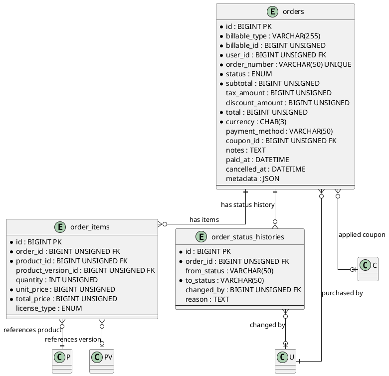

# 06.53 - Orders

| Field   | Value                |
|---------|----------------------|
| Project | GsmUi                |
| Domain  | Marketplace - Orders |
| Version | 1.0.0                |
| Prev    | 06.52 - Product Versions |
| Next    | 06.55 - Licenses     |

---

## Overview

Purchase orders for one-time marketplace purchases. Each order uses a polymorphic `billable` relationship to support both individual users and team-owned purchases. Orders are immutable once created — corrections are handled via compensating orders. Status transitions are tracked in a dedicated audit table.

---

## Business Rules

1. **Immutability** — Orders are never modified after creation. Corrections via compensating orders (credit notes).
2. **Status lifecycle** — `pending → processing → completed → cancelled | refunded`. Transitions are one-directional; `completed → refunded` requires authorization.
3. **Multi-currency** — `currency` stored on the order (ISO 4217). All monetary amounts in minor units (cents).
4. **No soft-deletes** — Financial records are immutable. `deleted_at` intentionally omitted.
5. **Polymorphic billable** — `billable_type` can be `App\Models\User` or `App\Models\Team`. `user_id` always records the purchaser.

---

## Tables

### orders

**Purpose:** Purchase orders for one-time marketplace purchases. Uses morphTo for billable ownership.

| Column          | Type            | Attributes                              | Description                              |
|-----------------|-----------------|-----------------------------------------|------------------------------------------|
| id              | BIGINT          | PK, AUTO_INCREMENT                      | Primary key                              |
| billable_type   | VARCHAR(255)    | NOT NULL                                | Morph type (User or Team)                |
| billable_id     | BIGINT UNSIGNED | NOT NULL                                | Morph ID                                 |
| user_id         | BIGINT UNSIGNED | FK → users.id, NOT NULL                 | Purchaser (who placed the order)         |
| order_number    | VARCHAR(50)     | UNIQUE, NOT NULL                        | Human-readable order number              |
| status          | ENUM            | pending/processing/completed/cancelled/refunded DEFAULT 'pending' | Order status |
| subtotal        | BIGINT UNSIGNED | NOT NULL                                | Sum of line items (minor units)          |
| tax_amount      | BIGINT UNSIGNED | DEFAULT 0                               | Tax amount (minor units)                 |
| discount_amount | BIGINT UNSIGNED | DEFAULT 0                               | Discount applied (minor units)           |
| total           | BIGINT UNSIGNED | NOT NULL                                | subtotal + tax - discount                |
| currency        | CHAR(3)         | DEFAULT 'USD'                           | ISO 4217 currency code                   |
| payment_method  | VARCHAR(50)     | NULLABLE                                | Payment gateway identifier               |
| coupon_id       | BIGINT UNSIGNED | FK → coupons.id, NULLABLE               | Applied coupon                           |
| notes           | TEXT            | NULLABLE                                | Internal notes                           |
| paid_at         | DATETIME        | NULLABLE                                | Payment confirmation timestamp           |
| cancelled_at    | DATETIME        | NULLABLE                                | Cancellation timestamp                   |
| metadata        | JSON            | NULLABLE                                | Arbitrary metadata (gateway response)    |
| created_at      | DATETIME        | NOT NULL                                | Record creation                          |
| updated_at      | DATETIME        | NOT NULL                                | Last modification                        |

**Indexes:** PK, UNIQUE order_number, INDEX (billable_type, billable_id), INDEX user_id, INDEX status, INDEX created_at, INDEX coupon_id

**Relationships:** morphTo billable, belongsTo User, belongsTo Coupon, hasMany OrderItem, hasMany OrderStatusHistory

---

### order_items

**Purpose:** Line items within an order. Each item references a product and a specific version.

| Column             | Type            | Attributes                         | Description               |
|--------------------|-----------------|------------------------------------|---------------------------|
| id                 | BIGINT          | PK, AUTO_INCREMENT                 | Primary key               |
| order_id           | BIGINT UNSIGNED | FK → orders.id, NOT NULL           | Parent order              |
| product_id         | BIGINT UNSIGNED | FK → products.id, NOT NULL         | Purchased product         |
| product_version_id | BIGINT UNSIGNED | FK → product_versions.id, NULLABLE | Specific version purchased|
| quantity           | INT UNSIGNED    | DEFAULT 1                          | Quantity                  |
| unit_price         | BIGINT UNSIGNED | NOT NULL                           | Price per unit (minor)    |
| total_price        | BIGINT UNSIGNED | NOT NULL                           | quantity × unit_price     |
| license_type       | ENUM            | single/multiple/team DEFAULT 'single' | License type           |
| created_at         | DATETIME        | NOT NULL                           | Record creation           |
| updated_at         | DATETIME        | NOT NULL                           | Last modification         |

**Indexes:** PK, INDEX order_id, INDEX product_id

**Relationships:** belongsTo Order, belongsTo Product, belongsTo ProductVersion

---

### order_status_histories

**Purpose:** Immutable audit trail of order status transitions.

| Column      | Type            | Attributes                    | Description                     |
|-------------|-----------------|-------------------------------|---------------------------------|
| id          | BIGINT          | PK, AUTO_INCREMENT            | Primary key                     |
| order_id    | BIGINT UNSIGNED | FK → orders.id, NOT NULL      | Parent order                    |
| from_status | VARCHAR(50)     | NULLABLE                      | Previous status (null=initial)  |
| to_status   | VARCHAR(50)     | NOT NULL                      | New status                      |
| changed_by  | BIGINT UNSIGNED | FK → users.id, NULLABLE       | User who initiated the change   |
| reason      | TEXT            | NULLABLE                      | Reason for the change           |
| created_at  | DATETIME        | NOT NULL                      | Record creation                 |
| updated_at  | DATETIME        | NOT NULL                      | Last modification               |

**Indexes:** PK, INDEX order_id, INDEX created_at

**Relationships:** belongsTo Order, belongsTo User (changed_by)

---

## Entity Relationship Diagram (PlantUML)



---

## Migrations

### orders

```php
Schema::create('orders', function (Blueprint $table) {
    $table->id();
    $table->morphs('billable');
    $table->foreignId('user_id')->constrained()->cascadeOnDelete();
    $table->string('order_number', 50)->unique();
    $table->enum('status', ['pending','processing','completed','cancelled','refunded'])->default('pending');
    $table->unsignedBigInteger('subtotal');
    $table->unsignedBigInteger('tax_amount')->default(0);
    $table->unsignedBigInteger('discount_amount')->default(0);
    $table->unsignedBigInteger('total');
    $table->char('currency', 3)->default('USD');
    $table->string('payment_method', 50)->nullable();
    $table->foreignId('coupon_id')->nullable()->constrained()->nullOnDelete();
    $table->text('notes')->nullable();
    $table->dateTime('paid_at')->nullable();
    $table->dateTime('cancelled_at')->nullable();
    $table->json('metadata')->nullable();
    $table->timestamps();

    $table->index('status');
    $table->index('created_at');
});
```

### order_items

```php
Schema::create('order_items', function (Blueprint $table) {
    $table->id();
    $table->foreignId('order_id')->constrained()->cascadeOnDelete();
    $table->foreignId('product_id')->constrained()->cascadeOnDelete();
    $table->foreignId('product_version_id')->nullable()->constrained('product_versions')->nullOnDelete();
    $table->unsignedInteger('quantity')->default(1);
    $table->unsignedBigInteger('unit_price');
    $table->unsignedBigInteger('total_price');
    $table->enum('license_type', ['single','multiple','team'])->default('single');
    $table->timestamps();
});
```

### order_status_histories

```php
Schema::create('order_status_histories', function (Blueprint $table) {
    $table->id();
    $table->foreignId('order_id')->constrained()->cascadeOnDelete();
    $table->string('from_status', 50)->nullable();
    $table->string('to_status', 50);
    $table->foreignId('changed_by')->nullable()->constrained('users')->nullOnDelete();
    $table->text('reason')->nullable();
    $table->timestamps();

    $table->index('created_at');
});
```

---

## Model Stubs

### Order

```php
class Order extends Model
{
    protected $fillable = [
        'billable_type','billable_id','user_id','order_number','status',
        'subtotal','tax_amount','discount_amount','total','currency',
        'payment_method','coupon_id','notes','paid_at','cancelled_at','metadata',
    ];

    protected $casts = [
        'subtotal'=>'integer','tax_amount'=>'integer',
        'discount_amount'=>'integer','total'=>'integer',
        'paid_at'=>'datetime','cancelled_at'=>'datetime','metadata'=>'array',
    ];

    public function billable(): MorphTo { return $this->morphTo(); }
    public function user(): BelongsTo { return $this->belongsTo(User::class); }
    public function coupon(): BelongsTo { return $this->belongsTo(Coupon::class); }
    public function items(): HasMany { return $this->hasMany(OrderItem::class); }
    public function statusHistories(): HasMany { return $this->hasMany(OrderStatusHistory::class); }
}
```

### OrderItem

```php
class OrderItem extends Model
{
    protected $fillable = [
        'order_id','product_id','product_version_id','quantity',
        'unit_price','total_price','license_type',
    ];

    protected $casts = ['quantity'=>'integer','unit_price'=>'integer','total_price'=>'integer'];

    public function order(): BelongsTo { return $this->belongsTo(Order::class); }
    public function product(): BelongsTo { return $this->belongsTo(Product::class); }
    public function productVersion(): BelongsTo { return $this->belongsTo(ProductVersion::class); }
}
```

### OrderStatusHistory

```php
class OrderStatusHistory extends Model
{
    protected $fillable = ['order_id','from_status','to_status','changed_by','reason'];

    public function order(): BelongsTo { return $this->belongsTo(Order::class); }
    public function user(): BelongsTo { return $this->belongsTo(User::class, 'changed_by'); }
}
```

---

## Notes

- **Order number** — Sequential format like `GSM-2026-00001`. Use a dedicated sequence table or Snowflake-style ID with prefix.
- **Monetary values** — All amounts as `BIGINT UNSIGNED` in minor units (cents). $49.99 = `4999`. Avoids floating-point errors.
- **No soft-deletes** — Orders intentionally omit `SoftDeletes` for audit/compliance immutability.
- **Status transitions** — Enforce valid transitions in a service class. The `order_status_histories` table is append-only.
- **Metadata** — Stores payment gateway responses, fraud check results, or extensible data without schema changes.

---

# Order Number Generation

```php
// app/Services/OrderNumberGenerator.php
class OrderNumberGenerator
{
    public const PREFIX = 'GSM';
    public const FORMAT = 'Y'; // Year-based

    public function generate(): string
    {
        $year = date('Y');
        $sequence = $this->getNextSequence($year);

        return sprintf(
            '%s-%s-%05d',
            self::PREFIX,
            $year,
            $sequence
        );
    }

    protected function getNextSequence(int $year): int
    {
        $key = "order_sequence_{$year}";

        return Cache::remember($key, now()->addDay(), function () use ($year) {
            $lastOrder = Order::where('order_number', 'LIKE', self::PREFIX . "-{$year}-%")
                ->orderByDesc('order_number')
                ->first();

            if (!$lastOrder) {
                return 1;
            }

            // Extract sequence number from last order
            $parts = explode('-', $lastOrder->order_number);
            return (int) end($parts) + 1;
        });
    }

    public function validate(string $orderNumber): bool
    {
        return preg_match('/^' . self::PREFIX . '-\d{4}-\d{5}$/', $orderNumber) === 1;
    }
}
```

---

# Order Status Transitions

```php
// app/Services/OrderStatusManager.php
class OrderStatusManager
{
    public const VALID_TRANSITIONS = [
        'pending'    => ['processing', 'cancelled'],
        'processing' => ['completed', 'cancelled'],
        'completed'  => ['refunded'],
        'cancelled'  => [],
        'refunded'   => [],
    ];

    public function transition(Order $order, string $newStatus, ?string $reason = null, ?User $user = null): Order
    {
        $currentStatus = $order->status;

        if (!$this->canTransition($currentStatus, $newStatus)) {
            throw new \InvalidArgumentException(
                "Cannot transition from '{$currentStatus}' to '{$newStatus}'"
            );
        }

        // Create status history entry
        OrderStatusHistory::create([
            'order_id' => $order->id,
            'from_status' => $currentStatus,
            'to_status' => $newStatus,
            'changed_by' => $user?->id,
            'reason' => $reason,
        ]);

        // Update order status
        $order->update(['status' => $newStatus]);

        // Handle side effects
        $this->handleTransitionEffects($order, $currentStatus, $newStatus);

        return $order->fresh();
    }

    public function canTransition(string $from, string $to): bool
    {
        return in_array($to, self::VALID_TRANSITIONS[$from] ?? [], true);
    }

    protected function handleTransitionEffects(Order $order, string $from, string $to): void
    {
        match ($to) {
            'processing' => $this->handleProcessing($order),
            'completed'  => $this->handleCompleted($order),
            'cancelled'  => $this->handleCancelled($order, $from),
            'refunded'   => $this->handleRefunded($order),
            default      => null,
        };
    }

    protected function handleProcessing(Order $order): void
    {
        // Reserve inventory, start payment processing
        OrderProcessing::dispatch($order);
    }

    protected function handleCompleted(Order $order): void
    {
        $order->update(['paid_at' => now()]);

        // Generate licenses
        LicenseGenerator::dispatch($order);

        // Send confirmation email
        OrderConfirmed::dispatch($order);

        // Update download counts
        foreach ($order->items as $item) {
            if ($item->product_version_id) {
                ProductVersion::where('id', $item->product_version_id)
                    ->increment('download_count', $item->quantity);
            }
        }
    }

    protected function handleCancelled(Order $order, string $from): void
    {
        $order->update(['cancelled_at' => now()]);

        // Release inventory
        OrderCancelled::dispatch($order);
    }

    protected function handleRefunded(Order $order): void
    {
        // Process refund through payment gateway
        OrderRefunded::dispatch($order);

        // Revoke licenses
        LicenseRevocation::dispatch($order);
    }
}
```

---

# Order Creation Workflow

```php
// app/Services/OrderService.php
class OrderService
{
    public function __construct(
        protected OrderNumberGenerator $numberGenerator,
        protected OrderStatusManager $statusManager,
        protected CouponService $couponService,
    ) {}

    public function createOrder(User $user, array $items, array $options = []): Order
    {
        DB::beginTransaction();

        try {
            // Validate items
            $validatedItems = $this->validateItems($items);

            // Calculate totals
            $subtotal = collect($validatedItems)->sum('total_price');
            $discount = $this->calculateDiscount($subtotal, $options['coupon_code'] ?? null);
            $tax = $this->calculateTax($subtotal - $discount, $options['tax_rate'] ?? 0);
            $total = $subtotal - $discount + $tax;

            // Create order
            $order = Order::create([
                'billable_type' => $options['billable_type'] ?? User::class,
                'billable_id' => $options['billable_id'] ?? $user->id,
                'user_id' => $user->id,
                'order_number' => $this->numberGenerator->generate(),
                'status' => 'pending',
                'subtotal' => $subtotal,
                'tax_amount' => $tax,
                'discount_amount' => $discount,
                'total' => $total,
                'currency' => $options['currency'] ?? 'USD',
                'payment_method' => $options['payment_method'] ?? null,
                'coupon_id' => $options['coupon_id'] ?? null,
                'notes' => $options['notes'] ?? null,
            ]);

            // Create order items
            foreach ($validatedItems as $item) {
                OrderItem::create([
                    'order_id' => $order->id,
                    'product_id' => $item['product_id'],
                    'product_version_id' => $item['product_version_id'] ?? null,
                    'quantity' => $item['quantity'],
                    'unit_price' => $item['unit_price'],
                    'total_price' => $item['total_price'],
                    'license_type' => $item['license_type'] ?? 'single',
                ]);
            }

            // Record initial status
            OrderStatusHistory::create([
                'order_id' => $order->id,
                'from_status' => null,
                'to_status' => 'pending',
                'changed_by' => $user->id,
            ]);

            DB::commit();

            return $order->fresh(['items', 'statusHistories']);
        } catch (\Exception $e) {
            DB::rollBack();
            throw $e;
        }
    }

    protected function validateItems(array $items): array
    {
        $validated = [];

        foreach ($items as $item) {
            $product = Product::findOrFail($item['product_id']);

            $version = null;
            if (isset($item['product_version_id'])) {
                $version = ProductVersion::findOrFail($item['product_version_id']);
            } elseif ($product->latestVersion) {
                $version = $product->latestVersion;
            }

            $unitPrice = $version?->price ?? $product->price;

            $validated[] = [
                'product_id' => $product->id,
                'product_version_id' => $version?->id,
                'quantity' => max(1, $item['quantity'] ?? 1),
                'unit_price' => $unitPrice,
                'total_price' => $unitPrice * max(1, $item['quantity'] ?? 1),
                'license_type' => $item['license_type'] ?? 'single',
            ];
        }

        return $validated;
    }

    protected function calculateDiscount(int $subtotal, ?string $couponCode): int
    {
        if (!$couponCode) {
            return 0;
        }

        return $this->couponService->calculateDiscount($subtotal, $couponCode);
    }

    protected function calculateTax(int $amount, float $taxRate): int
    {
        if ($taxRate <= 0) {
            return 0;
        }

        return (int) round($amount * $taxRate);
    }
}
```

---

# Payment Processing Flow

```php
// app/Services/PaymentService.php
class PaymentService
{
    public function processPayment(Order $order, array $paymentData): array
    {
        $gateway = $this->resolveGateway($order->payment_method);

        $result = $gateway->charge([
            'amount' => $order->total,
            'currency' => $order->currency,
            'source' => $paymentData['token'] ?? null,
            'metadata' => [
                'order_number' => $order->order_number,
                'user_id' => $order->user_id,
            ],
        ]);

        // Store gateway response in metadata
        $order->update([
            'metadata' => array_merge($order->metadata ?? [], [
                'payment' => [
                    'gateway' => $order->payment_method,
                    'transaction_id' => $result['transaction_id'],
                    'status' => $result['status'],
                    'processed_at' => now()->toISOString(),
                ],
            ]),
        ]);

        return $result;
    }

    protected function resolveGateway(string $method): PaymentGateway
    {
        return match ($method) {
            'stripe' => new StripeGateway(),
            'paypal' => new PayPalGateway(),
            default => throw new \InvalidArgumentException("Unknown payment method: {$method}"),
        };
    }
}
```

---

# Refund Processing

```php
// app/Services/RefundService.php
class RefundService
{
    public function processRefund(Order $order, ?string $reason = null, ?User $authorizedBy = null): Order
    {
        if ($order->status !== 'completed') {
            throw new \InvalidArgumentException('Only completed orders can be refunded');
        }

        DB::beginTransaction();

        try {
            // Process refund through payment gateway
            $gateway = app(PaymentService::class);
            $transactionId = $order->metadata['payment']['transaction_id'] ?? null;

            if ($transactionId) {
                $gateway->refund($order->payment_method, $transactionId, $order->total);
            }

            // Transition to refunded status
            $this->statusManager->transition(
                $order,
                'refunded',
                $reason ?? 'Order refunded',
                $authorizedBy
            );

            // Create credit note
            $this->createCreditNote($order);

            DB::commit();

            return $order->fresh();
        } catch (\Exception $e) {
            DB::rollBack();
            throw $e;
        }
    }

    protected function createCreditNote(Order $order): void
    {
        CreditNote::create([
            'order_id' => $order->id,
            'credit_note_number' => app(OrderNumberGenerator::class)->generate(),
            'amount' => $order->total,
            'currency' => $order->currency,
            'reason' => 'Order refund',
            'issued_at' => now(),
        ]);
    }
}
```

---

# Order Statistics Queries

```php
// app/Services/OrderStatisticsService.php
class OrderStatisticsService
{
    public function getRevenueSummary(?Carbon $startDate = null, ?Carbon $endDate = null): array
    {
        $query = Order::where('status', 'completed');

        if ($startDate) {
            $query->where('paid_at', '>=', $startDate);
        }
        if ($endDate) {
            $query->where('paid_at', '<=', $endDate);
        }

        $stats = $query->selectRaw('
            COUNT(*) as total_orders,
            SUM(total) as total_revenue,
            AVG(total) as average_order_value,
            MIN(total) as smallest_order,
            MAX(total) as largest_order
        ')->first();

        return [
            'total_orders' => (int) $stats->total_orders,
            'total_revenue' => (int) $stats->total_revenue,
            'average_order_value' => (int) round($stats->average_order_value ?? 0),
            'smallest_order' => (int) ($stats->smallest_order ?? 0),
            'largest_order' => (int) ($stats->largest_order ?? 0),
        ];
    }

    public function getRevenueByProduct(?Carbon $startDate = null, ?Carbon $endDate = null): Collection
    {
        $query = OrderItem::selectRaw('
            product_id,
            SUM(total_price) as revenue,
            SUM(quantity) as units_sold,
            COUNT(DISTINCT order_id) as order_count
        ')
        ->groupBy('product_id')
        ->with('product:id,name,slug');

        if ($startDate || $endDate) {
            $query->whereHas('order', function ($q) use ($startDate, $endDate) {
                $q->where('status', 'completed');
                if ($startDate) {
                    $q->where('paid_at', '>=', $startDate);
                }
                if ($endDate) {
                    $q->where('paid_at', '<=', $endDate);
                }
            });
        } else {
            $query->whereHas('order', fn($q) => $q->where('status', 'completed'));
        }

        return $query->orderByDesc('revenue')->get();
    }

    public function getDailyRevenue(Carbon $startDate, Carbon $endDate): Collection
    {
        return Order::where('status', 'completed')
            ->where('paid_at', '>=', $startDate)
            ->where('paid_at', '<=', $endDate)
            ->selectRaw('DATE(paid_at) as date, COUNT(*) as orders, SUM(total) as revenue')
            ->groupBy('date')
            ->orderBy('date')
            ->get();
    }

    public function getCouponUsageStats(): Collection
    {
        return Order::whereNotNull('coupon_id')
            ->where('status', 'completed')
            ->selectRaw('
                coupon_id,
                COUNT(*) as usage_count,
                SUM(discount_amount) as total_discount,
                AVG(discount_amount) as average_discount
            ')
            ->groupBy('coupon_id')
            ->with('coupon:id,code,discount_type')
            ->orderByDesc('usage_count')
            ->get();
    }
}
```

---

# Order Export

```php
// app/Services/OrderExportService.php
class OrderExportService
{
    public function exportToCsv(?Carbon $startDate = null, ?Carbon $endDate = null): string
    {
        $orders = Order::with(['items.product', 'user', 'coupon'])
            ->where('status', 'completed')
            ->orderBy('paid_at');

        if ($startDate) {
            $orders->where('paid_at', '>=', $startDate);
        }
        if ($endDate) {
            $orders->where('paid_at', '<=', $endDate);
        }

        $handle = fopen('php://temp', 'r+');

        // Header
        fputcsv($handle, [
            'Order Number', 'Date', 'Customer', 'Email',
            'Subtotal', 'Tax', 'Discount', 'Total',
            'Currency', 'Payment Method', 'Coupon',
        ]);

        foreach ($orders->cursor() as $order) {
            fputcsv($handle, [
                $order->order_number,
                $order->paid_at->format('Y-m-d H:i:s'),
                $order->user->name,
                $order->user->email,
                $this->formatAmount($order->subtotal),
                $this->formatAmount($order->tax_amount),
                $this->formatAmount($order->discount_amount),
                $this->formatAmount($order->total),
                $order->currency,
                $order->payment_method,
                $order->coupon?->code ?? '',
            ]);
        }

        rewind($handle);
        $csv = stream_get_contents($handle);
        fclose($handle);

        return $csv;
    }

    protected function formatAmount(int $amount): string
    {
        return number_format($amount / 100, 2, '.', '');
    }
}
```

---

# SQL DDL — Complete Schema

```sql
-- orders table
CREATE TABLE orders (
    id BIGINT UNSIGNED AUTO_INCREMENT PRIMARY KEY,
    billable_type VARCHAR(255) NOT NULL,
    billable_id BIGINT UNSIGNED NOT NULL,
    user_id BIGINT UNSIGNED NOT NULL,
    order_number VARCHAR(50) NOT NULL,
    status ENUM('pending','processing','completed','cancelled','refunded') NOT NULL DEFAULT 'pending',
    subtotal BIGINT UNSIGNED NOT NULL,
    tax_amount BIGINT UNSIGNED NOT NULL DEFAULT 0,
    discount_amount BIGINT UNSIGNED NOT NULL DEFAULT 0,
    total BIGINT UNSIGNED NOT NULL,
    currency CHAR(3) NOT NULL DEFAULT 'USD',
    payment_method VARCHAR(50) NULL,
    coupon_id BIGINT UNSIGNED NULL,
    notes TEXT NULL,
    paid_at TIMESTAMP NULL,
    cancelled_at TIMESTAMP NULL,
    metadata JSON NULL,
    created_at TIMESTAMP NOT NULL DEFAULT CURRENT_TIMESTAMP,
    updated_at TIMESTAMP NOT NULL DEFAULT CURRENT_TIMESTAMP ON UPDATE CURRENT_TIMESTAMP,

    UNIQUE INDEX idx_orders_order_number (order_number),
    INDEX idx_orders_billable (billable_type, billable_id),
    INDEX idx_orders_user_id (user_id),
    INDEX idx_orders_status (status),
    INDEX idx_orders_created_at (created_at),
    INDEX idx_orders_paid_at (paid_at),
    INDEX idx_orders_coupon_id (coupon_id),

    CONSTRAINT fk_orders_user
        FOREIGN KEY (user_id) REFERENCES users(id)
        ON DELETE RESTRICT,
    CONSTRAINT fk_orders_coupon
        FOREIGN KEY (coupon_id) REFERENCES coupons(id)
        ON DELETE SET NULL
) ENGINE=InnoDB DEFAULT CHARSET=utf8mb4 COLLATE=utf8mb4_unicode_ci;

-- order_items table
CREATE TABLE order_items (
    id BIGINT UNSIGNED AUTO_INCREMENT PRIMARY KEY,
    order_id BIGINT UNSIGNED NOT NULL,
    product_id BIGINT UNSIGNED NOT NULL,
    product_version_id BIGINT UNSIGNED NULL,
    quantity INT UNSIGNED NOT NULL DEFAULT 1,
    unit_price BIGINT UNSIGNED NOT NULL,
    total_price BIGINT UNSIGNED NOT NULL,
    license_type ENUM('single','multiple','team') NOT NULL DEFAULT 'single',
    created_at TIMESTAMP NOT NULL DEFAULT CURRENT_TIMESTAMP,
    updated_at TIMESTAMP NOT NULL DEFAULT CURRENT_TIMESTAMP ON UPDATE CURRENT_TIMESTAMP,

    INDEX idx_order_items_order_id (order_id),
    INDEX idx_order_items_product_id (product_id),
    INDEX idx_order_items_version_id (product_version_id),

    CONSTRAINT fk_order_items_order
        FOREIGN KEY (order_id) REFERENCES orders(id)
        ON DELETE CASCADE,
    CONSTRAINT fk_order_items_product
        FOREIGN KEY (product_id) REFERENCES products(id)
        ON DELETE RESTRICT,
    CONSTRAINT fk_order_items_version
        FOREIGN KEY (product_version_id) REFERENCES product_versions(id)
        ON DELETE SET NULL
) ENGINE=InnoDB DEFAULT CHARSET=utf8mb4 COLLATE=utf8mb4_unicode_ci;

-- order_status_histories table
CREATE TABLE order_status_histories (
    id BIGINT UNSIGNED AUTO_INCREMENT PRIMARY KEY,
    order_id BIGINT UNSIGNED NOT NULL,
    from_status VARCHAR(50) NULL,
    to_status VARCHAR(50) NOT NULL,
    changed_by BIGINT UNSIGNED NULL,
    reason TEXT NULL,
    created_at TIMESTAMP NOT NULL DEFAULT CURRENT_TIMESTAMP,
    updated_at TIMESTAMP NOT NULL DEFAULT CURRENT_TIMESTAMP ON UPDATE CURRENT_TIMESTAMP,

    INDEX idx_osh_order_id (order_id),
    INDEX idx_osh_created_at (created_at),
    INDEX idx_osh_to_status (to_status),

    CONSTRAINT fk_osh_order
        FOREIGN KEY (order_id) REFERENCES orders(id)
        ON DELETE CASCADE,
    CONSTRAINT fk_osh_user
        FOREIGN KEY (changed_by) REFERENCES users(id)
        ON DELETE SET NULL
) ENGINE=InnoDB DEFAULT CHARSET=utf8mb4 COLLATE=utf8mb4_unicode_ci;

-- credit_notes table
CREATE TABLE credit_notes (
    id BIGINT UNSIGNED AUTO_INCREMENT PRIMARY KEY,
    order_id BIGINT UNSIGNED NOT NULL,
    credit_note_number VARCHAR(50) NOT NULL,
    amount BIGINT UNSIGNED NOT NULL,
    currency CHAR(3) NOT NULL DEFAULT 'USD',
    reason TEXT NULL,
    issued_at TIMESTAMP NOT NULL,
    created_at TIMESTAMP NOT NULL DEFAULT CURRENT_TIMESTAMP,
    updated_at TIMESTAMP NOT NULL DEFAULT CURRENT_TIMESTAMP ON UPDATE CURRENT_TIMESTAMP,

    UNIQUE INDEX idx_credit_notes_number (credit_note_number),
    INDEX idx_credit_notes_order_id (order_id),
    INDEX idx_credit_notes_issued_at (issued_at),

    CONSTRAINT fk_credit_notes_order
        FOREIGN KEY (order_id) REFERENCES orders(id)
        ON DELETE RESTRICT
) ENGINE=InnoDB DEFAULT CHARSET=utf8mb4 COLLATE=utf8mb4_unicode_ci;
```

---

# Foreign Key Patterns

```php
// Complete foreign key definitions for orders

// orders → users (purchaser)
Schema::table('orders', function (Blueprint $table) {
    $table->foreign('user_id')
        ->references('id')
        ->on('users')
        ->restrictOnDelete();
});

// orders → coupons
Schema::table('orders', function (Blueprint $table) {
    $table->foreign('coupon_id')
        ->references('id')
        ->on('coupons')
        ->nullOnDelete();
});

// order_items → orders
Schema::table('order_items', function (Blueprint $table) {
    $table->foreign('order_id')
        ->references('id')
        ->on('orders')
        ->cascadeOnDelete();
});

// order_items → products
Schema::table('order_items', function (Blueprint $table) {
    $table->foreign('product_id')
        ->references('id')
        ->on('products')
        ->restrictOnDelete();
});

// order_items → product_versions
Schema::table('order_items', function (Blueprint $table) {
    $table->foreign('product_version_id')
        ->references('id')
        ->on('product_versions')
        ->nullOnDelete();
});

// order_status_histories → orders
Schema::table('order_status_histories', function (Blueprint $table) {
    $table->foreign('order_id')
        ->references('id')
        ->on('orders')
        ->cascadeOnDelete();
});

// order_status_histories → users (changed_by)
Schema::table('order_status_histories', function (Blueprint $table) {
    $table->foreign('changed_by')
        ->references('id')
        ->on('users')
        ->nullOnDelete();
});

// credit_notes → orders
Schema::table('credit_notes', function (Blueprint $table) {
    $table->foreign('order_id')
        ->references('id')
        ->on('orders')
        ->restrictOnDelete();
});
```

---

# Event Definitions

```php
// app/Events/OrderCreated.php
class OrderCreated
{
    use Dispatchable, SerializesModels;

    public function __construct(
        public Order $order,
    ) {}
}

// app/Events/OrderProcessing.php
class OrderProcessing
{
    use Dispatchable, SerializesModels;

    public function __construct(
        public Order $order,
    ) {}
}

// app/Events/OrderConfirmed.php
class OrderConfirmed
{
    use Dispatchable, SerializesModels;

    public function __construct(
        public Order $order,
    ) {}
}

// app/Events/OrderCancelled.php
class OrderCancelled
{
    use Dispatchable, SerializesModels;

    public function __construct(
        public Order $order,
    ) {}
}

// app/Events/OrderRefunded.php
class OrderRefunded
{
    use Dispatchable, SerializesModels;

    public function __construct(
        public Order $order,
    ) {}
}
```

---

# Observer Patterns

```php
// app/Observers/OrderObserver.php
class OrderObserver
{
    public function created(Order $order): void
    {
        OrderCreated::dispatch($order);
    }

    public function updated(Order $order): void
    {
        if ($order->wasChanged('status')) {
            $this->handleStatusChange($order);
        }
    }

    protected function handleStatusChange(Order $order): void
    {
        match ($order->status) {
            'processing' => OrderProcessing::dispatch($order),
            'completed'  => OrderConfirmed::dispatch($order),
            'cancelled'  => OrderCancelled::dispatch($order),
            'refunded'   => OrderRefunded::dispatch($order),
            default      => null,
        };
    }
}
```

---

# Index Strategy

```php
// Composite indexes for common query patterns

// Orders by user and status
Schema::table('orders', function (Blueprint $table) {
    $table->index(['user_id', 'status'], 'idx_orders_user_status');
});

// Orders by billable and date
Schema::table('orders', function (Blueprint $table) {
    $table->index(['billable_type', 'billable_id', 'created_at'], 'idx_orders_billable_date');
});

// Order items by product
Schema::table('order_items', function (Blueprint $table) {
    $table->index(['product_id', 'product_version_id'], 'idx_oi_product_version');
});

// Status history by order and date
Schema::table('order_status_histories', function (Blueprint $table) {
    $table->index(['order_id', 'created_at'], 'idx_osh_order_date');
});

// Credit notes by order
Schema::table('credit_notes', function (Blueprint $table) {
    $table->index(['order_id', 'issued_at'], 'idx_cn_order_date');
});
```

---

# Order Factory & Seeders

```php
// database/factories/OrderFactory.php
class OrderFactory extends Factory
{
    protected $model = Order::class;

    public function definition(): array
    {
        $subtotal = $this->faker->numberBetween(999, 99999);
        $tax = (int) round($subtotal * 0.08);
        $discount = 0;
        $total = $subtotal - $discount + $tax;

        return [
            'billable_type' => User::class,
            'billable_id' => User::factory(),
            'user_id' => User::factory(),
            'order_number' => app(OrderNumberGenerator::class)->generate(),
            'status' => 'pending',
            'subtotal' => $subtotal,
            'tax_amount' => $tax,
            'discount_amount' => $discount,
            'total' => $total,
            'currency' => 'USD',
            'payment_method' => $this->faker->randomElement(['stripe', 'paypal']),
            'coupon_id' => null,
            'notes' => null,
            'paid_at' => null,
            'cancelled_at' => null,
            'metadata' => null,
        ];
    }

    public function completed(): static
    {
        return $this->state(fn() => [
            'status' => 'completed',
            'paid_at' => $this->faker->dateTimeBetween('-30 days', 'now'),
        ]);
    }

    public function pending(): static
    {
        return $this->state(fn() => ['status' => 'pending']);
    }

    public function refunded(): static
    {
        return $this->state(fn() => [
            'status' => 'refunded',
            'paid_at' => $this->faker->dateTimeBetween('-60 days', '-30 days'),
        ]);
    }
}

// database/factories/OrderItemFactory.php
class OrderItemFactory extends Factory
{
    protected $model = OrderItem::class;

    public function definition(): array
    {
        $unitPrice = $this->faker->numberBetween(999, 49999);
        $quantity = $this->faker->numberBetween(1, 5);

        return [
            'order_id' => Order::factory(),
            'product_id' => Product::factory(),
            'product_version_id' => null,
            'quantity' => $quantity,
            'unit_price' => $unitPrice,
            'total_price' => $unitPrice * $quantity,
            'license_type' => $this->faker->randomElement(['single', 'multiple', 'team']),
        ];
    }
}

// database/factories/OrderStatusHistoryFactory.php
class OrderStatusHistoryFactory extends Factory
{
    protected $model = OrderStatusHistory::class;

    public function definition(): array
    {
        return [
            'order_id' => Order::factory(),
            'from_status' => null,
            'to_status' => 'pending',
            'changed_by' => User::factory(),
            'reason' => null,
        ];
    }
}
```

---

# Test Helpers

```php
// tests/Helpers/OrderTestHelpers.php
trait OrderTestHelpers
{
    protected function createOrder(User $user, array $items = [], array $options = []): Order
    {
        return app(OrderService::class)->createOrder($user, $items, $options);
    }

    protected function createCompletedOrder(User $user, array $items = []): Order
    {
        $order = $this->createOrder($user, $items);
        app(OrderStatusManager::class)->transition($order, 'processing');
        app(OrderStatusManager::class)->transition($order, 'completed');

        return $order->fresh();
    }

    protected function assertOrderStatus(Order $order, string $status): void
    {
        $this->assertEquals($status, $order->fresh()->status);
    }

    protected function assertOrderTotal(Order $order, int $expectedTotal): void
    {
        $this->assertEquals($expectedTotal, $order->fresh()->total);
    }

    protected function assertStatusHistoryExists(Order $order, string $from, string $to): void
    {
        $this->assertDatabaseHas('order_status_histories', [
            'order_id' => $order->id,
            'from_status' => $from,
            'to_status' => $to,
        ]);
    }

    protected function assertCreditNoteExists(Order $order): void
    {
        $this->assertDatabaseHas('credit_notes', [
            'order_id' => $order->id,
        ]);
    }

    protected function assertOrderNumberFormat(string $orderNumber): void
    {
        $this->assertMatchesRegularExpression(
            '/^GSM-\d{4}-\d{5}$/',
            $orderNumber,
            "Order number '{$orderNumber}' does not match expected format"
        );
    }
}
```

---

# Revenue Reporting Queries

```php
// app/Services/RevenueReportService.php
class RevenueReportService
{
    public function generateMonthlyReport(int $year, int $month): array
    {
        $startDate = Carbon::create($year, $month, 1)->startOfMonth();
        $endDate = $startDate->copy()->endOfMonth();

        $orders = Order::where('status', 'completed')
            ->where('paid_at', '>=', $startDate)
            ->where('paid_at', '<=', $endDate);

        return [
            'period' => $startDate->format('F Y'),
            'total_orders' => (clone $orders)->count(),
            'gross_revenue' => (clone $orders)->sum('subtotal'),
            'tax_collected' => (clone $orders)->sum('tax_amount'),
            'discounts_given' => (clone $orders)->sum('discount_amount'),
            'net_revenue' => (clone $orders)->sum('total'),
            'average_order_value' => (clone $orders)->avg('total'),
            'unique_customers' => (clone $orders)->distinct('user_id')->count('user_id'),
            'top_products' => $this->getTopProducts($startDate, $endDate),
            'revenue_by_day' => $this->getDailyBreakdown($startDate, $endDate),
        ];
    }

    protected function getTopProducts(Carbon $start, Carbon $end, int $limit = 10): Collection
    {
        return OrderItem::selectRaw('
            product_id,
            SUM(total_price) as revenue,
            SUM(quantity) as units
        ')
        ->whereHas('order', function ($q) use ($start, $end) {
            $q->where('status', 'completed')
              ->where('paid_at', '>=', $start)
              ->where('paid_at', '<=', $end);
        })
        ->groupBy('product_id')
        ->with('product:id,name,slug')
        ->orderByDesc('revenue')
        ->limit($limit)
        ->get();
    }

    protected function getDailyBreakdown(Carbon $start, Carbon $end): Collection
    {
        return Order::where('status', 'completed')
            ->where('paid_at', '>=', $start)
            ->where('paid_at', '<=', $end)
            ->selectRaw('
                DATE(paid_at) as date,
                COUNT(*) as orders,
                SUM(total) as revenue
            ')
            ->groupBy('date')
            ->orderBy('date')
            ->get();
    }
}

---

# Order API Endpoints

```php
// routes/api.php — order management endpoints
Route::prefix('orders')->group(function () {
    Route::get('/', [OrderController::class, 'index']);
    Route::post('/', [OrderController::class, 'store']);
    Route::get('/{order}', [OrderController::class, 'show']);
    Route::get('/{order}/status-history', [OrderController::class, 'statusHistory']);
    Route::post('/{order}/process', [OrderController::class, 'process']);
    Route::post('/{order}/complete', [OrderController::class, 'complete']);
    Route::post('/{order}/cancel', [OrderController::class, 'cancel']);
    Route::post('/{order}/refund', [OrderController::class, 'refund']);
    Route::get('/{order}/credit-note', [OrderController::class, 'creditNote']);
});

Route::prefix('admin/orders')->middleware('admin')->group(function () {
    Route::get('/stats', [OrderController::class, 'stats']);
    Route::get('/revenue', [OrderController::class, 'revenue']);
    Route::get('/export', [OrderController::class, 'export']);
});
```

---

# Order Controller

```php
// app/Http/Controllers/OrderController.php
class OrderController extends Controller
{
    public function __construct(
        protected OrderService $orderService,
        protected OrderStatusManager $statusManager,
        protected RefundService $refundService,
    ) {}

    public function index(Request $request): JsonResponse
    {
        $query = Order::with(['user', 'items.product', 'coupon']);

        if ($request->has('status')) {
            $query->where('status', $request->status);
        }

        if ($request->has('user_id')) {
            $query->where('user_id', $request->user_id);
        }

        if ($request->has('from_date')) {
            $query->where('created_at', '>=', $request->from_date);
        }

        if ($request->has('to_date')) {
            $query->where('created_at', '<=', $request->to_date);
        }

        $orders = $query->orderByDesc('created_at')->paginate(25);

        return response()->json($orders);
    }

    public function store(Request $request): JsonResponse
    {
        $validated = $request->validate([
            'items' => ['required', 'array', 'min:1'],
            'items.*.product_id' => ['required', 'exists:products,id'],
            'items.*.product_version_id' => ['nullable', 'exists:product_versions,id'],
            'items.*.quantity' => ['integer', 'min:1', 'max:100'],
            'items.*.license_type' => ['in:single,multiple,team'],
            'coupon_code' => ['nullable', 'string', 'exists:coupons,code'],
            'payment_method' => ['required', 'string'],
            'currency' => ['string', 'size:3'],
            'notes' => ['nullable', 'string', 'max:1000'],
        ]);

        $order = $this->orderService->createOrder(
            $request->user(),
            $validated['items'],
            [
                'coupon_code' => $validated['coupon_code'] ?? null,
                'payment_method' => $validated['payment_method'],
                'currency' => $validated['currency'] ?? 'USD',
                'notes' => $validated['notes'] ?? null,
                'billable_type' => $request->user()::class,
                'billable_id' => $request->user()->id,
            ]
        );

        return response()->json($order->load(['items.product', 'statusHistories']), 201);
    }

    public function show(Order $order): JsonResponse
    {
        return response()->json(
            $order->load(['user', 'items.product', 'items.productVersion', 'coupon', 'statusHistories.user'])
        );
    }

    public function statusHistory(Order $order): JsonResponse
    {
        return response()->json(
            $order->statusHistories()->with('user:id,name,email')->orderByDesc('created_at')->get()
        );
    }

    public function process(Order $order): JsonResponse
    {
        $updated = $this->statusManager->transition($order, 'processing', null, $request->user());

        return response()->json($updated);
    }

    public function complete(Order $order): JsonResponse
    {
        $updated = $this->statusManager->transition($order, 'completed', null, $request->user());

        return response()->json($updated);
    }

    public function cancel(Request $request, Order $order): JsonResponse
    {
        $validated = $request->validate([
            'reason' => ['nullable', 'string', 'max:1000'],
        ]);

        $updated = $this->statusManager->transition(
            $order,
            'cancelled',
            $validated['reason'] ?? null,
            $request->user()
        );

        return response()->json($updated);
    }

    public function refund(Request $request, Order $order): JsonResponse
    {
        $validated = $request->validate([
            'reason' => ['required', 'string', 'max:1000'],
        ]);

        $updated = $this->refundService->processRefund(
            $order,
            $validated['reason'],
            $request->user()
        );

        return response()->json($updated);
    }

    public function creditNote(Order $order): JsonResponse
    {
        $creditNote = CreditNote::where('order_id', $order->id)->first();

        if (!$creditNote) {
            return response()->json(['message' => 'No credit note found'], 404);
        }

        return response()->json($creditNote);
    }

    public function stats(Request $request): JsonResponse
    {
        $stats = app(OrderStatisticsService::class)->getRevenueSummary(
            $request->has('from') ? Carbon::parse($request->from) : null,
            $request->has('to') ? Carbon::parse($request->to) : null
        );

        return response()->json($stats);
    }

    public function revenue(Request $request): JsonResponse
    {
        $daily = app(OrderStatisticsService::class)->getDailyRevenue(
            Carbon::parse($request->get('from', now()->subDays(30))),
            Carbon::parse($request->get('to', now()))
        );

        return response()->json($daily);
    }

    public function export(Request $request): Response
    {
        $csv = app(OrderExportService::class)->exportToCsv(
            $request->has('from') ? Carbon::parse($request->from) : null,
            $request->has('to') ? Carbon::parse($request->to) : null
        );

        return response($csv, 200, [
            'Content-Type' => 'text/csv',
            'Content-Disposition' => 'attachment; filename="orders-' . now()->format('Y-m-d') . '.csv"',
        ]);
    }
}
```

---

# Order Policy

```php
// app/Policies/OrderPolicy.php
class OrderPolicy
{
    public function viewAny(User $user): bool
    {
        return $user->hasPermission('orders.view');
    }

    public function view(User $user, Order $order): bool
    {
        return $user->id === $order->user_id
            || $user->hasPermission('orders.view');
    }

    public function create(User $user): bool
    {
        return true;
    }

    public function process(User $user, Order $order): bool
    {
        return $user->hasPermission('orders.process');
    }

    public function complete(User $user, Order $order): bool
    {
        return $user->hasPermission('orders.complete');
    }

    public function cancel(User $user, Order $order): bool
    {
        return $user->id === $order->user_id
            || $user->hasPermission('orders.cancel');
    }

    public function refund(User $user, Order $order): bool
    {
        return $user->hasPermission('orders.refund');
    }
}
```

---

# Order Livewire Components

```php
// app/Livewire/OrderHistory.php
class OrderHistory extends Component
{
    public User $user;
    public string $statusFilter = '';
    public int $page = 1;

    public function getOrdersProperty(): LengthAwarePaginator
    {
        $query = Order::where('user_id', $this->user->id)
            ->with(['items.product']);

        if ($this->statusFilter) {
            $query->where('status', $this->statusFilter);
        }

        return $query->orderByDesc('created_at')->paginate(10, page: $this->page);
    }

    public function getTotalSpentProperty(): int
    {
        return Order::where('user_id', $this->user->id)
            ->where('status', 'completed')
            ->sum('total');
    }

    public function setStatusFilter(string $status): void
    {
        $this->statusFilter = $status;
        $this->page = 1;
    }

    public function render(): View
    {
        return view('livewire.order-history', [
            'orders' => $this->orders,
            'totalSpent' => $this->totalSpent,
        ]);
    }
}
```

---

# Blade Template for Order History

```blade
{{-- resources/views/livewire/order-history.blade.php --}}
<div>
    <div class="mb-6 flex items-center justify-between">
        <div>
            <h2 class="text-lg font-semibold">Order History</h2>
            <p class="text-sm text-gray-500">
                Total spent: ${{ number_format($totalSpent / 100, 2) }}
            </p>
        </div>
        <div class="flex gap-2">
            <button
                wire:click="setStatusFilter('')"
                class="rounded-md px-3 py-1.5 text-xs font-medium {{ $statusFilter === '' ? 'bg-gray-900 text-white' : 'border hover:bg-gray-50' }}"
            >
                All
            </button>
            <button
                wire:click="setStatusFilter('completed')"
                class="rounded-md px-3 py-1.5 text-xs font-medium {{ $statusFilter === 'completed' ? 'bg-green-600 text-white' : 'border hover:bg-gray-50' }}"
            >
                Completed
            </button>
            <button
                wire:click="setStatusFilter('pending')"
                class="rounded-md px-3 py-1.5 text-xs font-medium {{ $statusFilter === 'pending' ? 'bg-yellow-600 text-white' : 'border hover:bg-gray-50' }}"
            >
                Pending
            </button>
            <button
                wire:click="setStatusFilter('refunded')"
                class="rounded-md px-3 py-1.5 text-xs font-medium {{ $statusFilter === 'refunded' ? 'bg-red-600 text-white' : 'border hover:bg-gray-50' }}"
            >
                Refunded
            </button>
        </div>
    </div>

    <div class="space-y-4">
        @forelse ($orders as $order)
            <div class="rounded-lg border p-4">
                <div class="flex items-center justify-between">
                    <div>
                        <div class="flex items-center gap-2">
                            <span class="font-mono text-sm font-medium">{{ $order->order_number }}</span>
                            <span class="rounded-full px-2 py-0.5 text-xs font-medium
                                {{ match($order->status) {
                                    'completed' => 'bg-green-100 text-green-800',
                                    'pending' => 'bg-yellow-100 text-yellow-800',
                                    'cancelled' => 'bg-gray-100 text-gray-800',
                                    'refunded' => 'bg-red-100 text-red-800',
                                    default => 'bg-blue-100 text-blue-800',
                                }}">
                                {{ ucfirst($order->status) }}
                            </span>
                        </div>
                        <p class="mt-1 text-sm text-gray-500">
                            {{ $order->created_at->format('M j, Y') }}
                        </p>
                    </div>
                    <div class="text-right">
                        <p class="font-semibold">${{ number_format($order->total / 100, 2) }}</p>
                        <p class="text-xs text-gray-500">{{ $order->items->count() }} item(s)</p>
                    </div>
                </div>
                <div class="mt-3 flex items-center gap-2">
                    @foreach ($order->items->take(3) as $item)
                        <span class="rounded bg-gray-100 px-2 py-0.5 text-xs">{{ $item->product->name }}</span>
                    @endforeach
                    @if ($order->items->count() > 3)
                        <span class="text-xs text-gray-500">+{{ $order->items->count() - 3 }} more</span>
                    @endif
                </div>
            </div>
        @empty
            <p class="py-8 text-center text-sm text-gray-500">No orders found.</p>
        @endforeless
    </div>

    @if ($orders->hasPages())
        <div class="mt-6">
            {{ $orders->links() }}
        </div>
    @endif
</div>
```

---

# Order Middleware

```php
// app/Http/Middleware/EnsureOrderAccess.php
class EnsureOrderAccess
{
    public function handle(Request $request, Closure $next): Response
    {
        $order = $request->route('order');
        $user = $request->user();

        if (!$order) {
            return $next($request);
        }

        // Admin users can access all orders
        if ($user->hasPermission('orders.view')) {
            return $next($request);
        }

        // Users can only access their own orders
        if ($order->user_id !== $user->id) {
            abort(403, 'Unauthorized access to order.');
        }

        return $next($request);
    }
}

// app/Http/Middleware/EnsureOrderNotCompleted.php
class EnsureOrderNotCompleted
{
    public function handle(Request $request, Closure $next): Response
    {
        $order = $request->route('order');

        if ($order && in_array($order->status, ['completed', 'refunded'])) {
            abort(422, 'This order cannot be modified.');
        }

        return $next($request);
    }
}
```

---

# Credit Note Service

```php
// app/Services/CreditNoteService.php
class CreditNoteService
{
    public function generateCreditNote(Order $order, string $reason): CreditNote
    {
        if ($order->status !== 'refunded') {
            throw new \InvalidArgumentException('Order must be refunded to generate a credit note');
        }

        $existing = CreditNote::where('order_id', $order->id)->first();
        if ($existing) {
            return $existing;
        }

        return CreditNote::create([
            'order_id' => $order->id,
            'credit_note_number' => $this->generateNumber(),
            'amount' => $order->total,
            'currency' => $order->currency,
            'reason' => $reason,
            'issued_at' => now(),
        ]);
    }

    protected function generateNumber(): string
    {
        $year = date('Y');
        $sequence = Cache::remember("credit_note_sequence_{$year}", now()->addDay(), function () use ($year) {
            $last = CreditNote::where('credit_note_number', 'LIKE', "CN-{$year}-%")
                ->orderByDesc('credit_note_number')
                ->first();

            if (!$last) {
                return 1;
            }

            $parts = explode('-', $last->credit_note_number);
            return (int) end($parts) + 1;
        });

        return sprintf('CN-%s-%05d', $year, $sequence);
    }
}
```

---

# Blade Template for Order Confirmation Email

```blade
{{-- resources/views/emails/order-confirmed.blade.php --}}
<x-mail::message>
# Order Confirmed

Thank you for your purchase! Your order has been confirmed.

<x-mail::table>
| Item | Quantity | Price |
|:-----|:--------:|------:|
@foreach ($order->items as $item)
| {{ $item->product->name }} | {{ $item->quantity }} | ${{ number_format($item->total_price / 100, 2) }} |
@endforeach
</x-mail::table>

**Subtotal:** ${{ number_format($order->subtotal / 100, 2) }}
@if ($order->discount_amount > 0)
**Discount:** -${{ number_format($order->discount_amount / 100, 2) }}
@endif
@if ($order->tax_amount > 0)
**Tax:** ${{ number_format($order->tax_amount / 100, 2) }}
@endif
**Total:** ${{ number_format($order->total / 100, 2) }}

<x-mail::button :url="$downloadUrl">
Download Your Purchase
</x-mail::button>

Thanks,<br>
{{ config('app.name') }}
</x-mail::message>
```

---

# Test Helpers

```php
// tests/Helpers/OrderApiTestHelpers.php
trait OrderApiTestHelpers
{
    protected function actingAsOrderUser(User $user): void
    {
        $this->actingAs($user);
    }

    protected function createOrderViaApi(array $items, array $overrides = []): array
    {
        $response = $this->postJson('/api/orders', array_merge([
            'items' => $items,
            'payment_method' => 'stripe',
        ], $overrides));

        $response->assertCreated();

        return $response->json('data');
    }

    protected function assertOrderExists(string $orderNumber): void
    {
        $this->assertDatabaseHas('orders', ['order_number' => $orderNumber]);
    }

    protected function assertOrderItemExists(int $orderId, int $productId): void
    {
        $this->assertDatabaseHas('order_items', [
            'order_id' => $orderId,
            'product_id' => $productId,
        ]);
    }

    protected function assertStatusHistoryExists(int $orderId, string $status): void
    {
        $this->assertDatabaseHas('order_status_histories', [
            'order_id' => $orderId,
            'to_status' => $status,
        ]);
    }

    protected function assertCreditNoteExists(int $orderId): void
    {
        $this->assertDatabaseHas('credit_notes', [
            'order_id' => $orderId,
        ]);
    }

    protected function assertOrderNumberFormat(string $orderNumber): void
    {
        $this->assertMatchesRegularExpression(
            '/^GSM-\d{4}-\d{5}$/',
            $orderNumber
        );
    }

    protected function getCompletedOrderForUser(User $user): Order
    {
        return Order::where('user_id', $user->id)
            ->where('status', 'completed')
            ->first();
    }

    protected function getPendingOrderForUser(User $user): Order
    {
        return Order::where('user_id', $user->id)
            ->where('status', 'pending')
            ->first();
    }
}
```

---

# Order Migration Helpers

```php
// database/migrations/xxxx_add_order_metadata_columns.php
Schema::table('orders', function (Blueprint $table) {
    $table->string('ip_address', 45)->nullable()->after('payment_method');
    $table->string('user_agent', 512)->nullable()->after('ip_address');
    $table->string('session_id', 255)->nullable()->after('user_agent');
    $table->boolean('is_gift')->default(false)->after('notes');
    $table->foreignId('gift_recipient_id')->nullable()->constrained('users')->nullOnDelete()->after('is_gift');
    $table->string('gift_message', 500)->nullable()->after('gift_recipient_id');
    $table->timestamp('completed_at')->nullable()->after('cancelled_at');
    $table->unsignedInteger('item_count')->default(0)->after('total');
    $table->string('source', 50)->default('web')->after('item_count');
    $table->json('fraud_check_result')->nullable()->after('metadata');
    $table->json('shipping_address')->nullable()->after('fraud_check_result');
    $table->json('billing_address')->nullable()->after('shipping_address');
});

// database/migrations/xxxx_create_order_coupons_table.php
Schema::create('order_coupons', function (Blueprint $table) {
    $table->id();
    $table->foreignId('order_id')->constrained()->cascadeOnDelete();
    $table->foreignId('coupon_id')->constrained()->cascadeOnDelete();
    $table->unsignedBigInteger('discount_amount')->default(0);
    $table->string('discount_type', 50)->default('percentage');
    $table->decimal('discount_value', 8, 2)->default(0);
    $table->timestamps();

    $table->index('order_id');
    $table->index('coupon_id');
});
```
