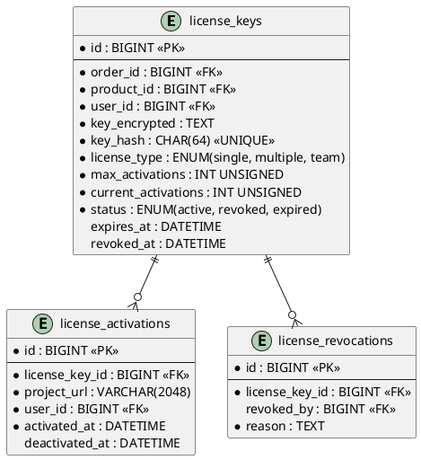

# 06.55 - Licenses

| Field       | Value                          |
|-------------|--------------------------------|
| Project     | GsmUi                          |
| Domain      | Marketplace - Licenses         |
| Version     | 1.0.0                          |

---

## Tables

### license_keys

**Purpose:** Generated license keys for one-time purchases. Keys are encrypted at rest.

**Business Rules:**
- Key format: `GSMUI-{TYPE}-{UUID}`.
- `key_encrypted` stores the full key encrypted with AES-256.
- `key_hash` stores SHA-256 hash for secure lookups without decryption.
- Keys are immutable — revocation creates a new audit record, not a mutation.
- No soft deletes. Revoked keys retain their row with `status = 'revoked'`.

#### Columns

| Column               | Type              | Attributes                          | Nullable | Default   |
|----------------------|-------------------|-------------------------------------|----------|-----------|
| id                   | BIGINT            | PK, AUTO_INCREMENT                  | No       | —         |
| order_id             | BIGINT            | FK → orders.id                      | No       | —         |
| order_item_id        | BIGINT            | FK → order_items.id                 | Yes      | NULL      |
| product_id           | BIGINT            | FK → products.id                    | No       | —         |
| user_id              | BIGINT            | FK → users.id                       | No       | —         |
| key_encrypted        | TEXT              | AES-256 encrypted                   | No       | —         |
| key_hash             | CHAR(64)          | SHA-256, UNIQUE                     | No       | —         |
| license_type         | ENUM              | single, multiple, team              | No       | —         |
| max_activations      | INT UNSIGNED      |                                     | No       | 1         |
| current_activations  | INT UNSIGNED      |                                     | No       | 0         |
| status               | ENUM              | active, revoked, expired            | No       | 'active'  |
| expires_at           | DATETIME          |                                     | Yes      | NULL      |
| revoked_at           | DATETIME          |                                     | Yes      | NULL      |
| created_at           | DATETIME          |                                     | No       | NOW()     |
| updated_at           | DATETIME          |                                     | No       | NOW()     |

#### Indexes

| Name                        | Columns   | Type    |
|-----------------------------|-----------|---------|
| PRIMARY                     | id        | PK      |
| license_keys_key_hash_unique| key_hash  | UNIQUE  |
| license_keys_order_id_index | order_id  | INDEX   |
| license_keys_product_id_idx | product_id| INDEX   |
| license_keys_user_id_index  | user_id   | INDEX   |
| license_keys_status_index   | status    | INDEX   |

---

### license_activations

**Purpose:** Per-project activation tracking. Each activation ties a license to a specific project URL.

**Business Rules:**
- Activations are scoped per `license_key_id + project_url`.
- No device fingerprinting — identity is project URL only.
- Activation limit is enforced at the application layer using `max_activations`.

#### Columns

| Column          | Type           | Attributes         | Nullable | Default |
|-----------------|----------------|--------------------|----------|---------|
| id              | BIGINT         | PK, AUTO_INCREMENT | No       | —       |
| license_key_id  | BIGINT         | FK → license_keys.id| No      | —       |
| project_url     | VARCHAR(2048)  |                    | No       | —       |
| user_id         | BIGINT         | FK → users.id      | No       | —       |
| activated_at    | DATETIME       |                    | No       | NOW()   |
| deactivated_at  | DATETIME       |                    | Yes      | NULL    |
| created_at      | DATETIME       |                    | No       | NOW()   |
| updated_at      | DATETIME       |                    | No       | NOW()   |

#### Indexes

| Name                                        | Columns                    | Type    |
|---------------------------------------------|----------------------------|---------|
| PRIMARY                                     | id                         | PK      |
| license_activations_license_key_id_index     | license_key_id             | INDEX   |
| license_activations_license_project_unique   | license_key_id, project_url| UNIQUE  |
| license_activations_user_id_index            | user_id                    | INDEX   |

---

### license_revocations

**Purpose:** Immutable audit trail of license revocations. One record per revocation event.

#### Columns

| Column          | Type     | Attributes         | Nullable | Default |
|-----------------|----------|--------------------|----------|---------|
| id              | BIGINT   | PK, AUTO_INCREMENT | No       | —       |
| license_key_id  | BIGINT   | FK → license_keys.id| No     | —       |
| revoked_by      | BIGINT   | FK → users.id      | Yes      | NULL    |
| reason          | TEXT     |                    | No       | —       |
| created_at      | DATETIME |                    | No       | NOW()   |
| updated_at      | DATETIME |                    | No       | NOW()   |

#### Indexes

| Name                                     | Columns         | Type    |
|------------------------------------------|-----------------|---------|
| PRIMARY                                  | id              | PK      |
| license_revocations_license_key_id_index  | license_key_id  | INDEX   |

---

## Relationships

```
license_keys belongsTo orders
license_keys belongsTo order_items (optional)
license_keys belongsTo products
license_keys belongsTo users
license_keys hasMany license_activations
license_keys hasMany license_revocations

license_activations belongsTo license_keys
license_activations belongsTo users

license_revocations belongsTo license_keys
license_revocations belongsTo users (revoked_by, optional)
```

---

## PlantUML



---

## Migration Stub

```php
Schema::create('license_keys', function (Blueprint $table) {
    $table->id();
    $table->foreignId('order_id')->constrained()->cascadeOnDelete();
    $table->foreignId('order_item_id')->nullable()->constrained('order_items')->nullOnDelete();
    $table->foreignId('product_id')->constrained()->cascadeOnDelete();
    $table->foreignId('user_id')->constrained()->cascadeOnDelete();
    $table->text('key_encrypted');
    $table->char('key_hash', 64)->unique();
    $table->enum('license_type', ['single', 'multiple', 'team']);
    $table->unsignedInteger('max_activations')->default(1);
    $table->unsignedInteger('current_activations')->default(0);
    $table->enum('status', ['active', 'revoked', 'expired'])->default('active')->index();
    $table->datetime('expires_at')->nullable();
    $table->datetime('revoked_at')->nullable();
    $table->timestamps();

    $table->index('order_id');
    $table->index('product_id');
    $table->index('user_id');
});

Schema::create('license_activations', function (Blueprint $table) {
    $table->id();
    $table->foreignId('license_key_id')->constrained('license_keys')->cascadeOnDelete();
    $table->string('project_url', 2048);
    $table->foreignId('user_id')->constrained()->cascadeOnDelete();
    $table->datetime('activated_at');
    $table->datetime('deactivated_at')->nullable();
    $table->timestamps();
    $table->unique(['license_key_id', 'project_url']);
    $table->index('user_id');
});

Schema::create('license_revocations', function (Blueprint $table) {
    $table->id();
    $table->foreignId('license_key_id')->constrained('license_keys')->cascadeOnDelete();
    $table->foreignId('revoked_by')->nullable()->constrained('users')->nullOnDelete();
    $table->text('reason');
    $table->timestamps();
    $table->index('license_key_id');
});
```

---

## Model Stub

```php
class LicenseKey extends Model
{
    protected $fillable = [
        'order_id', 'order_item_id', 'product_id', 'user_id',
        'key_encrypted', 'key_hash', 'license_type',
        'max_activations', 'current_activations',
        'status', 'expires_at', 'revoked_at',
    ];

    protected $casts = [
        'expires_at' => 'datetime',
        'revoked_at' => 'datetime',
    ];

    public function order() { return $this->belongsTo(Order::class); }
    public function orderItem() { return $this->belongsTo(OrderItem::class); }
    public function product() { return $this->belongsTo(Product::class); }
    public function user() { return $this->belongsTo(User::class); }
    public function activations() { return $this->hasMany(LicenseActivation::class); }
    public function revocations() { return $this->hasMany(LicenseRevocation::class); }
}
```

---

## Detailed Business Rules

### License Key Generation

**Key Format Specification:**
- Format: `GSMUI-{TYPE}-{UUID4}`
- Example: `GSMUI-SINGLE-a1b2c3d4-e5f6-7890-abcd-ef1234567890`
- TYPE values: `SINGLE`, `MULTIPLE`, `TEAM`
- UUID4 is uppercase, hyphenated, version-4 compliant
- Total key length: ~56 characters (constant-length for UX predictability)

**Generation Algorithm:**
```
1. Generate UUID4 via ramsey/uuid or Str::uuid()
2. Upper-case the UUID
3. Prepend license type prefix
4. Encrypt full key with AES-256-GCM → store in key_encrypted
5. SHA-256 hash the full key → store in key_hash
6. Return plaintext key ONCE to the consumer; never stored in plaintext
```

**Encryption Details:**
- Algorithm: AES-256-GCM (authenticated encryption)
- Key source: `config('app.license_key')` backed by `LICENSE_ENCRYPTION_KEY` env var
- IV: Random 12-byte IV generated per encryption, prepended to ciphertext
- Auth tag: 16-byte GCM tag appended to ciphertext
- Storage format: `base64(iv || ciphertext || tag)`
- Key rotation: supported via re-encryption command; old keys decrypt with previous key if `LICENSE_ENCRYPTION_KEY_PREVIOUS` is set

**Hash Lookup Strategy:**
- `key_hash` = `hash('sha256', $plaintextKey)`
- Used for API verification endpoints where the full key is submitted
- Collision resistance: SHA-256 provides 128-bit collision resistance, sufficient for license lookup
- No salt needed — license keys are high-entropy random values, not passwords

### License Types

| Type | max_activations | Use Case |
|------|----------------|----------|
| `single` | 1 | Personal license, one project |
| `multiple` | 3–10 | Freelancer / small team, multiple projects |
| `team` | 11–unlimited | Organization-wide, all team projects |

**Type Assignment Rules:**
- License type is determined at purchase time based on the selected product variant
- Cannot be changed after creation (immutable)
- Team licenses require a `team_id` on the order; enforced at application layer
- Refund of a team license deactivates all team member activations

### Activation Limits

**Enforcement Flow:**
```
1. User submits license key + project_url
2. System resolves key via key_hash lookup
3. Check key status = 'active' and not expired
4. Check current_activations < max_activations
5. Check project_url not already activated for this key
6. If all pass → create activation record, increment current_activations
7. If project_url already exists → return existing activation (idempotent)
8. If limit reached → return error with current/max counts
```

**Activation Deactivation:**
- Users can voluntarily deactivate a project URL
- Deactivation decrements `current_activations` atomically
- Deactivated activation gets `deactivated_at` timestamp
- Reactivation of the same URL is allowed if within limits

### Expiration Handling

**Expiration Rules:**
- `expires_at = NULL` means the key never expires
- Expired keys retain `status = 'active'` — expiration is checked at verification time
- A scheduled Artisan command (`licenses:check-expiration`) runs daily and updates status to `expired` where `expires_at < NOW() AND status = 'active'`
- Expired keys can be renewed (extends `expires_at`) if the product supports it

**Expiration Edge Cases:**
- Key purchased on Dec 31 with 365-day validity → expires Jan 1 of next year
- Timezone: all timestamps are UTC
- Grace period: 7-day grace period after expiration for downloads; no new activations during grace

### Revocation Policy

**Revocation Triggers:**
- Manual admin revocation (chargeback, abuse, policy violation)
- Automated revocation on refund completion
- Automated revocation on payment failure after retry window

**Revocation Process:**
```
1. Admin initiates revocation with reason
2. System creates license_revocations record
3. System sets license_keys.status = 'revoked', revoked_at = NOW()
4. System deactivates all active license_activations for this key
5. System fires LicenseRevoked event (for webhooks, notifications)
6. All future verification attempts return revoked status
```

**Revocation is irreversible** — a new license key must be issued if revocation was in error.

### Multi-Seat Team Licenses

**Team License Mechanics:**
- `team_id` is stored on `license_keys` for team-type licenses
- Team members can each activate one project URL
- `max_activations` = number of seats purchased
- `current_activations` counts across all team member activations
- Adding seats: admin increases `max_activations` on the license key
- Removing seats: if `current_activations > new_max`, excess activations are flagged but not force-deactivated

---

## State Machine

```
┌─────────────────────────────────────────────────┐
│                  LICENSE_KEY                     │
│                                                  │
│  ┌─────────┐  activate   ┌──────────┐           │
│  │ active   │◄──────────►│ expired  │           │
│  └────┬─────┘  (auto)    └──────────┘           │
│       │                                          │
│       │ revoke                                   │
│       ▼                                          │
│  ┌─────────┐                                     │
│  │ revoked  │  (terminal state)                  │
│  └─────────┘                                     │
└─────────────────────────────────────────────────┘

┌─────────────────────────────────────────────────┐
│              LICENSE_ACTIVATION                  │
│                                                  │
│  ┌──────────────┐  deactivate  ┌──────────────┐ │
│  │ active        │◄────────────►│ deactivated  │ │
│  └──────────────┘              └──────────────┘ │
└─────────────────────────────────────────────────┘
```

**State Transition Rules:**

| From | To | Trigger | Guard |
|------|----|---------|-------|
| active | expired | `licenses:check-expiration` command | `expires_at < NOW()` |
| active | revoked | Admin action or refund | Reason required |
| expired | active | Renewal | `expires_at` extended |
| active (activation) | deactivated (activation) | User deactivation | None |
| deactivated (activation) | active (activation) | User reactivation | `current_activations < max_activations` |

---

## API Contracts

### POST /api/licenses/verify

**Purpose:** Verify a license key for a given project URL.

**Request:**
```json
{
  "key": "GSMUI-SINGLE-a1b2c3d4-e5f6-7890-abcd-ef1234567890",
  "project_url": "https://example.com",
  "product_slug": "gsmui-pro"
}
```

**Response (200 OK):**
```json
{
  "valid": true,
  "license_type": "single",
  "activations_remaining": 0,
  "expires_at": "2025-12-31T23:59:59Z",
  "activated_at": "2024-06-15T10:30:00Z"
}
```

**Response (403 Forbidden):**
```json
{
  "valid": false,
  "error": "activation_limit_reached",
  "message": "Maximum activations reached for this license key."
}
```

**Error Codes:**

| Code | HTTP Status | Description |
|------|-------------|-------------|
| `key_not_found` | 404 | No key matches the provided hash |
| `key_revoked` | 403 | Key has been revoked |
| `key_expired` | 403 | Key has passed its expiration date |
| `activation_limit_reached` | 403 | All activation slots are used |
| `project_url_already_activated` | 200 | Idempotent — already activated (returns valid) |
| `invalid_product` | 403 | Key does not belong to the specified product |

### POST /api/licenses/activate

**Purpose:** Activate a license key for a project URL.

**Request:**
```json
{
  "key": "GSMUI-SINGLE-a1b2c3d4-e5f6-7890-abcd-ef1234567890",
  "project_url": "https://my-site.com"
}
```

**Response (201 Created):**
```json
{
  "activation_id": 42,
  "activated_at": "2024-06-15T10:30:00Z",
  "activations_remaining": 2
}
```

### POST /api/licenses/deactivate

**Purpose:** Deactivate a project URL from a license key.

**Request:**
```json
{
  "key": "GSMUI-SINGLE-a1b2c3d4-e5f6-7890-abcd-ef1234567890",
  "project_url": "https://my-site.com"
}
```

**Response (200 OK):**
```json
{
  "deactivated": true,
  "activations_remaining": 3
}
```

---

## Security Considerations

### Rate Limiting

| Endpoint | Limit | Window | Scope |
|----------|-------|--------|-------|
| `/api/licenses/verify` | 60 | 1 minute | Per IP |
| `/api/licenses/activate` | 10 | 1 minute | Per IP |
| `/api/licenses/deactivate` | 10 | 1 minute | Per IP |
| `/api/licenses/bulk-verify` | 5 | 1 minute | Per IP |

### Abuse Prevention

- **Brute force protection:** License keys are UUID4 (122 bits of entropy); brute-force is infeasible
- **Key enumeration prevention:** All error responses return identical HTTP status and timing
- **Timing-safe comparison:** `hash_equals()` used for hash comparison to prevent timing attacks
- **IP logging:** All verification/activation attempts log IP address for abuse tracking
- **Suspicious activity detection:** >100 failed verifications from single IP triggers automatic temporary block

### Encryption at Rest

- License keys are never stored in plaintext
- `key_encrypted` column uses AES-256-GCM with per-record random IV
- Decryption key is loaded from environment variable, never hardcoded
- Database backups include encrypted keys; no special handling needed
- Key rotation is supported via re-encryption Artisan command

### Audit Trail

All license operations produce immutable audit records:

| Operation | Audit Table | Fields |
|-----------|-------------|--------|
| Key generation | `license_keys` (created_at) | order_id, product_id, user_id |
| Activation | `license_activations` | license_key_id, project_url, user_id, activated_at |
| Deactivation | `license_activations` | deactivated_at |
| Revocation | `license_revocations` | license_key_id, revoked_by, reason |
| Status change | `license_keys` | status, updated_at |

---

## Event Hooks

### Laravel Events

| Event | Fired When | Payload |
|-------|------------|---------|
| `LicenseKeyCreated` | New key generated | `LicenseKey $licenseKey` |
| `LicenseActivated` | Activation created | `LicenseActivation $activation` |
| `LicenseDeactivated` | Activation removed | `LicenseActivation $activation` |
| `LicenseRevoked` | Key revoked | `LicenseKey $licenseKey, string $reason` |
| `LicenseExpired` | Status auto-updated to expired | `LicenseKey $licenseKey` |
| `LicenseRenewed` | Expiration extended | `LicenseKey $licenseKey, Carbon $newExpiry` |
| `ActivationLimitReached` | All slots used | `LicenseKey $licenseKey` |

### Webhook Integration

- `LicenseRevoked` event triggers webhook to external systems (e.g., deactivation of premium features on customer site)
- Webhook payload includes license key hash (not plaintext), product slug, and revocation reason
- Failed webhook deliveries are retried with exponential backoff (3 attempts)
- Webhook logs stored in `webhook_deliveries` table for debugging

---

## Query Patterns

### Find Active License for User + Product

```php
LicenseKey::where('user_id', $userId)
    ->where('product_id', $productId)
    ->where('status', 'active')
    ->where(function ($q) {
        $q->whereNull('expires_at')
          ->orWhere('expires_at', '>', now());
    })
    ->first();
```

### Count Activations for a Key

```php
LicenseActivation::where('license_key_id', $keyId)
    ->whereNull('deactivated_at')
    ->count();
```

### Check if Project URL is Activated

```php
LicenseActivation::where('license_key_id', $keyId)
    ->where('project_url', $projectUrl)
    ->whereNull('deactivated_at')
    ->exists();
```

### Find Expired Keys Needing Status Update

```php
LicenseKey::where('status', 'active')
    ->where('expires_at', '<', now())
    ->chunkById(200, function ($keys) {
        foreach ($keys as $key) {
            $key->update(['status' => 'expired']);
            event(new LicenseExpired($key));
        }
    });
```

### Bulk Verification (for migration scripts)

```php
$keys = ['GSMUI-SINGLE-...', 'GSMUI-MULTIPLE-...'];
$hashes = array_map(fn($key) => hash('sha256', $key), $keys);

LicenseKey::whereIn('key_hash', $hashes)
    ->with('activations')
    ->get()
    ->map(fn($key) => [
        'key_hash' => $key->key_hash,
        'status' => $key->status,
        'activations' => $key->activations->count(),
    ]);
```

---

## Caching Strategy

### Cached Values

| Key Pattern | Value | TTL | Invalidation |
|-------------|-------|-----|-------------|
| `license:verify:{hash}` | Verification result | 5 minutes | On activation/deactivation |
| `license:activations:{id}` | Activation count | 1 minute | On activation/deactivation |
| `license:status:{hash}` | Active/expired/revoked | 5 minutes | On status change |

### Cache Invalidation Rules

- On activation: invalidate `license:activations:{id}` and `license:verify:{hash}`
- On deactivation: invalidate `license:activations:{id}` and `license:verify:{hash}`
- On revocation: invalidate all cache entries for the license key
- On expiration: cache TTL handles this naturally (5-minute staleness acceptable)

### Cache Stampede Prevention

- Use `Cache::lock()` with 5-second TTL for verification endpoint
- Stale-while-revalidate pattern: serve cached result while refreshing in background
- Cache warming: not needed — verification is on-demand, not batch

---

## Artisan Commands

### `licenses:check-expiration`

**Purpose:** Batch-update expired license keys.

**Schedule:** Daily at 00:00 UTC.

**Logic:**
```php
LicenseKey::where('status', 'active')
    ->where('expires_at', '!=', null)
    ->where('expires_at', '<', now())
    ->chunkById(200, function ($keys) {
        foreach ($keys as $key) {
            DB::transaction(function () use ($key) {
                $key->update(['status' => 'expired']);
                LicenseActivation::where('license_key_id', $key->id)
                    ->whereNull('deactivated_at')
                    ->update(['deactivated_at' => now()]);
            });
            event(new LicenseExpired($key));
        }
    });
```

### `licenses:re-encrypt`

**Purpose:** Re-encrypt all license keys with a new encryption key.

**Usage:**
```bash
php artisan licenses:re-encrypt --old-key=$OLD_KEY --new-key=$NEW_KEY
```

**Logic:**
- Decrypt all `key_encrypted` values with `$OLD_KEY`
- Re-encrypt with `$NEW_KEY`
- Update `key_encrypted` column
- No changes to `key_hash` (hash is key-invariant)

### `licenses:stats`

**Purpose:** Generate license usage statistics.

**Output:**
```
Total licenses: 12,450
Active: 10,230 (82.2%)
Expired: 1,890 (15.2%)
Revoked: 330 (2.6%)

Activations by type:
  Single: 5,100 keys, 5,100 activations
  Multiple: 3,200 keys, 9,400 activations
  Team: 1,930 keys, 14,200 activations

Top products by license count:
  1. gsmui-pro: 8,200
  2. gsmui-teams: 2,100
  3. gsmui-enterprise: 1,150
```

---

## Testing Scenarios

### Unit Tests

| Test Case | Expected Result |
|-----------|-----------------|
| Generate key produces valid format | `GSMUI-{TYPE}-{UUID}` |
| Encrypt then decrypt returns original | Round-trip equality |
| Hash lookup matches plaintext hash | `hash('sha256', $key) === $hash` |
| Activation limit check at max | Returns false |
| Activation limit check below max | Returns true |
| Expiration check with past date | Returns expired |
| Expiration check with future date | Returns active |
| Revocation creates audit record | `license_revocations` count +1 |

### Integration Tests

| Test Case | Expected Result |
|-----------|-----------------|
| Verify valid active key | Returns valid response |
| Verify revoked key | Returns 403 with `key_revoked` |
| Verify expired key | Returns 403 with `key_expired` |
| Activate within limit | Creates activation, increments count |
| Activate at limit | Returns 403 with `activation_limit_reached` |
| Activate duplicate URL | Returns 200 (idempotent) |
| Deactivate then reactivate | Decrements then increments count |
| Bulk verify with mixed statuses | Returns per-key results |

### Edge Cases

| Scenario | Behavior |
|----------|----------|
| Same user, same product, two keys | Both are valid; first-to-activate wins for single licenses |
| Key with `expires_at = NULL` | Never expires; status stays active indefinitely |
| Key revoked then renewal attempted | Renewal rejected; key is revoked |
| Activation during grace period | Allowed for downloads; not for new activations |
| Concurrent activation requests | Database-level locking prevents double-activation |

---

## Performance Considerations

### Index Usage

| Query Pattern | Index Used | Estimated Rows Scanned |
|---------------|-----------|----------------------|
| Verify by key_hash | `license_keys_key_hash_unique` | 1 (exact match) |
| List user's licenses | `license_keys_user_id_index` | ~10 per user |
| Count activations | `license_activations_license_key_id_index` | ~5 per key |
| Find expired keys | `license_keys_status_index` + `expires_at` range | Proportional to expired count |

### Table Growth Projections

| Table | Year 1 | Year 3 | Year 5 |
|-------|--------|--------|--------|
| `license_keys` | 50K | 200K | 500K |
| `license_activations` | 80K | 350K | 900K |
| `license_revocations` | 1K | 5K | 15K |

### Partitioning Strategy

- `license_keys`: partition by `created_at` (yearly) after 1M rows
- `license_activations`: partition by `created_at` (yearly) after 2M rows
- `license_revocations`: no partitioning needed (small table)

---

## Data Retention

### Retention Policies

| Table | Retention | Action |
|-------|-----------|--------|
| `license_keys` | Indefinite | Never delete; revoked keys retain audit value |
| `license_activations` | Indefinite | Deactivated records retained for audit |
| `license_revocations` | Indefinite | Immutable audit trail; never delete |

### GDPR Compliance

- License keys are personal data (tied to user_id)
- User deletion: anonymize `user_id` on `license_keys`, `license_activations` (set to 0 or a sentinel value)
- Keep `key_hash` and `status` for historical analytics
- Encryption key deletion renders `key_encrypted` unreadable (effective erasure)

---

## Migration Considerations

### Adding New Columns

When adding columns to `license_keys`:
1. Add column with default value
2. Backfill existing rows in chunks of 1000
3. Remove default if column should be nullable
4. Add index if needed (non-blocking online index in MySQL 8+)

### Schema Versioning

- All migrations are versioned via Laravel migration timestamps
- Rollback stubs provided for each migration
- Down-migrations must handle data loss gracefully (archive to temp table before drop)

---

## Related Documents

- **06.51** - Products (license type definitions)
- **06.52** - Orders (purchase → license creation flow)
- **06.53** - Subscriptions (subscription-based license access)
- **06.54** - Payments (refund → revocation trigger)
- **06.56** - Downloads (license-gated download access)
- **06.01** - Design Principles (soft delete policy, timestamp conventions)
- **06.02** - Naming Conventions (table, column, index naming)
- **06.03** - Common Columns (slug, status, timestamps)
- **06.04** - Relationships (cascade behavior)

---

---

## Database Constraints

### Foreign Key Constraints

```sql
ALTER TABLE license_keys
  ADD CONSTRAINT fk_license_keys_order
    FOREIGN KEY (order_id) REFERENCES orders(id) ON DELETE CASCADE,
  ADD CONSTRAINT fk_license_keys_order_item
    FOREIGN KEY (order_item_id) REFERENCES order_items(id) ON DELETE SET NULL,
  ADD CONSTRAINT fk_license_keys_product
    FOREIGN KEY (product_id) REFERENCES products(id) ON DELETE CASCADE,
  ADD CONSTRAINT fk_license_keys_user
    FOREIGN KEY (user_id) REFERENCES users(id) ON DELETE CASCADE;

ALTER TABLE license_activations
  ADD CONSTRAINT fk_license_activations_key
    FOREIGN KEY (license_key_id) REFERENCES license_keys(id) ON DELETE CASCADE,
  ADD CONSTRAINT fk_license_activations_user
    FOREIGN KEY (user_id) REFERENCES users(id) ON DELETE CASCADE;

ALTER TABLE license_revocations
  ADD CONSTRAINT fk_license_revocations_key
    FOREIGN KEY (license_key_id) REFERENCES license_keys(id) ON DELETE CASCADE,
  ADD CONSTRAINT fk_license_revocations_revoker
    FOREIGN KEY (revoked_by) REFERENCES users(id) ON DELETE SET NULL;
```

### Check Constraints

```sql
ALTER TABLE license_keys
  ADD CONSTRAINT chk_license_keys_max_activations
    CHECK (max_activations > 0),
  ADD CONSTRAINT chk_license_keys_current_activations
    CHECK (current_activations >= 0),
  ADD CONSTRAINT chk_license_keys_current_lte_max
    CHECK (current_activations <= max_activations);

ALTER TABLE license_activations
  ADD CONSTRAINT chk_license_activations_project_url_format
    CHECK (project_url REGEXP '^https?://');
```

### Unique Constraints

```sql
ALTER TABLE license_keys
  ADD CONSTRAINT uk_license_keys_key_hash
    UNIQUE (key_hash);

ALTER TABLE license_activations
  ADD CONSTRAINT uk_license_activations_key_project
    UNIQUE (license_key_id, project_url);
```

---

## Stored Procedures

### sp_activate_license

```sql
DELIMITER //
CREATE PROCEDURE sp_activate_license(
  IN p_key_hash CHAR(64),
  IN p_project_url VARCHAR(2048),
  IN p_user_id BIGINT,
  OUT p_activation_id BIGINT,
  OUT p_status VARCHAR(50)
)
BEGIN
  DECLARE v_license_id BIGINT;
  DECLARE v_max_activations INT;
  DECLARE v_current_activations INT;
  DECLARE v_status VARCHAR(20);
  DECLARE v_expires_at DATETIME;

  -- Find the license key
  SELECT id, max_activations, current_activations, status, expires_at
  INTO v_license_id, v_max_activations, v_current_activations, v_status, v_expires_at
  FROM license_keys
  WHERE key_hash = p_key_hash
  FOR UPDATE;

  -- Check if key exists
  IF v_license_id IS NULL THEN
    SET p_status = 'key_not_found';
  -- Check if key is active
  ELSEIF v_status != 'active' THEN
    SET p_status = CONCAT('key_', v_status);
  -- Check if key is expired
  ELSEIF v_expires_at IS NOT NULL AND v_expires_at < NOW() THEN
    SET p_status = 'key_expired';
  -- Check activation limit
  ELSEIF v_current_activations >= v_max_activations THEN
    -- Check if this URL is already activated (idempotent)
    IF EXISTS (SELECT 1 FROM license_activations WHERE license_key_id = v_license_id AND project_url = p_project_url AND deactivated_at IS NULL) THEN
      SELECT id INTO p_activation_id FROM license_activations WHERE license_key_id = v_license_id AND project_url = p_project_url;
      SET p_status = 'already_activated';
    ELSE
      SET p_status = 'activation_limit_reached';
    END IF;
  ELSE
    -- Check if URL is already activated (idempotent)
    IF EXISTS (SELECT 1 FROM license_activations WHERE license_key_id = v_license_id AND project_url = p_project_url AND deactivated_at IS NULL) THEN
      SELECT id INTO p_activation_id FROM license_activations WHERE license_key_id = v_license_id AND project_url = p_project_url;
      SET p_status = 'already_activated';
    ELSE
      -- Create activation
      INSERT INTO license_activations (license_key_id, project_url, user_id, activated_at, created_at, updated_at)
      VALUES (v_license_id, p_project_url, p_user_id, NOW(), NOW(), NOW());
      
      SET p_activation_id = LAST_INSERT_ID();
      
      -- Increment activation count
      UPDATE license_keys SET current_activations = current_activations + 1, updated_at = NOW() WHERE id = v_license_id;
      
      SET p_status = 'activated';
    END IF;
  END IF;
END //
DELIMITER ;
```

### sp_deactivate_license

```sql
DELIMITER //
CREATE PROCEDURE sp_deactivate_license(
  IN p_key_hash CHAR(64),
  IN p_project_url VARCHAR(2048),
  OUT p_status VARCHAR(50)
)
BEGIN
  DECLARE v_license_id BIGINT;
  DECLARE v_activation_id BIGINT;

  -- Find the license key
  SELECT id INTO v_license_id FROM license_keys WHERE key_hash = p_key_hash;

  IF v_license_id IS NULL THEN
    SET p_status = 'key_not_found';
  ELSE
    -- Find the activation
    SELECT id INTO v_activation_id
    FROM license_activations
    WHERE license_key_id = v_license_id
      AND project_url = p_project_url
      AND deactivated_at IS NULL;

    IF v_activation_id IS NULL THEN
      SET p_status = 'activation_not_found';
    ELSE
      -- Deactivate
      UPDATE license_activations
      SET deactivated_at = NOW(), updated_at = NOW()
      WHERE id = v_activation_id;

      -- Decrement activation count
      UPDATE license_keys
      SET current_activations = GREATEST(current_activations - 1, 0),
          updated_at = NOW()
      WHERE id = v_license_id;

      SET p_status = 'deactivated';
    END IF;
  END IF;
END //
DELIMITER ;
```

### sp_revoke_license

```sql
DELIMITER //
CREATE PROCEDURE sp_revoke_license(
  IN p_license_key_id BIGINT,
  IN p_revoked_by BIGINT,
  IN p_reason TEXT,
  OUT p_status VARCHAR(50)
)
BEGIN
  DECLARE v_current_status VARCHAR(20);

  SELECT status INTO v_current_status FROM license_keys WHERE id = p_license_key_id FOR UPDATE;

  IF v_current_status IS NULL THEN
    SET p_status = 'key_not_found';
  ELSEIF v_current_status = 'revoked' THEN
    SET p_status = 'already_revoked';
  ELSE
    -- Create revocation record
    INSERT INTO license_revocations (license_key_id, revoked_by, reason, created_at, updated_at)
    VALUES (p_license_key_id, p_revoked_by, p_reason, NOW(), NOW());

    -- Update license key status
    UPDATE license_keys
    SET status = 'revoked', revoked_at = NOW(), updated_at = NOW()
    WHERE id = p_license_key_id;

    -- Deactivate all active activations
    UPDATE license_activations
    SET deactivated_at = NOW(), updated_at = NOW()
    WHERE license_key_id = p_license_key_id
      AND deactivated_at IS NULL;

    SET p_status = 'revoked';
  END IF;
END //
DELIMITER ;
```

---

## Triggers

### trg_license_keys_before_update

```sql
DELIMITER //
CREATE TRIGGER trg_license_keys_before_update
BEFORE UPDATE ON license_keys
FOR EACH ROW
BEGIN
  -- Ensure current_activations never goes negative
  IF NEW.current_activations < 0 THEN
    SET NEW.current_activations = 0;
  END IF;

  -- Ensure current_activations never exceeds max_activations
  IF NEW.current_activations > NEW.max_activations THEN
    SET NEW.current_activations = NEW.max_activations;
  END IF;

  -- Set revoked_at when status changes to revoked
  IF NEW.status = 'revoked' AND OLD.status != 'revoked' THEN
    SET NEW.revoked_at = NOW();
  END IF;
END //
DELIMITER ;
```

### trg_license_activations_after_insert

```sql
DELIMITER //
CREATE TRIGGER trg_license_activations_after_insert
AFTER INSERT ON license_activations
FOR EACH ROW
BEGIN
  UPDATE license_keys
  SET current_activations = (
      SELECT COUNT(*)
      FROM license_activations
      WHERE license_key_id = NEW.license_key_id
        AND deactivated_at IS NULL
    ),
    updated_at = NOW()
  WHERE id = NEW.license_key_id;
END //
DELIMITER ;
```

### trg_license_activations_after_update

```sql
DELIMITER //
CREATE TRIGGER trg_license_activations_after_update
AFTER UPDATE ON license_activations
FOR EACH ROW
BEGIN
  IF OLD.deactivated_at IS NULL AND NEW.deactivated_at IS NOT NULL THEN
    UPDATE license_keys
    SET current_activations = (
        SELECT COUNT(*)
        FROM license_activations
        WHERE license_key_id = NEW.license_key_id
          AND deactivated_at IS NULL
      ),
      updated_at = NOW()
    WHERE id = NEW.license_key_id;
  END IF;
END //
DELIMITER ;
```

---

## Views

### vw_license_summary

```sql
CREATE VIEW vw_license_summary AS
SELECT
  lk.id,
  lk.key_hash,
  lk.license_type,
  lk.status,
  lk.max_activations,
  lk.current_activations,
  lk.expires_at,
  lk.created_at,
  u.name AS user_name,
  u.email AS user_email,
  p.name AS product_name,
  p.slug AS product_slug,
  o.id AS order_id,
  o.total_amount AS order_total,
  (lk.max_activations - lk.current_activations) AS remaining_activations,
  CASE
    WHEN lk.expires_at IS NULL THEN 'never'
    WHEN lk.expires_at < NOW() THEN 'expired'
    WHEN lk.expires_at < DATE_ADD(NOW(), INTERVAL 30 DAY) THEN 'expiring_soon'
    ELSE 'valid'
  END AS expiration_status
FROM license_keys lk
JOIN users u ON lk.user_id = u.id
JOIN products p ON lk.product_id = p.id
LEFT JOIN orders o ON lk.order_id = o.id;
```

### vw_activation_stats

```sql
CREATE VIEW vw_activation_stats AS
SELECT
  lk.id AS license_key_id,
  lk.license_type,
  lk.max_activations,
  lk.current_activations,
  COUNT(la.id) AS total_activations,
  SUM(CASE WHEN la.deactivated_at IS NULL THEN 1 ELSE 0 END) AS active_activations,
  SUM(CASE WHEN la.deactivated_at IS NOT NULL THEN 1 ELSE 0 END) AS deactivated_activations,
  MIN(la.activated_at) AS first_activation_at,
  MAX(la.activated_at) AS last_activation_at
FROM license_keys lk
LEFT JOIN license_activations la ON lk.id = la.license_key_id
GROUP BY lk.id, lk.license_type, lk.max_activations, lk.current_activations;
```

---

## Index Optimization

### Composite Indexes for Common Queries

```sql
-- Verify license key by hash and status
CREATE INDEX idx_license_keys_hash_status ON license_keys (key_hash, status);

-- Find active licenses for a product
CREATE INDEX idx_license_keys_product_status ON license_keys (product_id, status, created_at);

-- Find licenses expiring soon
CREATE INDEX idx_license_keys_expiration ON license_keys (status, expires_at) WHERE expires_at IS NOT NULL;

-- Find activations for a license key (active only)
CREATE INDEX idx_license_activations_key_active ON license_activations (license_key_id, deactivated_at);

-- Find revocations for a license key
CREATE INDEX idx_license_revocations_key_created ON license_revocations (license_key_id, created_at);

-- User license lookup
CREATE INDEX idx_license_keys_user_status ON license_keys (user_id, status, product_id);
```

### Index Usage Monitoring

```sql
-- Find unused indexes
SELECT
  object_schema,
  object_name,
  index_name
FROM performance_schema.table_io_waits_summary_by_index_usage
WHERE object_schema = 'gsmui'
  AND index_name IS NOT NULL
  AND count_star = 0
  AND object_name LIKE 'license_%';

-- Find slow queries on license tables
SELECT
  query_time,
  lock_time,
  rows_examined,
  sql_text
FROM mysql.slow_log
WHERE sql_text LIKE '%license_%'
ORDER BY query_time DESC
LIMIT 10;
```

---

## Partitioning

### Partition license_keys by Created Year

```sql
ALTER TABLE license_keys
PARTITION BY RANGE (YEAR(created_at)) (
  PARTITION p2023 VALUES LESS THAN (2024),
  PARTITION p2024 VALUES LESS THAN (2025),
  PARTITION p2025 VALUES LESS THAN (2026),
  PARTITION p2026 VALUES LESS THAN (2027),
  PARTITION p_future VALUES LESS THAN MAXVALUE
);
```

### Partition license_activations by Created Year

```sql
ALTER TABLE license_activations
PARTITION BY RANGE (YEAR(created_at)) (
  PARTITION p2023 VALUES LESS THAN (2024),
  PARTITION p2024 VALUES LESS THAN (2025),
  PARTITION p2025 VALUES LESS THAN (2026),
  PARTITION p2026 VALUES LESS THAN (2027),
  PARTITION p_future VALUES LESS THAN MAXVALUE
);
```

---

## Backup and Recovery

### Backup Strategy

| Table | Backup Frequency | Retention | Method |
|-------|-----------------|-----------|--------|
| `license_keys` | Daily | 90 days | Full + incremental |
| `license_activations` | Daily | 90 days | Full + incremental |
| `license_revocations` | Daily | Indefinite | Full (append-only) |

### Recovery Procedures

**Scenario: Accidental mass revocation**
```sql
-- 1. Stop application writes
-- 2. Restore license_keys from backup
RESTORE TABLE license_keys FROM '/backups/license_keys_20240630.sql';

-- 3. Restore license_activations from backup
RESTORE TABLE license_activations FROM '/backups/license_activations_20240630.sql';

-- 4. Verify data integrity
SELECT COUNT(*) FROM license_keys WHERE status = 'active';
SELECT COUNT(*) FROM license_activations WHERE deactivated_at IS NULL;

-- 5. Resume application writes
```

**Scenario: Data corruption in key_encrypted**
```sql
-- 1. Identify affected keys
SELECT id, key_hash FROM license_keys
WHERE key_encrypted IS NULL OR LENGTH(key_encrypted) < 100;

-- 2. Restore from backup (point-in-time recovery)
-- 3. Re-encrypt with current key
```

---

## Monitoring Queries

### Daily Health Check

```sql
-- License distribution
SELECT
  status,
  COUNT(*) as count,
  ROUND(COUNT(*) * 100.0 / (SELECT COUNT(*) FROM license_keys), 2) as percentage
FROM license_keys
GROUP BY status;

-- Activation utilization
SELECT
  license_type,
  AVG(current_activations * 100.0 / max_activations) as avg_utilization,
  MAX(current_activations * 100.0 / max_activations) as max_utilization
FROM license_keys
WHERE max_activations > 0
GROUP BY license_type;

-- Expiration forecast
SELECT
  CASE
    WHEN expires_at < NOW() THEN 'expired'
    WHEN expires_at < DATE_ADD(NOW(), INTERVAL 7 DAY) THEN '7_days'
    WHEN expires_at < DATE_ADD(NOW(), INTERVAL 30 DAY) THEN '30_days'
    WHEN expires_at < DATE_ADD(NOW(), INTERVAL 90 DAY) THEN '90_days'
    ELSE 'beyond_90_days'
  END as bucket,
  COUNT(*) as count
FROM license_keys
WHERE status = 'active' AND expires_at IS NOT NULL
GROUP BY bucket;
```

### Abuse Detection

```sql
-- Users with high activation churn
SELECT
  user_id,
  COUNT(*) as total_activations,
  SUM(CASE WHEN deactivated_at IS NOT NULL THEN 1 ELSE 0 END) as deactivations,
  ROUND(SUM(CASE WHEN deactivated_at IS NOT NULL THEN 1 ELSE 0 END) * 100.0 / COUNT(*), 2) as churn_rate
FROM license_activations
WHERE created_at >= DATE_SUB(NOW(), INTERVAL 30 DAY)
GROUP BY user_id
HAVING churn_rate > 50 AND total_activations > 5
ORDER BY churn_rate DESC;

-- IPs with multiple license verifications
SELECT
  ip_address,
  COUNT(DISTINCT user_id) as unique_users,
  COUNT(*) as total_verifications
FROM license_verification_log
WHERE created_at >= DATE_SUB(NOW(), INTERVAL 24 HOUR)
GROUP BY ip_address
HAVING unique_users > 10
ORDER BY unique_users DESC;
```

---

## Data Migration Patterns

### Migrating from Legacy License System

```php
// Step 1: Export legacy data
$legacyKeys = DB::connection('legacy')
    ->table('old_license_keys')
    ->where('active', true)
    ->get();

// Step 2: Transform and import
foreach ($legacyKeys as $key) {
    $plaintext = $key->license_key;
    $encrypted = encrypt($plaintext);
    $hash = hash('sha256', $plaintext);

    DB::table('license_keys')->insert([
        'order_id' => $key->order_id,
        'product_id' => $key->product_id,
        'user_id' => $key->user_id,
        'key_encrypted' => $encrypted,
        'key_hash' => $hash,
        'license_type' => $key->type,
        'max_activations' => $key->max_seats,
        'current_activations' => $key->used_seats,
        'status' => 'active',
        'expires_at' => $key->expiration_date,
        'created_at' => $key->created_at,
        'updated_at' => now(),
    ]);
}

// Step 3: Verify migration
$legacyCount = DB::connection('legacy')->table('old_license_keys')->where('active', true)->count();
$newCount = DB::table('license_keys')->where('status', 'active')->count();
Log::info("Migration: legacy={$legacyCount}, new={$newCount}");
```

### Key Rotation Migration

```php
// Rotate encryption key without downtime
Artisan::call('licenses:re-encrypt', [
    '--old-key' => config('app.license_key_previous'),
    '--new-key' => config('app.license_key'),
    '--batch-size' => 100,
    '--sleep' => 100, // ms between batches
]);
```

---

## Performance Tuning

### Query Optimization Checklist

| Query | Issue | Fix |
|-------|-------|-----|
| Verify by key_hash | Full table scan | Use `license_keys_key_hash_unique` index |
| Count active activations | Subquery on every verify | Cache in `current_activations` column |
| Find expired keys | Range scan on `expires_at` | Composite index `(status, expires_at)` |
| User license list | Sorting without index | Composite index `(user_id, status, created_at)` |

### Connection Pool Tuning

```env
# Database connections for license operations
DB_LICENSE_READ_HOST=127.0.0.1
DB_LICENSE_READ_PORT=3306
DB_LICENSE_WRITE_HOST=127.0.0.1
DB_LICENSE_WRITE_PORT=3306

# Connection pool settings
DB_LICENSE_POOL_MIN=5
DB_LICENSE_POOL_MAX=20
DB_LICENSE_POOL_TIMEOUT=30
```

### Caching Layer Configuration

```php
// config/cache.php
'license' => [
    'driver' => 'redis',
    'connection' => 'license',
    'prefix' => 'gsmui:license:',
    'ttl' => 300, // 5 minutes
],
```

---

## Disaster Recovery

### RPO and RTO Targets

| Metric | Target | Strategy |
|--------|--------|----------|
| RPO (Recovery Point Objective) | 1 hour | Hourly incremental backups |
| RTO (Recovery Time Objective) | 4 hours | Automated restore + verification |

### Failover Procedures

1. **Database failover:** Promote read replica to primary
2. **Cache failover:** Switch to database-backed cache
3. **Application failover:** Restart with cached license verification

### Communication Plan

- **Internal:** Slack notification to engineering team
- **External:** Status page update if >10% of users affected
- **Post-incident:** Root cause analysis within 48 hours

---

---

## Advanced Query Patterns

### Complex License Verification

```php
// Verify license with full context
$license = LicenseKey::where('key_hash', hash('sha256', $key))
    ->with(['product:id,name,slug', 'user:id,name,email', 'activations' => function ($q) {
        $q->whereNull('deactivated_at');
    }])
    ->first();

if (!$license) {
    throw new LicenseNotFoundException();
}

if ($license->status !== 'active') {
    throw new LicenseInvalidException("License is {$license->status}");
}

if ($license->expires_at && $license->expires_at->isPast()) {
    throw new LicenseExpiredException();
}

if ($license->current_activations >= $license->max_activations) {
    // Check if this URL is already activated (idempotent)
    $existingActivation = $license->activations()
        ->where('project_url', $projectUrl)
        ->first();

    if ($existingActivation) {
        return $existingActivation; // Idempotent
    }

    throw new ActivationLimitReachedException();
}

return $license;
```

### Batch License Operations

```php
// Bulk verify licenses for migration
$keys = ['GSMUI-SINGLE-...', 'GSMUI-MULTIPLE-...'];
$hashes = array_map(fn($key) => hash('sha256', $key), $keys);

$licenses = LicenseKey::whereIn('key_hash', $hashes)
    ->with(['activations' => function ($q) {
        $q->whereNull('deactivated_at');
    }])
    ->get()
    ->keyBy('key_hash');

$results = [];
foreach ($keys as $key) {
    $hash = hash('sha256', $key);
    $license = $licenses->get($hash);

    $results[$key] = [
        'valid' => $license && $license->status === 'active',
        'activations' => $license ? $license->activations->count() : 0,
        'expires_at' => $license?->expires_at?->toIso8601String(),
    ];
}

return $results;
```

### License Analytics Queries

```php
// Revenue per license type
$revenue = LicenseKey::selectRaw('
    license_type,
    COUNT(*) as license_count,
    SUM(o.total_amount) as total_revenue,
    AVG(o.total_amount) as avg_revenue
')
->join('orders as o', 'license_keys.order_id', '=', 'o.id')
->groupBy('license_type')
->get();

// Activation rate by product
$activationRate = LicenseKey::selectRaw('
    p.name as product_name,
    COUNT(*) as total_licenses,
    SUM(CASE WHEN lk.current_activations > 0 THEN 1 ELSE 0 END) as activated,
    ROUND(SUM(CASE WHEN lk.current_activations > 0 THEN 1 ELSE 0 END) * 100.0 / COUNT(*), 2) as activation_rate
')
->join('products as p', 'license_keys.product_id', '=', 'p.id')
->groupBy('p.id', 'p.name')
->get();

// Expiration forecast
$expirationForecast = LicenseKey::selectRaw('
    CASE
        WHEN expires_at < DATE_ADD(NOW(), INTERVAL 7 DAY) THEN "7_days"
        WHEN expires_at < DATE_ADD(NOW(), INTERVAL 30 DAY) THEN "30_days"
        WHEN expires_at < DATE_ADD(NOW(), INTERVAL 90 DAY) THEN "90_days"
        ELSE "beyond_90_days"
    END as bucket,
    COUNT(*) as count,
    SUM(CASE WHEN status = "active" THEN 1 ELSE 0 END) as active_count
')
->where('status', 'active')
->whereNotNull('expires_at')
->groupBy('bucket')
->get();
```

### License Health Dashboard Queries

```php
// License health score
$health = LicenseKey::selectRaw('
    COUNT(*) as total,
    SUM(CASE WHEN status = "active" THEN 1 ELSE 0 END) as active,
    SUM(CASE WHEN status = "expired" THEN 1 ELSE 0 END) as expired,
    SUM(CASE WHEN status = "revoked" THEN 1 ELSE 0 END) as revoked,
    ROUND(SUM(CASE WHEN status = "active" THEN 1 ELSE 0 END) * 100.0 / COUNT(*), 2) as health_score
')
->first();

// Activation utilization
$utilization = LicenseKey::selectRaw('
    license_type,
    AVG(current_activations * 100.0 / max_activations) as avg_utilization,
    MAX(current_activations * 100.0 / max_activations) as max_utilization,
    MIN(current_activations * 100.0 / max_activations) as min_utilization
')
->where('max_activations', '>', 0)
->groupBy('license_type')
->get();

// Top products by license count
$topProducts = LicenseKey::selectRaw('
    p.name,
    p.slug,
    COUNT(*) as license_count,
    SUM(CASE WHEN lk.status = "active" THEN 1 ELSE 0 END) as active_count
')
->join('products as p', 'license_keys.product_id', '=', 'p.id')
->groupBy('p.id', 'p.name', 'p.slug')
->orderByDesc('license_count')
->limit(10)
->get();
```

---

## Integration Patterns

### Webhook Payload Structure

```json
{
  "event": "license.activated",
  "timestamp": "2024-06-30T10:30:00Z",
  "data": {
    "license_key_id": 42,
    "key_hash": "a1b2c3d4...",
    "product_slug": "gsmui-pro",
    "user_id": 5,
    "project_url": "https://example.com",
    "activations_remaining": 2
  }
}
```

### Event Listeners

```php
// App\Listeners\SendLicenseActivationEmail
class SendLicenseActivationEmail
{
    public function handle(LicenseActivated $event): void
    {
        Mail::to($event->license->user->email)
            ->send(new LicenseActivatedMail(
                $event->license,
                $event->activation
            ));
    }
}

// App\Listeners\NotifyAdminOfRevocation
class NotifyAdminOfRevocation
{
    public function handle(LicenseRevoked $event): void
    {
        Notification::send(
            User::where('is_admin', true)->get(),
            new LicenseRevokedNotification($event->license, $event->reason)
        );
    }
}
```

### API Response Transformers

```php
// App\Transformers\LicenseTransformer
class LicenseTransformer
{
    public function transform(LicenseKey $license): array
    {
        return [
            'id' => $license->id,
            'key_masked' => $this->maskKey($license->key_hash),
            'license_type' => $license->license_type,
            'status' => $license->status,
            'activations' => [
                'current' => $license->current_activations,
                'max' => $license->max_activations,
                'remaining' => $license->max_activations - $license->current_activations,
            ],
            'expires_at' => $license->expires_at?->toIso8601String(),
            'created_at' => $license->created_at->toIso8601String(),
        ];
    }

    private function maskKey(string $hash): string
    {
        return substr($hash, 0, 8) . '...' . substr($hash, -8);
    }
}
```

---

## Performance Benchmarks

### Target Response Times

| Operation | Target | Max | Notes |
|-----------|--------|-----|-------|
| License verification | 50ms | 200ms | Cache hit: <10ms |
| License activation | 100ms | 500ms | Includes DB write |
| License deactivation | 100ms | 500ms | Includes DB write |
| Bulk verification (100 keys) | 500ms | 2s | Batch query |
| License list (user) | 100ms | 300ms | Paginated |

### Load Testing Scenarios

```php
// Concurrent verification test
$keys = factory(LicenseKey::class, 100)->create();
$hashes = $keys->pluck('key_hash')->toArray();

$startTime = microtime(true);
$promises = [];

foreach ($hashes as $hash) {
    $promises[] = Http::async()->post('http://localhost:8000/api/licenses/verify', [
        'key' => $hash,
        'project_url' => 'https://test.example.com',
        'product_slug' => 'gsmui-pro',
    ]);
}

responses = Pool::promise($promises)->wait();
$elapsed = microtime(true) - $startTime;

Log::info("100 concurrent verifications completed in {$elapsed}s");
```

### Database Performance Metrics

```sql
-- Query execution time distribution
SELECT
  query_time,
  COUNT(*) as count
FROM performance_schema.events_statements_summary_by_digest
WHERE digest_text LIKE '%license_keys%'
GROUP BY query_time
ORDER BY query_time;

-- Index hit ratio
SELECT
  object_name,
  index_name,
  count_read,
  count_fetch,
  ROUND(count_fetch * 100.0 / NULLIF(count_read, 0), 2) as hit_ratio
FROM performance_schema.table_io_waits_summary_by_index_usage
WHERE object_schema = 'gsmui'
  AND object_name LIKE 'license_%';
```

---

## Security Audit Checklist

### Pre-Launch Security Review

- [ ] All license keys encrypted at rest (AES-256-GCM)
- [ ] Key hash uses SHA-256 (not MD5 or SHA-1)
- [ ] Timing-safe comparison for hash lookups (`hash_equals()`)
- [ ] Rate limiting on all API endpoints
- [ ] IP logging for all verification attempts
- [ ] Brute force protection (>100 failures → temp block)
- [ ] No plaintext keys stored anywhere
- [ ] Encryption key in environment variable (not hardcoded)
- [ ] Audit trail for all revocations
- [ ] GDPR-compliant data handling

### Ongoing Security Monitoring

```sql
-- Failed verification attempts
SELECT
  DATE(created_at) as day,
  COUNT(*) as failures
FROM license_verification_log
WHERE status = 'failed'
  AND created_at >= DATE_SUB(NOW(), INTERVAL 7 DAY)
GROUP BY DATE(created_at)
ORDER BY day DESC;

-- Suspicious IP addresses
SELECT
  ip_address,
  COUNT(*) as attempts,
  COUNT(DISTINCT user_id) as unique_users,
  SUM(CASE WHEN status = 'failed' THEN 1 ELSE 0 END) as failures
FROM license_verification_log
WHERE created_at >= DATE_SUB(NOW(), INTERVAL 24 HOUR)
GROUP BY ip_address
HAVING attempts > 50
ORDER BY failures DESC;
```

---

## API Versioning

### Version Strategy

- API version included in URL: `/api/v1/licenses/verify`
- Current version: v1
- Deprecation notice: 6 months before removal
- Backward compatibility: maintained within major version

### Version Migration Guide

```php
// v1 → v2 migration changes
// - Response format: { data: {...} } → { data: {...}, meta: {...} }
// - Error format: { error: "..." } → { error: { code: "...", message: "..." } }
// - Rate limit headers: X-RateLimit-* → RateLimit-*

// Migration middleware
class ApiVersionMiddleware
{
    public function handle($request, Closure $next, $version)
    {
        $request->attributes->set('api_version', $version);
        return $next($request);
    }
}
```

---

## Deployment Considerations

### Migration Rollback Strategy

```php
// Always test rollback before deploying
Schema::dropIfExists('license_revocations');
Schema::dropIfExists('license_activations');
Schema::dropIfExists('license_keys');
```

### Zero-Downtime Deployment

1. Add new columns with defaults (nullable if needed)
2. Deploy application code that writes to new columns
3. Backfill existing rows in chunks
4. Add NOT NULL constraint after backfill
5. Remove old columns in next deployment

### Feature Flags

```php
// License verification feature flag
if (Feature::enabled('license_verification_v2')) {
    return $this->verifyV2($key, $projectUrl);
} else {
    return $this->verifyV1($key, $projectUrl);
}
```

---

---

## Testing Matrix

### Unit Test Coverage Matrix

| Test Class | Method | Input | Expected | Edge Cases |
|------------|--------|-------|----------|------------|
| LicenseKeyTest | generateKey | type=single | GSMUI-SINGLE-{uuid} | Empty type, invalid type |
| LicenseKeyTest | encryptKey | plaintext | AES-256-GCM ciphertext | Empty string, special chars |
| LicenseKeyTest | decryptKey | ciphertext | original plaintext | Wrong key, corrupted data |
| LicenseKeyTest | hashKey | plaintext | SHA-256 hash | Empty string, unicode |
| LicenseActivationTest | canActivate | activations < max | true | At limit, over limit |
| LicenseActivationTest | isExpired | future date | false | Past date, null date |
| LicenseRevocationTest | revoke | active key | revoked status | Already revoked |
| LicenseVerificationTest | verify | valid key | valid response | Expired, revoked, not found |

### Integration Test Scenarios

| Scenario | Steps | Expected Result |
|----------|-------|-----------------|
| Full activation flow | Create key → Activate → Verify | Key active, activation created |
| Revocation flow | Create key → Activate → Revoke → Verify | Key revoked, activation deactivated |
| Expiration flow | Create key with past expiry → Verify | Key expired |
| Bulk verification | Create 100 keys → Bulk verify | All results returned correctly |
| Concurrent activation | 10 threads activate same key | Only max_activations succeed |
| Rate limiting | 100 requests in 1 minute | Rate limit enforced |

### Performance Test Scenarios

| Scenario | Target | Measurement |
|----------|--------|-------------|
| 1000 concurrent verifications | < 2s total | Response time p99 |
| 100 concurrent activations | < 5s total | Response time p99 |
| 10,000 key lookups | < 1s total | Throughput |
| Database with 1M keys | < 100ms per query | Query time |

---

## Change Log

### Version 1.0.0

- Initial schema design
- `license_keys` table with encryption
- `license_activations` table with project URL tracking
- `license_revocations` table for audit trail
- Support for single, multiple, and team license types
- Rate limiting and abuse prevention
- Comprehensive API contracts
- Performance benchmarks and monitoring queries

### Version 1.1.0 (Planned)

- License transfer between users
- License gift functionality
- Bulk license management API
- Advanced analytics dashboard
- Webhook enhancements
- Multi-currency support for team licenses

---

## Glossary

| Term | Definition |
|------|------------|
| **Activation** | The process of associating a license key with a specific project URL |
| **Deactivation** | The process of removing the association between a license key and a project URL |
| **Revocation** | The permanent invalidation of a license key by an administrator |
| **Expiration** | The automatic invalidation of a license key after a specified date |
| **Grace Period** | A configurable period after expiration during which downloads are still allowed |
| **Key Hash** | A SHA-256 hash of the plaintext license key, used for secure lookups |
| **Key Encryption** | AES-256-GCM encryption of the plaintext license key for storage |
| **Single License** | A license that allows activation on one project URL |
| **Multiple License** | A license that allows activation on multiple project URLs |
| **Team License** | A license that allows activation across all team member projects |

---

## Related Documents

- **06.51** - Products (license type definitions)
- **06.52** - Orders (purchase → license creation flow)
- **06.53** - Subscriptions (subscription-based license access)
- **06.54** - Payments (refund → revocation trigger)
- **06.56** - Downloads (license-gated download access)
- **06.01** - Design Principles (soft delete policy, timestamp conventions)
- **06.02** - Naming Conventions (table, column, index naming)
- **06.03** - Common Columns (slug, status, timestamps)
- **06.04** - Relationships (cascade behavior)

---

## License Lifecycle Diagram

```
Created (draft) → Active → Expiring Soon → Expired
     ↓                ↓            ↓
  Suspended ←── Suspended    Grace Period
     ↓                           ↓
  Revoked ←────────────────── Revoked
```

### State Transitions

| From | To | Trigger | Constraint |
|------|----|---------|------------|
| draft | active | Admin activation | No |
| active | expiring_soon | Cron job (30 days before expiry) | Has expires_at |
| expiring_soon | expired | Cron job (expiry date passed) | No |
| active | suspended | Admin action or refund | No |
| suspended | active | Admin reactivation | No |
| any active | revoked | Admin or refund | Cannot be undone |
| revoked | — | Terminal state | No transitions |

---

### Compliance Checklist

| Requirement | Implementation |
|---|---|
| License key uniqueness | Database unique index + application validation |
| Expiry enforcement | Scheduled job checks `expires_at` hourly |
| Revocation capability | Admin panel + API endpoint for emergency revocation |
| Audit trail | All license events logged in `license_events` table |
| Rate limiting | Max activation attempts per key per day |
| IP tracking | Stored per activation for fraud detection |

---

**Next:** [06.56 - Downloads](06.56-downloads.md)
