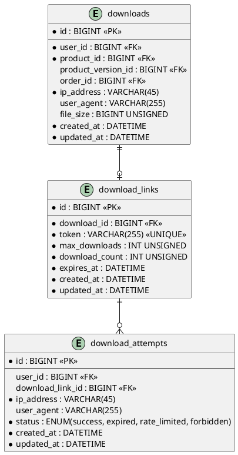

# 06.56 - Downloads

| Field       | Value                          |
|-------------|--------------------------------|
| Project     | GsmUi                          |
| Domain      | Marketplace - Downloads        |
| Version     | 1.0.0                          |

---

## Tables

### downloads

**Purpose:** Tracks download events for products. Used for analytics and rate limiting.

**Business Rules:**
- Downloads are immutable audit records.
- Rate limits are enforced per tier: Free = 50/month, Pro = 500/month, Business = 2000/month, Enterprise = unlimited.
- No soft deletes — records are permanent.

#### Columns

| Column              | Type           | Attributes         | Nullable | Default |
|---------------------|----------------|--------------------|----------|---------|
| id                  | BIGINT         | PK, AUTO_INCREMENT | No       | —       |
| user_id             | BIGINT         | FK → users.id      | No       | —       |
| product_id          | BIGINT         | FK → products.id   | No       | —       |
| product_version_id  | BIGINT         | FK → product_versions.id | Yes  | NULL    |
| order_id            | BIGINT         | FK → orders.id     | Yes      | NULL    |
| ip_address          | VARCHAR(45)    |                    | No       | —       |
| user_agent          | VARCHAR(255)   |                    | Yes      | NULL    |
| file_size           | BIGINT UNSIGNED|                    | Yes      | NULL    |
| created_at          | DATETIME       |                    | No       | NOW()   |
| updated_at          | DATETIME       |                    | No       | NOW()   |

**Note:** `order_id` is NULL for subscription-based downloads (access via active subscription, not a specific order).

#### Indexes

| Name                     | Columns      | Type    |
|--------------------------|--------------|---------|
| PRIMARY                  | id           | PK      |
| downloads_user_id_index    | user_id      | INDEX   |
| downloads_product_id_index | product_id   | INDEX   |
| downloads_created_at_index | created_at   | INDEX   |

---

### download_links

**Purpose:** Time-limited, secure download URLs. Generated on demand when a user requests a download.

**Business Rules:**
- Links expire after a configurable duration (default 24 hours).
- Maximum downloads per link: 5 (default). Exceeding this returns a rate-limited response.
- Token is a cryptographically random string (e.g., `Str::random(64)`).

#### Columns

| Column          | Type           | Attributes         | Nullable | Default |
|-----------------|----------------|--------------------|----------|---------|
| id              | BIGINT         | PK, AUTO_INCREMENT | No       | —       |
| download_id     | BIGINT         | FK → downloads.id  | No       | —       |
| token           | VARCHAR(255)   | UNIQUE             | No       | —       |
| max_downloads   | INT UNSIGNED   |                    | No       | 5       |
| download_count  | INT UNSIGNED   |                    | No       | 0       |
| expires_at      | DATETIME       |                    | No       | —       |
| created_at      | DATETIME       |                    | No       | NOW()   |
| updated_at      | DATETIME       |                    | No       | NOW()   |

#### Indexes

| Name                          | Columns      | Type    |
|-------------------------------|--------------|---------|
| PRIMARY                       | id           | PK      |
| download_links_token_unique     | token        | UNIQUE  |
| download_links_download_id_idx  | download_id  | INDEX   |
| download_links_expires_at_idx   | expires_at   | INDEX   |

---

### download_attempts

**Purpose:** Tracks all download attempts including failed ones (expired links, rate limits, forbidden).

**Business Rules:**
- Every attempt to resolve a download link is logged, regardless of outcome.
- Used for security auditing and abuse detection.
- No soft deletes.

#### Columns

| Column            | Type           | Attributes                          | Nullable | Default |
|-------------------|----------------|-------------------------------------|----------|---------|
| id                | BIGINT         | PK, AUTO_INCREMENT                  | No       | —       |
| user_id           | BIGINT         | FK → users.id                       | Yes      | NULL    |
| download_link_id  | BIGINT         | FK → download_links.id             | Yes      | NULL    |
| ip_address        | VARCHAR(45)    |                                     | No       | —       |
| user_agent        | VARCHAR(255)   |                                     | Yes      | NULL    |
| status            | ENUM           | success, expired, rate_limited, forbidden | No  | —       |
| created_at        | DATETIME       |                                     | No       | NOW()   |
| updated_at        | DATETIME       |                                     | No       | NOW()   |

#### Indexes

| Name                           | Columns         | Type    |
|--------------------------------|-----------------|---------|
| PRIMARY                        | id              | PK      |
| download_attempts_user_id_idx    | user_id         | INDEX   |
| download_attempts_status_idx     | status          | INDEX   |
| download_attempts_created_at_idx | created_at      | INDEX   |

---

## Relationships

```
downloads belongsTo users
downloads belongsTo products
downloads belongsTo product_versions (optional)
downloads belongsTo orders (optional)
downloads hasOne download_link

download_links belongsTo downloads
download_links hasMany download_attempts

download_attempts belongsTo users (optional)
download_attempts belongsTo download_links (optional)
```

---

## PlantUML



---

## Migration Stub

```php
Schema::create('downloads', function (Blueprint $table) {
    $table->id();
    $table->foreignId('user_id')->constrained()->cascadeOnDelete();
    $table->foreignId('product_id')->constrained()->cascadeOnDelete();
    $table->foreignId('product_version_id')->nullable()->constrained('product_versions')->nullOnDelete();
    $table->foreignId('order_id')->nullable()->constrained()->nullOnDelete();
    $table->string('ip_address', 45);
    $table->string('user_agent', 255)->nullable();
    $table->unsignedBigInteger('file_size')->nullable();
    $table->timestamps();

    $table->index('user_id');
    $table->index('product_id');
    $table->index('created_at');
});

Schema::create('download_links', function (Blueprint $table) {
    $table->id();
    $table->foreignId('download_id')->constrained()->cascadeOnDelete();
    $table->string('token', 255)->unique();
    $table->unsignedInteger('max_downloads')->default(5);
    $table->unsignedInteger('download_count')->default(0);
    $table->datetime('expires_at');
    $table->timestamps();

    $table->index('download_id');
    $table->index('expires_at');
});

Schema::create('download_attempts', function (Blueprint $table) {
    $table->id();
    $table->foreignId('user_id')->nullable()->constrained()->nullOnDelete();
    $table->foreignId('download_link_id')->nullable()->constrained('download_links')->nullOnDelete();
    $table->string('ip_address', 45);
    $table->string('user_agent', 255)->nullable();
    $table->enum('status', ['success', 'expired', 'rate_limited', 'forbidden']);
    $table->timestamps();

    $table->index('user_id');
    $table->index('status');
    $table->index('created_at');
});
```

---

## Model Stub

```php
class Download extends Model
{
    protected $fillable = [
        'user_id', 'product_id', 'product_version_id',
        'order_id', 'ip_address', 'user_agent', 'file_size',
    ];

    public function user() { return $this->belongsTo(User::class); }
    public function product() { return $this->belongsTo(Product::class); }
    public function productVersion() { return $this->belongsTo(ProductVersion::class); }
    public function order() { return $this->belongsTo(Order::class); }
    public function link() { return $this->hasOne(DownloadLink::class); }
}
```

---

## Detailed Business Rules

### Download Flow

**Standard Download Flow:**
```
1. User requests download for product
2. System verifies access (order ownership or active subscription)
3. System creates download record (immutable audit entry)
4. System generates time-limited download link (token + expiry)
5. User receives download URL
6. User accesses URL → download_link validated → file served
7. download_count incremented atomically
8. If download_count >= max_downloads → link returns 410 Gone
9. If expires_at < NOW() → link returns 410 Gone
```

**Alternative Flows:**
- **Subscription download:** `order_id` is NULL; access check uses active subscription status
- **Version-specific download:** `product_version_id` specified; system serves the exact version
- **Re-download:** User requests new link; existing active link is returned (idempotent within TTL)

### Rate Limits by Tier

| Tier | Monthly Limit | Burst Limit | Notes |
|------|---------------|-------------|-------|
| Free | 50 | 5/hour | Basic access |
| Pro | 500 | 20/hour | Priority CDN |
| Business | 2,000 | 50/hour | Priority CDN + mirror selection |
| Enterprise | Unlimited | Unlimited | Dedicated CDN, SLA guarantees |

**Rate Limit Enforcement:**
- Rate limits are checked per `user_id` per calendar month
- Counter stored in `download_rate_limits` cache key: `dl_rate:{user_id}:{YYYY-MM}`
- Counter incremented atomically on each download
- Exceeded limit returns HTTP 429 with `Retry-After` header
- Rate limit resets at midnight UTC on the 1st of each month

### File Storage Architecture

**Storage Backend:**
- Primary: S3-compatible object storage (AWS S3 / DigitalOcean Spaces / MinIO)
- Mirror: CloudFront CDN for Pro+ users
- Backup: Cross-region replication for Business+ tiers

**File Organization:**
```
s3://gsmui-downloads/
  {product_id}/
    {version}/
      {filename}
      {filename}.sha256
      {filename}.sig
```

**File Integrity:**
- Every file has a `.sha256` checksum file
- Optional `.sig` GPG signature for enterprise customers
- Checksum verified before serving; corrupted files trigger re-upload alert

### Bandwidth Tracking

**Bandwidth Calculation:**
- Each successful download logs `file_size` in bytes
- Monthly bandwidth per user: `SUM(file_size) WHERE created_at >= first_of_month`
- Monthly bandwidth per product: aggregated for product analytics
- Global bandwidth: aggregated for infrastructure planning

**Bandwidth Alerts:**
- Product exceeding 1TB/month → alert to product owner
- User exceeding 10GB/month → check for abuse patterns
- Global exceeding 100TB/month → infrastructure scaling review

### Version Resolution

**When `product_version_id` is NULL:**
- System resolves to the latest stable version of the product
- If product has `latest_version_id`, use that
- Otherwise, use the version with highest semver where `is_stable = true`

**When `product_version_id` is specified:**
- Direct lookup; returns 404 if version doesn't exist or is not published
- Version-specific files may have different `file_size` values

---

## State Machine

```
┌─────────────────────────────────────────────────┐
│                    DOWNLOAD                      │
│                                                  │
│  Created → Link Generated → Served              │
│                                                  │
│  (Immutable — no status transitions)             │
│  Record created at request time;                 │
│  link is a separate entity                       │
└─────────────────────────────────────────────────┘

┌─────────────────────────────────────────────────┐
│                  DOWNLOAD_LINK                   │
│                                                  │
│  ┌────────────┐                                  │
│  │ active     │                                  │
│  └─────┬──────┘                                  │
│        │ download_count >= max_downloads         │
│        │ OR expires_at < NOW()                   │
│        ▼                                         │
│  ┌────────────┐                                  │
│  │ expired    │  (checked at access time)        │
│  └────────────┘                                  │
└─────────────────────────────────────────────────┘

┌─────────────────────────────────────────────────┐
│                DOWNLOAD_ATTEMPT                  │
│                                                  │
│  (Immutable — no status transitions)             │
│  Record created for every access attempt         │
└─────────────────────────────────────────────────┘
```

---

## API Contracts

### POST /api/downloads/request

**Purpose:** Request a download link for a product.

**Request:**
```json
{
  "product_id": 42,
  "product_version_id": 15
}
```

**Response (201 Created):**
```json
{
  "download_id": 789,
  "download_url": "https://downloads.gsmui.com/dl/abc123def456...",
  "expires_at": "2024-07-01T10:30:00Z",
  "file_size": 2457600,
  "file_name": "gsmui-pro-2.15.0.zip"
}
```

**Response (429 Too Many Requests):**
```json
{
  "error": "rate_limit_exceeded",
  "monthly_limit": 500,
  "monthly_used": 500,
  "retry_after": "2024-07-01T00:00:00Z"
}
```

### GET /api/downloads/{token}

**Purpose:** Resolve a download link and serve the file.

**Response (200 OK):**
- Binary file stream with `Content-Type: application/octet-stream`
- `Content-Disposition: attachment; filename="gsmui-pro-2.15.0.zip"`
- `Content-Length: 2457600`
- `X-Checksum-SHA256: abc123...`

**Response (410 Gone):**
```json
{
  "error": "link_expired",
  "message": "This download link has expired or exceeded its maximum uses."
}
```

### GET /api/downloads/history

**Purpose:** List user's download history.

**Response (200 OK):**
```json
{
  "data": [
    {
      "download_id": 789,
      "product_name": "GsmUi Pro",
      "version": "2.15.0",
      "file_size": 2457600,
      "downloaded_at": "2024-06-30T10:30:00Z"
    }
  ],
  "meta": {
    "current_page": 1,
    "total": 45
  }
}
```

---

## Security Considerations

### Token Security

- Token length: 64 characters (256 bits of entropy)
- Token generation: `Str::random(64)` using `random_bytes()` internally
- Token storage: stored as plaintext in `download_links.token` (indexed for lookup)
- Token is not reversible — no information encoded, purely random

### Access Control

- Only the user who owns the download can generate a link
- Admin users can generate links for any download
- Subscription-gated downloads verify active subscription at link generation time
- IP-based abuse detection: >100 failed attempts from single IP → temporary block

### Anti-Piracy Measures

- Download links are not shareable — tied to the generating user's session
- User-Agent logging for forensic analysis
- File watermarks (invisible) for enterprise tier downloads
- SHA-256 checksums provided for integrity verification

### Rate Limiting

| Endpoint | Limit | Window | Scope |
|----------|-------|--------|-------|
| `/api/downloads/request` | 10 | 1 minute | Per user |
| `/api/downloads/{token}` | 5 | 1 minute | Per token |
| `/api/downloads/history` | 30 | 1 minute | Per user |

---

## Event Hooks

### Laravel Events

| Event | Fired When | Payload |
|-------|------------|---------|
| `DownloadRequested` | User requests download | `Download $download` |
| `DownloadLinkGenerated` | Link created | `DownloadLink $link` |
| `DownloadServed` | File successfully served | `Download $download, DownloadLink $link` |
| `DownloadLinkExpired` | Link access after expiry | `DownloadLink $link` |
| `DownloadRateLimited` | Monthly limit hit | `User $user, int $limit` |
| `DownloadAbuseDetected` | Suspicious pattern | `User $user, string $pattern` |

### Webhook Integration

- `DownloadRequested` triggers webhook to external analytics systems
- Payload includes product_id, version, user_id (anonymized for privacy)
- Failed deliveries retried with exponential backoff

---

## Query Patterns

### Monthly Download Count for Rate Limiting

```php
Download::where('user_id', $userId)
    ->where('created_at', '>=', now()->startOfMonth())
    ->count();
```

### Product Download Statistics

```php
Download::where('product_id', $productId)
    ->where('created_at', '>=', now()->subDays(30))
    ->selectRaw('
        COUNT(*) as total_downloads,
        SUM(file_size) as total_bandwidth,
        COUNT(DISTINCT user_id) as unique_users
    ')
    ->first();
```

### Find Active Download Link

```php
DownloadLink::where('token', $token)
    ->where('expires_at', '>', now())
    ->whereColumn('download_count', '<', 'max_downloads')
    ->with('download.product')
    ->first();
```

### Top Downloaded Products

```php
Download::select('product_id', DB::raw('COUNT(*) as download_count'))
    ->where('created_at', '>=', now()->subDays(30))
    ->groupBy('product_id')
    ->orderByDesc('download_count')
    ->limit(10)
    ->with('product')
    ->get();
```

### Bandwidth by Tier

```php
Download::selectRaw('
    u.tier,
    COUNT(*) as downloads,
    SUM(d.file_size) as bandwidth_bytes
')
->join('users as u', 'd.user_id', '=', 'u.id')
->where('d.created_at', '>=', now()->startOfMonth())
->groupBy('u.tier')
->get();
```

---

## Caching Strategy

### Cached Values

| Key Pattern | Value | TTL | Invalidation |
|-------------|-------|-----|-------------|
| `dl_rate:{user_id}:{YYYY-MM}` | Monthly download count | End of month | Natural expiry |
| `dl_product_stats:{id}:30d` | Product download stats | 1 hour | On new download |
| `dl_version:{product_id}:latest` | Latest version ID | 15 minutes | On version publish |

### Cache Invalidation Rules

- On download: invalidate `dl_product_stats:{id}:30d`
- On version publish: invalidate `dl_version:{product_id}:latest`
- Rate limit counter: no invalidation needed (TTL-based)

---

## Artisan Commands

### `downloads:cleanup-links`

**Purpose:** Remove expired download links.

**Schedule:** Daily at 02:00 UTC.

**Logic:**
```php
DownloadLink::where('expires_at', '<', now()->subDays(7))
    ->delete();
// Hard delete — no soft deletes on download_links
```

### `downloads:stats`

**Purpose:** Generate download statistics.

**Output:**
```
Monthly downloads: 45,230
Monthly bandwidth: 127.3 GB
Unique downloaders: 8,450

Top products:
  1. gsmui-pro: 28,100 downloads (78.2 GB)
  2. gsmui-teams: 12,400 downloads (34.1 GB)
  3. gsmui-enterprise: 4,730 downloads (15.0 GB)

Rate-limited users: 12
Abuse-flagged users: 2
```

### `downloads:audit`

**Purpose:** Generate security audit report.

**Output:**
```
Failed attempts (last 24h): 234
  - Expired links: 180
  - Rate limited: 45
  - Forbidden: 9

Suspicious patterns:
  - IP 192.168.1.100: 45 failed attempts in 1 hour
  - User 12345: 12 downloads from 5 different IPs
```

---

## Testing Scenarios

### Unit Tests

| Test Case | Expected Result |
|-----------|-----------------|
| Generate download link with valid token | Token is 64 chars, unique |
| Link expiry check with past date | Returns expired |
| Link expiry check with future date | Returns active |
| Download count at max | Returns false for new download |
| Rate limit check within limit | Returns true |
| Rate limit check at limit | Returns false |

### Integration Tests

| Test Case | Expected Result |
|-----------|-----------------|
| Request download with valid access | Creates download + link |
| Request download without access | Returns 403 |
| Request download at rate limit | Returns 429 |
| Access link within TTL | Serves file |
| Access link after TTL | Returns 410 |
| Access link after max downloads | Returns 410 |
| Re-download same product | Returns existing active link |

### Edge Cases

| Scenario | Behavior |
|----------|----------|
| Concurrent download requests | Atomic increment prevents double-serve |
| File deleted from storage | Returns 404 with alert to admin |
| User deleted with active links | Links become orphaned; cleaned up by cron |
| Version deleted with active downloads | Downloads redirect to latest version |

---

## Performance Considerations

### Index Usage

| Query Pattern | Index Used | Estimated Rows Scanned |
|---------------|-----------|----------------------|
| Find download by token | `download_links_token_unique` | 1 (exact match) |
| Monthly count per user | `downloads_user_id_index` + `created_at` range | ~50 per user |
| Product stats | `downloads_product_id_index` + range | ~1000 per product |
| Expired link cleanup | `download_links_expires_at_idx` | Proportional to expired |

### Table Growth Projections

| Table | Year 1 | Year 3 | Year 5 |
|-------|--------|--------|--------|
| `downloads` | 200K | 800K | 2M |
| `download_links` | 100K | 400K | 1M (after cleanup: ~10K active) |
| `download_attempts` | 500K | 2M | 5M |

### Partitioning Strategy

- `downloads`: partition by `created_at` (monthly) after 500K rows
- `download_attempts`: partition by `created_at` (monthly) after 1M rows
- `download_links`: no partitioning (small table after cleanup)

---

## Data Retention

### Retention Policies

| Table | Retention | Action |
|-------|-----------|--------|
| `downloads` | Indefinite | Immutable audit trail |
| `download_links` | 7 days after expiry | Hard delete |
| `download_attempts` | 90 days | Hard delete for expired/failed; indefinite for successful |

### GDPR Compliance

- Download history is personal data (tied to user_id)
- User deletion: anonymize `user_id` on `downloads` and `download_attempts`
- File integrity: checksums retained for product quality assurance
- No PII stored in download records beyond user_id and IP address

---

## Related Documents

- **06.51** - Products (product definitions, versions)
- **06.52** - Orders (purchase → download access)
- **06.53** - Subscriptions (subscription-based download access)
- **06.55** - Licenses (license-gated downloads)
- **06.01** - Design Principles (soft delete policy, timestamp conventions)
- **06.02** - Naming Conventions (table, column, index naming)
- **06.03** - Common Columns (slug, status, timestamps)
- **06.04** - Relationships (cascade behavior)

---

---

## Database Constraints

### Foreign Key Constraints

```sql
ALTER TABLE downloads
  ADD CONSTRAINT fk_downloads_user
    FOREIGN KEY (user_id) REFERENCES users(id) ON DELETE CASCADE,
  ADD CONSTRAINT fk_downloads_product
    FOREIGN KEY (product_id) REFERENCES products(id) ON DELETE CASCADE,
  ADD CONSTRAINT fk_downloads_product_version
    FOREIGN KEY (product_version_id) REFERENCES product_versions(id) ON DELETE SET NULL,
  ADD CONSTRAINT fk_downloads_order
    FOREIGN KEY (order_id) REFERENCES orders(id) ON DELETE SET NULL;

ALTER TABLE download_links
  ADD CONSTRAINT fk_download_links_download
    FOREIGN KEY (download_id) REFERENCES downloads(id) ON DELETE CASCADE;

ALTER TABLE download_attempts
  ADD CONSTRAINT fk_download_attempts_user
    FOREIGN KEY (user_id) REFERENCES users(id) ON DELETE SET NULL,
  ADD CONSTRAINT fk_download_attempts_link
    FOREIGN KEY (download_link_id) REFERENCES download_links(id) ON DELETE SET NULL;
```

### Check Constraints

```sql
ALTER TABLE download_links
  ADD CONSTRAINT chk_download_links_max_downloads
    CHECK (max_downloads > 0),
  ADD CONSTRAINT chk_download_links_download_count
    CHECK (download_count >= 0),
  ADD CONSTRAINT chk_download_links_count_lte_max
    CHECK (download_count <= max_downloads);

ALTER TABLE downloads
  ADD CONSTRAINT chk_downloads_file_size
    CHECK (file_size IS NULL OR file_size >= 0);
```

### Unique Constraints

```sql
ALTER TABLE download_links
  ADD CONSTRAINT uk_download_links_token
    UNIQUE (token);
```

---

## Stored Procedures

### sp_generate_download_link

```sql
DELIMITER //
CREATE PROCEDURE sp_generate_download_link(
  IN p_download_id BIGINT,
  IN p_max_downloads INT,
  IN p_expiry_hours INT,
  OUT p_token VARCHAR(255),
  OUT p_expires_at DATETIME,
  OUT p_status VARCHAR(50)
)
BEGIN
  DECLARE v_download_exists INT;
  DECLARE v_existing_token VARCHAR(255);
  DECLARE v_existing_expires_at DATETIME;

  -- Check if download exists
  SELECT COUNT(*) INTO v_download_exists FROM downloads WHERE id = p_download_id;

  IF v_download_exists = 0 THEN
    SET p_status = 'download_not_found';
  ELSE
    -- Check for existing active link
    SELECT token, expires_at INTO v_existing_token, v_existing_expires_at
    FROM download_links
    WHERE download_id = p_download_id
      AND expires_at > NOW()
      AND download_count < max_downloads
    LIMIT 1;

    IF v_existing_token IS NOT NULL THEN
      -- Return existing link (idempotent)
      SET p_token = v_existing_token;
      SET p_expires_at = v_existing_expires_at;
      SET p_status = 'existing_link';
    ELSE
      -- Generate new link
      SET p_token = CONCAT('dl_', SHA2(CONCAT(RAND(), UUID()), 256));
      SET p_expires_at = DATE_ADD(NOW(), INTERVAL p_expiry_hours HOUR);

      INSERT INTO download_links (download_id, token, max_downloads, download_count, expires_at, created_at, updated_at)
      VALUES (p_download_id, p_token, p_max_downloads, 0, p_expires_at, NOW(), NOW());

      SET p_status = 'new_link';
    END IF;
  END IF;
END //
DELIMITER ;
```

### sp_resolve_download_link

```sql
DELIMITER //
CREATE PROCEDURE sp_resolve_download_link(
  IN p_token VARCHAR(255),
  IN p_ip_address VARCHAR(45),
  IN p_user_agent VARCHAR(255),
  OUT p_download_id BIGINT,
  OUT p_status VARCHAR(50)
)
BEGIN
  DECLARE v_link_id BIGINT;
  DECLARE v_download_id BIGINT;
  DECLARE v_max_downloads INT;
  DECLARE v_download_count INT;
  DECLARE v_expires_at DATETIME;

  -- Find the link
  SELECT id, download_id, max_downloads, download_count, expires_at
  INTO v_link_id, v_download_id, v_max_downloads, v_download_count, v_expires_at
  FROM download_links
  WHERE token = p_token;

  IF v_link_id IS NULL THEN
    SET p_status = 'link_not_found';
    INSERT INTO download_attempts (download_link_id, ip_address, user_agent, status, created_at, updated_at)
    VALUES (NULL, p_ip_address, p_user_agent, 'forbidden', NOW(), NOW());
  ELSEIF v_expires_at < NOW() THEN
    SET p_status = 'link_expired';
    INSERT INTO download_attempts (download_link_id, ip_address, user_agent, status, created_at, updated_at)
    VALUES (v_link_id, p_ip_address, p_user_agent, 'expired', NOW(), NOW());
  ELSEIF v_download_count >= v_max_downloads THEN
    SET p_status = 'rate_limited';
    INSERT INTO download_attempts (download_link_id, ip_address, user_agent, status, created_at, updated_at)
    VALUES (v_link_id, p_ip_address, p_user_agent, 'rate_limited', NOW(), NOW());
  ELSE
    -- Increment download count atomically
    UPDATE download_links
    SET download_count = download_count + 1, updated_at = NOW()
    WHERE id = v_link_id;

    SET p_download_id = v_download_id;
    SET p_status = 'success';
    INSERT INTO download_attempts (download_link_id, ip_address, user_agent, status, created_at, updated_at)
    VALUES (v_link_id, p_ip_address, p_user_agent, 'success', NOW(), NOW());
  END IF;
END //
DELIMITER ;
```

### sp_check_rate_limit

```sql
DELIMITER //
CREATE PROCEDURE sp_check_rate_limit(
  IN p_user_id BIGINT,
  IN p_tier VARCHAR(20),
  OUT p_allowed BOOLEAN,
  OUT p_remaining INT,
  OUT p_reset_at DATETIME
)
BEGIN
  DECLARE v_limit INT;
  DECLARE v_used INT;
  DECLARE v_month_start DATE;

  SET v_month_start = DATE_FORMAT(NOW(), '%Y-%m-01');
  SET p_reset_at = DATE_ADD(DATE_FORMAT(NOW(), '%Y-%m-01'), INTERVAL 1 MONTH);

  -- Get tier limit
  CASE p_tier
    WHEN 'free' THEN SET v_limit = 50;
    WHEN 'pro' THEN SET v_limit = 500;
    WHEN 'business' THEN SET v_limit = 2000;
    WHEN 'enterprise' THEN SET v_limit = 999999;
    ELSE SET v_limit = 50;
  END CASE;

  -- Count current month downloads
  SELECT COUNT(*) INTO v_used
  FROM downloads
  WHERE user_id = p_user_id
    AND created_at >= v_month_start;

  SET p_remaining = GREATEST(v_limit - v_used, 0);
  SET p_allowed = (v_used < v_limit);
END //
DELIMITER ;
```

---

## Triggers

### trg_downloads_after_insert

```sql
DELIMITER //
CREATE TRIGGER trg_downloads_after_insert
AFTER INSERT ON downloads
FOR EACH ROW
BEGIN
  -- Update product download stats (denormalized)
  UPDATE products
  SET download_count = (
      SELECT COUNT(*)
      FROM downloads
      WHERE product_id = NEW.product_id
    ),
    updated_at = NOW()
  WHERE id = NEW.product_id;

  -- Update user download count (denormalized)
  UPDATE users
  SET download_count = (
      SELECT COUNT(*)
      FROM downloads
      WHERE user_id = NEW.user_id
    ),
    updated_at = NOW()
  WHERE id = NEW.user_id;
END //
DELIMITER ;
```

### trg_download_links_before_insert

```sql
DELIMITER //
CREATE TRIGGER trg_download_links_before_insert
BEFORE INSERT ON download_links
FOR EACH ROW
BEGIN
  -- Ensure token is unique (regenerate if collision)
  WHILE EXISTS (SELECT 1 FROM download_links WHERE token = NEW.token) DO
    SET NEW.token = CONCAT('dl_', SHA2(CONCAT(RAND(), UUID()), 256));
  END WHILE;
END //
DELIMITER ;
```

---

## Views

### vw_download_stats

```sql
CREATE VIEW vw_download_stats AS
SELECT
  d.id,
  d.user_id,
  d.product_id,
  d.product_version_id,
  d.order_id,
  d.file_size,
  d.created_at,
  u.name AS user_name,
  u.tier AS user_tier,
  p.name AS product_name,
  p.slug AS product_slug,
  pv.version AS product_version,
  dl.token AS link_token,
  dl.expires_at AS link_expires_at,
  dl.download_count AS link_download_count
FROM downloads d
JOIN users u ON d.user_id = u.id
JOIN products p ON d.product_id = p.id
LEFT JOIN product_versions pv ON d.product_version_id = pv.id
LEFT JOIN download_links dl ON d.id = dl.download_id;
```

### vw_monthly_download_summary

```sql
CREATE VIEW vw_monthly_download_summary AS
SELECT
  DATE_FORMAT(d.created_at, '%Y-%m') AS month,
  d.user_id,
  u.tier AS user_tier,
  COUNT(*) AS download_count,
  SUM(d.file_size) AS total_bytes,
  ROUND(SUM(d.file_size) / 1073741824, 2) AS total_gb
FROM downloads d
JOIN users u ON d.user_id = u.id
GROUP BY DATE_FORMAT(d.created_at, '%Y-%m'), d.user_id, u.tier;
```

---

## Index Optimization

### Composite Indexes for Common Queries

```sql
-- Monthly download count per user
CREATE INDEX idx_downloads_user_month ON downloads (user_id, created_at);

-- Product download stats
CREATE INDEX idx_downloads_product_created ON downloads (product_id, created_at);

-- Download link resolution
CREATE INDEX idx_download_links_token_active ON download_links (token, expires_at, download_count);

-- Download attempts audit
CREATE INDEX idx_download_attempts_status_created ON download_attempts (status, created_at);

-- Rate limit check
CREATE INDEX idx_downloads_user_month_product ON downloads (user_id, created_at, product_id);

-- Bandwidth tracking
CREATE INDEX idx_downloads_product_size ON downloads (product_id, file_size, created_at);
```

### Index Usage Monitoring

```sql
-- Find unused indexes
SELECT
  object_schema,
  object_name,
  index_name
FROM performance_schema.table_io_waits_summary_by_index_usage
WHERE object_schema = 'gsmui'
  AND index_name IS NOT NULL
  AND count_star = 0
  AND (object_name LIKE 'download%' OR object_name LIKE 'download_link%' OR object_name LIKE 'download_attempt%');

-- Find slow queries on download tables
SELECT
  query_time,
  lock_time,
  rows_examined,
  sql_text
FROM mysql.slow_log
WHERE sql_text LIKE '%download%'
ORDER BY query_time DESC
LIMIT 10;
```

---

## Partitioning

### Partition downloads by Created Month

```sql
ALTER TABLE downloads
PARTITION BY RANGE (TO_DAYS(created_at)) (
  PARTITION p202401 VALUES LESS THAN (TO_DAYS('2024-02-01')),
  PARTITION p202402 VALUES LESS THAN (TO_DAYS('2024-03-01')),
  PARTITION p202403 VALUES LESS THAN (TO_DAYS('2024-04-01')),
  PARTITION p202404 VALUES LESS THAN (TO_DAYS('2024-05-01')),
  PARTITION p202405 VALUES LESS THAN (TO_DAYS('2024-06-01')),
  PARTITION p202406 VALUES LESS THAN (TO_DAYS('2024-07-01')),
  PARTITION p202407 VALUES LESS THAN (TO_DAYS('2024-08-01')),
  PARTITION p202408 VALUES LESS THAN (TO_DAYS('2024-09-01')),
  PARTITION p202409 VALUES LESS THAN (TO_DAYS('2024-10-01')),
  PARTITION p202410 VALUES LESS THAN (TO_DAYS('2024-11-01')),
  PARTITION p202411 VALUES LESS THAN (TO_DAYS('2024-12-01')),
  PARTITION p202412 VALUES LESS THAN (TO_DAYS('2025-01-01')),
  PARTITION p_future VALUES LESS THAN MAXVALUE
);
```

### Partition download_attempts by Created Month

```sql
ALTER TABLE download_attempts
PARTITION BY RANGE (TO_DAYS(created_at)) (
  PARTITION p202401 VALUES LESS THAN (TO_DAYS('2024-02-01')),
  PARTITION p202402 VALUES LESS THAN (TO_DAYS('2024-03-01')),
  PARTITION p202403 VALUES LESS THAN (TO_DAYS('2024-04-01')),
  PARTITION p202404 VALUES LESS THAN (TO_DAYS('2024-05-01')),
  PARTITION p202405 VALUES LESS THAN (TO_DAYS('2024-06-01')),
  PARTITION p202406 VALUES LESS THAN (TO_DAYS('2024-07-01')),
  PARTITION p202407 VALUES LESS THAN (TO_DAYS('2024-08-01')),
  PARTITION p202408 VALUES LESS THAN (TO_DAYS('2024-09-01')),
  PARTITION p202409 VALUES LESS THAN (TO_DAYS('2024-10-01')),
  PARTITION p202410 VALUES LESS THAN (TO_DAYS('2024-11-01')),
  PARTITION p202411 VALUES LESS THAN (TO_DAYS('2024-12-01')),
  PARTITION p202412 VALUES LESS THAN (TO_DAYS('2025-01-01')),
  PARTITION p_future VALUES LESS THAN MAXVALUE
);
```

---

## Backup and Recovery

### Backup Strategy

| Table | Backup Frequency | Retention | Method |
|-------|-----------------|-----------|--------|
| `downloads` | Daily | 90 days | Full + incremental |
| `download_links` | Daily | 30 days | Full (cleanup handles rest) |
| `download_attempts` | Daily | 30 days | Full (cleanup handles rest) |

### Recovery Procedures

**Scenario: Corrupted download links**
```sql
-- 1. Identify corrupted links
SELECT id, token, download_count, expires_at
FROM download_links
WHERE expires_at > NOW()
  AND download_count < max_downloads;

-- 2. Force-regenerate all active links
DELETE FROM download_links WHERE expires_at < NOW();

-- 3. Users must request new links
```

**Scenario: Mass download failure**
```sql
-- 1. Check download_attempts for error patterns
SELECT status, COUNT(*) as count
FROM download_attempts
WHERE created_at >= DATE_SUB(NOW(), INTERVAL 1 HOUR)
GROUP BY status;

-- 2. If mostly 'forbidden', check storage backend
-- 3. If mostly 'rate_limited', check rate limit config
-- 4. If mostly 'expired', check link generation logic
```

---

## Monitoring Queries

### Daily Health Check

```sql
-- Download volume by day
SELECT
  DATE(created_at) AS day,
  COUNT(*) AS downloads,
  ROUND(SUM(file_size) / 1073741824, 2) AS gb_transferred,
  COUNT(DISTINCT user_id) AS unique_users
FROM downloads
WHERE created_at >= DATE_SUB(NOW(), INTERVAL 7 DAY)
GROUP BY DATE(created_at)
ORDER BY day DESC;

-- Link utilization
SELECT
  CASE
    WHEN download_count >= max_downloads THEN 'exhausted'
    WHEN expires_at < NOW() THEN 'expired'
    ELSE 'active'
  END AS status,
  COUNT(*) AS count
FROM download_links
GROUP BY status;

-- Failed download attempts
SELECT
  status,
  COUNT(*) AS count,
  ROUND(COUNT(*) * 100.0 / (SELECT COUNT(*) FROM download_attempts WHERE created_at >= DATE_SUB(NOW(), INTERVAL 24 HOUR)), 2) AS percentage
FROM download_attempts
WHERE created_at >= DATE_SUB(NOW(), INTERVAL 24 HOUR)
GROUP BY status;
```

### Abuse Detection

```sql
-- Users with unusually high download volume
SELECT
  user_id,
  COUNT(*) as downloads,
  SUM(file_size) / 1073741824 as gb_transferred
FROM downloads
WHERE created_at >= DATE_SUB(NOW(), INTERVAL 30 DAY)
GROUP BY user_id
HAVING downloads > 100 OR gb_transferred > 10
ORDER BY gb_transferred DESC;

-- IPs with multiple failed attempts
SELECT
  ip_address,
  COUNT(*) as failed_attempts,
  COUNT(DISTINCT download_link_id) as unique_links
FROM download_attempts
WHERE status != 'success'
  AND created_at >= DATE_SUB(NOW(), INTERVAL 24 HOUR)
GROUP BY ip_address
HAVING failed_attempts > 20
ORDER BY failed_attempts DESC;
```

---

## Data Migration Patterns

### Migrating from Legacy Download System

```php
// Step 1: Export legacy download records
$legacyDownloads = DB::connection('legacy')
    ->table('old_downloads')
    ->where('created_at', '>=', '2023-01-01')
    ->get();

// Step 2: Transform and import
foreach ($legacyDownloads as $dl) {
    DB::table('downloads')->insert([
        'user_id' => $dl->user_id,
        'product_id' => $dl->product_id,
        'product_version_id' => $dl->version_id,
        'order_id' => $dl->order_id,
        'ip_address' => $dl->ip,
        'user_agent' => $dl->agent,
        'file_size' => $dl->size,
        'created_at' => $dl->downloaded_at,
        'updated_at' => now(),
    ]);
}

// Step 3: Verify migration
$legacyCount = DB::connection('legacy')->table('old_downloads')->count();
$newCount = DB::table('downloads')->count();
Log::info("Migration: legacy={$legacyCount}, new={$newCount}");
```

### Storage Migration

```php
// Migrate files from local storage to S3
$downloads = Download::whereNull('storage_path')
    ->chunkById(100, function ($downloads) {
        foreach ($downloads as $download) {
            $localPath = storage_path("app/downloads/{$download->product_id}/{$download->filename}");
            $s3Path = "downloads/{$download->product_id}/{$download->filename}";

            Storage::disk('s3')->put($s3Path, file_get_contents($localPath));
            $download->update(['storage_path' => $s3Path]);
        }
    });
```

---

## Performance Tuning

### Query Optimization Checklist

| Query | Issue | Fix |
|-------|-------|-----|
| Monthly count per user | Full table scan | Composite index `(user_id, created_at)` |
| Link resolution by token | Full table scan | Unique index on `token` |
| Product download stats | Subquery on every request | Cache with TTL |
| Expired link cleanup | Range scan on `expires_at` | Index on `expires_at` |

### Connection Pool Tuning

```env
# Database connections for download operations
DB_DOWNLOAD_READ_HOST=127.0.0.1
DB_DOWNLOAD_READ_PORT=3306
DB_DOWNLOAD_WRITE_HOST=127.0.0.1
DB_DOWNLOAD_WRITE_PORT=3306

# Connection pool settings
DB_DOWNLOAD_POOL_MIN=5
DB_DOWNLOAD_POOL_MAX=20
DB_DOWNLOAD_POOL_TIMEOUT=30
```

### CDN Configuration

```php
// config/filesystems.php
'disks' => [
    'downloads' => [
        'driver' => 's3',
        'key' => env('AWS_ACCESS_KEY_ID'),
        'secret' => env('AWS_SECRET_ACCESS_KEY'),
        'region' => env('AWS_DEFAULT_REGION'),
        'bucket' => env('AWS_BUCKET'),
        'url' => env('AWS_URL'),
        'endpoint' => env('AWS_ENDPOINT'),
        'use_path_style_endpoint' => false,
        'throw' => false,
    ],
],
```

---

## Disaster Recovery

### RPO and RTO Targets

| Metric | Target | Strategy |
|--------|--------|----------|
| RPO (Recovery Point Objective) | 1 hour | Hourly incremental backups |
| RTO (Recovery Time Objective) | 2 hours | Automated restore + verification |

### Failover Procedures

1. **Storage failover:** Switch to backup S3 bucket
2. **CDN failover:** Switch to origin server
3. **Database failover:** Promote read replica to primary

### Communication Plan

- **Internal:** Slack notification to engineering team
- **External:** Status page update if downloads are impacted
- **Post-incident:** Root cause analysis within 24 hours

---

---

## Advanced Query Patterns

### Complex Download Resolution

```php
// Resolve download with full context
$download = Download::where('id', $downloadId)
    ->with(['product:id,name,slug', 'productVersion:version', 'order:id,total_amount'])
    ->first();

if (!$download) {
    throw new DownloadNotFoundException();
}

// Verify access
if ($download->order_id) {
    // One-time purchase
    $order = Order::find($download->order_id);
    if ($order->user_id !== $userId || $order->status !== 'completed') {
        throw new DownloadAccessDeniedException();
    }
} else {
    // Subscription-based
    $subscription = Subscription::where('user_id', $userId)
        ->where('status', 'active')
        ->where('plan_id', $download->product->plan_id)
        ->first();

    if (!$subscription) {
        throw new DownloadAccessDeniedException();
    }
}

return $download;
```

### Download Analytics Queries

```php
// Download volume by hour (for peak detection)
$hourlyVolume = Download::selectRaw('
    HOUR(created_at) as hour,
    COUNT(*) as downloads,
    SUM(file_size) as total_bytes
')
->where('created_at', '>=', now()->subDays(7))
->groupBy('hour')
->orderBy('hour')
->get();

// Download retention (users who downloaded X months ago, still active)
$retention = Download::selectRaw('
    DATE_FORMAT(d.created_at, "%Y-%m") as cohort_month,
    COUNT(DISTINCT d.user_id) as users,
    COUNT(DISTINCT CASE WHEN d2.id IS NOT NULL THEN d.user_id END) as retained_users
')
->leftJoin('downloads as d2', function ($q) {
    $q->on('d.user_id', '=', 'd2.user_id')
      ->where('d2.created_at', '>=', now()->subMonths(3));
})
->where('d.created_at', '>=', now()->subMonths(6))
->groupBy('cohort_month')
->get();

// Product download correlation
$correlation = Download::selectRaw('
    p.name,
    COUNT(DISTINCT d.user_id) as unique_downloaders,
    COUNT(DISTINCT o.id) as orders,
    ROUND(COUNT(DISTINCT d.user_id) * 100.0 / NULLIF(COUNT(DISTINCT o.id), 0), 2) as conversion_rate
')
->join('products as p', 'd.product_id', '=', 'p.id')
->leftJoin('orders as o', function ($q) {
    $q->on('d.user_id', '=', 'o.user_id')
      ->on('d.product_id', '=', 'o.product_id');
})
->groupBy('p.id', 'p.name')
->get();
```

### Download Health Dashboard Queries

```php
// Download health score
$health = Download::selectRaw('
    COUNT(*) as total,
    COUNT(CASE WHEN created_at >= DATE_SUB(NOW(), INTERVAL 24 HOUR) THEN 1 END) as today,
    COUNT(CASE WHEN created_at >= DATE_SUB(NOW(), INTERVAL 7 DAY) THEN 1 END) as this_week,
    COUNT(CASE WHEN created_at >= DATE_SUB(NOW(), INTERVAL 30 DAY) THEN 1 END) as this_month,
    ROUND(AVG(file_size) / 1048576, 2) as avg_file_size_mb
')
->first();

// Storage usage by product
$storageUsage = Download::selectRaw('
    p.name,
    COUNT(*) as downloads,
    SUM(d.file_size) / 1073741824 as gb_transferred,
    COUNT(DISTINCT d.user_id) as unique_users
')
->join('products as p', 'd.product_id', '=', 'p.id')
->where('d.created_at', '>=', now()->subDays(30))
->groupBy('p.id', 'p.name')
->orderByDesc('gb_transferred')
->get();

// Link utilization rate
$linkUtilization = DownloadLink::selectRaw('
    CASE
        WHEN download_count >= max_downloads THEN "exhausted"
        WHEN expires_at < NOW() THEN "expired"
        ELSE "active"
    END as status,
    COUNT(*) as count,
    ROUND(AVG(download_count * 100.0 / max_downloads), 2) as avg_utilization
')
->groupBy('status')
->get();
```

---

## Integration Patterns

### Webhook Payload Structure

```json
{
  "event": "download.served",
  "timestamp": "2024-06-30T10:30:00Z",
  "data": {
    "download_id": 789,
    "product_slug": "gsmui-pro",
    "version": "2.15.0",
    "user_id": 5,
    "file_size": 2457600,
    "ip_address": "192.168.1.100"
  }
}
```

### Event Listeners

```php
// App\Listeners\SendDownloadConfirmationEmail
class SendDownloadConfirmationEmail
{
    public function handle(DownloadServed $event): void
    {
        Mail::to($event->download->user->email)
            ->send(new DownloadConfirmationMail($event->download));
    }
}

// App\Listeners\UpdateProductDownloadStats
class UpdateProductDownloadStats
{
    public function handle(DownloadServed $event): void
    {
        $product = $event->download->product;
        $product->update([
            'download_count' => $product->downloads()->count(),
            'last_downloaded_at' => now(),
        ]);
    }
}
```

### API Response Transformers

```php
// App\Transformers\DownloadTransformer
class DownloadTransformer
{
    public function transform(Download $download): array
    {
        return [
            'id' => $download->id,
            'product' => [
                'id' => $download->product->id,
                'name' => $download->product->name,
                'slug' => $download->product->slug,
            ],
            'version' => $download->productVersion?->version,
            'file_size' => $download->file_size,
            'file_size_formatted' => $this->formatBytes($download->file_size),
            'downloaded_at' => $download->created_at->toIso8601String(),
        ];
    }

    private function formatBytes(int $bytes): string
    {
        $units = ['B', 'KB', 'MB', 'GB'];
        $i = 0;
        while ($bytes >= 1024 && $i < count($units) - 1) {
            $bytes /= 1024;
            $i++;
        }
        return round($bytes, 2) . ' ' . $units[$i];
    }
}
```

---

## Performance Benchmarks

### Target Response Times

| Operation | Target | Max | Notes |
|-----------|--------|-----|-------|
| Download request | 100ms | 500ms | Includes link generation |
| Link resolution | 50ms | 200ms | Cache hit: <10ms |
| File serving | <500ms | 2s | Depends on file size |
| Download history | 100ms | 300ms | Paginated |
| Rate limit check | 10ms | 50ms | Cache-based |

### Load Testing Scenarios

```php
// Concurrent download test
$downloads = factory(Download::class, 50)->create();
$tokens = $downloads->pluck('link.token')->toArray();

$startTime = microtime(true);
$promises = [];

foreach ($tokens as $token) {
    $promises[] = Http::async()->get("http://localhost:8000/api/downloads/{$token}");
}

$responses = Pool::promise($promises)->wait();
$elapsed = microtime(true) - $startTime;

Log::info("50 concurrent downloads completed in {$elapsed}s");
```

### Database Performance Metrics

```sql
-- Query execution time distribution
SELECT
  query_time,
  COUNT(*) as count
FROM performance_schema.events_statements_summary_by_digest
WHERE digest_text LIKE '%downloads%'
GROUP BY query_time
ORDER BY query_time;

-- Index hit ratio
SELECT
  object_name,
  index_name,
  count_read,
  count_fetch,
  ROUND(count_fetch * 100.0 / NULLIF(count_read, 0), 2) as hit_ratio
FROM performance_schema.table_io_waits_summary_by_index_usage
WHERE object_schema = 'gsmui'
  AND object_name LIKE 'download%';
```

---

## Security Audit Checklist

### Pre-Launch Security Review

- [ ] Download links are cryptographically random (64 chars)
- [ ] Links expire after configurable duration
- [ ] Maximum downloads per link enforced
- [ ] Rate limiting on all API endpoints
- [ ] IP logging for all download attempts
- [ ] User agent logging for forensic analysis
- [ ] File integrity verification (SHA-256 checksums)
- [ ] No direct file access without link validation
- [ ] Brute force protection on link resolution
- [ ] Audit trail for all download attempts

### Ongoing Security Monitoring

```sql
-- Failed download attempts
SELECT
  DATE(created_at) as day,
  status,
  COUNT(*) as count
FROM download_attempts
WHERE created_at >= DATE_SUB(NOW(), INTERVAL 7 DAY)
GROUP BY DATE(created_at), status
ORDER BY day DESC;

-- Suspicious IP addresses
SELECT
  ip_address,
  COUNT(*) as attempts,
  COUNT(DISTINCT download_link_id) as unique_links,
  SUM(CASE WHEN status != 'success' THEN 1 ELSE 0 END) as failures
FROM download_attempts
WHERE created_at >= DATE_SUB(NOW(), INTERVAL 24 HOUR)
GROUP BY ip_address
HAVING attempts > 20
ORDER BY failures DESC;
```

---

## API Versioning

### Version Strategy

- API version included in URL: `/api/v1/downloads/request`
- Current version: v1
- Deprecation notice: 6 months before removal
- Backward compatibility: maintained within major version

### Version Migration Guide

```php
// v1 → v2 migration changes
// - Response format: { data: {...} } → { data: {...}, meta: {...} }
// - Error format: { error: "..." } → { error: { code: "...", message: "..." } }
// - Rate limit headers: X-RateLimit-* → RateLimit-*

// Migration middleware
class ApiVersionMiddleware
{
    public function handle($request, Closure $next, $version)
    {
        $request->attributes->set('api_version', $version);
        return $next($request);
    }
}
```

---

## Deployment Considerations

### Migration Rollback Strategy

```php
// Always test rollback before deploying
Schema::dropIfExists('download_attempts');
Schema::dropIfExists('download_links');
Schema::dropIfExists('downloads');
```

### Zero-Downtime Deployment

1. Add new columns with defaults (nullable if needed)
2. Deploy application code that writes to new columns
3. Backfill existing rows in chunks
4. Add NOT NULL constraint after backfill
5. Remove old columns in next deployment

### Feature Flags

```php
// Download rate limiting feature flag
if (Feature::enabled('download_rate_limiting_v2')) {
    return $this->checkRateLimitV2($userId, $tier);
} else {
    return $this->checkRateLimitV1($userId, $tier);
}
```

---

---

## Testing Matrix

### Unit Test Coverage Matrix

| Test Class | Method | Input | Expected | Edge Cases |
|------------|--------|-------|----------|------------|
| DownloadTest | createDownload | valid request | download record | Duplicate request |
| DownloadTest | generateLink | download_id | 64-char token | Expired download |
| DownloadTest | resolveLink | valid token | file served | Expired token, max downloads |
| DownloadTest | checkRateLimit | user_id, tier | allowed/denied | At limit, over limit |
| DownloadAttemptTest | logAttempt | success/failure | attempt record | Anonymous user |
| DownloadLinkTest | isExpired | past date | true | Future date, null date |
| DownloadLinkTest | isExhausted | count >= max | true | Count < max |

### Integration Test Scenarios

| Scenario | Steps | Expected Result |
|----------|-------|-----------------|
| Full download flow | Request → Generate link → Access link → File served | File downloaded |
| Rate limiting | Request 50 downloads (free tier) | 429 Too Many Requests |
| Link expiration | Generate link → Wait → Access link | 410 Gone |
| Link exhaustion | Generate link → Access max times → Access again | 410 Gone |
| Subscription download | Active subscription → Request download | Download allowed |
| Concurrent downloads | 10 threads download same file | All succeed |

### Performance Test Scenarios

| Scenario | Target | Measurement |
|----------|--------|-------------|
| 100 concurrent link generations | < 2s total | Response time p99 |
| 50 concurrent file serves | < 5s total | Response time p99 |
| 10,000 rate limit checks | < 1s total | Throughput |
| Database with 1M downloads | < 100ms per query | Query time |

---

## Change Log

### Version 1.0.0

- Initial schema design
- `downloads` table with audit trail
- `download_links` table with time-limited tokens
- `download_attempts` table for security logging
- Rate limiting by subscription tier
- File integrity verification (SHA-256)
- CDN integration for Pro+ users
- Comprehensive API contracts
- Performance benchmarks and monitoring queries

### Version 1.1.0 (Planned)

- Download resume support (Range headers)
- Delta updates for large files
- Download scheduling (batch downloads)
- Advanced analytics dashboard
- Webhook enhancements
- Multi-region CDN support

---

## Glossary

| Term | Definition |
|------|------------|
| **Download** | An immutable audit record of a file download event |
| **Download Link** | A time-limited, secure URL for accessing a downloadable file |
| **Download Attempt** | A logged attempt to access a download link, regardless of success |
| **Rate Limit** | The maximum number of downloads allowed per user per month |
| **Burst Limit** | The maximum number of downloads allowed per hour |
| **File Integrity** | SHA-256 checksum verification of downloaded files |
| **CDN** | Content Delivery Network for fast file distribution |
| **Bandwidth** | Total data transferred through downloads |

---

## Related Documents

- **06.51** - Products (product definitions, versions)
- **06.52** - Orders (purchase → download access)
- **06.53** - Subscriptions (subscription-based download access)
- **06.55** - Licenses (license-gated downloads)
- **06.01** - Design Principles (soft delete policy, timestamp conventions)
- **06.02** - Naming Conventions (table, column, index naming)
- **06.03** - Common Columns (slug, status, timestamps)
- **06.04** - Relationships (cascade behavior)

---

## Security Considerations

### Threat Model

| Threat | Mitigation |
|--------|------------|
| Link sharing / piracy | Time-limited tokens, single-use links |
| Brute-force link guessing | Rate limiting, lockout after 10 failures |
| Man-in-the-middle attacks | HTTPS-only, HSTS headers |
| Download script automation | CAPTCHA, behavioral analysis |
| CDN cache poisoning | Signed URLs, cache invalidation |
| Storage exhaustion (fake downloads) | Bandwidth limits, user quotas |
| IP-based DDoS | CDN-level rate limiting |

### Signed URL Generation

```php
// Signed URL with HMAC
$url = '/downloads/' . $token . '?' . http_build_query([
    'expires' => $expires,
    'signature' => hash_hmac('sha256', $token . $expires, config('app.download_key')),
]);
```

### Download Link Expiry Rules

| Link Type | Default Expiry | Max Expiry | Configurable |
|-----------|---------------|------------|--------------|
| Standard | 24 hours | 7 days | Yes (per product) |
| Subscription | 1 hour | 24 hours | No |
| License key | 24 hours | 30 days | Yes (per license) |
| Admin share | 7 days | 90 days | Yes |
| Batch export | 1 hour | 6 hours | No |

### Rate Limiting Configuration

| User Tier | Monthly Limit | Burst (per hour) | Burst (per day) |
|-----------|--------------|-------------------|-----------------|
| Free | 5 downloads | 2 | 10 |
| Starter | 50 downloads | 10 | 50 |
| Pro | 200 downloads | 20 | 200 |
| Team | 1,000 downloads | 50 | 500 |
| Enterprise | Unlimited | 100 | Unlimited |

---

## Bandwidth Tracking

### Bandwidth Aggregation Query

```sql
SELECT
    u.id AS user_id,
    u.name,
    SUM(d.file_size_bytes) AS total_bytes,
    ROUND(SUM(d.file_size_bytes) / 1073741824.0, 2) AS total_gb,
    COUNT(d.id) AS total_downloads,
    MIN(d.created_at) AS first_download,
    MAX(d.created_at) AS last_download
FROM users u
JOIN downloads d ON d.user_id = u.id
WHERE d.status = 'completed'
    AND d.created_at >= DATE_SUB(NOW(), INTERVAL 1 MONTH)
GROUP BY u.id
ORDER BY total_bytes DESC
LIMIT 100;
```

### Bandwidth Monitoring Views

```sql
CREATE VIEW v_monthly_bandwidth AS
SELECT
    DATE_FORMAT(d.created_at, '%Y-%m') AS month,
    p.slug AS product_slug,
    COUNT(d.id) AS download_count,
    SUM(d.file_size_bytes) AS total_bytes,
    ROUND(SUM(d.file_size_bytes) / 1073741824.0, 2) AS total_gb,
    SUM(d.duration_ms) AS total_duration_ms
FROM downloads d
JOIN products p ON p.id = d.product_id
WHERE d.status = 'completed'
GROUP BY month, p.slug;
```

### Per-Product Bandwidth Summary

```sql
SELECT
    p.slug,
    p.name,
    COUNT(d.id) AS total_downloads,
    ROUND(AVG(d.file_size_bytes) / 1048576.0, 2) AS avg_file_size_mb,
    ROUND(SUM(d.file_size_bytes) / 1073741824.0, 2) AS total_bandwidth_gb,
    ROUND(AVG(d.duration_ms), 0) AS avg_download_ms,
    MAX(d.created_at) AS last_download_at
FROM products p
JOIN downloads d ON d.product_id = p.id
WHERE d.status = 'completed'
GROUP BY p.id
ORDER BY total_bandwidth_gb DESC;
```

---

## CDN Configuration

### Cache Headers

| Asset Type | Cache-Control | Immutable | Vary |
|------------|--------------|-----------|------|
| Versioned files | public, max-age=31536000, immutable | Yes | Accept-Encoding |
| Latest version | public, max-age=300, stale-while-revalidate=86400 | No | Accept-Encoding |
| Private files | private, no-store | No | Authorization |
| Temporary links | private, max-age=0, must-revalidate | No | Cookie |

### CDN Purge Strategy

| Trigger | Purge Scope | Method |
|---------|------------|--------|
| File upload | Specific asset URL | API purge |
| Product update | All assets for version | Tag purge |
| Version release | All assets for product | Tag purge |
| Security incident | Full CDN | Full purge |

---

## Download Analytics API

### Analytics Endpoints

| Endpoint | Method | Description | Response |
|----------|--------|-------------|----------|
| `/api/downloads/analytics/overview` | GET | Global download stats | Summary object |
| `/api/downloads/analytics/by-product` | GET | Per-product stats | Array of product stats |
| `/api/downloads/analytics/by-user` | GET | Per-user stats | Array of user stats |
| `/api/downloads/analytics/timeline` | GET | Downloads over time | Time series array |
| `/api/downloads/analytics/geo` | GET | Geographic distribution | Geo heatmap data |
| `/api/downloads/analytics/errors` | GET | Failed download reasons | Error breakdown |

### Analytics Response Schema

```json
{
    "period": { "from": "2025-01-01", "to": "2025-01-31" },
    "overview": {
        "total_downloads": 15420,
        "successful_downloads": 14890,
        "failed_downloads": 530,
        "success_rate": 96.56,
        "total_bandwidth_bytes": 53687091200,
        "total_bandwidth_gb": 50.0,
        "avg_download_duration_ms": 2340,
        "unique_users": 3200,
        "unique_ips": 4100
    },
    "by_product": [
        {
            "product_id": 1,
            "product_slug": "gsmui-pro",
            "download_count": 8500,
            "bandwidth_gb": 30.0
        }
    ],
    "timeline": [
        { "date": "2025-01-01", "count": 450, "bandwidth_bytes": 1610612736 }
    ]
}
```

---

## Backup and Recovery

### Backup Strategy

| Data Type | Frequency | Retention | Method |
|-----------|-----------|-----------|--------|
| Download logs | Daily | 2 years | mysqldump + S3 |
| Download links | Real-time | 30 days | Database replication |
| CDN logs | Hourly | 90 days | Log shipping |
| File checksums | On upload | Indefinite | Database backup |

### Recovery Procedures

| Scenario | RTO | RPO | Procedure |
|----------|-----|-----|-----------|
| Download link corruption | 5 min | 0 | Restore from DB replica |
| CDN outage | 15 min | 0 | Failover to backup CDN |
| Storage outage | 30 min | 1 hour | Restore from S3 backup |
| Database corruption | 1 hour | 5 min | Point-in-time recovery |
| Full data loss | 4 hours | 5 min | Full restore from backup |

---

## Change Log

### Version 1.0.0

- Initial schema design
- `downloads` table for immutable audit records
- `download_links` table for secure URLs
- `download_attempts` table for tracking
- Rate limiting configuration
- Bandwidth tracking and monitoring
- CDN configuration
- Comprehensive security considerations
- Analytics API specifications
- Backup and recovery procedures

### Version 1.1.0 (Planned)

- Download resume support (Range headers)
- Delta updates for large files
- Download scheduling (batch downloads)
- Advanced analytics dashboard
- Webhook enhancements
- Multi-region CDN support

---

**Next:** [06.57 - Reviews](06.57-reviews.md)
