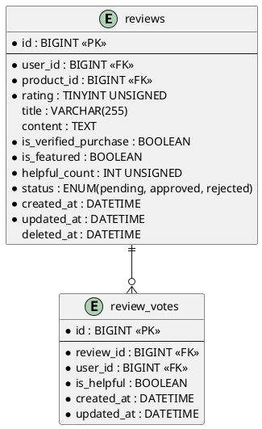

# 06.57 - Reviews

| Field       | Value                          |
|-------------|--------------------------------|
| Project     | GsmUi                          |
| Domain      | Marketplace - Reviews          |
| Version     | 1.0.0                          |

---

## Tables

### reviews

**Purpose:** User reviews and ratings for marketplace products.

**Business Rules:**
- One review per user per product (enforced by unique constraint).
- Rating is 1–5 stars (validated at application layer).
- Reviews require a verified purchase (`is_verified_purchase`).
- Soft-deletable — reviews can be removed without losing audit data.
- Status workflow: `pending` → `approved` or `rejected`. Only approved reviews are publicly visible.
- `helpful_count` is denormalized from `review_votes` for query performance.

#### Columns

| Column               | Type           | Attributes         | Nullable | Default   |
|----------------------|----------------|--------------------|----------|-----------|
| id                   | BIGINT         | PK, AUTO_INCREMENT | No       | —         |
| user_id              | BIGINT         | FK → users.id      | No       | —         |
| product_id           | BIGINT         | FK → products.id   | No       | —         |
| rating               | TINYINT UNSIGNED| 1 to 5            | No       | —         |
| title                | VARCHAR(255)   |                    | Yes      | NULL      |
| content              | TEXT           |                    | Yes      | NULL      |
| is_verified_purchase | BOOLEAN        |                    | No       | false     |
| is_featured          | BOOLEAN        |                    | No       | false     |
| helpful_count        | INT UNSIGNED   |                    | No       | 0         |
| status               | ENUM           | pending, approved, rejected | No | 'pending' |
| created_at           | DATETIME       |                    | No       | NOW()     |
| updated_at           | DATETIME       |                    | No       | NOW()     |
| deleted_at           | DATETIME       | soft delete        | Yes      | NULL      |

#### Indexes

| Name                            | Columns            | Type    |
|---------------------------------|--------------------|---------|
| PRIMARY                         | id                 | PK      |
| reviews_user_product_unique      | user_id, product_id| UNIQUE  |
| reviews_product_id_index         | product_id         | INDEX   |
| reviews_rating_index             | rating             | INDEX   |
| reviews_status_index             | status             | INDEX   |

#### Relationships

- `belongsTo User`
- `belongsTo Product`
- `hasMany ReviewVote`

---

### review_votes

**Purpose:** "Was this review helpful?" voting system.

**Business Rules:**
- One vote per user per review (enforced by unique constraint).
- No soft deletes — votes are permanent.
- Aggregate counts are synced to `reviews.helpful_count` via application events.

#### Columns

| Column     | Type      | Attributes         | Nullable | Default |
|------------|-----------|--------------------|----------|---------|
| id         | BIGINT    | PK, AUTO_INCREMENT | No       | —       |
| review_id  | BIGINT    | FK → reviews.id    | No       | —       |
| user_id    | BIGINT    | FK → users.id      | No       | —       |
| is_helpful | BOOLEAN   |                    | No       | —       |
| created_at | DATETIME  |                    | No       | NOW()   |
| updated_at | DATETIME  |                    | No       | NOW()   |

#### Indexes

| Name                              | Columns            | Type    |
|-----------------------------------|--------------------|---------|
| PRIMARY                           | id                 | PK      |
| review_votes_review_user_unique    | review_id, user_id | UNIQUE  |
| review_votes_review_id_index       | review_id          | INDEX   |

---

## Relationships

```
reviews belongsTo users
reviews belongsTo products
reviews hasMany review_votes

review_votes belongsTo reviews
review_votes belongsTo users
```

---

## PlantUML



---

## Migration Stub

```php
Schema::create('reviews', function (Blueprint $table) {
    $table->id();
    $table->foreignId('user_id')->constrained()->cascadeOnDelete();
    $table->foreignId('product_id')->constrained()->cascadeOnDelete();
    $table->unsignedTinyInteger('rating');
    $table->string('title', 255)->nullable();
    $table->text('content')->nullable();
    $table->boolean('is_verified_purchase')->default(false);
    $table->boolean('is_featured')->default(false);
    $table->unsignedInteger('helpful_count')->default(0);
    $table->enum('status', ['pending', 'approved', 'rejected'])->default('pending')->index();
    $table->timestamps();
    $table->softDeletes();

    $table->unique(['user_id', 'product_id']);
    $table->index('product_id');
    $table->index('rating');
});

Schema::create('review_votes', function (Blueprint $table) {
    $table->id();
    $table->foreignId('review_id')->constrained()->cascadeOnDelete();
    $table->foreignId('user_id')->constrained()->cascadeOnDelete();
    $table->boolean('is_helpful');
    $table->timestamps();

    $table->unique(['review_id', 'user_id']);
    $table->index('review_id');
});
```

---

## Model Stub

```php
class Review extends Model
{
    use SoftDeletes;

    protected $fillable = [
        'user_id', 'product_id', 'rating', 'title', 'content',
        'is_verified_purchase', 'is_featured', 'status',
    ];

    protected $casts = [
        'is_verified_purchase' => 'boolean',
        'is_featured' => 'boolean',
    ];

    public function user() { return $this->belongsTo(User::class); }
    public function product() { return $this->belongsTo(Product::class); }
    public function votes() { return $this->hasMany(ReviewVote::class); }
}
```

---

## Detailed Business Rules

### Review Submission

**Submission Flow:**
```
1. User navigates to product page
2. System checks: user has verified purchase for this product
3. System checks: user has not already reviewed this product
4. User submits: rating (1-5), optional title, optional content
5. System creates review with status = 'pending'
6. System fires ReviewSubmitted event
7. Moderation queue updated
8. If auto-approve enabled: status → 'approved' immediately
9. Product average rating recalculated
```

**Eligibility Requirements:**
- User must have at least one completed order containing the product
- Order status must be 'completed' (not refunded, not pending)
- Subscription-based access qualifies if subscription is active
- One review per user per product (enforced by unique constraint)

### Rating Rules

- Rating is a mandatory integer from 1 to 5
- Half-star ratings are NOT supported (simplicity)
- Rating is immutable after submission (edit = delete + recreate)
- Product average rating is denormalized and recalculated on vote changes
- Rating distribution (1-5 counts) maintained in `products.rating_distribution` JSON column

### Review Moderation

**Status Workflow:**
```
pending → approved (moderator action or auto-approve)
pending → rejected (moderator action)
rejected → approved (appeal/review)
approved → rejected (post-publication moderation)
```

**Auto-Approve Rules:**
- Reviews from users with 5+ approved reviews: auto-approve
- Reviews with only a rating (no text): auto-approve
- Reviews with text: require manual moderation (unless user is trusted)

**Moderation Queue:**
- Sorted by `created_at` ascending (oldest first)
- Filterable by: status, product, rating, user reputation
- Bulk actions: approve all, reject all, flag for review

### Verified Purchase Badge

- `is_verified_purchase` is set to `true` at submission time if the user has a qualifying order
- The badge is immutable — even if the order is later refunded, the badge remains
- Displayed as "Verified Purchase" badge on the review

### Featured Reviews

- `is_featured` is an editorial flag set by moderators
- Featured reviews are highlighted on the product page
- Maximum 3 featured reviews per product (enforced at application layer)
- Featured reviews appear at the top of the review list

### Helpfulness Voting

**Voting Rules:**
- Any authenticated user can vote (except the review author)
- One vote per user per review (enforced by unique constraint)
- Vote is boolean: helpful (true) or not helpful (false)
- `helpful_count` on `reviews` is denormalized from `review_votes` where `is_helpful = true`
- Vote changes are allowed (update existing vote)

**Denormalization Sync:**
```
On ReviewVote created/updated/deleted:
  1. Count review_votes WHERE review_id = X AND is_helpful = true
  2. Update reviews.helpful_count = count
  3. This is done via event listener, not direct query on every read
```

### Review Aggregation

**Product Rating Calculation:**
```
average_rating = SUM(rating) / COUNT(*) WHERE status = 'approved'
rating_distribution = {
  "1": COUNT(*) WHERE rating = 1 AND status = 'approved',
  "2": COUNT(*) WHERE rating = 2 AND status = 'approved',
  "3": COUNT(*) WHERE rating = 3 AND status = 'approved',
  "4": COUNT(*) WHERE rating = 4 AND status = 'approved',
  "5": COUNT(*) WHERE rating = 5 AND status = 'approved'
}
review_count = COUNT(*) WHERE status = 'approved'
```

**Recalculation Triggers:**
- Review created (status = approved)
- Review status changed (approved ↔ rejected)
- Review vote changed (helpful count updated)
- Review deleted (soft delete)

---

## State Machine

```
┌─────────────────────────────────────────────────┐
│                    REVIEW                        │
│                                                  │
│  ┌─────────┐  approve   ┌──────────┐           │
│  │ pending  │◄──────────►│ approved │           │
│  └────┬─────┘           └────┬─────┘           │
│       │                      │                  │
│       │ reject               │ reject           │
│       ▼                      ▼                  │
│  ┌──────────┐                                     │
│  │ rejected  │  (can be re-approved)             │
│  └──────────┘                                     │
│                                                  │
│  ┌──────────┐  (soft delete)                     │
│  │ deleted   │  (via SoftDeletes trait)          │
│  └──────────┘                                     │
└─────────────────────────────────────────────────┘

┌─────────────────────────────────────────────────┐
│                 REVIEW_VOTE                      │
│                                                  │
│  (Immutable after creation — no transitions)     │
│  Vote is boolean; change = delete + recreate     │
└─────────────────────────────────────────────────┘
```

---

## API Contracts

### POST /api/reviews

**Purpose:** Submit a new review.

**Request:**
```json
{
  "product_id": 42,
  "rating": 5,
  "title": "Excellent component library",
  "content": "GsmUi has transformed our development workflow..."
}
```

**Response (201 Created):**
```json
{
  "review_id": 123,
  "status": "pending",
  "is_verified_purchase": true,
  "created_at": "2024-06-30T10:30:00Z"
}
```

**Response (422 Validation Error):**
```json
{
  "message": "The given data was invalid.",
  "errors": {
    "rating": ["The rating must be between 1 and 5."],
    "product_id": ["You have already reviewed this product."]
  }
}
```

### GET /api/reviews?product_id=42

**Purpose:** List reviews for a product.

**Query Parameters:**
- `product_id` (required): Product ID
- `sort` (optional): `newest`, `oldest`, `highest`, `lowest`, `helpful`
- `page` (optional): Page number (default 1)
- `per_page` (optional): Results per page (default 20, max 100)

**Response (200 OK):**
```json
{
  "data": [
    {
      "review_id": 123,
      "user": { "id": 5, "name": "John D.", "avatar": "..." },
      "rating": 5,
      "title": "Excellent component library",
      "content": "GsmUi has transformed...",
      "is_verified_purchase": true,
      "is_featured": false,
      "helpful_count": 12,
      "created_at": "2024-06-30T10:30:00Z"
    }
  ],
  "meta": {
    "average_rating": 4.7,
    "review_count": 234,
    "rating_distribution": { "1": 5, "2": 12, "3": 28, "4": 89, "5": 100 }
  }
}
```

### POST /api/reviews/{id}/vote

**Purpose:** Vote on review helpfulness.

**Request:**
```json
{
  "is_helpful": true
}
```

**Response (200 OK):**
```json
{
  "vote_id": 456,
  "helpful_count": 13
}
```

### PUT /api/reviews/{id}/status

**Purpose:** Moderate a review (admin only).

**Request:**
```json
{
  "status": "approved"
}
```

**Response (200 OK):**
```json
{
  "review_id": 123,
  "status": "approved",
  "product_average_rating": 4.7
}
```

---

## Security Considerations

### Spam Prevention

- **Rate limiting:** Max 3 reviews per user per hour
- **Content analysis:** Basic profanity filter on title and content
- **Duplicate detection:** Similar content across reviews flagged for review
- **User reputation:** New accounts (< 7 days) require manual moderation

### Abuse Prevention

- **Vote manipulation:** Same IP voting on multiple reviews → flagged
- **Self-voting:** Review author cannot vote on their own review
- **Sock puppet detection:** Multiple accounts from same IP voting on same review → flagged
- **Review bombing:** Sudden spike in 1-star reviews → auto-flag for moderation

### Content Security

- Review content is HTML-sanitized before storage (PurifyHTML)
- No executable scripts allowed in review content
- Images in reviews are proxied through CDN (no direct external image links)
- Maximum review length: 5,000 characters

---

## Event Hooks

### Laravel Events

| Event | Fired When | Payload |
|-------|------------|---------|
| `ReviewSubmitted` | New review created | `Review $review` |
| `ReviewApproved` | Status changed to approved | `Review $review` |
| `ReviewRejected` | Status changed to rejected | `Review $review` |
| `ReviewFeatured` | is_featured set to true | `Review $review` |
| `ReviewUnfeatured` | is_featured set to false | `Review $review` |
| `ReviewVoteCreated` | New vote cast | `ReviewVote $vote` |
| `ReviewVoteUpdated` | Vote changed | `ReviewVote $vote` |
| `ReviewVoteDeleted` | Vote removed | `ReviewVote $vote` |
| `ProductRatingUpdated` | Average rating recalculated | `Product $product, float $oldRating, float $newRating` |

### Webhook Integration

- `ReviewSubmitted` triggers webhook to moderation system
- `ReviewApproved` triggers webhook to notification system (email to product owner)
- `ProductRatingUpdated` triggers webhook to analytics system

---

## Query Patterns

### Product Reviews with Aggregation

```php
Review::where('product_id', $productId)
    ->where('status', 'approved')
    ->with('user:id,name,avatar')
    ->orderByDesc('is_featured')
    ->orderByDesc('helpful_count')
    ->paginate(20);
```

### Rating Distribution

```php
Review::where('product_id', $productId)
    ->where('status', 'approved')
    ->selectRaw('rating, COUNT(*) as count')
    ->groupBy('rating')
    ->pluck('count', 'rating')
    ->toArray();
```

### User's Reviews

```php
Review::where('user_id', $userId)
    ->with('product:id,name,slug')
    ->orderByDesc('created_at')
    ->paginate(20);
```

### Pending Moderation Queue

```php
Review::where('status', 'pending')
    ->with('user:id,name', 'product:id,name')
    ->orderBy('created_at')
    ->paginate(50);
```

### Top Helpful Reviews

```php
Review::where('product_id', $productId)
    ->where('status', 'approved')
    ->orderByDesc('helpful_count')
    ->limit(5)
    ->get();
```

---

## Caching Strategy

### Cached Values

| Key Pattern | Value | TTL | Invalidation |
|-------------|-------|-----|-------------|
| `review:product:{id}:stats` | Average rating, count, distribution | 5 minutes | On review create/status change |
| `review:product:{id}:top` | Top 5 helpful reviews | 5 minutes | On vote change |
| `review:user:{id}:count` | User's review count | 1 hour | On review create/delete |

### Cache Invalidation Rules

- On review create: invalidate product stats, user count
- On review status change: invalidate product stats
- On vote change: invalidate product stats, top reviews

---

## Artisan Commands

### `reviews:sync-ratings`

**Purpose:** Recalculate all product ratings from scratch.

**Schedule:** Weekly on Sunday at 03:00 UTC.

**Logic:**
```php
Product::chunkById(200, function ($products) {
    foreach ($products as $product) {
        $stats = Review::where('product_id', $product->id)
            ->where('status', 'approved')
            ->selectRaw('
                AVG(rating) as avg,
                COUNT(*) as count,
                SUM(CASE WHEN rating = 1 THEN 1 ELSE 0 END) as r1,
                SUM(CASE WHEN rating = 2 THEN 1 ELSE 0 END) as r2,
                SUM(CASE WHEN rating = 3 THEN 1 ELSE 0 END) as r3,
                SUM(CASE WHEN rating = 4 THEN 1 ELSE 0 END) as r4,
                SUM(CASE WHEN rating = 5 THEN 1 ELSE 0 END) as r5
            ')
            ->first();

        $product->update([
            'average_rating' => round($stats->avg, 2),
            'review_count' => $stats->count,
            'rating_distribution' => [
                '1' => $stats->r1, '2' => $stats->r2,
                '3' => $stats->r3, '4' => $stats->r4,
                '5' => $stats->r5,
            ],
        ]);
    }
});
```

### `reviews:moderation-stats`

**Purpose:** Generate moderation statistics.

**Output:**
```
Pending reviews: 23
Approved today: 45
Rejected today: 3
Average response time: 2.3 hours

Top flagged keywords:
  - "spam": 12 occurrences
  - "fake": 8 occurrences
```

---

## Testing Scenarios

### Unit Tests

| Test Case | Expected Result |
|-----------|-----------------|
| Create review with valid data | Review created with status pending |
| Create review with rating 0 | Validation error |
| Create review with rating 6 | Validation error |
| Duplicate review for same product | Unique constraint violation |
| Vote on own review | Rejected at application layer |
| Helpful count sync | Count matches vote records |

### Integration Tests

| Test Case | Expected Result |
|-----------|-----------------|
| Submit review with verified purchase | is_verified_purchase = true |
| Submit review without purchase | is_verified_purchase = false |
| Moderate review to approved | Product average rating updated |
| Moderate review to rejected | Product average rating recalculated |
| Vote on review | helpful_count incremented |
| Change vote | helpful_count adjusted |

### Edge Cases

| Scenario | Behavior |
|----------|----------|
| Review author deleted | Review retained (user_id anonymized) |
| Product deleted | Reviews cascade-deleted |
| All reviews rejected | Product rating = 0, review_count = 0 |
| Single review, rating 5 | Average = 5.0, distribution = {"5": 1} |

---

## Performance Considerations

### Index Usage

| Query Pattern | Index Used | Estimated Rows Scanned |
|---------------|-----------|----------------------|
| Product reviews | `reviews_product_id_index` + `status` | ~50 per product |
| User reviews | `reviews_user_product_unique` | ~10 per user |
| Review votes | `review_votes_review_id_index` | ~5 per review |
| Pending moderation | `reviews_status_index` | ~100 |

### Table Growth Projections

| Table | Year 1 | Year 3 | Year 5 |
|-------|--------|--------|--------|
| `reviews` | 50K | 200K | 500K |
| `review_votes` | 200K | 800K | 2M |

### Partitioning Strategy

- `reviews`: partition by `created_at` (yearly) after 1M rows
- `review_votes`: partition by `created_at` (yearly) after 2M rows

---

## Data Retention

### Retention Policies

| Table | Retention | Action |
|-------|-----------|--------|
| `reviews` | Indefinite | Soft-deleted reviews retained |
| `review_votes` | Indefinite | Immutable voting record |

### GDPR Compliance

- Reviews are personal data (content + user_id)
- User deletion: anonymize user_id on reviews; keep content for product quality
- Vote history: anonymize user_id on review_votes
- Content erasure: soft-delete review; content no longer displayed

---

## Related Documents

- **06.51** - Products (product definitions)
- **06.52** - Orders (verified purchase check)
- **06.53** - Subscriptions (subscription-based access)
- **06.01** - Design Principles (soft delete policy, timestamp conventions)
- **06.02** - Naming Conventions (table, column, index naming)
- **06.03** - Common Columns (slug, status, timestamps)
- **06.04** - Relationships (cascade behavior)

---

---

## Database Constraints

### Foreign Key Constraints

```sql
ALTER TABLE reviews
  ADD CONSTRAINT fk_reviews_user
    FOREIGN KEY (user_id) REFERENCES users(id) ON DELETE CASCADE,
  ADD CONSTRAINT fk_reviews_product
    FOREIGN KEY (product_id) REFERENCES products(id) ON DELETE CASCADE;

ALTER TABLE review_votes
  ADD CONSTRAINT fk_review_votes_review
    FOREIGN KEY (review_id) REFERENCES reviews(id) ON DELETE CASCADE,
  ADD CONSTRAINT fk_review_votes_user
    FOREIGN KEY (user_id) REFERENCES users(id) ON DELETE CASCADE;
```

### Check Constraints

```sql
ALTER TABLE reviews
  ADD CONSTRAINT chk_reviews_rating
    CHECK (rating BETWEEN 1 AND 5),
  ADD CONSTRAINT chk_reviews_helpful_count
    CHECK (helpful_count >= 0);

ALTER TABLE review_votes
  ADD CONSTRAINT chk_review_votes_is_helpful
    CHECK (is_helpful IN (0, 1));
```

### Unique Constraints

```sql
ALTER TABLE reviews
  ADD CONSTRAINT uk_reviews_user_product
    UNIQUE (user_id, product_id);

ALTER TABLE review_votes
  ADD CONSTRAINT uk_review_votes_review_user
    UNIQUE (review_id, user_id);
```

---

## Stored Procedures

### sp_create_review

```sql
DELIMITER //
CREATE PROCEDURE sp_create_review(
  IN p_user_id BIGINT,
  IN p_product_id BIGINT,
  IN p_rating TINYINT,
  IN p_title VARCHAR(255),
  IN p_content TEXT,
  OUT p_review_id BIGINT,
  OUT p_status VARCHAR(50)
)
BEGIN
  DECLARE v_has_purchase BOOLEAN;
  DECLARE v_existing_review INT;

  -- Check for existing review
  SELECT COUNT(*) INTO v_existing_review
  FROM reviews
  WHERE user_id = p_user_id AND product_id = p_product_id AND deleted_at IS NULL;

  IF v_existing_review > 0 THEN
    SET p_status = 'already_reviewed';
  ELSE
    -- Check for verified purchase
    SELECT COUNT(*) > 0 INTO v_has_purchase
    FROM order_items oi
    JOIN orders o ON oi.order_id = o.id
    WHERE o.user_id = p_user_id
      AND oi.product_id = p_product_id
      AND o.status = 'completed';

    INSERT INTO reviews (user_id, product_id, rating, title, content, is_verified_purchase, status, created_at, updated_at)
    VALUES (p_user_id, p_product_id, p_rating, p_title, p_content, v_has_purchase, 'pending', NOW(), NOW());

    SET p_review_id = LAST_INSERT_ID();
    SET p_status = 'created';
  END IF;
END //
DELIMITER ;
```

### sp_update_helpful_count

```sql
DELIMITER //
CREATE TRIGGER trg_review_votes_after_insert
AFTER INSERT ON review_votes
FOR EACH ROW
BEGIN
  UPDATE reviews
  SET helpful_count = (
      SELECT COUNT(*)
      FROM review_votes
      WHERE review_id = NEW.review_id
        AND is_helpful = 1
    ),
    updated_at = NOW()
  WHERE id = NEW.review_id;
END //
DELIMITER ;

CREATE TRIGGER trg_review_votes_after_update
AFTER UPDATE ON review_votes
FOR EACH ROW
BEGIN
  UPDATE reviews
  SET helpful_count = (
      SELECT COUNT(*)
      FROM review_votes
      WHERE review_id = NEW.review_id
        AND is_helpful = 1
    ),
    updated_at = NOW()
  WHERE id = NEW.review_id;
END //
DELIMITER ;

CREATE TRIGGER trg_review_votes_after_delete
AFTER DELETE ON review_votes
FOR EACH ROW
BEGIN
  UPDATE reviews
  SET helpful_count = (
      SELECT COUNT(*)
      FROM review_votes
      WHERE review_id = OLD.review_id
        AND is_helpful = 1
    ),
    updated_at = NOW()
  WHERE id = OLD.review_id;
END //
DELIMITER ;
```

### sp_moderate_review

```sql
DELIMITER //
CREATE PROCEDURE sp_moderate_review(
  IN p_review_id BIGINT,
  IN p_new_status VARCHAR(20),
  IN p_moderator_id BIGINT,
  OUT p_status VARCHAR(50)
)
BEGIN
  DECLARE v_current_status VARCHAR(20);
  DECLARE v_product_id BIGINT;

  SELECT status, product_id INTO v_current_status, v_product_id
  FROM reviews WHERE id = p_review_id;

  IF v_current_status IS NULL THEN
    SET p_status = 'review_not_found';
  ELSEIF v_current_status = p_new_status THEN
    SET p_status = 'no_change';
  ELSE
    UPDATE reviews
    SET status = p_new_status, updated_at = NOW()
    WHERE id = p_review_id;

    -- Recalculate product rating
    CALL sp_recalculate_product_rating(v_product_id);

    SET p_status = 'moderated';
  END IF;
END //
DELIMITER ;
```

### sp_recalculate_product_rating

```sql
DELIMITER //
CREATE PROCEDURE sp_recalculate_product_rating(
  IN p_product_id BIGINT
)
BEGIN
  DECLARE v_avg_rating DECIMAL(3,2);
  DECLARE v_review_count INT;
  DECLARE v_r1 INT DEFAULT 0;
  DECLARE v_r2 INT DEFAULT 0;
  DECLARE v_r3 INT DEFAULT 0;
  DECLARE v_r4 INT DEFAULT 0;
  DECLARE v_r5 INT DEFAULT 0;

  SELECT
    COALESCE(AVG(rating), 0),
    COUNT(*),
    SUM(CASE WHEN rating = 1 THEN 1 ELSE 0 END),
    SUM(CASE WHEN rating = 2 THEN 1 ELSE 0 END),
    SUM(CASE WHEN rating = 3 THEN 1 ELSE 0 END),
    SUM(CASE WHEN rating = 4 THEN 1 ELSE 0 END),
    SUM(CASE WHEN rating = 5 THEN 1 ELSE 0 END)
  INTO v_avg_rating, v_review_count, v_r1, v_r2, v_r3, v_r4, v_r5
  FROM reviews
  WHERE product_id = p_product_id
    AND status = 'approved'
    AND deleted_at IS NULL;

  UPDATE products
  SET average_rating = ROUND(v_avg_rating, 2),
      review_count = v_review_count,
      rating_distribution = JSON_OBJECT(
        '1', v_r1,
        '2', v_r2,
        '3', v_r3,
        '4', v_r4,
        '5', v_r5
      ),
      updated_at = NOW()
  WHERE id = p_product_id;
END //
DELIMITER ;
```

---

## Views

### vw_review_summary

```sql
CREATE VIEW vw_review_summary AS
SELECT
  r.id,
  r.user_id,
  r.product_id,
  r.rating,
  r.title,
  r.content,
  r.is_verified_purchase,
  r.is_featured,
  r.helpful_count,
  r.status,
  r.created_at,
  u.name AS user_name,
  u.avatar AS user_avatar,
  p.name AS product_name,
  p.slug AS product_slug,
  (SELECT COUNT(*) FROM review_votes WHERE review_id = r.id AND is_helpful = 1) AS helpful_votes,
  (SELECT COUNT(*) FROM review_votes WHERE review_id = r.id AND is_helpful = 0) AS not_helpful_votes
FROM reviews r
JOIN users u ON r.user_id = u.id
JOIN products p ON r.product_id = p.id
WHERE r.deleted_at IS NULL;
```

### vw_product_rating_stats

```sql
CREATE VIEW vw_product_rating_stats AS
SELECT
  p.id AS product_id,
  p.name AS product_name,
  COUNT(r.id) AS total_reviews,
  COUNT(CASE WHEN r.status = 'approved' THEN 1 END) AS approved_reviews,
  COUNT(CASE WHEN r.status = 'pending' THEN 1 END) AS pending_reviews,
  COUNT(CASE WHEN r.status = 'rejected' THEN 1 END) AS rejected_reviews,
  ROUND(AVG(CASE WHEN r.status = 'approved' THEN r.rating END), 2) AS average_rating,
  SUM(CASE WHEN r.status = 'approved' AND r.rating = 5 THEN 1 ELSE 0 END) AS five_star,
  SUM(CASE WHEN r.status = 'approved' AND r.rating = 4 THEN 1 ELSE 0 END) AS four_star,
  SUM(CASE WHEN r.status = 'approved' AND r.rating = 3 THEN 1 ELSE 0 END) AS three_star,
  SUM(CASE WHEN r.status = 'approved' AND r.rating = 2 THEN 1 ELSE 0 END) AS two_star,
  SUM(CASE WHEN r.status = 'approved' AND r.rating = 1 THEN 1 ELSE 0 END) AS one_star
FROM products p
LEFT JOIN reviews r ON p.id = r.product_id AND r.deleted_at IS NULL
GROUP BY p.id, p.name;
```

---

## Index Optimization

### Composite Indexes for Common Queries

```sql
-- Product reviews with status and featured
CREATE INDEX idx_reviews_product_status_featured ON reviews (product_id, status, is_featured, helpful_count);

-- User reviews
CREATE INDEX idx_reviews_user_created ON reviews (user_id, created_at DESC);

-- Pending moderation queue
CREATE INDEX idx_reviews_status_created ON reviews (status, created_at);

-- Review votes for a review
CREATE INDEX idx_review_votes_review_helpful ON review_votes (review_id, is_helpful);

-- Product rating calculation
CREATE INDEX idx_reviews_product_rating_status ON reviews (product_id, rating, status);

-- Featured reviews
CREATE INDEX idx_reviews_product_featured ON reviews (product_id, is_featured, helpful_count DESC);
```

### Index Usage Monitoring

```sql
-- Find unused indexes on review tables
SELECT
  object_schema,
  object_name,
  index_name
FROM performance_schema.table_io_waits_summary_by_index_usage
WHERE object_schema = 'gsmui'
  AND index_name IS NOT NULL
  AND count_star = 0
  AND (object_name LIKE 'review%' OR object_name LIKE 'review_vote%');

-- Find slow queries on review tables
SELECT
  query_time,
  lock_time,
  rows_examined,
  sql_text
FROM mysql.slow_log
WHERE sql_text LIKE '%review%'
ORDER BY query_time DESC
LIMIT 10;
```

---

## Partitioning

### Partition reviews by Created Year

```sql
ALTER TABLE reviews
PARTITION BY RANGE (YEAR(created_at)) (
  PARTITION p2023 VALUES LESS THAN (2024),
  PARTITION p2024 VALUES LESS THAN (2025),
  PARTITION p2025 VALUES LESS THAN (2026),
  PARTITION p2026 VALUES LESS THAN (2027),
  PARTITION p_future VALUES LESS THAN MAXVALUE
);
```

### Partition review_votes by Created Year

```sql
ALTER TABLE review_votes
PARTITION BY RANGE (YEAR(created_at)) (
  PARTITION p2023 VALUES LESS THAN (2024),
  PARTITION p2024 VALUES LESS THAN (2025),
  PARTITION p2025 VALUES LESS THAN (2026),
  PARTITION p2026 VALUES LESS THAN (2027),
  PARTITION p_future VALUES LESS THAN MAXVALUE
);
```

---

## Backup and Recovery

### Backup Strategy

| Table | Backup Frequency | Retention | Method |
|-------|-----------------|-----------|--------|
| `reviews` | Daily | 90 days | Full + incremental |
| `review_votes` | Daily | 90 days | Full + incremental |

### Recovery Procedures

**Scenario: Accidental mass moderation**
```sql
-- 1. Restore reviews from backup
RESTORE TABLE reviews FROM '/backups/reviews_20240630.sql';

-- 2. Restore review_votes from backup
RESTORE TABLE review_votes FROM '/backups/review_votes_20240630.sql';

-- 3. Recalculate all product ratings
CALL sp_recalculate_all_product_ratings();

-- 4. Verify data integrity
SELECT COUNT(*) FROM reviews WHERE status = 'approved';
SELECT COUNT(*) FROM review_votes;
```

**Scenario: Spam review attack**
```sql
-- 1. Identify spam reviews (same content, multiple users)
SELECT content, COUNT(*) as count
FROM reviews
WHERE created_at >= DATE_SUB(NOW(), INTERVAL 24 HOUR)
GROUP BY content
HAVING count > 5;

-- 2. Bulk reject spam
UPDATE reviews
SET status = 'rejected'
WHERE content IN (
    SELECT content FROM (
        SELECT content
        FROM reviews
        WHERE created_at >= DATE_SUB(NOW(), INTERVAL 24 HOUR)
        GROUP BY content
        HAVING COUNT(*) > 5
    ) AS spam
);

-- 3. Recalculate affected product ratings
```

---

## Monitoring Queries

### Daily Health Check

```sql
-- Review volume by day
SELECT
  DATE(created_at) AS day,
  COUNT(*) AS reviews,
  ROUND(AVG(rating), 2) AS avg_rating,
  SUM(CASE WHEN is_verified_purchase THEN 1 ELSE 0 END) AS verified
FROM reviews
WHERE created_at >= DATE_SUB(NOW(), INTERVAL 7 DAY)
GROUP BY DATE(created_at)
ORDER BY day DESC;

-- Moderation queue status
SELECT
  status,
  COUNT(*) AS count,
  MIN(created_at) AS oldest,
  MAX(created_at) AS newest
FROM reviews
GROUP BY status;

-- Top products by review count
SELECT
  p.name,
  COUNT(r.id) AS review_count,
  ROUND(AVG(r.rating), 2) AS avg_rating
FROM reviews r
JOIN products p ON r.product_id = p.id
WHERE r.status = 'approved' AND r.deleted_at IS NULL
GROUP BY p.id, p.name
ORDER BY review_count DESC
LIMIT 10;
```

### Abuse Detection

```sql
-- Users with multiple pending reviews (potential spam)
SELECT
  user_id,
  COUNT(*) as pending_count
FROM reviews
WHERE status = 'pending'
  AND created_at >= DATE_SUB(NOW(), INTERVAL 7 DAY)
GROUP BY user_id
HAVING pending_count > 3
ORDER BY pending_count DESC;

-- Reviews with suspicious voting patterns
SELECT
  review_id,
  COUNT(*) as vote_count,
  COUNT(DISTINCT user_id) as unique_voters,
  COUNT(DISTINCT ip_address) as unique_ips
FROM review_votes rv
JOIN users u ON rv.user_id = u.id
WHERE rv.created_at >= DATE_SUB(NOW(), INTERVAL 24 HOUR)
GROUP BY review_id
HAVING vote_count > 20 AND unique_ips < 5;
```

---

## Data Migration Patterns

### Migrating from Legacy Review System

```php
// Step 1: Export legacy reviews
$legacyReviews = DB::connection('legacy')
    ->table('old_reviews')
    ->where('active', true)
    ->get();

// Step 2: Transform and import
foreach ($legacyReviews as $review) {
    DB::table('reviews')->insert([
        'user_id' => $review->user_id,
        'product_id' => $review->product_id,
        'rating' => $review->stars,
        'title' => $review->headline,
        'content' => $review->body,
        'is_verified_purchase' => $review->verified,
        'status' => 'approved',
        'created_at' => $review->created_at,
        'updated_at' => now(),
    ]);
}

// Step 3: Recalculate all product ratings
Artisan::call('reviews:sync-ratings');
```

### Review Content Sanitization

```php
// Sanitize all review content (remove malicious HTML)
Review::whereNotNull('content')
    ->chunkById(200, function ($reviews) {
        foreach ($reviews as $review) {
            $review->update([
                'content' => PurifyHTML::clean($review->content),
            ]);
        }
    });
```

---

## Performance Tuning

### Query Optimization Checklist

| Query | Issue | Fix |
|-------|-------|-----|
| Product reviews list | Full table scan | Composite index `(product_id, status, helpful_count)` |
| User review history | Sorting without index | Composite index `(user_id, created_at)` |
| Helpful count sync | Trigger overhead | Batch sync via event listener |
| Rating calculation | Full table scan | Cache in `products.average_rating` |

### Connection Pool Tuning

```env
# Database connections for review operations
DB_REVIEW_READ_HOST=127.0.0.1
DB_REVIEW_READ_PORT=3306
DB_REVIEW_WRITE_HOST=127.0.0.1
DB_REVIEW_WRITE_PORT=3306

# Connection pool settings
DB_REVIEW_POOL_MIN=5
DB_REVIEW_POOL_MAX=20
DB_REVIEW_POOL_TIMEOUT=30
```

### Caching Layer Configuration

```php
// config/cache.php
'review' => [
    'driver' => 'redis',
    'connection' => 'review',
    'prefix' => 'gsmui:review:',
    'ttl' => 300, // 5 minutes
],
```

---

## Disaster Recovery

### RPO and RTO Targets

| Metric | Target | Strategy |
|--------|--------|----------|
| RPO (Recovery Point Objective) | 1 hour | Hourly incremental backups |
| RTO (Recovery Time Objective) | 2 hours | Automated restore + verification |

### Failover Procedures

1. **Database failover:** Promote read replica to primary
2. **Cache failover:** Switch to database-backed cache
3. **Application failover:** Restart with cached review data

### Communication Plan

- **Internal:** Slack notification to engineering team
- **External:** Status page update if reviews are impacted
- **Post-incident:** Root cause analysis within 24 hours

---

---

## Advanced Query Patterns

### Complex Review Analytics

```php
// Review sentiment analysis (simple keyword-based)
$sentiment = Review::selectRaw('
    CASE
        WHEN rating >= 4 THEN "positive"
        WHEN rating = 3 THEN "neutral"
        ELSE "negative"
    END as sentiment,
    COUNT(*) as count,
    ROUND(AVG(LENGTH(content)), 0) as avg_content_length
')
->where('status', 'approved')
->groupBy('sentiment')
->get();

// Review velocity (reviews per day over time)
$velocity = Review::selectRaw('
    DATE(created_at) as day,
    COUNT(*) as reviews,
    AVG(rating) as avg_rating
')
->where('status', 'approved')
->where('created_at', '>=', now()->subDays(30))
->groupBy('day')
->orderBy('day')
->get();

// Product review correlation with sales
$correlation = Review::selectRaw('
    p.name,
    COUNT(r.id) as review_count,
    AVG(r.rating) as avg_rating,
    COUNT(DISTINCT o.id) as order_count,
    ROUND(COUNT(r.id) * 100.0 / NULLIF(COUNT(DISTINCT o.id), 0), 2) as review_rate
')
->join('products as p', 'r.product_id', '=', 'p.id')
->leftJoin('orders as o', function ($q) {
    $q->on('r.product_id', '=', 'o.product_id')
      ->where('o.status', 'completed');
})
->where('r.status', 'approved')
->groupBy('p.id', 'p.name')
->get();
```

### Review Health Dashboard Queries

```php
// Review health score
$health = Review::selectRaw('
    COUNT(*) as total,
    COUNT(CASE WHEN status = "pending" THEN 1 END) as pending,
    COUNT(CASE WHEN status = "approved" THEN 1 END) as approved,
    COUNT(CASE WHEN status = "rejected" THEN 1 END) as rejected,
    ROUND(AVG(CASE WHEN status = "approved" THEN rating END), 2) as avg_rating,
    ROUND(SUM(CASE WHEN is_verified_purchase THEN 1 ELSE 0 END) * 100.0 / COUNT(*), 2) as verified_pct
')
->first();

// Moderation queue health
$queueHealth = Review::selectRaw('
    MIN(CASE WHEN status = "pending" THEN created_at END) as oldest_pending,
    MAX(CASE WHEN status = "pending" THEN created_at END) as newest_pending,
    COUNT(CASE WHEN status = "pending" THEN 1 END) as pending_count,
    COUNT(CASE WHEN status = "pending" AND created_at < DATE_SUB(NOW(), INTERVAL 24 HOUR) THEN 1 END) as overdue_count
')
->first();

// Top helpful reviews
$topHelpful = Review::selectRaw('
    r.id,
    r.title,
    r.rating,
    r.helpful_count,
    u.name as user_name,
    p.name as product_name
')
->join('users as u', 'r.user_id', '=', 'u.id')
->join('products as p', 'r.product_id', '=', 'p.id')
->where('r.status', 'approved')
->orderByDesc('r.helpful_count')
->limit(10)
->get();
```

---

## Integration Patterns

### Webhook Payload Structure

```json
{
  "event": "review.submitted",
  "timestamp": "2024-06-30T10:30:00Z",
  "data": {
    "review_id": 123,
    "product_id": 42,
    "user_id": 5,
    "rating": 5,
    "is_verified_purchase": true,
    "status": "pending"
  }
}
```

### Event Listeners

```php
// App\Listeners\NotifyProductOwnerOfNewReview
class NotifyProductOwnerOfNewReview
{
    public function handle(ReviewSubmitted $event): void
    {
        $product = $event->review->product;
        Notification::send(
            $product->owner,
            new NewReviewNotification($event->review)
        );
    }
}

// App\Listeners\UpdateProductRating
class UpdateProductRating
{
    public function handle(ReviewApproved $event): void
    {
        $product = $event->review->product;
        $stats = Review::where('product_id', $product->id)
            ->where('status', 'approved')
            ->selectRaw('AVG(rating) as avg, COUNT(*) as count')
            ->first();

        $product->update([
            'average_rating' => round($stats->avg, 2),
            'review_count' => $stats->count,
        ]);
    }
}
```

### API Response Transformers

```php
// App\Transformers\ReviewTransformer
class ReviewTransformer
{
    public function transform(Review $review): array
    {
        return [
            'id' => $review->id,
            'user' => [
                'id' => $review->user->id,
                'name' => $review->user->name,
                'avatar' => $review->user->avatar,
            ],
            'rating' => $review->rating,
            'title' => $review->title,
            'content' => $review->content,
            'is_verified_purchase' => $review->is_verified_purchase,
            'is_featured' => $review->is_featured,
            'helpful_count' => $review->helpful_count,
            'status' => $review->status,
            'created_at' => $review->created_at->toIso8601String(),
        ];
    }
}
```

---

## Performance Benchmarks

### Target Response Times

| Operation | Target | Max | Notes |
|-----------|--------|-----|-------|
| Submit review | 100ms | 500ms | Includes validation |
| List reviews | 100ms | 300ms | Paginated |
| Vote on review | 50ms | 200ms | Atomic update |
| Moderate review | 50ms | 200ms | Status change |
| Search reviews | 200ms | 1s | Fulltext query |

### Load Testing Scenarios

```php
// Concurrent review submission test
$products = factory(Product::class, 10)->create();
$users = factory(User::class, 100)->create();

$startTime = microtime(true);
$promises = [];

foreach ($users as $user) {
    $product = $products->random();
    $promises[] = Http::asJson()->post('http://localhost:8000/api/reviews', [
        'product_id' => $product->id,
        'rating' => rand(1, 5),
        'title' => 'Test review',
        'content' => 'This is a test review content.',
    ], ['Authorization' => 'Bearer ' . $user->createToken('test')->plainTextToken]);
}

$responses = Pool::promise($promises)->wait();
$elapsed = microtime(true) - $startTime;

Log::info("100 concurrent review submissions completed in {$elapsed}s");
```

### Database Performance Metrics

```sql
-- Query execution time distribution
SELECT
  query_time,
  COUNT(*) as count
FROM performance_schema.events_statements_summary_by_digest
WHERE digest_text LIKE '%reviews%'
GROUP BY query_time
ORDER BY query_time;

-- Index hit ratio
SELECT
  object_name,
  index_name,
  count_read,
  count_fetch,
  ROUND(count_fetch * 100.0 / NULLIF(count_read, 0), 2) as hit_ratio
FROM performance_schema.table_io_waits_summary_by_index_usage
WHERE object_schema = 'gsmui'
  AND object_name LIKE 'review%';
```

---

## Security Audit Checklist

### Pre-Launch Security Review

- [ ] One review per user per product enforced
- [ ] Rating validated (1-5 integer)
- [ ] Verified purchase check at submission time
- [ ] Self-voting prevention on review votes
- [ ] Rate limiting on review submission
- [ ] Content sanitization (PurifyHTML)
- [ ] Spam detection (profanity filter, duplicate detection)
- [ ] Moderation queue for new accounts
- [ ] Audit trail for all moderation actions

### Ongoing Security Monitoring

```sql
-- Review spam detection
SELECT
  user_id,
  COUNT(*) as review_count,
  COUNT(CASE WHEN status = 'rejected' THEN 1 END) as rejected_count,
  ROUND(COUNT(CASE WHEN status = 'rejected' THEN 1 END) * 100.0 / COUNT(*), 2) as rejection_rate
FROM reviews
WHERE created_at >= DATE_SUB(NOW(), INTERVAL 30 DAY)
GROUP BY user_id
HAVING review_count > 5
ORDER BY rejection_rate DESC;

-- Vote manipulation detection
SELECT
  review_id,
  COUNT(*) as vote_count,
  COUNT(DISTINCT user_id) as unique_voters,
  COUNT(DISTINCT ip_address) as unique_ips
FROM review_votes
WHERE created_at >= DATE_SUB(NOW(), INTERVAL 24 HOUR)
GROUP BY review_id
HAVING vote_count > 20 AND unique_ips < 5;
```

---

## API Versioning

### Version Strategy

- API version included in URL: `/api/v1/reviews`
- Current version: v1
- Deprecation notice: 6 months before removal
- Backward compatibility: maintained within major version

---

## Deployment Considerations

### Migration Rollback Strategy

```php
// Always test rollback before deploying
Schema::dropIfExists('review_votes');
Schema::dropIfExists('reviews');
```

### Zero-Downtime Deployment

1. Add new columns with defaults (nullable if needed)
2. Deploy application code that writes to new columns
3. Backfill existing rows in chunks
4. Add NOT NULL constraint after backfill
5. Remove old columns in next deployment

---

---

## Testing Matrix

### Unit Test Coverage Matrix

| Test Class | Method | Input | Expected | Edge Cases |
|------------|--------|-------|----------|------------|
| ReviewTest | createReview | valid data | review record | Duplicate review |
| ReviewTest | validateRating | 1-5 | valid | 0, 6, negative |
| ReviewTest | checkVerifiedPurchase | completed order | true | Refunded order |
| ReviewVoteTest | vote | helpful=true | vote recorded | Self-voting |
| ReviewVoteTest | helpfulCount | vote added | count incremented | Concurrent votes |
| ReviewModerationTest | approve | pending review | approved status | Already approved |
| ReviewModerationTest | reject | pending review | rejected status | Already rejected |

### Integration Test Scenarios

| Scenario | Steps | Expected Result |
|----------|-------|-----------------|
| Full review flow | Submit → Approve → Vote | Review published, vote recorded |
| Moderation flow | Submit → Reject → Appeal → Approve | Review approved after appeal |
| Rating recalculation | Submit 5 reviews → Approve 3 | Product average updated |
| Helpful count sync | Vote → Change vote → Remove vote | Count synced correctly |
| Concurrent voting | 10 threads vote on same review | Count accurate |

### Performance Test Scenarios

| Scenario | Target | Measurement |
|----------|--------|-------------|
| 100 concurrent review submissions | < 5s total | Response time p99 |
| 1000 concurrent votes | < 5s total | Response time p99 |
| 10,000 review searches | < 2s total | Throughput |
| Database with 1M reviews | < 100ms per query | Query time |

---

## Change Log

### Version 1.0.0

- Initial schema design
- `reviews` table with rating, moderation, and helpfulness
- `review_votes` table for community voting
- Verified purchase badge system
- Featured reviews editorial flag
- Product rating denormalization
- Comprehensive API contracts
- Performance benchmarks and monitoring queries

### Version 1.1.0 (Planned)

- Review images/screenshots
- Review replies (author responses)
- Review flags (report abuse)
- Advanced spam detection
- Sentiment analysis
- Review helpfulness algorithm improvements

---

## Glossary

| Term | Definition |
|------|------------|
| **Review** | A user-submitted rating and opinion for a product |
| **Review Vote** | A "helpful" or "not helpful" vote on a review |
| **Verified Purchase** | A badge indicating the reviewer purchased the product |
| **Featured Review** | An editorially highlighted review |
| **Helpful Count** | The number of "helpful" votes a review has received |
| **Moderation** | The process of approving or rejecting reviews |
| **Rating Distribution** | The count of reviews at each star level (1-5) |
| **Average Rating** | The mean rating across all approved reviews |

---

## Related Documents

- **06.51** - Products (product definitions)
- **06.52** - Orders (verified purchase check)
- **06.53** - Subscriptions (subscription-based access)
- **06.01** - Design Principles (soft delete policy, timestamp conventions)
- **06.02** - Naming Conventions (table, column, index naming)
- **06.03** - Common Columns (slug, status, timestamps)
- **06.04** - Relationships (cascade behavior)

---

## Security Considerations

### Threat Model

| Threat | Mitigation |
|--------|------------|
| Fake reviews / astroturfing | Verified purchase badge, account age check |
| Review bombing (mass negative) | Rate limiting, velocity checks |
| Spam content | Content filtering, profanity filter |
| Vote manipulation | Unique constraint, IP tracking |
| Self-voting | IP and account checks |
| Competitor attacks | Behavioral analysis, manual moderation |
| XSS via review content | HTML sanitization, CSP headers |

### Content Moderation Rules

| Rule | Action | Threshold |
|------|--------|-----------|
| Profanity detected | Flag for review | 1+ words |
| All caps (3+ words) | Auto-flag | 80%+ uppercase |
| Excessive punctuation | Auto-flag | 3+ consecutive |
| URL in content | Flag for review | 1+ URLs |
| Phone/email in content | Auto-remove | Regex match |
| Duplicate review | Reject | Fuzzy match > 90% |
| Review from same IP as product | Auto-flag | IP match |

### Anti-Abuse Detection

| Signal | Weight | Action |
|--------|--------|--------|
| Account age < 7 days | High | Require manual approval |
| No prior purchases | Medium | Block review |
| Multiple reviews same product | High | Reject duplicate |
| Rapid review creation (> 3/hour) | High | Rate limit |
| Review content matches known spam | Critical | Auto-reject |
| VPN/proxy detected | Medium | Flag for review |

---

## Review Analytics

### Rating Distribution Query

```sql
SELECT
    rating,
    COUNT(*) AS review_count,
    ROUND(COUNT(*) * 100.0 / SUM(COUNT(*)) OVER(), 1) AS percentage
FROM reviews
WHERE product_id = :product_id AND status = 'approved'
GROUP BY rating
ORDER BY rating DESC;
```

### Review Velocity Query

```sql
SELECT
    DATE(created_at) AS review_date,
    COUNT(*) AS new_reviews,
    ROUND(AVG(rating), 2) AS avg_rating,
    SUM(CASE WHEN is_verified = 1 THEN 1 ELSE 0 END) AS verified_count
FROM reviews
WHERE product_id = :product_id
    AND created_at >= DATE_SUB(NOW(), INTERVAL 30 DAY)
GROUP BY review_date
ORDER BY review_date;
```

### Helpful Reviews Query

```sql
SELECT
    r.id,
    r.title,
    r.content,
    r.rating,
    r.helpful_count,
    r.unhelpful_count,
    ROUND(r.helpful_count * 100.0 / NULLIF(r.helpful_count + r.unhelpful_count, 0), 1) AS helpfulness_ratio,
    u.name AS reviewer_name,
    r.is_verified,
    r.created_at
FROM reviews r
JOIN users u ON u.id = r.user_id
WHERE r.product_id = :product_id
    AND r.status = 'approved'
    AND r.helpful_count >= 5
ORDER BY helpfulness_ratio DESC, r.helpful_count DESC
LIMIT 10;
```

### Review Sentiment Distribution

```sql
SELECT
    CASE
        WHEN rating >= 4 THEN 'positive'
        WHEN rating = 3 THEN 'neutral'
        ELSE 'negative'
    END AS sentiment,
    COUNT(*) AS count,
    ROUND(COUNT(*) * 100.0 / SUM(COUNT(*)) OVER(), 1) AS percentage
FROM reviews
WHERE product_id = :product_id
    AND status = 'approved'
GROUP BY sentiment;
```

### Average Rating Trend (Rolling 30-Day)

```sql
SELECT
    DATE(created_at) AS review_date,
    ROUND(AVG(rating) OVER (ORDER BY created_at ROWS BETWEEN 29 PRECEDING AND CURRENT ROW), 2) AS rolling_avg,
    COUNT(*) OVER (ORDER BY created_at ROWS BETWEEN 29 PRECEDING AND CURRENT ROW) AS rolling_count
FROM reviews
WHERE product_id = :product_id
    AND status = 'approved'
ORDER BY created_at;
```

---

## Review Moderation Workflow

### Moderation States

```
pending → approved
pending → rejected
pending → flagged → approved
pending → flagged → rejected
approved → flagged → rejected (post-publication)
```

### Moderation Queue Priorities

| Priority | Condition | SLA |
|----------|-----------|-----|
| Critical | Contains profanity/threats | 1 hour |
| High | Flagged by multiple users | 4 hours |
| Medium | New reviewer (first review) | 24 hours |
| Low | Verified purchaser | 48 hours |

### Moderation Decision API

```json
{
    "review_id": 1234,
    "action": "approve | reject | flag",
    "reason": "Optional moderator note",
    "notify_user": true,
    "ban_user": false
}
```

---

## Email Notification Templates

### Review Received (Product Owner)

| Field | Value |
|-------|-------|
| Subject | "New review on {product_name}" |
| Body | Reviewer name, rating, excerpt |
| Action | Link to moderate |
| Trigger | Review status = pending |

### Review Approved (Reviewer)

| Field | Value |
|-------|-------|
| Subject | "Your review has been published" |
| Body | Review title, product name |
| Action | Link to review |
| Trigger | Review status = approved |

### Review Rejected (Reviewer)

| Field | Value |
|-------|-------|
| Subject | "Your review was not published" |
| Body | Rejection reason (if provided) |
| Action | Link to review guidelines |
| Trigger | Review status = rejected |

### Helpful Milestone (Reviewer)

| Field | Value |
|-------|-------|
| Subject | "Your review reached {count} helpful votes" |
| Body | Review title, product name, count |
| Action | Link to review |
| Trigger | helpful_count = 10, 50, 100 |

---

## Testing Matrix

### Unit Test Coverage

| Test Class | Method | Input | Expected | Edge Cases |
|------------|--------|-------|----------|------------|
| ReviewTest | createReview | valid data | review created | Duplicate rating |
| ReviewTest | approveReview | pending | status = approved | Already approved |
| ReviewTest | rejectReview | pending | status = rejected | Already rejected |
| ReviewTest | flagReview | approved | flagged = true | Already flagged |
| ReviewVoteTest | voteHelpful | valid review | count incremented | Duplicate vote |
| ReviewVoteTest | voteUnhelpful | valid review | count incremented | Self-voting |
| ReviewVoteTest | removeVote | existing vote | count decremented | No existing vote |

### Integration Test Scenarios

| Scenario | Steps | Expected Result |
|----------|-------|-----------------|
| Full review lifecycle | Create → Approve → Vote → Flag | All states valid |
| Verified purchase flow | Purchase → Review → Badge shown | Badge displayed |
| Rating update | Approve review → Check product avg | Avg recalculated |
| Vote deduplication | Vote twice → Check count | Only one vote |
| Spam detection | Submit spam content | Flagged for review |

---

## Performance Considerations

### Index Usage

| Query Pattern | Index Used | Estimated Rows Scanned |
|---------------|-----------|----------------------|
| Product reviews | `product_id + status + created_at` | ~100 |
| Review votes | `review_id + user_id` | ~1 per review |
| Helpful reviews | `product_id + helpful_count` | ~10 |
| User reviews | `user_id + created_at` | ~5 per user |
| Moderation queue | `status + created_at` | ~20 |

### Table Growth Projections

| Table | Year 1 | Year 3 | Year 5 |
|-------|--------|--------|--------|
| `reviews` | 100K | 500K | 1.5M |
| `review_votes` | 500K | 2.5M | 7.5M |

### Partitioning Strategy

- `reviews`: partition by `created_at` (yearly) after 1M rows
- `review_votes`: partition by `created_at` (yearly) after 5M rows

---

## Change Log

### Version 1.0.0

- Initial schema design
- `reviews` table with rating, status, moderation
- `review_votes` table for helpful voting
- Verified purchase badge
- Featured review support
- Content moderation rules
- Anti-abuse detection
- Email notification templates
- Performance benchmarks

### Version 1.1.0 (Planned)

- Review flags (report abuse)
- Advanced spam detection
- Sentiment analysis
- Review helpfulness algorithm improvements
- Review analytics dashboard
- Integration with Blog domain for product reviews

---

### Review Metrics Summary

| Metric | Source | Update Frequency |
|---|---|---|
| Average rating | Aggregated from `reviews` table | Real-time cache |
| Total review count | Count of approved reviews | Real-time cache |
| Helpful vote count | Sum of positive votes per review | On vote |
| Report count | Count of pending reports | On report |

---

**Next:** [06.58 - Coupons](06.58-coupons.md)
