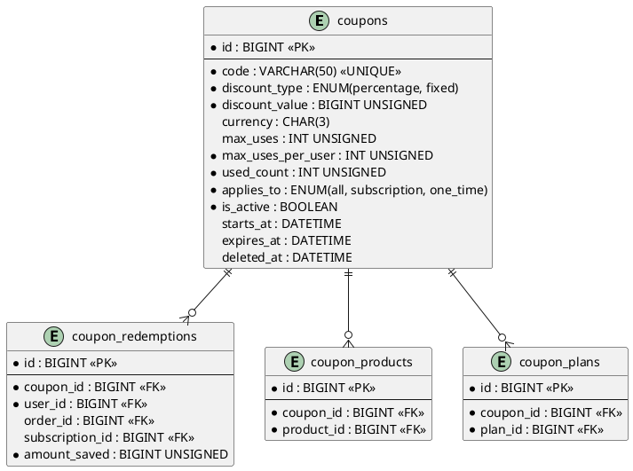

# 06.58 - Coupons

| Field       | Value                          |
|-------------|--------------------------------|
| Project     | GsmUi                          |
| Domain      | Marketplace - Coupons          |
| Version     | 1.0.0                          |

---

## Tables

### coupons

**Purpose:** Discount coupons for marketplace purchases and subscriptions.

**Business Rules:**
- Code is unique and case-insensitive (stored uppercase).
- Discount types: `percentage` (integer 1–100) or `fixed` (amount in minor units, e.g. cents).
- `currency` required for `fixed`, null for `percentage`.
- Usage limits: `max_uses` (global cap, null = unlimited), `max_uses_per_user` (default 1).
- `used_count` denormalized from `coupon_redemptions` for fast checks.
- Soft-deletable — deletion preserves redemption history.

#### Columns

| Column              | Type              | Attributes         | Nullable | Default     |
|---------------------|-------------------|--------------------|----------|-------------|
| id                  | BIGINT            | PK, AUTO_INCREMENT | No       | —           |
| code                | VARCHAR(50)       | UNIQUE             | No       | —           |
| description         | TEXT              |                    | Yes      | NULL        |
| discount_type       | ENUM              | percentage, fixed  | No       | —           |
| discount_value      | BIGINT UNSIGNED   |                    | No       | —           |
| currency            | CHAR(3)           | null for percentage| Yes      | NULL        |
| max_uses            | INT UNSIGNED      | null = unlimited   | Yes      | NULL        |
| max_uses_per_user   | INT UNSIGNED      |                    | No       | 1           |
| used_count          | INT UNSIGNED      |                    | No       | 0           |
| min_order_amount    | BIGINT UNSIGNED   | minor units        | Yes      | NULL        |
| applies_to          | ENUM              | all, subscription, one_time | No | 'all'     |
| is_active           | BOOLEAN           |                    | No       | true        |
| starts_at           | DATETIME          |                    | Yes      | NULL        |
| expires_at          | DATETIME          |                    | Yes      | NULL        |
| created_at          | DATETIME          |                    | No       | NOW()       |
| updated_at          | DATETIME          |                    | No       | NOW()       |
| deleted_at          | DATETIME          | soft delete        | Yes      | NULL        |

#### Indexes

| Name                     | Columns   | Type    |
|--------------------------|-----------|---------|
| PRIMARY                  | id        | PK      |
| coupons_code_unique      | code      | UNIQUE  |
| coupons_is_active_index  | is_active | INDEX   |
| coupons_expires_at_index | expires_at| INDEX   |

---

### coupon_redemptions

**Purpose:** Tracks coupon usage per user per order/subscription.

**Business Rules:**
- Records monetary amount saved at time of redemption.
- Either `order_id` or `subscription_id` is set, never both.
- Unique constraint prevents duplicate redemptions for same coupon + user + order.

#### Columns

| Column           | Type           | Attributes         | Nullable | Default |
|------------------|----------------|--------------------|----------|---------|
| id               | BIGINT         | PK, AUTO_INCREMENT | No       | —       |
| coupon_id        | BIGINT         | FK → coupons.id    | No       | —       |
| user_id          | BIGINT         | FK → users.id      | No       | —       |
| order_id         | BIGINT         | FK → orders.id     | Yes      | NULL    |
| subscription_id  | BIGINT         | FK → subscriptions.id | Yes   | NULL    |
| amount_saved     | BIGINT UNSIGNED| minor units        | No       | —       |
| created_at       | DATETIME       |                    | No       | NOW()   |
| updated_at       | DATETIME       |                    | No       | NOW()   |

#### Indexes

| Name                                       | Columns                    | Type    |
|--------------------------------------------|----------------------------|---------|
| PRIMARY                                    | id                         | PK      |
| coupon_redemptions_coupon_id_index          | coupon_id                  | INDEX   |
| coupon_redemptions_user_id_index            | user_id                    | INDEX   |
| coupon_redemptions_coupon_user_order_unique | coupon_id, user_id, order_id | UNIQUE |

---

### coupon_products / coupon_plans (pivot tables)

**Purpose:** Restricts coupon applicability to specific products or plans. Empty table = coupon applies to all.

**coupon_products columns:** id, coupon_id (FK coupons), product_id (FK products), created_at, updated_at.
**coupon_plans columns:** id, coupon_id (FK coupons), plan_id (FK plans), created_at, updated_at.

**Indexes:** PK + UNIQUE(coupon_id, product_id) / UNIQUE(coupon_id, plan_id).

---

## Relationships

```
coupons hasMany coupon_redemptions, coupon_products, coupon_plans
coupon_redemptions belongsTo coupons, users, orders (opt), subscriptions (opt)
coupon_products belongsTo coupons, products
coupon_plans belongsTo coupons, plans
```

---

## PlantUML



---

## Migration Stub

```php
Schema::create('coupons', function (Blueprint $table) {
    $table->id();
    $table->string('code', 50)->unique();
    $table->text('description')->nullable();
    $table->enum('discount_type', ['percentage', 'fixed']);
    $table->unsignedBigInteger('discount_value');
    $table->char('currency', 3)->nullable();
    $table->unsignedInteger('max_uses')->nullable();
    $table->unsignedInteger('max_uses_per_user')->default(1);
    $table->unsignedInteger('used_count')->default(0);
    $table->unsignedBigInteger('min_order_amount')->nullable();
    $table->enum('applies_to', ['all', 'subscription', 'one_time'])->default('all');
    $table->boolean('is_active')->default(true)->index();
    $table->datetime('starts_at')->nullable();
    $table->datetime('expires_at')->nullable()->index();
    $table->timestamps();
    $table->softDeletes();
});

Schema::create('coupon_redemptions', function (Blueprint $table) {
    $table->id();
    $table->foreignId('coupon_id')->constrained()->cascadeOnDelete();
    $table->foreignId('user_id')->constrained()->cascadeOnDelete();
    $table->foreignId('order_id')->nullable()->constrained()->nullOnDelete();
    $table->foreignId('subscription_id')->nullable()->constrained('subscriptions')->nullOnDelete();
    $table->unsignedBigInteger('amount_saved');
    $table->timestamps();
    $table->unique(['coupon_id', 'user_id', 'order_id']);
    $table->index('coupon_id');
    $table->index('user_id');
});

Schema::create('coupon_products', function (Blueprint $table) {
    $table->id();
    $table->foreignId('coupon_id')->constrained()->cascadeOnDelete();
    $table->foreignId('product_id')->constrained()->cascadeOnDelete();
    $table->timestamps();
    $table->unique(['coupon_id', 'product_id']);
});

Schema::create('coupon_plans', function (Blueprint $table) {
    $table->id();
    $table->foreignId('coupon_id')->constrained()->cascadeOnDelete();
    $table->foreignId('plan_id')->constrained()->cascadeOnDelete();
    $table->timestamps();
    $table->unique(['coupon_id', 'plan_id']);
});
```

---

## Model Stub

```php
class Coupon extends Model
{
    use SoftDeletes;

    protected $fillable = [
        'code', 'description', 'discount_type', 'discount_value',
        'currency', 'max_uses', 'max_uses_per_user', 'min_order_amount',
        'applies_to', 'is_active', 'starts_at', 'expires_at',
    ];

    protected $casts = [
        'is_active' => 'boolean',
        'starts_at' => 'datetime',
        'expires_at' => 'datetime',
    ];

    public function redemptions() { return $this->hasMany(CouponRedemption::class); }
    public function products() { return $this->hasMany(CouponProduct::class); }
    public function plans() { return $this->hasMany(CouponPlan::class); }
}
```

---

## Detailed Business Rules

### Coupon Creation

**Creation Flow:**
```
1. Admin navigates to coupon management
2. Admin fills: code, discount_type, discount_value, etc.
3. System normalizes code to uppercase
4. System validates:
   - Code uniqueness (case-insensitive)
   - discount_value within valid range
   - currency required for fixed type
   - max_uses > 0 or NULL
   - starts_at < expires_at (if both set)
5. System creates coupon record
6. System optionally attaches product/plan restrictions
7. Coupon is active and ready for use
```

**Code Generation Rules:**
- Codes are uppercase alphanumeric + hyphens
- Minimum 4 characters, maximum 50 characters
- No offensive words (blocklist checked at creation)
- Auto-generated codes follow pattern: `{PREFIX}{RANDOM8}` e.g., `SAVE-A1B2C3D4`

### Discount Calculation

**Percentage Discount:**
- `discount_value` is an integer 1–100
- Applied as: `discount = subtotal * (discount_value / 100)`
- Rounded to nearest minor unit (cent)
- Maximum discount: 100% (free order)
- Rounding: round half up (standard banker's rounding)

**Fixed Discount:**
- `discount_value` is in minor units (e.g., cents)
- Applied as: `discount = MIN(discount_value, subtotal)`
- `currency` must match the order currency
- If discount > subtotal, discount = subtotal (no negative totals)

### Usage Limits

**Global Limit (`max_uses`):**
- NULL = unlimited
- Integer = hard cap on total redemptions across all users
- `used_count` is atomically incremented on redemption
- When `used_count >= max_uses`, coupon is rejected

**Per-User Limit (`max_uses_per_user`):**
- Default: 1 (one-time use per user)
- Checked by counting `coupon_redemptions WHERE user_id = X`
- Team licenses: per-user limit applies per team member

**Enforcement Flow:**
```
1. Validate coupon code exists and is active
2. Check starts_at <= NOW() (or NULL)
3. Check expires_at >= NOW() (or NULL)
4. Check used_count < max_uses (or max_uses IS NULL)
5. Check user's redemption count < max_uses_per_user
6. Check applies_to matches order type
7. Check min_order_amount <= order subtotal (if set)
8. Check product/plan restrictions (if any)
9. All pass → create redemption, increment used_count
```

### Minimum Order Amount

- `min_order_amount` is in minor units (cents)
- NULL = no minimum
- Checked against order subtotal (before tax, before other discounts)
- If subtotal < min_order_amount, coupon is rejected

### Coupon Scope

**`applies_to` Values:**
- `all`: Applies to all orders and subscriptions
- `subscription`: Only applies to subscription purchases
- `one_time`: Only applies to one-time product purchases

**Product/Plan Restrictions:**
- Empty `coupon_products` / `coupon_plans` = applies to all (within scope)
- Non-empty = only applies to listed products/plans
- Multiple products/plans: coupon applies to any matching item (OR logic)

### Stacking Rules

**Default Behavior:** One coupon per order (no stacking)

**Advanced Stacking (future feature):**
- Coupons can have a `stackable` flag (added in v2)
- Stackable coupons apply in order of discount value (highest first)
- Maximum 3 stackable coupons per order
- Fixed + percentage stacking: percentage applied first, then fixed

### Coupon Renewal

**Subscription Coupons:**
- Coupons with `applies_to = 'subscription'` can apply to renewals
- Redemption recorded on each renewal
- Per-user limit applies per billing cycle, not lifetime
- Auto-renewal with coupon: coupon applied automatically if valid

---

## State Machine

```
┌─────────────────────────────────────────────────┐
│                    COUPON                        │
│                                                  │
│  ┌─────────┐  deactivate  ┌──────────┐          │
│  │ active   │◄────────────►│ inactive │          │
│  └────┬─────┘              └──────────┘          │
│       │                                          │
│       │ soft delete                              │
│       ▼                                          │
│  ┌──────────┐                                    │
│  │ deleted   │  (via SoftDeletes trait)          │
│  └──────────┘                                    │
└─────────────────────────────────────────────────┘

┌─────────────────────────────────────────────────┐
│              COUPON_REDEMPTION                   │
│                                                  │
│  (Immutable after creation — no transitions)     │
│  Record created at redemption time               │
└─────────────────────────────────────────────────┘
```

---

## API Contracts

### POST /api/coupons

**Purpose:** Create a new coupon (admin only).

**Request:**
```json
{
  "code": "SAVE20",
  "description": "20% off all products",
  "discount_type": "percentage",
  "discount_value": 20,
  "max_uses": 1000,
  "max_uses_per_user": 1,
  "applies_to": "all",
  "starts_at": "2024-07-01T00:00:00Z",
  "expires_at": "2024-12-31T23:59:59Z"
}
```

**Response (201 Created):**
```json
{
  "coupon_id": 42,
  "code": "SAVE20",
  "discount_type": "percentage",
  "discount_value": 20,
  "is_active": true,
  "created_at": "2024-06-30T10:30:00Z"
}
```

### POST /api/coupons/validate

**Purpose:** Validate a coupon code for a given order.

**Request:**
```json
{
  "code": "SAVE20",
  "order subtotal": 10000,
  "order_type": "one_time",
  "product_ids": [42, 43]
}
```

**Response (200 OK):**
```json
{
  "valid": true,
  "discount_amount": 2000,
  "discount_display": "$20.00",
  "new_total": 8000
}
```

**Response (422 Validation Error):**
```json
{
  "valid": false,
  "error": "coupon_expired",
  "message": "This coupon has expired."
}
```

### POST /api/coupons/redeem

**Purpose:** Redeem a coupon (internal use during checkout).

**Request:**
```json
{
  "coupon_id": 42,
  "user_id": 5,
  "order_id": 789,
  "amount_saved": 2000
}
```

**Response (201 Created):**
```json
{
  "redemption_id": 123,
  "amount_saved": 2000,
  "remaining_uses": 999
}
```

---

## Security Considerations

### Fraud Prevention

- **Code brute-force protection:** Rate limit coupon validation: 10 attempts/minute per IP
- **One-time use enforcement:** Database-level atomic increment prevents double-redemption
- **Expiration enforcement:** Checked at validation and redemption time
- **Suspicious activity:** >50 coupon validations from single IP → temporary block

### Abuse Patterns

| Pattern | Detection | Response |
|---------|-----------|----------|
| Code sharing on public forums | Monitor validation volume spike | Disable coupon, issue new code |
| Account farming for per-user limits | Detect multiple accounts, same IP | Flag accounts, manual review |
| Coupon stacking exploit | Monitor redemption patterns | Patch validation logic |

### Admin Audit

- All coupon creation/modification logged in `audit_logs` table
- Soft-deleted coupons retained for audit trail
- `used_count` changes are atomic and logged

---

## Event Hooks

### Laravel Events

| Event | Fired When | Payload |
|-------|------------|---------|
| `CouponCreated` | New coupon created | `Coupon $coupon` |
| `CouponUpdated` | Coupon modified | `Coupon $coupon` |
| `CouponRedeemed` | Coupon used | `CouponRedemption $redemption` |
| `CouponDeactivated` | is_active set to false | `Coupon $coupon` |
| `CouponExpired` | expires_at passed | `Coupon $coupon` |
| `CouponUsageLimitReached` | max_uses reached | `Coupon $coupon` |

### Webhook Integration

- `CouponRedeemed` triggers webhook to analytics system
- `CouponUsageLimitReached` triggers webhook to notification system (alert admin)

---

## Query Patterns

### Validate Coupon for Order

```php
Coupon::where('code', strtoupper($code))
    ->where('is_active', true)
    ->where(function ($q) use ($orderType) {
        $q->where('applies_to', 'all')
          ->orWhere('applies_to', $orderType);
    })
    ->where(function ($q) {
        $q->whereNull('starts_at')
          ->orWhere('starts_at', '<=', now());
    })
    ->where(function ($q) {
        $q->whereNull('expires_at')
          ->orWhere('expires_at', '>', now());
    })
    ->where(function ($q) {
        $q->whereNull('max_uses')
          ->orWhereColumn('used_count', '<', 'max_uses');
    })
    ->first();
```

### Check Per-User Usage

```php
CouponRedemption::where('coupon_id', $couponId)
    ->where('user_id', $userId)
    ->count() < $coupon->max_uses_per_user;
```

### Product/Plan Eligibility

```php
// Check if coupon applies to any of the order's products
$coupon->products()->whereIn('product_id', $productIds)->exists()
    || $coupon->plans()->whereIn('plan_id', $planIds)->exists()
    || $coupon->products()->count() === 0; // empty = applies to all
```

### Top Coupons by Usage

```php
Coupon::orderByDesc('used_count')
    ->limit(10)
    ->get();
```

### Redemption History

```php
CouponRedemption::where('coupon_id', $couponId)
    ->with('user:id,name,email')
    ->orderByDesc('created_at')
    ->paginate(50);
```

---

## Caching Strategy

### Cached Values

| Key Pattern | Value | TTL | Invalidation |
|-------------|-------|-----|-------------|
| `coupon:validate:{code}:{user_id}:{order_type}` | Validation result | 1 minute | On redemption |
| `coupon:usage:{id}` | Current used_count | 5 minutes | On redemption |
| `coupon:user_usage:{id}:{user_id}` | Per-user count | 5 minutes | On redemption |

### Cache Invalidation Rules

- On redemption: invalidate all cache entries for the coupon
- On coupon update: invalidate all cache entries for the coupon
- On coupon deactivation: invalidate all cache entries

---

## Artisan Commands

### `coupons:expire`

**Purpose:** Mark expired coupons and fire events.

**Schedule:** Daily at 00:00 UTC.

**Logic:**
```php
Coupon::where('is_active', true)
    ->where('expires_at', '<', now())
    ->chunkById(200, function ($coupons) {
        foreach ($coupons as $coupon) {
            $coupon->update(['is_active' => false]);
            event(new CouponExpired($coupon));
        }
    });
```

### `coupons:cleanup`

**Purpose:** Remove soft-deleted coupons older than 1 year.

**Schedule:** Monthly on 1st at 03:00 UTC.

**Logic:**
```php
Coupon::where('deleted_at', '<', now()->subYear())
    ->forceDelete();
```

### `coupons:stats`

**Purpose:** Generate coupon usage statistics.

**Output:**
```
Active coupons: 45
Total redemptions: 12,340
Total savings: $245,678.00

Top coupons:
  1. SAVE20: 3,450 uses, $69,000 saved
  2. WELCOME10: 2,800 uses, $28,000 saved
  3. BUNDLE15: 2,100 uses, $31,500 saved

Redemption rate: 67.3%
Average discount per redemption: $19.91
```

---

## Testing Scenarios

### Unit Tests

| Test Case | Expected Result |
|-----------|-----------------|
| Create coupon with valid data | Coupon created |
| Create duplicate code | Unique constraint violation |
| Percentage discount calculation | Correct amount |
| Fixed discount calculation | Correct amount (capped at subtotal) |
| Validation with expired coupon | Returns invalid |
| Validation with inactive coupon | Returns invalid |
| Per-user limit check | Correct pass/fail |

### Integration Tests

| Test Case | Expected Result |
|-----------|-----------------|
| Apply coupon at checkout | Discount applied, redemption created |
| Apply expired coupon | Rejected |
| Apply coupon at max uses | Rejected |
| Apply coupon with product restriction | Only applies to matching products |
| Apply subscription coupon to one-time order | Rejected |

### Edge Cases

| Scenario | Behavior |
|----------|----------|
| Coupon with max_uses = 1, concurrent redemptions | Atomic increment prevents overuse |
| Coupon with starts_at in future | Rejected at validation |
| Coupon with min_order_amount exactly met | Accepted |
| Coupon discount > subtotal | Discount = subtotal (no negative) |
| Coupon code case sensitivity | Case-insensitive (normalized to uppercase) |

---

## Performance Considerations

### Index Usage

| Query Pattern | Index Used | Estimated Rows Scanned |
|---------------|-----------|----------------------|
| Validate by code | `coupons_code_unique` | 1 (exact match) |
| Active coupons | `coupons_is_active_index` | Proportional to active count |
| User redemption count | `coupon_redemptions_user_id_index` | ~5 per user |
| Product eligibility | `coupon_products coupon_id + product_id` | ~3 per coupon |

### Table Growth Projections

| Table | Year 1 | Year 3 | Year 5 |
|-------|--------|--------|--------|
| `coupons` | 500 | 1,500 | 3,000 |
| `coupon_redemptions` | 50K | 200K | 500K |
| `coupon_products` | 2K | 5K | 10K |
| `coupon_plans` | 1K | 3K | 6K |

### Partitioning Strategy

- `coupon_redemptions`: partition by `created_at` (yearly) after 1M rows
- `coupons`: no partitioning (small table)
- `coupon_products` / `coupon_plans`: no partitioning (small tables)

---

## Data Retention

### Retention Policies

| Table | Retention | Action |
|-------|-----------|--------|
| `coupons` | Indefinite | Soft-deleted retained for audit |
| `coupon_redemptions` | Indefinite | Immutable transaction record |
| `coupon_products` | Indefinite | Cascades with coupon |
| `coupon_plans` | Indefinite | Cascades with coupon |

### GDPR Compliance

- Coupon redemptions are personal data (tied to user_id)
- User deletion: anonymize user_id on coupon_redemptions
- Keep coupon_id and amount_saved for financial analytics

---

## Related Documents

- **06.52** - Orders (coupon application during checkout)
- **06.53** - Subscriptions (subscription coupon handling)
- **06.54** - Payments (discount applied to payment)
- **06.01** - Design Principles (soft delete policy, timestamp conventions)
- **06.02** - Naming Conventions (table, column, index naming)
- **06.03** - Common Columns (slug, status, timestamps)
- **06.04** - Relationships (cascade behavior)

---

---

## Database Constraints

### Foreign Key Constraints

```sql
ALTER TABLE coupons
  ADD CONSTRAINT chk_coupons_discount_value
    CHECK (discount_value > 0);

ALTER TABLE coupon_redemptions
  ADD CONSTRAINT fk_coupon_redemptions_coupon
    FOREIGN KEY (coupon_id) REFERENCES coupons(id) ON DELETE CASCADE,
  ADD CONSTRAINT fk_coupon_redemptions_user
    FOREIGN KEY (user_id) REFERENCES users(id) ON DELETE CASCADE,
  ADD CONSTRAINT fk_coupon_redemptions_order
    FOREIGN KEY (order_id) REFERENCES orders(id) ON DELETE SET NULL,
  ADD CONSTRAINT fk_coupon_redemptions_subscription
    FOREIGN KEY (subscription_id) REFERENCES subscriptions(id) ON DELETE SET NULL;

ALTER TABLE coupon_products
  ADD CONSTRAINT fk_coupon_products_coupon
    FOREIGN KEY (coupon_id) REFERENCES coupons(id) ON DELETE CASCADE,
  ADD CONSTRAINT fk_coupon_products_product
    FOREIGN KEY (product_id) REFERENCES products(id) ON DELETE CASCADE;

ALTER TABLE coupon_plans
  ADD CONSTRAINT fk_coupon_plans_coupon
    FOREIGN KEY (coupon_id) REFERENCES coupons(id) ON DELETE CASCADE,
  ADD CONSTRAINT fk_coupon_plans_plan
    FOREIGN KEY (plan_id) REFERENCES plans(id) ON DELETE CASCADE;
```

### Check Constraints

```sql
ALTER TABLE coupons
  ADD CONSTRAINT chk_coupons_discount_value
    CHECK (discount_value > 0),
  ADD CONSTRAINT chk_coupons_max_uses
    CHECK (max_uses IS NULL OR max_uses > 0),
  ADD CONSTRAINT chk_coupons_max_uses_per_user
    CHECK (max_uses_per_user > 0),
  ADD CONSTRAINT chk_coupons_used_count
    CHECK (used_count >= 0),
  ADD CONSTRAINT chk_coupons_min_order_amount
    CHECK (min_order_amount IS NULL OR min_order_amount >= 0);

ALTER TABLE coupon_redemptions
  ADD CONSTRAINT chk_coupon_redemptions_amount_saved
    CHECK (amount_saved >= 0);
```

### Unique Constraints

```sql
ALTER TABLE coupons
  ADD CONSTRAINT uk_coupons_code
    UNIQUE (code);

ALTER TABLE coupon_redemptions
  ADD CONSTRAINT uk_coupon_redemptions_coupon_user_order
    UNIQUE (coupon_id, user_id, order_id);

ALTER TABLE coupon_products
  ADD CONSTRAINT uk_coupon_products_coupon_product
    UNIQUE (coupon_id, product_id);

ALTER TABLE coupon_plans
  ADD CONSTRAINT uk_coupon_plans_coupon_plan
    UNIQUE (coupon_id, plan_id);
```

---

## Stored Procedures

### sp_validate_coupon

```sql
DELIMITER //
CREATE PROCEDURE sp_validate_coupon(
  IN p_code VARCHAR(50),
  IN p_user_id BIGINT,
  IN p_order_type VARCHAR(20),
  IN p_subtotal BIGINT,
  IN p_product_ids JSON,
  IN p_plan_ids JSON,
  OUT p_coupon_id BIGINT,
  OUT p_discount_amount BIGINT,
  OUT p_status VARCHAR(50)
)
BEGIN
  DECLARE v_coupon_code VARCHAR(50);
  DECLARE v_discount_type VARCHAR(20);
  DECLARE v_discount_value BIGINT;
  DECLARE v_max_uses INT;
  DECLARE v_used_count INT;
  DECLARE v_max_uses_per_user INT;
  DECLARE v_applies_to VARCHAR(20);
  DECLARE v_is_active BOOLEAN;
  DECLARE v_starts_at DATETIME;
  DECLARE v_expires_at DATETIME;
  DECLARE v_min_order_amount BIGINT;
  DECLARE v_user_redemptions INT;
  DECLARE v_product_match BOOLEAN DEFAULT FALSE;
  DECLARE v_plan_match BOOLEAN DEFAULT FALSE;

  -- Find the coupon (case-insensitive)
  SELECT id, discount_type, discount_value, max_uses, used_count,
         max_uses_per_user, applies_to, is_active, starts_at, expires_at, min_order_amount
  INTO p_coupon_id, v_discount_type, v_discount_value, v_max_uses, v_used_count,
       v_max_uses_per_user, v_applies_to, v_is_active, v_starts_at, v_expires_at, v_min_order_amount
  FROM coupons
  WHERE UPPER(code) = UPPER(p_code) AND deleted_at IS NULL;

  IF p_coupon_id IS NULL THEN
    SET p_status = 'coupon_not_found';
  ELSEIF v_is_active = FALSE THEN
    SET p_status = 'coupon_inactive';
  ELSEIF v_starts_at IS NOT NULL AND v_starts_at > NOW() THEN
    SET p_status = 'coupon_not_yet_active';
  ELSEIF v_expires_at IS NOT NULL AND v_expires_at < NOW() THEN
    SET p_status = 'coupon_expired';
  ELSEIF v_max_uses IS NOT NULL AND v_used_count >= v_max_uses THEN
    SET p_status = 'coupon_max_uses_reached';
  ELSE
    -- Check per-user limit
    SELECT COUNT(*) INTO v_user_redemptions
    FROM coupon_redemptions
    WHERE coupon_id = p_coupon_id AND user_id = p_user_id;

    IF v_user_redemptions >= v_max_uses_per_user THEN
      SET p_status = 'coupon_max_uses_per_user_reached';
    ELSEIF v_applies_to != 'all' AND v_applies_to != p_order_type THEN
      SET p_status = 'coupon_not_applicable';
    ELSEIF v_min_order_amount IS NOT NULL AND p_subtotal < v_min_order_amount THEN
      SET p_status = 'coupon_minimum_not_met';
    ELSE
      -- Check product/plan restrictions
      IF (SELECT COUNT(*) FROM coupon_products WHERE coupon_id = p_coupon_id) > 0 THEN
        SELECT COUNT(*) > 0 INTO v_product_match
        FROM coupon_products cp
        WHERE cp.coupon_id = p_coupon_id
          AND cp.product_id IN (SELECT value FROM JSON_TABLE(p_product_ids, '$[*]' COLUMNS (value BIGINT PATH '$')) AS jt);
      ELSE
        SET v_product_match = TRUE;
      END IF;

      IF (SELECT COUNT(*) FROM coupon_plans WHERE coupon_id = p_coupon_id) > 0 THEN
        SELECT COUNT(*) > 0 INTO v_plan_match
        FROM coupon_plans cp
        WHERE cp.coupon_id = p_coupon_id
          AND cp.plan_id IN (SELECT value FROM JSON_TABLE(p_plan_ids, '$[*]' COLUMNS (value BIGINT PATH '$')) AS jt);
      ELSE
        SET v_plan_match = TRUE;
      END IF;

      IF v_product_match = FALSE AND v_plan_match = FALSE THEN
        SET p_status = 'coupon_not_applicable_to_products';
      ELSE
        -- Calculate discount
        IF v_discount_type = 'percentage' THEN
          SET p_discount_amount = ROUND(p_subtotal * v_discount_value / 100);
        ELSE
          SET p_discount_amount = LEAST(v_discount_value, p_subtotal);
        END IF;

        SET p_status = 'valid';
      END IF;
    END IF;
  END IF;
END //
DELIMITER ;
```

### sp_redeem_coupon

```sql
DELIMITER //
CREATE PROCEDURE sp_redeem_coupon(
  IN p_coupon_id BIGINT,
  IN p_user_id BIGINT,
  IN p_order_id BIGINT,
  IN p_amount_saved BIGINT,
  OUT p_redemption_id BIGINT,
  OUT p_status VARCHAR(50)
)
BEGIN
  DECLARE v_current_used_count INT;
  DECLARE v_max_uses INT;
  DECLARE v_existing_redemption INT;

  -- Check for existing redemption (idempotent)
  SELECT COUNT(*) INTO v_existing_redemption
  FROM coupon_redemptions
  WHERE coupon_id = p_coupon_id AND user_id = p_user_id AND order_id = p_order_id;

  IF v_existing_redemption > 0 THEN
    SET p_status = 'already_redeemed';
  ELSE
    -- Atomic increment with check
    SELECT used_count, max_uses INTO v_current_used_count, v_max_uses
    FROM coupons WHERE id = p_coupon_id FOR UPDATE;

    IF v_max_uses IS NOT NULL AND v_current_used_count >= v_max_uses THEN
      SET p_status = 'coupon_max_uses_reached';
    ELSE
      -- Create redemption
      INSERT INTO coupon_redemptions (coupon_id, user_id, order_id, amount_saved, created_at, updated_at)
      VALUES (p_coupon_id, p_user_id, p_order_id, p_amount_saved, NOW(), NOW());

      SET p_redemption_id = LAST_INSERT_ID();

      -- Increment used_count
      UPDATE coupons
      SET used_count = used_count + 1, updated_at = NOW()
      WHERE id = p_coupon_id;

      SET p_status = 'redeemed';
    END IF;
  END IF;
END //
DELIMITER ;
```

---

## Triggers

### trg_coupons_before_update

```sql
DELIMITER //
CREATE TRIGGER trg_coupons_before_update
BEFORE UPDATE ON coupons
FOR EACH ROW
BEGIN
  -- Ensure used_count never goes negative
  IF NEW.used_count < 0 THEN
    SET NEW.used_count = 0;
  END IF;

  -- Ensure discount_value is valid
  IF NEW.discount_type = 'percentage' AND (NEW.discount_value < 1 OR NEW.discount_value > 100) THEN
    SIGNAL SQLSTATE '45000' SET MESSAGE_TEXT = 'Percentage discount must be between 1 and 100';
  END IF;

  -- Ensure currency is set for fixed discounts
  IF NEW.discount_type = 'fixed' AND NEW.currency IS NULL THEN
    SIGNAL SQLSTATE '45000' SET MESSAGE_TEXT = 'Currency is required for fixed discounts';
  END IF;
END //
DELIMITER ;
```

### trg_coupon_redemptions_after_insert

```sql
DELIMITER //
CREATE TRIGGER trg_coupon_redemptions_after_insert
AFTER INSERT ON coupon_redemptions
FOR EACH ROW
BEGIN
  -- Update product discount stats (denormalized)
  UPDATE products p
  SET discount_count = (
      SELECT COUNT(*)
      FROM coupon_redemptions cr
      JOIN coupon_products cp ON cr.coupon_id = cp.coupon_id
      WHERE cp.product_id = p.id
    ),
    total_discount_amount = (
      SELECT COALESCE(SUM(cr.amount_saved), 0)
      FROM coupon_redemptions cr
      JOIN coupon_products cp ON cr.coupon_id = cp.coupon_id
      WHERE cp.product_id = p.id
    ),
    updated_at = NOW()
  WHERE p.id IN (
      SELECT product_id FROM coupon_products WHERE coupon_id = NEW.coupon_id
    );
END //
DELIMITER ;
```

---

## Views

### vw_coupon_summary

```sql
CREATE VIEW vw_coupon_summary AS
SELECT
  c.id,
  c.code,
  c.description,
  c.discount_type,
  c.discount_value,
  c.currency,
  c.max_uses,
  c.used_count,
  c.max_uses_per_user,
  c.applies_to,
  c.is_active,
  c.starts_at,
  c.expires_at,
  c.created_at,
  CASE
    WHEN c.is_active = FALSE THEN 'inactive'
    WHEN c.expires_at IS NOT NULL AND c.expires_at < NOW() THEN 'expired'
    WHEN c.max_uses IS NOT NULL AND c.used_count >= c.max_uses THEN 'maxed_out'
    ELSE 'active'
  END AS effective_status,
  (c.max_uses - c.used_count) AS remaining_uses,
  (SELECT COUNT(DISTINCT user_id) FROM coupon_redemptions WHERE coupon_id = c.id) AS unique_users,
  (SELECT COALESCE(SUM(amount_saved), 0) FROM coupon_redemptions WHERE coupon_id = c.id) AS total_saved
FROM coupons c
WHERE c.deleted_at IS NULL;
```

### vw_coupon_redemption_stats

```sql
CREATE VIEW vw_coupon_redemption_stats AS
SELECT
  c.id AS coupon_id,
  c.code,
  c.discount_type,
  c.discount_value,
  COUNT(cr.id) AS total_redemptions,
  COUNT(DISTINCT cr.user_id) AS unique_users,
  COALESCE(SUM(cr.amount_saved), 0) AS total_amount_saved,
  ROUND(AVG(cr.amount_saved), 2) AS avg_amount_saved,
  MIN(cr.created_at) AS first_redemption,
  MAX(cr.created_at) AS last_redemption
FROM coupons c
LEFT JOIN coupon_redemptions cr ON c.id = cr.coupon_id
WHERE c.deleted_at IS NULL
GROUP BY c.id, c.code, c.discount_type, c.discount_value;
```

---

## Index Optimization

### Composite Indexes for Common Queries

```sql
-- Coupon validation
CREATE INDEX idx_coupons_code_active ON coupons (UPPER(code), is_active, deleted_at);

-- Active coupons by applies_to
CREATE INDEX idx_coupons_applies_to_active ON coupons (applies_to, is_active, deleted_at);

-- Expiring coupons
CREATE INDEX idx_coupons_expires_active ON coupons (expires_at, is_active) WHERE expires_at IS NOT NULL;

-- User redemption count
CREATE INDEX idx_coupon_redemptions_user_coupon ON coupon_redemptions (user_id, coupon_id);

-- Product eligibility check
CREATE INDEX idx_coupon_products_coupon_product ON coupon_products (coupon_id, product_id);

-- Plan eligibility check
CREATE INDEX idx_coupon_plans_coupon_plan ON coupon_plans (coupon_id, plan_id);

-- Redemption history
CREATE INDEX idx_coupon_redemptions_coupon_created ON coupon_redemptions (coupon_id, created_at);
```

### Index Usage Monitoring

```sql
-- Find unused indexes on coupon tables
SELECT
  object_schema,
  object_name,
  index_name
FROM performance_schema.table_io_waits_summary_by_index_usage
WHERE object_schema = 'gsmui'
  AND index_name IS NOT NULL
  AND count_star = 0
  AND (object_name LIKE 'coupon%');

-- Find slow queries on coupon tables
SELECT
  query_time,
  lock_time,
  rows_examined,
  sql_text
FROM mysql.slow_log
WHERE sql_text LIKE '%coupon%'
ORDER BY query_time DESC
LIMIT 10;
```

---

## Partitioning

### Partition coupon_redemptions by Created Year

```sql
ALTER TABLE coupon_redemptions
PARTITION BY RANGE (YEAR(created_at)) (
  PARTITION p2023 VALUES LESS THAN (2024),
  PARTITION p2024 VALUES LESS THAN (2025),
  PARTITION p2025 VALUES LESS THAN (2026),
  PARTITION p2026 VALUES LESS THAN (2027),
  PARTITION p_future VALUES LESS THAN MAXVALUE
);
```

---

## Backup and Recovery

### Backup Strategy

| Table | Backup Frequency | Retention | Method |
|-------|-----------------|-----------|--------|
| `coupons` | Daily | 90 days | Full + incremental |
| `coupon_redemptions` | Daily | 90 days | Full + incremental |
| `coupon_products` | Daily | 90 days | Full + incremental |
| `coupon_plans` | Daily | 90 days | Full + incremental |

### Recovery Procedures

**Scenario: Accidental coupon deletion**
```sql
-- 1. Restore coupons from backup
RESTORE TABLE coupons FROM '/backups/coupons_20240630.sql';

-- 2. Restore redemptions from backup
RESTORE TABLE coupon_redemptions FROM '/backups/coupon_redemptions_20240630.sql';

-- 3. Verify data integrity
SELECT COUNT(*) FROM coupons WHERE deleted_at IS NULL;
SELECT COUNT(*) FROM coupon_redemptions;
```

**Scenario: Coupon abuse (mass redemptions)**
```sql
-- 1. Identify abusive redemptions
SELECT user_id, COUNT(*) as redemptions
FROM coupon_redemptions
WHERE coupon_id = 42
  AND created_at >= DATE_SUB(NOW(), INTERVAL 24 HOUR)
GROUP BY user_id
HAVING redemptions > 5;

-- 2. Deactivate coupon
UPDATE coupons SET is_active = FALSE WHERE id = 42;

-- 3. Review and reverse fraudulent redemptions
```

---

## Monitoring Queries

### Daily Health Check

```sql
-- Coupon usage by day
SELECT
  DATE(cr.created_at) AS day,
  COUNT(*) AS redemptions,
  SUM(cr.amount_saved) AS total_saved
FROM coupon_redemptions cr
WHERE cr.created_at >= DATE_SUB(NOW(), INTERVAL 7 DAY)
GROUP BY DATE(cr.created_at)
ORDER BY day DESC;

-- Top coupons by usage
SELECT
  c.code,
  c.discount_type,
  c.discount_value,
  c.used_count,
  c.max_uses,
  ROUND(c.used_count * 100.0 / NULLIF(c.max_uses, 0), 2) AS utilization_pct
FROM coupons c
WHERE c.is_active = TRUE AND c.deleted_at IS NULL
ORDER BY c.used_count DESC
LIMIT 10;

-- Coupons approaching max usage
SELECT
  code,
  used_count,
  max_uses,
  (max_uses - used_count) AS remaining
FROM coupons
WHERE max_uses IS NOT NULL
  AND (max_uses - used_count) <= 10
  AND is_active = TRUE
ORDER BY remaining ASC;
```

### Abuse Detection

```sql
-- Users with multiple coupon redemptions
SELECT
  user_id,
  COUNT(*) as redemptions,
  SUM(amount_saved) as total_saved
FROM coupon_redemptions
WHERE created_at >= DATE_SUB(NOW(), INTERVAL 30 DAY)
GROUP BY user_id
HAVING redemptions > 10
ORDER BY total_saved DESC;

-- Suspicious redemption patterns (same IP, multiple users)
SELECT
  cr.user_id,
  cr.created_at,
  cr.amount_saved
FROM coupon_redemptions cr
WHERE cr.coupon_id = 42
  AND cr.created_at >= DATE_SUB(NOW(), INTERVAL 24 HOUR)
ORDER BY cr.created_at;
```

---

## Data Migration Patterns

### Migrating from Legacy Coupon System

```php
// Step 1: Export legacy coupons
$legacyCoupons = DB::connection('legacy')
    ->table('old_coupons')
    ->where('active', true)
    ->get();

// Step 2: Transform and import
foreach ($legacyCoupons as $coupon) {
    DB::table('coupons')->insert([
        'code' => strtoupper($coupon->code),
        'description' => $coupon->description,
        'discount_type' => $coupon->type,
        'discount_value' => $coupon->value,
        'currency' => $coupon->currency,
        'max_uses' => $coupon->max_uses,
        'max_uses_per_user' => $coupon->max_per_user,
        'used_count' => $coupon->times_used,
        'applies_to' => $coupon->scope,
        'is_active' => $coupon->active,
        'starts_at' => $coupon->start_date,
        'expires_at' => $coupon->end_date,
        'created_at' => $coupon->created_at,
        'updated_at' => now(),
    ]);
}

// Step 3: Migrate redemptions
$legacyRedemptions = DB::connection('legacy')
    ->table('old_coupon_uses')
    ->get();

foreach ($legacyRedemptions as $redemption) {
    DB::table('coupon_redemptions')->insert([
        'coupon_id' => $redemption->coupon_id,
        'user_id' => $redemption->user_id,
        'order_id' => $redemption->order_id,
        'amount_saved' => $redemption->discount_amount,
        'created_at' => $redemption->used_at,
        'updated_at' => now(),
    ]);
}
```

### Code Normalization Migration

```php
// Normalize all coupon codes to uppercase
Coupon::whereRaw('code != UPPER(code)')
    ->chunkById(200, function ($coupons) {
        foreach ($coupons as $coupon) {
            $coupon->update(['code' => strtoupper($coupon->code)]);
        }
    });
```

---

## Performance Tuning

### Query Optimization Checklist

| Query | Issue | Fix |
|-------|-------|-----|
| Validate coupon by code | Case-insensitive lookup | Function index on `UPPER(code)` |
| User redemption count | Subquery on every validation | Cache in Redis with TTL |
| Product eligibility | JSON query on arrays | Pivot table index |
| Expiring coupons | Range scan on `expires_at` | Composite index |

### Connection Pool Tuning

```env
# Database connections for coupon operations
DB_COUPON_READ_HOST=127.0.0.1
DB_COUPON_READ_PORT=3306
DB_COUPON_WRITE_HOST=127.0.0.1
DB_COUPON_WRITE_PORT=3306

# Connection pool settings
DB_COUPON_POOL_MIN=5
DB_COUPON_POOL_MAX=20
DB_COUPON_POOL_TIMEOUT=30
```

### Caching Layer Configuration

```php
// config/cache.php
'coupon' => [
    'driver' => 'redis',
    'connection' => 'coupon',
    'prefix' => 'gsmui:coupon:',
    'ttl' => 60, // 1 minute
],
```

---

## Disaster Recovery

### RPO and RTO Targets

| Metric | Target | Strategy |
|--------|--------|----------|
| RPO (Recovery Point Objective) | 1 hour | Hourly incremental backups |
| RTO (Recovery Time Objective) | 2 hours | Automated restore + verification |

### Failover Procedures

1. **Database failover:** Promote read replica to primary
2. **Cache failover:** Switch to database-backed validation
3. **Application failover:** Disable coupon validation temporarily

### Communication Plan

- **Internal:** Slack notification to engineering team
- **External:** Status page update if coupons are impacted
- **Post-incident:** Root cause analysis within 24 hours

---

---

## Advanced Query Patterns

### Complex Coupon Analytics

```php
// Coupon effectiveness by discount type
$effectiveness = Coupon::selectRaw('
    discount_type,
    COUNT(*) as coupon_count,
    SUM(used_count) as total_redemptions,
    AVG(used_count) as avg_redemptions_per_coupon,
    SUM(amount_saved) as total_savings
')
->leftJoin('coupon_redemptions as cr', 'coupons.id', '=', 'cr.coupon_id')
->groupBy('discount_type')
->get();

// Coupon ROI analysis
$roi = Coupon::selectRaw('
    c.code,
    c.discount_type,
    c.discount_value,
    COUNT(cr.id) as redemptions,
    SUM(cr.amount_saved) as total_saved,
    COUNT(DISTINCT cr.user_id) as unique_users,
    ROUND(SUM(cr.amount_saved) / NULLIF(COUNT(DISTINCT cr.user_id), 0), 2) as cost_per_user
')
->join('coupon_redemptions as cr', 'c.id', '=', 'cr.coupon_id')
->where('c.created_at', '>=', now()->subDays(30))
->groupBy('c.id', 'c.code', 'c.discount_type', 'c.discount_value')
->get();

// Coupon usage by time of day
$hourlyUsage = CouponRedemption::selectRaw('
    HOUR(created_at) as hour,
    COUNT(*) as redemptions,
    SUM(amount_saved) as total_saved
')
->where('created_at', '>=', now()->subDays(7))
->groupBy('hour')
->orderBy('hour')
->get();
```

### Coupon Health Dashboard Queries

```php
// Coupon health score
$health = Coupon::selectRaw('
    COUNT(*) as total,
    COUNT(CASE WHEN is_active = TRUE THEN 1 END) as active,
    COUNT(CASE WHEN expires_at < NOW() THEN 1 END) as expired,
    COUNT(CASE WHEN used_count >= max_uses THEN 1 END) as maxed_out,
    SUM(used_count) as total_redemptions,
    SUM(amount_saved) as total_savings
')
->first();

// Top performing coupons
$topPerforming = Coupon::selectRaw('
    c.code,
    c.discount_type,
    c.discount_value,
    c.used_count,
    c.max_uses,
    ROUND(c.used_count * 100.0 / NULLIF(c.max_uses, 0), 2) as utilization_pct,
    (SELECT SUM(cr.amount_saved) FROM coupon_redemptions cr WHERE cr.coupon_id = c.id) as total_saved
')
->where('c.is_active', TRUE)
->orderByDesc('c.used_count')
->limit(10)
->get();

// Coupons approaching limits
$approachingLimits = Coupon::selectRaw('
    code,
    used_count,
    max_uses,
    (max_uses - used_count) as remaining,
    expires_at,
    DATEDIFF(expires_at, NOW()) as days_until_expiry
')
->where('max_uses', 'IS NOT', 'NULL')
->whereRaw('used_count >= max_uses * 0.9')
->orWhereRaw('expires_at <= DATE_ADD(NOW(), INTERVAL 7 DAY)')
->orderBy('remaining')
->get();
```

---

## Integration Patterns

### Webhook Payload Structure

```json
{
  "event": "coupon.redeemed",
  "timestamp": "2024-06-30T10:30:00Z",
  "data": {
    "coupon_id": 42,
    "code": "SAVE20",
    "user_id": 5,
    "order_id": 789,
    "amount_saved": 2000,
    "discount_type": "percentage",
    "discount_value": 20
  }
}
```

### Event Listeners

```php
// App\Listeners\NotifyAdminOfCouponRedemption
class NotifyAdminOfCouponRedemption
{
    public function handle(CouponRedeemed $event): void
    {
        if ($event->redemption->amount_saved > 5000) {
            Notification::send(
                User::where('is_admin', true)->get(),
                new HighValueRedemptionNotification($event->redemption)
            );
        }
    }
}

// App\Listeners\UpdateCouponStats
class UpdateCouponStats
{
    public function handle(CouponRedeemed $event): void
    {
        $coupon = $event->redemption->coupon;
        $coupon->update([
            'used_count' => $coupon->redemptions()->count(),
        ]);
    }
}
```

### API Response Transformers

```php
// App\Transformers\CouponTransformer
class CouponTransformer
{
    public function transform(Coupon $coupon): array
    {
        return [
            'id' => $coupon->id,
            'code' => $coupon->code,
            'discount_type' => $coupon->discount_type,
            'discount_value' => $coupon->discount_value,
            'discount_display' => $coupon->discount_type === 'percentage'
                ? "{$coupon->discount_value}%"
                : number_format($coupon->discount_value / 100, 2),
            'max_uses' => $coupon->max_uses,
            'used_count' => $coupon->used_count,
            'remaining_uses' => $coupon->max_uses ? $coupon->max_uses - $coupon->used_count : null,
            'is_active' => $coupon->is_active,
            'expires_at' => $coupon->expires_at?->toIso8601String(),
        ];
    }
}
```

---

## Performance Benchmarks

### Target Response Times

| Operation | Target | Max | Notes |
|-----------|--------|-----|-------|
| Validate coupon | 50ms | 200ms | Cache hit: <10ms |
| Redeem coupon | 100ms | 500ms | Includes atomic increment |
| List coupons | 100ms | 300ms | Paginated |
| Redemption history | 100ms | 300ms | Paginated |
| Coupon stats | 200ms | 1s | Aggregation query |

### Load Testing Scenarios

```php
// Concurrent coupon redemption test
$coupons = factory(Coupon::class, 5)->create(['max_uses' => 1000]);
$users = factory(User::class, 100)->create();

$startTime = microtime(true);
$promises = [];

foreach ($users as $user) {
    $coupon = $coupons->random();
    $promises[] = Http::asJson()->post('http://localhost:8000/api/coupons/redeem', [
        'coupon_id' => $coupon->id,
        'order_id' => factory(Order::class)->create(['user_id' => $user->id])->id,
        'amount_saved' => 2000,
    ], ['Authorization' => 'Bearer ' . $user->createToken('test')->plainTextToken]);
}

$responses = Pool::promise($promises)->wait();
$elapsed = microtime(true) - $startTime;

Log::info("100 concurrent coupon redemptions completed in {$elapsed}s");
```

### Database Performance Metrics

```sql
-- Query execution time distribution
SELECT
  query_time,
  COUNT(*) as count
FROM performance_schema.events_statements_summary_by_digest
WHERE digest_text LIKE '%coupon%'
GROUP BY query_time
ORDER BY query_time;

-- Index hit ratio
SELECT
  object_name,
  index_name,
  count_read,
  count_fetch,
  ROUND(count_fetch * 100.0 / NULLIF(count_read, 0), 2) as hit_ratio
FROM performance_schema.table_io_waits_summary_by_index_usage
WHERE object_schema = 'gsmui'
  AND object_name LIKE 'coupon%';
```

---

## Security Audit Checklist

### Pre-Launch Security Review

- [ ] Coupon code uniqueness enforced (case-insensitive)
- [ ] Usage limits enforced (global and per-user)
- [ ] Expiration dates enforced
- [ ] Rate limiting on coupon validation
- [ ] Brute force protection on code guessing
- [ ] Atomic increment prevents double-redemption
- [ ] Audit trail for all coupon modifications
- [ ] Fraud detection for suspicious patterns
- [ ] Admin action logging

### Ongoing Security Monitoring

```sql
-- Coupon abuse detection
SELECT
  user_id,
  COUNT(*) as redemptions,
  SUM(amount_saved) as total_saved
FROM coupon_redemptions
WHERE created_at >= DATE_SUB(NOW(), INTERVAL 30 DAY)
GROUP BY user_id
HAVING redemptions > 10
ORDER BY total_saved DESC;

-- Suspicious redemption patterns
SELECT
  cr.user_id,
  cr.created_at,
  cr.amount_saved,
  c.code,
  c.discount_type
FROM coupon_redemptions cr
JOIN coupons c ON cr.coupon_id = c.id
WHERE cr.created_at >= DATE_SUB(NOW(), INTERVAL 24 HOUR)
ORDER BY cr.created_at;
```

---

## API Versioning

### Version Strategy

- API version included in URL: `/api/v1/coupons`
- Current version: v1
- Deprecation notice: 6 months before removal
- Backward compatibility: maintained within major version

---

## Deployment Considerations

### Migration Rollback Strategy

```php
// Always test rollback before deploying
Schema::dropIfExists('coupon_plans');
Schema::dropIfExists('coupon_products');
Schema::dropIfExists('coupon_redemptions');
Schema::dropIfExists('coupons');
```

### Zero-Downtime Deployment

1. Add new columns with defaults (nullable if needed)
2. Deploy application code that writes to new columns
3. Backfill existing rows in chunks
4. Add NOT NULL constraint after backfill
5. Remove old columns in next deployment

---

---

## Testing Matrix

### Unit Test Coverage Matrix

| Test Class | Method | Input | Expected | Edge Cases |
|------------|--------|-------|----------|------------|
| CouponTest | validateCode | valid code | valid response | Expired, inactive |
| CouponTest | calculateDiscount | percentage=20 | correct amount | 100%, 1% |
| CouponTest | calculateDiscount | fixed=1000 | correct amount | > subtotal |
| CouponTest | checkPerUserLimit | 1 redemption | allowed | At limit |
| CouponRedemptionTest | redeem | valid coupon | redemption created | Duplicate redemption |
| CouponProductTest | isEligible | matching product | true | No match |
| CouponPlanTest | isEligible | matching plan | true | No match |

### Integration Test Scenarios

| Scenario | Steps | Expected Result |
|----------|-------|-----------------|
| Full redemption flow | Validate → Apply → Redeem | Discount applied, redemption created |
| Product restriction | Create coupon → Apply to non-matching product | Rejected |
| Plan restriction | Create coupon → Apply to non-matching plan | Rejected |
| Stacking prevention | Apply coupon A → Apply coupon B | Second coupon rejected |
| Expiration flow | Create coupon with past expiry → Validate | Coupon expired |
| Concurrent redemption | 10 threads redeem same coupon | Atomic increment, no overuse |

### Performance Test Scenarios

| Scenario | Target | Measurement |
|----------|--------|-------------|
| 100 concurrent validations | < 2s total | Response time p99 |
| 100 concurrent redemptions | < 5s total | Response time p99 |
| 10,000 coupon searches | < 2s total | Throughput |
| Database with 100K coupons | < 100ms per query | Query time |

---

## Change Log

### Version 1.0.0

- Initial schema design
- `coupons` table with percentage and fixed discounts
- `coupon_redemptions` table with usage tracking
- `coupon_products` and `coupon_plans` pivot tables
- Usage limits (global and per-user)
- Minimum order amount
- Product/plan restrictions
- Comprehensive API contracts
- Performance benchmarks and monitoring queries

### Version 1.1.0 (Planned)

- Coupon stacking support
- A/B testing for coupons
- Advanced fraud detection
- Coupon analytics dashboard
- Auto-generation of coupon codes
- Bulk coupon import/export

---

## Glossary

| Term | Definition |
|------|------------|
| **Coupon** | A discount code that can be applied to orders or subscriptions |
| **Redemption** | The application of a coupon to an order or subscription |
| **Percentage Discount** | A discount calculated as a percentage of the order subtotal |
| **Fixed Discount** | A discount of a fixed amount in minor units (cents) |
| **Usage Limit** | The maximum number of times a coupon can be redeemed |
| **Per-User Limit** | The maximum number of times a single user can redeem a coupon |
| **Minimum Order Amount** | The minimum subtotal required to use a coupon |
| **Amount Saved** | The monetary value saved by applying a coupon |

---

## Related Documents

- **06.52** - Orders (coupon application during checkout)
- **06.53** - Subscriptions (subscription coupon handling)
- **06.54** - Payments (discount applied to payment)
- **06.01** - Design Principles (soft delete policy, timestamp conventions)
- **06.02** - Naming Conventions (table, column, index naming)
- **06.03** - Common Columns (slug, status, timestamps)
- **06.04** - Relationships (cascade behavior)

## Seeding Strategy

### Demo Coupon Seeder (Non-Production)

```php
class CouponSeeder extends Seeder
{
    public function run(): void
    {
        $coupons = [
            [
                'code' => 'WELCOME10',
                'description' => '10% off for new customers',
                'discount_type' => 'percentage',
                'discount_value' => 10,
                'max_uses' => null,
                'max_uses_per_user' => 1,
                'applies_to' => 'all',
                'is_active' => true,
            ],
            [
                'code' => 'SAVE20-2024',
                'description' => '20% off through end of 2024',
                'discount_type' => 'percentage',
                'discount_value' => 20,
                'max_uses' => 1000,
                'max_uses_per_user' => 1,
                'applies_to' => 'all',
                'is_active' => true,
                'expires_at' => '2024-12-31 23:59:59',
            ],
            [
                'code' => 'FREESHIP5',
                'description' => '$5 off any order (fixed)',
                'discount_type' => 'fixed',
                'discount_value' => 500,
                'currency' => 'USD',
                'min_order_amount' => 2000,
                'max_uses' => 500,
                'max_uses_per_user' => 2,
                'applies_to' => 'one_time',
                'is_active' => true,
            ],
            [
                'code' => 'PRO-YEARLY',
                'description' => '15% off annual subscriptions',
                'discount_type' => 'percentage',
                'discount_value' => 15,
                'applies_to' => 'subscription',
                'is_active' => true,
            ],
        ];

        foreach ($coupons as $attrs) {
            Coupon::updateOrCreate(['code' => $attrs['code']], $attrs);
        }
    }
}
```

### Coupon Factory

```php
class CouponFactory extends Factory
{
    protected $model = Coupon::class;

    public function definition(): array
    {
        return $this->faker->boolean ? $this->percentage() : $this->fixed();
    }

    public function percentage(int $value = 10): array
    {
        return [
            'code' => strtoupper($this->faker->unique()->bothify('TEST-########')),
            'discount_type' => 'percentage',
            'discount_value' => $value,
            'currency' => null,
            'max_uses' => $this->faker->optional()->numberBetween(10, 1000),
            'max_uses_per_user' => 1,
            'applies_to' => 'all',
            'is_active' => true,
        ];
    }

    public function fixed(int $cents = 500): array
    {
        return [
            'code' => strtoupper($this->faker->unique()->bothify('FIX-########')),
            'discount_type' => 'fixed',
            'discount_value' => $cents,
            'currency' => 'USD',
            'min_order_amount' => $cents * 4,
            'max_uses' => null,
            'max_uses_per_user' => 1,
            'applies_to' => 'one_time',
            'is_active' => true,
        ];
    }
}
```

### Test Data Seeding Rules

- Seeders only create coupons with `TEST-`/`FIX-` prefixes in CI.
- Production seeders create nothing — coupons are always admin-created.
- Redemption factories always pair with an existing coupon and user to
  respect FK constraints.

## Code Generation Service

Auto-generated codes for campaigns:

```php
namespace App\Services;

use App\Models\Coupon;
use Illuminate\Support\Str;

class CouponCodeGenerator
{
    private const BLOCKLIST = ['damn', 'hell', 'crap']; // extend per brand policy

    public function generate(?string $prefix = null, int $randomChars = 8): string
    {
        do {
            $random = strtoupper(Str::random($randomChars));
            // Strip ambiguous characters
            $random = str_replace(['O', '0', 'I', '1'], ['A', '2', 'J', '3'], $random);
            $code = trim(($prefix ? strtoupper($prefix) . '-' : '') . $random, '-');
        } while (
            $this->containsBlocklistedWord($code)
            || Coupon::withTrashed()->where('code', $code)->exists()
        );

        return $code;
    }

    public function generateBatch(?string $prefix, int $count): array
    {
        return collect(range(1, $count))
            ->map(fn () => $this->generate($prefix))
            ->unique()
            ->values()
            ->all();
    }

    private function containsBlocklistedWord(string $code): bool
    {
        $lower = strtolower($code);
        return collect(self::BLOCKLIST)->contains(fn ($w) => str_contains($lower, $w));
    }
}
```

Usage:

```php
$codes = app(CouponCodeGenerator::class)->generateBatch('LAUNCH24', 500);
foreach ($codes as $code) {
    Coupon::create([
        'code' => $code,
        'discount_type' => 'percentage',
        'discount_value' => 25,
        'max_uses' => 1,
        'max_uses_per_user' => 1,
        'applies_to' => 'all',
        'is_active' => true,
        'expires_at' => now()->addDays(30),
    ]);
}
```

## Bulk Import Format

CSV import for partner-provided codes:

```csv
code,discount_type,discount_value,currency,max_uses,max_uses_per_user,applies_to,starts_at,expires_at
PARTNER-A1B2,percentage,15,,1000,1,all,2024-07-01,2024-12-31
PARTNER-C3D4,fixed,1000,USD,500,1,one_time,2024-07-01,2024-09-30
```

```php
// coupons:import {file}
$failures = [];
foreach (Csv::rows($path) as $i => $row) {
    try {
        Coupon::create([
            'code' => strtoupper(trim($row['code'])),
            'discount_type' => $row['discount_type'],
            'discount_value' => (int) $row['discount_value'],
            'currency' => $row['currency'] ?: null,
            'max_uses' => $row['max_uses'] ? (int) $row['max_uses'] : null,
            'max_uses_per_user' => (int) ($row['max_uses_per_user'] ?: 1),
            'applies_to' => $row['applies_to'] ?: 'all',
            'starts_at' => $row['starts_at'] ?: null,
            'expires_at' => $row['expires_at'] ?: null,
        ]);
    } catch (\Throwable $e) {
        $failures[] = ['line' => $i + 2, 'code' => $row['code'] ?? '?', 'error' => $e->getMessage()];
    }
}
```

Import is transactional per row (not all-or-nothing) with a failure report;
duplicate codes fail individually without aborting the batch.

## Change Log (v1.2 additions)

### Version 1.2.0 (Planned)

- Seeding strategy and demo coupon catalog
- Code generation service with blocklist and ambiguity stripping
- Bulk CSV import with per-row failure reporting
- Campaign code batch generation

---

**Next:** 06.60 - Subscriptions
