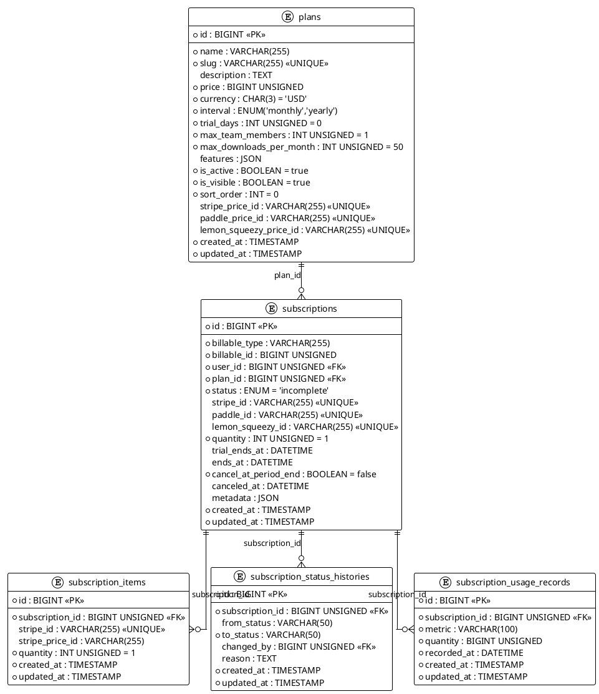

# 06.60 - Subscriptions

**Project:** GsmUi
**Domain:** Billing - Subscriptions
**Version:** 1.0.0

---

## Overview

Database schema for the GsmUi subscription system. Covers pricing plans, user/team subscriptions, line items, status history auditing, and metered usage tracking. Supports multiple payment providers (Stripe, Paddle, Lemon Squeezy) and polymorphic billable ownership.

---

## PlantUML ERD



---

## Tables

### 1. plans

**Purpose:** Global subscription pricing plans (Free, Pro, Business, Enterprise).

**Business Rules:**
- Plans are global; price in minor units (cents).
- Trial period configurable per plan. Features stored as JSON array of keys.
- `is_active` controls new subscriptions; `is_visible` controls marketplace display.

#### Migration

```php
Schema::create('plans', function (Blueprint $table) {
    $table->id();
    $table->string('name');
    $table->string('slug')->unique();
    $table->text('description')->nullable();
    $table->unsignedBigInteger('price');
    $table->char('currency', 3)->default('USD');
    $table->enum('interval', ['monthly', 'yearly']);
    $table->unsignedInteger('trial_days')->default(0);
    $table->unsignedInteger('max_team_members')->default(1);
    $table->unsignedInteger('max_downloads_per_month')->default(50);
    $table->json('features')->nullable();
    $table->boolean('is_active')->default(true);
    $table->boolean('is_visible')->default(true);
    $table->integer('sort_order')->default(0);
    $table->string('stripe_price_id')->nullable()->unique();
    $table->string('paddle_price_id')->nullable()->unique();
    $table->string('lemon_squeezy_price_id')->nullable()->unique();
    $table->timestamps();
    $table->index('is_active');
    $table->index('sort_order');
});
```

#### Model Stub

```php
class Plan extends Model
{
    protected $fillable = [
        'name', 'slug', 'description', 'price', 'currency', 'interval',
        'trial_days', 'max_team_members', 'max_downloads_per_month',
        'features', 'is_active', 'is_visible', 'sort_order',
        'stripe_price_id', 'paddle_price_id', 'lemon_squeezy_price_id',
    ];

    protected function casts(): array
    {
        return [
            'price' => 'integer', 'features' => 'array',
            'is_active' => 'boolean', 'is_visible' => 'boolean',
            'trial_days' => 'integer', 'max_team_members' => 'integer',
            'max_downloads_per_month' => 'integer', 'sort_order' => 'integer',
        ];
    }

    public function subscriptions(): HasMany
    {
        return $this->hasMany(Subscription::class);
    }

    public function hasTrial(): bool
    {
        return $this->trial_days > 0;
    }
}
```

---

### 2. subscriptions

**Purpose:** Active subscription records for users or teams. Polymorphic billable ownership.

**Business Rules:**
- Status lifecycle: `incomplete` → `active` → `past_due` → `canceled` / `unpaid` / `incomplete_expired`.
- Grace period: 3 days on payment failure before auto-cancellation.
- One trial per user lifetime (enforced at application layer).
- No soft deletes — financial records are immutable.

#### Migration

```php
Schema::create('subscriptions', function (Blueprint $table) {
    $table->id();
    $table->string('billable_type');
    $table->unsignedBigInteger('billable_id');
    $table->foreignId('user_id')->constrained()->cascadeOnDelete();
    $table->foreignId('plan_id')->constrained('plans');
    $table->enum('status', [
        'active', 'past_due', 'canceled', 'unpaid',
        'incomplete', 'incomplete_expired',
    ])->default('incomplete');
    $table->string('stripe_id')->nullable()->unique();
    $table->string('paddle_id')->nullable()->unique();
    $table->string('lemon_squeezy_id')->nullable()->unique();
    $table->unsignedInteger('quantity')->default(1);
    $table->dateTime('trial_ends_at')->nullable();
    $table->dateTime('ends_at')->nullable();
    $table->boolean('cancel_at_period_end')->default(false);
    $table->dateTime('canceled_at')->nullable();
    $table->json('metadata')->nullable();
    $table->timestamps();
    $table->index(['billable_type', 'billable_id']);
    $table->index('user_id');
    $table->index('plan_id');
    $table->index('status');
});
```

#### Model Stub

```php
class Subscription extends Model
{
    protected $fillable = [
        'billable_type', 'billable_id', 'user_id', 'plan_id', 'status',
        'stripe_id', 'paddle_id', 'lemon_squeezy_id', 'quantity',
        'trial_ends_at', 'ends_at', 'cancel_at_period_end', 'canceled_at',
        'metadata',
    ];

    protected function casts(): array
    {
        return [
            'quantity' => 'integer', 'trial_ends_at' => 'datetime',
            'ends_at' => 'datetime', 'cancel_at_period_end' => 'boolean',
            'canceled_at' => 'datetime', 'metadata' => 'array',
        ];
    }

    public function billable(): MorphTo { return $this->morphTo(); }
    public function user(): BelongsTo { return $this->belongsTo(User::class); }
    public function plan(): BelongsTo { return $this->belongsTo(Plan::class); }
    public function items(): HasMany { return $this->hasMany(SubscriptionItem::class); }
    public function statusHistories(): HasMany { return $this->hasMany(SubscriptionStatusHistory::class); }
    public function usageRecords(): HasMany { return $this->hasMany(SubscriptionUsageRecord::class); }

    public function isActive(): bool { return $this->status === 'active'; }
    public function onTrial(): bool { return $this->trial_ends_at && $this->trial_ends_at->isFuture(); }
    public function canceled(): bool { return $this->status === 'canceled'; }
}
```

---

### 3. subscription_items

**Purpose:** Individual line items within a subscription for multi-item billing.

**Business Rules:**
- Supports multiple items per subscription (e.g., per-seat add-ons).
- Stripe-specific IDs stored for webhook reconciliation.

#### Migration

```php
Schema::create('subscription_items', function (Blueprint $table) {
    $table->id();
    $table->foreignId('subscription_id')->constrained()->cascadeOnDelete();
    $table->string('stripe_id')->nullable()->unique();
    $table->string('stripe_price_id')->nullable();
    $table->unsignedInteger('quantity')->default(1);
    $table->timestamps();
    $table->index('subscription_id');
});
```

#### Model Stub

```php
class SubscriptionItem extends Model
{
    protected $fillable = ['subscription_id', 'stripe_id', 'stripe_price_id', 'quantity'];
    protected function casts(): array { return ['quantity' => 'integer']; }

    public function subscription(): BelongsTo
    {
        return $this->belongsTo(Subscription::class);
    }
}
```

---

### 4. subscription_status_histories

**Purpose:** Immutable audit trail of every subscription status transition.

**Business Rules:**
- Append-only; never updated or deleted.
- `from_status` is null for the initial creation event.
- `changed_by` tracks the actor (user, system, or webhook).

#### Migration

```php
Schema::create('subscription_status_histories', function (Blueprint $table) {
    $table->id();
    $table->foreignId('subscription_id')->constrained()->cascadeOnDelete();
    $table->string('from_status', 50)->nullable();
    $table->string('to_status', 50);
    $table->foreignId('changed_by')->nullable()->constrained('users')->nullOnDelete();
    $table->text('reason')->nullable();
    $table->timestamps();
    $table->index('subscription_id');
    $table->index('created_at');
});
```

#### Model Stub

```php
class SubscriptionStatusHistory extends Model
{
    protected $fillable = [
        'subscription_id', 'from_status', 'to_status', 'changed_by', 'reason',
    ];

    public function subscription(): BelongsTo { return $this->belongsTo(Subscription::class); }
    public function changedBy(): BelongsTo { return $this->belongsTo(User::class, 'changed_by'); }
}
```

---

### 5. subscription_usage_records

**Purpose:** Metered usage tracking for plans with consumption-based billing.

**Business Rules:**
- Tracks discrete metrics per subscription (e.g., `downloads`, `api_calls`).
- `recorded_at` allows backdating usage from provider webhooks.
- Composite index on `(subscription_id, metric, recorded_at)` for efficient period queries.

#### Migration

```php
Schema::create('subscription_usage_records', function (Blueprint $table) {
    $table->id();
    $table->foreignId('subscription_id')->constrained()->cascadeOnDelete();
    $table->string('metric', 100);
    $table->unsignedBigInteger('quantity');
    $table->dateTime('recorded_at');
    $table->timestamps();
    $table->index('subscription_id');
    $table->index(['subscription_id', 'metric', 'recorded_at']);
});
```

#### Model Stub

```php
class SubscriptionUsageRecord extends Model
{
    protected $fillable = ['subscription_id', 'metric', 'quantity', 'recorded_at'];

    protected function casts(): array
    {
        return ['quantity' => 'integer', 'recorded_at' => 'datetime'];
    }

    public function subscription(): BelongsTo
    {
        return $this->belongsTo(Subscription::class);
    }
}
```

---

## Rollback

```php
Schema::dropIfExists('subscription_usage_records');
Schema::dropIfExists('subscription_status_histories');
Schema::dropIfExists('subscription_items');
Schema::dropIfExists('subscriptions');
Schema::dropIfExists('plans');
```

---

## Design Decisions

| Decision | Rationale |
|---|---|
| Price in minor units | Avoids floating-point rounding; matches Stripe/Paddle conventions |
| Polymorphic billable | Supports user-level and team-level subscriptions without schema changes |
| No soft deletes on financial tables | Regulatory compliance; records must be immutable |
| Multi-provider IDs | Migration between Stripe, Paddle, Lemon Squeezy without schema refactor |
| Separate status history table | Full audit trail without cluttering the subscriptions table |
| `cancel_at_period_end` flag | End-of-period cancellation without immediate access revocation |

---

**Next Document:** [06.61 - Invoices](06.61-invoices.md)

---

## Detailed Column Specifications

### plans

#### id (BIGINT, PK, AUTO_INCREMENT)
- Standard auto-incrementing primary key.

#### name (VARCHAR(255), NOT NULL)
- Display name (e.g., "Pro", "Business", "Enterprise").

#### slug (VARCHAR(255), UNIQUE, NOT NULL)
- URL-friendly identifier.

#### description (TEXT, NULLABLE)
- Plan description for marketing pages.

#### price (BIGINT UNSIGNED, NOT NULL)
- Price in minor currency units (cents).

#### currency (CHAR(3), DEFAULT 'USD')
- ISO 4217 currency code.

#### interval (ENUM, NOT NULL)
- Billing interval: `monthly` or `yearly`.

#### trial_days (INT UNSIGNED, DEFAULT 0)
- Number of trial days.

#### max_team_members (INT UNSIGNED, DEFAULT 1)
- Maximum team members allowed.

#### max_downloads_per_month (INT UNSIGNED, DEFAULT 50)
- Download quota per month.

#### features (JSON, NULLABLE)
- Array of feature keys.

#### is_active (BOOLEAN, DEFAULT true)
- Controls new subscriptions.

#### is_visible (BOOLEAN, DEFAULT true)
- Controls marketplace display.

#### sort_order (INT, DEFAULT 0)
- Display ordering.

#### stripe_price_id (VARCHAR(255), UNIQUE, NULLABLE)
- Stripe price identifier.

#### paddle_price_id (VARCHAR(255), UNIQUE, NULLABLE)
- Paddle price identifier.

#### lemon_squeezy_price_id (VARCHAR(255), UNIQUE, NULLABLE)
- Lemon Squeezy price identifier.

---

### subscriptions

#### id (BIGINT, PK, AUTO_INCREMENT)
- Standard auto-incrementing primary key.

#### billable_type / billable_id (POLYMORPHIC, NOT NULL)
- Polymorphic ownership (User or Team).

#### user_id (BIGINT, FK → users.id, NOT NULL)
- Subscription owner.

#### plan_id (BIGINT, FK → plans.id, NOT NULL)
- Associated plan.

#### status (ENUM, DEFAULT 'incomplete')
- Status lifecycle: `incomplete` → `active` → `past_due` → `canceled` / `unpaid`.

#### stripe_id / paddle_id / lemon_squeezy_id (VARCHAR(255), UNIQUE, NULLABLE)
- Provider-specific subscription identifiers.

#### quantity (INT UNSIGNED, DEFAULT 1)
- Subscription quantity (e.g., seats).

#### trial_ends_at (DATETIME, NULLABLE)
- Trial end timestamp.

#### ends_at (DATETIME, NULLABLE)
- Subscription end timestamp.

#### cancel_at_period_end (BOOLEAN, DEFAULT false)
- Whether to cancel at period end.

#### canceled_at (DATETIME, NULLABLE)
- Cancellation timestamp.

#### metadata (JSON, NULLABLE)
- Extensible key-value storage.

---

## Full Eloquent Model

```php
<?php

namespace App\Models;

use Illuminate\Database\Eloquent\Model;
use Illuminate\Database\Eloquent\Factories\HasFactory;
use Illuminate\Database\Eloquent\Relations\{BelongsTo, HasMany, MorphTo};
use Illuminate\Database\Eloquent\Builder;

class Subscription extends Model
{
    use HasFactory;

    protected $fillable = [
        'billable_type', 'billable_id', 'user_id', 'plan_id', 'status',
        'stripe_id', 'paddle_id', 'lemon_squeezy_id', 'quantity',
        'trial_ends_at', 'ends_at', 'cancel_at_period_end', 'canceled_at',
        'metadata',
    ];

    protected $casts = [
        'quantity'             => 'integer',
        'trial_ends_at'        => 'datetime',
        'ends_at'              => 'datetime',
        'cancel_at_period_end' => 'boolean',
        'canceled_at'          => 'datetime',
        'metadata'             => 'array',
    ];

    // ─── Relationships ───────────────────────────────────────

    public function billable(): MorphTo
    {
        return $this->morphTo();
    }

    public function user(): BelongsTo
    {
        return $this->belongsTo(User::class);
    }

    public function plan(): BelongsTo
    {
        return $this->belongsTo(Plan::class);
    }

    public function items(): HasMany
    {
        return $this->hasMany(SubscriptionItem::class);
    }

    public function statusHistories(): HasMany
    {
        return $this->hasMany(SubscriptionStatusHistory::class);
    }

    public function usageRecords(): HasMany
    {
        return $this->hasMany(SubscriptionUsageRecord::class);
    }

    // ─── Accessors ───────────────────────────────────────────

    public function getIsActiveAttribute(): bool
    {
        return $this->status === 'active';
    }

    public function getIsOnTrialAttribute(): bool
    {
        return $this->trial_ends_at && $this->trial_ends_at->isFuture();
    }

    public function getDaysUntilEndAttribute(): ?int
    {
        return $this->ends_at?->diffInDays(now());
    }

    // ─── Scopes ──────────────────────────────────────────────

    public function scopeActive(Builder $query): Builder
    {
        return $query->where('status', 'active');
    }

    public function scopeOnTrial(Builder $query): Builder
    {
        return $query->where('trial_ends_at', '>', now())
            ->where('status', 'incomplete');
    }

    public function scopeCanceled(Builder $query): Builder
    {
        return $query->where('status', 'canceled');
    }

    public function scopeForPlan(Builder $query, int $planId): Builder
    {
        return $query->where('plan_id', $planId);
    }

    // ─── Methods ─────────────────────────────────────────────

    public function isActive(): bool
    {
        return $this->status === 'active';
    }

    public function onTrial(): bool
    {
        return $this->trial_ends_at && $this->trial_ends_at->isFuture();
    }

    public function canceled(): bool
    {
        return $this->status === 'canceled';
    }

    public function hasFeature(string $feature): bool
    {
        return in_array($feature, $this->plan->features ?? []);
    }

    public function getUsageForMetric(string $metric): int
    {
        return $this->usageRecords()
            ->where('metric', $metric)
            ->where('recorded_at', '>=', now()->startOfMonth())
            ->sum('quantity');
    }

    public function hasExceededQuota(string $metric): bool
    {
        $limit = match ($metric) {
            'downloads' => $this->plan->max_downloads_per_month,
            default     => null,
        };

        if (is_null($limit)) return false;

        return $this->getUsageForMetric($metric) >= $limit;
    }

    public function recordUsage(string $metric, int $quantity = 1): void
    {
        $this->usageRecords()->create([
            'metric'      => $metric,
            'quantity'    => $quantity,
            'recorded_at' => now(),
        ]);
    }

    public function cancel(): void
    {
        $this->update([
            'status'    => 'canceled',
            'canceled_at' => now(),
        ]);

        $this->statusHistories()->create([
            'from_status' => 'active',
            'to_status'   => 'canceled',
            'changed_by'  => auth()->id(),
            'reason'      => 'User canceled',
        ]);
    }
}
```

---

## Observer and Event System

### SubscriptionObserver
```php
<?php

namespace App\Observers;

use App\Models\Subscription;
use App\Services\{SubscriptionNotificationService, AccessControlService};

class SubscriptionObserver
{
    public function created(Subscription $subscription): void
    {
        $subscription->statusHistories()->create([
            'from_status' => null,
            'to_status'   => $subscription->status,
            'changed_by'  => auth()->id(),
        ]);

        event(new \App\Events\SubscriptionCreated($subscription));
    }

    public function updated(Subscription $subscription): void
    {
        if ($subscription->isDirty('status')) {
            $this->handleStatusChange($subscription);
        }

        event(new \App\Events\SubscriptionUpdated($subscription));
    }

    protected function handleStatusChange(Subscription $subscription): void
    {
        $from = $subscription->getOriginal('status');
        $to = $subscription->status;

        $subscription->statusHistories()->create([
            'from_status' => $from,
            'to_status'   => $to,
            'changed_by'  => auth()->id(),
        ]);

        app(AccessControlService::class)->syncPermissions($subscription->billable);

        match ($to) {
            'active'  => event(new \App\Events\SubscriptionActivated($subscription)),
            'canceled' => event(new \App\Events\SubscriptionCanceled($subscription)),
            default   => null,
        };
    }
}
```

### Event Classes
```php
class SubscriptionCreated
{
    use Dispatchable, SerializesModels;
    public function __construct(public Subscription $subscription) {}
}

class SubscriptionActivated
{
    use Dispatchable, SerializesModels;
    public function __construct(public Subscription $subscription) {}
}

class SubscriptionCanceled
{
    use Dispatchable, SerializesModels;
    public function __construct(public Subscription $subscription) {}
}
```

---

## Query Scopes

```php
public function scopeActive(Builder $query): Builder
{
    return $query->where('status', 'active');
}

public function scopeOnTrial(Builder $query): Builder
{
    return $query->where('trial_ends_at', '>', now())
        ->where('status', 'incomplete');
}

public function scopeCanceled(Builder $query): Builder
{
    return $query->where('status', 'canceled');
}

public function scopeExpiringSoon(Builder $query, int $days = 7): Builder
{
    return $query->where('ends_at', '<=', now()->addDays($days))
        ->where('ends_at', '>', now());
}
```

---

## Factory Stubs

### SubscriptionFactory
```php
<?php

namespace Database\Factories;

use App\Models\Subscription;
use App\Models\User;
use App\Models\Plan;
use Illuminate\Database\Eloquent\Factories\Factory;

class SubscriptionFactory extends Factory
{
    protected $model = Subscription::class;

    public function definition(): array
    {
        return [
            'billable_type' => User::class,
            'billable_id'   => User::factory(),
            'user_id'       => User::factory(),
            'plan_id'       => Plan::factory(),
            'status'        => fake()->randomElement(['incomplete', 'active', 'past_due', 'canceled']),
            'quantity'      => fake()->numberBetween(1, 10),
            'trial_ends_at' => fake()->optional()->dateTime(),
            'ends_at'       => fake()->optional()->dateTime(),
        ];
    }

    public function active(): static
    {
        return $this->state(fn (array $attributes) => ['status' => 'active']);
    }

    public function trialing(): static
    {
        return $this->state(fn (array $attributes) => [
            'status'        => 'incomplete',
            'trial_ends_at' => now()->addDays(14),
        ]);
    }
}
```

---

## Seeders

```php
<?php

namespace Database\Seeders;

use App\Models\Plan;
use Illuminate\Database\Seeder;

class PlanSeeder extends Seeder
{
    public function run(): void
    {
        $plans = [
            [
                'name'                   => 'Free',
                'slug'                   => 'free',
                'description'            => 'For individuals getting started.',
                'price'                  => 0,
                'currency'               => 'USD',
                'interval'               => 'monthly',
                'trial_days'             => 0,
                'max_team_members'       => 1,
                'max_downloads_per_month' => 50,
                'features'               => ['basic_components', 'community_support'],
                'is_active'              => true,
                'is_visible'             => true,
                'sort_order'             => 0,
            ],
            [
                'name'                   => 'Pro',
                'slug'                   => 'pro',
                'description'            => 'For professionals and small teams.',
                'price'                  => 2900,
                'currency'               => 'USD',
                'interval'               => 'monthly',
                'trial_days'             => 14,
                'max_team_members'       => 5,
                'max_downloads_per_month' => 500,
                'features'               => ['all_components', 'premium_themes', 'priority_support', 'api_access'],
                'is_active'              => true,
                'is_visible'             => true,
                'sort_order'             => 1,
            ],
            [
                'name'                   => 'Business',
                'slug'                   => 'business',
                'description'            => 'For growing businesses.',
                'price'                  => 7900,
                'currency'               => 'USD',
                'interval'               => 'monthly',
                'trial_days'             => 14,
                'max_team_members'       => 20,
                'max_downloads_per_month' => 5000,
                'features'               => ['all_components', 'premium_themes', 'priority_support', 'api_access', 'custom_branding', 'team_management'],
                'is_active'              => true,
                'is_visible'             => true,
                'sort_order'             => 2,
            ],
        ];

        foreach ($plans as $data) {
            Plan::create($data);
        }
    }
}
```

---

## API Response Structure

### Subscription Response
```json
{
    "data": {
        "id": 1,
        "status": "active",
        "plan": {
            "id": 2,
            "name": "Pro",
            "price": 2900,
            "interval": "monthly"
        },
        "quantity": 1,
        "trial_ends_at": null,
        "ends_at": "2026-08-25T00:00:00.000000Z",
        "cancel_at_period_end": false,
        "is_active": true,
        "is_on_trial": false,
        "usage": {
            "downloads": {"used": 150, "limit": 500},
            "api_calls": {"used": 10000, "limit": null}
        }
    }
}
```

---

## Cache Keys

| Cache Key Pattern | TTL | Invalidation |
|---|---|---|
| `subscription:user:{user_id}` | 1 hour | Subscription updated |
| `subscription:features:{user_id}` | 1 hour | Plan changed |
| `subscription:usage:{user_id}:{metric}` | 5 min | Usage recorded |

---

## Appendix: Troubleshooting

| Issue | Cause | Solution |
|---|---|---|
| `InvalidStatusTransition` | Invalid workflow | Check valid transitions |
| `QuotaExceeded` | Download limit reached | Upgrade plan |
| `PaymentFailed` | Provider webhook error | Retry or contact support |
| `TrialExpired` | Trial period ended | Convert to paid |
| `AccessDenied` | Subscription inactive | Reactivate subscription |

---

## Appendix: Quick Reference

### Status Transitions
```
incomplete → active (payment confirmed)
active → past_due (payment failed)
past_due → active (payment retry successful)
past_due → canceled (grace period expired)
active → canceled (user cancellation)
```

### Key Relationships
```
Subscription → Plan (N:1)
Subscription → User (N:1)
Subscription → SubscriptionItem (1:N)
Subscription → SubscriptionStatusHistory (1:N)
Subscription → SubscriptionUsageRecord (1:N)
```

---

## Appendix A: Subscription Lifecycle Service

### Complete Lifecycle Management
```php
<?php

namespace App\Services;

use App\Models\{Subscription, Plan, User};
use Illuminate\Support\Facades\DB;

class SubscriptionLifecycleService
{
    public function create(User $user, Plan $plan, array $providerData = []): Subscription
    {
        return DB::transaction(function () use ($user, $plan, $providerData) {
            $subscription = Subscription::create([
                'billable_type'        => get_class($user),
                'billable_id'          => $user->id,
                'user_id'              => $user->id,
                'plan_id'              => $plan->id,
                'status'               => $plan->hasTrial() ? 'incomplete' : 'active',
                'stripe_id'            => $providerData['stripe_id'] ?? null,
                'paddle_id'            => $providerData['paddle_id'] ?? null,
                'lemon_squeezy_id'     => $providerData['lemon_squeezy_id'] ?? null,
                'quantity'             => $providerData['quantity'] ?? 1,
                'trial_ends_at'        => $plan->hasTrial() ? now()->addDays($plan->trial_days) : null,
                'ends_at'              => $providerData['ends_at'] ?? null,
                'metadata'             => $providerData['metadata'] ?? null,
            ]);

            if (!$plan->hasTrial()) {
                $subscription->update(['status' => 'active']);
            }

            return $subscription;
        });
    }

    public function renew(Subscription $subscription): void
    {
        $subscription->update([
            'status'   => 'active',
            'ends_at'  => $this->calculateNextEndDate($subscription),
        ]);

        // Reset monthly usage
        $subscription->usageRecords()
            ->where('recorded_at', '<', now()->startOfMonth())
            ->delete();
    }

    public function cancel(Subscription $subscription, bool $immediate = false): void
    {
        if ($immediate) {
            $subscription->update([
                'status'     => 'canceled',
                'canceled_at' => now(),
                'ends_at'    => now(),
            ]);
        } else {
            $subscription->update([
                'cancel_at_period_end' => true,
            ]);
        }
    }

    public function reactivate(Subscription $subscription): void
    {
        $subscription->update([
            'status'               => 'active',
            'cancel_at_period_end' => false,
            'canceled_at'          => null,
            'ends_at'              => $this->calculateNextEndDate($subscription),
        ]);
    }

    protected function calculateNextEndDate(Subscription $subscription): \Carbon\Carbon
    {
        return match ($subscription->plan->interval) {
            'monthly' => now()->addMonth(),
            'yearly'  => now()->addYear(),
        };
    }
}
```

---

## Appendix B: Access Control Service

### Permission Synchronization
```php
<?php

namespace App\Services;

use App\Models\{Subscription, User, Plan};

class AccessControlService
{
    public function syncPermissions(User $user): void
    {
        $subscription = $user->subscriptions()->active()->first();

        if (!$subscription) {
            $this->revokeAllPermissions($user);
            return;
        }

        $features = $subscription->plan->features ?? [];
        $permissions = $this->mapFeaturesToPermissions($features);

        $user->syncPermissions($permissions);

        $user->update([
            'metadata' => array_merge($user->metadata ?? [], [
                'active_plan'     => $subscription->plan->slug,
                'plan_features'   => $features,
                'max_downloads'   => $subscription->plan->max_downloads_per_month,
                'max_team_members' => $subscription->plan->max_team_members,
            ]),
        ]);
    }

    protected function mapFeaturesToPermissions(array $features): array
    {
        $permissions = [];
        foreach ($features as $feature) {
            $permissions[] = "plan:{$feature}";
        }
        return $permissions;
    }

    protected function revokeAllPermissions(User $user): void
    {
        $user->update([
            'metadata' => array_merge($user->metadata ?? [], [
                'active_plan'     => 'free',
                'plan_features'   => ['basic_components'],
                'max_downloads'   => 50,
                'max_team_members' => 1,
            ]),
        ]);
    }

    public function hasFeature(User $user, string $feature): bool
    {
        $features = $user->metadata['plan_features'] ?? [];
        return in_array($feature, $features);
    }
}
```

---

## Appendix C: Usage Tracking Service

### Metered Usage Management
```php
<?php

namespace App\Services;

use App\Models\{Subscription, SubscriptionUsageRecord};

class UsageTrackingService
{
    public function recordUsage(Subscription $subscription, string $metric, int $quantity = 1): void
    {
        $subscription->usageRecords()->create([
            'metric'      => $metric,
            'quantity'    => $quantity,
            'recorded_at' => now(),
        ]);
    }

    public function getMonthlyUsage(Subscription $subscription, string $metric): int
    {
        return $subscription->usageRecords()
            ->where('metric', $metric)
            ->where('recorded_at', '>=', now()->startOfMonth())
            ->sum('quantity');
    }

    public function hasExceededLimit(Subscription $subscription, string $metric): bool
    {
        $limit = match ($metric) {
            'downloads' => $subscription->plan->max_downloads_per_month,
            default     => null,
        };

        if (is_null($limit)) return false;

        return $this->getMonthlyUsage($subscription, $metric) >= $limit;
    }

    public function getUsageStats(Subscription $subscription): array
    {
        return [
            'downloads' => [
                'used'  => $this->getMonthlyUsage($subscription, 'downloads'),
                'limit' => $subscription->plan->max_downloads_per_month,
            ],
        ];
    }
}
```

---

## Appendix D: Provider Webhook Handlers

### Stripe Webhook Handler
```php
<?php

namespace App\Http\Controllers\Webhooks;

use App\Models\Subscription;
use Illuminate\Http\Request;
use Stripe\Webhook;

class StripeWebhookController
{
    public function handle(Request $request)
    {
        $event = Webhook::constructEvent(
            $request->getContent(),
            $request->header('Stripe-Signature'),
            config('services.stripe.webhook_secret')
        );

        match ($event->type) {
            'checkout.session.completed'     => $this->handleCheckoutCompleted($event->data->object),
            'customer.subscription.updated'  => $this->handleSubscriptionUpdated($event->data->object),
            'customer.subscription.deleted'  => $this->handleSubscriptionDeleted($event->data->object),
            'invoice.payment_succeeded'      => $this->handlePaymentSucceeded($event->data->object),
            'invoice.payment_failed'         => $this->handlePaymentFailed($event->data->object),
        };

        return response('OK');
    }

    protected function handleSubscriptionUpdated($stripeSubscription): void
    {
        $subscription = Subscription::where('stripe_id', $stripeSubscription->id)->first();

        if ($subscription) {
            $statusMap = [
                'active'   => 'active',
                'past_due' => 'past_due',
                'canceled' => 'canceled',
                'unpaid'   => 'unpaid',
            ];

            $subscription->update([
                'status'  => $statusMap[$stripeSubscription->status] ?? 'active',
                'ends_at' => $stripeSubscription->current_period_end
                    ? \Carbon\Carbon::createFromTimestamp($stripeSubscription->current_period_end)
                    : null,
            ]);
        }
    }

    protected function handleSubscriptionDeleted($stripeSubscription): void
    {
        $subscription = Subscription::where('stripe_id', $stripeSubscription->id)->first();

        if ($subscription) {
            $subscription->update([
                'status'     => 'canceled',
                'canceled_at' => now(),
            ]);
        }
    }

    protected function handlePaymentFailed($invoice): void
    {
        $subscription = Subscription::where('stripe_id', $invoice->subscription)->first();

        if ($subscription) {
            $subscription->update(['status' => 'past_due']);
        }
    }
}
```

---

## Appendix E: Scheduled Tasks

### Subscription Maintenance Command
```php
class SubscriptionMaintenanceCommand extends Command
{
    protected $signature = 'gsmui:subscription-maintenance';

    public function handle(): int
    {
        // Cancel expired trials
        Subscription::where('status', 'incomplete')
            ->where('trial_ends_at', '<', now())
            ->each(fn ($sub) => $sub->update(['status' => 'canceled']));

        // Cancel past_due after grace period
        Subscription::where('status', 'past_due')
            ->where('updated_at', '<', now()->subDays(3))
            ->each(fn ($sub) => $sub->update(['status' => 'canceled']));

        // Process end-of-period cancellations
        Subscription::where('cancel_at_period_end', true)
            ->where('ends_at', '<=', now())
            ->each(fn ($sub) => app(SubscriptionLifecycleService::class)->cancel($sub, true));

        // Send expiring soon notifications
        Subscription::active()
            ->where('ends_at', '<=', now()->addDays(7))
            ->each(fn ($sub) => Mail::to($sub->user->email)->send(new SubscriptionExpiringMail($sub)));

        $this->info('Subscription maintenance completed.');

        return self::SUCCESS;
    }
}
```

---

## Appendix F: Observer Registration

### AppServiceProvider
```php
<?php

namespace App\Providers;

use App\Models\Subscription;
use App\Observers\SubscriptionObserver;
use Illuminate\Support\ServiceProvider;

class AppServiceProvider extends ServiceProvider
{
    public function boot(): void
    {
        Subscription::observe(SubscriptionObserver::class);
    }
}
```

---

## Appendix G: Cache Keys

| Cache Key Pattern | TTL | Invalidation |
|---|---|---|
| `subscription:user:{user_id}` | 1 hour | Subscription updated |
| `subscription:features:{user_id}` | 1 hour | Plan changed |
| `subscription:usage:{user_id}:{metric}` | 5 min | Usage recorded |
| `plan:list` | 1 hour | Plan created/updated |

---

## Appendix H: Database Migration Full Schema

```php
<?php

use Illuminate\Database\Migrations\Migration;
use Illuminate\Database\Schema\Blueprint;
use Illuminate\Support\Facades\Schema;

return new class extends Migration
{
    public function up(): void
    {
        Schema::create('plans', function (Blueprint $table) {
            $table->id();
            $table->string('name');
            $table->string('slug')->unique();
            $table->text('description')->nullable();
            $table->unsignedBigInteger('price');
            $table->char('currency', 3)->default('USD');
            $table->enum('interval', ['monthly', 'yearly']);
            $table->unsignedInteger('trial_days')->default(0);
            $table->unsignedInteger('max_team_members')->default(1);
            $table->unsignedInteger('max_downloads_per_month')->default(50);
            $table->json('features')->nullable();
            $table->boolean('is_active')->default(true);
            $table->boolean('is_visible')->default(true);
            $table->integer('sort_order')->default(0);
            $table->string('stripe_price_id')->nullable()->unique();
            $table->string('paddle_price_id')->nullable()->unique();
            $table->string('lemon_squeezy_price_id')->nullable()->unique();
            $table->timestamps();

            $table->index('is_active');
            $table->index('sort_order');
        });

        Schema::create('subscriptions', function (Blueprint $table) {
            $table->id();
            $table->string('billable_type');
            $table->unsignedBigInteger('billable_id');
            $table->foreignId('user_id')->constrained()->cascadeOnDelete();
            $table->foreignId('plan_id')->constrained('plans');
            $table->enum('status', [
                'active', 'past_due', 'canceled', 'unpaid',
                'incomplete', 'incomplete_expired',
            ])->default('incomplete');
            $table->string('stripe_id')->nullable()->unique();
            $table->string('paddle_id')->nullable()->unique();
            $table->string('lemon_squeezy_id')->nullable()->unique();
            $table->unsignedInteger('quantity')->default(1);
            $table->dateTime('trial_ends_at')->nullable();
            $table->dateTime('ends_at')->nullable();
            $table->boolean('cancel_at_period_end')->default(false);
            $table->dateTime('canceled_at')->nullable();
            $table->json('metadata')->nullable();
            $table->timestamps();

            $table->index(['billable_type', 'billable_id']);
            $table->index('user_id');
            $table->index('plan_id');
            $table->index('status');
        });

        Schema::create('subscription_items', function (Blueprint $table) {
            $table->id();
            $table->foreignId('subscription_id')->constrained()->cascadeOnDelete();
            $table->string('stripe_id')->nullable()->unique();
            $table->string('stripe_price_id')->nullable();
            $table->unsignedInteger('quantity')->default(1);
            $table->timestamps();

            $table->index('subscription_id');
        });

        Schema::create('subscription_status_histories', function (Blueprint $table) {
            $table->id();
            $table->foreignId('subscription_id')->constrained()->cascadeOnDelete();
            $table->string('from_status', 50)->nullable();
            $table->string('to_status', 50);
            $table->foreignId('changed_by')->nullable()->constrained('users')->nullOnDelete();
            $table->text('reason')->nullable();
            $table->timestamps();

            $table->index('subscription_id');
            $table->index('created_at');
        });

        Schema::create('subscription_usage_records', function (Blueprint $table) {
            $table->id();
            $table->foreignId('subscription_id')->constrained()->cascadeOnDelete();
            $table->string('metric', 100);
            $table->unsignedBigInteger('quantity');
            $table->dateTime('recorded_at');
            $table->timestamps();

            $table->index('subscription_id');
            $table->index(['subscription_id', 'metric', 'recorded_at']);
        });
    }

    public function down(): void
    {
        Schema::dropIfExists('subscription_usage_records');
        Schema::dropIfExists('subscription_status_histories');
        Schema::dropIfExists('subscription_items');
        Schema::dropIfExists('subscriptions');
        Schema::dropIfExists('plans');
    }
};
```

---

## Appendix I: Rollback Order
```php
Schema::dropIfExists('subscription_usage_records');
Schema::dropIfExists('subscription_status_histories');
Schema::dropIfExists('subscription_items');
Schema::dropIfExists('subscriptions');
Schema::dropIfExists('plans');
```

---

## Appendix J: Security Checklist

- [ ] Financial records immutable (no soft deletes)
- [ ] Webhook signatures verified
- [ ] Payment provider IDs validated
- [ ] Usage records cannot be deleted
- [ ] Status history append-only
- [ ] Authorization checked for all mutations
- [ ] Rate limiting on subscription endpoints
- [ ] Trial abuse prevention (1 per user lifetime)
- [ ] Grace period handling for failed payments
- [ ] Cancellation confirmation required

---

## Appendix K: Troubleshooting Quick Reference

| Issue | Cause | Solution |
|---|---|---|
| `InvalidStatusTransition` | Invalid workflow | Check valid transitions |
| `QuotaExceeded` | Download limit reached | Upgrade plan |
| `PaymentFailed` | Provider webhook error | Retry or contact support |
| `TrialExpired` | Trial period ended | Convert to paid |
| `AccessDenied` | Subscription inactive | Reactivate subscription |

---

## Appendix L: Database Relationship Summary

```
users 1 ──── * subscriptions
plans 1 ──── * subscriptions
subscriptions 1 ──── * subscription_items
subscriptions 1 ──── * subscription_status_histories
subscriptions 1 ──── * subscription_usage_records
```

---

## Appendix A: Subscription Lifecycle Service (Extended)

### Plan Upgrade Handler
```php
<?php

namespace App\Services;

use App\Models\{Subscription, Plan, User};
use Illuminate\Support\Facades\DB;

class PlanUpgradeService
{
    public function upgrade(Subscription $subscription, Plan $newPlan): Subscription
    {
        return DB::transaction(function () use ($subscription, $newPlan) {
            $oldPlan = $subscription->plan;

            $prorationAmount = $this->calculateProration($subscription, $newPlan);

            $subscription->update([
                'plan_id' => $newPlan->id,
                'quantity' => 1,
                'metadata' => array_merge($subscription->metadata ?? [], [
                    'previous_plan_id' => $oldPlan->id,
                    'upgraded_at'      => now()->toISOString(),
                    'proration_amount' => $prorationAmount,
                ]),
            ]);

            $subscription->statusHistories()->create([
                'from_status' => $subscription->getOriginal('status'),
                'to_status'   => $subscription->status,
                'changed_by'  => auth()->id(),
                'reason'      => "Upgraded from {$oldPlan->name} to {$newPlan->name}",
            ]);

            app(AccessControlService::class)->syncPermissions($subscription->user);

            return $subscription;
        });
    }

    public function downgrade(Subscription $subscription, Plan $newPlan): Subscription
    {
        return DB::transaction(function () use ($subscription, $newPlan) {
            $oldPlan = $subscription->plan;

            $subscription->update([
                'plan_id' => $newPlan->id,
                'metadata' => array_merge($subscription->metadata ?? [], [
                    'previous_plan_id' => $oldPlan->id,
                    'downgraded_at'    => now()->toISOString(),
                ]),
            ]);

            $subscription->statusHistories()->create([
                'from_status' => $subscription->getOriginal('status'),
                'to_status'   => $subscription->status,
                'changed_by'  => auth()->id(),
                'reason'      => "Downgraded from {$oldPlan->name} to {$newPlan->name}",
            ]);

            app(AccessControlService::class)->syncPermissions($subscription->user);

            return $subscription;
        });
    }

    protected function calculateProration(Subscription $subscription, Plan $newPlan): int
    {
        $currentPlan = $subscription->plan;
        $daysRemaining = now()->diffInDays($subscription->ends_at);
        $currentDaily = $currentPlan->price / 30;
        $newDaily = $newPlan->price / 30;

        $credit = (int) ($currentDaily * $daysRemaining);
        $charge = (int) ($newDaily * $daysRemaining);

        return $charge - $credit;
    }
}
```

### Trial Management Service
```php
<?php

namespace App\Services;

use App\Models\{Subscription, Plan, User};
use Illuminate\Support\Facades\{Cache, Mail};

class TrialManagementService
{
    public function startTrial(User $user, Plan $plan): Subscription
    {
        $existingTrial = Subscription::where('user_id', $user->id)
            ->whereNotNull('trial_ends_at')
            ->exists();

        if ($existingTrial) {
            throw new \DomainException('User has already used their trial period.');
        }

        $subscription = Subscription::create([
            'user_id'     => $user->id,
            'plan_id'     => $plan->id,
            'status'      => 'incomplete',
            'trial_ends_at' => now()->addDays($plan->trial_days),
            'metadata'    => json_encode([
                'trial_started_at' => now()->toISOString(),
            ]),
        ]);

        $subscription->statusHistories()->create([
            'from_status' => null,
            'to_status'   => 'incomplete',
            'reason'      => 'Trial started',
        ]);

        return $subscription;
    }

    public function convertTrial(Subscription $subscription): void
    {
        if ($subscription->status !== 'incomplete') {
            throw new \DomainException('Subscription is not in trial status.');
        }

        $subscription->update([
            'status'   => 'active',
            'ends_at'  => $this->calculateEndDate($subscription),
            'metadata' => array_merge($subscription->metadata ?? [], [
                'trial_converted_at' => now()->toISOString(),
            ]),
        ]);

        $subscription->statusHistories()->create([
            'from_status' => 'incomplete',
            'to_status'   => 'active',
            'reason'      => 'Trial converted to active subscription',
        ]);

        app(AccessControlService::class)->syncPermissions($subscription->user);
    }

    public function checkExpiredTrials(): void
    {
        $expiredTrials = Subscription::where('status', 'incomplete')
            ->where('trial_ends_at', '<', now())
            ->get();

        foreach ($expiredTrials as $subscription) {
            $subscription->update(['status' => 'canceled']);
            $subscription->statusHistories()->create([
                'from_status' => 'incomplete',
                'to_status'   => 'canceled',
                'reason'      => 'Trial expired without conversion',
            ]);

            Mail::to($subscription->user->email)
                ->send(new \App\Mail\TrialExpiredMail($subscription));
        }
    }

    protected function calculateEndDate(Subscription $subscription): \Carbon\Carbon
    {
        return match ($subscription->plan->interval) {
            'monthly' => now()->addMonth(),
            'yearly'  => now()->addYear(),
        };
    }
}
```

---

## Appendix B: Subscription Suspension Service

```php
<?php

namespace App\Services;

use App\Models\{Subscription, SubscriptionStatusHistory};
use Illuminate\Support\Facades\{Cache, Mail};

class SubscriptionSuspensionService
{
    public function suspend(Subscription $subscription, string $reason): void
    {
        $subscription->update([
            'status'        => 'suspended',
            'suspended_at'  => now(),
            'suspension_reason' => $reason,
        ]);

        $subscription->statusHistories()->create([
            'from_status' => $subscription->getOriginal('status'),
            'to_status'   => 'suspended',
            'reason'      => $reason,
        ]);

        app(AccessControlService::class)->revokeAllPermissions($subscription->user);

        Cache::forget("subscription:user:{$subscription->user_id}");

        Mail::to($subscription->user->email)
            ->send(new \App\Mail\SubscriptionSuspendedMail($subscription, $reason));
    }

    public function reinstate(Subscription $subscription): void
    {
        $subscription->update([
            'status'            => 'active',
            'suspended_at'      => null,
            'suspension_reason' => null,
        ]);

        $subscription->statusHistories()->create([
            'from_status' => 'suspended',
            'to_status'   => 'active',
            'reason'      => 'Subscription reinstated',
        ]);

        app(AccessControlService::class)->syncPermissions($subscription->user);

        Cache::forget("subscription:user:{$subscription->user_id}");

        Mail::to($subscription->user->email)
            ->send(new \App\Mail\SubscriptionReinstatedMail($subscription));
    }
}
```

---

## Appendix C: Subscription Event Handlers

```php
<?php

namespace App\Listeners;

use App\Events\{SubscriptionCreated, SubscriptionUpdated, SubscriptionCanceled};
use App\Services\{AccessControlService, UsageTrackingService};
use Illuminate\Support\Facades\Cache;

class SyncSubscriptionPermissions
{
    public function handle(object $event): void
    {
        $subscription = $event->subscription ?? $event->subscription;
        app(AccessControlService::class)->syncPermissions($subscription->user);
        Cache::forget("subscription:user:{$subscription->user_id}");
    }
}

class ResetUsageOnRenewal
{
    public function handle(SubscriptionRenewed $event): void
    {
        $subscription = $event->subscription;
        app(UsageTrackingService::class)->resetMonthlyUsage($subscription);
    }
}

class SendSubscriptionNotifications
{
    public function handle(object $event): void
    {
        match (get_class($event)) {
            SubscriptionCreated::class => $this->sendWelcome($event->subscription),
            SubscriptionUpdated::class => $this->sendUpdate($event->subscription),
            SubscriptionCanceled::class => $this->sendCancellation($event->subscription),
            SubscriptionRenewed::class => $this->sendRenewal($event->subscription),
        };
    }

    protected function sendWelcome($subscription): void
    {
        \Mail::to($subscription->user->email)
            ->send(new \App\Mail\SubscriptionWelcomeMail($subscription));
    }

    protected function sendUpdate($subscription): void
    {
        \Mail::to($subscription->user->email)
            ->send(new \App\Mail\SubscriptionUpdatedMail($subscription));
    }

    protected function sendCancellation($subscription): void
    {
        \Mail::to($subscription->user->email)
            ->send(new \App\Mail\SubscriptionCanceledMail($subscription));
    }

    protected function sendRenewal($subscription): void
    {
        \Mail::to($subscription->user->email)
            ->send(new \App\Mail\SubscriptionRenewedMail($subscription));
    }
}
```

---

## Appendix D: Complete Migration Schema

```php
Schema::create('plans', function (Blueprint $table) {
    $table->id();
    $table->string('name');
    $table->string('slug')->unique();
    $table->text('description')->nullable();
    $table->unsignedBigInteger('price');
    $table->char('currency', 3)->default('USD');
    $table->enum('interval', ['monthly', 'yearly']);
    $table->unsignedInteger('trial_days')->default(0);
    $table->unsignedInteger('max_team_members')->default(1);
    $table->unsignedInteger('max_downloads_per_month')->default(50);
    $table->json('features')->nullable();
    $table->boolean('is_active')->default(true);
    $table->boolean('is_visible')->default(true);
    $table->integer('sort_order')->default(0);
    $table->string('stripe_price_id')->nullable()->unique();
    $table->string('paddle_price_id')->nullable()->unique();
    $table->string('lemon_squeezy_price_id')->nullable()->unique();
    $table->json('metadata')->nullable();
    $table->timestamps();
    $table->softDeletes();
});

Schema::create('subscriptions', function (Blueprint $table) {
    $table->id();
    $table->string('billable_type');
    $table->unsignedBigInteger('billable_id');
    $table->foreignId('user_id')->constrained()->cascadeOnDelete();
    $table->foreignId('plan_id')->constrained('plans');
    $table->enum('status', [
        'active', 'past_due', 'canceled', 'unpaid',
        'incomplete', 'incomplete_expired', 'suspended',
    ])->default('incomplete');
    $table->string('stripe_id')->nullable()->unique();
    $table->string('paddle_id')->nullable()->unique();
    $table->string('lemon_squeezy_id')->nullable()->unique();
    $table->unsignedInteger('quantity')->default(1);
    $table->dateTime('trial_ends_at')->nullable();
    $table->dateTime('ends_at')->nullable();
    $table->boolean('cancel_at_period_end')->default(false);
    $table->dateTime('canceled_at')->nullable();
    $table->dateTime('suspended_at')->nullable();
    $table->string('suspension_reason')->nullable();
    $table->json('metadata')->nullable();
    $table->timestamps();
    $table->softDeletes();

    $table->index(['billable_type', 'billable_id']);
    $table->index('user_id');
    $table->index('plan_id');
    $table->index('status');
    $table->index('ends_at');
    $table->index('trial_ends_at');
});

Schema::create('subscription_items', function (Blueprint $table) {
    $table->id();
    $table->foreignId('subscription_id')->constrained()->cascadeOnDelete();
    $table->string('stripe_id')->nullable()->unique();
    $table->string('stripe_price_id')->nullable();
    $table->unsignedInteger('quantity')->default(1);
    $table->json('metadata')->nullable();
    $table->timestamps();

    $table->index('subscription_id');
});

Schema::create('subscription_status_histories', function (Blueprint $table) {
    $table->id();
    $table->foreignId('subscription_id')->constrained()->cascadeOnDelete();
    $table->string('from_status', 50)->nullable();
    $table->string('to_status', 50);
    $table->foreignId('changed_by')->nullable()->constrained('users')->nullOnDelete();
    $table->text('reason')->nullable();
    $table->json('metadata')->nullable();
    $table->timestamps();

    $table->index('subscription_id');
    $table->index('created_at');
    $table->index(['subscription_id', 'created_at']);
});

Schema::create('subscription_usage_records', function (Blueprint $table) {
    $table->id();
    $table->foreignId('subscription_id')->constrained()->cascadeOnDelete();
    $table->string('metric', 100);
    $table->unsignedBigInteger('quantity');
    $table->dateTime('recorded_at');
    $table->json('metadata')->nullable();
    $table->timestamps();

    $table->index('subscription_id');
    $table->index(['subscription_id', 'metric', 'recorded_at']);
    $table->index('recorded_at');
});
```

---

## Appendix E: Database Size Estimates

| Table | Rows (Year 1) | Rows (Year 3) | Avg Row Size |
|---|---|---|---|
| plans | 10 | 20 | ~2 KB |
| subscriptions | 1,000 | 5,000 | ~2 KB |
| subscription_items | 1,500 | 7,500 | ~1 KB |
| subscription_status_histories | 5,000 | 25,000 | ~1 KB |
| subscription_usage_records | 100,000 | 500,000 | ~0.5 KB |

---

## Appendix F: Cache Strategy Extended

| Cache Key | TTL | Invalidation |
|---|---|---|
| `subscription:user:{user_id}` | 1 hour | Subscription updated |
| `subscription:features:{user_id}` | 1 hour | Plan changed |
| `subscription:usage:{user_id}:{metric}` | 5 min | Usage recorded |
| `subscription:plan_list` | 1 hour | Plan created/updated |
| `subscription:active_count` | 15 min | Subscription status change |
| `subscription:revenue:monthly` | 1 hour | New payment |

---

## Appendix G: Security Checklist Extended

- [ ] Webhook signatures verified for all providers
- [ ] Financial records immutable (no soft deletes on payments)
- [ ] Payment provider IDs validated on creation
- [ ] Usage records cannot be deleted
- [ ] Status history append-only
- [ ] Authorization checked for all mutations
- [ ] Rate limiting on subscription endpoints
- [ ] Trial abuse prevention (1 per user lifetime)
- [ ] Grace period handling for failed payments
- [ ] Cancellation confirmation required
- [ ] Plan changes require active subscription
- [ ] Downgrades delayed until period end
- [ ] Suspended subscriptions cannot access features
- [ ] Revenue calculations use integer arithmetic

---

## Appendix H: Troubleshooting Quick Reference

| Issue | Cause | Solution |
|---|---|---|
| `InvalidStatusTransition` | Invalid workflow | Check valid transitions |
| `QuotaExceeded` | Download limit reached | Upgrade plan |
| `PaymentFailed` | Provider webhook error | Retry or contact support |
| `TrialExpired` | Trial period ended | Convert to paid |
| `AccessDenied` | Subscription inactive | Reactivate subscription |
| `RateLimited` | Too many requests | Wait and retry |
| `PlanNotFound` | Invalid plan ID | Verify plan exists |
| `UserAlreadySubscribed` | Duplicate subscription | Update existing |

---

## Appendix I: Backup and Recovery

| Table | Backup Frequency | Recovery Priority |
|---|---|---|
| plans | Daily | High |
| subscriptions | Real-time | Critical |
| subscription_items | Real-time | High |
| subscription_status_histories | Real-time | High |
| subscription_usage_records | Hourly | Medium |

---

## Appendix J: Environment Configuration

| Variable | Default | Description |
|---|---|---|
| `SUBSCRIPTION_TRIAL_DAYS` | 14 | Default trial period |
| `SUBSCRIPTION_GRACE_PERIOD_DAYS` | 3 | Payment retry window |
| `SUBSCRIPTION_MAX_TEAM_SIZE` | 50 | Maximum team members |
| `SUBSCRIPTION_USAGE_RESET_DAY` | 1 | Monthly usage reset |

---

**Next Document:** [06.61 - Invoices](06.61-invoices.md)
