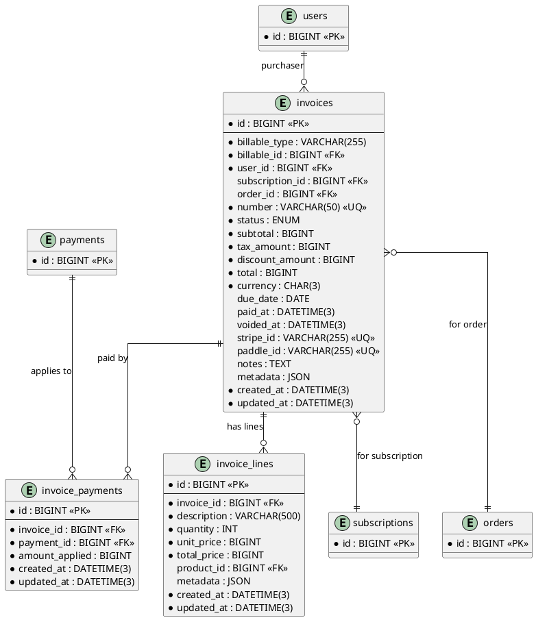

# 06.61 - Invoices

**Project:** GsmUi
**Domain:** Billing - Invoices
**Version:** 1.0.0

---

# Purpose

This document defines the invoice schema for GsmUi billing. Invoices are generated for subscriptions and one-time purchases and use `morphTo` for billable ownership (user or team). Invoices are immutable financial records.

---

# Tables

## invoices

**Purpose:** Generated invoices for subscriptions and one-time purchases.

**Business Rules:**
- Invoice numbers are unique and sequential (`INV-2026-000001`)
- Status transitions: `draft` → `open` → `paid` | `void` | `uncollectible`
- An invoice links to either a `subscription_id` OR an `order_id` (not both)
- Invoices are immutable — corrections via credit notes (future)
- No soft deletes — financial records are preserved forever

**Columns:**

| Column | Type | Nullable | Default | Notes |
|---|---|---|---|---|
| id | BIGINT UNSIGNED | NO | AUTO_INCREMENT | PK |
| billable_type | VARCHAR(255) | NO | — | 'App\Models\User' \| 'App\Models\Team' |
| billable_id | BIGINT UNSIGNED | NO | — | Morph ID |
| user_id | BIGINT UNSIGNED | NO | — | FK → users.id (purchaser) |
| subscription_id | BIGINT UNSIGNED | YES | NULL | FK → subscriptions.id |
| order_id | BIGINT UNSIGNED | YES | NULL | FK → orders.id |
| number | VARCHAR(50) | NO | — | Unique invoice number |
| status | ENUM('draft','open','paid','void','uncollectible') | NO | 'draft' | Invoice state |
| subtotal | BIGINT UNSIGNED | NO | — | Minor units |
| tax_amount | BIGINT UNSIGNED | NO | 0 | Minor units |
| discount_amount | BIGINT UNSIGNED | NO | 0 | Minor units |
| total | BIGINT UNSIGNED | NO | — | Minor units |
| currency | CHAR(3) | NO | 'USD' | ISO 4217 |
| due_date | DATE | YES | NULL | Payment due date |
| paid_at | DATETIME(3) | YES | NULL | NULL = unpaid |
| voided_at | DATETIME(3) | YES | NULL | NULL = not voided |
| stripe_id | VARCHAR(255) | YES | NULL | Unique |
| paddle_id | VARCHAR(255) | YES | NULL | Unique |
| notes | TEXT | YES | NULL | Custom invoice notes |
| metadata | JSON | YES | NULL | Gateway metadata |
| created_at | DATETIME(3) | NO | CURRENT_TIMESTAMP(3) | |
| updated_at | DATETIME(3) | NO | CURRENT_TIMESTAMP(3) | ON UPDATE |

**Indexes:**

```
PRIMARY: id
UNIQUE: invoices_number_unique (number)
INDEX: invoices_billable_type_billable_id_index (billable_type, billable_id)
INDEX: invoices_user_id_index (user_id)
INDEX: invoices_subscription_id_index (subscription_id)
INDEX: invoices_order_id_index (order_id)
INDEX: invoices_status_index (status)
UNIQUE: invoices_stripe_id_unique (stripe_id)
UNIQUE: invoices_paddle_id_unique (paddle_id)
```

**Relationships:**
- morphTo: billable (User | Team)
- belongsTo: User, Subscription, Order
- hasMany: InvoiceLine, InvoicePayment

**Migration:**

```php
Schema::create('invoices', function (Blueprint $table) {
    $table->id();
    $table->string('billable_type');
    $table->unsignedBigInteger('billable_id');
    $table->foreignId('user_id')->constrained();
    $table->foreignId('subscription_id')->nullable()->constrained()->nullOnDelete();
    $table->foreignId('order_id')->nullable()->constrained()->nullOnDelete();
    $table->string('number')->unique();
    $table->enum('status', ['draft', 'open', 'paid', 'void', 'uncollectible'])->default('draft');
    $table->unsignedBigInteger('subtotal');
    $table->unsignedBigInteger('tax_amount')->default(0);
    $table->unsignedBigInteger('discount_amount')->default(0);
    $table->unsignedBigInteger('total');
    $table->char('currency', 3)->default('USD');
    $table->date('due_date')->nullable();
    $table->timestamp('paid_at')->nullable();
    $table->timestamp('voided_at')->nullable();
    $table->string('stripe_id')->nullable()->unique();
    $table->string('paddle_id')->nullable()->unique();
    $table->text('notes')->nullable();
    $table->json('metadata')->nullable();
    $table->timestamps();

    $table->index(['billable_type', 'billable_id']);
});
```

**Eloquent Model:**

```php
class Invoice extends Model
{
    use HasFactory;

    protected $guarded = [];
    protected $casts = [
        'paid_at' => 'datetime',
        'voided_at' => 'datetime',
        'due_date' => 'date',
        'metadata' => 'array',
    ];

    public function billable(): MorphTo
    {
        return $this->morphTo();
    }
}
```

**Events:** InvoiceCreated, InvoicePaid, InvoiceVoided

---

## invoice_lines

**Purpose:** Line items within an invoice.

**Business Rules:**
- Each line has a description and price
- `product_id` is set for product/subscription lines
- Invoice totals are computed from lines
- No soft deletes

**Columns:**

| Column | Type | Nullable | Default | Notes |
|---|---|---|---|---|
| id | BIGINT UNSIGNED | NO | AUTO_INCREMENT | PK |
| invoice_id | BIGINT UNSIGNED | NO | — | FK → invoices.id |
| description | VARCHAR(500) | NO | — | Line description |
| quantity | INT UNSIGNED | NO | 1 | Units |
| unit_price | BIGINT UNSIGNED | NO | — | Minor units |
| total_price | BIGINT UNSIGNED | NO | — | Minor units |
| product_id | BIGINT UNSIGNED | YES | NULL | FK → products.id |
| metadata | JSON | YES | NULL | Line metadata |
| created_at | DATETIME(3) | NO | CURRENT_TIMESTAMP(3) | |
| updated_at | DATETIME(3) | NO | CURRENT_TIMESTAMP(3) | ON UPDATE |

**Indexes:**

```
PRIMARY: id
INDEX: invoice_lines_invoice_id_index (invoice_id)
INDEX: invoice_lines_product_id_index (product_id)
```

**Migration:**

```php
Schema::create('invoice_lines', function (Blueprint $table) {
    $table->id();
    $table->foreignId('invoice_id')->constrained()->cascadeOnDelete();
    $table->string('description', 500);
    $table->unsignedInteger('quantity')->default(1);
    $table->unsignedBigInteger('unit_price');
    $table->unsignedBigInteger('total_price');
    $table->foreignId('product_id')->nullable()->constrained()->nullOnDelete();
    $table->json('metadata')->nullable();
    $table->timestamps();
});
```

---

## invoice_payments

**Purpose:** Links invoices to payments. An invoice may have multiple partial payments.

**Business Rules:**
- One link per invoice/payment pair
- `amount_applied` cannot exceed invoice total
- No soft deletes

**Columns:**

| Column | Type | Nullable | Default | Notes |
|---|---|---|---|---|
| id | BIGINT UNSIGNED | NO | AUTO_INCREMENT | PK |
| invoice_id | BIGINT UNSIGNED | NO | — | FK → invoices.id |
| payment_id | BIGINT UNSIGNED | NO | — | FK → payments.id |
| amount_applied | BIGINT UNSIGNED | NO | — | Minor units |
| created_at | DATETIME(3) | NO | CURRENT_TIMESTAMP(3) | |
| updated_at | DATETIME(3) | NO | CURRENT_TIMESTAMP(3) | ON UPDATE |

**Indexes:**

```
PRIMARY: id
INDEX: invoice_payments_invoice_id_index (invoice_id)
INDEX: invoice_payments_payment_id_index (payment_id)
UNIQUE: invoice_payments_invoice_id_payment_id_unique (invoice_id, payment_id)
```

**Migration:**

```php
Schema::create('invoice_payments', function (Blueprint $table) {
    $table->id();
    $table->foreignId('invoice_id')->constrained()->cascadeOnDelete();
    $table->foreignId('payment_id')->constrained()->cascadeOnDelete();
    $table->unsignedBigInteger('amount_applied');
    $table->timestamps();
    $table->unique(['invoice_id', 'payment_id']);
});
```

---

# Cross-Domain Relationships

## invoices → subscriptions
A subscription invoice links to its `subscriptions.id`. Recurring invoices are generated per billing cycle.

## invoices → orders
A one-time purchase generates an order and an invoice. `invoices.order_id` links the two.

## invoices → payments
Payments are applied to invoices via `invoice_payments`. One payment may pay multiple invoices; one invoice may receive multiple payments.

---

# PlantUML ERD



---

# Invoices Domain - Complete Reference

## Schema Summary

| Table | Purpose | Rows Estimate | Soft Delete |
|---|---|---|---|
| `invoices` | Generated invoices | ~500K | No |
| `invoice_lines` | Line items per invoice | ~2M | No |
| `invoice_payments` | Invoice-to-payment links | ~1M | No |

## Financial Record Immutability

All invoice tables are **immutable** — no soft deletes, no UPDATE operations after creation. Corrections are handled via credit notes (future) or void/reissue patterns.

```php
// Observer to prevent updates to financial records
class InvoiceObserver
{
    public function updating(Invoice $invoice): void
    {
        // Allow only status transitions
        $allowed = ['draft' => ['open'], 'open' => ['paid', 'void', 'uncollectible']];
        
        if (! in_array($invoice->getOriginal('status'), array_keys($allowed)) ||
            ! in_array($invoice->status, $allowed[$invoice->getOriginal('status')] ?? [])) {
            throw new \RuntimeException('Invoice records are immutable');
        }
    }
}
```

## Migration File: 2026_01_01_006101_create_invoices_tables.php

```php
<?php

use Illuminate\Database\Migrations\Migration;
use Illuminate\Database\Schema\Blueprint;
use Illuminate\Support\Facades\Schema;

return new class extends Migration
{
    public function up(): void
    {
        Schema::create('invoices', function (Blueprint $table) {
            $table->id();
            $table->string('billable_type');
            $table->unsignedBigInteger('billable_id');
            $table->foreignId('user_id')->constrained();
            $table->foreignId('subscription_id')->nullable()->constrained()->nullOnDelete();
            $table->foreignId('order_id')->nullable()->constrained()->nullOnDelete();
            $table->string('number')->unique();
            $table->enum('status', ['draft', 'open', 'paid', 'void', 'uncollectible'])->default('draft');
            $table->unsignedBigInteger('subtotal');
            $table->unsignedBigInteger('tax_amount')->default(0);
            $table->unsignedBigInteger('discount_amount')->default(0);
            $table->unsignedBigInteger('total');
            $table->char('currency', 3)->default('USD');
            $table->date('due_date')->nullable();
            $table->timestamp('paid_at')->nullable();
            $table->timestamp('voided_at')->nullable();
            $table->string('stripe_id')->nullable()->unique();
            $table->string('paddle_id')->nullable()->unique();
            $table->text('notes')->nullable();
            $table->json('metadata')->nullable();
            $table->timestamps();

            $table->index(['billable_type', 'billable_id']);
            $table->index(['user_id', 'status']);
            $table->index(['status', 'due_date']);
            $table->index(['created_at', 'status']);
        });

        Schema::create('invoice_lines', function (Blueprint $table) {
            $table->id();
            $table->foreignId('invoice_id')->constrained()->cascadeOnDelete();
            $table->string('description', 500);
            $table->unsignedInteger('quantity')->default(1);
            $table->unsignedBigInteger('unit_price');
            $table->unsignedBigInteger('total_price');
            $table->foreignId('product_id')->nullable()->constrained()->nullOnDelete();
            $table->json('metadata')->nullable();
            $table->timestamps();

            $table->index(['invoice_id', 'product_id']);
        });

        Schema::create('invoice_payments', function (Blueprint $table) {
            $table->id();
            $table->foreignId('invoice_id')->constrained()->cascadeOnDelete();
            $table->foreignId('payment_id')->constrained()->cascadeOnDelete();
            $table->unsignedBigInteger('amount_applied');
            $table->timestamps();

            $table->unique(['invoice_id', 'payment_id']);
            $table->index('payment_id');
        });
    }

    public function down(): void
    {
        Schema::dropIfExists('invoice_payments');
        Schema::dropIfExists('invoice_lines');
        Schema::dropIfExists('invoices');
    }
};
```

## Index Strategy

### invoices

```sql
-- Query pattern: "Get invoices for billable entity"
CREATE INDEX invoices_billable_status 
ON invoices(billable_type, billable_id, status, created_at DESC);

-- Query pattern: "User's invoices"
CREATE INDEX invoices_user_status 
ON invoices(user_id, status, created_at DESC);

-- Query pattern: "Overdue invoices"
CREATE INDEX invoices_status_due 
ON invoices(status, due_date ASC) WHERE status = 'open';

-- Query pattern: "Invoice lookup by number"
CREATE UNIQUE INDEX invoices_number_unique 
ON invoices(number);

-- Query pattern: "Gateway sync by stripe_id"
CREATE UNIQUE INDEX invoices_stripe_id_unique 
ON invoices(stripe_id);

-- Query pattern: "Gateway sync by paddle_id"
CREATE UNIQUE INDEX invoices_paddle_id_unique 
ON invoices(paddle_id);
```

### invoice_lines

```sql
-- Query pattern: "Line items for invoice"
CREATE INDEX invoice_lines_invoice_id 
ON invoice_lines(invoice_id, id);

-- Query pattern: "Find lines by product"
CREATE INDEX invoice_lines_product_id 
ON invoice_lines(product_id, invoice_id);
```

### invoice_payments

```sql
-- Query pattern: "Payments for invoice"
CREATE INDEX invoice_payments_invoice_id 
ON invoice_payments(invoice_id, created_at);

-- Query pattern: "Invoices paid by payment"
CREATE INDEX invoice_payments_payment_id 
ON invoice_payments(payment_id, created_at);

-- Query pattern: "Prevent duplicate payment application"
CREATE UNIQUE INDEX invoice_payments_invoice_id_payment_id_unique 
ON invoice_payments(invoice_id, payment_id);
```

## Data Access Patterns

### Invoice Generation

```php
<?php

namespace App\Domains\Billing\Services;

use App\Domains\Billing\Models\Invoice;
use App\Domains\Billing\Models\InvoiceLine;
use App\Domains\Users\Models\User;

class InvoiceService
{
    public function generateForSubscription(
        \App\Domains\Billing\Models\Subscription $subscription,
        array $lineItems,
    ): Invoice {
        $subtotal = collect($lineItems)->sum(fn ($l) => $l['quantity'] * $l['unit_price']);

        $invoice = Invoice::create([
            'billable_type' => get_class($subscription->billable),
            'billable_id' => $subscription->billable_id,
            'user_id' => $subscription->billable->owner_id ?? $subscription->billable_id,
            'subscription_id' => $subscription->id,
            'number' => $this->generateInvoiceNumber(),
            'status' => 'open',
            'subtotal' => $subtotal,
            'tax_amount' => 0,
            'discount_amount' => 0,
            'total' => $subtotal,
            'currency' => $subscription->currency ?? 'USD',
            'due_date' => now()->addDays(30)->toDateString(),
        ]);

        foreach ($lineItems as $item) {
            InvoiceLine::create([
                'invoice_id' => $invoice->id,
                'description' => $item['description'],
                'quantity' => $item['quantity'],
                'unit_price' => $item['unit_price'],
                'total_price' => $item['quantity'] * $item['unit_price'],
                'product_id' => $item['product_id'] ?? null,
            ]);
        }

        event(new InvoiceCreated($invoice));

        return $invoice;
    }

    private function generateInvoiceNumber(): string
    {
        $year = now()->format('Y');
        $sequence = Invoice::where('number', 'LIKE', "INV-{$year}-%")
            ->count() + 1;

        return sprintf('INV-%s-%06d', $year, $sequence);
    }
}
```

### Invoice Payment Application

```php
<?php

namespace App\Domains\Billing\Services;

use App\Domains\Billing\Models\Invoice;
use App\Domains\Billing\Models\InvoicePayment;
use App\Domains\Billing\Models\Payment;

class InvoicePaymentService
{
    public function applyPayment(Invoice $invoice, Payment $payment, int $amount): InvoicePayment
    {
        // Validate payment amount doesn't exceed invoice total
        $currentTotal = $invoice->invoicePayments()->sum('amount_applied');
        $remaining = $invoice->total - $currentTotal;

        if ($amount > $remaining) {
            throw new \InvalidArgumentException("Payment amount {$amount} exceeds remaining balance {$remaining}");
        }

        $invoicePayment = InvoicePayment::create([
            'invoice_id' => $invoice->id,
            'payment_id' => $payment->id,
            'amount_applied' => $amount,
        ]);

        // Update invoice status if fully paid
        $newTotal = $currentTotal + $amount;
        if ($newTotal >= $invoice->total) {
            $invoice->update(['status' => 'paid', 'paid_at' => now()]);
            event(new InvoicePaid($invoice));
        }

        event(new InvoicePaymentApplied($invoicePayment));

        return $invoicePayment;
    }

    public function getInvoiceBalance(Invoice $invoice): int
    {
        $applied = $invoice->invoicePayments()->sum('amount_applied');
        return $invoice->total - $applied;
    }

    public function voidInvoice(Invoice $invoice, string $reason): void
    {
        if ($invoice->status === 'paid') {
            throw new \RuntimeException('Cannot void a paid invoice. Use refund instead.');
        }

        $invoice->update([
            'status' => 'void',
            'voided_at' => now(),
            'metadata' => array_merge($invoice->metadata ?? [], [
                'void_reason' => $reason,
                'voided_at' => now()->toIso8601String(),
            ]),
        ]);

        event(new InvoiceVoided($invoice, $reason));
    }
}
```

### Invoice Number Generation Service

```php
<?php

namespace App\Domains\Billing\Services;

use App\Domains\Billing\Models\Invoice;
use Illuminate\Support\Facades\Cache;

class InvoiceNumberService
{
    public function generate(): string
    {
        return Cache::lock('invoice_number_generation', 5)->block(10, function () {
            $year = now()->format('Y');
            $prefix = "INV-{$year}-";

            $lastInvoice = Invoice::where('number', 'LIKE', "{$prefix}%")
                ->orderBy('number', 'desc')
                ->first();

            $sequence = 1;
            if ($lastInvoice) {
                $lastSequence = (int) substr($lastInvoice->number, -6);
                $sequence = $lastSequence + 1;
            }

            return $prefix . str_pad($sequence, 6, '0', STR_PAD_LEFT);
        });
    }
}
```

### Overdue Invoice Job

```php
<?php

namespace App\Domains\Billing\Jobs;

use App\Domains\Billing\Models\Invoice;
use Illuminate\Bus\Queueable;
use Illuminate\Contracts\Queue\ShouldQueue;
use Illuminate\Foundation\Bus\Dispatchable;
use Illuminate\Queue\InteractsWithQueue;

class MarkOverdueInvoices implements ShouldQueue
{
    use Dispatchable, InteractsWithQueue, Queueable;

    public function handle(): void
    {
        $overdueInvoices = Invoice::where('status', 'open')
            ->where('due_date', '<', now()->toDateString())
            ->get();

        foreach ($overdueInvoices as $invoice) {
            // Send reminder notification
            event(new InvoiceOverdue($invoice));

            // Update metadata
            $invoice->update([
                'metadata' => array_merge($invoice->metadata ?? [], [
                    'overdue_notified_at' => now()->toIso8601String(),
                    'overdue_days' => now()->diffInDays($invoice->due_date),
                ]),
            ]);
        }
    }
}
```

### Revenue Reporting Query

```sql
-- Monthly revenue by billable type
SELECT 
    billable_type,
    DATE_FORMAT(created_at, '%Y-%m') as month,
    COUNT(*) as invoice_count,
    SUM(total) as total_revenue,
    SUM(tax_amount) as total_tax,
    SUM(total - tax_amount) as net_revenue,
    COUNT(CASE WHEN status = 'paid' THEN 1 END) as paid_count,
    COUNT(CASE WHEN status = 'open' THEN 1 END) as open_count,
    COUNT(CASE WHEN status = 'void' THEN 1 END) as void_count
FROM invoices
WHERE created_at >= DATE_SUB(NOW(), INTERVAL 12 MONTH)
GROUP BY billable_type, DATE_FORMAT(created_at, '%Y-%m')
ORDER BY month DESC, billable_type;
```

```sql
-- Average days to payment
SELECT 
    AVG(DATEDIFF(paid_at, created_at)) as avg_days_to_payment,
    MIN(DATEDIFF(paid_at, created_at)) as min_days,
    MAX(DATEDIFF(paid_at, created_at)) as max_days,
    COUNT(*) as total_paid_invoices
FROM invoices
WHERE status = 'paid'
  AND paid_at IS NOT NULL
  AND created_at >= DATE_SUB(NOW(), INTERVAL 12 MONTH);
```

### Factory

```php
<?php

namespace Database\Factories;

use App\Domains\Billing\Models\Invoice;
use Illuminate\Database\Eloquent\Factories\Factory;

class InvoiceFactory extends Factory
{
    protected $model = Invoice::class;

    public function definition(): array
    {
        $subtotal = fake()->numberBetween(1000, 100000);
        $taxRate = fake()->randomElement([0, 0.05, 0.08, 0.10]);
        $taxAmount = (int) ($subtotal * $taxRate);

        return [
            'billable_type' => 'App\\Models\\User',
            'billable_id' => 1,
            'user_id' => 1,
            'subscription_id' => null,
            'order_id' => null,
            'number' => fn () => app(\App\Domains\Billing\Services\InvoiceNumberService::class)->generate(),
            'status' => fake()->randomElement(['draft', 'open', 'paid', 'void', 'uncollectible']),
            'subtotal' => $subtotal,
            'tax_amount' => $taxAmount,
            'discount_amount' => 0,
            'total' => $subtotal + $taxAmount,
            'currency' => 'USD',
            'due_date' => fake()->dateTimeBetween('+1 week', '+1 month'),
            'paid_at' => null,
            'voided_at' => null,
            'stripe_id' => null,
            'paddle_id' => null,
            'notes' => null,
            'metadata' => null,
        ];
    }

    public function draft(): static
    {
        return $this->state(fn (array $attrs) => ['status' => 'draft']);
    }

    public function open(): static
    {
        return $this->state(fn (array $attrs) => ['status' => 'open']);
    }

    public function paid(): static
    {
        return $this->state(fn (array $attrs) => [
            'status' => 'paid',
            'paid_at' => now(),
        ]);
    }

    public function void(): static
    {
        return $this->state(fn (array $attrs) => [
            'status' => 'void',
            'voided_at' => now(),
        ]);
    }

    public function withLineItems(int $count = 3): static
    {
        return $this->afterCreating(function (Invoice $invoice) use ($count) {
            \Database\Factories\InvoiceLineFactory::new()
                ->count($count)
                ->create(['invoice_id' => $invoice->id]);
        });
    }
}
```

## Observer: InvoiceObserver

```php
<?php

namespace App\Domains\Billing\Observers;

use App\Domains\Billing\Models\Invoice;

class InvoiceObserver
{
    public function created(Invoice $invoice): void
    {
        // Log invoice creation for audit
        \App\Domains\Admin\Models\AuditLog::create([
            'user_id' => $invoice->user_id,
            'action' => 'invoice.created',
            'entity_type' => Invoice::class,
            'entity_id' => $invoice->id,
            'new_values' => [
                'number' => $invoice->number,
                'total' => $invoice->total,
                'currency' => $invoice->currency,
            ],
        ]);
    }

    public function updated(Invoice $invoice): void
    {
        if ($invoice->isDirty('status')) {
            \App\Domains\Admin\Models\AuditLog::create([
                'user_id' => $invoice->user_id,
                'action' => "invoice.{$invoice->status}",
                'entity_type' => Invoice::class,
                'entity_id' => $invoice->id,
                'old_values' => ['status' => $invoice->getOriginal('status')],
                'new_values' => ['status' => $invoice->status],
            ]);
        }
    }
}
```

## Testing Patterns

```php
<?php

namespace Tests\Domains\Billing;

use App\Domains\Billing\Models\Invoice;
use App\Domains\Billing\Models\InvoiceLine;
use App\Domains\Billing\Models\InvoicePayment;
use App\Domains\Billing\Models\Payment;
use App\Domains\Billing\Services\InvoiceNumberService;
use App\Domains\Billing\Services\InvoicePaymentService;
use App\Domains\Billing\Services\InvoiceService;
use Illuminate\Foundation\Testing\RefreshDatabase;
use Tests\TestCase;

class InvoiceTest extends TestCase
{
    use RefreshDatabase;

    public function test_invoice_generation(): void
    {
        $service = new InvoiceService();
        
        $invoice = $service->generateForSubscription(
            \App\Domains\Billing\Models\Subscription::factory()->create(),
            [
                [
                    'description' => 'Pro Plan - Monthly',
                    'quantity' => 1,
                    'unit_price' => 2999,
                ],
            ]
        );

        $this->assertDatabaseHas('invoices', [
            'number' => $invoice->number,
            'status' => 'open',
            'total' => 2999,
        ]);
    }

    public function test_invoice_number_generation(): void
    {
        $service = new InvoiceNumberService();
        
        $number1 = $service->generate();
        $number2 = $service->generate();

        $this->assertStringStartsWith('INV-', $number1);
        $this->assertNotEquals($number1, $number2);
    }

    public function test_payment_application(): void
    {
        $invoice = Invoice::factory()->open()->create(['total' => 10000]);
        $payment = Payment::factory()->create(['amount' => 10000]);
        
        $service = new InvoicePaymentService();
        $invoicePayment = $service->applyPayment($invoice, $payment, 10000);

        $this->assertDatabaseHas('invoice_payments', [
            'invoice_id' => $invoice->id,
            'payment_id' => $payment->id,
            'amount_applied' => 10000,
        ]);

        $this->assertEquals('paid', $invoice->fresh()->status);
    }

    public function test_partial_payment(): void
    {
        $invoice = Invoice::factory()->open()->create(['total' => 10000]);
        $payment = Payment::factory()->create(['amount' => 5000]);
        
        $service = new InvoicePaymentService();
        $service->applyPayment($invoice, $payment, 5000);

        $this->assertEquals('open', $invoice->fresh()->status);
        $this->assertEquals(5000, $service->getInvoiceBalance($invoice));
    }

    public function test_void_invoice(): void
    {
        $invoice = Invoice::factory()->open()->create();
        
        $service = new InvoicePaymentService();
        $service->voidInvoice($invoice, 'Customer requested cancellation');

        $this->assertEquals('void', $invoice->fresh()->status);
        $this->assertNotNull($invoice->fresh()->voided_at);
    }

    public function test_immutability_prevents_direct_update(): void
    {
        $invoice = Invoice::factory()->paid()->create();
        
        $this->expectException(\RuntimeException::class);
        
        $invoice->update(['total' => 999999]);
    }

    public function test_invoice_line_total_calculation(): void
    {
        $invoice = Invoice::factory()->create(['total' => 5000]);
        
        $line = InvoiceLine::create([
            'invoice_id' => $invoice->id,
            'description' => 'Item 1',
            'quantity' => 2,
            'unit_price' => 2500,
            'total_price' => 5000,
        ]);

        $this->assertEquals(5000, $line->total_price);
    }
}
```

---

# Invoice Lifecycle State Machine

## Status Transitions

```
draft → open → paid
                → void
                → uncollectible
```

### State Transition Rules

| From | To | Trigger | Allowed Actions |
|---|---|---|---|
| `draft` | `open` | Invoice finalized | Send to customer |
| `open` | `paid` | Payment received | Record payment |
| `open` | `void` | Admin voids | Cancel invoice |
| `open` | `uncollectible` | Collection failed | Mark uncollectible |

### Invalid Transitions

| From | To | Reason |
|---|---|---|
| `paid` | `void` | Use refund instead |
| `void` | `paid` | Create new invoice |
| `uncollectible` | `paid` | Use refund instead |
| `draft` | `paid` | Must pass through `open` |

## Invoice Number Generation Algorithm

```php
<?php

namespace App\Domains\Billing\Services;

use App\Domains\Billing\Models\Invoice;
use Illuminate\Support\Facades\Cache;
use Illuminate\Support\Facades\DB;

class InvoiceNumberGenerator
{
    private const PREFIX = 'INV';
    private const FORMAT = 'Y'; // Year-based

    public function generate(): string
    {
        return Cache::lock('invoice_number_lock', 10)->block(5, function () {
            $year = now()->format(self::FORMAT);
            $prefix = self::PREFIX . '-' . $year . '-';

            $lastInvoice = DB::table('invoices')
                ->where('number', 'LIKE', $prefix . '%')
                ->orderBy('number', 'desc')
                ->first();

            $sequence = 1;
            if ($lastInvoice) {
                $lastSequence = (int) substr($lastInvoice->number, -6);
                $sequence = $lastSequence + 1;
            }

            return $prefix . str_pad($sequence, 6, '0', STR_PAD_LEFT);
        });
    }

    public function validate(string $number): bool
    {
        return (bool) preg_match('/^INV-\d{4}-\d{6}$/', $number);
    }

    public function parse(string $number): array
    {
        if (! $this->validate($number)) {
            throw new \InvalidArgumentException("Invalid invoice number format: {$number}");
        }

        return [
            'prefix' => substr($number, 0, 3),
            'year' => substr($number, 4, 4),
            'sequence' => (int) substr($number, 9, 6),
        ];
    }
}
```

## Invoice Calculation Service

```php
<?php

namespace App\Domains\Billing\Services;

use App\Domains\Billing\Models\Invoice;
use App\Domains\Billing\Models\InvoiceLine;

class InvoiceCalculationService
{
    public function calculateTotals(Invoice $invoice): Invoice
    {
        $lines = $invoice->lines;

        $subtotal = $lines->sum('total_price');
        $taxAmount = $this->calculateTax($invoice, $subtotal);
        $discountAmount = $this->calculateDiscount($invoice, $subtotal);
        $total = $subtotal + $taxAmount - $discountAmount;

        $invoice->update([
            'subtotal' => $subtotal,
            'tax_amount' => $taxAmount,
            'discount_amount' => $discountAmount,
            'total' => $total,
        ]);

        return $invoice->fresh();
    }

    private function calculateTax(Invoice $invoice, int $subtotal): int
    {
        $taxRate = $this->getTaxRate($invoice->billable_type, $invoice->currency);
        return (int) ($subtotal * $taxRate);
    }

    private function calculateDiscount(Invoice $invoice, int $subtotal): int
    {
        $metadata = $invoice->metadata ?? [];
        $discountPercent = $metadata['discount_percent'] ?? 0;
        $discountAmount = $metadata['discount_amount'] ?? 0;

        if ($discountPercent > 0) {
            return (int) ($subtotal * ($discountPercent / 100));
        }

        return $discountAmount;
    }

    private function getTaxRate(string $billableType, string $currency): float
    {
        // Simplified tax rate lookup
        return match ($currency) {
            'USD' => 0.08,
            'EUR' => 0.21,
            'GBP' => 0.20,
            default => 0.0,
        };
    }

    public function validateLineItem(array $data): array
    {
        $errors = [];

        if (empty($data['description'])) {
            $errors[] = 'Description is required';
        }

        if (! isset($data['quantity']) || $data['quantity'] < 1) {
            $errors[] = 'Quantity must be at least 1';
        }

        if (! isset($data['unit_price']) || $data['unit_price'] < 0) {
            $errors[] = 'Unit price must be non-negative';
        }

        $expectedTotal = ($data['quantity'] ?? 0) * ($data['unit_price'] ?? 0);
        if (isset($data['total_price']) && $data['total_price'] !== $expectedTotal) {
            $errors[] = "Total price mismatch: expected {$expectedTotal}, got {$data['total_price']}";
        }

        return $errors;
    }
}
```

## Invoice Export Service

```php
<?php

namespace App\Domains\Billing\Services;

use App\Domains\Billing\Models\Invoice;
use Illuminate\Support\Facades\Storage;

class InvoiceExportService
{
    public function exportToPdf(Invoice $invoice): string
    {
        $html = view('invoices.pdf', [
            'invoice' => $invoice->load(['lines', 'billable', 'user']),
            'company' => $this->getCompanyInfo(),
        ])->render();

        $pdf = app('dompdf.wrapper')->loadHtml($html);
        $filename = "invoices/{$invoice->number}.pdf";

        Storage::disk('local')->put($filename, $pdf->output());

        return $filename;
    }

    public function exportToCsv(int $startYear, int $endYear): string
    {
        $invoices = Invoice::where('status', 'paid')
            ->whereYear('created_at', '>=', $startYear)
            ->whereYear('created_at', '<=', $endYear)
            ->with(['lines', 'billable'])
            ->get();

        $headers = [
            'Invoice Number',
            'Date',
            'Customer',
            'Subtotal',
            'Tax',
            'Discount',
            'Total',
            'Currency',
            'Status',
        ];

        $rows = $invoices->map(function ($invoice) {
            return [
                $invoice->number,
                $invoice->created_at->format('Y-m-d'),
                $invoice->billable->name ?? 'Unknown',
                number_format($invoice->subtotal / 100, 2),
                number_format($invoice->tax_amount / 100, 2),
                number_format($invoice->discount_amount / 100, 2),
                number_format($invoice->total / 100, 2),
                $invoice->currency,
                $invoice->status,
            ];
        });

        $csv = implode("\n", array_map('fputcsv', array_merge([$headers], $rows->toArray())));
        $filename = "exports/invoices_{$startYear}_{$endYear}.csv";

        Storage::disk('local')->put($filename, $csv);

        return $filename;
    }

    private function getCompanyInfo(): array
    {
        return [
            'name' => config('app.name'),
            'address' => config('company.address'),
            'email' => config('company.email'),
            'tax_id' => config('company.tax_id'),
        ];
    }
}
```

## Invoice Webhook Events

```php
<?php

namespace App\Domains\Billing\Events;

use App\Domains\Billing\Models\Invoice;

class InvoiceCreated
{
    public function __construct(
        public Invoice $invoice,
    ) {}
}

class InvoicePaid
{
    public function __construct(
        public Invoice $invoice,
    ) {}
}

class InvoiceVoided
{
    public function __construct(
        public Invoice $invoice,
        public string $reason,
    ) {}
}

class InvoiceOverdue
{
    public function __construct(
        public Invoice $invoice,
    ) {}
}

class InvoicePaymentApplied
{
    public function __construct(
        public \App\Domains\Billing\Models\InvoicePayment $payment,
    ) {}
}
```

## Invoice Notification Templates

```php
<?php

namespace App\Domains\Notifications\Services;

use App\Domains\Billing\Models\Invoice;

class InvoiceNotificationService
{
    public function sendInvoiceCreated(Invoice $invoice): void
    {
        $user = $invoice->user;

        \App\Domains\Notifications\Models\Notification::create([
            'user_id' => $user->id,
            'type' => 'billing',
            'title' => 'New Invoice',
            'body' => "Invoice {$invoice->number} for " . number_format($invoice->total / 100, 2) . " {$invoice->currency}",
            'data' => [
                'invoice_id' => $invoice->id,
                'invoice_number' => $invoice->number,
                'total' => $invoice->total,
                'currency' => $invoice->currency,
                'due_date' => $invoice->due_date,
            ],
            'action_url' => "/invoices/{$invoice->number}",
        ]);
    }

    public function sendInvoicePaid(Invoice $invoice): void
    {
        $user = $invoice->user;

        \App\Domains\Notifications\Models\Notification::create([
            'user_id' => $user->id,
            'type' => 'billing',
            'title' => 'Payment Received',
            'body' => "Payment for invoice {$invoice->number} has been received.",
            'data' => [
                'invoice_id' => $invoice->id,
                'invoice_number' => $invoice->number,
                'amount_paid' => $invoice->total,
                'currency' => $invoice->currency,
            ],
            'action_url' => "/invoices/{$invoice->number}",
        ]);
    }

    public function sendInvoiceOverdue(Invoice $invoice): void
    {
        $user = $invoice->user;
        $daysOverdue = now()->diffInDays($invoice->due_date);

        \App\Domains\Notifications\Models\Notification::create([
            'user_id' => $user->id,
            'type' => 'billing',
            'title' => 'Invoice Overdue',
            'body' => "Invoice {$invoice->number} is {$daysOverdue} days overdue. Amount: " . number_format($invoice->total / 100, 2) . " {$invoice->currency}",
            'data' => [
                'invoice_id' => $invoice->id,
                'invoice_number' => $invoice->number,
                'total' => $invoice->total,
                'currency' => $invoice->currency,
                'due_date' => $invoice->due_date,
                'days_overdue' => $daysOverdue,
            ],
            'action_url' => "/invoices/{$invoice->number}",
        ]);
    }
}
```

## Reporting Queries

### Monthly Revenue Summary

```sql
SELECT 
    DATE_FORMAT(created_at, '%Y-%m') as month,
    COUNT(*) as total_invoices,
    COUNT(CASE WHEN status = 'paid' THEN 1 END) as paid_invoices,
    COUNT(CASE WHEN status = 'open' THEN 1 END) as open_invoices,
    COUNT(CASE WHEN status = 'void' THEN 1 END) as void_invoices,
    SUM(total) as gross_revenue,
    SUM(CASE WHEN status = 'paid' THEN total ELSE 0 END) as collected_revenue,
    SUM(tax_amount) as total_tax,
    AVG(total) as avg_invoice_value
FROM invoices
WHERE created_at >= DATE_SUB(NOW(), INTERVAL 12 MONTH)
GROUP BY DATE_FORMAT(created_at, '%Y-%m')
ORDER BY month DESC;
```

### Customer Revenue Analysis

```sql
SELECT 
    u.id as user_id,
    u.name,
    u.email,
    COUNT(i.id) as invoice_count,
    SUM(i.total) as total_revenue,
    AVG(i.total) as avg_invoice_value,
    MIN(i.created_at) as first_invoice,
    MAX(i.created_at) as last_invoice
FROM invoices i
JOIN users u ON i.user_id = u.id
WHERE i.status = 'paid'
  AND i.created_at >= DATE_SUB(NOW(), INTERVAL 12 MONTH)
GROUP BY u.id, u.name, u.email
ORDER BY total_revenue DESC
LIMIT 50;
```

### Payment Method Analysis

```sql
SELECT 
    CASE 
        WHEN i.stripe_id IS NOT NULL THEN 'Stripe'
        WHEN i.paddle_id IS NOT NULL THEN 'Paddle'
        ELSE 'Other'
    END as payment_method,
    COUNT(*) as invoice_count,
    SUM(i.total) as total_revenue,
    AVG(i.total) as avg_value
FROM invoices i
WHERE i.status = 'paid'
GROUP BY payment_method
ORDER BY total_revenue DESC;
```

---

# Invoice Multi-Currency Support

## Currency Handling

```php
<?php

namespace App\Domains\Billing\Services;

class InvoiceCurrencyService
{
    private array $supportedCurrencies = [
        'USD' => ['symbol' => '$', 'decimals' => 2, 'position' => 'before'],
        'EUR' => ['symbol' => '€', 'decimals' => 2, 'position' => 'before'],
        'GBP' => ['symbol' => '£', 'decimals' => 2, 'position' => 'before'],
        'JPY' => ['symbol' => '¥', 'decimals' => 0, 'position' => 'before'],
        'SAR' => ['symbol' => 'ر.س', 'decimals' => 2, 'position' => 'after'],
    ];

    public function formatAmount(int $amountInCents, string $currency): string
    {
        $config = $this->supportedCurrencies[$currency] ?? ['symbol' => $currency, 'decimals' => 2, 'position' => 'before'];
        
        $amount = $amountInCents / pow(10, $config['decimals']);
        $formatted = number_format($amount, $config['decimals']);

        return $config['position'] === 'before'
            ? $config['symbol'] . $formatted
            : $formatted . ' ' . $config['symbol'];
    }

    public function convertAmount(int $amount, string $fromCurrency, string $toCurrency, float $rate): int
    {
        if ($fromCurrency === $toCurrency) {
            return $amount;
        }

        return (int) round($amount * $rate);
    }

    public function getExchangeRate(string $from, string $to): float
    {
        // In production, fetch from exchange rate API
        $rates = [
            'USD_EUR' => 0.92,
            'USD_GBP' => 0.79,
            'USD_JPY' => 149.5,
            'EUR_USD' => 1.09,
            'GBP_USD' => 1.27,
        ];

        return $rates["{$from}_{$to}"] ?? 1.0;
    }
}
```

## Invoice Aging Report

```php
<?php

namespace App\Domains\Billing\Services;

class InvoiceAgingService
{
    public function getAgingReport(): array
    {
        $invoices = DB::table('invoices')
            ->where('status', 'open')
            ->selectRaw('
                *,
                DATEDIFF(NOW(), created_at) as days_open,
                CASE
                    WHEN DATEDIFF(NOW(), created_at) <= 30 THEN "0-30 days"
                    WHEN DATEDIFF(NOW(), created_at) <= 60 THEN "31-60 days"
                    WHEN DATEDIFF(NOW(), created_at) <= 90 THEN "61-90 days"
                    ELSE "90+ days"
                END as aging_bucket
            ')
            ->get()
            ->groupBy('aging_bucket');

        $report = [];
        foreach ($invoices as $bucket => $group) {
            $report[$bucket] = [
                'count' => count($group),
                'total' => collect($group)->sum('total'),
                'invoices' => collect($group)->map(fn ($inv) => [
                    'number' => $inv->number,
                    'total' => $inv->total,
                    'days_open' => $inv->days_open,
                ])->toArray(),
            ];
        }

        return $report;
    }
}
```

---

# Invoice Testing

## Unit Tests

```php
<?php

namespace Tests\Domains\Billing;

use App\Domains\Billing\Models\Invoice;
use App\Domains\Billing\Models\InvoiceLine;
use App\Domains\Billing\Models\InvoicePayment;
use App\Domains\Billing\Models\Payment;
use App\Domains\Billing\Services\InvoiceNumberGenerator;
use App\Domains\Billing\Services\InvoiceService;
use App\Domains\Billing\Services\InvoicePaymentService;
use App\Domains\Billing\Services\InvoiceCalculationService;
use Illuminate\Foundation\Testing\RefreshDatabase;
use Tests\TestCase;

class InvoiceServiceTest extends TestCase
{
    use RefreshDatabase;

    public function test_invoice_number_generation(): void
    {
        $generator = new InvoiceNumberGenerator();
        
        $number1 = $generator->generate();
        $number2 = $generator->generate();

        $this->assertStringStartsWith('INV-', $number1);
        $this->assertNotEquals($number1, $number2);
        $this->assertTrue($generator->validate($number1));
    }

    public function test_invoice_creation(): void
    {
        $service = new InvoiceService();
        
        $invoice = $service->generateForSubscription(
            \App\Domains\Billing\Models\Subscription::factory()->create(),
            [
                [
                    'description' => 'Pro Plan - Monthly',
                    'quantity' => 1,
                    'unit_price' => 2999,
                ],
            ]
        );

        $this->assertDatabaseHas('invoices', [
            'number' => $invoice->number,
            'status' => 'open',
            'total' => 2999,
        ]);
    }

    public function test_payment_application(): void
    {
        $invoice = Invoice::factory()->open()->create(['total' => 10000]);
        $payment = Payment::factory()->create(['amount' => 10000]);
        
        $service = new InvoicePaymentService();
        $invoicePayment = $service->applyPayment($invoice, $payment, 10000);

        $this->assertDatabaseHas('invoice_payments', [
            'invoice_id' => $invoice->id,
            'payment_id' => $payment->id,
            'amount_applied' => 10000,
        ]);

        $this->assertEquals('paid', $invoice->fresh()->status);
    }

    public function test_partial_payment(): void
    {
        $invoice = Invoice::factory()->open()->create(['total' => 10000]);
        $payment = Payment::factory()->create(['amount' => 5000]);
        
        $service = new InvoicePaymentService();
        $service->applyPayment($invoice, $payment, 5000);

        $this->assertEquals('open', $invoice->fresh()->status);
        $this->assertEquals(5000, $service->getInvoiceBalance($invoice));
    }

    public function test_void_invoice(): void
    {
        $invoice = Invoice::factory()->open()->create();
        
        $service = new InvoicePaymentService();
        $service->voidInvoice($invoice, 'Customer requested cancellation');

        $this->assertEquals('void', $invoice->fresh()->status);
        $this->assertNotNull($invoice->fresh()->voided_at);
    }

    public function test_immutability_prevents_direct_update(): void
    {
        $invoice = Invoice::factory()->paid()->create();
        
        $this->expectException(\RuntimeException::class);
        
        $invoice->update(['total' => 999999]);
    }

    public function test_invoice_calculation(): void
    {
        $invoice = Invoice::factory()->create(['total' => 0]);
        
        InvoiceLine::create([
            'invoice_id' => $invoice->id,
            'description' => 'Item 1',
            'quantity' => 2,
            'unit_price' => 2500,
            'total_price' => 5000,
        ]);

        InvoiceLine::create([
            'invoice_id' => $invoice->id,
            'description' => 'Item 2',
            'quantity' => 1,
            'unit_price' => 3000,
            'total_price' => 3000,
        ]);

        $service = new InvoiceCalculationService();
        $calculated = $service->calculateTotals($invoice);

        $this->assertEquals(8000, $calculated->subtotal);
    }

    public function test_currency_formatting(): void
    {
        $service = new \App\Domains\Billing\Services\InvoiceCurrencyService();
        
        $this->assertEquals('$29.99', $service->formatAmount(2999, 'USD'));
        $this->assertEquals('€29.99', $service->formatAmount(2999, 'EUR'));
        $this->assertEquals('£29.99', $service->formatAmount(2999, 'GBP'));
    }
}
```

## Integration Tests

```php
<?php

namespace Tests\Domains\Billing;

use App\Domains\Billing\Events\InvoiceCreated;
use App\Domains\Billing\Events\InvoicePaid;
use App\Domains\Billing\Models\Invoice;
use App\Domains\Billing\Services\InvoiceService;
use App\Domains\Users\Models\User;
use Illuminate\Foundation\Testing\RefreshDatabase;
use Illuminate\Support\Facades\Event;
use Tests\TestCase;

class InvoiceIntegrationTest extends TestCase
{
    use RefreshDatabase;

    public function test_invoice_creation_event(): void
    {
        Event::fake();
        $service = new InvoiceService();
        
        $invoice = $service->generateForSubscription(
            \App\Domains\Billing\Models\Subscription::factory()->create(),
            [
                [
                    'description' => 'Test Plan',
                    'quantity' => 1,
                    'unit_price' => 1000,
                ],
            ]
        );

        Event::assertDispatched(InvoiceCreated::class);
    }

    public function test_invoice_payment_event(): void
    {
        Event::fake();
        $invoice = Invoice::factory()->open()->create(['total' => 5000]);
        $payment = Payment::factory()->create(['amount' => 5000]);
        
        $service = new InvoicePaymentService();
        $service->applyPayment($invoice, $payment, 5000);

        Event::assertDispatched(InvoicePaid::class);
    }
}
```

---

# Invoice Console Commands

## Command: InvoiceOverdueCheck

```php
<?php

namespace App\Domains\Billing\Console;

use App\Domains\Billing\Models\Invoice;
use App\Domains\Billing\Services\InvoiceNotificationService;
use Illuminate\Console\Command;

class InvoiceOverdueCheckCommand extends Command
{
    protected $signature = 'invoices:check-overdue';
    protected $description = 'Check for overdue invoices and send notifications';

    public function handle(): int
    {
        $overdueInvoices = Invoice::where('status', 'open')
            ->where('due_date', '<', now()->toDateString())
            ->get();

        $notificationService = new InvoiceNotificationService();

        foreach ($overdueInvoices as $invoice) {
            $notificationService->sendInvoiceOverdue($invoice);
        }

        $this->info("Checked " . $overdueInvoices->count() . " overdue invoices.");

        return self::SUCCESS;
    }
}
```

## Command: InvoiceGenerateReport

```php
<?php

namespace App\Domains\Billing\Console;

use App\Domains\Billing\Models\Invoice;
use Illuminate\Console\Command;

class InvoiceGenerateReportCommand extends Command
{
    protected $signature = 'invoices:report {--month= : YYYY-MM format}';
    protected $description = 'Generate monthly invoice report';

    public function handle(): int
    {
        $month = $this->option('month') ?? now()->subMonth()->format('Y-m');

        $stats = Invoice::whereRaw('DATE_FORMAT(created_at, "%Y-%m") = ?', [$month])
            ->selectRaw('
                COUNT(*) as total,
                SUM(CASE WHEN status = "paid" THEN 1 ELSE 0 END) as paid,
                SUM(CASE WHEN status = "open" THEN 1 ELSE 0 END) as open,
                SUM(CASE WHEN status = "void" THEN 1 ELSE 0 END) as void,
                SUM(total) as total_amount,
                SUM(CASE WHEN status = "paid" THEN total ELSE 0 END) as collected_amount
            ')
            ->first();

        $this->table(
            ['Metric', 'Value'],
            [
                ['Total Invoices', $stats->total],
                ['Paid', $stats->paid],
                ['Open', $stats->open],
                ['Void', $stats->void],
                ['Total Amount', number_format($stats->total_amount / 100, 2)],
                ['Collected', number_format($stats->collected_amount / 100, 2)],
            ]
        );

        return self::SUCCESS;
    }
}
```

---

# Invoice Monitoring Dashboard

## Key Metrics Dashboard

```php
<?php

namespace App\Domains\Billing\Widgets;

use App\Domains\Billing\Models\Invoice;
use Illuminate\Support\Facades\DB;

class InvoiceDashboardWidget
{
    public function getOverview(int $days = 30): array
    {
        return [
            'total_invoices' => $this->getInvoiceCount($days),
            'total_revenue' => $this->getTotalRevenue($days),
            'collected_revenue' => $this->getCollectedRevenue($days),
            'pending_revenue' => $this->getPendingRevenue($days),
            'avg_invoice_value' => $this->getAvgInvoiceValue($days),
            'overdue_count' => $this->getOverdueCount(),
        ];
    }

    private function getInvoiceCount(int $days): int
    {
        return Invoice::where('created_at', '>=', now()->subDays($days))->count();
    }

    private function getTotalRevenue(int $days): int
    {
        return Invoice::where('created_at', '>=', now()->subDays($days))->sum('total');
    }

    private function getCollectedRevenue(int $days): int
    {
        return Invoice::where('created_at', '>=', now()->subDays($days))
            ->where('status', 'paid')
            ->sum('total');
    }

    private function getPendingRevenue(int $days): int
    {
        return Invoice::where('created_at', '>=', now()->subDays($days))
            ->where('status', 'open')
            ->sum('total');
    }

    private function getAvgInvoiceValue(int $days): float
    {
        return Invoice::where('created_at', '>=', now()->subDays($days))->avg('total') ?? 0;
    }

    private function getOverdueCount(): int
    {
        return Invoice::where('status', 'open')
            ->where('due_date', '<', now()->toDateString())
            ->count();
    }
}
```

---

# Invoice Integration Points

## Customer Domain Integration

| Integration | Table | Column | Description |
|---|---|---|---|
| Invoice → Customer | `customers` | `id` | `customer_id` FK on invoices |
| Invoice → Contact | `contacts` | `id` | `billing_contact_id` FK on invoices |
| Invoice → Address | `addresses` | `id` | `billing_address_id` FK on invoices |

## Accounting Domain Integration

| Integration | Table | Column | Description |
|---|---|---|---|
| Invoice → Journal Entry | `journal_entries` | `invoice_id` | Double-entry bookkeeping |
| Invoice → Chart of Accounts | `chart_of_accounts` | `id` | Revenue account mapping |

## Subscription Domain Integration

| Integration | Table | Column | Description |
|---|---|---|---|
| Invoice → Subscription | `subscriptions` | `id` | `subscription_id` FK on invoices |
| Invoice → Plan | `plans` | `id` | Plan pricing snapshot |

## Notification Domain Integration

| Integration | Table | Column | Description |
|---|---|---|---|
| Invoice → Notification Log | `notification_logs` | `notifiable_id` | Invoice notification tracking |
| Invoice → Email Template | `email_templates` | `id` | Invoice email template |

## Reporting Domain Integration

| Integration | Table | Column | Description |
|---|---|---|---|
| Invoice → Report Snapshot | `report_snapshots` | `entity_id` | Monthly revenue snapshots |
| Invoice → Dashboard Metric | `dashboard_metrics` | `entity_id` | Real-time invoice metrics |

## Webhook Domain Integration

| Integration | Table | Column | Description |
|---|---|---|---|
| Invoice → Webhook Delivery | `webhook_deliveries` | `entity_id` | Invoice event webhooks |
| Invoice → Webhook Log | `webhook_logs` | `invoice_id` | Webhook execution logs |

---

# Invoice Factory & Seeders

## Invoice Factory

```php
<?php

namespace Database\Factories\Domains\Billing;

use App\Domains\Billing\Models\Invoice;
use App\Domains\Customers\Models\Customer;
use Illuminate\Database\Eloquent\Factories\Factory;

class InvoiceFactory extends Factory
{
    protected $model = Invoice::class;

    public function definition(): array
    {
        return [
            'customer_id' => Customer::factory(),
            'invoice_number' => 'INV-' . $this->faker->unique()->numerify('######'),
            'status' => $this->faker->randomElement(['draft', 'open', 'paid', 'void']),
            'currency' => 'USD',
            'subtotal' => $this->faker->numberBetween(1000, 1000000),
            'tax_amount' => $this->faker->numberBetween(0, 100000),
            'total' => $this->faker->numberBetween(1000, 1100000),
            'amount_paid' => 0,
            'amount_due' => $this->faker->numberBetween(1000, 1100000),
            'due_date' => $this->faker->dateTimeBetween('+7 days', '+60 days'),
            'notes' => $this->faker->optional()->sentence(),
            'metadata' => [],
        ];
    }

    public function paid(): static
    {
        return $this->state(fn (array $attributes) => [
            'status' => 'paid',
            'amount_paid' => $attributes['total'],
            'amount_due' => 0,
        ]);
    }

    public function overdue(): static
    {
        return $this->state(fn (array $attributes) => [
            'status' => 'open',
            'due_date' => $this->faker->dateTimeBetween('-30 days', '-1 day'),
        ]);
    }

    public function withLineItems(int $count = 3): static
    {
        return $this->afterCreating(function (Invoice $invoice) use ($count) {
            for ($i = 0; $i < $count; $i++) {
                $invoice->lineItems()->create([
                    'description' => $this->faker->words(3, true),
                    'quantity' => $this->faker->numberBetween(1, 10),
                    'unit_price' => $this->faker->numberBetween(100, 50000),
                    'total' => $this->faker->numberBetween(100, 500000),
                ]);
            }
        });
    }
}
```

## Invoice Seeder

```php
<?php

namespace Database\Seeders;

use App\Domains\Billing\Models\Invoice;
use App\Domains\Customers\Models\Customer;
use Illuminate\Database\Seeder;

class InvoiceSeeder extends Seeder
{
    public function run(): void
    {
        $customers = Customer::factory()->count(20)->create();

        foreach ($customers as $customer) {
            Invoice::factory()
                ->count(rand(1, 5))
                ->withLineItems(rand(2, 6))
                ->create(['customer_id' => $customer->id]);
        }
    }
}
```

---

# Next Document

**06.62 - Payments** defines payment records, methods, refunds, status histories, and webhook delivery tables.
