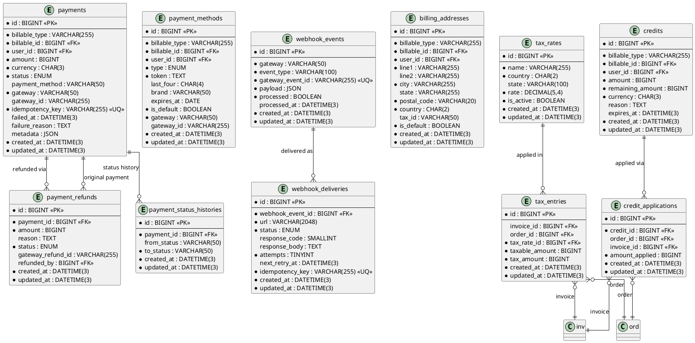

# 06.62 - Payments

**Project:** GsmUi
**Domain:** Billing - Payments
**Version:** 1.0.0

---

# Purpose

This document defines the payment infrastructure schema: payment records, stored payment methods, refunds, status histories, webhook event storage, webhook delivery tracking, billing addresses, tax rates, tax entries, and account credits. All records here are immutable financial/audit data.

---

# Tables

## payments

**Purpose:** Payment records from payment gateways (Stripe, Paddle, Lemon Squeezy).

**Business Rules:**
- Payments are immutable — corrections via `payment_refunds`
- `idempotency_key` prevents duplicate writes
- Statuses: `pending` → `processing` → `succeeded` | `failed` | `refunded` | `partially_refunded`
- At most one gateway ID populated per record
- No soft deletes

**Columns:**

| Column | Type | Nullable | Default | Notes |
|---|---|---|---|---|
| id | BIGINT UNSIGNED | NO | AUTO_INCREMENT | PK |
| billable_type | VARCHAR(255) | NO | — | 'App\Models\User' \| 'App\Models\Team' |
| billable_id | BIGINT UNSIGNED | NO | — | Morph ID |
| user_id | BIGINT UNSIGNED | NO | — | FK → users.id |
| amount | BIGINT UNSIGNED | NO | — | Minor units |
| currency | CHAR(3) | NO | 'USD' | ISO 4217 |
| status | ENUM('pending','processing','succeeded','failed','refunded','partially_refunded') | NO | 'pending' | Payment state |
| payment_method | VARCHAR(50) | YES | NULL | card, paypal, bank_transfer |
| gateway | VARCHAR(50) | NO | — | stripe, paddle, lemon_squeezy |
| gateway_id | VARCHAR(255) | YES | NULL | Gateway transaction ID |
| idempotency_key | VARCHAR(255) | NO | — | Unique |
| failed_at | DATETIME(3) | YES | NULL | NULL = not failed |
| failure_reason | TEXT | YES | NULL | Gateway error |
| metadata | JSON | YES | NULL | Gateway metadata |
| created_at | DATETIME(3) | NO | CURRENT_TIMESTAMP(3) | |
| updated_at | DATETIME(3) | NO | CURRENT_TIMESTAMP(3) | ON UPDATE |

**Indexes:**

```
PRIMARY: id
UNIQUE: payments_idempotency_key_unique (idempotency_key)
INDEX: payments_billable_type_billable_id_index (billable_type, billable_id)
INDEX: payments_user_id_index (user_id)
INDEX: payments_status_index (status)
INDEX: payments_gateway_gateway_id_index (gateway, gateway_id)
INDEX: payments_created_at_index (created_at)
```

**Migration:**

```php
Schema::create('payments', function (Blueprint $table) {
    $table->id();
    $table->string('billable_type');
    $table->unsignedBigInteger('billable_id');
    $table->foreignId('user_id')->constrained();
    $table->unsignedBigInteger('amount');
    $table->char('currency', 3)->default('USD');
    $table->enum('status', ['pending', 'processing', 'succeeded', 'failed', 'refunded', 'partially_refunded'])->default('pending');
    $table->string('payment_method')->nullable();
    $table->string('gateway');
    $table->string('gateway_id')->nullable();
    $table->string('idempotency_key')->unique();
    $table->timestamp('failed_at')->nullable();
    $table->text('failure_reason')->nullable();
    $table->json('metadata')->nullable();
    $table->timestamps();

    $table->index(['billable_type', 'billable_id']);
    $table->index(['gateway', 'gateway_id']);
});
```

**Events:** PaymentSucceeded, PaymentFailed, PaymentRefunded

---

## payment_methods

**Purpose:** Stored payment methods for users/teams (saved cards, PayPal accounts).

**Business Rules:**
- `token` is encrypted (AES-256) — never stored in plaintext
- One default payment method per billable entity
- No soft deletes — removal deletes the record

**Columns:**

| Column | Type | Nullable | Default | Notes |
|---|---|---|---|---|
| id | BIGINT UNSIGNED | NO | AUTO_INCREMENT | PK |
| billable_type | VARCHAR(255) | NO | — | 'App\Models\User' \| 'App\Models\Team' |
| billable_id | BIGINT UNSIGNED | NO | — | Morph ID |
| user_id | BIGINT UNSIGNED | NO | — | FK → users.id |
| type | ENUM('card','paypal','bank_transfer') | NO | — | Method type |
| token | TEXT | NO | — | Encrypted token |
| last_four | CHAR(4) | YES | NULL | Card last 4 digits |
| brand | VARCHAR(50) | YES | NULL | visa, mastercard |
| expires_at | DATE | YES | NULL | Card expiry |
| is_default | BOOLEAN | NO | false | Default flag |
| gateway | VARCHAR(50) | NO | — | Gateway name |
| gateway_id | VARCHAR(255) | YES | NULL | Gateway method ID |
| created_at | DATETIME(3) | NO | CURRENT_TIMESTAMP(3) | |
| updated_at | DATETIME(3) | NO | CURRENT_TIMESTAMP(3) | ON UPDATE |

**Indexes:**

```
PRIMARY: id
INDEX: payment_methods_billable_type_billable_id_index (billable_type, billable_id)
INDEX: payment_methods_user_id_index (user_id)
INDEX: payment_methods_is_default_index (is_default)
```

**Migration:**

```php
Schema::create('payment_methods', function (Blueprint $table) {
    $table->id();
    $table->string('billable_type');
    $table->unsignedBigInteger('billable_id');
    $table->foreignId('user_id')->constrained();
    $table->enum('type', ['card', 'paypal', 'bank_transfer']);
    $table->text('token');
    $table->char('last_four', 4)->nullable();
    $table->string('brand')->nullable();
    $table->date('expires_at')->nullable();
    $table->boolean('is_default')->default(false);
    $table->string('gateway');
    $table->string('gateway_id')->nullable();
    $table->timestamps();

    $table->index(['billable_type', 'billable_id']);
});
```

---

## payment_refunds

**Purpose:** Refund records linked to payments.

**Business Rules:**
- Refunds are immutable
- `amount` cannot exceed original payment amount
- Statuses: `pending` → `succeeded` | `failed`
- No soft deletes

**Columns:**

| Column | Type | Nullable | Default | Notes |
|---|---|---|---|---|
| id | BIGINT UNSIGNED | NO | AUTO_INCREMENT | PK |
| payment_id | BIGINT UNSIGNED | NO | — | FK → payments.id |
| amount | BIGINT UNSIGNED | NO | — | Minor units |
| reason | TEXT | YES | NULL | Refund reason |
| status | ENUM('pending','succeeded','failed') | NO | 'pending' | Refund state |
| gateway_refund_id | VARCHAR(255) | YES | NULL | Gateway refund ID |
| refunded_by | BIGINT UNSIGNED | YES | NULL | FK → users.id |
| created_at | DATETIME(3) | NO | CURRENT_TIMESTAMP(3) | |
| updated_at | DATETIME(3) | NO | CURRENT_TIMESTAMP(3) | ON UPDATE |

**Indexes:**

```
PRIMARY: id
INDEX: payment_refunds_payment_id_index (payment_id)
INDEX: payment_refunds_status_index (status)
INDEX: payment_refunds_created_at_index (created_at)
```

**Migration:**

```php
Schema::create('payment_refunds', function (Blueprint $table) {
    $table->id();
    $table->foreignId('payment_id')->constrained()->cascadeOnDelete();
    $table->unsignedBigInteger('amount');
    $table->text('reason')->nullable();
    $table->enum('status', ['pending', 'succeeded', 'failed'])->default('pending');
    $table->string('gateway_refund_id')->nullable();
    $table->foreignId('refunded_by')->nullable()->constrained('users')->nullOnDelete();
    $table->timestamps();
});
```

---

## payment_status_histories

**Purpose:** Immutable audit trail of payment status transitions.

**Columns:**

| Column | Type | Nullable | Default | Notes |
|---|---|---|---|---|
| id | BIGINT UNSIGNED | NO | AUTO_INCREMENT | PK |
| payment_id | BIGINT UNSIGNED | NO | — | FK → payments.id |
| from_status | VARCHAR(50) | YES | NULL | Previous status |
| to_status | VARCHAR(50) | NO | — | New status |
| created_at | DATETIME(3) | NO | CURRENT_TIMESTAMP(3) | |
| updated_at | DATETIME(3) | NO | CURRENT_TIMESTAMP(3) | ON UPDATE |

**Indexes:**

```
PRIMARY: id
INDEX: payment_status_histories_payment_id_index (payment_id)
INDEX: payment_status_histories_created_at_index (created_at)
```

**Migration:**

```php
Schema::create('payment_status_histories', function (Blueprint $table) {
    $table->id();
    $table->foreignId('payment_id')->constrained()->cascadeOnDelete();
    $table->string('from_status')->nullable();
    $table->string('to_status');
    $table->timestamps();
});
```

---

## webhook_events

**Purpose:** Raw webhook payloads received from payment gateways. Used for idempotency and debugging.

**Business Rules:**
- `gateway_event_id` is unique per gateway — prevents duplicate processing
- `payload` stored as JSON for replay/debugging
- `processed` flag tracks handler completion
- No soft deletes

**Columns:**

| Column | Type | Nullable | Default | Notes |
|---|---|---|---|---|
| id | BIGINT UNSIGNED | NO | AUTO_INCREMENT | PK |
| gateway | VARCHAR(50) | NO | — | stripe, paddle, lemon_squeezy |
| event_type | VARCHAR(100) | NO | — | invoice.created, customer.subscription.updated |
| gateway_event_id | VARCHAR(255) | NO | — | Unique per gateway |
| payload | JSON | NO | — | Raw payload |
| processed | BOOLEAN | NO | false | Handler done |
| processed_at | DATETIME(3) | YES | NULL | NULL = pending |
| created_at | DATETIME(3) | NO | CURRENT_TIMESTAMP(3) | |
| updated_at | DATETIME(3) | NO | CURRENT_TIMESTAMP(3) | ON UPDATE |

**Indexes:**

```
PRIMARY: id
UNIQUE: webhook_events_gateway_event_id_unique (gateway_event_id)
INDEX: webhook_events_gateway_index (gateway)
INDEX: webhook_events_event_type_index (event_type)
INDEX: webhook_events_processed_index (processed)
INDEX: webhook_events_created_at_index (created_at)
```

**Migration:**

```php
Schema::create('webhook_events', function (Blueprint $table) {
    $table->id();
    $table->string('gateway');
    $table->string('event_type');
    $table->string('gateway_event_id')->unique();
    $table->json('payload');
    $table->boolean('processed')->default(false);
    $table->timestamp('processed_at')->nullable();
    $table->timestamps();
});
```

---

## webhook_deliveries

**Purpose:** Tracks outgoing webhook deliveries to user-configured endpoints (MCP, integrations).

**Business Rules:**
- Retries up to 5 times with exponential backoff
- `idempotency_key` prevents duplicate external deliveries
- No soft deletes

**Columns:**

| Column | Type | Nullable | Default | Notes |
|---|---|---|---|---|
| id | BIGINT UNSIGNED | NO | AUTO_INCREMENT | PK |
| webhook_event_id | BIGINT UNSIGNED | NO | — | FK → webhook_events.id |
| url | VARCHAR(2048) | NO | — | Delivery URL |
| status | ENUM('pending','delivered','failed') | NO | 'pending' | Delivery state |
| response_code | SMALLINT UNSIGNED | YES | NULL | HTTP status |
| response_body | TEXT | YES | NULL | Response payload |
| attempts | TINYINT UNSIGNED | NO | 0 | Retry count |
| next_retry_at | DATETIME(3) | YES | NULL | NULL = no retry |
| idempotency_key | VARCHAR(255) | NO | — | Unique |
| created_at | DATETIME(3) | NO | CURRENT_TIMESTAMP(3) | |
| updated_at | DATETIME(3) | NO | CURRENT_TIMESTAMP(3) | ON UPDATE |

**Indexes:**

```
PRIMARY: id
UNIQUE: webhook_deliveries_idempotency_key_unique (idempotency_key)
INDEX: webhook_deliveries_webhook_event_id_index (webhook_event_id)
INDEX: webhook_deliveries_status_index (status)
INDEX: webhook_deliveries_next_retry_at_index (next_retry_at)
```

**Migration:**

```php
Schema::create('webhook_deliveries', function (Blueprint $table) {
    $table->id();
    $table->foreignId('webhook_event_id')->constrained()->cascadeOnDelete();
    $table->string('url', 2048);
    $table->enum('status', ['pending', 'delivered', 'failed'])->default('pending');
    $table->unsignedSmallInteger('response_code')->nullable();
    $table->text('response_body')->nullable();
    $table->unsignedTinyInteger('attempts')->default(0);
    $table->timestamp('next_retry_at')->nullable();
    $table->string('idempotency_key')->unique();
    $table->timestamps();
});
```

---

## billing_addresses

**Purpose:** Billing addresses for invoicing and tax calculation.

**Columns:**

| Column | Type | Nullable | Default | Notes |
|---|---|---|---|---|
| id | BIGINT UNSIGNED | NO | AUTO_INCREMENT | PK |
| billable_type | VARCHAR(255) | NO | — | 'App\Models\User' \| 'App\Models\Team' |
| billable_id | BIGINT UNSIGNED | NO | — | Morph ID |
| user_id | BIGINT UNSIGNED | NO | — | FK → users.id |
| line1 | VARCHAR(255) | NO | — | Address line 1 |
| line2 | VARCHAR(255) | YES | NULL | Address line 2 |
| city | VARCHAR(255) | NO | — | City |
| state | VARCHAR(255) | YES | NULL | State/Province |
| postal_code | VARCHAR(20) | NO | — | Postal code |
| country | CHAR(2) | NO | — | ISO 3166-1 alpha-2 |
| tax_id | VARCHAR(50) | YES | NULL | VAT/GST number |
| is_default | BOOLEAN | NO | true | Default flag |
| created_at | DATETIME(3) | NO | CURRENT_TIMESTAMP(3) | |
| updated_at | DATETIME(3) | NO | CURRENT_TIMESTAMP(3) | ON UPDATE |

**Indexes:**

```
PRIMARY: id
INDEX: billing_addresses_billable_type_billable_id_index (billable_type, billable_id)
INDEX: billing_addresses_user_id_index (user_id)
INDEX: billing_addresses_country_index (country)
```

**Migration:**

```php
Schema::create('billing_addresses', function (Blueprint $table) {
    $table->id();
    $table->string('billable_type');
    $table->unsignedBigInteger('billable_id');
    $table->foreignId('user_id')->constrained();
    $table->string('line1');
    $table->string('line2')->nullable();
    $table->string('city');
    $table->string('state')->nullable();
    $table->string('postal_code', 20);
    $table->char('country', 2);
    $table->string('tax_id', 50)->nullable();
    $table->boolean('is_default')->default(true);
    $table->timestamps();

    $table->index(['billable_type', 'billable_id']);
});
```

---

## tax_rates

**Purpose:** Tax rate definitions by jurisdiction.

**Columns:**

| Column | Type | Nullable | Default | Notes |
|---|---|---|---|---|
| id | BIGINT UNSIGNED | NO | AUTO_INCREMENT | PK |
| name | VARCHAR(255) | NO | — | Rate name |
| country | CHAR(2) | NO | — | ISO 3166-1 alpha-2 |
| state | VARCHAR(100) | YES | NULL | State/region |
| rate | DECIMAL(5,4) | NO | — | e.g. 0.2000 = 20% |
| is_active | BOOLEAN | NO | true | Active flag |
| created_at | DATETIME(3) | NO | CURRENT_TIMESTAMP(3) | |
| updated_at | DATETIME(3) | NO | CURRENT_TIMESTAMP(3) | ON UPDATE |

**Indexes:**

```
PRIMARY: id
INDEX: tax_rates_country_state_index (country, state)
INDEX: tax_rates_is_active_index (is_active)
```

**Migration:**

```php
Schema::create('tax_rates', function (Blueprint $table) {
    $table->id();
    $table->string('name');
    $table->char('country', 2);
    $table->string('state')->nullable();
    $table->decimal('rate', 5, 4);
    $table->boolean('is_active')->default(true);
    $table->timestamps();
});
```

---

## tax_entries

**Purpose:** Applied tax amounts on invoices/orders.

**Columns:**

| Column | Type | Nullable | Default | Notes |
|---|---|---|---|---|
| id | BIGINT UNSIGNED | NO | AUTO_INCREMENT | PK |
| invoice_id | BIGINT UNSIGNED | YES | NULL | FK → invoices.id |
| order_id | BIGINT UNSIGNED | YES | NULL | FK → orders.id |
| tax_rate_id | BIGINT UNSIGNED | NO | — | FK → tax_rates.id |
| taxable_amount | BIGINT UNSIGNED | NO | — | Minor units |
| tax_amount | BIGINT UNSIGNED | NO | — | Minor units |
| created_at | DATETIME(3) | NO | CURRENT_TIMESTAMP(3) | |
| updated_at | DATETIME(3) | NO | CURRENT_TIMESTAMP(3) | ON UPDATE |

**Indexes:**

```
PRIMARY: id
INDEX: tax_entries_invoice_id_index (invoice_id)
INDEX: tax_entries_order_id_index (order_id)
INDEX: tax_entries_tax_rate_id_index (tax_rate_id)
```

**Migration:**

```php
Schema::create('tax_entries', function (Blueprint $table) {
    $table->id();
    $table->foreignId('invoice_id')->nullable()->constrained()->cascadeOnDelete();
    $table->foreignId('order_id')->nullable()->constrained()->cascadeOnDelete();
    $table->foreignId('tax_rate_id')->constrained()->cascadeOnDelete();
    $table->unsignedBigInteger('taxable_amount');
    $table->unsignedBigInteger('tax_amount');
    $table->timestamps();
});
```

---

## credits

**Purpose:** Account credits (from refunds, promotions, or manual adjustments).

**Business Rules:**
- Credits are immutable — balance computed from active credits minus applied
- `remaining_amount` decremented as credits are applied
- Optional expiration date
- No soft deletes

**Columns:**

| Column | Type | Nullable | Default | Notes |
|---|---|---|---|---|
| id | BIGINT UNSIGNED | NO | AUTO_INCREMENT | PK |
| billable_type | VARCHAR(255) | NO | — | 'App\Models\User' \| 'App\Models\Team' |
| billable_id | BIGINT UNSIGNED | NO | — | Morph ID |
| user_id | BIGINT UNSIGNED | NO | — | FK → users.id |
| amount | BIGINT UNSIGNED | NO | — | Minor units |
| remaining_amount | BIGINT UNSIGNED | NO | — | Minor units |
| currency | CHAR(3) | NO | 'USD' | ISO 4217 |
| reason | TEXT | YES | NULL | Credit reason |
| expires_at | DATETIME(3) | YES | NULL | NULL = never expires |
| created_at | DATETIME(3) | NO | CURRENT_TIMESTAMP(3) | |
| updated_at | DATETIME(3) | NO | CURRENT_TIMESTAMP(3) | ON UPDATE |

**Indexes:**

```
PRIMARY: id
INDEX: credits_billable_type_billable_id_index (billable_type, billable_id)
INDEX: credits_user_id_index (user_id)
INDEX: credits_expires_at_index (expires_at)
```

**Migration:**

```php
Schema::create('credits', function (Blueprint $table) {
    $table->id();
    $table->string('billable_type');
    $table->unsignedBigInteger('billable_id');
    $table->foreignId('user_id')->constrained();
    $table->unsignedBigInteger('amount');
    $table->unsignedBigInteger('remaining_amount');
    $table->char('currency', 3)->default('USD');
    $table->text('reason')->nullable();
    $table->timestamp('expires_at')->nullable();
    $table->timestamps();

    $table->index(['billable_type', 'billable_id']);
});
```

---

## credit_applications

**Purpose:** Tracks credit usage against orders/invoices.

**Columns:**

| Column | Type | Nullable | Default | Notes |
|---|---|---|---|---|
| id | BIGINT UNSIGNED | NO | AUTO_INCREMENT | PK |
| credit_id | BIGINT UNSIGNED | NO | — | FK → credits.id |
| order_id | BIGINT UNSIGNED | YES | NULL | FK → orders.id |
| invoice_id | BIGINT UNSIGNED | YES | NULL | FK → invoices.id |
| amount_applied | BIGINT UNSIGNED | NO | — | Minor units |
| created_at | DATETIME(3) | NO | CURRENT_TIMESTAMP(3) | |
| updated_at | DATETIME(3) | NO | CURRENT_TIMESTAMP(3) | ON UPDATE |

**Indexes:**

```
PRIMARY: id
INDEX: credit_applications_credit_id_index (credit_id)
INDEX: credit_applications_order_id_index (order_id)
INDEX: credit_applications_invoice_id_index (invoice_id)
```

**Migration:**

```php
Schema::create('credit_applications', function (Blueprint $table) {
    $table->id();
    $table->foreignId('credit_id')->constrained()->cascadeOnDelete();
    $table->foreignId('order_id')->nullable()->constrained()->cascadeOnDelete();
    $table->foreignId('invoice_id')->nullable()->constrained()->cascadeOnDelete();
    $table->unsignedBigInteger('amount_applied');
    $table->timestamps();
});
```

---

# Cross-Domain Relationships

## payments → invoices
Payments applied to invoices via `invoice_payments`. One payment may cover multiple invoices.

## payments → refunds
`payment_refunds` links to `payments`. A payment may have multiple partial refunds.

## webhook_events → webhook_deliveries
Outgoing deliveries reference the source `webhook_events` record.

## credits → orders / invoices
Credits applied via `credit_applications` to either orders or invoices.

---

# PlantUML ERD



---

# 11. Payment Provider Integration

## Stripe Integration

### Stripe Payment Flow

```
1. Client initiates payment → frontend calls /api/payments/intent
2. Server creates Stripe PaymentIntent → returns client_secret
3. Frontend confirms payment via Stripe.js
4. Stripe fires webhook: payment_intent.succeeded
5. Webhook handler updates payments table status to 'succeeded'
6. Application grants access / updates subscription
```

### Stripe Webhook Events Handled

| Event | Handler | Action |
|---|---|---|
| `payment_intent.succeeded` | `StripePaymentSucceeded` | Mark payment succeeded, grant access |
| `payment_intent.payment_failed` | `StripePaymentFailed` | Mark payment failed, notify user |
| `charge.refunded` | `StripeChargeRefunded` | Create refund record, update credits |
| `charge.dispute.created` | `StripeDisputeCreated` | Create dispute record, notify admin |
| `charge.dispute.closed` | `StripeDisputeClosed` | Resolve dispute, adjust account |
| `customer.subscription.created` | `StripeSubscriptionCreated` | Create local subscription record |
| `customer.subscription.updated` | `StripeSubscriptionUpdated` | Sync subscription status |
| `customer.subscription.deleted` | `StripeSubscriptionDeleted` | Mark subscription cancelled |
| `invoice.paid` | `StripeInvoicePaid` | Create invoice payment record |
| `invoice.payment_failed` | `StripeInvoiceFailed` | Notify user, retry or cancel |

### Stripe Webhook Handler

```php
<?php

namespace App\Domains\Payments\Handlers;

use App\Domains\Payments\Models\Payment;
use App\Domains\Payments\Models\WebhookEvent;
use App\Domains\Payments\Services\PaymentStatusService;
use Illuminate\Support\Facades\Log;

class StripeWebhookHandler
{
    private PaymentStatusService $statusService;

    public function __construct(PaymentStatusService $statusService)
    {
        $this->statusService = $statusService;
    }

    public function handle(WebhookEvent $event): void
    {
        match ($event->event_type) {
            'payment_intent.succeeded' => $this->handlePaymentSucceeded($event),
            'payment_intent.payment_failed' => $this->handlePaymentFailed($event),
            'charge.refunded' => $this->handleChargeRefunded($event),
            'charge.dispute.created' => $this->handleDisputeCreated($event),
            'charge.dispute.closed' => $this->handleDisputeClosed($event),
            'customer.subscription.created' => $this->handleSubscriptionCreated($event),
            'customer.subscription.updated' => $this->handleSubscriptionUpdated($event),
            'customer.subscription.deleted' => $this->handleSubscriptionDeleted($event),
            'invoice.paid' => $this->handleInvoicePaid($event),
            'invoice.payment_failed' => $this->handleInvoiceFailed($event),
            default => Log::info("Unhandled Stripe event: {$event->event_type}"),
        };
    }

    private function handlePaymentSucceeded(WebhookEvent $event): void
    {
        $payload = $event->payload;
        $paymentIntentId = $payload['data']['object']['id'];

        $payment = Payment::where('gateway', 'stripe')
            ->where('gateway_id', $paymentIntentId)
            ->first();

        if ($payment) {
            $this->statusService->markSucceeded($payment);
        }
    }

    private function handlePaymentFailed(WebhookEvent $event): void
    {
        $payload = $event->payload;
        $paymentIntentId = $payload['data']['object']['id'];
        $failureReason = $payload['data']['object']['last_payment_error']['message'] ?? 'Unknown error';

        $payment = Payment::where('gateway', 'stripe')
            ->where('gateway_id', $paymentIntentId)
            ->first();

        if ($payment) {
            $this->statusService->markFailed($payment, $failureReason);
        }
    }

    private function handleChargeRefunded(WebhookEvent $event): void
    {
        $payload = $event->payload;
        $charge = $payload['data']['object'];
        $paymentIntentId = $charge['payment_intent'];

        $payment = Payment::where('gateway', 'stripe')
            ->where('gateway_id', $paymentIntentId)
            ->first();

        if ($payment) {
            $this->statusService->handleRefund($payment, $charge);
        }
    }

    private function handleDisputeCreated(WebhookEvent $event): void
    {
        $payload = $event->payload;
        $dispute = $payload['data']['object'];

        Log::critical('Payment dispute created', [
            'dispute_id' => $dispute['id'],
            'amount' => $dispute['amount'],
            'reason' => $dispute['reason'],
        ]);
    }

    private function handleDisputeClosed(WebhookEvent $event): void
    {
        $payload = $event->payload;
        $dispute = $payload['data']['object'];

        Log::info('Payment dispute closed', [
            'dispute_id' => $dispute['id'],
            'status' => $dispute['status'],
        ]);
    }

    private function handleSubscriptionCreated(WebhookEvent $event): void
    {
        // Create local subscription record
    }

    private function handleSubscriptionUpdated(WebhookEvent $event): void
    {
        // Sync subscription status
    }

    private function handleSubscriptionDeleted(WebhookEvent $event): void
    {
        // Mark subscription as cancelled
    }

    private function handleInvoicePaid(WebhookEvent $event): void
    {
        // Create invoice payment record
    }

    private function handleInvoiceFailed(WebhookEvent $event): void
    {
        // Notify user of failed invoice payment
    }
}
```

## Paddle Integration

### Paddle Webhook Events Handled

| Event | Handler | Action |
|---|---|---|
| `transaction.completed` | `PaddleTransactionCompleted` | Mark payment succeeded |
| `transaction.updated` | `PaddleTransactionUpdated` | Sync payment status |
| `refund.created` | `PaddleRefundCreated` | Create refund record |
| `subscription.created` | `PaddleSubscriptionCreated` | Create local subscription |
| `subscription.updated` | `PaddleSubscriptionUpdated` | Sync subscription status |
| `subscription.cancelled` | `PaddleSubscriptionCancelled` | Mark subscription cancelled |
| `invoice.payment_succeeded` | `PaddleInvoicePaid` | Create invoice payment |

### Paddle Webhook Handler

```php
<?php

namespace App\Domains\Payments\Handlers;

use App\Domains\Payments\Models\WebhookEvent;
use Illuminate\Support\Facades\Log;

class PaddleWebhookHandler
{
    public function handle(WebhookEvent $event): void
    {
        match ($event->event_type) {
            'transaction.completed' => $this->handleTransactionCompleted($event),
            'transaction.updated' => $this->handleTransactionUpdated($event),
            'refund.created' => $this->handleRefundCreated($event),
            'subscription.created' => $this->handleSubscriptionCreated($event),
            'subscription.updated' => $this->handleSubscriptionUpdated($event),
            'subscription.cancelled' => $this->handleSubscriptionCancelled($event),
            'invoice.payment_succeeded' => $this->handleInvoicePaid($event),
            default => Log::info("Unhandled Paddle event: {$event->event_type}"),
        };
    }

    private function handleTransactionCompleted(WebhookEvent $event): void
    {
        $payload = $event->payload;
        Log::info('Paddle transaction completed', [
            'transaction_id' => $payload['data']['id'],
            'status' => $payload['data']['status'],
        ]);
    }

    private function handleTransactionUpdated(WebhookEvent $event): void
    {
        // Sync transaction status
    }

    private function handleRefundCreated(WebhookEvent $event): void
    {
        // Create refund record
    }

    private function handleSubscriptionCreated(WebhookEvent $event): void
    {
        // Create local subscription record
    }

    private function handleSubscriptionUpdated(WebhookEvent $event): void
    {
        // Sync subscription status
    }

    private function handleSubscriptionCancelled(WebhookEvent $event): void
    {
        // Mark subscription as cancelled
    }

    private function handleInvoicePaid(WebhookEvent $event): void
    {
        // Create invoice payment record
    }
}
```

---

# 12. Refund Logic

## Refund Processing Service

```php
<?php

namespace App\Domains\Payments\Services;

use App\Domains\Payments\Models\Payment;
use App\Domains\Payments\Models\PaymentRefund;
use App\Domains\Payments\Events\PaymentRefunded;
use Illuminate\Support\Facades\DB;

class RefundService
{
    private PaymentGatewayInterface $gateway;

    public function __construct(PaymentGatewayInterface $gateway)
    {
        $this->gateway = $gateway;
    }

    public function processRefund(
        Payment $payment,
        int $amount,
        ?string $reason = null,
        ?int $refundedBy = null
    ): PaymentRefund {
        if ($amount > $payment->amount) {
            throw new \InvalidArgumentException('Refund amount exceeds payment amount.');
        }

        if ($payment->status !== 'succeeded') {
            throw new \InvalidArgumentException('Can only refund succeeded payments.');
        }

        $existingRefunds = $payment->refunds()
            ->where('status', 'succeeded')
            ->sum('amount');

        if ($existingRefunds + $amount > $payment->amount) {
            throw new \InvalidArgumentException('Total refund amount exceeds payment amount.');
        }

        return DB::transaction(function () use ($payment, $amount, $reason, $refundedBy) {
            $gatewayRefundId = $this->gateway->createRefund(
                $payment->gateway_id,
                $amount,
                $reason
            );

            $refund = PaymentRefund::create([
                'payment_id' => $payment->id,
                'amount' => $amount,
                'reason' => $reason,
                'status' => 'pending',
                'gateway_refund_id' => $gatewayRefundId,
                'refunded_by' => $refundedBy,
            ]);

            event(new PaymentRefunded($payment, $refund));

            return $refund;
        });
    }

    public function handleRefundWebhook(Payment $payment, array $webhookData): void
    {
        $refundStatus = match ($webhookData['status']) {
            'succeeded' => 'succeeded',
            'failed' => 'failed',
            default => 'pending',
        };

        $refund = $payment->refunds()
            ->where('gateway_refund_id', $webhookData['id'])
            ->first();

        if ($refund) {
            $refund->update(['status' => $refundStatus]);
        }

        $totalRefunded = $payment->refunds()
            ->where('status', 'succeeded')
            ->sum('amount');

        if ($totalRefunded > 0) {
            $newStatus = $totalRefunded >= $payment->amount ? 'refunded' : 'partially_refunded';
            $payment->update(['status' => $newStatus]);
        }
    }
}
```

## Refund Business Rules

| Rule | Description |
|---|---|
| Refund window | 90 days from payment date |
| Maximum refund amount | Cannot exceed original payment minus existing refunds |
| Partial refunds | Allowed, multiple partial refunds permitted |
| Refund method | Must match original payment method where possible |
| Refund notification | User notified via email on refund initiation and completion |
| Credit option | User may choose credit instead of monetary refund |

---

# 13. Dispute Handling

## Dispute Schema

```
id              BIGINT UNSIGNED AUTO_INCREMENT PRIMARY KEY
payment_id      BIGINT UNSIGNED    NOT NULL
gateway         VARCHAR(50)        NOT NULL
gateway_dispute_id VARCHAR(255)    NOT NULL
reason          VARCHAR(100)       NOT NULL
status          ENUM('needs_response','under_review','won','lost') NOT NULL DEFAULT 'needs_response'
amount          BIGINT UNSIGNED    NOT NULL
evidence_due_at DATETIME(3)        NULL
resolution      TEXT               NULL
created_at      DATETIME(3)        NOT NULL DEFAULT CURRENT_TIMESTAMP(3)
updated_at      DATETIME(3)        NOT NULL DEFAULT CURRENT_TIMESTAMP(3) ON UPDATE CURRENT_TIMESTAMP(3)
```

## Indexes

| Index Name | Columns | Type |
|---|---|---|
| payment_disputes_pk | id | PRIMARY |
| payment_disputes_payment_id_index | payment_id | INDEX |
| payment_disputes_gateway_dispute_id_unique | gateway_dispute_id | UNIQUE |
| payment_disputes_status_index | status | INDEX |

## Migration

```php
<?php

use Illuminate\Database\Migrations\Migration;
use Illuminate\Database\Schema\Blueprint;
use Illuminate\Support\Facades\Schema;

return new class extends Migration
{
    public function up(): void
    {
        Schema::create('payment_disputes', function (Blueprint $table) {
            $table->id();
            $table->foreignId('payment_id')->constrained()->cascadeOnDelete();
            $table->string('gateway');
            $table->string('gateway_dispute_id')->unique();
            $table->string('reason');
            $table->enum('status', ['needs_response', 'under_review', 'won', 'lost'])->default('needs_response');
            $table->unsignedBigInteger('amount');
            $table->timestamp('evidence_due_at')->nullable();
            $table->text('resolution')->nullable();
            $table->timestamps(3);

            $table->index('payment_id');
            $table->index('status');
        });
    }

    public function down(): void
    {
        Schema::dropIfExists('payment_disputes');
    }
};
```

## Dispute Resolution Flow

```
1. Gateway notifies dispute created via webhook
2. System creates payment_disputes record with status 'needs_response'
3. System notifies admin via email and dashboard notification
4. Admin gathers evidence (receipts, delivery confirmations, etc.)
5. Admin submits evidence via admin panel
6. Gateway reviews evidence (7-21 day window)
7. Gateway closes dispute → webhook fires
8. System updates dispute status to 'won' or 'lost'
9. If lost: payment flagged, potential account restriction
10. If won: payment status unchanged, no further action
```

## Dispute Evidence Service

```php
<?php

namespace App\Domains\Payments\Services;

use App\Domains\Payments\Models\PaymentDispute;
use Illuminate\Support\Facades\Storage;

class DisputeEvidenceService
{
    public function submitEvidence(PaymentDispute $dispute, array $evidence): void
    {
        $formattedEvidence = [
            'customer_name' => $evidence['customer_name'],
            'customer_email' => $evidence['customer_email'],
            'product_description' => $evidence['product_description'],
            'shipping_tracking_number' => $evidence['tracking_number'] ?? null,
            'shipping_carrier' => $evidence['carrier'] ?? null,
            'billing_address' => $evidence['billing_address'] ?? null,
            'receipt_url' => $evidence['receipt_url'] ?? null,
            'service_date' => $evidence['service_date'] ?? null,
            'cancellation_policy' => $evidence['cancellation_policy'] ?? null,
            'customer_communication' => $evidence['communication'] ?? null,
        ];

        $dispute->update([
            'status' => 'under_review',
        ]);

        // Submit to gateway API
        // $this->gateway->submitDisputeEvidence($dispute->gateway_dispute_id, $formattedEvidence);
    }
}
```

---

# 14. Payment Scheduling

## Recurring Payments Schema

```
id                  BIGINT UNSIGNED AUTO_INCREMENT PRIMARY KEY
billable_type       VARCHAR(255)       NOT NULL
billable_id         BIGINT UNSIGNED    NOT NULL
user_id             BIGINT UNSIGNED    NOT NULL
plan_id             BIGINT UNSIGNED    NULL
amount              BIGINT UNSIGNED    NOT NULL
currency            CHAR(3)            NOT NULL DEFAULT 'USD'
interval            ENUM('daily','weekly','monthly','quarterly','yearly') NOT NULL
interval_count      INT                NOT NULL DEFAULT 1
status              ENUM('active','paused','cancelled','past_due') NOT NULL DEFAULT 'active'
next_billing_at     DATETIME(3)        NOT NULL
last_billing_at     DATETIME(3)        NULL
billing_cycle_start DATETIME(3)        NULL
billing_cycle_end   DATETIME(3)        NULL
gateway             VARCHAR(50)        NOT NULL
gateway_subscription_id VARCHAR(255)   NULL
metadata            JSON               NULL
created_at          DATETIME(3)        NOT NULL DEFAULT CURRENT_TIMESTAMP(3)
updated_at          DATETIME(3)        NOT NULL DEFAULT CURRENT_TIMESTAMP(3) ON UPDATE CURRENT_TIMESTAMP(3)
```

## Indexes

| Index Name | Columns | Type |
|---|---|---|
| recurring_payments_pk | id | PRIMARY |
| recurring_payments_billable_type_billable_id_index | billable_type, billable_id | INDEX |
| recurring_payments_user_id_index | user_id | INDEX |
| recurring_payments_next_billing_at_index | next_billing_at | INDEX |
| recurring_payments_status_index | status | INDEX |

## Migration

```php
<?php

use Illuminate\Database\Migrations\Migration;
use Illuminate\Database\Schema\Blueprint;
use Illuminate\Support\Facades\Schema;

return new class extends Migration
{
    public function up(): void
    {
        Schema::create('recurring_payments', function (Blueprint $table) {
            $table->id();
            $table->string('billable_type');
            $table->unsignedBigInteger('billable_id');
            $table->foreignId('user_id')->constrained();
            $table->foreignId('plan_id')->nullable()->constrained()->nullOnDelete();
            $table->unsignedBigInteger('amount');
            $table->char('currency', 3)->default('USD');
            $table->enum('interval', ['daily', 'weekly', 'monthly', 'quarterly', 'yearly']);
            $table->integer('interval_count')->default(1);
            $table->enum('status', ['active', 'paused', 'cancelled', 'past_due'])->default('active');
            $table->timestamp('next_billing_at');
            $table->timestamp('last_billing_at')->nullable();
            $table->timestamp('billing_cycle_start')->nullable();
            $table->timestamp('billing_cycle_end')->nullable();
            $table->string('gateway');
            $table->string('gateway_subscription_id')->nullable();
            $table->json('metadata')->nullable();
            $table->timestamps(3);

            $table->index(['billable_type', 'billable_id']);
            $table->index('user_id');
            $table->index('next_billing_at');
            $table->index('status');
        });
    }

    public function down(): void
    {
        Schema::dropIfExists('recurring_payments');
    }
};
```

## Billing Schedule Service

```php
<?php

namespace App\Domains\Payments\Services;

use App\Domains\Payments\Models\RecurringPayment;
use Carbon\Carbon;

class BillingScheduleService
{
    public function getDueRecurringPayments(): \Illuminate\Database\Eloquent\Collection
    {
        return RecurringPayment::where('status', 'active')
            ->where('next_billing_at', '<=', now('UTC'))
            ->get();
    }

    public function calculateNextBillingDate(RecurringPayment $payment): Carbon
    {
        return match ($payment->interval) {
            'daily' => $payment->next_billing_at->addDays($payment->interval_count),
            'weekly' => $payment->next_billing_at->addWeeks($payment->interval_count),
            'monthly' => $payment->next_billing_at->addMonths($payment->interval_count),
            'quarterly' => $payment->next_billing_at->addMonths(3 * $payment->interval_count),
            'yearly' => $payment->next_billing_at->addYears($payment->interval_count),
        };
    }

    public function processRecurringPayment(RecurringPayment $payment): void
    {
        $cycleStart = $payment->next_billing_at;
        $cycleEnd = $this->calculateCycleEnd($payment, $cycleStart);

        $payment->update([
            'billing_cycle_start' => $cycleStart,
            'billing_cycle_end' => $cycleEnd,
            'last_billing_at' => now('UTC'),
            'next_billing_at' => $this->calculateNextBillingDate($payment),
        ]);
    }

    private function calculateCycleEnd(RecurringPayment $payment, Carbon $start): Carbon
    {
        return match ($payment->interval) {
            'daily' => $start->copy()->addDays($payment->interval_count),
            'weekly' => $start->copy()->addWeeks($payment->interval_count),
            'monthly' => $start->copy()->addMonths($payment->interval_count),
            'quarterly' => $start->copy()->addMonths(3 * $payment->interval_count),
            'yearly' => $start->copy()->addYears($payment->interval_count),
        };
    }
}
```

---

# 15. Currency Handling

## Supported Currencies

| Code | Name | Minor Units | Symbol |
|---|---|---|---|
| USD | US Dollar | 2 | $ |
| EUR | Euro | 2 | € |
| GBP | British Pound | 2 | £ |
| JPY | Japanese Yen | 0 | ¥ |
| CAD | Canadian Dollar | 2 | C$ |
| AUD | Australian Dollar | 2 | A$ |
| CHF | Swiss Franc | 2 | CHF |
| INR | Indian Rupee | 2 | ₹ |
| BRL | Brazilian Real | 2 | R$ |
| MXN | Mexican Peso | 2 | MXN |

## Currency Conversion Service

```php
<?php

namespace App\Domains\Payments\Services;

class CurrencyService
{
    private const MINOR_UNITS = [
        'USD' => 2, 'EUR' => 2, 'GBP' => 2, 'JPY' => 0,
        'CAD' => 2, 'AUD' => 2, 'CHF' => 2, 'INR' => 2,
        'BRL' => 2, 'MXN' => 2,
    ];

    public function toMinorUnits(int $amount, string $currency): int
    {
        $units = self::MINOR_UNITS[$currency] ?? 2;
        return (int) round($amount * pow(10, $units));
    }

    public function toMajorUnits(int $minorAmount, string $currency): float
    {
        $units = self::MINOR_UNITS[$currency] ?? 2;
        return $minorAmount / pow(10, $units);
    }

    public function format(int $minorAmount, string $currency): string
    {
        $major = $this->toMajorUnits($minorAmount, $currency);
        return number_format($major, self::MINOR_UNITS[$currency] ?? 2, '.', ',');
    }

    public function getSymbol(string $currency): string
    {
        return match ($currency) {
            'USD' => '$',
            'EUR' => '€',
            'GBP' => '£',
            'JPY' => '¥',
            'CAD' => 'C$',
            'AUD' => 'A$',
            'INR' => '₹',
            'BRL' => 'R$',
            default => $currency,
        };
    }

    public function convert(int $amount, string $fromCurrency, string $toCurrency, float $rate): int
    {
        $major = $this->toMajorUnits($amount, $fromCurrency);
        $convertedMajor = $major * $rate;
        $convertedMinor = $this->toMinorUnits((int) $convertedMajor, $toCurrency);
        return $convertedMinor;
    }
}
```

---

# 16. Tax Calculation

## Tax Calculation Service

```php
<?php

namespace App\Domains\Payments\Services;

use App\Domains\Payments\Models\BillingAddress;
use App\Domains\Payments\Models\TaxEntry;
use App\Domains\Payments\Models\TaxRate;

class TaxCalculationService
{
    public function calculateTax(int $amount, BillingAddress $address): array
    {
        $applicableRates = TaxRate::where('country', $address->country)
            ->where(function ($query) use ($address) {
                $query->whereNull('state')
                    ->orWhere('state', $address->state);
            })
            ->where('is_active', true)
            ->get();

        $totalTax = 0;
        $taxEntries = [];

        foreach ($applicableRates as $rate) {
            $taxAmount = (int) round($amount * (float) $rate->rate);
            $totalTax += $taxAmount;

            $taxEntries[] = [
                'tax_rate_id' => $rate->id,
                'taxable_amount' => $amount,
                'tax_amount' => $taxAmount,
            ];
        }

        return [
            'subtotal' => $amount,
            'tax_amount' => $totalTax,
            'total' => $amount + $totalTax,
            'tax_entries' => $taxEntries,
        ];
    }

    public function isExempt(BillingAddress $address): bool
    {
        if (!$address->tax_id) {
            return false;
        }

        $country = $address->country;
        return match ($country) {
            'US' => false,
            'EU' => $this->validateVatId($address->tax_id),
            default => false,
        };
    }

    private function validateVatId(string $taxId): bool
    {
        $pattern = '/^[A-Z]{2}[0-9A-Z]{2,13}$/';
        return (bool) preg_match($pattern, $taxId);
    }

    public function recordTaxEntry(?int $invoiceId, ?int $orderId, int $amount, BillingAddress $address): void
    {
        $calculation = $this->calculateTax($amount, $address);

        foreach ($calculation['tax_entries'] as $entry) {
            TaxEntry::create([
                'invoice_id' => $invoiceId,
                'order_id' => $orderId,
                'tax_rate_id' => $entry['tax_rate_id'],
                'taxable_amount' => $entry['taxable_amount'],
                'tax_amount' => $entry['tax_amount'],
            ]);
        }
    }
}
```

## Tax Rate Seed Data

```php
<?php

namespace Database\Seeders;

use App\Domains\Payments\Models\TaxRate;
use Illuminate\Database\Seeder;

class TaxRateSeeder extends Seeder
{
    public function run(): void
    {
        $rates = [
            ['name' => 'US Federal Sales Tax', 'country' => 'US', 'state' => null, 'rate' => 0.0000],
            ['name' => 'California Sales Tax', 'country' => 'US', 'state' => 'CA', 'rate' => 0.0725],
            ['name' => 'New York Sales Tax', 'country' => 'US', 'state' => 'NY', 'rate' => 0.0400],
            ['name' => 'Texas Sales Tax', 'country' => 'US', 'state' => 'TX', 'rate' => 0.0625],
            ['name' => 'UK VAT', 'country' => 'GB', 'state' => null, 'rate' => 0.2000],
            ['name' => 'Germany VAT', 'country' => 'DE', 'state' => null, 'rate' => 0.1900],
            ['name' => 'France VAT', 'country' => 'FR', 'state' => null, 'rate' => 0.2000],
            ['name' => 'Canada GST', 'country' => 'CA', 'state' => null, 'rate' => 0.0500],
            ['name' => 'Australia GST', 'country' => 'AU', 'state' => null, 'rate' => 0.1000],
            ['name' => 'Japan Consumption Tax', 'country' => 'JP', 'state' => null, 'rate' => 0.1000],
            ['name' => 'India GST', 'country' => 'IN', 'state' => null, 'rate' => 0.1800],
            ['name' => 'Brazil ICMS', 'country' => 'BR', 'state' => null, 'rate' => 0.1700],
            ['name' => 'Swiss VAT', 'country' => 'CH', 'state' => null, 'rate' => 0.0770],
        ];

        foreach ($rates as $rate) {
            TaxRate::updateOrCreate(
                ['country' => $rate['country'], 'state' => $rate['state']],
                $rate
            );
        }
    }
}
```

---

# 17. Receipt Generation

## Receipt Schema

```
id              BIGINT UNSIGNED AUTO_INCREMENT PRIMARY KEY
payment_id      BIGINT UNSIGNED    NOT NULL
receipt_number  VARCHAR(50)        NOT NULL
billable_type   VARCHAR(255)       NOT NULL
billable_id     BIGINT UNSIGNED    NOT NULL
user_id         BIGINT UNSIGNED    NOT NULL
subtotal        BIGINT UNSIGNED    NOT NULL
tax_amount      BIGINT UNSIGNED    NOT NULL DEFAULT 0
total           BIGINT UNSIGNED    NOT NULL
currency        CHAR(3)            NOT NULL DEFAULT 'USD'
line_items      JSON               NOT NULL
billing_address JSON               NULL
pdf_path        VARCHAR(500)       NULL
sent_at         DATETIME(3)        NULL
created_at      DATETIME(3)        NOT NULL DEFAULT CURRENT_TIMESTAMP(3)
updated_at      DATETIME(3)        NOT NULL DEFAULT CURRENT_TIMESTAMP(3) ON UPDATE CURRENT_TIMESTAMP(3)
```

## Indexes

| Index Name | Columns | Type |
|---|---|---|
| receipts_pk | id | PRIMARY |
| receipts_payment_id_index | payment_id | INDEX |
| receipts_receipt_number_unique | receipt_number | UNIQUE |
| receipts_user_id_index | user_id | INDEX |
| receipts_created_at_index | created_at | INDEX |

## Migration

```php
<?php

use Illuminate\Database\Migrations\Migration;
use Illuminate\Database\Schema\Blueprint;
use Illuminate\Support\Facades\Schema;

return new class extends Migration
{
    public function up(): void
    {
        Schema::create('receipts', function (Blueprint $table) {
            $table->id();
            $table->foreignId('payment_id')->constrained()->cascadeOnDelete();
            $table->string('receipt_number', 50)->unique();
            $table->string('billable_type');
            $table->unsignedBigInteger('billable_id');
            $table->foreignId('user_id')->constrained();
            $table->unsignedBigInteger('subtotal');
            $table->unsignedBigInteger('tax_amount')->default(0);
            $table->unsignedBigInteger('total');
            $table->char('currency', 3)->default('USD');
            $table->json('line_items');
            $table->json('billing_address')->nullable();
            $table->string('pdf_path', 500)->nullable();
            $table->timestamp('sent_at')->nullable();
            $table->timestamps(3);

            $table->index('payment_id');
            $table->index('user_id');
            $table->index('created_at');
        });
    }

    public function down(): void
    {
        Schema::dropIfExists('receipts');
    }
};
```

## Receipt Generation Service

```php
<?php

namespace App\Domains\Payments\Services;

use App\Domains\Payments\Models\Payment;
use App\Domains\Payments\Models\Receipt;
use Illuminate\Support\Facades\Storage;

class ReceiptService
{
    private CurrencyService $currencyService;

    public function __construct(CurrencyService $currencyService)
    {
        $this->currencyService = $currencyService;
    }

    public function generate(Payment $payment, array $lineItems): Receipt
    {
        $subtotal = array_sum(array_column($lineItems, 'amount'));
        $taxAmount = $this->calculateTaxFromItems($lineItems, $payment->currency);
        $total = $subtotal + $taxAmount;

        $receipt = Receipt::create([
            'payment_id' => $payment->id,
            'receipt_number' => $this->generateReceiptNumber(),
            'billable_type' => $payment->billable_type,
            'billable_id' => $payment->billable_id,
            'user_id' => $payment->user_id,
            'subtotal' => $subtotal,
            'tax_amount' => $taxAmount,
            'total' => $total,
            'currency' => $payment->currency,
            'line_items' => $lineItems,
            'billing_address' => $this->getBillingAddress($payment),
        ]);

        $pdfPath = $this->generatePdf($receipt);
        $receipt->update(['pdf_path' => $pdfPath]);

        return $receipt;
    }

    private function generateReceiptNumber(): string
    {
        $prefix = 'RCP';
        $date = now('UTC')->format('Ymd');
        $sequence = Receipt::whereDate('created_at', now('UTC'))->count() + 1;
        return "{$prefix}-{$date}-" . str_pad($sequence, 5, '0', STR_PAD_LEFT);
    }

    private function calculateTaxFromItems(array $lineItems, string $currency): int
    {
        $totalTax = 0;
        foreach ($lineItems as $item) {
            $taxRate = $item['tax_rate'] ?? 0;
            $totalTax += (int) round($item['amount'] * $taxRate);
        }
        return $totalTax;
    }

    private function getBillingAddress(Payment $payment): ?array
    {
        return null; // Fetch from billing_addresses table
    }

    private function generatePdf(Receipt $receipt): string
    {
        $filename = "receipts/{$receipt->receipt_number}.pdf";
        // Generate PDF using a library like DomPDF or Snappy
        // Storage::disk('local')->put($filename, $pdfContent);
        return $filename;
    }

    public function sendReceipt(Receipt $receipt): void
    {
        $receipt->update(['sent_at' => now('UTC')]);
        // Send email with PDF attachment
    }
}
```

---

# 18. Payment Status Transitions

## State Machine

```
                    ┌──────────────┐
                    │   pending    │
                    └──────┬───────┘
                           │
                    ┌──────▼───────┐
                    │ processing   │
                    └──────┬───────┘
                           │
              ┌────────────┼────────────┐
              │            │            │
       ┌──────▼───────┐ ┌─▼──────────┐ ┌──────────────────┐
       │  succeeded   │ │   failed   │ │partially_refunded│
       └──────┬───────┘ └────────────┘ └──────────────────┘
              │                              │
       ┌──────▼───────┐              ┌───────▼──────┐
       │  refunded    │◄─────────────│              │
       └──────────────┘              └──────────────┘
```

## Valid Transitions

| From Status | To Status | Trigger |
|---|---|---|
| `pending` | `processing` | Gateway API call initiated |
| `pending` | `failed` | Immediate failure |
| `processing` | `succeeded` | Webhook confirmation |
| `processing` | `failed` | Webhook failure notification |
| `succeeded` | `partially_refunded` | Partial refund processed |
| `succeeded` | `refunded` | Full refund processed |
| `partially_refunded` | `refunded` | Remaining amount refunded |

## Status Transition Service

```php
<?php

namespace App\Domains\Payments\Services;

use App\Domains\Payments\Models\Payment;
use App\Domains\Payments\Models\PaymentStatusHistory;
use App\Domains\Payments\Events\PaymentStatusChanged;

class PaymentStatusService
{
    private const VALID_TRANSITIONS = [
        'pending' => ['processing', 'failed'],
        'processing' => ['succeeded', 'failed'],
        'succeeded' => ['partially_refunded', 'refunded'],
        'partially_refunded' => ['refunded'],
        'failed' => [],
        'refunded' => [],
    ];

    public function transition(Payment $payment, string $newStatus, ?string $reason = null): void
    {
        $currentStatus = $payment->status;

        if (!in_array($newStatus, self::VALID_TRANSITIONS[$currentStatus] ?? [])) {
            throw new \InvalidArgumentException(
                "Invalid status transition from '{$currentStatus}' to '{$newStatus}'."
            );
        }

        $payment->update(['status' => $newStatus]);

        PaymentStatusHistory::create([
            'payment_id' => $payment->id,
            'from_status' => $currentStatus,
            'to_status' => $newStatus,
        ]);

        event(new PaymentStatusChanged($payment, $currentStatus, $newStatus));
    }

    public function markSucceeded(Payment $payment): void
    {
        $this->transition($payment, 'succeeded');
    }

    public function markFailed(Payment $payment, string $reason): void
    {
        $payment->update([
            'failed_at' => now('UTC'),
            'failure_reason' => $reason,
        ]);

        $this->transition($payment, 'failed');
    }

    public function markRefunded(Payment $payment): void
    {
        $this->transition($payment, 'refunded');
    }

    public function markPartiallyRefunded(Payment $payment): void
    {
        $this->transition($payment, 'partially_refunded');
    }
}
```

---

# 19. Idempotency Handling

## Idempotency Key Service

```php
<?php

namespace App\Domains\Payments\Services;

use App\Domains\Payments\Models\Payment;
use Illuminate\Support\Facades\Cache;

class IdempotencyService
{
    public function generateKey(string $prefix, array $data): string
    {
        $hash = md5(json_encode($data));
        return "{$prefix}_{$hash}_" . now('UTC')->timestamp;
    }

    public function checkDuplicate(string $idempotencyKey): ?Payment
    {
        return Payment::where('idempotency_key', $idempotencyKey)->first();
    }

    public function acquireLock(string $idempotencyKey): bool
    {
        return Cache::add("idempotency:{$idempotencyKey}", true, 300);
    }

    public function releaseLock(string $idempotencyKey): void
    {
        Cache::forget("idempotency:{$idempotencyKey}");
    }

    public function processWithIdempotency(string $idempotencyKey, callable $callback): Payment
    {
        $existing = $this->checkDuplicate($idempotencyKey);
        if ($existing) {
            return $existing;
        }

        if (!$this->acquireLock($idempotencyKey)) {
            throw new \RuntimeException('Payment is being processed. Please retry.');
        }

        try {
            return $callback();
        } finally {
            $this->releaseLock($idempotencyKey);
        }
    }
}
```

---

# 20. Webhook Retry Strategy

## Retry Configuration

| Attempt | Delay | Backoff |
|---|---|---|
| 1 | Immediate | — |
| 2 | 5 minutes | 5m |
| 3 | 30 minutes | 30m |
| 4 | 2 hours | 2h |
| 5 | 8 hours | 8h |

## Retry Worker

```php
<?php

namespace App\Domains\Payments\Jobs;

use App\Domains\Payments\Models\WebhookDelivery;
use App\Domains\Payments\Models\WebhookEvent;
use Illuminate\Bus\Queueable;
use Illuminate\Contracts\Queue\ShouldQueue;
use Illuminate\Foundation\Bus\Dispatchable;
use Illuminate\Queue\InteractsWithQueue;
use Illuminate\Queue\SerializesModels;

class ProcessWebhookDelivery implements ShouldQueue
{
    use Dispatchable, InteractsWithQueue, Queueable, SerializesModels;

    public int $tries = 5;
    public int $backoff = 300;

    public function __construct(
        public WebhookDelivery $delivery,
        public WebhookEvent $event,
    ) {}

    public function handle(): void
    {
        $this->delivery->update(['status' => 'processing']);

        try {
            $response = $this->sendRequest();

            $this->delivery->update([
                'status' => $response->successful() ? 'delivered' : 'failed',
                'response_code' => $response->status(),
                'response_body' => $response->body(),
                'attempts' => $this->delivery->attempts + 1,
            ]);
        } catch (\Exception $e) {
            $this->delivery->update([
                'status' => 'failed',
                'response_body' => $e->getMessage(),
                'attempts' => $this->delivery->attempts + 1,
            ]);

            throw $e;
        }
    }

    public function retryUntil(): \Carbon\Carbon
    {
        return now('UTC')->addHours(24);
    }

    private function sendRequest(): \Illuminate\Http\Client\Response
    {
        return \Illuminate\Support\Facades\Http::timeout(10)
            ->withHeaders([
                'Content-Type' => 'application/json',
                'X-Webhook-Event' => $this->event->event_type,
                'X-Webhook-Signature' => $this->generateSignature(),
            ])
            ->post($this->delivery->url, $this->event->payload);
    }

    private function generateSignature(): string
    {
        $secret = config('services.webhooks.secret');
        return hash_hmac('sha256', json_encode($this->event->payload), $secret);
    }
}
```

---

# Cross-Domain Relationships

## payments → invoices
Payments applied to invoices via `invoice_payments`. One payment may cover multiple invoices.

## payments → refunds
`payment_refunds` links to `payments`. A payment may have multiple partial refunds.

## webhook_events → webhook_deliveries
Outgoing deliveries reference the source `webhook_events` record.

## credits → orders / invoices
Credits applied via `credit_applications` to either orders or invoices.

---

# Appendix A. Migration Execution Order

```
1. payments                  (no dependencies)
2. payment_methods           (no dependencies)
3. payment_refunds           (depends on payments)
4. payment_status_histories  (depends on payments)
5. webhook_events            (no dependencies)
6. webhook_deliveries        (depends on webhook_events)
7. billing_addresses         (no dependencies)
8. tax_rates                 (no dependencies)
9. tax_entries               (depends on tax_rates)
10. credits                  (no dependencies)
11. credit_applications      (depends on credits)
12. payment_disputes         (depends on payments)
13. recurring_payments       (no dependencies)
14. receipts                 (depends on payments)
```

## Rollback Order

```
14. receipts
13. recurring_payments
12. payment_disputes
11. credit_applications
10. credits
9. tax_entries
8. tax_rates
7. billing_addresses
6. webhook_deliveries
5. webhook_events
4. payment_status_histories
3. payment_refunds
2. payment_methods
1. payments
```

---

# Appendix B. Data Retention Policy

| Table | Retention Period | Cleanup Method |
|---|---|---|
| payments | Permanent | Audit requirement |
| payment_methods | Until removed | User-managed |
| payment_refunds | Permanent | Audit requirement |
| payment_status_histories | Permanent | Audit trail |
| webhook_events | 1 year | Scheduled cleanup |
| webhook_deliveries | 90 days | Scheduled cleanup |
| billing_addresses | Until removed | User-managed |
| tax_rates | Permanent | Manual update |
| tax_entries | Permanent | Audit requirement |
| credits | Until exhausted/expired | Scheduled cleanup |
| credit_applications | Permanent | Audit trail |
| payment_disputes | Permanent | Audit requirement |
| recurring_payments | Until cancelled | User-managed |
| receipts | 7 years | Tax compliance |

---

# Appendix C. Environment Configuration

```env
# Payment Gateway Configuration
STRIPE_KEY=
STRIPE_SECRET=
STRIPE_WEBHOOK_SECRET=
STRIPE_API_VERSION=2024-04-10

PADDLE_VENDOR_ID=
PADDLE_VENDOR_AUTH_CODE=
PADDLE_PUBLIC_KEY=

# Payment Configuration
PAYMENT_DEFAULT_CURRENCY=USD
PAYMENT_IDEMPOTENCY_TTL=300
PAYMENT_REFUND_WINDOW_DAYS=90
PAYMENT_MAX_REFUND_PERCENTAGE=100

# Webhook Configuration
WEBHOOK_MAX_RETRIES=5
WEBHOOK_RETRY_BACKOFF=exponential
WEBHOOK_DELIVERY_TIMEOUT=10
WEBHOOK_SIGNATURE_ALGORITHM=sha256

# Tax Configuration
TAX_CALCULATION_ENABLED=true
TAX_DEFAULT_COUNTRY=US
TAX_EXEMPT_MINIMUM=0

# Receipt Configuration
RECEIPT_PREFIX=RCP
RECEIPT_PDF_ENABLED=true
RECEIPT_EMAIL_ON_GENERATION=true
RECEIPT_RETENTION_YEARS=7

# Credit Configuration
CREDIT_EXPIRY_ENABLED=true
CREDIT_DEFAULT_EXPIRY_DAYS=365
CREDIT_MINIMUM_AMOUNT=100
```

---

# 21. Payment Factory Definitions

## PaymentFactory

```php
<?php

namespace Database\Factories;

use App\Domains\Payments\Models\Payment;
use App\Domains\Users\Models\User;
use Illuminate\Database\Eloquent\Factories\Factory;
use Illuminate\Support\Str;

class PaymentFactory extends Factory
{
    protected $model = Payment::class;

    public function definition(): array
    {
        return [
            'billable_type' => User::class,
            'billable_id' => User::factory(),
            'user_id' => User::factory(),
            'amount' => fake()->numberBetween(100, 100000),
            'currency' => 'USD',
            'status' => 'succeeded',
            'payment_method' => fake()->randomElement(['card', 'paypal', 'bank_transfer']),
            'gateway' => 'stripe',
            'gateway_id' => 'pi_' . Str::random(24),
            'idempotency_key' => Str::uuid()->toString(),
            'metadata' => null,
        ];
    }

    public function pending(): static
    {
        return $this->state(fn () => ['status' => 'pending']);
    }

    public function processing(): static
    {
        return $this->state(fn () => ['status' => 'processing']);
    }

    public function failed(): static
    {
        return $this->state(fn () => [
            'status' => 'failed',
            'failed_at' => now('UTC'),
            'failure_reason' => fake()->randomElement([
                'Your card was declined.',
                'Insufficient funds.',
                'Authentication required.',
            ]),
        ]);
    }

    public function refunded(): static
    {
        return $this->state(fn () => ['status' => 'refunded']);
    }

    public function partiallyRefunded(): static
    {
        return $this->state(fn () => ['status' => 'partially_refunded']);
    }

    public function stripe(): static
    {
        return $this->state(fn () => ['gateway' => 'stripe']);
    }

    public function paddle(): static
    {
        return $this->state(fn () => [
            'gateway' => 'paddle',
            'gateway_id' => 'txn_' . Str::random(16),
        ]);
    }

    public function lemonSqueezy(): static
    {
        return $this->state(fn () => [
            'gateway' => 'lemon_squeezy',
            'gateway_id' => ' LemonSqueezy_' . Str::random(16),
        ]);
    }

    public function withCurrency(string $currency): static
    {
        return $this->state(fn () => ['currency' => $currency]);
    }

    public function forAmount(int $amount): static
    {
        return $this->state(fn () => ['amount' => $amount]);
    }
}
```

## PaymentMethodFactory

```php
<?php

namespace Database\Factories;

use App\Domains\Payments\Models\PaymentMethod;
use App\Domains\Users\Models\User;
use Illuminate\Database\Eloquent\Factories\Factory;
use Illuminate\Support\Str;

class PaymentMethodFactory extends Factory
{
    protected $model = PaymentMethod::class;

    public function definition(): array
    {
        return [
            'billable_type' => User::class,
            'billable_id' => User::factory(),
            'user_id' => User::factory(),
            'type' => 'card',
            'token' => 'pm_' . Str::random(24),
            'last_four' => fake()->numerify('####'),
            'brand' => fake()->randomElement(['visa', 'mastercard', 'amex', 'discover']),
            'expires_at' => fake()->dateTimeBetween('+1 year', '+5 years'),
            'is_default' => false,
            'gateway' => 'stripe',
            'gateway_id' => 'pm_' . Str::random(24),
        ];
    }

    public function default(): static
    {
        return $this->state(fn () => ['is_default' => true]);
    }

    public function paypal(): static
    {
        return $this->state(fn () => [
            'type' => 'paypal',
            'last_four' => null,
            'brand' => null,
            'expires_at' => null,
        ]);
    }

    public function bankTransfer(): static
    {
        return $this->state(fn () => [
            'type' => 'bank_transfer',
            'last_four' => fake()->numerify('####'),
            'brand' => null,
        ]);
    }

    public function expired(): static
    {
        return $this->state(fn () => [
            'expires_at' => fake()->dateTimeBetween('-1 year', '-1 month'),
        ]);
    }
}
```

## PaymentRefundFactory

```php
<?php

namespace Database\Factories;

use App\Domains\Payments\Models\Payment;
use App\Domains\Payments\Models\PaymentRefund;
use App\Domains\Users\Models\User;
use Illuminate\Database\Eloquent\Factories\Factory;
use Illuminate\Support\Str;

class PaymentRefundFactory extends Factory
{
    protected $model = PaymentRefund::class;

    public function definition(): array
    {
        return [
            'payment_id' => Payment::factory(),
            'amount' => fake()->numberBetween(100, 5000),
            'reason' => fake()->optional()->sentence(),
            'status' => 'pending',
            'gateway_refund_id' => 're_' . Str::random(24),
            'refunded_by' => User::factory(),
        ];
    }

    public function succeeded(): static
    {
        return $this->state(fn () => ['status' => 'succeeded']);
    }

    public function failed(): static
    {
        return $this->state(fn () => ['status' => 'failed']);
    }
}
```

## CreditFactory

```php
<?php

namespace Database\Factories;

use App\Domains\Payments\Models\Credit;
use App\Domains\Users\Models\User;
use Illuminate\Database\Eloquent\Factories\Factory;

class CreditFactory extends Factory
{
    protected $model = Credit::class;

    public function definition(): array
    {
        $amount = fake()->numberBetween(500, 50000);
        return [
            'billable_type' => User::class,
            'billable_id' => User::factory(),
            'user_id' => User::factory(),
            'amount' => $amount,
            'remaining_amount' => $amount,
            'currency' => 'USD',
            'reason' => fake()->optional()->sentence(),
            'expires_at' => fake()->optional(0.3)->dateTimeBetween('+30 days', '+1 year'),
        ];
    }

    public function expired(): static
    {
        return $this->state(fn () => [
            'expires_at' => fake()->dateTimeBetween('-30 days', '-1 day'),
        ]);
    }

    public function exhausted(): static
    {
        return $this->state(fn () => [
            'remaining_amount' => 0,
        ]);
    }

    public function promotional(): static
    {
        return $this->state(fn () => [
            'reason' => 'Promotional credit',
            'expires_at' => now('UTC')->addDays(30),
        ]);
    }
}
```

---

# 22. Payment Seeder Logic

## PaymentSeeder

```php
<?php

namespace Database\Seeders;

use App\Domains\Payments\Models\Payment;
use App\Domains\Payments\Models\PaymentMethod;
use App\Domains\Payments\Models\PaymentRefund;
use App\Domains\Payments\Models\Credit;
use App\Domains\Users\Models\User;
use Illuminate\Database\Seeder;

class PaymentSeeder extends Seeder
{
    public function run(): void
    {
        $users = User::take(5)->get();

        foreach ($users as $user) {
            // Create payment methods
            PaymentMethod::factory()->count(2)->create([
                'user_id' => $user->id,
                'billable_id' => $user->id,
            ]);

            // Create payments
            $payments = Payment::factory()->count(3)->create([
                'user_id' => $user->id,
                'billable_id' => $user->id,
            ]);

            // Create refunds for some payments
            foreach ($payments->take(1) as $payment) {
                PaymentRefund::factory()->create([
                    'payment_id' => $payment->id,
                    'amount' => (int) ($payment->amount * 0.5),
                    'status' => 'succeeded',
                ]);
            }

            // Create credits
            Credit::factory()->count(2)->create([
                'user_id' => $user->id,
                'billable_id' => $user->id,
            ]);
        }
    }
}
```

## TaxRateSeeder (Extended)

```php
<?php

namespace Database\Seeders;

use App\Domains\Payments\Models\TaxRate;
use Illuminate\Database\Seeder;

class ExtendedTaxRateSeeder extends Seeder
{
    public function run(): void
    {
        $rates = [
            // United States
            ['name' => 'US Federal Sales Tax', 'country' => 'US', 'state' => null, 'rate' => 0.0000],
            ['name' => 'California Sales Tax', 'country' => 'US', 'state' => 'CA', 'rate' => 0.0725],
            ['name' => 'New York Sales Tax', 'country' => 'US', 'state' => 'NY', 'rate' => 0.0400],
            ['name' => 'Texas Sales Tax', 'country' => 'US', 'state' => 'TX', 'rate' => 0.0625],
            ['name' => 'Florida Sales Tax', 'country' => 'US', 'state' => 'FL', 'rate' => 0.0600],
            ['name' => 'Illinois Sales Tax', 'country' => 'US', 'state' => 'IL', 'rate' => 0.0625],
            ['name' => 'Pennsylvania Sales Tax', 'country' => 'US', 'state' => 'PA', 'rate' => 0.0600],
            ['name' => 'Ohio Sales Tax', 'country' => 'US', 'state' => 'OH', 'rate' => 0.0575],
            ['name' => 'Georgia Sales Tax', 'country' => 'US', 'state' => 'GA', 'rate' => 0.0400],
            ['name' => 'North Carolina Sales Tax', 'country' => 'US', 'state' => 'NC', 'rate' => 0.0475],

            // Europe
            ['name' => 'UK VAT', 'country' => 'GB', 'state' => null, 'rate' => 0.2000],
            ['name' => 'Germany VAT', 'country' => 'DE', 'state' => null, 'rate' => 0.1900],
            ['name' => 'France VAT', 'country' => 'FR', 'state' => null, 'rate' => 0.2000],
            ['name' => 'Italy VAT', 'country' => 'IT', 'state' => null, 'rate' => 0.2200],
            ['name' => 'Spain VAT', 'country' => 'ES', 'state' => null, 'rate' => 0.2100],
            ['name' => 'Netherlands VAT', 'country' => 'NL', 'state' => null, 'rate' => 0.2100],
            ['name' => 'Belgium VAT', 'country' => 'BE', 'state' => null, 'rate' => 0.2100],
            ['name' => 'Sweden VAT', 'country' => 'SE', 'state' => null, 'rate' => 0.2500],
            ['name' => 'Norway VAT', 'country' => 'NO', 'state' => null, 'rate' => 0.2500],
            ['name' => 'Swiss VAT', 'country' => 'CH', 'state' => null, 'rate' => 0.0770],
            ['name' => 'Austria VAT', 'country' => 'AT', 'state' => null, 'rate' => 0.2000],
            ['name' => 'Ireland VAT', 'country' => 'IE', 'state' => null, 'rate' => 0.2300],
            ['name' => 'Portugal VAT', 'country' => 'PT', 'state' => null, 'rate' => 0.2300],
            ['name' => 'Poland VAT', 'country' => 'PL', 'state' => null, 'rate' => 0.2300],
            ['name' => 'Czech Republic VAT', 'country' => 'CZ', 'state' => null, 'rate' => 0.2100],

            // Asia Pacific
            ['name' => 'Japan Consumption Tax', 'country' => 'JP', 'state' => null, 'rate' => 0.1000],
            ['name' => 'India GST', 'country' => 'IN', 'state' => null, 'rate' => 0.1800],
            ['name' => 'Australia GST', 'country' => 'AU', 'state' => null, 'rate' => 0.1000],
            ['name' => 'New Zealand GST', 'country' => 'NZ', 'state' => null, 'rate' => 0.1500],
            ['name' => 'Singapore GST', 'country' => 'SG', 'state' => null, 'rate' => 0.0900],
            ['name' => 'South Korea VAT', 'country' => 'KR', 'state' => null, 'rate' => 0.1000],
            ['name' => 'China VAT', 'country' => 'CN', 'state' => null, 'rate' => 0.1300],

            // Americas
            ['name' => 'Canada GST', 'country' => 'CA', 'state' => null, 'rate' => 0.0500],
            ['name' => 'Brazil ICMS', 'country' => 'BR', 'state' => null, 'rate' => 0.1700],
            ['name' => 'Mexico IVA', 'country' => 'MX', 'state' => null, 'rate' => 0.1600],
            ['name' => 'Argentina VAT', 'country' => 'AR', 'state' => null, 'rate' => 0.2100],
            ['name' => 'Chile VAT', 'country' => 'CL', 'state' => null, 'rate' => 0.1900],
            ['name' => 'Colombia VAT', 'country' => 'CO', 'state' => null, 'rate' => 0.1900],

            // Middle East & Africa
            ['name' => 'UAE VAT', 'country' => 'AE', 'state' => null, 'rate' => 0.0500],
            ['name' => 'Saudi Arabia VAT', 'country' => 'SA', 'state' => null, 'rate' => 0.1500],
            ['name' => 'South Africa VAT', 'country' => 'ZA', 'state' => null, 'rate' => 0.1500],
            ['name' => 'Israel VAT', 'country' => 'IL', 'state' => null, 'rate' => 0.1700],
            ['name' => 'Turkey VAT', 'country' => 'TR', 'state' => null, 'rate' => 0.2000],
        ];

        foreach ($rates as $rate) {
            TaxRate::updateOrCreate(
                ['country' => $rate['country'], 'state' => $rate['state']],
                $rate
            );
        }
    }
}
```

---

# 23. Payment Relationship Diagram

## Cross-Domain Relationships (Extended)

```
┌─────────────────────────────────────────────────────────────────────┐
│                        PAYMENT DOMAIN                                │
├─────────────────────────────────────────────────────────────────────┤
│                                                                     │
│  payments ──── (N) payment_refunds                                  │
│    │                                                                │
│    ├─── (N) payment_status_histories                                │
│    │                                                                │
│    ├─── (N) receipts                                                │
│    │                                                                │
│    ├─── (N) payment_disputes                                        │
│    │                                                                │
│    └─── (M) invoice_payments ──── (M) invoices                     │
│                                                                     │
│  payment_methods ──── (belongs to) billable (User|Team)             │
│                                                                     │
│  webhook_events ──── (N) webhook_deliveries                         │
│                                                                     │
│  billing_addresses ──── (belongs to) billable (User|Team)          │
│                                                                     │
│  tax_rates ──── (N) tax_entries                                     │
│                     │                                               │
│                     ├─── (M) invoices                               │
│                     └─── (M) orders                                 │
│                                                                     │
│  credits ──── (N) credit_applications                               │
│                   │                                                 │
│                   ├─── (M) orders                                   │
│                   └─── (M) invoices                                 │
│                                                                     │
│  recurring_payments ──── (belongs to) billable (User|Team)          │
│                                                                     │
└─────────────────────────────────────────────────────────────────────┘
```

## Payment Status Flow (Extended)

```
                    ┌──────────────┐
                    │   pending    │
                    └──────┬───────┘
                           │ Gateway API call
                    ┌──────▼───────┐
                    │ processing   │
                    └──────┬───────┘
                           │
              ┌────────────┼────────────┐
              │            │            │
       ┌──────▼───────┐ ┌─▼──────────┐ ┌──────────────────┐
       │  succeeded   │ │   failed   │ │partially_refunded│
       └──────┬───────┘ └────────────┘ └──────────────────┘
              │                              │
       ┌──────▼───────┐              ┌───────▼──────┐
       │  refunded    │◄─────────────│              │
       └──────────────┘              └──────────────┘
```

## Refund Amount Validation

```
Original Payment Amount: $100.00
├── Refund 1: $30.00 (succeeded) → Remaining: $70.00
├── Refund 2: $25.00 (succeeded) → Remaining: $45.00
├── Refund 3: $45.00 (succeeded) → Remaining: $0.00
│   └── Payment status: 'refunded'
│
├── Refund 4: $10.00 (attempted) → REJECTED: exceeds remaining
│
└── Partial scenario:
    ├── Refund A: $30.00 (succeeded) → Remaining: $70.00
    └── Payment status: 'partially_refunded'
```

## Credit Balance Calculation

```
Credit Record 1: $50.00 (remaining: $50.00, expires: 2025-06-01)
Credit Record 2: $30.00 (remaining: $10.00, expires: 2025-12-01)
Credit Record 3: $20.00 (remaining: $0.00, exhausted)

Available Balance = $50.00 + $10.00 = $60.00
Expired credits excluded from balance.
```
