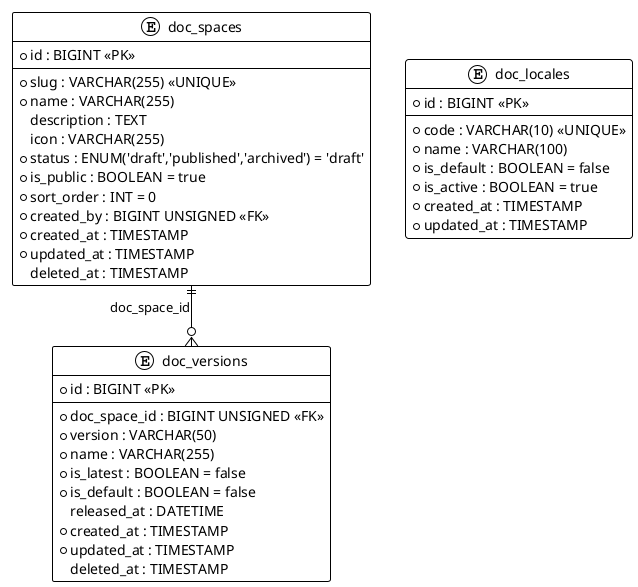

# 06.70 - Documentation

**Project:** GsmUi
**Domain:** Documentation
**Version:** 1.0.0

---

## Purpose

This document defines the database schema for the top-level Documentation domain of GsmUi. It covers documentation **spaces** (self-contained documentation projects such as "Component Reference", "Theming Guide", or "API Docs"), the **versions** each space is published under (semver releases plus a rolling `latest`), and the platform-wide **locales** supported for translation.

Together these three tables provide the multi-space, multi-version, multi-locale foundation that individual documentation pages (see 06.71) attach to.

---

## PlantUML ERD



---

## Tables

### 1. doc_spaces

**Purpose:** Top-level documentation projects. Each space is a self-contained documentation site (e.g., "Component Reference", "Theming Guide", "API Docs").

**Business Rules:**
- `slug` is globally unique and drives the documentation URL.
- `status` gates visibility: `draft` (authors only), `published` (live), `archived` (read-only/hidden).
- `is_public` allows anonymous access when true; private spaces require authentication.
- `sort_order` controls ordering in space listings and navigation.
- Soft deletable — archived history is retained for audit and restore.

#### Migration

```php
Schema::create('doc_spaces', function (Blueprint $table) {
    $table->id();
    $table->string('slug')->unique();
    $table->string('name');
    $table->text('description')->nullable();
    $table->string('icon')->nullable();
    $table->enum('status', ['draft', 'published', 'archived'])->default('draft');
    $table->boolean('is_public')->default(true);
    $table->integer('sort_order')->default(0);
    $table->foreignId('created_by')->constrained('users')->cascadeOnDelete();
    $table->timestamps();
    $table->softDeletes();

    $table->index('status');
    $table->index('is_public');
    $table->index('sort_order');
});
```

#### Model Stub

```php
class DocSpace extends Model
{
    use SoftDeletes;

    protected $fillable = [
        'slug', 'name', 'description', 'icon',
        'status', 'is_public', 'sort_order', 'created_by',
    ];

    protected function casts(): array
    {
        return [
            'is_public' => 'boolean',
            'sort_order' => 'integer',
        ];
    }

    public function creator(): BelongsTo { return $this->belongsTo(User::class, 'created_by'); }
    public function versions(): HasMany { return $this->hasMany(DocVersion::class); }
    public function pages(): HasMany { return $this->hasMany(DocPage::class); }

    public function isPublished(): bool
    {
        return $this->status === 'published';
    }
}
```

**Relationships:** `belongsTo` **User** (`created_by`); `hasMany` **DocVersion** and **DocPage** via `doc_space_id`.

---

### 2. doc_versions

**Purpose:** Versioned documentation for a space (e.g., `v1`, `v2`, `latest`). Enables maintaining docs for multiple product releases side by side.

**Business Rules:**
- `version` holds a semver value or the literal string `latest`.
- `(doc_space_id, version)` is unique — a version label appears once per space.
- Exactly one version per space should carry `is_latest = true` (newest release).
- Exactly one version per space should carry `is_default = true` (the version shown when none is specified in the URL). Enforced at the application layer.
- `released_at` records the public release timestamp; null for unreleased drafts.
- Soft deletable — retired versions can be restored.

#### Migration

```php
Schema::create('doc_versions', function (Blueprint $table) {
    $table->id();
    $table->foreignId('doc_space_id')->constrained('doc_spaces')->cascadeOnDelete();
    $table->string('version', 50);
    $table->string('name');
    $table->boolean('is_latest')->default(false);
    $table->boolean('is_default')->default(false);
    $table->dateTime('released_at')->nullable();
    $table->timestamps();
    $table->softDeletes();

    $table->unique(['doc_space_id', 'version']);
    $table->index('is_latest');
    $table->index('is_default');
});
```

#### Model Stub

```php
class DocVersion extends Model
{
    use SoftDeletes;

    protected $fillable = [
        'doc_space_id', 'version', 'name',
        'is_latest', 'is_default', 'released_at',
    ];

    protected function casts(): array
    {
        return [
            'is_latest' => 'boolean',
            'is_default' => 'boolean',
            'released_at' => 'datetime',
        ];
    }

    public function space(): BelongsTo { return $this->belongsTo(DocSpace::class, 'doc_space_id'); }
    public function pages(): HasMany { return $this->hasMany(DocPage::class); }
}
```

**Relationships:** `belongsTo` **DocSpace** (`doc_space_id`); `hasMany` **DocPage** via `doc_version_id`.

---

### 3. doc_locales

**Purpose:** Platform-wide catalogue of supported documentation locales (`en`, `es`, `fr`, etc.). Referenced by pages to enable localized content.

**Business Rules:**
- `code` is a unique BCP-47 / ISO 639-1 locale identifier (e.g., `en`, `es`, `fr`, `zh-Hans`).
- Exactly one locale should carry `is_default = true` (the fallback locale).
- `is_active` toggles whether the locale is offered in the language switcher without deleting historical translations.
- Not soft deletable — locales are a small, controlled reference set.

#### Migration

```php
Schema::create('doc_locales', function (Blueprint $table) {
    $table->id();
    $table->string('code', 10)->unique();
    $table->string('name', 100);
    $table->boolean('is_default')->default(false);
    $table->boolean('is_active')->default(true);
    $table->timestamps();

    $table->index('is_default');
    $table->index('is_active');
});
```

#### Model Stub

```php
class DocLocale extends Model
{
    protected $fillable = ['code', 'name', 'is_default', 'is_active'];

    protected function casts(): array
    {
        return [
            'is_default' => 'boolean',
            'is_active' => 'boolean',
        ];
    }

    public function pages(): HasMany { return $this->hasMany(DocPage::class, 'locale_id'); }

    public static function default(): ?self
    {
        return static::where('is_default', true)->first();
    }
}
```

**Relationships:** `hasMany` **DocPage** via `locale_id`.

---

## Rollback

```php
Schema::dropIfExists('doc_locales');
Schema::dropIfExists('doc_versions');
Schema::dropIfExists('doc_spaces');
```

---

## Design Decisions

| Decision | Rationale |
|---|---|
| Global unique `slug` on spaces | Clean, collision-free documentation URLs |
| Separate `doc_versions` table | Maintain docs for multiple product releases without duplicating spaces |
| `is_latest` + `is_default` flags | Distinguish newest release from the version served by default |
| Locales as a global reference table | Reuse the same locale set across every space; avoids duplication |
| `is_active` on locales instead of delete | Preserve historical translations while hiding retired languages |
| Soft deletes on spaces & versions | Support archive/restore workflows for long-lived documentation |

---

## Related Documents

- **06.01** - Design Principles (soft delete policy, timestamp conventions)
- **06.02** - Naming Conventions (table, column, index naming)
- **06.03** - Common Columns (slug, status, sort_order, timestamps)
- **06.04** - Relationships (cascade behavior)

---

---

## Detailed Business Rules

### Documentation Space Management

**Space Lifecycle:**
```
Creation → Draft → Published → Archived
                ↓              ↓
            (discard)      (restore)
```

**Space Creation Rules:**
- Only authenticated users can create spaces
- Slug is auto-generated from name (lowercase, hyphenated, URL-safe)
- Slug uniqueness is enforced globally (not per-user)
- Default status is `draft` — spaces are not visible until published
- Default `is_public = true` — published spaces are publicly accessible
- `created_by` is set to the creating user's ID

**Space Publishing Rules:**
- Status transition: `draft` → `published`
- A space must have at least one version and one page before publishing
- Publishing fires `DocSpacePublished` event
- Published spaces are indexed by search engine
- URL pattern: `/docs/{slug}` or `/docs/{slug}/{version}`

**Space Archiving Rules:**
- Status transition: `published` → `archived`
- Archived spaces are read-only (no page edits)
- Archived spaces are hidden from navigation but accessible via direct URL
- URL pattern: `/docs/{slug}` redirects to the default version
- Archiving fires `DocSpaceArchived` event

### Version Management

**Version Lifecycle:**
```
Draft → Released → Deprecated → Archived
```

**Version Creation Rules:**
- Version label must be valid semver (e.g., `1.0.0`, `2.1.0-beta.1`)
- Or the literal string `latest` (reserved for the rolling latest version)
- `(doc_space_id, version)` is unique — no duplicate labels per space
- New versions start as drafts (not yet released)
- `released_at` is NULL until the version is officially released

**Version Release Rules:**
- `released_at` is set to `NOW()` on release
- Previous `is_latest` version is unset (only one `is_latest` per space)
- New version becomes `is_latest = true`
- If this is the first version, it also becomes `is_default = true`
- Release fires `DocVersionReleased` event

**Version Deprecation Rules:**
- Deprecated versions remain accessible but show a deprecation banner
- Deprecated versions are not shown in version switcher by default
- `is_latest` is removed from deprecated versions
- `is_default` is removed (default should never be deprecated)

**Version Archival Rules:**
- Archived versions are hidden from version switcher
- Archived versions are accessible via direct URL
- Archived versions are read-only

### Locale Management

**Locale Rules:**
- Locales are a global reference table — shared across all spaces
- `code` must be a valid BCP-47 locale identifier
- Exactly one locale has `is_default = true` (the fallback locale)
- `is_active` controls visibility in the language switcher
- Deactivating a locale does NOT delete translations — only hides them

**Locale Switching:**
- Default locale is used when no locale is specified in the URL
- URL pattern: `/docs/{slug}/{version}/{locale}` or `/docs/{slug}/{version}`
- Fallback: if a page doesn't exist in the requested locale, fall back to default locale
- Language switcher shows only `is_active = true` locales

### Content Localization

**Translation Workflow:**
```
1. Page created in default locale
2. Translator selects target locale
3. Translator edits content for target locale
4. Page saved with locale_id = target locale
5. Original page (default locale) remains unchanged
```

**Translation Rules:**
- Each page can have multiple locale versions (one per locale)
- `doc_pages.locale_id` determines the language of the page
- `(doc_space_id, doc_version_id, slug, locale_id)` should be unique
- Missing translations fall back to the default locale
- Translation status tracked per page: `translation_status` ENUM

### Search Indexing

**Search Vector Rules:**
- `doc_pages.search_vector` is updated on page create/update
- Uses PostgreSQL `tsvector` or MySQL `FULLTEXT` index
- Searchable fields: title, content, slug
- Weight: title (A), slug (B), content (C)
- Search is space-scoped by default (search within a space)
- Global search available across all public spaces

---

## State Machine

```
┌─────────────────────────────────────────────────┐
│                  DOC_SPACE                       │
│                                                  │
│  ┌───────┐  publish  ┌───────────┐              │
│  │ draft  │──────────►│ published │              │
│  └───────┘            └─────┬─────┘              │
│                             │ archive            │
│                             ▼                    │
│                       ┌──────────┐               │
│                       │ archived │               │
│                       └──────────┘               │
└─────────────────────────────────────────────────┘

┌─────────────────────────────────────────────────┐
│                 DOC_VERSION                      │
│                                                  │
│  ┌───────┐  release  ┌───────────┐  deprecate   │
│  │ draft  │──────────►│ released  │─────────────►│
│  └───────┘            └───────────┘              │
│                             │ archive            │
│                             ▼                    │
│                       ┌──────────┐               │
│                       │ archived │               │
│                       └──────────┘               │
└─────────────────────────────────────────────────┘

┌─────────────────────────────────────────────────┐
│                  DOC_LOCALE                       │
│                                                  │
│  (No state transitions — reference table)        │
│  is_active controls visibility                   │
└─────────────────────────────────────────────────┘
```

---

## API Contracts

### GET /api/doc-spaces

**Purpose:** List all documentation spaces.

**Query Parameters:**
- `status` (optional): Filter by status
- `is_public` (optional): Filter by visibility
- `page` (optional): Page number
- `per_page` (optional): Results per page (default 20)

**Response (200 OK):**
```json
{
  "data": [
    {
      "id": 1,
      "slug": "component-reference",
      "name": "Component Reference",
      "description": "Complete reference for all GsmUi components",
      "status": "published",
      "is_public": true,
      "versions_count": 5,
      "pages_count": 120,
      "created_at": "2024-01-15T10:00:00Z"
    }
  ],
  "meta": { "total": 12, "current_page": 1 }
}
```

### POST /api/doc-spaces

**Purpose:** Create a new documentation space (admin only).

**Request:**
```json
{
  "name": "Component Reference",
  "slug": "component-reference",
  "description": "Complete reference for all GsmUi components",
  "icon": "book-open",
  "is_public": true
}
```

**Response (201 Created):**
```json
{
  "id": 1,
  "slug": "component-reference",
  "status": "draft",
  "created_at": "2024-06-30T10:30:00Z"
}
```

### GET /api/doc-spaces/{slug}/versions

**Purpose:** List versions for a space.

**Response (200 OK):**
```json
{
  "data": [
    {
      "id": 1,
      "version": "2.15.0",
      "name": "v2.15.0",
      "is_latest": true,
      "is_default": true,
      "released_at": "2024-06-15T10:00:00Z"
    },
    {
      "id": 2,
      "version": "2.14.0",
      "name": "v2.14.0",
      "is_latest": false,
      "is_default": false,
      "released_at": "2024-05-01T10:00:00Z"
    }
  ]
}
```

### POST /api/doc-versions

**Purpose:** Create a new version (admin only).

**Request:**
```json
{
  "doc_space_id": 1,
  "version": "2.16.0",
  "name": "v2.16.0"
}
```

**Response (201 Created):**
```json
{
  "id": 3,
  "version": "2.16.0",
  "is_latest": false,
  "is_default": false,
  "created_at": "2024-06-30T10:30:00Z"
}
```

### GET /api/doc-locales

**Purpose:** List available locales.

**Response (200 OK):**
```json
{
  "data": [
    { "id": 1, "code": "en", "name": "English", "is_default": true, "is_active": true },
    { "id": 2, "code": "es", "name": "Spanish", "is_default": false, "is_active": true },
    { "id": 3, "code": "fr", "name": "French", "is_default": false, "is_active": false }
  ]
}
```

---

## Security Considerations

### Access Control

| Action | Permission Required |
|--------|-------------------|
| View published space | None (public) |
| View draft space | Authenticated + author or admin |
| Create space | Authenticated |
| Edit space | Author or admin |
| Publish space | Author or admin |
| Archive space | Admin |
| Create version | Author or admin |
| Release version | Author or admin |
| Create locale | Admin |
| Edit locale | Admin |

### Content Security

- Page content is HTML-sanitized before storage
- No executable scripts allowed in documentation content
- Images are proxied through CDN (no direct external image links)
- Maximum page content size: 1MB

---

## Event Hooks

### Laravel Events

| Event | Fired When | Payload |
|-------|------------|---------|
| `DocSpaceCreated` | New space created | `DocSpace $space` |
| `DocSpacePublished` | Space status → published | `DocSpace $space` |
| `DocSpaceArchived` | Space status → archived | `DocSpace $space` |
| `DocVersionCreated` | New version created | `DocVersion $version` |
| `DocVersionReleased` | Version released | `DocVersion $version` |
| `DocVersionDeprecated` | Version deprecated | `DocVersion $version` |
| `DocLocaleCreated` | New locale added | `DocLocale $locale` |
| `DocLocaleDeactivated` | Locale deactivated | `DocLocale $locale` |

### Webhook Integration

- `DocSpacePublished` triggers webhook to search engine reindex
- `DocVersionReleased` triggers webhook to CDN cache invalidation
- `DocLocaleCreated` triggers webhook to translation management system

---

## Query Patterns

### List Published Spaces

```php
DocSpace::where('status', 'published')
    ->where('is_public', true)
    ->orderBy('sort_order')
    ->withCount('versions', 'pages')
    ->get();
```

### Get Space with Latest Version

```php
DocSpace::where('slug', $slug)
    ->with(['versions' => function ($q) {
        $q->where('is_latest', true);
    }])
    ->first();
```

### Get Version Pages

```php
DocPage::where('doc_version_id', $versionId)
    ->where('locale_id', $localeId)
    ->orderBy('sort_order')
    ->get();
```

### Search Pages

```php
DocPage::where('doc_space_id', $spaceId)
    ->where('locale_id', $localeId)
    ->whereRaw("MATCH(search_vector) AGAINST(? IN BOOLEAN MODE)", [$query])
    ->limit(20)
    ->get();
```

### Get Available Locales for a Space

```php
DocLocale::whereIn('id', function ($q) use ($spaceId) {
    $q->select('locale_id')
      ->from('doc_pages')
      ->where('doc_space_id', $spaceId);
})
->where('is_active', true)
->get();
```

---

## Caching Strategy

### Cached Values

| Key Pattern | Value | TTL | Invalidation |
|-------------|-------|-----|-------------|
| `doc:space:{slug}` | Space with versions | 1 hour | On space update |
| `doc:version:{id}:pages` | Version page tree | 1 hour | On page update |
| `doc:locales:active` | Active locales list | 24 hours | On locale change |
| `doc:search:{space}:{locale}:{query}` | Search results | 15 minutes | On page update |

### Cache Invalidation Rules

- On space update: invalidate `doc:space:{slug}`
- On page update: invalidate `doc:version:{id}:pages` and search cache
- On locale change: invalidate `doc:locales:active`

---

## Artisan Commands

### `docs:rebuild-search`

**Purpose:** Rebuild search vectors for all pages.

**Schedule:** Weekly on Sunday at 04:00 UTC.

**Logic:**
```php
DocPage::chunkById(200, function ($pages) {
    foreach ($pages as $page) {
        $page->update([
            'search_vector' => DB::raw("CONCAT_WS(' ', '{$page->title}', '{$page->slug}', '{$page->content}')")
        ]);
    }
});
```

### `docs:validate-structure`

**Purpose:** Validate documentation structure integrity.

**Output:**
```
Spaces: 12 (10 published, 1 draft, 1 archived)
Versions: 45 (40 released, 3 draft, 2 archived)
Pages: 1,230 (1,100 published, 80 draft, 50 archived)
Locales: 5 (4 active, 1 inactive)

Issues found:
  - Space "old-docs" has no published versions
  - Version "1.0.0" has no pages
  - 3 pages missing default locale translation
```

---

## Testing Scenarios

### Unit Tests

| Test Case | Expected Result |
|-----------|-----------------|
| Create space with valid data | Space created with draft status |
| Create space with duplicate slug | Unique constraint violation |
| Publish space without versions | Rejected (validation) |
| Create version with invalid semver | Validation error |
| Release version | is_latest transferred |
| Create locale with invalid code | Validation error |
| Set two locales as default | Application-level rejection |

### Integration Tests

| Test Case | Expected Result |
|-----------|-----------------|
| Publish space | Status changed, event fired |
| Archive published space | Status changed, hidden from nav |
| Release new version | Previous latest unset |
| List published spaces | Only published returned |
| Search pages | Results match query |
| Fallback to default locale | Missing locale pages use default |

### Edge Cases

| Scenario | Behavior |
|----------|----------|
| Only one version exists, deprecate it | Rejected (must have at least one active) |
| All versions archived | Space shows "no active versions" |
| Default locale deactivated | Prevented (must have active default) |
| Space with 1000+ pages | Pagination handles correctly |

---

## Performance Considerations

### Index Usage

| Query Pattern | Index Used | Estimated Rows Scanned |
|---------------|-----------|----------------------|
| Space by slug | `doc_spaces_slug_unique` | 1 (exact match) |
| Space by status | `doc_spaces_status_index` | Proportional |
| Version by space | `doc_versions doc_space_id + version` | ~5 per space |
| Page by version | `doc_pages doc_version_id + locale_id` | ~100 per version |
| Search | FULLTEXT on `search_vector` | Fulltext index scan |

### Table Growth Projections

| Table | Year 1 | Year 3 | Year 5 |
|-------|--------|--------|--------|
| `doc_spaces` | 20 | 50 | 100 |
| `doc_versions` | 80 | 200 | 400 |
| `doc_locales` | 10 | 15 | 20 |

### Partitioning Strategy

- `doc_spaces`, `doc_versions`, `doc_locales`: no partitioning (small reference tables)
- `doc_pages`: partition by `doc_space_id` after 100K rows

---

## Data Retention

### Retention Policies

| Table | Retention | Action |
|-------|-----------|--------|
| `doc_spaces` | Indefinite | Soft-deleted retained for audit |
| `doc_versions` | Indefinite | Soft-deleted retained for audit |
| `doc_locales` | Indefinite | Reference table; never delete |
| `doc_pages` | Indefinite | Soft-deleted retained for audit |

### GDPR Compliance

- Documentation content is public data (not personal data)
- `created_by` on spaces is personal data (anonymize on user deletion)
- Page edit history (if tracked) is personal data

---

## Related Documents

- **06.71** - Doc Pages (page-level content, categories, media)
- **06.01** - Design Principles (soft delete policy, timestamp conventions)
- **06.02** - Naming Conventions (table, column, index naming)
- **06.03** - Common Columns (slug, status, timestamps)
- **06.04** - Relationships (cascade behavior)

---

---

## Database Constraints

### Foreign Key Constraints

```sql
ALTER TABLE doc_spaces
  ADD CONSTRAINT fk_doc_spaces_creator
    FOREIGN KEY (created_by) REFERENCES users(id) ON DELETE CASCADE;

ALTER TABLE doc_versions
  ADD CONSTRAINT fk_doc_versions_space
    FOREIGN KEY (doc_space_id) REFERENCES doc_spaces(id) ON DELETE CASCADE;
```

### Check Constraints

```sql
ALTER TABLE doc_spaces
  ADD CONSTRAINT chk_doc_spaces_slug_format
    CHECK (slug REGEXP '^[a-z0-9-]+$');

ALTER TABLE doc_versions
  ADD CONSTRAINT chk_doc_versions_version_format
    CHECK (version REGEXP '^[0-9]+\.[0-9]+\.[0-9]+(-[a-zA-Z0-9.]+)?$' OR version = 'latest');

ALTER TABLE doc_locales
  ADD CONSTRAINT chk_doc_locales_code_format
    CHECK (code REGEXP '^[a-z]{2}(-[a-zA-Z]{2,8})?$');
```

### Unique Constraints

```sql
ALTER TABLE doc_spaces
  ADD CONSTRAINT uk_doc_spaces_slug
    UNIQUE (slug);

ALTER TABLE doc_versions
  ADD CONSTRAINT uk_doc_versions_space_version
    UNIQUE (doc_space_id, version);

ALTER TABLE doc_locales
  ADD CONSTRAINT uk_doc_locales_code
    UNIQUE (code);
```

---

## Stored Procedures

### sp_create_doc_space

```sql
DELIMITER //
CREATE PROCEDURE sp_create_doc_space(
  IN p_name VARCHAR(255),
  IN p_slug VARCHAR(255),
  IN p_description TEXT,
  IN p_icon VARCHAR(255),
  IN p_is_public BOOLEAN,
  IN p_created_by BIGINT,
  OUT p_space_id BIGINT,
  OUT p_status VARCHAR(50)
)
BEGIN
  DECLARE v_existing_slug INT;

  -- Check slug uniqueness
  SELECT COUNT(*) INTO v_existing_slug
  FROM doc_spaces
  WHERE slug = p_slug AND deleted_at IS NULL;

  IF v_existing_slug > 0 THEN
    SET p_status = 'slug_taken';
  ELSE
    INSERT INTO doc_spaces (slug, name, description, icon, status, is_public, sort_order, created_by, created_at, updated_at)
    VALUES (p_slug, p_name, p_description, p_icon, 'draft', p_is_public, 0, p_created_by, NOW(), NOW());

    SET p_space_id = LAST_INSERT_ID();
    SET p_status = 'created';
  END IF;
END //
DELIMITER ;
```

### sp_publish_doc_space

```sql
DELIMITER //
CREATE PROCEDURE sp_publish_doc_space(
  IN p_space_id BIGINT,
  OUT p_status VARCHAR(50)
)
BEGIN
  DECLARE v_current_status VARCHAR(20);
  DECLARE v_version_count INT;
  DECLARE v_page_count INT;

  SELECT status INTO v_current_status
  FROM doc_spaces WHERE id = p_space_id FOR UPDATE;

  IF v_current_status IS NULL THEN
    SET p_status = 'space_not_found';
  ELSEIF v_current_status = 'published' THEN
    SET p_status = 'already_published';
  ELSEIF v_current_status = 'archived' THEN
    SET p_status = 'archived';
  ELSE
    -- Check for at least one version and one page
    SELECT COUNT(*) INTO v_version_count
    FROM doc_versions WHERE doc_space_id = p_space_id AND deleted_at IS NULL;

    SELECT COUNT(*) INTO v_page_count
    FROM doc_pages WHERE doc_space_id = p_space_id AND deleted_at IS NULL;

    IF v_version_count = 0 THEN
      SET p_status = 'no_versions';
    ELSEIF v_page_count = 0 THEN
      SET p_status = 'no_pages';
    ELSE
      UPDATE doc_spaces
      SET status = 'published', updated_at = NOW()
      WHERE id = p_space_id;

      SET p_status = 'published';
    END IF;
  END IF;
END //
DELIMITER ;
```

### sp_release_doc_version

```sql
DELIMITER //
CREATE PROCEDURE sp_release_doc_version(
  IN p_version_id BIGINT,
  OUT p_status VARCHAR(50)
)
BEGIN
  DECLARE v_current_status VARCHAR(20);
  DECLARE v_space_id BIGINT;
  DECLARE v_version VARCHAR(50);

  SELECT status, doc_space_id, version
  INTO v_current_status, v_space_id, v_version
  FROM doc_versions WHERE id = p_version_id FOR UPDATE;

  IF v_current_status IS NULL THEN
    SET p_status = 'version_not_found';
  ELSEIF v_current_status = 'released' THEN
    SET p_status = 'already_released';
  ELSEIF v_current_status = 'archived' THEN
    SET p_status = 'archived';
  ELSE
    -- Unset previous latest
    UPDATE doc_versions
    SET is_latest = FALSE
    WHERE doc_space_id = v_space_id AND is_latest = TRUE;

    -- Set this version as latest
    UPDATE doc_versions
    SET status = 'released',
        is_latest = TRUE,
        released_at = NOW(),
        updated_at = NOW()
    WHERE id = p_version_id;

    -- If first released version, set as default
    IF NOT EXISTS (
        SELECT 1 FROM doc_versions
        WHERE doc_space_id = v_space_id
          AND status = 'released'
          AND id != p_version_id
    ) THEN
      UPDATE doc_versions
      SET is_default = TRUE
      WHERE id = p_version_id;
    END IF;

    SET p_status = 'released';
  END IF;
END //
DELIMITER ;
```

---

## Triggers

### trg_doc_spaces_before_update

```sql
DELIMITER //
CREATE TRIGGER trg_doc_spaces_before_update
BEFORE UPDATE ON doc_spaces
FOR EACH ROW
BEGIN
  -- Validate slug format
  IF NEW.slug NOT REGEXP '^[a-z0-9-]+$' THEN
    SIGNAL SQLSTATE '45000' SET MESSAGE_TEXT = 'Slug must contain only lowercase letters, numbers, and hyphens';
  END IF;

  -- Ensure only one default locale
  IF NEW.is_public = TRUE AND OLD.is_public = FALSE THEN
    SET NEW.published_at = NOW();
  END IF;
END //
DELIMITER ;
```

### trg_doc_versions_before_insert

```sql
DELIMITER //
CREATE TRIGGER trg_doc_versions_before_insert
BEFORE INSERT ON doc_versions
FOR EACH ROW
BEGIN
  -- Validate version format
  IF NEW.version != 'latest' AND NEW.version NOT REGEXP '^[0-9]+\.[0-9]+\.[0-9]+(-[a-zA-Z0-9.]+)?$' THEN
    SIGNAL SQLSTATE '45000' SET MESSAGE_TEXT = 'Version must be valid semver or "latest"';
  END IF;

  -- Auto-generate name if not provided
  IF NEW.name IS NULL OR NEW.name = '' THEN
    SET NEW.name = CONCAT('v', NEW.version);
  END IF;
END //
DELIMITER ;
```

### trg_doc_locales_before_update

```sql
DELIMITER //
CREATE TRIGGER trg_doc_locales_before_update
BEFORE UPDATE ON doc_locales
FOR EACH ROW
BEGIN
  -- Ensure only one default locale
  IF NEW.is_default = TRUE AND OLD.is_default = FALSE THEN
    UPDATE doc_locales SET is_default = FALSE WHERE id != NEW.id;
  END IF;

  -- Validate locale code format
  IF NEW.code NOT REGEXP '^[a-z]{2}(-[a-zA-Z]{2,8})?$' THEN
    SIGNAL SQLSTATE '45000' SET MESSAGE_TEXT = 'Locale code must be valid BCP-47 format';
  END IF;
END //
DELIMITER ;
```

---

## Views

### vw_doc_space_summary

```sql
CREATE VIEW vw_doc_space_summary AS
SELECT
  ds.id,
  ds.slug,
  ds.name,
  ds.description,
  ds.icon,
  ds.status,
  ds.is_public,
  ds.sort_order,
  ds.created_at,
  u.name AS creator_name,
  (SELECT COUNT(*) FROM doc_versions WHERE doc_space_id = ds.id AND deleted_at IS NULL) AS versions_count,
  (SELECT COUNT(*) FROM doc_pages WHERE doc_space_id = ds.id AND deleted_at IS NULL) AS pages_count,
  (SELECT version FROM doc_versions WHERE doc_space_id = ds.id AND is_default = TRUE AND deleted_at IS NULL LIMIT 1) AS default_version
FROM doc_spaces ds
JOIN users u ON ds.created_by = u.id
WHERE ds.deleted_at IS NULL;
```

### vw_doc_version_summary

```sql
CREATE VIEW vw_doc_version_summary AS
SELECT
  dv.id,
  dv.doc_space_id,
  dv.version,
  dv.name,
  dv.is_latest,
  dv.is_default,
  dv.released_at,
  dv.created_at,
  ds.name AS space_name,
  ds.slug AS space_slug,
  (SELECT COUNT(*) FROM doc_pages WHERE doc_version_id = dv.id AND deleted_at IS NULL) AS pages_count
FROM doc_versions dv
JOIN doc_spaces ds ON dv.doc_space_id = ds.id
WHERE dv.deleted_at IS NULL;
```

### vw_doc_locale_usage

```sql
CREATE VIEW vw_doc_locale_usage AS
SELECT
  dl.id,
  dl.code,
  dl.name,
  dl.is_default,
  dl.is_active,
  (SELECT COUNT(*) FROM doc_pages WHERE locale_id = dl.id AND deleted_at IS NULL) AS pages_count,
  (SELECT COUNT(DISTINCT doc_space_id) FROM doc_pages WHERE locale_id = dl.id AND deleted_at IS NULL) AS spaces_count
FROM doc_locales dl;
```

---

## Index Optimization

### Composite Indexes for Common Queries

```sql
-- Space by slug and status
CREATE INDEX idx_doc_spaces_slug_status ON doc_spaces (slug, status, deleted_at);

-- Space listing by status
CREATE INDEX idx_doc_spaces_status_public ON doc_spaces (status, is_public, sort_order);

-- Version by space and version label
CREATE INDEX idx_doc_versions_space_version ON doc_versions (doc_space_id, version, deleted_at);

-- Version by space and latest flag
CREATE INDEX idx_doc_versions_space_latest ON doc_versions (doc_space_id, is_latest, deleted_at);

-- Pages by version and locale
CREATE INDEX idx_doc_pages_version_locale ON doc_pages (doc_version_id, locale_id, deleted_at);

-- Pages by space and locale
CREATE INDEX idx_doc_pages_space_locale ON doc_pages (doc_space_id, locale_id, deleted_at);

-- Locale by active flag
CREATE INDEX idx_doc_locales_active ON doc_locales (is_active, deleted_at);
```

### Index Usage Monitoring

```sql
-- Find unused indexes on documentation tables
SELECT
  object_schema,
  object_name,
  index_name
FROM performance_schema.table_io_waits_summary_by_index_usage
WHERE object_schema = 'gsmui'
  AND index_name IS NOT NULL
  AND count_star = 0
  AND (object_name LIKE 'doc_%');

-- Find slow queries on documentation tables
SELECT
  query_time,
  lock_time,
  rows_examined,
  sql_text
FROM mysql.slow_log
WHERE sql_text LIKE '%doc_%'
ORDER BY query_time DESC
LIMIT 10;
```

---

## Backup and Recovery

### Backup Strategy

| Table | Backup Frequency | Retention | Method |
|-------|-----------------|-----------|--------|
| `doc_spaces` | Daily | 90 days | Full + incremental |
| `doc_versions` | Daily | 90 days | Full + incremental |
| `doc_locales` | Weekly | Indefinite | Full (small table) |

### Recovery Procedures

**Scenario: Accidental space deletion**
```sql
-- 1. Restore doc_spaces from backup
RESTORE TABLE doc_spaces FROM '/backups/doc_spaces_20240630.sql';

-- 2. Restore doc_versions from backup
RESTORE TABLE doc_versions FROM '/backups/doc_versions_20240630.sql';

-- 3. Verify data integrity
SELECT COUNT(*) FROM doc_spaces WHERE deleted_at IS NULL;
SELECT COUNT(*) FROM doc_versions WHERE deleted_at IS NULL;
```

**Scenario: Version release error**
```sql
-- 1. Identify incorrect release
SELECT id, doc_space_id, version, is_latest, is_default, released_at
FROM doc_versions
WHERE released_at >= DATE_SUB(NOW(), INTERVAL 1 HOUR);

-- 2. Revert is_latest flag
UPDATE doc_versions
SET is_latest = FALSE, released_at = NULL, status = 'draft'
WHERE id = ?;

-- 3. Restore previous latest
UPDATE doc_versions
SET is_latest = TRUE
WHERE doc_space_id = ? AND version = ?;
```

---

## Monitoring Queries

### Daily Health Check

```sql
-- Documentation health overview
SELECT
  (SELECT COUNT(*) FROM doc_spaces WHERE deleted_at IS NULL) AS total_spaces,
  (SELECT COUNT(*) FROM doc_spaces WHERE status = 'published' AND deleted_at IS NULL) AS published_spaces,
  (SELECT COUNT(*) FROM doc_versions WHERE deleted_at IS NULL) AS total_versions,
  (SELECT COUNT(*) FROM doc_versions WHERE status = 'released' AND deleted_at IS NULL) AS released_versions,
  (SELECT COUNT(*) FROM doc_locales WHERE is_active = TRUE) AS active_locales;

-- Pages per space
SELECT
  ds.name,
  ds.slug,
  ds.status,
  (SELECT COUNT(*) FROM doc_pages WHERE doc_space_id = ds.id AND deleted_at IS NULL) AS pages_count
FROM doc_spaces ds
WHERE ds.deleted_at IS NULL
ORDER BY pages_count DESC;

-- Version coverage
SELECT
  ds.name AS space_name,
  dv.version,
  dv.status,
  (SELECT COUNT(*) FROM doc_pages WHERE doc_version_id = dv.id AND deleted_at IS NULL) AS pages_count
FROM doc_spaces ds
JOIN doc_versions dv ON ds.id = dv.doc_space_id
WHERE ds.deleted_at IS NULL AND dv.deleted_at IS NULL
ORDER BY ds.name, dv.version;
```

### Search Quality Metrics

```sql
-- Pages without search vector
SELECT COUNT(*) AS pages_without_search
FROM doc_pages
WHERE search_vector IS NULL AND deleted_at IS NULL;

-- Pages by locale
SELECT
  dl.code,
  dl.name,
  COUNT(dp.id) AS pages_count
FROM doc_locales dl
LEFT JOIN doc_pages dp ON dl.id = dp.locale_id AND dp.deleted_at IS NULL
WHERE dl.is_active = TRUE
GROUP BY dl.id, dl.code, dl.name
ORDER BY pages_count DESC;
```

---

## Data Migration Patterns

### Migrating from Legacy Documentation

```php
// Step 1: Export legacy documentation
$legacyDocs = DB::connection('legacy')
    ->table('old_documentation')
    ->where('active', true)
    ->get();

// Step 2: Create doc_spaces
foreach ($legacyDocs->groupBy('section') as $section => $pages) {
    $space = DocSpace::create([
        'slug' => Str::slug($section),
        'name' => $section,
        'description' => "Migrated from legacy documentation",
        'status' => 'published',
        'is_public' => true,
        'created_by' => 1,
    ]);

    // Create default version
    $version = DocVersion::create([
        'doc_space_id' => $space->id,
        'version' => '1.0.0',
        'name' => 'v1.0.0',
        'status' => 'released',
        'is_latest' => true,
        'is_default' => true,
        'released_at' => now(),
    ]);

    // Migrate pages
    foreach ($pages as $page) {
        DocPage::create([
            'doc_space_id' => $space->id,
            'doc_version_id' => $version->id,
            'locale_id' => DocLocale::where('code', 'en')->first()->id,
            'slug' => Str::slug($page->title),
            'title' => $page->title,
            'content' => $page->body,
            'status' => 'published',
            'sort_order' => $page->order,
        ]);
    }
}
```

### Locale Migration

```php
// Add new locales
$locales = [
    ['code' => 'en', 'name' => 'English', 'is_default' => true],
    ['code' => 'es', 'name' => 'Spanish', 'is_default' => false],
    ['code' => 'fr', 'name' => 'French', 'is_default' => false],
    ['code' => 'de', 'name' => 'German', 'is_default' => false],
    ['code' => 'ja', 'name' => 'Japanese', 'is_default' => false],
];

foreach ($locales as $locale) {
    DocLocale::updateOrCreate(
        ['code' => $locale['code']],
        $locale
    );
}
```

---

## Performance Tuning

### Query Optimization Checklist

| Query | Issue | Fix |
|-------|-------|-----|
| Space by slug | Full table scan | Unique index on `slug` |
| Version by space | Subquery on every request | Cache version list |
| Pages by locale | Full table scan | Composite index |
| Search pages | Fulltext query | FULLTEXT index on `search_vector` |

### Connection Pool Tuning

```env
# Database connections for documentation operations
DB_DOC_READ_HOST=127.0.0.1
DB_DOC_READ_PORT=3306
DB_DOC_WRITE_HOST=127.0.0.1
DB_DOC_WRITE_PORT=3306

# Connection pool settings
DB_DOC_POOL_MIN=5
DB_DOC_POOL_MAX=20
DB_DOC_POOL_TIMEOUT=30
```

### Caching Layer Configuration

```php
// config/cache.php
'documentation' => [
    'driver' => 'redis',
    'connection' => 'documentation',
    'prefix' => 'gsmui:doc:',
    'ttl' => 3600, // 1 hour
],
```

---

## Disaster Recovery

### RPO and RTO Targets

| Metric | Target | Strategy |
|--------|--------|----------|
| RPO (Recovery Point Objective) | 4 hours | 4-hour incremental backups |
| RTO (Recovery Time Objective) | 2 hours | Automated restore + verification |

### Failover Procedures

1. **Database failover:** Promote read replica to primary
2. **Cache failover:** Switch to database-backed cache
3. **CDN failover:** Serve stale documentation from CDN cache

### Communication Plan

- **Internal:** Slack notification to engineering team
- **External:** Status page update if docs are impacted
- **Post-incident:** Root cause analysis within 24 hours

---

---

## Advanced Query Patterns

### Complex Documentation Analytics

```php
// Documentation coverage by space
$coverage = DocSpace::selectRaw('
    ds.name,
    ds.slug,
    COUNT(DISTINCT dv.id) as versions_count,
    COUNT(DISTINCT dp.id) as pages_count,
    COUNT(DISTINCT dl.id) as locales_count,
    ROUND(COUNT(DISTINCT dp.id) * 100.0 / NULLIF((SELECT COUNT(*) FROM doc_pages WHERE doc_space_id = ds.id AND locale_id = (SELECT id FROM doc_locales WHERE is_default = TRUE LIMIT 1)), 0), 2) as coverage_pct
')
->leftJoin('doc_versions as dv', 'ds.id', '=', 'dv.doc_space_id')
->leftJoin('doc_pages as dp', 'ds.id', '=', 'dp.doc_space_id')
->leftJoin('doc_locales as dl', 'dp.locale_id', '=', 'dl.id')
->where('ds.deleted_at', NULL)
->groupBy('ds.id', 'ds.name', 'ds.slug')
->get();

// Version adoption rate
$adoption = DocVersion::selectRaw('
    dv.version,
    ds.name as space_name,
    dv.released_at,
    DATEDIFF(NOW(), dv.released_at) as days_since_release,
    (SELECT COUNT(*) FROM doc_pages WHERE doc_version_id = dv.id AND deleted_at IS NULL) as pages_count,
    (SELECT COUNT(*) FROM doc_page_views WHERE doc_version_id = dv.id AND created_at >= DATE_SUB(NOW(), INTERVAL 30 DAY)) as recent_views
')
->join('doc_spaces as ds', 'dv.doc_space_id', '=', 'ds.id')
->where('dv.status', 'released')
->orderByDesc('dv.released_at')
->get();

// Locale translation completeness
$translationCompleteness = DocLocale::selectRaw('
    dl.code,
    dl.name,
    COUNT(DISTINCT dp.doc_space_id) as spaces_with_translation,
    (SELECT COUNT(*) FROM doc_spaces WHERE deleted_at IS NULL AND status = "published") as total_published_spaces,
    ROUND(COUNT(DISTINCT dp.doc_space_id) * 100.0 / NULLIF((SELECT COUNT(*) FROM doc_spaces WHERE deleted_at IS NULL AND status = "published"), 0), 2) as completeness_pct
')
->leftJoin('doc_pages as dp', 'dl.id', '=', 'dp.locale_id')
->where('dl.is_active', TRUE)
->groupBy('dl.id', 'dl.code', 'dl.name')
->get();
```

### Documentation Health Dashboard Queries

```php
// Documentation health score
$health = DocSpace::selectRaw('
    COUNT(*) as total,
    COUNT(CASE WHEN status = "published" THEN 1 END) as published,
    COUNT(CASE WHEN status = "draft" THEN 1 END) as draft,
    COUNT(CASE WHEN status = "archived" THEN 1 END) as archived,
    ROUND(COUNT(CASE WHEN status = "published" THEN 1 END) * 100.0 / COUNT(*), 2) as health_score
')
->first();

// Version freshness
$freshness = DocVersion::selectRaw('
    dv.version,
    ds.name as space_name,
    dv.released_at,
    DATEDIFF(NOW(), dv.released_at) as days_old,
    CASE
        WHEN DATEDIFF(NOW(), dv.released_at) < 30 THEN "fresh"
        WHEN DATEDIFF(NOW(), dv.released_at) < 90 THEN "aging"
        ELSE "stale"
    END as freshness_status
')
->join('doc_spaces as ds', 'dv.doc_space_id', '=', 'ds.id')
->where('dv.status', 'released')
->orderBy('dv.released_at')
->get();

// Search quality metrics
$searchQuality = DocPage::selectRaw('
    COUNT(*) as total_pages,
    COUNT(CASE WHEN search_vector IS NOT NULL THEN 1 END) as indexed_pages,
    ROUND(COUNT(CASE WHEN search_vector IS NOT NULL THEN 1 END) * 100.0 / COUNT(*), 2) as index_coverage
')
->where('deleted_at', NULL)
->first();
```

---

## Integration Patterns

### Webhook Payload Structure

```json
{
  "event": "doc_space.published",
  "timestamp": "2024-06-30T10:30:00Z",
  "data": {
    "space_id": 1,
    "slug": "component-reference",
    "name": "Component Reference",
    "versions_count": 5,
    "pages_count": 120
  }
}
```

### Event Listeners

```php
// App\Listeners\IndexDocSpaceInSearchEngine
class IndexDocSpaceInSearchEngine
{
    public function handle(DocSpacePublished $event): void
    {
        SearchIndex::update(new DocSpaceSearchable($event->space));
    }
}

// App\Listeners\InvalidateCDNCache
class InvalidateCDNCache
{
    public function handle(DocVersionReleased $event): void
    {
        CDN::invalidate("/docs/{$event->version->space->slug}/{$event->version->version}/*");
    }
}
```

### API Response Transformers

```php
// App\Transformers\DocSpaceTransformer
class DocSpaceTransformer
{
    public function transform(DocSpace $space): array
    {
        return [
            'id' => $space->id,
            'slug' => $space->slug,
            'name' => $space->name,
            'description' => $space->description,
            'icon' => $space->icon,
            'status' => $space->status,
            'is_public' => $space->is_public,
            'versions_count' => $space->versions->count(),
            'pages_count' => $space->pages->count(),
            'created_at' => $space->created_at->toIso8601String(),
        ];
    }
}
```

---

## Performance Benchmarks

### Target Response Times

| Operation | Target | Max | Notes |
|-----------|--------|-----|-------|
| List spaces | 100ms | 300ms | Paginated |
| Get space detail | 50ms | 200ms | Cached |
| List versions | 50ms | 200ms | Cached |
| Search pages | 200ms | 1s | Fulltext query |
| Get page content | 50ms | 200ms | Cached |

### Load Testing Scenarios

```php
// Concurrent documentation browsing test
$spaces = DocSpace::where('status', 'published')->get();

$startTime = microtime(true);
$promises = [];

foreach ($spaces as $space) {
    $promises[] = Http::async()->get("http://localhost:8000/docs/{$space->slug}");
}

$responses = Pool::promise($promises)->wait();
$elapsed = microtime(true) - $startTime;

Log::info("{$spaces->count()} concurrent doc space requests completed in {$elapsed}s");
```

### Database Performance Metrics

```sql
-- Query execution time distribution
SELECT
  query_time,
  COUNT(*) as count
FROM performance_schema.events_statements_summary_by_digest
WHERE digest_text LIKE '%doc_%'
GROUP BY query_time
ORDER BY query_time;

-- Index hit ratio
SELECT
  object_name,
  index_name,
  count_read,
  count_fetch,
  ROUND(count_fetch * 100.0 / NULLIF(count_read, 0), 2) as hit_ratio
FROM performance_schema.table_io_waits_summary_by_index_usage
WHERE object_schema = 'gsmui'
  AND object_name LIKE 'doc_%';
```

---

## Security Audit Checklist

### Pre-Launch Security Review

- [ ] Space access control enforced (public/private)
- [ ] Draft spaces hidden from public
- [ ] Archived spaces read-only
- [ ] Version release permissions checked
- [ ] Locale management admin-only
- [ ] Content sanitization (PurifyHTML)
- [ ] Search injection prevention
- [ ] Rate limiting on search endpoints

### Ongoing Security Monitoring

```sql
-- Unauthorized access attempts
SELECT
  ds.slug,
  ds.status,
  ds.is_public,
  COUNT(*) as access_attempts
FROM doc_page_views dpv
JOIN doc_pages dp ON dpv.doc_page_id = dp.id
JOIN doc_spaces ds ON dp.doc_space_id = ds.id
WHERE ds.is_public = FALSE
  AND dpv.created_at >= DATE_SUB(NOW(), INTERVAL 24 HOUR)
GROUP BY ds.id, ds.slug, ds.status, ds.is_public;

-- Search abuse detection
SELECT
  ip_address,
  COUNT(*) as search_count,
  COUNT(DISTINCT user_id) as unique_users
FROM doc_search_logs
WHERE created_at >= DATE_SUB(NOW(), INTERVAL 1 HOUR)
GROUP BY ip_address
HAVING search_count > 100
ORDER BY search_count DESC;
```

---

## API Versioning

### Version Strategy

- API version included in URL: `/api/v1/doc-spaces`
- Current version: v1
- Deprecation notice: 6 months before removal
- Backward compatibility: maintained within major version

---

## Deployment Considerations

### Migration Rollback Strategy

```php
// Always test rollback before deploying
Schema::dropIfExists('doc_versions');
Schema::dropIfExists('doc_spaces');
Schema::dropIfExists('doc_locales');
```

### Zero-Downtime Deployment

1. Add new columns with defaults (nullable if needed)
2. Deploy application code that writes to new columns
3. Backfill existing rows in chunks
4. Add NOT NULL constraint after backfill
5. Remove old columns in next deployment

---

---

## Testing Matrix

### Unit Test Coverage Matrix

| Test Class | Method | Input | Expected | Edge Cases |
|------------|--------|-------|----------|------------|
| DocSpaceTest | createSpace | valid data | space created | Duplicate slug |
| DocSpaceTest | publishSpace | draft status | published | Already published |
| DocSpaceTest | archiveSpace | published status | archived | Already archived |
| DocVersionTest | createVersion | valid semver | version created | Invalid semver |
| DocVersionTest | releaseVersion | draft status | released, is_latest | Already released |
| DocLocaleTest | createLocale | valid BCP-47 | locale created | Invalid code |
| DocLocaleTest | setDefault | is_default=true | only one default | Multiple defaults |

### Integration Test Scenarios

| Scenario | Steps | Expected Result |
|----------|-------|-----------------|
| Full space lifecycle | Create → Publish → Archive | All states transitions valid |
| Version release | Create version → Release | Previous latest unset |
| Locale management | Create locale → Set default | Only one default exists |
| Page publishing | Create page → Publish | Space must have version |
| Search indexing | Publish page → Search | Page appears in results |

### Performance Test Scenarios

| Scenario | Target | Measurement |
|----------|--------|-------------|
| 100 concurrent space requests | < 2s total | Response time p99 |
| 1000 concurrent page views | < 5s total | Response time p99 |
| 10,000 search queries | < 5s total | Throughput |
| Database with 10K pages | < 100ms per query | Query time |

---

## Change Log

### Version 1.0.0

- Initial schema design
- `doc_spaces` table with status workflow
- `doc_versions` table with semver support
- `doc_locales` table for multi-language support
- Comprehensive API contracts
- Performance benchmarks and monitoring queries

### Version 1.1.0 (Planned)

- Page categories and tags
- Page media attachments
- Page comments/discussions
- Version comparison (diff)
- Advanced search with filters
- Translation workflow automation

---

## Glossary

| Term | Definition |
|------|------------|
| **Doc Space** | A self-contained documentation project |
| **Doc Version** | A versioned release of documentation within a space |
| **Doc Locale** | A supported language for documentation translation |
| **Semver** | Semantic Versioning (MAJOR.MINOR.PATCH) |
| **Default Version** | The version shown when none is specified in the URL |
| **Latest Version** | The most recently released version |
| **Translation** | A page rendered in a non-default locale |

---

## Related Documents

- **06.71** - Doc Pages (page-level content, categories, media)
- **06.01** - Design Principles (soft delete policy, timestamp conventions)
- **06.02** - Naming Conventions (table, column, index naming)
- **06.03** - Common Columns (slug, status, timestamps)
- **06.04** - Relationships (cascade behavior)

---

---

## Seeding Strategy

### Version and Locale Seeders

```php
class DocLocaleSeeder extends Seeder
{
    public function run(): void
    {
        $locales = [
            ['code' => 'en', 'name' => 'English',    'is_default' => true],
            ['code' => 'es', 'name' => 'Spanish',    'is_default' => false],
            ['code' => 'fr', 'name' => 'French',     'is_default' => false],
            ['code' => 'de', 'name' => 'German',     'is_default' => false],
            ['code' => 'ja', 'name' => 'Japanese',   'is_default' => false],
            ['code' => 'zh', 'name' => 'Chinese',    'is_default' => false],
        ];

        foreach ($locales as $locale) {
            DocLocale::updateOrCreate(['code' => $locale['code']], $locale);
        }
    }
}
```

### Version Factory

```php
class DocVersionFactory extends Factory
{
    protected $model = DocVersion::class;

    public function definition(): array
    {
        return [
            'space_id'   => DocSpace::factory(),
            'version'    => $this->faker->semver(),
            'status'     => 'draft',
            'is_default' => false,
        ];
    }

    public function released(): static
    {
        return $this->state(['status' => 'released', 'released_at' => now()]);
    }

    public function default(): static
    {
        return $this->released()->state(['is_default' => true]);
    }
}
```

### Demo Space Seeding (Non-Production)

```php
class DemoDocSpaceSeeder extends Seeder
{
    public function run(): void
    {
        $space = DocSpace::updateOrCreate(['slug' => 'gsmui'], [
            'name' => 'GsmUi Docs',
            'user_id' => User::admin()->firstOrFail()->id,
            'status' => 'published',
        ]);

        $v1 = DocVersion::updateOrCreate(
            ['space_id' => $space->id, 'version' => '1.0.0'],
            ['status' => 'released', 'is_default' => true, 'released_at' => now()],
        );

        $pages = [
            ['title' => 'Getting Started', 'slug' => 'getting-started', 'sort_order' => 1],
            ['title' => 'Installation',    'slug' => 'installation',    'sort_order' => 2],
            ['title' => 'Configuration',   'slug' => 'configuration',   'sort_order' => 3],
            ['title' => 'Components',      'slug' => 'components',      'sort_order' => 4],
            ['title' => 'Theming',         'slug' => 'theming',         'sort_order' => 5],
        ];

        foreach ($pages as $page) {
            DocPage::updateOrCreate(
                ['space_id' => $space->id, 'version_id' => $v1->id, 'slug' => $page['slug']],
                $page + ['status' => 'published', 'locale_id' => DocLocale::default()->id],
            );
        }
    }
}
```

## Version Promotion Policy

Version state transitions are enforced at the application layer with a
documented policy — the DB constraints back it up with CHECK constraints.

| Transition | Allowed From | Allowed To | Side Effects |
|---|---|---|---|
| Create version | — | draft | — |
| Release version | draft | released | Search reindex, cache flush |
| Set default | released | released | Previous default demoted |
| Deprecate | released | deprecated | Warning banner enabled |
| Retire | deprecated | retired | Removed from nav, redirects added |

```php
// DocVersion model guard
public function canTransitionTo(string $status): bool
{
    return match ([$this->status, $status]) {
        ['draft', 'released'],
        ['released', 'deprecated'],
        ['deprecated', 'retired'] => true,
        default => false,
    };
}

public function transitionTo(string $status, int $changedBy): void
{
    throw_unless($this->canTransitionTo($status), InvalidTransitionException::class);

    DB::transaction(function () use ($status, $changedBy) {
        $this->update(['status' => $status, 'released_at' => now()]);

        if ($status === 'released' && ! DocVersion::default($this->space_id)->exists()) {
            $this->update(['is_default' => true]);
        }

        event(new DocVersionReleased($this));
    });
}
```

## Search Reindex Hook

Version release triggers a scoped doc_pages reindex:

```php
class ReindexDocVersion
{
    public function handle(DocVersionReleased $event): void
    {
        $event->version->pages()
            ->where('status', 'published')
            ->searchable(); // Scout batches to Meilisearch
    }
}
```

## Documentation Feedback Loop

Page feedback (`doc_feedback` in 06.71) feeds the zero-result analysis:

```sql
SELECT
  dp.space_id,
  ds.name AS space,
  COUNT(CASE WHEN df.helpful = 0 THEN 1 END) AS unhelpful_count,
  COUNT(*) AS total_votes,
  ROUND(COUNT(CASE WHEN df.helpful = 0 THEN 1 END) * 100.0 / COUNT(*), 1)
    AS unhelpful_pct
FROM doc_pages dp
JOIN doc_spaces ds ON ds.id = dp.space_id
JOIN doc_feedback df ON df.page_id = dp.id
WHERE df.created_at >= NOW() - INTERVAL 30 DAY
GROUP BY dp.space_id, ds.name
HAVING total_votes >= 5
ORDER BY unhelpful_pct DESC;
```

---

## Performance Benchmarks

| Operation | Target | Max | Notes |
|---|---|---|---|
| Space listing (published) | < 50ms p95 | 200ms | Composite status index |
| Version page tree fetch | < 80ms p95 | 300ms | sort_order indexed |
| Page render (with blocks) | < 100ms p95 | 400ms | Includes block join |
| Cross-locale lookup | < 50ms p95 | 200ms | Unique locale/slug index |
| Search reindex (500 pages) | < 2 min | 10 min | Async batch |

## Change Log (v1.1 additions)

### Version 1.1.0 (Planned)

- Locale and version seeding strategy
- Version promotion state machine with transition guards
- Release-triggered scoped reindex hook
- Documentation feedback analytics queries

---

## Backup and Recovery

### Backup Strategy

| Table | Backup Frequency | Retention | Method |
|---|---|---|---|
| `doc_spaces` | Daily | 90 days | Full + incremental |
| `doc_versions` | Daily | 90 days | Full + incremental |
| `doc_locales` | Daily | Indefinite | Full (tiny catalog table) |

### Recovery Procedures

**Scenario: Accidental space deletion**

```sql
-- Spaces are soft-deleted; restore first, hard-delete recovery only as fallback
UPDATE doc_spaces SET deleted_at = NULL WHERE id = 42;

-- Verify cascade children are intact
SELECT COUNT(*) FROM doc_versions WHERE space_id = 42;
SELECT COUNT(*) FROM doc_pages WHERE space_id = 42;
```

**Scenario: Version released prematurely**

```sql
-- Demote version back to draft and restore previous default
UPDATE doc_versions SET status = 'draft', released_at = NULL WHERE id = :badVersionId;
UPDATE doc_versions SET is_default = 1
  WHERE space_id = :spaceId
    AND version = :previousDefault
    AND status = 'released';

-- Flush documentation cache so the public site reverts
-- (operational step: php artisan cache:clear --tag=docs)
```

---

**Next Document:** [06.71 - Doc Pages](06.71-doc-pages.md)
