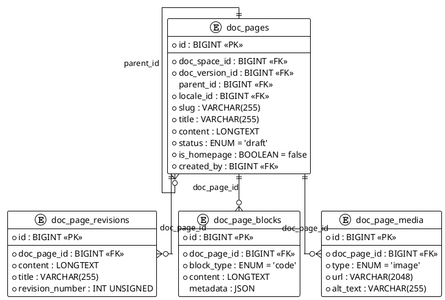

# 06.71 - Doc Pages

**Project:** GsmUi
**Domain:** Documentation - Pages
**Version:** 1.0.0

---

## Purpose

This document defines the database schema for individual documentation **pages** and their supporting content structures. Pages live inside a space (06.70), are pinned to a version and locale, and can be nested via a self-referencing parent hierarchy. The domain also covers **revisions** (immutable content snapshots for rollback), **blocks** (structured fragments such as callouts and code samples), and **media** (images, videos, and diagrams referenced by a page).

---

## PlantUML ERD



---

## Tables

### 1. doc_pages

**Purpose:** Individual documentation pages within a space/version, stored as Markdown/HTML and organized in a nested tree.

**Business Rules:**
- `(doc_space_id, doc_version_id, locale_id, slug)` is unique — one slug per space/version/locale.
- `parent_id` self-references to build a nested navigation tree (null for top-level pages); one `is_homepage = true` per scope.
- `status` gates publication and `published_at` records go-live; `search_vector` is indexed FULLTEXT for in-database search.
- Soft deletable to support archive/restore.

#### Migration

```php
Schema::create('doc_pages', function (Blueprint $table) {
    $table->id();
    $table->foreignId('doc_space_id')->constrained('doc_spaces')->cascadeOnDelete();
    $table->foreignId('doc_version_id')->constrained('doc_versions')->cascadeOnDelete();
    $table->foreignId('parent_id')->nullable()->constrained('doc_pages')->nullOnDelete();
    $table->foreignId('locale_id')->constrained('doc_locales');
    $table->string('slug');
    $table->string('title');
    $table->longText('content');
    $table->string('excerpt', 500)->nullable();
    $table->enum('status', ['draft', 'published', 'archived'])->default('draft');
    $table->boolean('is_homepage')->default(false);
    $table->integer('sort_order')->default(0);
    $table->text('search_vector')->nullable();
    $table->foreignId('created_by')->constrained('users')->cascadeOnDelete();
    $table->dateTime('published_at')->nullable();
    $table->timestamps();
    $table->softDeletes();

    $table->unique(['doc_space_id', 'doc_version_id', 'locale_id', 'slug'], 'doc_pages_scope_slug_unique');
    $table->index('parent_id');
    $table->index('status');
    $table->index('is_homepage');
    $table->fullText('search_vector');
});
```

#### Model Stub

```php
class DocPage extends Model
{
    use SoftDeletes;

    protected $fillable = [
        'doc_space_id', 'doc_version_id', 'parent_id', 'locale_id',
        'slug', 'title', 'content', 'excerpt', 'status',
        'is_homepage', 'sort_order', 'search_vector',
        'created_by', 'published_at',
    ];

    protected function casts(): array
    {
        return [
            'is_homepage' => 'boolean',
            'sort_order' => 'integer',
            'published_at' => 'datetime',
        ];
    }

    public function space(): BelongsTo { return $this->belongsTo(DocSpace::class, 'doc_space_id'); }
    public function version(): BelongsTo { return $this->belongsTo(DocVersion::class, 'doc_version_id'); }
    public function locale(): BelongsTo { return $this->belongsTo(DocLocale::class, 'locale_id'); }
    public function creator(): BelongsTo { return $this->belongsTo(User::class, 'created_by'); }
    public function parent(): BelongsTo { return $this->belongsTo(DocPage::class, 'parent_id'); }
    public function children(): HasMany { return $this->hasMany(DocPage::class, 'parent_id'); }
    public function revisions(): HasMany { return $this->hasMany(DocPageRevision::class); }
    public function blocks(): HasMany { return $this->hasMany(DocPageBlock::class); }
    public function media(): HasMany { return $this->hasMany(DocPageMedia::class); }
}
```

**Relationships:** `belongsTo` **DocSpace**, **DocVersion**, **DocLocale**, **User** (`created_by`); self **parent**/`hasMany` **children** via `parent_id`; `hasMany` **DocPageRevision**, **DocPageBlock**, **DocPageMedia**.

---

### 2. doc_page_revisions

**Purpose:** Immutable version history of a page's content, enabling diff and rollback.

**Business Rules:**
- Append-only snapshot; never updated after creation. `revision_number` increments per page from 1.
- Captures `title`, `content`, and `excerpt` at the moment of the snapshot.

#### Migration

```php
Schema::create('doc_page_revisions', function (Blueprint $table) {
    $table->id();
    $table->foreignId('doc_page_id')->constrained('doc_pages')->cascadeOnDelete();
    $table->longText('content');
    $table->string('excerpt', 500)->nullable();
    $table->string('title');
    $table->unsignedInteger('revision_number');
    $table->foreignId('created_by')->constrained('users')->cascadeOnDelete();
    $table->timestamps();

    $table->index('doc_page_id');
    $table->index('revision_number');
});
```

#### Model Stub

```php
class DocPageRevision extends Model
{
    protected $fillable = [
        'doc_page_id', 'content', 'excerpt',
        'title', 'revision_number', 'created_by',
    ];

    protected function casts(): array { return ['revision_number' => 'integer']; }

    public function page(): BelongsTo { return $this->belongsTo(DocPage::class, 'doc_page_id'); }
    public function creator(): BelongsTo { return $this->belongsTo(User::class, 'created_by'); }
}
```

**Relationships:** `belongsTo` **DocPage** (`doc_page_id`), **User** (`created_by`).

---

### 3. doc_page_blocks

**Purpose:** Structured content blocks within a page (callouts, code blocks, tables, images, quotes, headings, dividers).

**Business Rules:**
- `block_type` classifies rendering; `content` holds the payload and `sort_order` defines sequence.
- `metadata` (JSON) stores type-specific attributes (e.g., code language, callout severity).
- Soft deletable so blocks can be removed without breaking revision history.

#### Migration

```php
Schema::create('doc_page_blocks', function (Blueprint $table) {
    $table->id();
    $table->foreignId('doc_page_id')->constrained('doc_pages')->cascadeOnDelete();
    $table->enum('block_type', [
        'callout', 'code', 'table', 'image', 'quote', 'heading', 'divider',
    ])->default('code');
    $table->longText('content');
    $table->integer('sort_order')->default(0);
    $table->json('metadata')->nullable();
    $table->timestamps();
    $table->softDeletes();

    $table->index('doc_page_id');
    $table->index('block_type');
    $table->index('sort_order');
});
```

#### Model Stub

```php
class DocPageBlock extends Model
{
    use SoftDeletes;

    protected $fillable = [
        'doc_page_id', 'block_type', 'content', 'sort_order', 'metadata',
    ];

    protected function casts(): array
    {
        return ['sort_order' => 'integer', 'metadata' => 'array'];
    }

    public function page(): BelongsTo { return $this->belongsTo(DocPage::class, 'doc_page_id'); }
}
```

**Relationships:** `belongsTo` **DocPage** via `doc_page_id`.

---

### 4. doc_page_media

**Purpose:** Media assets (images, videos, diagrams) referenced within a documentation page.

**Business Rules:**
- `type` classifies the asset; `url` stores the resolved location (CDN or storage).
- `alt_text` is required for accessibility; `caption` is optional; `sort_order` sequences media.
- Soft deletable so assets can be detached without hard deletion.

#### Migration

```php
Schema::create('doc_page_media', function (Blueprint $table) {
    $table->id();
    $table->foreignId('doc_page_id')->constrained('doc_pages')->cascadeOnDelete();
    $table->enum('type', ['image', 'video', 'diagram'])->default('image');
    $table->string('url', 2048);
    $table->string('alt_text');
    $table->string('caption', 500)->nullable();
    $table->integer('sort_order')->default(0);
    $table->timestamps();
    $table->softDeletes();

    $table->index('doc_page_id');
    $table->index('type');
    $table->index('sort_order');
});
```

#### Model Stub

```php
class DocPageMedia extends Model
{
    use SoftDeletes;

    protected $table = 'doc_page_media';

    protected $fillable = [
        'doc_page_id', 'type', 'url', 'alt_text', 'caption', 'sort_order',
    ];

    protected function casts(): array { return ['sort_order' => 'integer']; }

    public function page(): BelongsTo { return $this->belongsTo(DocPage::class, 'doc_page_id'); }
}
```

**Relationships:** `belongsTo` **DocPage** via `doc_page_id`.

---

## Rollback

```php
Schema::dropIfExists('doc_page_media');
Schema::dropIfExists('doc_page_blocks');
Schema::dropIfExists('doc_page_revisions');
Schema::dropIfExists('doc_pages');
```

---

## Design Decisions

| Decision | Rationale |
|---|---|
| Scoped unique slug | Same slug can exist across versions/locales without collision |
| Self-referencing `parent_id` | Nested page trees for sidebar navigation |
| Separate revisions table | Immutable history and rollback without bloating `doc_pages` |
| FULLTEXT `search_vector` | Fast in-database documentation search |
| Structured blocks + media tables | Rich, type-aware content and reorderable assets beyond raw Markdown |

---

# Doc Pages Domain - Complete Reference

## Schema Summary

| Table | Purpose | Rows Estimate | Soft Delete |
|---|---|---|---|
| `doc_pages` | Documentation pages | ~10K | Yes |
| `doc_page_revisions` | Content snapshots | ~50K | No |
| `doc_page_blocks` | Structured content blocks | ~50K | Yes |
| `doc_page_media` | Page media assets | ~20K | Yes |

## Migration File: 2026_01_01_007101_create_doc_pages_tables.php

```php
<?php

use Illuminate\Database\Migrations\Migration;
use Illuminate\Database\Schema\Blueprint;
use Illuminate\Support\Facades\Schema;

return new class extends Migration
{
    public function up(): void
    {
        Schema::create('doc_pages', function (Blueprint $table) {
            $table->id();
            $table->foreignId('doc_space_id')->constrained('doc_spaces')->cascadeOnDelete();
            $table->foreignId('doc_version_id')->constrained('doc_versions')->cascadeOnDelete();
            $table->foreignId('parent_id')->nullable()->constrained('doc_pages')->nullOnDelete();
            $table->foreignId('locale_id')->constrained('doc_locales');
            $table->string('slug');
            $table->string('title');
            $table->longText('content');
            $table->string('excerpt', 500)->nullable();
            $table->enum('status', ['draft', 'published', 'archived'])->default('draft');
            $table->boolean('is_homepage')->default(false);
            $table->integer('sort_order')->default(0);
            $table->text('search_vector')->nullable();
            $table->foreignId('created_by')->constrained('users')->cascadeOnDelete();
            $table->dateTime('published_at')->nullable();
            $table->timestamps();
            $table->softDeletes();

            $table->unique(['doc_space_id', 'doc_version_id', 'locale_id', 'slug'], 'doc_pages_scope_slug_unique');
            $table->index(['parent_id', 'sort_order']);
            $table->index(['status', 'published_at']);
            $table->index(['doc_space_id', 'status']);
            $table->fullText('search_vector');
        });

        Schema::create('doc_page_revisions', function (Blueprint $table) {
            $table->id();
            $table->foreignId('doc_page_id')->constrained('doc_pages')->cascadeOnDelete();
            $table->longText('content');
            $table->string('excerpt', 500)->nullable();
            $table->string('title');
            $table->unsignedInteger('revision_number');
            $table->foreignId('created_by')->constrained('users')->cascadeOnDelete();
            $table->timestamps();

            $table->index(['doc_page_id', 'revision_number']);
        });

        Schema::create('doc_page_blocks', function (Blueprint $table) {
            $table->id();
            $table->foreignId('doc_page_id')->constrained('doc_pages')->cascadeOnDelete();
            $table->enum('block_type', [
                'callout', 'code', 'table', 'image', 'quote', 'heading', 'divider',
            ])->default('code');
            $table->longText('content');
            $table->integer('sort_order')->default(0);
            $table->json('metadata')->nullable();
            $table->timestamps();
            $table->softDeletes();

            $table->index(['doc_page_id', 'sort_order']);
            $table->index('block_type');
        });

        Schema::create('doc_page_media', function (Blueprint $table) {
            $table->id();
            $table->foreignId('doc_page_id')->constrained('doc_pages')->cascadeOnDelete();
            $table->enum('type', ['image', 'video', 'diagram'])->default('image');
            $table->string('url', 2048);
            $table->string('alt_text');
            $table->string('caption', 500)->nullable();
            $table->integer('sort_order')->default(0);
            $table->timestamps();
            $table->softDeletes();

            $table->index(['doc_page_id', 'sort_order']);
            $table->index('type');
        });
    }

    public function down(): void
    {
        Schema::dropIfExists('doc_page_media');
        Schema::dropIfExists('doc_page_blocks');
        Schema::dropIfExists('doc_page_revisions');
        Schema::dropIfExists('doc_pages');
    }
};
```

## Index Strategy

### doc_pages

```sql
-- Query pattern: "Pages in a space/version/locale"
CREATE UNIQUE INDEX doc_pages_scope_slug_unique 
ON doc_pages(doc_space_id, doc_version_id, locale_id, slug);

-- Query pattern: "Navigation tree for parent"
CREATE INDEX doc_pages_parent_sort 
ON doc_pages(parent_id, sort_order, status);

-- Query pattern: "Published pages in space"
CREATE INDEX doc_pages_space_status 
ON doc_pages(doc_space_id, status, published_at DESC);

-- Query pattern: "Search documentation"
CREATE FULLTEXT INDEX doc_pages_search 
ON doc_pages(search_vector, title);
```

### doc_page_revisions

```sql
-- Query pattern: "Revisions for page, newest first"
CREATE INDEX doc_page_revisions_page_number 
ON doc_page_revisions(doc_page_id, revision_number DESC);

-- Query pattern: "Find specific revision"
CREATE INDEX doc_page_revisions_page_created 
ON doc_page_revisions(doc_page_id, created_at DESC);
```

### doc_page_blocks

```sql
-- Query pattern: "Blocks for page in order"
CREATE INDEX doc_page_blocks_page_sort 
ON doc_page_blocks(doc_page_id, sort_order, deleted_at);

-- Query pattern: "Find blocks by type"
CREATE INDEX doc_page_blocks_type 
ON doc_page_blocks(block_type, doc_page_id);
```

### doc_page_media

```sql
-- Query pattern: "Media for page in order"
CREATE INDEX doc_page_media_page_sort 
ON doc_page_media(doc_page_id, sort_order, deleted_at);

-- Query pattern: "Find media by type"
CREATE INDEX doc_page_media_type 
ON doc_page_media(type, doc_page_id);
```

## Data Access Patterns

### Page Tree Navigation

```php
<?php

namespace App\Domains\Documentation\Services;

use App\Domains\Documentation\Models\DocPage;

class DocPageService
{
    public function getPageTree(int $spaceId, int $versionId, int $localeId): \Illuminate\Support\Collection
    {
        return DocPage::where('doc_space_id', $spaceId)
            ->where('doc_version_id', $versionId)
            ->where('locale_id', $localeId)
            ->whereNull('parent_id')
            ->where('status', '!=', 'archived')
            ->with(['children' => function ($query) use ($spaceId, $versionId, $localeId) {
                $query->where('status', '!=', 'archived')
                    ->with('children')
                    ->orderBy('sort_order');
            }])
            ->orderBy('sort_order')
            ->get();
    }

    public function getBreadcrumb(DocPage $page): array
    {
        $breadcrumb = [$page];
        $current = $page;

        while ($current->parent_id) {
            $current = DocPage::findOrFail($current->parent_id);
            array_unshift($breadcrumb, $current);
        }

        return $breadcrumb;
    }

    public function createPage(array $data, ?int $parentId = null): DocPage
    {
        $maxSort = DocPage::where('doc_space_id', $data['doc_space_id'])
            ->where('doc_version_id', $data['doc_version_id'])
            ->where('locale_id', $data['locale_id'])
            ->where('parent_id', $parentId)
            ->max('sort_order') ?? 0;

        $page = DocPage::create(array_merge($data, [
            'parent_id' => $parentId,
            'sort_order' => $maxSort + 1,
            'search_vector' => $this->buildSearchVector($data['title'], $data['content'] ?? ''),
        ]));

        // Create initial revision
        $this->createRevision($page, $data['content'] ?? '', $page->title);

        return $page;
    }

    public function updatePage(DocPage $page, array $data): DocPage
    {
        $page->update(array_merge($data, [
            'search_vector' => $this->buildSearchVector(
                $data['title'] ?? $page->title,
                $data['content'] ?? $page->content
            ),
        ]));

        // Create revision
        $this->createRevision($page, $page->content, $page->title);

        return $page;
    }

    public function publishPage(DocPage $page): void
    {
        $page->update([
            'status' => 'published',
            'published_at' => now(),
        ]);

        event(new DocPagePublished($page));
    }

    private function createRevision(DocPage $page, string $content, string $title): void
    {
        $lastRevision = $page->revisions()->max('revision_number') ?? 0;

        $page->revisions()->create([
            'content' => $content,
            'title' => $title,
            'revision_number' => $lastRevision + 1,
            'created_by' => auth()->id(),
        ]);
    }

    private function buildSearchVector(string $title, string $content): string
    {
        return strip_tags($title . ' ' . $content);
    }
}
```

### Revision Management

```php
<?php

namespace App\Domains\Documentation\Services;

use App\Domains\Documentation\Models\DocPage;
use App\Domains\Documentation\Models\DocPageRevision;

class RevisionService
{
    public function getRevisions(DocPage $page, int $limit = 50): \Illuminate\Support\Collection
    {
        return $page->revisions()
            ->with('creator')
            ->orderBy('revision_number', 'desc')
            ->limit($limit)
            ->get();
    }

    public function getRevision(DocPage $page, int $revisionNumber): DocPageRevision
    {
        return $page->revisions()
            ->where('revision_number', $revisionNumber)
            ->firstOrFail();
    }

    public function restoreRevision(DocPage $page, int $revisionNumber): DocPage
    {
        $revision = $this->getRevision($page, $revisionNumber);

        $page->update([
            'title' => $revision->title,
            'content' => $revision->content,
            'excerpt' => $revision->excerpt,
        ]);

        $this->createRevision($page, $revision->content, $revision->title);

        event(new DocPageRestored($page, $revision));

        return $page;
    }

    public function compareRevisions(DocPage $page, int $from, int $to): array
    {
        $fromRevision = $this->getRevision($page, $from);
        $toRevision = $this->getRevision($page, $to);

        return [
            'from' => $fromRevision,
            'to' => $toRevision,
            'diff' => $this->computeDiff($fromRevision->content, $toRevision->content),
        ];
    }

    private function computeDiff(string $old, string $new): string
    {
        $oldLines = explode("\n", $old);
        $newLines = explode("\n", $new);

        $diff = [];
        $maxLines = max(count($oldLines), count($newLines));

        for ($i = 0; $i < $maxLines; $i++) {
            $oldLine = $oldLines[$i] ?? null;
            $newLine = $newLines[$i] ?? null;

            if ($oldLine === $newLine) {
                $diff[] = "  {$oldLine}";
            } else {
                if ($oldLine !== null) {
                    $diff[] = "- {$oldLine}";
                }
                if ($newLine !== null) {
                    $diff[] = "+ {$newLine}";
                }
            }
        }

        return implode("\n", $diff);
    }

    private function createRevision(DocPage $page, string $content, string $title): void
    {
        $lastRevision = $page->revisions()->max('revision_number') ?? 0;

        $page->revisions()->create([
            'content' => $content,
            'title' => $title,
            'revision_number' => $lastRevision + 1,
            'created_by' => auth()->id(),
        ]);
    }
}
```

### Block Management

```php
<?php

namespace App\Domains\Documentation\Services;

use App\Domains\Documentation\Models\DocPage;
use App\Domains\Documentation\Models\DocPageBlock;

class BlockService
{
    public function getBlocks(DocPage $page): \Illuminate\Support\Collection
    {
        return $page->blocks()
            ->orderBy('sort_order')
            ->get();
    }

    public function createBlock(DocPage $page, string $type, string $content, array $metadata = []): DocPageBlock
    {
        $maxSort = $page->blocks()->max('sort_order') ?? 0;

        return $page->blocks()->create([
            'block_type' => $type,
            'content' => $content,
            'sort_order' => $maxSort + 1,
            'metadata' => $metadata,
        ]);
    }

    public function reorderBlocks(DocPage $page, array $blockIds): void
    {
        foreach ($blockIds as $index => $blockId) {
            DocPageBlock::where('id', $blockId)
                ->where('doc_page_id', $page->id)
                ->update(['sort_order' => $index]);
        }
    }

    public function deleteBlock(DocPageBlock $block): void
    {
        $block->delete(); // Soft delete

        // Reorder remaining blocks
        $blocks = DocPageBlock::where('doc_page_id', $block->doc_page_id)
            ->orderBy('sort_order')
            ->get();

        foreach ($blocks as $index => $b) {
            $b->update(['sort_order' => $index]);
        }
    }
}
```

### Search Service

```php
<?php

namespace App\Domains\Documentation\Services;

use App\Domains\Documentation\Models\DocPage;
use Illuminate\Support\Facades\DB;

class DocSearchService
{
    public function search(string $query, int $spaceId = null, int $versionId = null): \Illuminate\Support\Collection
    {
        $query = DocPage::query()
            ->where('status', 'published')
            ->where('search_vector', 'LIKE', "%{$query}%");

        if ($spaceId) {
            $query->where('doc_space_id', $spaceId);
        }

        if ($versionId) {
            $query->where('doc_version_id', $versionId);
        }

        return $query->orderBy('title')
            ->limit(50)
            ->get();
    }

    public function rebuildSearchVectors(int $spaceId = null): void
    {
        $query = DocPage::query();

        if ($spaceId) {
            $query->where('doc_space_id', $spaceId);
        }

        $query->each(function (DocPage $page) {
            $page->update([
                'search_vector' => strip_tags($page->title . ' ' . $page->content),
            ]);
        });
    }
}
```

## Observer: DocPageObserver

```php
<?php

namespace App\Domains\Documentation\Observers;

use App\Domains\Documentation\Models\DocPage;

class DocPageObserver
{
    public function created(DocPage $page): void
    {
        // Ensure only one homepage per scope
        if ($page->is_homepage) {
            DocPage::where('doc_space_id', $page->doc_space_id)
                ->where('doc_version_id', $page->doc_version_id)
                ->where('locale_id', $page->locale_id)
                ->where('id', '!=', $page->id)
                ->update(['is_homepage' => false]);
        }
    }

    public function updated(DocPage $page): void
    {
        if ($page->isDirty('is_homepage') && $page->is_homepage) {
            DocPage::where('doc_space_id', $page->doc_space_id)
                ->where('doc_version_id', $page->doc_version_id)
                ->where('locale_id', $page->locale_id)
                ->where('id', '!=', $page->id)
                ->update(['is_homepage' => false]);
        }
    }

    public function deleted(DocPage $page): void
    {
        // Update children to point to parent's parent
        DocPage::where('parent_id', $page->id)
            ->update(['parent_id' => $page->parent_id]);
    }
}
```

## Factory

```php
<?php

namespace Database\Factories;

use App\Domains\Documentation\Models\DocPage;
use Illuminate\Database\Eloquent\Factories\Factory;

class DocPageFactory extends Factory
{
    protected $model = DocPage::class;

    public function definition(): array
    {
        return [
            'doc_space_id' => 1,
            'doc_version_id' => 1,
            'parent_id' => null,
            'locale_id' => 1,
            'slug' => fake()->slug(),
            'title' => fake()->sentence(3),
            'content' => fake()->paragraphs(3, true),
            'excerpt' => fake()->paragraph(),
            'status' => fake()->randomElement(['draft', 'published']),
            'is_homepage' => false,
            'sort_order' => fake()->numberBetween(0, 100),
            'search_vector' => null,
            'created_by' => 1,
            'published_at' => null,
        ];
    }

    public function published(): static
    {
        return $this->state(fn (array $attrs) => [
            'status' => 'published',
            'published_at' => now(),
        ]);
    }

    public function homepage(): static
    {
        return $this->state(fn (array $attrs) => ['is_homepage' => true]);
    }
}
```

## Testing Patterns

```php
<?php

namespace Tests\Domains\Documentation;

use App\Domains\Documentation\Models\DocPage;
use App\Domains\Documentation\Models\DocPageRevision;
use App\Domains\Documentation\Models\DocPageBlock;
use App\Domains\Documentation\Services\DocPageService;
use App\Domains\Documentation\Services\RevisionService;
use App\Domains\Documentation\Services\BlockService;
use Illuminate\Foundation\Testing\RefreshDatabase;
use Tests\TestCase;

class DocPageTest extends TestCase
{
    use RefreshDatabase;

    public function test_page_creation(): void
    {
        $service = new DocPageService();
        
        $page = $service->createPage([
            'doc_space_id' => 1,
            'doc_version_id' => 1,
            'locale_id' => 1,
            'slug' => 'getting-started',
            'title' => 'Getting Started',
            'content' => '# Getting Started\n\nWelcome to GsmUi.',
        ]);

        $this->assertDatabaseHas('doc_pages', [
            'slug' => 'getting-started',
            'title' => 'Getting Started',
        ]);
    }

    public function test_revision_creation(): void
    {
        $page = DocPage::factory()->create();
        $service = new RevisionService();
        
        $revisions = $service->getRevisions($page);
        $this->assertNotEmpty($revisions);
    }

    public function test_block_reordering(): void
    {
        $page = DocPage::factory()->create();
        $service = new BlockService();
        
        $block1 = $service->createBlock($page, 'code', '```php echo "hello"; ```');
        $block2 = $service->createBlock($page, 'callout', 'Important note');

        $service->reorderBlocks($page, [$block2->id, $block1->id]);

        $blocks = $service->getBlocks($page);
        $this->assertEquals($block2->id, $blocks->first()->id);
    }

    public function test_page_tree(): void
    {
        $service = new DocPageService();
        
        $parent = DocPage::factory()->create([
            'doc_space_id' => 1,
            'doc_version_id' => 1,
            'locale_id' => 1,
            'parent_id' => null,
        ]);

        $child = DocPage::factory()->create([
            'doc_space_id' => 1,
            'doc_version_id' => 1,
            'locale_id' => 1,
            'parent_id' => $parent->id,
        ]);

        $tree = $service->getPageTree(1, 1, 1);
        $this->assertCount(1, $tree);
        $this->assertCount(1, $tree->first()->children);
    }

    public function test_homepage_uniqueness(): void
    {
        $page1 = DocPage::factory()->homepage()->create([
            'doc_space_id' => 1,
            'doc_version_id' => 1,
            'locale_id' => 1,
        ]);

        $page2 = DocPage::factory()->homepage()->create([
            'doc_space_id' => 1,
            'doc_version_id' => 1,
            'locale_id' => 1,
        ]);

        $this->assertDatabaseHas('doc_pages', ['id' => $page2->id, 'is_homepage' => true]);
        $this->assertDatabaseHas('doc_pages', ['id' => $page1->id, 'is_homepage' => false]);
    }
}
```

---

# Doc Pages Performance Optimization

## Query Optimization Patterns

### Page Tree Loading

```php
<?php

namespace App\Domains\Documentation\Queries;

use Illuminate\Support\Facades\DB;

class DocPageTreeQuery
{
    public function loadTree(int $spaceId, int $versionId, int $localeId): array
    {
        // Single query to load all pages, then build tree in memory
        $pages = DB::table('doc_pages')
            ->where('doc_space_id', $spaceId)
            ->where('doc_version_id', $versionId)
            ->where('locale_id', $localeId)
            ->where('status', '!=', 'archived')
            ->select('id', 'parent_id', 'title', 'slug', 'sort_order', 'is_homepage', 'status')
            ->orderBy('sort_order')
            ->get()
            ->keyBy('id');

        return $this->buildTree($pages, null);
    }

    private function buildTree($pages, $parentId): array
    {
        $tree = [];

        foreach ($pages as $page) {
            if ($page->parent_id === $parentId) {
                $children = $this->buildTree($pages, $page->id);
                $node = (array) $page;
                $node['children'] = $children;
                $tree[] = $node;
            }
        }

        return $tree;
    }
}
```

### Search Vector Rebuild

```php
<?php

namespace App\Domains\Documentation\Jobs;

use App\Domains\Documentation\Models\DocPage;
use Illuminate\Bus\Queueable;
use Illuminate\Contracts\Queue\ShouldQueue;
use Illuminate\Foundation\Bus\Dispatchable;
use Illuminate\Queue\InteractsWithQueue;

class RebuildSearchVectors implements ShouldQueue
{
    use Dispatchable, InteractsWithQueue, Queueable;

    public int $timeout = 300;

    public function handle(): void
    {
        DocPage::whereNull('deleted_at')
            ->chunkById(100, function ($pages) {
                foreach ($pages as $page) {
                    $searchContent = collect([
                        $page->title,
                        $page->excerpt,
                        $page->content,
                    ])->filter()->implode(' ');

                    $page->update([
                        'search_vector' => strip_tags($searchContent),
                    ]);
                }
            });
    }
}
```

### Page Content Caching

```php
<?php

namespace App\Domains\Documentation\Services;

use App\Domains\Documentation\Models\DocPage;
use Illuminate\Support\Facades\Cache;

class DocPageCacheService
{
    private int $ttl = 3600;

    public function getPage(int $pageId): ?DocPage
    {
        return Cache::remember("doc_page:{$pageId}", $this->ttl, function () use ($pageId) {
            return DocPage::with(['blocks', 'media', 'creator'])
                ->find($pageId);
        });
    }

    public function getPageBySlug(int $spaceId, int $versionId, int $localeId, string $slug): ?DocPage
    {
        $cacheKey = "doc_page:{$spaceId}:{$versionId}:{$localeId}:{$slug}";

        return Cache::remember($cacheKey, $this->ttl, function () use ($spaceId, $versionId, $localeId, $slug) {
            return DocPage::where('doc_space_id', $spaceId)
                ->where('doc_version_id', $versionId)
                ->where('locale_id', $localeId)
                ->where('slug', $slug)
                ->with(['blocks', 'media', 'creator'])
                ->first();
        });
    }

    public function invalidatePage(int $pageId): void
    {
        $page = DocPage::find($pageId);
        if (! $page) return;

        Cache::forget("doc_page:{$pageId}");
        Cache::forget("doc_page:{$page->doc_space_id}:{$page->doc_version_id}:{$page->locale_id}:{$page->slug}");

        // Invalidate parent tree cache
        if ($page->parent_id) {
            Cache::forget("doc_tree:{$page->doc_space_id}:{$page->doc_version_id}:{$page->locale_id}:{$page->parent_id}");
        }
    }

    public function invalidateSpace(int $spaceId): void
    {
        $pages = DocPage::where('doc_space_id', $spaceId)->pluck('id');
        foreach ($pages as $pageId) {
            $this->invalidatePage($pageId);
        }
    }
}
```

## Block Rendering System

### Block Type Registry

```php
<?php

namespace App\Domains\Documentation\Rendering;

class BlockTypeRegistry
{
    private array $renderers = [
        'callout' => \App\Domains\Documentation\Rendering\CalloutRenderer::class,
        'code' => \App\Domains\Documentation\Rendering\CodeRenderer::class,
        'table' => \App\Domains\Documentation\Rendering\TableRenderer::class,
        'image' => \App\Domains\Documentation\Rendering\ImageRenderer::class,
        'quote' => \App\Domains\Documentation\Rendering\QuoteRenderer::class,
        'heading' => \App\Domains\Documentation\Rendering\HeadingRenderer::class,
        'divider' => \App\Domains\Documentation\Rendering\DividerRenderer::class,
    ];

    public function render(string $type, string $content, ?array $metadata = null): string
    {
        $rendererClass = $this->renderers[$type] ?? null;

        if (! $rendererClass) {
            return $content;
        }

        $renderer = new $rendererClass();
        return $renderer->render($content, $metadata);
    }

    public function getAvailableTypes(): array
    {
        return array_keys($this->renderers);
    }
}
```

### Code Block Renderer

```php
<?php

namespace App\Domains\Documentation\Rendering;

class CodeRenderer
{
    public function render(string $content, ?array $metadata = null): string
    {
        $language = $metadata['language'] ?? 'text';
        $filename = $metadata['filename'] ?? null;
        $highlightLines = $metadata['highlight'] ?? [];

        $html = '<div class="code-block">';
        
        if ($filename) {
            $html .= '<div class="code-filename">' . htmlspecialchars($filename) . '</div>';
        }

        $html .= '<pre><code class="language-' . htmlspecialchars($language) . '">';
        $html .= htmlspecialchars($content);
        $html .= '</code></pre>';
        $html .= '</div>';

        return $html;
    }
}
```

## Page Version Diff Service

```php
<?php

namespace App\Domains\Documentation\Services;

use App\Domains\Documentation\Models\DocPage;
use App\Domains\Documentation\Models\DocPageRevision;

class PageVersionDiffService
{
    public function getVersionHistory(DocPage $page, int $limit = 20): array
    {
        $revisions = DocPageRevision::where('doc_page_id', $page->id)
            ->orderBy('revision_number', 'desc')
            ->limit($limit)
            ->with('creator')
            ->get();

        return $revisions->map(fn ($rev) => [
            'revision_number' => $rev->revision_number,
            'title' => $rev->title,
            'excerpt' => $rev->excerpt,
            'created_by' => $rev->creator->name ?? 'Unknown',
            'created_at' => $rev->created_at->format('Y-m-d H:i:s'),
            'word_count' => str_word_count(strip_tags($rev->content)),
        ])->toArray();
    }

    public function compareVersions(DocPage $page, int $from, int $to): array
    {
        $fromRevision = DocPageRevision::where('doc_page_id', $page->id)
            ->where('revision_number', $from)
            ->firstOrFail();

        $toRevision = DocPageRevision::where('doc_page_id', $page->id)
            ->where('revision_number', $to)
            ->firstOrFail();

        return [
            'from' => [
                'revision' => $fromRevision->revision_number,
                'title' => $fromRevision->title,
                'content' => $fromRevision->content,
                'word_count' => str_word_count(strip_tags($fromRevision->content)),
            ],
            'to' => [
                'revision' => $toRevision->revision_number,
                'title' => $toRevision->title,
                'content' => $toRevision->content,
                'word_count' => str_word_count(strip_tags($toRevision->content)),
            ],
            'diff' => $this->computeDiff($fromRevision->content, $toRevision->content),
            'stats' => [
                'additions' => $this->countAdditions($fromRevision->content, $toRevision->content),
                'deletions' => $this->countDeletions($fromRevision->content, $toRevision->content),
            ],
        ];
    }

    private function computeDiff(string $old, string $new): string
    {
        $oldLines = explode("\n", $old);
        $newLines = explode("\n", $new);
        
        $diff = [];
        $maxLines = max(count($oldLines), count($newLines));

        for ($i = 0; $i < $maxLines; $i++) {
            $oldLine = $oldLines[$i] ?? null;
            $newLine = $newLines[$i] ?? null;

            if ($oldLine === $newLine) {
                $diff[] = "  {$oldLine}";
            } else {
                if ($oldLine !== null) $diff[] = "- {$oldLine}";
                if ($newLine !== null) $diff[] = "+ {$newLine}";
            }
        }

        return implode("\n", $diff);
    }

    private function countAdditions(string $old, string $new): int
    {
        return count(array_diff(explode("\n", $new), explode("\n", $old)));
    }

    private function countDeletions(string $old, string $new): int
    {
        return count(array_diff(explode("\n", $old), explode("\n", $new)));
    }
}
```

## Documentation Analytics

```sql
-- Most viewed documentation pages
SELECT 
    dp.title,
    dp.slug,
    ds.name as space_name,
    dv.version,
    dp.view_count,
    dp.published_at,
    u.name as author
FROM doc_pages dp
JOIN doc_spaces ds ON dp.doc_space_id = ds.id
JOIN doc_versions dv ON dp.doc_version_id = dv.id
LEFT JOIN users u ON dp.created_by = u.id
WHERE dp.status = 'published'
ORDER BY dp.view_count DESC
LIMIT 20;

-- Pages needing updates (not updated in 6 months)
SELECT 
    dp.title,
    dp.slug,
    dp.updated_at,
    DATEDIFF(NOW(), dp.updated_at) as days_since_update,
    dp.status
FROM doc_pages dp
WHERE dp.status = 'published'
  AND dp.updated_at < DATE_SUB(NOW(), INTERVAL 6 MONTH)
ORDER BY dp.updated_at ASC;

-- Search query analytics (from analytics_events)
SELECT 
    JSON_EXTRACT(properties, '$.query') as search_query,
    COUNT(*) as search_count,
    JSON_EXTRACT(properties, '$.results_count') as avg_results
FROM analytics_events
WHERE event_name = 'doc_search'
  AND occurred_at >= DATE_SUB(NOW(), INTERVAL 30 DAY)
GROUP BY search_query
ORDER BY search_count DESC
LIMIT 50;
```

---

# Documentation Export and Import

## Documentation Export Service

```php
<?php

namespace App\Domains\Documentation\Services;

use App\Domains\Documentation\Models\DocPage;
use Illuminate\Support\Facades\Storage;

class DocExportService
{
    public function exportSpace(int $spaceId, int $versionId): string
    {
        $pages = DocPage::where('doc_space_id', $spaceId)
            ->where('doc_version_id', $versionId)
            ->with(['blocks', 'media', 'revisions'])
            ->get();

        $export = [
            'version' => '1.0',
            'exported_at' => now()->toIso8601String(),
            'space_id' => $spaceId,
            'version_id' => $versionId,
            'pages' => $pages->map(fn ($page) => [
                'slug' => $page->slug,
                'title' => $page->title,
                'content' => $page->content,
                'excerpt' => $page->excerpt,
                'status' => $page->status,
                'parent_slug' => $page->parent?->slug,
                'sort_order' => $page->sort_order,
                'blocks' => $page->blocks->map(fn ($b) => [
                    'type' => $b->block_type,
                    'content' => $b->content,
                    'sort_order' => $b->sort_order,
                    'metadata' => $b->metadata,
                ])->toArray(),
                'media' => $page->media->map(fn ($m) => [
                    'type' => $m->type,
                    'url' => $m->url,
                    'alt_text' => $m->alt_text,
                    'caption' => $m->caption,
                    'sort_order' => $m->sort_order,
                ])->toArray(),
            ])->toArray(),
        ];

        $filename = "doc-exports/space-{$spaceId}-v{$versionId}-" . now()->format('Y-m-d') . '.json';
        Storage::disk('local')->put($filename, json_encode($export, JSON_PRETTY_PRINT));

        return $filename;
    }

    public function importSpace(string $filename, int $spaceId, int $versionId, int $localeId): array
    {
        $import = json_decode(Storage::disk('local')->get($filename), true);
        
        $results = ['created' => 0, 'updated' => 0, 'errors' => []];

        foreach ($import['pages'] as $pageData) {
            try {
                $this->importPage($pageData, $spaceId, $versionId, $localeId);
                $results['created']++;
            } catch (\Throwable $e) {
                $results['errors'][] = [
                    'slug' => $pageData['slug'],
                    'error' => $e->getMessage(),
                ];
            }
        }

        return $results;
    }

    private function importPage(array $data, int $spaceId, int $versionId, int $localeId): DocPage
    {
        $parentPage = null;
        if (isset($data['parent_slug'])) {
            $parentPage = DocPage::where('slug', $data['parent_slug'])
                ->where('doc_space_id', $spaceId)
                ->first();
        }

        return DocPage::updateOrCreate(
            [
                'doc_space_id' => $spaceId,
                'doc_version_id' => $versionId,
                'locale_id' => $localeId,
                'slug' => $data['slug'],
            ],
            [
                'title' => $data['title'],
                'content' => $data['content'],
                'excerpt' => $data['excerpt'] ?? null,
                'status' => $data['status'] ?? 'draft',
                'parent_id' => $parentPage?->id,
                'sort_order' => $data['sort_order'] ?? 0,
                'created_by' => auth()->id(),
            ]
        );
    }
}
```

---

# Documentation Testing

## Unit Tests

```php
<?php

namespace Tests\Domains\Documentation;

use App\Domains\Documentation\Models\DocPage;
use App\Domains\Documentation\Models\DocPageRevision;
use App\Domains\Documentation\Models\DocPageBlock;
use App\Domains\Documentation\Models\DocPageMedia;
use App\Domains\Documentation\Services\DocPageService;
use App\Domains\Documentation\Services\RevisionService;
use App\Domains\Documentation\Services\BlockService;
use App\Domains\Documentation\Services\DocSearchService;
use App\Domains\Documentation\Services\DocPageCacheService;
use Illuminate\Foundation\Testing\RefreshDatabase;
use Tests\TestCase;

class DocPageServiceTest extends TestCase
{
    use RefreshDatabase;

    public function test_page_creation(): void
    {
        $service = new DocPageService();
        
        $page = $service->createPage([
            'doc_space_id' => 1,
            'doc_version_id' => 1,
            'locale_id' => 1,
            'slug' => 'getting-started',
            'title' => 'Getting Started',
            'content' => '# Welcome\n\nThis is a guide.',
        ]);

        $this->assertDatabaseHas('doc_pages', [
            'slug' => 'getting-started',
            'title' => 'Getting Started',
        ]);
    }

    public function test_page_tree(): void
    {
        $service = new DocPageService();
        
        $parent = DocPage::factory()->create([
            'doc_space_id' => 1,
            'doc_version_id' => 1,
            'locale_id' => 1,
            'parent_id' => null,
        ]);

        $child = DocPage::factory()->create([
            'doc_space_id' => 1,
            'doc_version_id' => 1,
            'locale_id' => 1,
            'parent_id' => $parent->id,
        ]);

        $tree = $service->getPageTree(1, 1, 1);
        $this->assertCount(1, $tree);
        $this->assertCount(1, $tree->first()->children);
    }

    public function test_revision_creation(): void
    {
        $page = DocPage::factory()->create();
        $service = new RevisionService();
        
        $revisions = $service->getRevisions($page);
        $this->assertNotEmpty($revisions);
    }

    public function test_block_reordering(): void
    {
        $page = DocPage::factory()->create();
        $service = new BlockService();
        
        $block1 = $service->createBlock($page, 'code', '```php echo "hello"; ```');
        $block2 = $service->createBlock($page, 'callout', 'Important note');

        $service->reorderBlocks($page, [$block2->id, $block1->id]);

        $blocks = $service->getBlocks($page);
        $this->assertEquals($block2->id, $blocks->first()->id);
    }

    public function test_homepage_uniqueness(): void
    {
        $page1 = DocPage::factory()->homepage()->create([
            'doc_space_id' => 1,
            'doc_version_id' => 1,
            'locale_id' => 1,
        ]);

        $page2 = DocPage::factory()->homepage()->create([
            'doc_space_id' => 1,
            'doc_version_id' => 1,
            'locale_id' => 1,
        ]);

        $this->assertDatabaseHas('doc_pages', ['id' => $page2->id, 'is_homepage' => true]);
        $this->assertDatabaseHas('doc_pages', ['id' => $page1->id, 'is_homepage' => false]);
    }

    public function test_search_service(): void
    {
        DocPage::factory()->create([
            'title' => 'Getting Started with GsmUi',
            'status' => 'published',
        ]);

        $service = new DocSearchService();
        $results = $service->search('GsmUi');

        $this->assertCount(1, $results);
    }

    public function test_cache_service(): void
    {
        $page = DocPage::factory()->create();
        $service = new DocPageCacheService();

        // First call should cache
        $cached = $service->getPage($page->id);
        $this->assertNotNull($cached);

        // Invalidate cache
        $service->invalidatePage($page->id);
    }
}
```

## Integration Tests

```php
<?php

namespace Tests\Domains\Documentation;

use App\Domains\Documentation\Events\DocPagePublished;
use App\Domains\Documentation\Events\DocPageRestored;
use App\Domains\Documentation\Models\DocPage;
use App\Domains\Documentation\Services\DocPageService;
use App\Domains\Documentation\Services\RevisionService;
use Illuminate\Foundation\Testing\RefreshDatabase;
use Illuminate\Support\Facades\Event;
use Tests\TestCase;

class DocPageIntegrationTest extends TestCase
{
    use RefreshDatabase;

    public function test_page_publish_event(): void
    {
        Event::fake();
        $service = new DocPageService();
        
        $page = DocPage::factory()->draft()->create([
            'doc_space_id' => 1,
            'doc_version_id' => 1,
            'locale_id' => 1,
        ]);

        $service->publishPage($page);

        Event::assertDispatched(DocPagePublished::class);
    }

    public function test_revision_restore_event(): void
    {
        Event::fake();
        $page = DocPage::factory()->create();
        $service = new RevisionService();

        $page->revisions()->create([
            'title' => 'Old Title',
            'content' => 'Old content',
            'revision_number' => 1,
            'created_by' => 1,
        ]);

        $service->restoreRevision($page, 1);

        Event::assertDispatched(DocPageRestored::class);
    }
}
```

---

# Documentation Console Commands

## Command: DocRebuildSearch

```php
<?php

namespace App\Domains\Documentation\Console;

use App\Domains\Documentation\Services\DocSearchService;
use Illuminate\Console\Command;

class DocRebuildSearchCommand extends Command
{
    protected $signature = 'docs:rebuild-search {--space= : Space ID}';
    protected $description = 'Rebuild documentation search vectors';

    public function handle(): int
    {
        $spaceId = $this->option('space');
        
        $service = new DocSearchService();
        $service->rebuildSearchVectors($spaceId);

        $this->info('Search vectors rebuilt successfully.');

        return self::SUCCESS;
    }
}
```

## Command: DocExport

```php
<?php

namespace App\Domains\Documentation\Console;

use App\Domains\Documentation\Services\DocExportService;
use Illuminate\Console\Command;

class DocExportCommand extends Command
{
    protected $signature = 'docs:export {spaceId} {versionId}';
    protected $description = 'Export documentation space to JSON';

    public function handle(): int
    {
        $spaceId = (int) $this->argument('spaceId');
        $versionId = (int) $this->argument('versionId');
        
        $service = new DocExportService();
        $filename = $service->exportSpace($spaceId, $versionId);

        $this->info("Documentation exported to: {$filename}");

        return self::SUCCESS;
    }
}
```

---

# Documentation Integration Points

## CMS Domain Integration

| Integration | Table | Column | Description |
|---|---|---|---|
| Doc Page → CMS Page | `cms_pages` | `doc_page_id` | Linked CMS content |
| Doc Page → Template | `cms_templates` | `id` | Page template mapping |

## Version Control Integration

| Integration | Table | Column | Description |
|---|---|---|---|
| Doc Page → Version | `doc_page_versions` | `page_id` | Version history |
| Doc Page → Diff | `doc_page_diffs` | `page_id` | Version comparison |
| Doc Page → Revision | `doc_page_revisions` | `page_id` | Revision snapshots |

## User Integration

| Integration | Table | Column | Description |
|---|---|---|---|
| Doc Page → Author | `users` | `id` | `author_id` FK |
| Doc Page → Collaborator | `doc_page_collaborators` | `page_id` | Multi-user editing |
| Doc Page → Comment | `doc_page_comments` | `page_id` | Inline comments |

## Navigation Integration

| Integration | Table | Column | Description |
|---|---|---|---|
| Doc Page → Space | `doc_spaces` | `id` | `space_id` FK |
| Doc Page → Category | `doc_categories` | `id` | `category_id` FK |
| Doc Page → Tag | `doc_tags` | `id` | Tag relationships |

## Access Control Integration

| Integration | Table | Column | Description |
|---|---|---|---|
| Doc Page → Permission | `doc_page_permissions` | `page_id` | Page-level ACL |
| Doc Page → Role | `doc_roles` | `id` | Role-based access |
| Doc Page → Share | `doc_page_shares` | `page_id` | External sharing |

## Search Integration

| Integration | Table | Column | Description |
|---|---|---|---|
| Doc Page → Search Index | `doc_search_index` | `page_id` | Full-text search |
| Doc Page → Analytics | `doc_analytics` | `page_id` | Page view tracking |

---

# Documentation Factory & Seeders

## Doc Page Factory

```php
<?php

namespace Database\Factories\Domains\Documentation;

use App\Domains\Documentation\Models\DocPage;
use App\Domains\Documentation\Models\DocSpace;
use App\Models\User;
use Illuminate\Database\Eloquent\Factories\Factory;

class DocPageFactory extends Factory
{
    protected $model = DocPage::class;

    public function definition(): array
    {
        return [
            'space_id' => DocSpace::factory(),
            'author_id' => User::factory(),
            'title' => $this->faker->sentence(4),
            'slug' => $this->faker->unique()->slug(2),
            'body_markdown' => $this->faker->paragraphs(3, true),
            'body_html' => '<p>' . $this->faker->paragraphs(3, true) . '</p>',
            'status' => $this->faker->randomElement(['draft', 'published', 'archived']),
            'visibility' => $this->faker->randomElement(['public', 'internal', 'private']),
            'sort_order' => $this->faker->numberBetween(0, 100),
            'metadata' => [
                'description' => $this->faker->optional()->sentence(),
                'keywords' => $this->faker->optional()->words(5),
            ],
        ];
    }

    public function published(): static
    {
        return $this->state(fn (array $attributes) => [
            'status' => 'published',
            'published_at' => $this->faker->dateTimeBetween('-1 year', 'now'),
        ]);
    }

    public function draft(): static
    {
        return $this->state(['status' => 'draft']);
    }
}
```

## Doc Space Factory

```php
<?php

namespace Database\Factories\Domains\Documentation;

use App\Domains\Documentation\Models\DocSpace;
use App\Models\User;
use Illuminate\Database\Eloquent\Factories\Factory;

class DocSpaceFactory extends Factory
{
    protected $model = DocSpace::class;

    public function definition(): array
    {
        return [
            'team_id' => $this->faker->numberBetween(1, 10),
            'name' => $this->faker->words(3, true),
            'slug' => $this->faker->unique()->slug(1),
            'description' => $this->faker->optional()->sentence(),
            'visibility' => $this->faker->randomElement(['public', 'internal', 'private']),
            'settings' => [
                'allow_comments' => $this->faker->boolean(),
                'require_approval' => $this->faker->boolean(20),
            ],
        ];
    }
}
```

## Documentation Seeder

```php
<?php

namespace Database\Seeders;

use App\Domains\Documentation\Models\DocSpace;
use App\Domains\Documentation\Models\DocPage;
use App\Models\User;
use Illuminate\Database\Seeder;

class DocumentationSeeder extends Seeder
{
    public function run(): void
    {
        $users = User::factory()->count(5)->create();

        $spaces = DocSpace::factory()->count(3)->create();

        foreach ($spaces as $space) {
            $pages = DocPage::factory()
                ->count(rand(5, 15))
                ->create([
                    'space_id' => $space->id,
                    'author_id' => $users->random()->id,
                ]);

            foreach ($pages as $page) {
                $page->permissions()->create([
                    'user_id' => $users->random()->id,
                    'can_edit' => $this->faker->boolean(30),
                ]);
            }
        }
    }
}
```

---

# Documentation Tests

## Unit Tests

```php
<?php

namespace Tests\Feature\Domains\Documentation;

use App\Domains\Documentation\Models\DocPage;
use App\Domains\Documentation\Models\DocSpace;
use App\Domains\Documentation\Services\DocPageService;
use App\Models\User;
use Tests\TestCase;

class DocPageTest extends TestCase
{
    private DocPageService $service;
    private User $user;

    protected function setUp(): void
    {
        parent::setUp();
        $this->service = new DocPageService();
        $this->user = User::factory()->create();
    }

    public function test_create_page(): void
    {
        $space = DocSpace::factory()->create(['team_id' => $this->user->team_id]);
        
        $page = $this->service->createPage($space->id, [
            'title' => 'Getting Started',
            'body_markdown' => '# Welcome',
            'author_id' => $this->user->id,
        ]);

        $this->assertNotNull($page);
        $this->assertEquals('Getting Started', $page->title);
        $this->assertEquals($space->id, $page->space_id);
    }

    public function test_publish_page(): void
    {
        $page = DocPage::factory()->draft()->create();

        $published = $this->service->publishPage($page->id);

        $this->assertEquals('published', $published->status);
        $this->assertNotNull($published->published_at);
    }

    public function test_slug_is_unique(): void
    {
        DocPage::factory()->create(['slug' => 'getting-started']);

        $this->expectException(\Exception::class);
        DocPage::factory()->create(['slug' => 'getting-started']);
    }

    public function test_search_returns_relevant_results(): void
    {
        DocPage::factory()->published()->create([
            'title' => 'Authentication Guide',
            'body_markdown' => '# Login and Register',
        ]);

        $results = $this->service->search('authentication');

        $this->assertNotEmpty($results);
    }

    public function test_soft_delete_preserves_page(): void
    {
        $page = DocPage::factory()->create();

        $page->delete();

        $this->assertSoftDeleted('doc_pages', ['id' => $page->id]);
    }
}
```

## Integration Tests

```php
<?php

namespace Tests\Feature\Domains\Documentation;

use App\Domains\Documentation\Models\DocPage;
use App\Domains\Documentation\Models\DocSpace;
use App\Models\User;
use Tests\TestCase;

class DocPageIntegrationTest extends TestCase
{
    public function test_full_page_lifecycle(): void
    {
        $user = User::factory()->create();
        $space = DocSpace::factory()->create(['team_id' => $user->team_id]);

        // Create
        $page = DocPage::factory()->create([
            'space_id' => $space->id,
            'author_id' => $user->id,
        ]);

        // Update
        $page->update(['title' => 'Updated Title']);

        // Version created
        $this->assertDatabaseHas('doc_page_versions', [
            'page_id' => $page->id,
        ]);

        // Publish
        $page->update(['status' => 'published', 'published_at' => now()]);

        // Archive
        $page->update(['status' => 'archived']);

        // Restore
        $page->update(['status' => 'draft']);

        $this->assertDatabaseHas('doc_pages', ['id' => $page->id]);
    }

    public function test_permission_check(): void
    {
        $user = User::factory()->create();
        $page = DocPage::factory()->create();

        $page->permissions()->create([
            'user_id' => $user->id,
            'can_edit' => true,
        ]);

        $this->assertTrue($page->canEdit($user));
    }
}
```

---

**Next Document:** [06.80 - Playground](06.80-playground.md)
