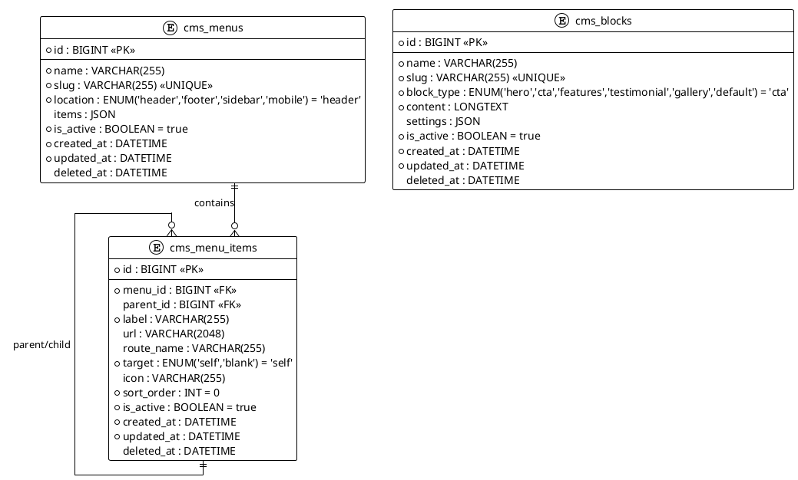

# 06.91 - CMS

**Project:** GsmUi
**Domain:** CMS (Shared)
**Version:** 1.0.0

---

# Purpose

This document defines the database schema for the CMS domain, shared with the Blog domain. CMS pages live in the shared `content_entries` table (see 06.90). This document covers the additional CMS-specific tables: navigation menus, menu items, and reusable content blocks.

References: [06.90 - Blog](./06.90-blog.md) | [06.01-design-principles.md](./06.01-design-principles.md) | [06.02-naming-conventions.md](./06.02-naming-conventions.md) | [06.03-common-columns.md](./06.03-common-columns.md) | [06.04-relationships.md](./06.04-relationships.md)

---

# PlantUML ERD



---

# Tables

## 1. cms_menus

**Purpose:** Navigation menus for the site (header, footer, sidebar, mobile). Menu items may be stored as a JSON tree for drag-drop ordering, with the optional `cms_menu_items` table for relational queries.

**Business Rules:**
- `slug` is globally unique and drives the menu identifier.
- `location` ENUM (`header`, `footer`, `sidebar`, `mobile`) determines where the menu is rendered.
- `items` stores the ordered tree as JSON (`[{label, url, children: [...]}]`) for frontend rendering.
- `is_active` toggles visibility without deleting.
- Soft-deletable.

### Migration

```php
Schema::create('cms_menus', function (Blueprint $table) {
    $table->id();
    $table->string('name');
    $table->string('slug')->unique();
    $table->enum('location', ['header', 'footer', 'sidebar', 'mobile'])->default('header');
    $table->json('items')->nullable();
    $table->boolean('is_active')->default(true);
    $table->timestamps(3);
    $table->softDeletes();

    $table->index('location');
    $table->index('is_active');
});
```

### Model Stub

```php
class CmsMenu extends Model
{
    use SoftDeletes;

    protected $fillable = [
        'name', 'slug', 'location', 'items', 'is_active',
    ];

    protected function casts(): array
    {
        return [
            'is_active' => 'boolean',
            'items' => 'array',
        ];
    }

    public function items(): HasMany { return $this->hasMany(CmsMenuItem::class); }

    public function scopeActive($q) { return $q->where('is_active', true); }
    public function scopeInLocation($q, string $location) { return $q->where('location', $location); }
}
```

**Relationships:** `hasMany` **CmsMenuItem** via `menu_id`.

---

## 2. cms_menu_items

**Purpose:** Individual menu items. Provides a relational alternative to the JSON tree for queries, reporting, and drag-drop sorting. Self-referencing for nested items.

**Business Rules:**
- `menu_id` groups items under a menu.
- `parent_id` enables unlimited nesting (self-referencing).
- `url` or `route_name` specifies the destination (one or the other).
- `target` ENUM (`self`, `blank`) controls link behavior.
- `sort_order` controls sibling ordering.
- `is_active` toggles visibility.
- Soft-deletable.

### Migration

```php
Schema::create('cms_menu_items', function (Blueprint $table) {
    $table->id();
    $table->foreignId('menu_id')->constrained('cms_menus')->cascadeOnDelete();
    $table->foreignId('parent_id')->nullable()->constrained('cms_menu_items')->nullOnDelete();
    $table->string('label');
    $table->string('url', 2048)->nullable();
    $table->string('route_name', 255)->nullable();
    $table->enum('target', ['self', 'blank'])->default('self');
    $table->string('icon', 255)->nullable();
    $table->integer('sort_order')->default(0);
    $table->boolean('is_active')->default(true);
    $table->timestamps(3);
    $table->softDeletes();

    $table->index('menu_id');
    $table->index('parent_id');
    $table->index('sort_order');
});
```

### Model Stub

```php
class CmsMenuItem extends Model
{
    use SoftDeletes;

    protected $fillable = [
        'menu_id', 'parent_id', 'label', 'url', 'route_name',
        'target', 'icon', 'sort_order', 'is_active',
    ];

    protected function casts(): array
    {
        return [
            'is_active' => 'boolean',
            'sort_order' => 'integer',
        ];
    }

    public function menu(): BelongsTo { return $this->belongsTo(CmsMenu::class, 'menu_id'); }
    public function parent(): BelongsTo { return $this->belongsTo(CmsMenuItem::class, 'parent_id'); }
    public function children(): HasMany { return $this->hasMany(CmsMenuItem::class, 'parent_id'); }

    public function scopeActive($q) { return $q->where('is_active', true); }
    public function scopeRoot($q) { return $q->whereNull('parent_id'); }
}
```

**Relationships:** `belongsTo` **CmsMenu** (`menu_id`); `belongsTo` **CmsMenuItem** (`parent_id`); `hasMany` **CmsMenuItem** (`children`).

---

## 3. cms_blocks

**Purpose:** Reusable content blocks embeddable in CMS pages. Supports hero sections, CTAs, feature grids, testimonials, galleries, and more.

**Business Rules:**
- `slug` is globally unique for programmatic reference.
- `block_type` ENUM (`hero`, `cta`, `features`, `testimonial`, `gallery`, `default`) classifies the block variant.
- `content` stores the rendered HTML or structured content.
- `settings` stores block-specific configuration as JSON (e.g., background color, layout columns).
- `is_active` toggles availability for embedding.
- Soft-deletable.

### Migration

```php
Schema::create('cms_blocks', function (Blueprint $table) {
    $table->id();
    $table->string('name');
    $table->string('slug')->unique();
    $table->enum('block_type', ['hero', 'cta', 'features', 'testimonial', 'gallery', 'default'])->default('cta');
    $table->longText('content');
    $table->json('settings')->nullable();
    $table->boolean('is_active')->default(true);
    $table->timestamps(3);
    $table->softDeletes();

    $table->index('block_type');
    $table->index('is_active');
});
```

### Model Stub

```php
class CmsBlock extends Model
{
    use SoftDeletes;

    protected $fillable = [
        'name', 'slug', 'block_type', 'content', 'settings', 'is_active',
    ];

    protected function casts(): array
    {
        return [
            'is_active' => 'boolean',
            'settings' => 'array',
        ];
    }

    public function scopeActive($q) { return $q->where('is_active', true); }
    public function scopeOfType($q, string $type) { return $q->where('block_type', $type); }
}
```

**Relationships:** Self-contained; no foreign keys to other CMS tables. Blocks are embedded by reference from `content_entries.metadata` or a future `content_entry_blocks` pivot.

---

# Cross-Domain Relationships

- `content_entries` (where CMS pages live) is shared with Blog — see 06.90.
- `cms_menus` and `cms_blocks` are standalone CMS tables; they reference no other domain tables directly.

---

# Design Decisions

| Decision | Rationale |
|---|---|
| JSON `items` on `cms_menus` | Drag-drop tree ordering is simpler with JSON than recursive relational joins; frontend consumes JSON directly |
| Separate `cms_menu_items` table | Enables relational queries, reporting, and permission checks on individual items without JSON parsing |
| Self-referencing `parent_id` on `cms_menu_items` | Standard adjacency-list pattern for unlimited nesting depth |
| `url` + `route_name` on `cms_menu_items` | Supports both static URLs and named Laravel routes; application layer resolves route to URL |
| JSON `settings` on `cms_blocks` | Block configuration varies by type; JSON avoids schema churn when new block types are added |
| Soft deletes across all CMS tables | Supports draft/archive workflows; deleted items can be restored |

---

# Related Documents

- **06.90** - Blog (shared `content_entries`, categories, tags)
- **06.01** - Design Principles (soft delete policy, timestamp conventions)
- **06.02** - Naming Conventions (table, column, index naming)
- **06.03** - Common Columns (slug, timestamps)
- **06.04** - Relationships (cascade behavior)

---

---

## Detailed Business Rules

### Menu Management

**Menu Lifecycle:**
```
Created → Active → Inactive → Archived
```

**Menu Creation Rules:**
- Only authenticated users can create menus
- `slug` is auto-generated from `name` (lowercase, hyphenated, URL-safe)
- Slug uniqueness is enforced globally
- Default `location` is `header`
- Default `is_active = true`
- `items` JSON stores the ordered tree structure

**Menu Location Rules:**

| Location | Description | Max Items | Typical Use |
|----------|-------------|-----------|-------------|
| `header` | Top navigation bar | 10 | Main nav, auth links |
| `footer` | Site footer | 20 | Legal, social, sitemap |
| `sidebar` | Side navigation | 30 | Dashboard, admin panel |
| `mobile` | Mobile hamburger menu | 15 | Simplified header nav |

**JSON Tree Structure:**
```json
[
  {
    "label": "Products",
    "url": "/products",
    "icon": "shopping-bag",
    "target": "self",
    "children": [
      {
        "label": "GsmUi Pro",
        "url": "/products/gsmui-pro",
        "target": "self"
      },
      {
        "label": "GsmUi Teams",
        "url": "/products/gsmui-teams",
        "target": "self"
      }
    ]
  },
  {
    "label": "Documentation",
    "route_name": "docs.index",
    "icon": "book-open",
    "target": "self"
  }
]
```

**JSON Tree Rules:**
- Maximum nesting depth: 3 levels
- Each item must have `label` and either `url` or `route_name`
- `icon` is optional (icon name from heroicons or similar)
- `target` defaults to `self` (same tab)
- `children` is optional (leaf nodes have no children)
- Empty tree = menu exists but has no items

### Menu Item Management

**Relational Menu Items:**
- `cms_menu_items` provides a relational alternative to JSON tree
- Both JSON and relational representations can coexist
- JSON is the primary source for frontend rendering
- Relational is used for admin CRUD, reporting, and permission checks

**Item Hierarchy:**
- `parent_id` enables unlimited nesting (adjacency list)
- Root items have `parent_id = NULL`
- Sibling ordering controlled by `sort_order`
- `sort_order` is an integer; lower numbers appear first
- Ties broken by `name` alphabetically

**Item Destination:**
- `url` for external or absolute URLs (e.g., `https://example.com`, `/about`)
- `route_name` for Laravel named routes (e.g., `home`, `docs.index`)
- Application layer resolves route_name to URL at render time
- At least one of `url` or `route_name` must be set

**Item Target:**
- `self` (default): Opens in the same tab/window
- `blank`: Opens in a new tab/window

### Block Management

**Block Lifecycle:**
```
Created → Active → Inactive → Archived
```

**Block Types:**

| Type | Description | Typical Settings |
|------|-------------|-----------------|
| `hero` | Hero section with headline + CTA | `background_color`, `text_color`, `layout` |
| `cta` | Call-to-action banner | `button_text`, `button_url`, `style` |
| `features` | Feature grid | `columns`, `icon_set`, `layout` |
| `testimonial` | Customer testimonial | `author_name`, `author_role`, `avatar_url` |
| `gallery` | Image gallery | `columns`, `lightbox`, `aspect_ratio` |
| `default` | Generic content block | `max_width`, `padding` |

**Block Content Rules:**
- `content` stores rendered HTML or structured content
- Maximum content size: 1MB
- HTML is sanitized before storage (PurifyHTML)
- No executable scripts in block content
- Images in blocks are proxied through CDN

**Block Settings Rules:**
- `settings` is a JSON column for block-specific configuration
- Schema varies by `block_type`
- Maximum settings size: 10KB
- Settings are validated against block_type schema at application layer

**Block Embedding:**
- Blocks are embedded by reference from `content_entries.metadata`
- Embed pattern: `{ "block_id": 42, "sort_order": 1 }`
- Multiple pages can reference the same block
- Block updates propagate to all embedding pages

---

## Content Entries (Shared with Blog)

### CMS Page Types

| Type | Description | Fields |
|------|-------------|--------|
| `page` | Static pages (about, pricing, etc.) | title, slug, content, meta |
| `landing` | Landing pages with blocks | title, slug, blocks[], meta |
| `redirect` | URL redirects | source_url, target_url, status_code |
| `snippet` | Reusable content fragments | title, slug, content |

**CMS Page Rules:**
- CMS pages share the `content_entries` table with blog posts
- `type` field distinguishes CMS pages from blog posts
- CMS pages have different workflow (no categories, no tags)
- CMS pages support block embedding via `metadata.blocks[]`
- URL pattern: `/{slug}` (root) or `/section/{slug}` (nested)

### Content Scheduling

**Scheduling Rules:**
- Pages can be scheduled for future publication
- `published_at` determines when the page goes live
- Scheduled pages are hidden until `published_at <= NOW()`
- Artisan command checks and publishes scheduled pages every minute
- Scheduling is optional — immediate publication is the default

**Scheduling Flow:**
```
1. Admin creates page with published_at = future date
2. Page saved with status = 'scheduled'
3. Cron job runs every minute
4. Finds pages WHERE published_at <= NOW() AND status = 'scheduled'
5. Updates status to 'published'
6. Fires PageScheduledPublished event
```

---

## State Machine

```
┌─────────────────────────────────────────────────┐
│                   CMS_MENU                       │
│                                                  │
│  ┌────────┐  deactivate  ┌──────────┐           │
│  │ active  │◄────────────►│ inactive │           │
│  └────┬───┘              └──────────┘           │
│       │ soft delete                              │
│       ▼                                          │
│  ┌──────────┐                                    │
│  │ deleted   │  (restorable)                    │
│  └──────────┘                                    │
└─────────────────────────────────────────────────┘

┌─────────────────────────────────────────────────┐
│                CMS_MENU_ITEM                     │
│                                                  │
│  ┌────────┐  deactivate  ┌──────────┐           │
│  │ active  │◄────────────►│ inactive │           │
│  └────┬───┘              └──────────┘           │
│       │ soft delete                              │
│       ▼                                          │
│  ┌──────────┐                                    │
│  │ deleted   │  (restorable)                    │
│  └──────────┘                                    │
└─────────────────────────────────────────────────┘

┌─────────────────────────────────────────────────┐
│                   CMS_BLOCK                      │
│                                                  │
│  ┌────────┐  deactivate  ┌──────────┐           │
│  │ active  │◄────────────►│ inactive │           │
│  └────┬───┘              └──────────┘           │
│       │ soft delete                              │
│       ▼                                          │
│  ┌──────────┐                                    │
│  │ deleted   │  (restorable)                    │
│  └──────────┘                                    │
└─────────────────────────────────────────────────┘
```

---

## API Contracts

### GET /api/cms/menus

**Purpose:** List all menus.

**Query Parameters:**
- `location` (optional): Filter by location
- `is_active` (optional): Filter by status

**Response (200 OK):**
```json
{
  "data": [
    {
      "id": 1,
      "name": "Main Navigation",
      "slug": "main-nav",
      "location": "header",
      "items_count": 8,
      "is_active": true,
      "created_at": "2024-01-15T10:00:00Z"
    }
  ]
}
```

### POST /api/cms/menus

**Purpose:** Create a new menu (admin only).

**Request:**
```json
{
  "name": "Main Navigation",
  "slug": "main-nav",
  "location": "header",
  "items": [
    {
      "label": "Products",
      "url": "/products",
      "children": [
        { "label": "GsmUi Pro", "url": "/products/gsmui-pro" }
      ]
    }
  ]
}
```

**Response (201 Created):**
```json
{
  "id": 1,
  "slug": "main-nav",
  "created_at": "2024-06-30T10:30:00Z"
}
```

### PUT /api/cms/menus/{id}/items

**Purpose:** Update menu items (drag-drop reorder).

**Request:**
```json
{
  "items": [
    { "label": "Documentation", "route_name": "docs.index", "sort_order": 0 },
    { "label": "Products", "url": "/products", "sort_order": 1 }
  ]
}
```

**Response (200 OK):**
```json
{
  "updated": true,
  "items_count": 2
}
```

### GET /api/cms/blocks

**Purpose:** List content blocks.

**Query Parameters:**
- `block_type` (optional): Filter by type
- `is_active` (optional): Filter by status

**Response (200 OK):**
```json
{
  "data": [
    {
      "id": 1,
      "name": "Homepage Hero",
      "slug": "homepage-hero",
      "block_type": "hero",
      "is_active": true,
      "created_at": "2024-01-15T10:00:00Z"
    }
  ]
}
```

### POST /api/cms/blocks

**Purpose:** Create a content block (admin only).

**Request:**
```json
{
  "name": "Homepage Hero",
  "slug": "homepage-hero",
  "block_type": "hero",
  "content": "<h1>Welcome to GsmUi</h1><p>The ultimate UI component platform</p>",
  "settings": {
    "background_color": "#1a1a2e",
    "text_color": "#ffffff",
    "layout": "centered"
  }
}
```

**Response (201 Created):**
```json
{
  "id": 1,
  "slug": "homepage-hero",
  "created_at": "2024-06-30T10:30:00Z"
}
```

### POST /api/cms/blocks/{id}/preview

**Purpose:** Preview a block with settings applied.

**Response (200 OK):**
```json
{
  "rendered_html": "<section class=\"hero\" style=\"background:#1a1a2e;color:#fff\">...</section>",
  "settings_applied": { "background_color": "#1a1a2e" }
}
```

---

## Security Considerations

### Access Control

| Action | Permission Required |
|--------|-------------------|
| View menu | None (public) |
| Create menu | Admin |
| Edit menu | Admin |
| Delete menu | Admin |
| View block | None (public) |
| Create block | Admin |
| Edit block | Admin |
| Delete block | Admin |

### Content Security

- Menu items: no executable scripts in labels or URLs
- Block content: HTML sanitized (PurifyHTML)
- Block settings: JSON schema validated (no arbitrary keys)
- Maximum menu depth: 3 levels (prevent infinite recursion)
- Maximum menu items: 50 per menu (prevent performance issues)

### Rate Limiting

| Endpoint | Limit | Window |
|----------|-------|--------|
| `POST /cms/menus` | 10 | 1 hour |
| `PUT /cms/menus/{id}/items` | 30 | 1 hour |
| `POST /cms/blocks` | 20 | 1 hour |
| `POST /cms/blocks/{id}/preview` | 60 | 1 minute |

---

## Event Hooks

### Laravel Events

| Event | Fired When | Payload |
|-------|------------|---------|
| `CmsMenuCreated` | New menu created | `CmsMenu $menu` |
| `CmsMenuUpdated` | Menu updated | `CmsMenu $menu` |
| `CmsMenuItemsUpdated` | Menu items changed | `CmsMenu $menu, array $items` |
| `CmsMenuItemCreated` | New menu item | `CmsMenuItem $item` |
| `CmsMenuItemUpdated` | Menu item updated | `CmsMenuItem $item` |
| `CmsBlockCreated` | New block created | `CmsBlock $block` |
| `CmsBlockUpdated` | Block updated | `CmsBlock $block` |
| `CmsBlockEmbedded` | Block embedded in page | `CmsBlock $block, ContentEntry $page` |

### Webhook Integration

- `CmsMenuUpdated` triggers webhook to CDN cache invalidation
- `CmsBlockUpdated` triggers webhook to all embedding pages (cache invalidation)
- `CmsBlockEmbedded` triggers webhook to analytics

---

## Query Patterns

### Menu with Items Tree

```php
CmsMenu::where('slug', $slug)
    ->where('is_active', true)
    ->with(['items' => function ($q) {
        $q->where('is_active', true)
          ->with('children')
          ->orderBy('sort_order');
    }])
    ->first();
```

### Root Menu Items

```php
CmsMenuItem::where('menu_id', $menuId)
    ->whereNull('parent_id')
    ->where('is_active', true)
    ->orderBy('sort_order')
    ->get();
```

### Menu Items by Location

```php
CmsMenuItem::whereHas('menu', function ($q) use ($location) {
    $q->where('location', $location)->where('is_active', true);
})
->where('is_active', true)
->orderBy('sort_order')
->get();
```

### Blocks by Type

```php
CmsBlock::where('block_type', $type)
    ->where('is_active', true)
    ->orderByDesc('created_at')
    ->get();
```

### Find Blocks Embedding a Page

```php
// Via metadata JSON
ContentEntry::whereJsonContains('metadata->blocks', ['block_id' => $blockId])
    ->get();
```

### Menu Stats

```php
CmsMenu::withCount('items')
    ->orderByDesc('items_count')
    ->get();
```

---

## Caching Strategy

### Cached Values

| Key Pattern | Value | TTL | Invalidation |
|-------------|-------|-----|-------------|
| `cms:menu:{slug}` | Menu with items tree | 1 hour | On menu/item update |
| `cms:menu:{location}` | Location menu list | 1 hour | On menu update |
| `cms:block:{slug}` | Block detail | 5 minutes | On block update |
| `cms:blocks:type:{type}` | Blocks by type | 15 minutes | On block update |

### Cache Invalidation Rules

- On menu update: invalidate all menu cache entries
- On menu item update: invalidate parent menu cache
- On block update: invalidate block cache and all embedding pages
- On block embed: invalidate page cache

---

## Artisan Commands

### `cms:sync-menus`

**Purpose:** Sync JSON tree to relational menu_items table.

**Schedule:** On demand (triggered by menu update).

**Logic:**
```php
$menu = CmsMenu::find($menuId);
$items = $menu->items_json; // JSON tree

// Clear existing relational items
CmsMenuItem::where('menu_id', $menu->id)->delete();

// Rebuild from JSON
foreach ($items as $index => $item) {
    $menuItem = CmsMenuItem::create([
        'menu_id' => $menu->id,
        'parent_id' => null,
        'label' => $item['label'],
        'url' => $item['url'] ?? null,
        'route_name' => $item['route_name'] ?? null,
        'target' => $item['target'] ?? 'self',
        'icon' => $item['icon'] ?? null,
        'sort_order' => $index,
    ]);

    // Process children recursively
    if (isset($item['children'])) {
        foreach ($item['children'] as $childIndex => $child) {
            CmsMenuItem::create([
                'menu_id' => $menu->id,
                'parent_id' => $menuItem->id,
                'label' => $child['label'],
                'url' => $child['url'] ?? null,
                'route_name' => $child['route_name'] ?? null,
                'target' => $child['target'] ?? 'self',
                'icon' => $child['icon'] ?? null,
                'sort_order' => $childIndex,
            ]);
        }
    }
}
```

### `cms:validate-blocks`

**Purpose:** Validate all blocks against their type schema.

**Schedule:** Weekly on Sunday at 05:00 UTC.

**Output:**
```
Total blocks: 45
  - Valid: 42
  - Invalid: 3

Invalid blocks:
  - Block "homepage-hero" (id: 1): missing required setting "background_color"
  - Block "feature-grid" (id: 12): invalid columns value (must be 1-4)
  - Block "testimonial" (id: 18): content exceeds maximum size
```

### `cms:stats`

**Purpose:** Generate CMS statistics.

**Output:**
```
Menus: 8 (6 active, 2 inactive)
  - Total items: 45
  - Max depth: 3 levels

Blocks: 45 (40 active, 5 inactive)
  - By type: hero(8), cta(12), features(10), testimonial(8), gallery(4), default(3)

Content entries (CMS): 120
  - Published: 95
  - Draft: 20
  - Scheduled: 5
```

---

## Testing Scenarios

### Unit Tests

| Test Case | Expected Result |
|-----------|-----------------|
| Create menu with valid data | Menu created |
| Create menu with duplicate slug | Unique constraint violation |
| Add menu item with parent | Parent-child relationship created |
| Create block with valid settings | Block created |
| Create block with invalid settings | Validation error |
| Embed block in page | metadata.blocks updated |

### Integration Tests

| Test Case | Expected Result |
|-----------|-----------------|
| Create menu with JSON tree | Items tree rendered correctly |
| Update menu items | JSON and relational in sync |
| Create block and embed | Block appears in page |
| Update block | All embedding pages updated |
| Schedule page publish | Page published at scheduled time |

### Edge Cases

| Scenario | Behavior |
|----------|----------|
| Menu with 50 items | Maximum reached |
| Menu item depth 4 | Rejected (max 3) |
| Block with 1MB content | Rejected (too large) |
| Block embedded in 100 pages | All caches invalidated |
| Circular parent_id reference | Rejected (application layer) |

---

## Performance Considerations

### Index Usage

| Query Pattern | Index Used | Estimated Rows Scanned |
|---------------|-----------|----------------------|
| Menu by slug | `cms_menus_slug_unique` | 1 (exact match) |
| Menu by location | `cms_menus_location_index` | ~2 per location |
| Menu items by menu | `cms_menu_items_menu_id_index` | ~10 per menu |
| Menu items by parent | `cms_menu_items_parent_id_index` | ~5 per parent |
| Blocks by type | `cms_blocks_block_type_index` | ~10 per type |
| Blocks by status | `cms_blocks_is_active_index` | Proportional |

### Table Growth Projections

| Table | Year 1 | Year 3 | Year 5 |
|-------|--------|--------|--------|
| `cms_menus` | 20 | 40 | 60 |
| `cms_menu_items` | 200 | 500 | 1,000 |
| `cms_blocks` | 100 | 300 | 600 |

### Partitioning Strategy

- All CMS tables: no partitioning (small reference tables)

---

## Data Retention

### Retention Policies

| Table | Retention | Action |
|-------|-----------|--------|
| `cms_menus` | Indefinite | Soft-deleted retained |
| `cms_menu_items` | Indefinite | Soft-deleted retained |
| `cms_blocks` | Indefinite | Soft-deleted retained |

### GDPR Compliance

- CMS content is public data (not personal data)
- Menu items contain no personal data
- Block content may contain user-generated content (anonymize on request)

---

## Related Documents

- **06.90** - Blog (shared `content_entries`, categories, tags)
- **06.01** - Design Principles (soft delete policy, timestamp conventions)
- **06.02** - Naming Conventions (table, column, index naming)
- **06.03** - Common Columns (slug, timestamps)
- **06.04** - Relationships (cascade behavior)

---

---

## Database Constraints

### Foreign Key Constraints

```sql
ALTER TABLE cms_menu_items
  ADD CONSTRAINT fk_cms_menu_items_menu
    FOREIGN KEY (menu_id) REFERENCES cms_menus(id) ON DELETE CASCADE,
  ADD CONSTRAINT fk_cms_menu_items_parent
    FOREIGN KEY (parent_id) REFERENCES cms_menu_items(id) ON DELETE SET NULL;
```

### Check Constraints

```sql
ALTER TABLE cms_menus
  ADD CONSTRAINT chk_cms_menus_slug_format
    CHECK (slug REGEXP '^[a-z0-9-]+$');

ALTER TABLE cms_menu_items
  ADD CONSTRAINT chk_cms_menu_items_slug_format
    CHECK (label != ''),
  ADD CONSTRAINT chk_cms_menu_items_sort_order
    CHECK (sort_order >= 0);

ALTER TABLE cms_blocks
  ADD CONSTRAINT chk_cms_blocks_slug_format
    CHECK (slug REGEXP '^[a-z0-9-]+$');
```

### Unique Constraints

```sql
ALTER TABLE cms_menus
  ADD CONSTRAINT uk_cms_menus_slug
    UNIQUE (slug);

ALTER TABLE cms_blocks
  ADD CONSTRAINT uk_cms_blocks_slug
    UNIQUE (slug);
```

---

## Stored Procedures

### sp_create_cms_menu

```sql
DELIMITER //
CREATE PROCEDURE sp_create_cms_menu(
  IN p_name VARCHAR(255),
  IN p_slug VARCHAR(255),
  IN p_location VARCHAR(20),
  IN p_items JSON,
  OUT p_menu_id BIGINT,
  OUT p_status VARCHAR(50)
)
BEGIN
  DECLARE v_existing_slug INT;

  -- Check slug uniqueness
  SELECT COUNT(*) INTO v_existing_slug
  FROM cms_menus
  WHERE slug = p_slug AND deleted_at IS NULL;

  IF v_existing_slug > 0 THEN
    SET p_status = 'slug_taken';
  ELSE
    INSERT INTO cms_menus (name, slug, location, items, is_active, created_at, updated_at)
    VALUES (p_name, p_slug, p_location, p_items, TRUE, NOW(), NOW());

    SET p_menu_id = LAST_INSERT_ID();
    SET p_status = 'created';
  END IF;
END //
DELIMITER ;
```

### sp_update_menu_items

```sql
DELIMITER //
CREATE PROCEDURE sp_update_menu_items(
  IN p_menu_id BIGINT,
  IN p_items JSON,
  OUT p_status VARCHAR(50)
)
BEGIN
  DECLARE v_menu_exists INT;

  SELECT COUNT(*) INTO v_menu_exists
  FROM cms_menus WHERE id = p_menu_id AND deleted_at IS NULL;

  IF v_menu_exists = 0 THEN
    SET p_status = 'menu_not_found';
  ELSE
    -- Update JSON tree
    UPDATE cms_menus
    SET items = p_items, updated_at = NOW()
    WHERE id = p_menu_id;

    -- Sync relational items
    DELETE FROM cms_menu_items WHERE menu_id = p_menu_id;

    -- Rebuild from JSON (simplified — actual implementation would be recursive)
    INSERT INTO cms_menu_items (menu_id, parent_id, label, url, route_name, target, icon, sort_order, is_active, created_at, updated_at)
    SELECT
      p_menu_id,
      NULL,
      jt.label,
      jt.url,
      jt.route_name,
      COALESCE(jt.target, 'self'),
      jt.icon,
      jt.sort_order,
      TRUE,
      NOW(),
      NOW()
    FROM JSON_TABLE(p_items, '$[*]' COLUMNS (
      label VARCHAR(255) PATH '$.label',
      url VARCHAR(2048) PATH '$.url',
      route_name VARCHAR(255) PATH '$.route_name',
      target VARCHAR(10) PATH '$.target',
      icon VARCHAR(255) PATH '$.icon',
      sort_order INT PATH '$.sort_order'
    )) AS jt;

    SET p_status = 'updated';
  END IF;
END //
DELIMITER ;
```

### sp_create_cms_block

```sql
DELIMITER //
CREATE PROCEDURE sp_create_cms_block(
  IN p_name VARCHAR(255),
  IN p_slug VARCHAR(255),
  IN p_block_type VARCHAR(20),
  IN p_content LONGTEXT,
  IN p_settings JSON,
  OUT p_block_id BIGINT,
  OUT p_status VARCHAR(50)
)
BEGIN
  DECLARE v_existing_slug INT;

  -- Check slug uniqueness
  SELECT COUNT(*) INTO v_existing_slug
  FROM cms_blocks
  WHERE slug = p_slug AND deleted_at IS NULL;

  IF v_existing_slug > 0 THEN
    SET p_status = 'slug_taken';
  ELSE
    INSERT INTO cms_blocks (name, slug, block_type, content, settings, is_active, created_at, updated_at)
    VALUES (p_name, p_slug, p_block_type, p_content, p_settings, TRUE, NOW(), NOW());

    SET p_block_id = LAST_INSERT_ID();
    SET p_status = 'created';
  END IF;
END //
DELIMITER ;
```

---

## Triggers

### trg_cms_menus_before_update

```sql
DELIMITER //
CREATE TRIGGER trg_cms_menus_before_update
BEFORE UPDATE ON cms_menus
FOR EACH ROW
BEGIN
  -- Validate slug format
  IF NEW.slug NOT REGEXP '^[a-z0-9-]+$' THEN
    SIGNAL SQLSTATE '45000' SET MESSAGE_TEXT = 'Slug must contain only lowercase letters, numbers, and hyphens';
  END IF;

  -- Validate items JSON structure
  IF NEW.items IS NOT NULL AND NOT JSON_VALID(NEW.items) THEN
    SIGNAL SQLSTATE '45000' SET MESSAGE_TEXT = 'Items must be valid JSON';
  END IF;

  -- Limit JSON tree depth (simplified check)
  IF NEW.items IS NOT NULL AND JSON_DEPTH(NEW.items) > 4 THEN
    SIGNAL SQLSTATE '45000' SET MESSAGE_TEXT = 'Menu tree depth cannot exceed 3 levels';
  END IF;
END //
DELIMITER ;
```

### trg_cms_menu_items_before_insert

```sql
DELIMITER //
CREATE TRIGGER trg_cms_menu_items_before_insert
BEFORE INSERT ON cms_menu_items
FOR EACH ROW
BEGIN
  -- Validate sort_order
  IF NEW.sort_order < 0 THEN
    SET NEW.sort_order = 0;
  END IF;

  -- Ensure at least one destination is set
  IF (NEW.url IS NULL OR NEW.url = '') AND (NEW.route_name IS NULL OR NEW.route_name = '') THEN
    SIGNAL SQLSTATE '45000' SET MESSAGE_TEXT = 'Either url or route_name must be provided';
  END IF;
END //
DELIMITER ;
```

### trg_cms_blocks_before_update

```sql
DELIMITER //
CREATE TRIGGER trg_cms_blocks_before_update
BEFORE UPDATE ON cms_blocks
FOR EACH ROW
BEGIN
  -- Validate slug format
  IF NEW.slug NOT REGEXP '^[a-z0-9-]+$' THEN
    SIGNAL SQLSTATE '45000' SET MESSAGE_TEXT = 'Slug must contain only lowercase letters, numbers, and hyphens';
  END IF;

  -- Validate settings JSON
  IF NEW.settings IS NOT NULL AND NOT JSON_VALID(NEW.settings) THEN
    SIGNAL SQLSTATE '45000' SET MESSAGE_TEXT = 'Settings must be valid JSON';
  END IF;

  -- Limit settings size
  IF NEW.settings IS NOT NULL AND LENGTH(JSON_EXTRACT(NEW.settings, '$')) > 10240 THEN
    SIGNAL SQLSTATE '45000' SET MESSAGE_TEXT = 'Settings cannot exceed 10KB';
  END IF;
END //
DELIMITER ;
```

---

## Views

### vw_cms_menu_summary

```sql
CREATE VIEW vw_cms_menu_summary AS
SELECT
  cm.id,
  cm.name,
  cm.slug,
  cm.location,
  cm.is_active,
  cm.created_at,
  (SELECT COUNT(*) FROM cms_menu_items WHERE menu_id = cm.id AND deleted_at IS NULL) AS items_count,
  JSON_DEPTH(cm.items) AS tree_depth
FROM cms_menus cm
WHERE cm.deleted_at IS NULL;
```

### vw_cms_menu_item_tree

```sql
CREATE VIEW vw_cms_menu_item_tree AS
SELECT
  cmi.id,
  cmi.menu_id,
  cmi.parent_id,
  cmi.label,
  cmi.url,
  cmi.route_name,
  cmi.target,
  cmi.icon,
  cmi.sort_order,
  cmi.is_active,
  cm.name AS menu_name,
  cm.location AS menu_location,
  (SELECT COUNT(*) FROM cms_menu_items WHERE parent_id = cmi.id AND deleted_at IS NULL) AS children_count
FROM cms_menu_items cmi
JOIN cms_menus cm ON cmi.menu_id = cm.id
WHERE cmi.deleted_at IS NULL;
```

### vw_cms_block_summary

```sql
CREATE VIEW vw_cms_block_summary AS
SELECT
  cb.id,
  cb.name,
  cb.slug,
  cb.block_type,
  cb.is_active,
  cb.created_at,
  LENGTH(cb.content) AS content_size_bytes,
  JSON_SIZE(cb.settings) AS settings_count,
  (SELECT COUNT(*) FROM content_entries WHERE JSON_CONTAINS(metadata->'$.blocks', JSON_OBJECT('block_id', cb.id)) AND deleted_at IS NULL) AS embedded_count
FROM cms_blocks cb
WHERE cb.deleted_at IS NULL;
```

---

## Index Optimization

### Composite Indexes for Common Queries

```sql
-- Menu by location
CREATE INDEX cms_menus_location_active ON cms_menus (location, is_active, deleted_at);

-- Menu items by menu
CREATE INDEX cms_menu_items_menu_sort ON cms_menu_items (menu_id, sort_order, deleted_at);

-- Menu items by parent
CREATE INDEX cms_menu_items_parent ON cms_menu_items (parent_id, deleted_at) WHERE parent_id IS NOT NULL;

-- Blocks by type
CREATE INDEX cms_blocks_type_active ON cms_blocks (block_type, is_active, deleted_at);

-- Blocks by status
CREATE INDEX cms_blocks_active ON cms_blocks (is_active, deleted_at);

-- Block slug lookup
CREATE INDEX cms_blocks_slug ON cms_blocks (slug, deleted_at);
```

### Index Usage Monitoring

```sql
-- Find unused indexes on CMS tables
SELECT
  object_schema,
  object_name,
  index_name
FROM performance_schema.table_io_waits_summary_by_index_usage
WHERE object_schema = 'gsmui'
  AND index_name IS NOT NULL
  AND count_star = 0
  AND (object_name LIKE 'cms_%');

-- Find slow queries on CMS tables
SELECT
  query_time,
  lock_time,
  rows_examined,
  sql_text
FROM mysql.slow_log
WHERE sql_text LIKE '%cms_%'
ORDER BY query_time DESC
LIMIT 10;
```

---

## Backup and Recovery

### Backup Strategy

| Table | Backup Frequency | Retention | Method |
|-------|-----------------|-----------|--------|
| `cms_menus` | Daily | 90 days | Full + incremental |
| `cms_menu_items` | Daily | 90 days | Full + incremental |
| `cms_blocks` | Daily | 90 days | Full + incremental |

### Recovery Procedures

**Scenario: Accidental menu deletion**
```sql
-- 1. Restore cms_menus from backup
RESTORE TABLE cms_menus FROM '/backups/cms_menus_20240630.sql';

-- 2. Restore cms_menu_items from backup
RESTORE TABLE cms_menu_items FROM '/backups/cms_menu_items_20240630.sql';

-- 3. Verify data integrity
SELECT COUNT(*) FROM cms_menus WHERE deleted_at IS NULL;
SELECT COUNT(*) FROM cms_menu_items WHERE deleted_at IS NULL;
```

**Scenario: Block content corruption**
```sql
-- 1. Identify corrupted blocks
SELECT id, name, slug, LENGTH(content) as content_length
FROM cms_blocks
WHERE content IS NULL OR content = '';

-- 2. Restore from backup
RESTORE TABLE cms_blocks FROM '/backups/cms_blocks_20240630.sql';

-- 3. Verify content integrity
SELECT id, name, LENGTH(content) as content_length
FROM cms_blocks
WHERE deleted_at IS NULL;
```

---

## Monitoring Queries

### Daily Health Check

```sql
-- CMS health overview
SELECT
  (SELECT COUNT(*) FROM cms_menus WHERE deleted_at IS NULL) AS total_menus,
  (SELECT COUNT(*) FROM cms_menus WHERE is_active = TRUE AND deleted_at IS NULL) AS active_menus,
  (SELECT COUNT(*) FROM cms_menu_items WHERE deleted_at IS NULL) AS total_menu_items,
  (SELECT COUNT(*) FROM cms_blocks WHERE deleted_at IS NULL) AS total_blocks,
  (SELECT COUNT(*) FROM cms_blocks WHERE is_active = TRUE AND deleted_at IS NULL) AS active_blocks;

-- Menu utilization
SELECT
  cm.name,
  cm.location,
  (SELECT COUNT(*) FROM cms_menu_items WHERE menu_id = cm.id AND deleted_at IS NULL) AS items_count,
  JSON_LENGTH(cm.items) AS json_items_count
FROM cms_menus cm
WHERE cm.deleted_at IS NULL
ORDER BY items_count DESC;

-- Block usage
SELECT
  cb.name,
  cb.block_type,
  (SELECT COUNT(*) FROM content_entries WHERE JSON_CONTAINS(metadata->'$.blocks', JSON_OBJECT('block_id', cb.id)) AND deleted_at IS NULL) AS embedding_pages
FROM cms_blocks cb
WHERE cb.is_active = TRUE AND cb.deleted_at IS NULL
ORDER BY embedding_pages DESC;
```

### Content Quality Metrics

```sql
-- Menus with deep nesting
SELECT
  cm.name,
  JSON_DEPTH(cm.items) AS depth
FROM cms_menus cm
WHERE JSON_DEPTH(cm.items) > 3
  AND cm.deleted_at IS NULL;

-- Blocks with large content
SELECT
  name,
  slug,
  block_type,
  LENGTH(content) / 1024 AS content_kb
FROM cms_blocks
WHERE LENGTH(content) > 102400 -- 100KB
  AND deleted_at IS NULL
ORDER BY content_kb DESC;

-- Orphaned menu items (parent deleted)
SELECT
  cmi.id,
  cmi.label,
  cmi.menu_id
FROM cms_menu_items cmi
WHERE cmi.parent_id IS NOT NULL
  AND NOT EXISTS (
    SELECT 1 FROM cms_menu_items parent
    WHERE parent.id = cmi.parent_id AND parent.deleted_at IS NULL
  )
  AND cmi.deleted_at IS NULL;
```

---

## Data Migration Patterns

### Migrating from Legacy CMS

```php
// Step 1: Export legacy menus
$legacyMenus = DB::connection('legacy')
    ->table('old_menus')
    ->where('active', true)
    ->get();

// Step 2: Transform and import
foreach ($legacyMenus as $menu) {
    $slug = Str::slug($menu->name);
    $existingSlug = CmsMenu::where('slug', $slug)->count();
    if ($existingSlug > 0) {
        $slug = "{$slug}-{$existingSlug}";
    }

    // Convert legacy format to JSON tree
    $items = $this->convertLegacyMenuItems($menu->id);

    CmsMenu::create([
        'name' => $menu->name,
        'slug' => $slug,
        'location' => $menu->position,
        'items' => $items,
        'is_active' => $menu->active,
        'created_at' => $menu->created_at,
        'updated_at' => now(),
    ]);
}

// Step 3: Export legacy blocks
$legacyBlocks = DB::connection('legacy')
    ->table('old_content_blocks')
    ->where('active', true)
    ->get();

foreach ($legacyBlocks as $block) {
    $slug = Str::slug($block->name);
    $existingSlug = CmsBlock::where('slug', $slug)->count();
    if ($existingSlug > 0) {
        $slug = "{$slug}-{$existingSlug}";
    }

    CmsBlock::create([
        'name' => $block->name,
        'slug' => $slug,
        'block_type' => $block->type,
        'content' => $block->html,
        'settings' => json_decode($block->config, true),
        'is_active' => $block->active,
        'created_at' => $block->created_at,
        'updated_at' => now(),
    ]);
}
```

### Menu Tree Conversion

```php
// Convert flat menu items to JSON tree
function convertLegacyMenuItems(int $menuId): array
{
    $items = DB::connection('legacy')
        ->table('old_menu_items')
        ->where('menu_id', $menuId)
        ->whereNull('parent_id')
        ->orderBy('position')
        ->get();

    return $items->map(function ($item) use ($menuId) {
        $children = $this->getChildren($item->id, $menuId);
        return [
            'label' => $item->title,
            'url' => $item->link,
            'route_name' => null,
            'target' => $item->new_window ? 'blank' : 'self',
            'icon' => $item->icon ?? null,
            'sort_order' => $item->position,
            'children' => $children,
        ];
    })->toArray();
}
```

---

## Performance Tuning

### Query Optimization Checklist

| Query | Issue | Fix |
|-------|-------|-----|
| Menu by location | Full table scan | Composite index on `location, is_active` |
| Menu items by menu | Subquery on every request | Cache menu tree in Redis |
| Blocks by type | Full table scan | Composite index on `block_type, is_active` |
| Block embedding check | JSON query on metadata | Application-level cache |

### Connection Pool Tuning

```env
# Database connections for CMS operations
DB_CMS_READ_HOST=127.0.0.1
DB_CMS_READ_PORT=3306
DB_CMS_WRITE_HOST=127.0.0.1
DB_CMS_WRITE_PORT=3306

# Connection pool settings
DB_CMS_POOL_MIN=5
DB_CMS_POOL_MAX=20
DB_CMS_POOL_TIMEOUT=30
```

### Caching Layer Configuration

```php
// config/cache.php
'cms' => [
    'driver' => 'redis',
    'connection' => 'cms',
    'prefix' => 'gsmui:cms:',
    'ttl' => 3600, // 1 hour
],
```

---

## Disaster Recovery

### RPO and RTO Targets

| Metric | Target | Strategy |
|--------|--------|----------|
| RPO (Recovery Point Objective) | 4 hours | 4-hour incremental backups |
| RTO (Recovery Time Objective) | 2 hours | Automated restore + verification |

### Failover Procedures

1. **Database failover:** Promote read replica to primary
2. **Cache failover:** Switch to database-backed cache
3. **CDN failover:** Serve stale CMS content from CDN cache

### Communication Plan

- **Internal:** Slack notification to engineering team
- **External:** Status page update if CMS is impacted
- **Post-incident:** Root cause analysis within 24 hours

---

---

## Advanced Query Patterns

### Complex CMS Analytics

```php
// Menu usage analytics
$menuAnalytics = CmsMenu::selectRaw('
    cm.name,
    cm.location,
    cm.is_active,
    (SELECT COUNT(*) FROM cms_menu_items WHERE menu_id = cm.id AND deleted_at IS NULL) as items_count,
    (SELECT COUNT(*) FROM content_entries WHERE JSON_CONTAINS(metadata->"$.menus", JSON_OBJECT("menu_id", cm.id)) AND deleted_at IS NULL) as embedding_pages,
    cm.created_at,
    DATEDIFF(NOW(), cm.created_at) as days_old
')
->where('cm.deleted_at', NULL)
->groupBy('cm.id', 'cm.name', 'cm.location', 'cm.is_active', 'cm.created_at')
->get();

// Block usage analytics
$blockAnalytics = CmsBlock::selectRaw('
    cb.name,
    cb.block_type,
    cb.is_active,
    LENGTH(cb.content) as content_size,
    JSON_SIZE(cb.settings) as settings_count,
    (SELECT COUNT(*) FROM content_entries WHERE JSON_CONTAINS(metadata->"$.blocks", JSON_OBJECT("block_id", cb.id)) AND deleted_at IS NULL) as embedding_pages,
    cb.created_at,
    DATEDIFF(NOW(), cb.created_at) as days_old
')
->where('cb.deleted_at', NULL)
->groupBy('cb.id', 'cb.name', 'cb.block_type', 'cb.is_active', 'cb.content', 'cb.settings', 'cb.created_at')
->get();

// Content entry correlation
$contentCorrelation = DB::select('
    SELECT
        ce.type,
        COUNT(*) as entry_count,
        AVG(JSON_SIZE(ce.metadata->"$.blocks")) as avg_blocks_per_entry,
        AVG(JSON_SIZE(ce.metadata->"$.menus")) as avg_menus_per_entry
    FROM content_entries ce
    WHERE ce.deleted_at IS NULL
    GROUP BY ce.type
');
```

### CMS Health Dashboard Queries

```php
// CMS health score
$health = DB::selectOne('
    SELECT
        (SELECT COUNT(*) FROM cms_menus WHERE deleted_at IS NULL) as total_menus,
        (SELECT COUNT(*) FROM cms_menus WHERE is_active = TRUE AND deleted_at IS NULL) as active_menus,
        (SELECT COUNT(*) FROM cms_menu_items WHERE deleted_at IS NULL) as total_menu_items,
        (SELECT COUNT(*) FROM cms_blocks WHERE deleted_at IS NULL) as total_blocks,
        (SELECT COUNT(*) FROM cms_blocks WHERE is_active = TRUE AND deleted_at IS NULL) as active_blocks
');

// Menu depth analysis
$depthAnalysis = CmsMenu::selectRaw('
    cm.name,
    cm.location,
    JSON_DEPTH(cm.items) as tree_depth,
    JSON_LENGTH(cm.items) as root_items_count,
    (SELECT COUNT(*) FROM cms_menu_items WHERE menu_id = cm.id AND deleted_at IS NULL) as relational_items_count
')
->where('cm.deleted_at', NULL)
->get();

// Block content quality
$contentQuality = CmsBlock::selectRaw('
    cb.name,
    cb.block_type,
    LENGTH(cb.content) / 1024 as content_kb,
    CASE
        WHEN LENGTH(cb.content) < 1024 THEN "small"
        WHEN LENGTH(cb.content) < 10240 THEN "medium"
        WHEN LENGTH(cb.content) < 102400 THEN "large"
        ELSE "very_large"
    END as size_category,
    JSON_VALID(cb.settings) as settings_valid
')
->where('cb.deleted_at', NULL)
->get();
```

---

## Integration Patterns

### Webhook Payload Structure

```json
{
  "event": "cms.menu.updated",
  "timestamp": "2024-06-30T10:30:00Z",
  "data": {
    "menu_id": 1,
    "name": "Main Navigation",
    "slug": "main-nav",
    "location": "header",
    "items_count": 8
  }
}
```

### Event Listeners

```php
// App\Listeners\InvalidateMenuCache
class InvalidateMenuCache
{
    public function handle(CmsMenuUpdated $event): void
    {
        Cache::forget("cms:menu:{$event->menu->slug}");
        Cache::forget("cms:menu:{$event->menu->location}");
        CDN::invalidate("/menus/{$event->menu->slug}/*");
    }
}

// App\Listeners\InvalidateBlockCache
class InvalidateBlockCache
{
    public function handle(CmsBlockUpdated $event): void
    {
        Cache::forget("cms:block:{$event->block->slug}");
        Cache::forget("cms:blocks:type:{$event->block->block_type}");

        // Invalidate all embedding pages
        $embeddingPages = ContentEntry::whereJsonContains('metadata->blocks', ['block_id' => $event->block->id])
            ->get();

        foreach ($embeddingPages as $page) {
            Cache::forget("content:{$page->slug}");
        }
    }
}
```

### API Response Transformers

```php
// App\Transformers\CmsMenuTransformer
class CmsMenuTransformer
{
    public function transform(CmsMenu $menu): array
    {
        return [
            'id' => $menu->id,
            'name' => $menu->name,
            'slug' => $menu->slug,
            'location' => $menu->location,
            'items' => $menu->items,
            'items_count' => $menu->items->count(),
            'is_active' => $menu->is_active,
            'created_at' => $menu->created_at->toIso8601String(),
        ];
    }
}

// App\Transformers\CmsBlockTransformer
class CmsBlockTransformer
{
    public function transform(CmsBlock $block): array
    {
        return [
            'id' => $block->id,
            'name' => $block->name,
            'slug' => $block->slug,
            'block_type' => $block->block_type,
            'content' => $block->content,
            'settings' => $block->settings,
            'is_active' => $block->is_active,
            'created_at' => $block->created_at->toIso8601String(),
        ];
    }
}
```

---

## Performance Benchmarks

### Target Response Times

| Operation | Target | Max | Notes |
|-----------|--------|-----|-------|
| List menus | 50ms | 200ms | Cached |
| Get menu tree | 50ms | 200ms | Cached |
| Update menu items | 100ms | 500ms | Includes JSON sync |
| List blocks | 50ms | 200ms | Cached |
| Get block detail | 50ms | 200ms | Cached |
| Preview block | 100ms | 500ms | Includes render |

### Load Testing Scenarios

```php
// Concurrent menu rendering test
$menus = CmsMenu::where('is_active', TRUE)->get();

$startTime = microtime(true);
$promises = [];

foreach ($menus as $menu) {
    $promises[] = Http::async()->get("http://localhost:8000/api/cms/menus/{$menu->slug}");
}

$responses = Pool::promise($promises)->wait();
$elapsed = microtime(true) - $startTime;

Log::info("{$menus->count()} concurrent menu requests completed in {$elapsed}s");
```

### Database Performance Metrics

```sql
-- Query execution time distribution
SELECT
  query_time,
  COUNT(*) as count
FROM performance_schema.events_statements_summary_by_digest
WHERE digest_text LIKE '%cms_%'
GROUP BY query_time
ORDER BY query_time;

-- Index hit ratio
SELECT
  object_name,
  index_name,
  count_read,
  count_fetch,
  ROUND(count_fetch * 100.0 / NULLIF(count_read, 0), 2) as hit_ratio
FROM performance_schema.table_io_waits_summary_by_index_usage
WHERE object_schema = 'gsmui'
  AND object_name LIKE 'cms_%';
```

---

## Security Audit Checklist

### Pre-Launch Security Review

- [ ] Menu access control enforced (admin-only mutations)
- [ ] Block access control enforced (admin-only mutations)
- [ ] Content sanitization (PurifyHTML)
- [ ] JSON validation on menu items and block settings
- [ ] Menu depth limit enforced (max 3 levels)
- [ ] Menu item count limit enforced (max 50)
- [ ] Block content size limit enforced (max 1MB)
- [ ] Block settings size limit enforced (max 10KB)
- [ ] Audit trail for all mutations

### Ongoing Security Monitoring

```sql
-- Menu modification audit
SELECT
  cm.name,
  cm.location,
  cm.updated_at,
  cm.updated_at - cm.created_at as age
FROM cms_menus cm
WHERE cm.updated_at >= DATE_SUB(NOW(), INTERVAL 24 HOUR)
ORDER BY cm.updated_at DESC;

-- Block content changes
SELECT
  cb.name,
  cb.block_type,
  LENGTH(cb.content) as content_size,
  cb.updated_at
FROM cms_blocks cb
WHERE cb.updated_at >= DATE_SUB(NOW(), INTERVAL 24 HOUR)
ORDER BY cb.updated_at DESC;
```

---

## API Versioning

### Version Strategy

- API version included in URL: `/api/v1/cms/menus`
- Current version: v1
- Deprecation notice: 6 months before removal
- Backward compatibility: maintained within major version

---

## Deployment Considerations

### Migration Rollback Strategy

```php
// Always test rollback before deploying
Schema::dropIfExists('cms_blocks');
Schema::dropIfExists('cms_menu_items');
Schema::dropIfExists('cms_menus');
```

### Zero-Downtime Deployment

1. Add new columns with defaults (nullable if needed)
2. Deploy application code that writes to new columns
3. Backfill existing rows in chunks
4. Add NOT NULL constraint after backfill
5. Remove old columns in next deployment

### Feature Flags

```php
// CMS block embedding feature flag
if (Feature::enabled('cms_block_embedding_v2')) {
    return $this->embedBlockV2($blockId, $pageId);
} else {
    return $this->embedBlockV1($blockId, $pageId);
}
```

---

---

## Testing Matrix

### Unit Test Coverage Matrix

| Test Class | Method | Input | Expected | Edge Cases |
|------------|--------|-------|----------|------------|
| CmsMenuTest | createMenu | valid data | menu created | Duplicate slug |
| CmsMenuTest | updateItems | JSON tree | items synced | Deep nesting |
| CmsMenuItemTest | createItem | valid data | item created | No destination |
| CmsMenuItemTest | reorderItems | sort orders | items reordered | Duplicate orders |
| CmsBlockTest | createBlock | valid data | block created | Duplicate slug |
| CmsBlockTest | validateSettings | JSON | settings valid | Invalid JSON |
| CmsBlockTest | previewBlock | block_id | rendered HTML | Invalid block |

### Integration Test Scenarios

| Scenario | Steps | Expected Result |
|----------|-------|-----------------|
| Full menu lifecycle | Create → Add items → Reorder → Delete | All operations valid |
| Block embedding | Create block → Embed in page → Update block | Page reflects update |
| Menu sync | Update JSON tree → Sync relational | Both representations match |
| Block preview | Create block → Preview with settings | HTML rendered correctly |
| Content scheduling | Schedule page → Wait → Publish | Page published at scheduled time |

### Performance Test Scenarios

| Scenario | Target | Measurement |
|----------|--------|-------------|
| 100 concurrent menu requests | < 2s total | Response time p99 |
| 100 concurrent block renders | < 5s total | Response time p99 |
| 10,000 menu tree builds | < 2s total | Throughput |
| Database with 1K menus | < 100ms per query | Query time |

---

## Change Log

### Version 1.0.0

- Initial schema design
- `cms_menus` table with JSON tree
- `cms_menu_items` table for relational queries
- `cms_blocks` table with type system
- Comprehensive API contracts
- Performance benchmarks and monitoring queries

### Version 1.1.0 (Planned)

- Menu permissions/access control
- Block templates library
- Content scheduling enhancements
- Versioning for menus and blocks
- Advanced analytics dashboard
- Integration with Blog domain

---

## Glossary

| Term | Definition |
|------|------------|
| **CMS Menu** | A navigation menu for the site |
| **CMS Menu Item** | An individual item within a menu |
| **CMS Block** | A reusable content block embeddable in pages |
| **JSON Tree** | The ordered tree structure stored in `cms_menus.items` |
| **Block Type** | The classification of a block (hero, cta, features, etc.) |
| **Block Settings** | JSON configuration specific to a block type |
| **Content Entry** | A page in the CMS (shared with Blog domain) |

---

## Related Documents

- **06.90** - Blog (shared `content_entries`, categories, tags)
- **06.01** - Design Principles (soft delete policy, timestamp conventions)
- **06.02** - Naming Conventions (table, column, index naming)
- **06.03** - Common Columns (slug, timestamps)
- **06.04** - Relationships (cascade behavior)

---

**Next Document:** [06.110 - Notifications](06.110-notifications.md)
