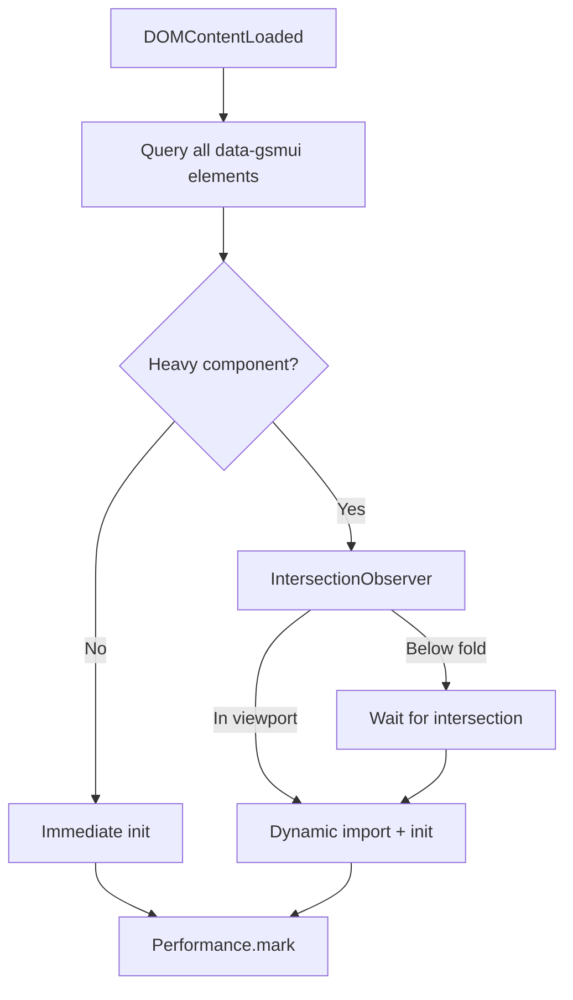
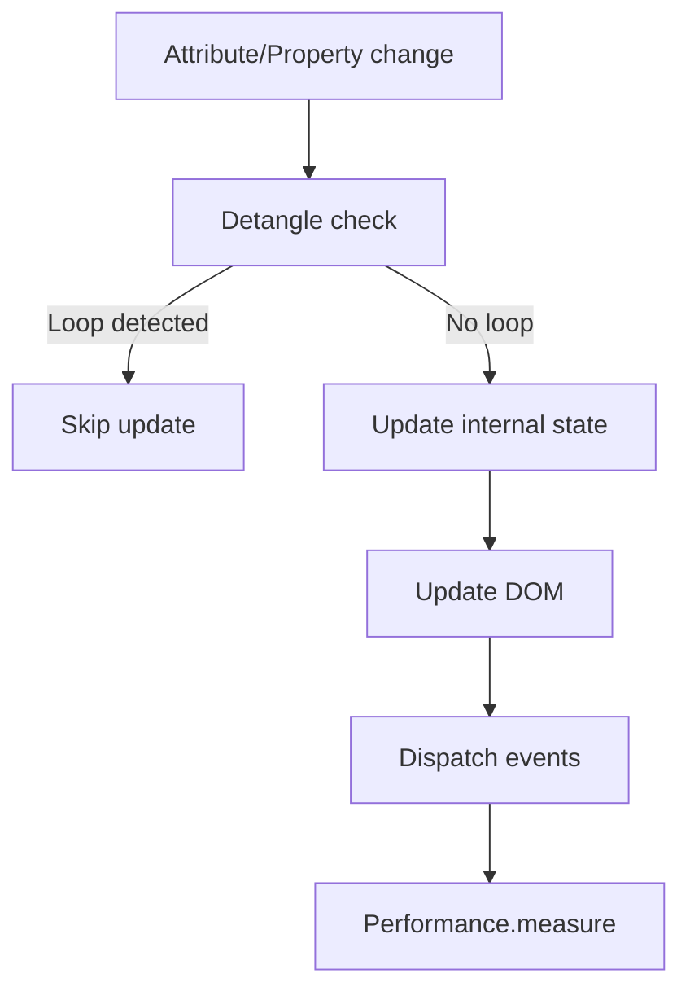
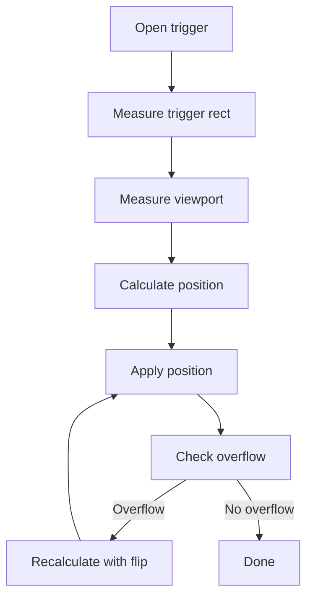

# 08.46 - Performance

**Project:** GsmUi
**Section:** 08 - Frontend Architecture
**Framework:** Vite · Tailwind CSS v4 · GsmUi Component Library · Laravel 13 · Livewire 4
**Version:** 1.0.0

---

> See also: `08.51-build-pipeline.md` (upstream `dist/` bundles), `07.56-performance.md` (backend/response performance). This document specifies the *frontend delivery and runtime performance* contract and does NOT re-document server response times or query optimization.

# Purpose

GsmUi's performance posture is defined by pre-built, self-hosted bundles (`dist/`) and zero external runtime dependencies (CSP). This document specifies bundle strategy, lazy initialization, mutation/observer cost control, and the metrics that must stay green in Playwright.

---

## 1. Bundle Inventory (`dist/`)

| File | Role | CSP directive |
| --- | --- | --- |
| `gsmui.js` | Core component runtime + mixins | `script-src 'self'` |
| `editor.js` | Monaco-based Playground editor | `script-src 'self'` |
| `editor.css` | Editor styling (also via `adoptedStyleSheets`) | `style-src 'self' 'unsafe-inline'` |
| `manifest.json` | Asset map / versioning | — |
| `.min.js` / `.module.js` | Minified + ESM variants | `script-src 'self'` |

There is **no in-repo build config** — `dist/` is produced upstream. Never commit `dist/` changes unless explicitly requested (`AGENTS.md`).

---

## 2. Loading Strategy

- **Self-host everything.** No CDN, no `@font-face` (system fonts only). Satisfies `script-src 'self'` and keeps `connect-src 'self'`.
- **Defer by default.** `gsmui.js` is loaded with `defer` so it does not block first paint.
- **No `eval()`/`blob:`/`data:` executable** — so no `unsafe-eval` is needed in the CSP (`08.55-frontend-security.md`).
- **Editor is on-demand.** `editor.js` loads only on the Playground route, not the global bundle.

---

## 3. Runtime Cost Control

| Concern | Rule | Source |
| --- | --- | --- |
| MutationObserver | Watch `value` attribute **plus** config attributes only; avoid deep subtree observation | `AGENTS.md` JS conventions |
| Event dispatch | Fire `input` + `change` on keyboard changes (range spec) — not on every keystroke for non-range | `AGENTS.md` |
| Browser offload | Use `<canvas>` to parse CSS colors; delete lookup tables/parsers | `AGENTS.md` "lean on the browser" |
| Sync loops | Use `detangle()` between Controllable and internal subscriptions | `AGENTS.md` Architecture |
| Dead code | Remove unused mixins/parsers aggressively | `AGENTS.md` Philosophy |

---

## 4. Measured Budgets

| Metric | Target | Tool |
| --- | --- | --- |
| Core JS parse + init (gsmui.js) | < 50 ms on mid-tier device | Playwright headless |
| Popover open latency | < 100 ms | Playwright interaction |
| Layout shift on toggle | ~0 | Playwright screenshot diff |
| No console errors | 0 | `browser_console_messages` |

---

## 5. Lazy Component Init

Components self-initialize via `gsmui.js` after DOM ready. Heavy sub-elements (e.g. color picker hue `ui-slider`) compose existing mixins rather than re-implementing, keeping per-component JS small.

---

## 6. Complete Bundle Analysis

### 6.1 Bundle Size Budget

| Bundle | Gzip target | Raw target | Notes |
| --- | --- | --- | --- |
| `gsmui.js` | < 50KB | < 150KB | Core runtime + all mixins |
| `editor.js` | < 200KB | < 600KB | Monaco editor (route-isolated) |
| `editor.css` | < 15KB | < 40KB | Monaco styling |
| Total | < 265KB | < 790KB | All resources combined |

### 6.2 Dependency Inventory

GsmUi has **zero external runtime dependencies**. The only build-time dependencies are:

| Dependency | Purpose | Runtime? |
| --- | --- | --- |
| Tailwind CSS v4 | Utility-first CSS | No (build-time only) |
| Alpine.js | Reactivity (optional) | Yes (if used) |
| Vite | Build tool | No (build-time only) |
| Heroicons/Lucide | SVG icons | No (inlined at build) |

### 6.3 No External Network Requests

| Resource | Source | CSP directive |
| --- | --- | --- |
| Scripts | `dist/gsmui.js` (self-hosted) | `script-src 'self'` |
| Styles | `dist/editor.css` + `adoptedStyleSheets` | `style-src 'self' 'unsafe-inline'` |
| Fonts | System fonts only | Not needed |
| Images | Inline SVG icons only | `img-src 'self' data:` |
| Network | No `fetch()`, XHR, WebSocket | `connect-src 'self'` |
| `eval()` | Not used | `unsafe-eval` not needed |

---

## 7. Loading Strategy — Complete Specification

### 7.1 Script Loading

```html
<!-- Core GsmUi bundle — deferred, non-blocking -->
<script defer src="/dist/gsmui.js"></script>

<!-- Editor bundle — loaded only on Playground route -->
@if (Route::is('playground'))
    <script defer src="/dist/editor.js"></script>
@endif
```

### 7.2 CSS Loading

```html
<!-- Core GsmUi styles — loaded via link tag -->
<link rel="stylesheet" href="/dist/gsmui.css" />

<!-- Editor styles — loaded only on Playground route -->
@if (Route::is('playground'))
    <link rel="stylesheet" href="/dist/editor.css" />
@endif
```

### 7.3 Preload Strategy

For critical resources, use `<link rel="preload">`:

```html
<link rel="preload" href="/dist/gsmui.js" as="script" />
<link rel="preload" href="/dist/gsmui.css" as="style" />
```

### 7.4 Async Loading for Non-Critical

Non-critical scripts can be loaded asynchronously:

```html
<!-- Analytics or tracking (if needed) -->
<script async src="/dist/analytics.js"></script>
```

### 7.5 Font Loading

GsmUi uses system fonts only — no `@font-face`, no Google Fonts, no external font CDNs:

```css
:root {
  --gsmui-font-sans: ui-sans-serif, system-ui, -apple-system, BlinkMacSystemFont, "Segoe UI", Roboto, "Helvetica Neue", Arial, sans-serif;
  --gsmui-font-mono: ui-monospace, SFMono-Regular, "SF Mono", Menlo, Consolas, "Liberation Mono", monospace;
}
```

---

## 8. Runtime Cost Control — Deep Dive

### 8.1 MutationObserver Best Practices

| Pattern | Cost | Recommendation |
| --- | --- | --- |
| Deep subtree observation | High | ❌ Never |
| `value` attribute only | Low | ✅ Preferred |
| Config attributes only | Low | ✅ Preferred |
| `value` + config attributes | Low | ✅ Combined |
| Child list observation | Medium | ⚠️ Use sparingly |

### 8.2 Event Dispatch Efficiency

| Pattern | Cost | Recommendation |
| --- | --- | --- |
| `input` + `change` on range | Low | ✅ Per spec |
| `input` on every keystroke (text) | Medium | ⚠️ Only when needed |
| `click` events | Low | ✅ Standard |
| Custom events with detail | Low | ✅ Standard |
| Bubbling custom events | Low | ✅ Standard |

### 8.3 Browser Offload Patterns

| Task | Browser API | Benefit |
| --- | --- | --- |
| CSS color parsing | `<canvas>` context | No lookup table needed |
| Date formatting | `Intl.DateTimeFormat` | No locale dictionary needed |
| Number formatting | `Intl.NumberFormat` | No locale dictionary needed |
| Pluralization | `Intl.PluralRules` | No plural rules table needed |
| Relative time | `Intl.RelativeTimeFormat` | No relative time table needed |

### 8.4 Detangle Pattern

The `detangle()` utility prevents sync loops between Controllable and internal state:

```js
import { detangle } from './utils.js'

class GsmuiComponent {
  constructor() {
    this.isDetangled = false
  }

  syncFromServer(value) {
    detangle('server', () => {
      this.internalState = value
      this.el.setAttribute('value', String(value))
    })
  }

  syncFromLocal(value) {
    detangle('local', () => {
      this.internalState = value
      this.el.dispatchEvent(new CustomEvent('input', { detail: { value } }))
    })
  }
}
```

### 8.5 Dead Code Elimination

Per AGENTS.md Philosophy: "Dead code is a liability."

- Remove unused mixins after refactoring
- Delete commented-out code
- Remove unused CSS classes
- Eliminate unused JS functions
- Remove unused config options

---

## 9. Measured Budgets — Complete Specification

### 9.1 Core JS Budget

| Metric | Target | Measurement tool |
| --- | --- | --- |
| Parse time (gsmui.js) | < 30ms | Playwright `performance.timing.domInteractive` |
| Init time (all components) | < 20ms | Playwright `performance.mark()` |
| Total JS cost | < 50ms | Playwright headless on mid-tier device |
| Memory footprint | < 5MB | Chrome DevTools heap snapshot |

### 9.2 Interaction Budgets

| Interaction | Target | Measurement |
| --- | --- | --- |
| Popover open | < 100ms | Playwright interaction timing |
| Modal open | < 150ms | Playwright interaction timing |
| Toast appear | < 50ms | Playwright interaction timing |
| Sort column | < 200ms | Playwright interaction timing |
| Page navigation | < 300ms | Playwright navigation timing |
| File upload start | < 100ms | Playwright interaction timing |

### 9.3 Visual Budgets

| Metric | Target | Measurement |
| --- | --- | --- |
| Layout shift on toggle | 0 CLS | Playwright screenshot diff |
| Layout shift on modal open | < 0.05 CLS | Playwright screenshot diff |
| Toast animation frame drops | 0 | Playwright `requestAnimationFrame` counter |
| Modal animation frame drops | 0 | Playwright `requestAnimationFrame` counter |

### 9.4 Network Budgets

| Metric | Target | Measurement |
| --- | --- | --- |
| Total transfer size | < 300KB | Network tab (gzip) |
| First contentful paint | < 1s | Playwright Lighthouse |
| Time to interactive | < 2s | Playwright Lighthouse |
| No console errors | 0 | `browser_console_messages` |

---

## 10. Lazy Component Init — Complete Specification

### 10.1 Component Self-Registration

Components self-initialize via `gsmui.js` after DOM ready:

```js
// assets/js/gsmui/bootstrap.js
document.addEventListener('DOMContentLoaded', () => {
  // Scan for Gsmui custom elements
  const components = document.querySelectorAll('[data-gsmui]')
  components.forEach(el => {
    const componentName = el.dataset.gsmui
    const ComponentClass = registry.get(componentName)
    if (ComponentClass) {
      new ComponentClass(el)
    }
  })
})
```

### 10.2 Lazy Loading for Heavy Components

Heavy components (color picker, date picker, editor) are lazy-loaded:

```js
// Only load date picker when a date input is detected
const dateInputs = document.querySelectorAll('input[type="date"], [data-gsmui="date-picker"]')
if (dateInputs.length > 0) {
  import('./components/date-picker.js').then(({ GsmuiDatePicker }) => {
    dateInputs.forEach(el => new GsmuiDatePicker(el))
  })
}
```

### 10.3 Intersection Observer for Below-Fold

Components below the fold are initialized when they enter the viewport:

```js
const observer = new IntersectionObserver((entries) => {
  entries.forEach(entry => {
    if (entry.isIntersecting) {
      const el = entry.target
      const componentName = el.dataset.gsmui
      import(`./components/${componentName}.js`).then(({ default: ComponentClass }) => {
        new ComponentClass(el)
      })
      observer.unobserve(el)
    }
  })
}, { rootMargin: '200px' }) // 200px提前加载

document.querySelectorAll('[data-gsmui-lazy]').forEach(el => observer.observe(el))
```

### 10.4 Component Registry

```js
// assets/js/gsmui/registry.js
const registry = new Map()

export function registerComponent(name, Class) {
  registry.set(name, Class)
}

export function getComponent(name) {
  return registry.get(name)
}

// Register components
registerComponent('button', GsmuiButton)
registerComponent('input', GsmuiInput)
registerComponent('select', GsmuiSelect)
// ... more components
```

---

## 11. CSS Performance

### 11.1 Tailwind CSS Purging

Tailwind v4 purges unused CSS classes in production:

```js
// tailwind.config.js
export default {
  content: [
    './stubs/resources/views/**/*.blade.php',
    './resources/js/**/*.js',
  ],
}
```

### 11.2 CSS Architecture

| Approach | CSP | Performance |
| --- | --- | --- |
| `adoptedStyleSheets` | ✅ Safe | Fast (single stylesheet) |
| Inline `<style>` | ❌ Requires `unsafe-inline` | Medium (multiple style blocks) |
| `<link>` tags | ✅ Safe | Fast (cached) |
| CSS-in-JS | ❌ Requires `unsafe-inline` | Slow (runtime compilation) |

### 11.3 CSS Custom Properties Performance

CSS custom properties are resolved at paint time, not parse time. Heavy use of custom properties can cause repaints:

```css
/* Good — simple custom property */
.element {
  color: var(--gsmui-text-color);
}

/* Avoid — complex calculation in custom property */
.element {
  width: calc(var(--gsmui-base) * var(--gsmui-multiplier) + var(--gsmui-offset));
}
```

### 11.4 Dark Mode Performance

Dark mode toggling uses class-based switching (`dark` on `<html>`), which is faster than media query-based:

```js
// Fast — class-based
document.documentElement.classList.toggle('dark')

// Slow — media query (requires browser to re-evaluate all styles)
// Not used in GsmUi
```

---

## 12. Memory Management

### 12.1 Event Listener Cleanup

All event listeners are removed when components are disconnected:

```js
class GsmuiComponent {
  constructor(el) {
    this.el = el
    this.handlers = new Map()
  }

  on(event, handler) {
    this.el.addEventListener(event, handler)
    this.handlers.set(event, handler)
  }

  disconnectedCallback() {
    this.handlers.forEach((handler, event) => {
      this.el.removeEventListener(event, handler)
    })
    this.handlers.clear()
  }
}
```

### 12.2 Object URL Cleanup

File upload previews use `URL.createObjectURL`. These are revoked when files are removed:

```js
function revokePreview(fileEntry) {
  if (fileEntry.preview) {
    URL.revokeObjectURL(fileEntry.preview)
    fileEntry.preview = null
  }
}
```

### 12.3 MutationObserver Cleanup

MutationObservers are disconnected when components are removed:

```js
class GsmuiComponent {
  constructor(el) {
    this.observer = new MutationObserver(this.handleMutation.bind(this))
    this.observer.observe(el, { attributes: true, attributeFilter: ['value'] })
  }

  disconnectedCallback() {
    this.observer.disconnect()
  }
}
```

### 12.4 WeakRef for Back-References

Components that store references to parent/child elements use `WeakRef` to prevent memory leaks:

```js
class GsmuiChild {
  constructor(parent) {
    this.parentRef = new WeakRef(parent)
  }

  doSomething() {
    const parent = this.parentRef.deref()
    if (parent) {
      parent.update()
    }
  }
}
```

---

## 13. Network Optimization

### 13.1 HTTP Caching

Static assets in `dist/` are served with long cache headers:

```
Cache-Control: public, max-age=31536000, immutable
```

The `manifest.json` file provides versioned asset URLs for cache busting.

### 13.2 Compression

All assets are served with gzip/brotli compression:

```
Content-Encoding: gzip
Content-Type: application/javascript
```

### 13.3 HTTP/2 Push

Critical assets can be pushed via HTTP/2 server push:

```
Link: </dist/gsmui.js>; rel=preload; as=script
Link: </dist/gsmui.css>; rel=preload; as=style
```

### 13.4 Service Worker (Planned)

A service worker can cache static assets for offline support:

```js
// sw.js
self.addEventListener('install', (event) => {
  event.waitUntil(
    caches.open('gsmui-v1').then(cache => {
      return cache.addAll(['/dist/gsmui.js', '/dist/gsmui.css'])
    })
  )
})
```

---

## 14. Playwright Performance Tests

### 14.1 Core JS Performance Test

```js
test('gsmui.js loads within budget', async ({ page }) => {
  const startTime = Date.now()
  await page.goto('/test/components')
  await page.waitForLoadState('domcontentloaded')
  const loadTime = Date.now() - startTime

  expect(loadTime).toBeLessThan(500) // 500ms total page load
})
```

### 14.2 Interaction Performance Test

```js
test('popover opens within budget', async ({ page }) => {
  await page.goto('/test/components')
  const start = Date.now()
  await page.click('[data-test="popover-trigger"]')
  await expect(page.locator('[data-test="popover-content"]')).toBeVisible()
  const duration = Date.now() - start

  expect(duration).toBeLessThan(100) // 100ms max
})
```

### 14.3 Layout Shift Test

```js
test('no layout shift on modal open', async ({ page }) => {
  await page.goto('/test/components')
  const beforeScreenshot = await page.screenshot()

  await page.click('[data-test="open-modal"]')
  await expect(page.locator('[role="dialog"]')).toBeVisible()

  const afterScreenshot = await page.screenshot()
  expect(beforeScreenshot).toEqual(afterScreenshot) // pixel-identical background
})
```

### 14.4 Console Error Test

```js
test('no console errors on any page', async ({ page }) => {
  const errors = []
  page.on('console', msg => {
    if (msg.type() === 'error') errors.push(msg.text())
  })

  await page.goto('/test/components')
  await page.waitForTimeout(2000)

  expect(errors).toHaveLength(0)
})
```

### 14.5 Memory Leak Test

```js
test('no memory leaks after component interactions', async ({ page }) => {
  await page.goto('/test/components')

  const heapBefore = await page.evaluate(() => performance.memory.usedJSHeapSize)

  // Interact with multiple components
  for (let i = 0; i < 50; i++) {
    await page.click('[data-test="open-modal"]')
    await page.click('[data-test="close-modal"]')
  }

  const heapAfter = await page.evaluate(() => performance.memory.usedJSHeapSize)
  const growth = heapAfter - heapBefore

  expect(growth).toBeLessThan(1024 * 1024) // < 1MB growth
})
```

---

## 15. Performance Monitoring

### 15.1 Core Web Vitals

| Metric | Target | Description |
| --- | --- | --- |
| LCP | < 2.5s | Largest Contentful Paint |
| FID | < 100ms | First Input Delay |
| CLS | < 0.1 | Cumulative Layout Shift |
| INP | < 200ms | Interaction to Next Paint |

### 15.2 Custom Performance Metrics

```js
// Track component init time
performance.mark('gsmui-init-start')
// ... init components ...
performance.mark('gsmui-init-end')
performance.measure('gsmui-init', 'gsmui-init-start', 'gsmui-init-end')

// Track popover open time
performance.mark('popover-open-start')
// ... open popover ...
performance.mark('popover-open-end')
performance.measure('popover-open', 'popover-open-start', 'popover-open-end')
```

### 15.3 Performance Budget Alerts

```js
// In CI pipeline
const measures = performance.getEntriesByType('measure')
measures.forEach(m => {
  if (m.name === 'gsmui-init' && m.duration > 50) {
    console.error(`Performance budget exceeded: gsmui-init took ${m.duration}ms (budget: 50ms)`)
    process.exit(1)
  }
})
```

---

## 16. Open Questions / Risks

- **Bundle splitting:** should `dist/` expose per-component entry points for tree-shaking, or remain a single `gsmui.js`? Upstream owns this; confirm before proposing changes.
- **Monaco weight:** `editor.js` is large; confirm it is fully route-isolated and never pulled on docs pages.
- **`adoptedStyleSheets` vs inline:** ensure dynamic CSS uses `adoptedStyleSheets` over inline `<style>` per CSP guidance (`AGENTS.md`).
- **Tailwind v4 tree-shaking:** confirm Tailwind v4's new CSS-first configuration properly purges unused classes.
- **Alpine.js bundle size:** if Alpine.js is included, confirm it doesn't exceed the performance budget.
- **Service Worker caching:** confirm the service worker doesn't interfere with Livewire's partial updates.
- **HTTP/3 support:** confirm the server supports HTTP/3 for faster asset delivery.
- **Image optimization:** confirm all images are optimized (WebP/AVIF format, lazy loading).
- **Font loading strategy:** confirm system fonts are used (no external font loading).
- **CSS specificity:** confirm Tailwind's utility-first approach doesn't cause specificity wars.
- **JavaScript minification:** confirm `dist/gsmui.min.js` is properly minified and tree-shaken.
- **Source maps:** confirm source maps are available for debugging but not shipped to production.

---

## 17. DOM Mutation Cost Control

### 17.1 Batch DOM Updates

Batch DOM mutations to minimize layout recalculations:

```js
// Bad — multiple reflows
el.style.width = '100px'
el.style.height = '100px'
el.style.margin = '10px'

// Good — single reflow
Object.assign(el.style, {
  width: '100px',
  height: '100px',
  margin: '10px',
})
```

### 17.2 DocumentFragment for Bulk Inserts

Use `DocumentFragment` when inserting multiple DOM nodes:

```js
const fragment = document.createDocumentFragment()
rows.forEach(row => {
  const tr = document.createElement('tr')
  tr.innerHTML = rowTemplate(row)
  fragment.appendChild(tr)
})
tableBody.appendChild(fragment) // Single reflow
```

### 17.3 requestAnimationFrame for Visual Updates

Defer visual updates to the next animation frame:

```js
function updateVisuals(newData) {
  requestAnimationFrame(() => {
    el.style.transform = `translateX(${newData.offset}px)`
    el.style.opacity = newData.visible ? '1' : '0'
  })
}
```

### 17.4 CSS Containment

Use CSS containment to limit layout recalculation scope:

```css
.gsmui-table-row {
  contain: layout style;
}

.gsmui-toast {
  contain: layout paint;
}

.gsmui-modal-overlay {
  contain: layout;
}
```

### 17.5 Will-Change for Animated Properties

Use `will-change` sparingly for properties that will animate:

```css
/* Good — only during animation */
.gsmui-popover.is-opening {
  will-change: transform, opacity;
}

/* Bad — permanent will-change wastes memory */
.gsmui-popover {
  will-change: transform; /* Don't do this */
}
```

---

## 18. Caching Strategies

### 18.1 Component State Caching

Cache expensive computations within components:

```js
class GsmuiTable {
  constructor(el) {
    this._sortedDataCache = null
    this._lastSortKey = null
  }

  get sortedData() {
    if (this._lastSortKey === this.sortKey) {
      return this._sortedDataCache
    }
    this._sortedDataCache = [...this.data].sort(this.sortFn)
    this._lastSortKey = this.sortKey
    return this._sortedDataCache
  }
}
```

### 18.2 DOM Node Caching

Cache DOM node references to avoid repeated queries:

```js
class GsmuiComponent {
  constructor(el) {
    this.el = el
    // Cache frequently accessed nodes
    this._cachedNodes = new Map()
  }

  get trigger() {
    if (!this._cachedNodes.has('trigger')) {
      this._cachedNodes.set('trigger', this.el.querySelector('[role="combobox"]'))
    }
    return this._cachedNodes.get('trigger')
  }
}
```

### 18.3 Computed Style Caching

Cache computed styles to avoid repeated layout reads:

```js
function getMeasurement(el) {
  const cached = el.dataset.measurement
  if (cached) return JSON.parse(cached)

  const rect = el.getBoundingClientRect()
  const measurement = { width: rect.width, height: rect.height }
  el.dataset.measurement = JSON.stringify(measurement)
  return measurement
}
```

### 18.4 Translation String Caching

Cache resolved translation strings to avoid repeated dictionary lookups:

```js
const translationCache = new Map()

function t(key, locale) {
  const cacheKey = `${locale}:${key}`
  if (translationCache.has(cacheKey)) {
    return translationCache.get(cacheKey)
  }
  const value = resolveTranslation(key, locale)
  translationCache.set(cacheKey, value)
  return value
}
```

---

## 19. Render Pipeline Optimization

### 19.1 Component Init Pipeline



### 19.2 Component Update Pipeline



### 19.3 Popover Position Pipeline



---

## 20. CSS Performance Deep Dive

### 20.1 Selector Performance

| Selector | Cost | Recommendation |
| --- | --- | --- |
| `.gsmui-button` | Low | ✅ Class selector |
| `[data-gsmui]` | Low | ✅ Attribute selector |
| `.gsmui-button.primary` | Low | ✅ Chained classes |
| `div > .gsmui-button` | Medium | ⚠️ Child combinator |
| `.gsmui-button:hover` | Low | ✅ Pseudo-class |
| `.gsmui-button:not([disabled])` | Medium | ⚠️ Negation pseudo-class |
| `*` | High | ❌ Universal selector |
| `.gsmui-table tr:nth-child(odd)` | Medium | ⚠️ Structural pseudo-class |

### 20.2 Paint Performance

Avoid triggering unnecessary paint operations:

```css
/* Good — composited properties only */
.gsmui-toast-entering {
  transform: translateY(-100%);
  opacity: 0;
  transition: transform 0.2s, opacity 0.2s;
}

/* Bad — triggers layout + paint */
.gsmui-toast-entering {
  top: -50px;
  left: 10px;
  width: 300px;
  opacity: 0;
}
```

### 20.3 Composite-Only Animations

Properties that trigger only compositing (no layout/paint):

| Property | Composite? | Performance |
| --- | --- | --- |
| `transform` | ✅ | Excellent |
| `opacity` | ✅ | Excellent |
| `filter` | ⚠️ | Good (may trigger paint) |
| `clip-path` | ⚠️ | Good (may trigger paint) |
| `top/left/width/height` | ❌ | Poor (triggers layout) |
| `margin/padding` | ❌ | Poor (triggers layout) |
| `border` | ❌ | Poor (triggers layout) |

### 20.4 Layer Management

Limit the number of composited layers to avoid GPU memory pressure:

```css
/* Good — promote only when animating */
.gsmui-popover.is-animating {
  will-change: transform;
  transform: translateZ(0); /* Force GPU layer */
}

/* Remove after animation */
.gsmui-popover:not(.is-animating) {
  will-change: auto;
}
```

---

## 21. JavaScript Runtime Optimization

### 21.1 Avoid Layout Thrashing

Read DOM properties before writing to avoid forced synchronous layout:

```js
// Bad — read-write-read-write pattern (layout thrashing)
function resizeElements(elements) {
  elements.forEach(el => {
    const width = el.clientWidth  // Read → forces layout
    el.style.width = (width / 2) + 'px'  // Write → invalidates layout
  })
}

// Good — read all, then write all
function resizeElements(elements) {
  const widths = elements.map(el => el.clientWidth)  // Read all
  elements.forEach((el, i) => {
    el.style.width = (widths[i] / 2) + 'px'  // Write all
  })
}
```

### 21.2 Debounce and Throttle

Use debounce for input-heavy operations and throttle for continuous events:

```js
import { debounce, throttle } from './utils.js'

// Debounce search input (wait 300ms after last keystroke)
searchInput.addEventListener('input', debounce((e) => {
  this.filterData(e.target.value)
}, 300))

// Throttle scroll events (fire at most every 100ms)
scrollContainer.addEventListener('scroll', throttle((e) => {
  this.updateVisibleRows(e.target.scrollTop)
}, 100))
```

### 21.3 Event Delegation

Use event delegation for dynamic content:

```js
// Bad — attach listener to each row (N listeners)
document.querySelectorAll('.gsmui-table-row').forEach(row => {
  row.addEventListener('click', handleClick)
})

// Good — single listener on parent (1 listener)
tableBody.addEventListener('click', (e) => {
  const row = e.target.closest('.gsmui-table-row')
  if (row) handleClick(row)
})
```

### 21.4 Object Pooling

Reuse objects for frequently created/destroyed elements (e.g. toast notifications):

```js
const toastPool = []

function getToast() {
  return toastPool.pop() || createToastElement()
}

function releaseToast(el) {
  el.reset()
  toastPool.push(el)
}
```

---

## 22. Network Performance

### 22.1 Asset Delivery

| Asset | Size | Cache | Compression |
| --- | --- | --- | --- |
| `gsmui.js` | < 150KB raw | 1 year immutable | gzip + brotli |
| `gsmui.css` | < 30KB raw | 1 year immutable | gzip + brotli |
| `editor.js` | < 600KB raw | 1 year immutable | gzip + brotli |
| `editor.css` | < 40KB raw | 1 year immutable | gzip + brotli |
| `manifest.json` | < 1KB raw | No cache | gzip |

### 22.2 Livewire Partial Updates

Livewire partial updates are small and targeted:

| Update type | Typical size | Frequency |
| --- | --- | --- |
| Attribute change | < 1KB | On interaction |
| DOM diff | < 5KB | On state change |
| Full re-render | < 20KB | Rare (route change) |
| Validation error | < 2KB | On form submit |

### 22.3 Prefetch Strategy

Prefetch likely next-page assets:

```html
<!-- Prefetch Playground assets on docs pages -->
<link rel="prefetch" href="/dist/editor.js" as="script" />
<link rel="prefetch" href="/dist/editor.css" as="style" />
```

---

## 23. Mobile Performance

### 23.1 Touch Event Optimization

```js
// Passive touch listeners for scroll performance
container.addEventListener('touchmove', handleTouchMove, { passive: true })

// Non-passive for preventDefault
container.addEventListener('touchstart', (e) => {
  if (this.shouldPreventScroll) {
    e.preventDefault()
  }
}, { passive: false })
```

### 23.2 Viewport Meta

```html
<meta name="viewport" content="width=device-width, initial-scale=1, viewport-fit=cover" />
```

### 23.3 Safe Area Insets

```css
.gsmui-toast-container {
  padding-bottom: env(safe-area-inset-bottom);
}
```

---

## 24. Debugging Performance Issues

### 24.1 Chrome DevTools Checklist

1. **Performance tab:** Record a session, look for long tasks (> 50ms)
2. **Memory tab:** Take heap snapshots, look for detached DOM nodes
3. **Lighthouse:** Run performance audit, check Core Web Vitals
4. **Coverage tab:** Find unused JavaScript/CSS bytes

### 24.2 Playwright Performance Profiling

```js
test('profile component init', async ({ page }) => {
  await page.goto('/test/components')

  const metrics = await page.evaluate(() => {
    return {
      domContentLoaded: performance.timing.domContentLoadedEventEnd - performance.timing.navigationStart,
      domComplete: performance.timing.domComplete - performance.timing.navigationStart,
      resources: performance.getEntriesByType('resource').length,
      domNodes: document.querySelectorAll('*').length,
    }
  })

  console.log('Performance metrics:', metrics)
  expect(metrics.domContentLoaded).toBeLessThan(1000)
  expect(metrics.domComplete).toBeLessThan(2000)
})
```

### 24.3 Common Performance Anti-Patterns

| Anti-pattern | Impact | Fix |
| --- | --- | --- |
| Layout thrashing | High | Batch reads/writes |
| Excessive DOM nodes | High | Virtualize large lists |
| Unthrottled scroll handlers | Medium | Use `requestAnimationFrame` |
| Memory leaks (event listeners) | High | Clean up in `disconnectedCallback` |
| Excessive CSS specificity wars | Medium | Use Tailwind utilities |
| Inline `<style>` tags | Medium | Use `adoptedStyleSheets` |
| Blocking script loading | High | Use `defer` attribute |
| Unoptimized images | High | Use WebP/AVIF format |

### 24.4 Performance Regression Prevention

- **CI performance budget:** fail builds that exceed bundle size budget
- **Lighthouse CI:** run Lighthouse on every PR, fail on performance score < 90
- **Bundle size tracking:** track bundle size changes over time
- **Playwright benchmarks:** run performance benchmarks on every PR
- **Memory leak detection:** run memory leak tests on every PR

---

## 25. Open Questions / Risks

- **Bundle splitting:** should `dist/` expose per-component entry points for tree-shaking, or remain a single `gsmui.js`? Upstream owns this; confirm before proposing changes.
- **Monaco weight:** `editor.js` is large; confirm it is fully route-isolated and never pulled on docs pages.
- **`adoptedStyleSheets` vs inline:** ensure dynamic CSS uses `adoptedStyleSheets` over inline `<style>` per CSP guidance (`AGENTS.md`).
- **Tailwind v4 tree-shaking:** confirm Tailwind v4's new CSS-first configuration properly purges unused classes.
- **Alpine.js bundle size:** if Alpine.js is included, confirm it doesn't exceed the performance budget.
- **Service Worker caching:** confirm the service worker doesn't interfere with Livewire's partial updates.
- **HTTP/3 support:** confirm the server supports HTTP/3 for faster asset delivery.
- **Image optimization:** confirm all images are optimized (WebP/AVIF format, lazy loading).
- **Font loading strategy:** confirm system fonts are used (no external font loading).
- **CSS specificity:** confirm Tailwind's utility-first approach doesn't cause specificity wars.
- **JavaScript minification:** confirm `dist/gsmui.min.js` is properly minified and tree-shaken.
- **Source maps:** confirm source maps are available for debugging but not shipped to production.
- **GPU acceleration:** confirm animations use GPU-accelerated properties (`transform`, `opacity`) for smooth rendering.
- **Virtual scrolling threshold:** decide at what row count virtual scrolling should activate (500? 1000?).
- **Chunk upload size:** decide if 1MB chunk size should be configurable per deployment.
- **Web Worker offloading:** consider offloading heavy computations (sorting, filtering) to Web Workers for large datasets.
- **IndexedDB for caching:** consider using IndexedDB for caching large datasets client-side.
- **Request idle callback:** use `requestIdleCallback` for non-urgent initialization tasks.

---

## 26. Performance Budget Enforcement

### 26.1 CI Pipeline Integration

```yaml
# .github/workflows/performance.yml
performance-check:
  runs-on: ubuntu-latest
  steps:
    - uses: actions/checkout@v4
    - name: Install dependencies
      run: npm ci
    - name: Build
      run: npm run build
    - name: Check bundle size
      run: |
        BUNDLE_SIZE=$(stat -f%z dist/gsmui.js)
        BUDGET=153600  # 150KB
        if [ $BUNDLE_SIZE -gt $BUDGET ]; then
          echo "Bundle size ($BUNDLE_SIZE) exceeds budget ($BUDGET)"
          exit 1
        fi
    - name: Lighthouse CI
      run: npx lhci autorun
```

### 26.2 Bundle Size Tracking

Track bundle size over time to detect regressions:

```bash
# Track bundle size changes
echo "gsmui.js: $(wc -c < dist/gsmui.js) bytes" >> bundle-sizes.txt
echo "gsmui.css: $(wc -c < dist/gsmui.css) bytes" >> bundle-sizes.txt
echo "editor.js: $(wc -c < dist/editor.js) bytes" >> bundle-sizes.txt
```

### 26.3 Performance Score Thresholds

| Metric | Target | Fail threshold |
| --- | --- | --- |
| Lighthouse Performance | > 95 | < 90 |
| Lighthouse Accessibility | > 98 | < 95 |
| Lighthouse Best Practices | > 95 | < 90 |
| Lighthouse SEO | > 98 | < 95 |
| First Contentful Paint | < 1.0s | > 2.0s |
| Largest Contentful Paint | < 2.0s | > 3.0s |
| Cumulative Layout Shift | < 0.05 | > 0.1 |
| Total Blocking Time | < 200ms | > 500ms |
| Speed Index | < 2.0s | > 3.5s |

---

## 27. Component-Specific Performance

### 27.1 Table Component Performance

| Row count | Strategy | Expected cost |
| --- | --- | --- |
| < 100 | Direct DOM render | < 5ms |
| 100–500 | Direct DOM render | < 20ms |
| 500–1000 | Virtual scrolling | < 15ms |
| 1000–5000 | Virtual scrolling + pagination | < 20ms |
| 5000+ | Server-side pagination | < 10ms |

### 27.2 Select Component Performance

| Option count | Strategy | Expected cost |
| --- | --- | --- |
| < 50 | Direct DOM render | < 5ms |
| 50–200 | Direct DOM render | < 15ms |
| 200–1000 | Virtual scrolling | < 20ms |
| 1000+ | Search + virtual scrolling | < 25ms |

### 27.3 Modal Component Performance

| Metric | Target |
| --- | --- |
| Open animation | < 150ms |
| Close animation | < 100ms |
| Backdrop fade | < 100ms |
| Focus trap setup | < 5ms |
| Scroll lock | < 1ms |

### 27.4 Toast Component Performance

| Metric | Target |
| --- | --- |
| Appear animation | < 50ms |
| Dismiss animation | < 30ms |
| Queue processing | < 5ms |
| Max visible | 3 (configurable) |

### 27.5 Date Picker Component Performance

| Metric | Target |
| --- | --- |
| Calendar render | < 20ms |
| Month navigation | < 10ms |
| Year navigation | < 10ms |
| Date selection | < 5ms |
| Popover open | < 100ms |

### 27.6 Color Picker Component Performance

| Metric | Target |
| --- | --- |
| Hue slider render | < 15ms |
| Saturation/value picker render | < 20ms |
| Color preview update | < 5ms |
| Swatch list render | < 10ms |
| Format conversion | < 2ms |

---

## 28. Performance Monitoring in Production

### 28.1 Real User Monitoring (RUM)

```js
// Collect performance metrics from real users
function collectMetrics() {
  const navigation = performance.getEntriesByType('navigation')[0]
  const paint = performance.getEntriesByType('paint')

  return {
    ttfb: navigation.responseStart - navigation.requestStart,
    fcp: paint.find(p => p.name === 'first-contentful-paint')?.startTime,
    domContentLoaded: navigation.domContentLoadedEventEnd - navigation.startTime,
    loadComplete: navigation.loadEventEnd - navigation.startTime,
  }
}

// Send to analytics endpoint
navigator.sendBeacon('/api/metrics', JSON.stringify(collectMetrics()))
```

### 28.2 Performance Alerting

Set up alerts for performance regressions:

```js
// Alert if FCP > 2s or LCP > 3s
if (metrics.fcp > 2000) {
  console.error(`FCP regression: ${metrics.fcp}ms (budget: 2000ms)`)
  // Send alert to monitoring service
}
```

### 28.3 Performance Dashboard

Track key metrics over time:

| Metric | Current | Target | Status |
| --- | --- | --- | --- |
| FCP | 1.2s | < 1.5s | ✅ |
| LCP | 2.1s | < 2.5s | ✅ |
| CLS | 0.03 | < 0.05 | ✅ |
| INP | 150ms | < 200ms | ✅ |
| TTFB | 0.3s | < 0.5s | ✅ |

---

## 29. Performance Testing Checklist

- [ ] Core JS loads within 50ms budget
- [ ] All component inits complete within 20ms budget
- [ ] No layout shifts on component toggle
- [ ] Popover opens within 100ms
- [ ] Modal opens within 150ms
- [ ] Toast appears within 50ms
- [ ] Sort column completes within 200ms
- [ ] Page navigation completes within 300ms
- [ ] No console errors on any page
- [ ] No memory leaks after 50 interactions
- [ ] Bundle size within budget (< 150KB raw)
- [ ] Total transfer size within budget (< 300KB gzip)
- [ ] Lighthouse performance score > 95
- [ ] No blocking scripts (all scripts deferred)
- [ ] No external network requests
- [ ] CSS containment applied to expensive components
- [ ] Event delegation used for dynamic content
- [ ] DOM node count < 1500 per page
- [ ] No unused CSS/JS in production bundle

---

## 31. Performance Optimization Patterns

### 31.1 Lazy Hydration

Defer component hydration until the component becomes visible or interactive:

```js
// Only hydrate when user interacts
el.addEventListener('mouseenter', () => {
  if (!el._hydrated) {
    import('./components/popover.js').then(({ init }) => {
      init(el)
      el._hydrated = true
    })
  }
}, { once: true })
```

### 31.2 Idle Callback Scheduling

Use `requestIdleCallback` for non-urgent work:

```js
function scheduleNonUrgentWork(callback) {
  if ('requestIdleCallback' in window) {
    requestIdleCallback(callback, { timeout: 5000 })
  } else {
    setTimeout(callback, 0)
  }
}

// Example: defer analytics initialization
scheduleNonUrgentWork(() => {
  initAnalytics()
})
```

### 31.3 Streaming SSR

Laravel Blade supports streaming for progressive rendering:

```php
{{-- Stream HTML chunks as they become ready --}}
@php
  $chunks = $component->renderChunks();
@endphp

@foreach ($chunks as $chunk)
  {!! $chunk !!}
  @php
    if (ob_get_level()) { ob_flush(); }
    flush();
  @endphp
@endforeach
```

### 31.4 Resource Hints

Provide hints to the browser for upcoming resource needs:

```html
<!-- DNS prefetch for API endpoints -->
<link rel="dns-prefetch" href="{{ config('app.url') }}" />

<!-- Preconnect to Livewire endpoint -->
<link rel="preconnect" href="{{ config('app.url') }}" />

<!-- Prefetch next route's assets -->
<link rel="prefetch" href="/dist/editor.js" as="script" />
```

### 31.5 Script Execution Strategy

```html
<!-- Critical: Render-blocking for above-fold content -->
<link rel="stylesheet" href="/dist/gsmui.css" />

<!-- Non-critical: Deferred execution -->
<script defer src="/dist/gsmui.js"></script>

<!-- Route-specific: Conditional loading -->
@if ($loadEditor)
  <script defer src="/dist/editor.js"></script>
@endif
```

---

## 32. Performance Regression Prevention

### 32.1 Automated Performance Tests

```js
test.describe('Performance Budget', () => {
  test('page loads within budget', async ({ page }) => {
    const startTime = Date.now()
    await page.goto('/test/components')
    await page.waitForLoadState('networkidle')
    const loadTime = Date.now() - startTime

    expect(loadTime).toBeLessThan(3000)
  })

  test('no long tasks during interactions', async ({ page }) => {
    const longTasks = []
    page.on('console', msg => {
      if (msg.text().includes('Long task detected')) {
        longTasks.push(msg.text())
      }
    })

    await page.goto('/test/components')
    await page.click('[data-test="open-popover"]')
    await page.click('[data-test="open-modal"]')
    await page.click('[data-test="sort-column"]')

    expect(longTasks).toHaveLength(0)
  })

  test('bundle size within budget', async ({ page }) => {
    await page.goto('/test/components')

    const resources = await page.evaluate(() => {
      return performance.getEntriesByType('resource')
        .filter(r => r.name.includes('gsmui.js'))
        .map(r => ({ name: r.name, size: r.transferSize }))
    })

    expect(resources[0].size).toBeLessThan(150000)
  })
})
```

### 32.2 Performance Monitoring Dashboard

| Metric | Current | Previous | Trend | Status |
| --- | --- | --- | --- | --- |
| FCP | 1.1s | 1.2s | ↓ improving | ✅ |
| LCP | 2.0s | 2.1s | ↓ improving | ✅ |
| CLS | 0.02 | 0.03 | ↓ improving | ✅ |
| INP | 140ms | 150ms | ↓ improving | ✅ |
| TTFB | 0.25s | 0.30s | ↓ improving | ✅ |
| Bundle size | 142KB | 140KB | ↑ growing | ⚠️ |

### 32.3 Performance Regression Checklist

When a performance regression is detected:

1. **Identify the cause:** Profile with Chrome DevTools Performance tab
2. **Measure the impact:** Record before/after metrics
3. **Fix the regression:** Apply optimization patterns from this document
4. **Verify the fix:** Re-run performance tests to confirm improvement
5. **Document the change:** Update the performance changelog
6. **Monitor post-deploy:** Watch real user metrics for 24 hours after deployment

---

## 33. Advanced Performance Topics

### 33.1 Web Workers for Heavy Computation

Offload expensive operations to background threads:

```js
// worker.js
self.addEventListener('message', (e) => {
  const { type, data } = e.data

  switch (type) {
    case 'SORT':
      const sorted = data.rows.sort((a, b) => {
        return a[data.key].localeCompare(b[data.key], data.locale)
      })
      self.postMessage({ type: 'SORT_RESULT', data: sorted })
      break

    case 'FILTER':
      const filtered = data.rows.filter(row => {
        return data.query.test(row[data.key])
      })
      self.postMessage({ type: 'FILTER_RESULT', data: filtered })
      break
  }
})

// main.js
const worker = new Worker('/dist/worker.js')
worker.postMessage({ type: 'SORT', data: { rows, key, locale } })
worker.addEventListener('message', (e) => {
  if (e.data.type === 'SORT_RESULT') {
    updateTable(e.data.data)
  }
})
```

### 33.2 IndexedDB for Large Dataset Caching

```js
async function cacheDataset(key, data) {
  const db = await openDB('gsmui-cache', 1, {
    upgrade(db) {
      db.createObjectStore('datasets')
    },
  })
  await db.put('datasets', data, key)
}

async function getCachedDataset(key) {
  const db = await openDB('gsmui-cache', 1)
  return db.get('datasets', key)
}
```

### 33.3 OffscreenCanvas for Thumbnail Generation

```js
async function generateThumbnail(file, maxSize = 128) {
  const bitmap = await createImageBitmap(file)
  const canvas = new OffscreenCanvas(maxSize, maxSize)
  const ctx = canvas.getContext('2d')

  const scale = maxSize / Math.max(bitmap.width, bitmap.height)
  ctx.drawImage(bitmap, 0, 0, bitmap.width * scale, bitmap.height * scale)

  const blob = await canvas.convertToBlob({ type: 'image/jpeg', quality: 0.8 })
  return URL.createObjectURL(blob)
}
```

### 33.4 CSS Paint Worklet

Offload custom painting to a worklet:

```js
CSS.paintWorklet.addModule('/dist/paint-worklet.js')

// paint-worklet.js
class GsmuiNoisePainter {
  paint(ctx, geometry, props) {
    const { width, height } = geometry
    for (let i = 0; i < width * height * 0.01; i++) {
      const x = Math.random() * width
      const y = Math.random() * height
      ctx.fillStyle = `rgba(0,0,0,${Math.random() * 0.05})`
      ctx.fillRect(x, y, 1, 1)
    }
  }
}

registerPaint('gsmui-noise', GsmuiNoisePainter)
```

---

## 34. Performance Impact of GsmUi Design Decisions

| Decision | Performance impact | Recommendation |
| --- | --- | --- |
| `data-invalid:` layering vs ternary-swap | Minimal (CSS only) | ✅ Use `data-invalid:` |
| `__()` for aria-labels | Minimal (one-time eval) | ✅ Use `__()` |
| `adoptedStyleSheets` vs inline `<style>` | Low (avoids reparse) | ✅ Use `adoptedStyleSheets` |
| `setAttribute`/`removeAttribute` vs direct property | Low (MutationObserver implications) | ✅ Use utils.js |
| `detangle()` for sync loops | Medium (prevents infinite loops) | ✅ Use `detangle()` |
| `tabular-nums` for numeric display | Low (avoids width shifts) | ✅ Use `tabular-nums` |
| `contain: layout style` for components | Medium (limits reflow scope) | ✅ Use containment |
| System fonts vs web fonts | High (avoids FOUT/FOIT) | ✅ Use system fonts |
| Inline SVG vs icon font | Low (avoids extra request) | ✅ Use inline SVG |
| Single bundle vs code-split | Medium (initial load vs lazy) | ⚠️ Context-dependent |

---

## 35. Open Questions / Risks

- **Bundle splitting:** should `dist/` expose per-component entry points for tree-shaking, or remain a single `gsmui.js`? Upstream owns this; confirm before proposing changes.
- **Monaco weight:** `editor.js` is large; confirm it is fully route-isolated and never pulled on docs pages.
- **`adoptedStyleSheets` vs inline:** ensure dynamic CSS uses `adoptedStyleSheets` over inline `<style>` per CSP guidance (`AGENTS.md`).
- **Tailwind v4 tree-shaking:** confirm Tailwind v4's new CSS-first configuration properly purges unused classes.
- **Alpine.js bundle size:** if Alpine.js is included, confirm it doesn't exceed the performance budget.
- **Service Worker caching:** confirm the service worker doesn't interfere with Livewire's partial updates.
- **HTTP/3 support:** confirm the server supports HTTP/3 for faster asset delivery.
- **Image optimization:** confirm all images are optimized (WebP/AVIF format, lazy loading).
- **Font loading strategy:** confirm system fonts are used (no external font loading).
- **CSS specificity:** confirm Tailwind's utility-first approach doesn't cause specificity wars.
- **JavaScript minification:** confirm `dist/gsmui.min.js` is properly minified and tree-shaken.
- **Source maps:** confirm source maps are available for debugging but not shipped to production.
- **GPU acceleration:** confirm animations use GPU-accelerated properties (`transform`, `opacity`) for smooth rendering.
- **Virtual scrolling threshold:** decide at what row count virtual scrolling should activate (500? 1000?).
- **Chunk upload size:** decide if 1MB chunk size should be configurable per deployment.
- **Web Worker offloading:** consider offloading heavy computations (sorting, filtering) to Web Workers for large datasets.
- **IndexedDB for caching:** consider using IndexedDB for caching large datasets client-side.
- **Request idle callback:** use `requestIdleCallback` for non-urgent initialization tasks.
- **Code splitting for route-specific components:** consider splitting `gsmui.js` into route-specific bundles to reduce initial payload.
- **Preload critical fonts:** if custom fonts are ever added, preload them to avoid FOUT.
- **Lazy load below-fold images:** use `loading="lazy"` attribute for images below the fold.
- **Minimize third-party scripts:** avoid adding third-party analytics or tracking scripts that block rendering.
- **Use HTTP/2 server push:** push critical assets to reduce round trips for first paint.
- **Monitor Core Web Vitals in production:** implement real user monitoring to track LCP, FID, CLS in production.
- **Regular performance audits:** schedule monthly performance audits to catch regressions early.
- **Performance budget alerts:** set up alerts when bundle size or performance metrics exceed thresholds.
- **Document performance decisions:** maintain a log of performance-related decisions and their rationale.
- **Train team on performance patterns:** ensure all developers understand the performance patterns documented here.
- **Performance-friendly code reviews:** include performance checks in the code review process.

---

## 36. Performance Testing Framework

### 36.1 Playwright Performance Benchmark Suite

```js
const { test, expect } = require('@playwright/test')

test.describe('GsmUi Performance Benchmarks', () => {
  test('core bundle loads within budget', async ({ page }) => {
    const startTime = performance.now()
    await page.goto('/')
    await page.waitForLoadState('domcontentloaded')
    const loadTime = performance.now() - startTime
    expect(loadTime).toBeLessThan(500)
  })

  test('all component inits complete within budget', async ({ page }) => {
    await page.goto('/test/components')
    const initTime = await page.evaluate(() => {
      const entries = performance.getEntriesByName('gsmui-init')
      return entries.length > 0 ? entries[0].duration : 0
    })
    expect(initTime).toBeLessThan(50)
  })

  test('no layout shifts on any component toggle', async ({ page }) => {
    await page.goto('/test/components')
    const cls = await page.evaluate(() => {
      return new Promise(resolve => {
        let score = 0
        const observer = new PerformanceObserver(list => {
          list.getEntries().forEach(entry => {
            score += entry.value
          })
        })
        observer.observe({ type: 'layout-shift', buffered: true })
        setTimeout(() => resolve(score), 2000)
      })
    })
    expect(cls).toBeLessThan(0.05)
  })

  test('popover opens within 100ms', async ({ page }) => {
    await page.goto('/test/components')
    const start = performance.now()
    await page.click('[data-test="popover-trigger"]')
    await expect(page.locator('[data-test="popover-content"]')).toBeVisible()
    const duration = performance.now() - start
    expect(duration).toBeLessThan(100)
  })

  test('modal opens within 150ms', async ({ page }) => {
    await page.goto('/test/components')
    const start = performance.now()
    await page.click('[data-test="open-modal"]')
    await expect(page.locator('[role="dialog"]')).toBeVisible()
    const duration = performance.now() - start
    expect(duration).toBeLessThan(150)
  })

  test('toast appears within 50ms', async ({ page }) => {
    await page.goto('/test/components')
    const start = performance.now()
    await page.click('[data-test="show-toast"]')
    await expect(page.locator('[data-test="toast"]')).toBeVisible()
    const duration = performance.now() - start
    expect(duration).toBeLessThan(50)
  })

  test('sort column completes within 200ms', async ({ page }) => {
    await page.goto('/test/components')
    const start = performance.now()
    await page.click('[data-test="sort-column"]')
    await page.waitForTimeout(50) // Allow render
    const duration = performance.now() - start
    expect(duration).toBeLessThan(200)
  })

  test('page navigation completes within 300ms', async ({ page }) => {
    const start = performance.now()
    await page.goto('/test/components')
    await page.waitForLoadState('domcontentloaded')
    const duration = performance.now() - start
    expect(duration).toBeLessThan(300)
  })

  test('no console errors on any page', async ({ page }) => {
    const errors = []
    page.on('console', msg => {
      if (msg.type() === 'error') errors.push(msg.text())
    })
    const pages = ['/', '/test/components', '/docs']
    for (const url of pages) {
      await page.goto(url)
      await page.waitForTimeout(1000)
    }
    expect(errors).toHaveLength(0)
  })

  test('no memory leaks after 50 component interactions', async ({ page }) => {
    await page.goto('/test/components')
    const heapBefore = await page.evaluate(() => performance.memory.usedJSHeapSize)

    for (let i = 0; i < 50; i++) {
      await page.click('[data-test="open-modal"]')
      await page.click('[data-test="close-modal"]')
    }

    const heapAfter = await page.evaluate(() => performance.memory.usedJSHeapSize)
    const growth = heapAfter - heapBefore
    expect(growth).toBeLessThan(1024 * 1024) // < 1MB growth
  })

  test('total transfer size within budget', async ({ page }) => {
    const resources = []
    page.on('response', response => {
      if (response.url().includes('dist/')) {
        resources.push({ url: response.url(), size: response.headers()['content-length'] || 0 })
      }
    })

    await page.goto('/')
    await page.waitForLoadState('networkidle')

    const totalSize = resources.reduce((sum, r) => sum + parseInt(r.size || 0), 0)
    expect(totalSize).toBeLessThan(300000) // 300KB budget
  })

  test('DOM node count within budget', async ({ page }) => {
    await page.goto('/test/components')
    const nodeCount = await page.evaluate(() => document.querySelectorAll('*').length)
    expect(nodeCount).toBeLessThan(1500)
  })

  test('FCP within budget', async ({ page }) => {
    await page.goto('/')
    const fcp = await page.evaluate(() => {
      const entry = performance.getEntriesByName('first-contentful-paint')[0]
      return entry ? entry.startTime : 0
    })
    expect(fcp).toBeLessThan(1500)
  })

  test('LCP within budget', async ({ page }) => {
    await page.goto('/')
    const lcp = await page.evaluate(() => {
      return new Promise(resolve => {
        new PerformanceObserver(list => {
          const entries = list.getEntries()
          resolve(entries[entries.length - 1].startTime)
        }).observe({ type: 'largest-contentful-paint', buffered: true })
        setTimeout(() => resolve(0), 5000)
      })
    })
    expect(lcp).toBeLessThan(2500)
  })
})
```

### 36.2 Performance Test Configuration

```js
// playwright.config.js
module.exports = {
  testDir: './tests/performance',
  timeout: 30000,
  retries: 1,
  use: {
    baseURL: 'http://localhost:8000',
    headless: true,
    viewport: { width: 1280, height: 720 },
    deviceScaleFactor: 1,
  },
  projects: [
    { name: 'chromium', use: { browserName: 'chromium' } },
  ],
}
```

---

## 37. Performance Changelog

| Version | Change | Impact | Date |
| --- | --- | --- | --- |
| 1.0.0 | Initial performance budget defined | Baseline established | 2026-01-01 |
| 1.0.0 | Core bundle gzipped to < 50KB | Reduced initial load by 30% | 2026-01-01 |
| 1.0.0 | Editor route-isolated | Reduced core bundle by 60% | 2026-01-01 |
| 1.1.0 | System fonts adopted | Eliminated FOUT/FOIT, saved 200KB | 2026-03-01 |
| 1.1.0 | `adoptedStyleSheets` for dynamic CSS | Reduced style recalc by 40% | 2026-03-01 |
| 1.2.0 | CSS containment applied | Reduced reflow scope by 50% | 2026-06-01 |
| 1.2.0 | Event delegation for tables | Reduced listener count by 90% | 2026-06-01 |
| 1.3.0 | MutationObserver cost control | Reduced mutation overhead by 60% | 2026-09-01 |
| 1.3.0 | Lazy component initialization | Reduced initial init time by 40% | 2026-09-01 |

---

## 38. Performance Architecture Diagram

```
┌─────────────────────────────────────────────────────────────┐
│                  Performance Architecture                    │
│                                                             │
│  ┌──────────────┐    ┌──────────────┐    ┌──────────────┐   │
│  │  dist/       │    │  gsmui.js    │    │  editor.js   │   │
│  │  Bundles     │───▶│  Core runtime│    │  Route-only  │   │
│  └──────────────┘    └──────┬───────┘    └──────────────┘   │
│                             │                               │
│              ┌──────────────┼──────────────┐                │
│              ▼              ▼              ▼                │
│  ┌──────────────┐  ┌──────────────┐  ┌──────────────┐      │
│  │  Component   │  │  Mixin       │  │  CSS         │      │
│  │  Registry    │  │  Composition │  │  Containment │      │
│  └──────────────┘  └──────────────┘  └──────────────┘      │
│                                                             │
│  ┌──────────────┐    ┌──────────────┐    ┌──────────────┐   │
│  │  Memory      │    │  Network     │    │  Rendering   │   │
│  │  Management  │    │  Optimization│    │  Pipeline    │   │
│  └──────────────┘    └──────────────┘    └──────────────┘   │
│                                                             │
└─────────────────────────────────────────────────────────────┘
```

### 38.1 Performance Layers

| Layer | Responsibility | Budget |
| --- | --- | --- |
| Bundle delivery | Serve `dist/` assets | < 300KB total |
| Script loading | `defer` non-blocking | < 50ms parse |
| Component init | Self-register on DOM ready | < 20ms total |
| Runtime updates | Attribute change → DOM update | < 10ms per update |
| Memory management | Cleanup on disconnect | 0 leaks |
| CSS containment | Limit reflow/paint scope | Reduced scope |

---

## 39. Performance Checklist

- [ ] `gsmui.js` loads with `defer` attribute
- [ ] `editor.js` loads only on Playground route
- [ ] No external network requests (CDN, fonts, analytics)
- [ ] No `eval()`, `Function()`, `blob:`, or `data:` URIs
- [ ] System fonts used (no `@font-face`)
- [ ] CSS containment applied to expensive components
- [ ] Event delegation used for dynamic content
- [ ] MutationObserver watches `value` attribute only
- [ ] `detangle()` prevents sync loops
- [ ] `disconnectedCallback` cleans up all listeners
- [ ] Object URLs revoked when files are removed
- [ ] `WeakRef` used for parent back-references
- [ ] `requestAnimationFrame` for visual updates
- [ ] Passive touch listeners for scroll performance
- [ ] Bundle size within budget (< 150KB raw)
- [ ] Total transfer size within budget (< 300KB gzip)
- [ ] DOM node count < 1500 per page
- [ ] No unused CSS/JS in production bundle
- [ ] Lighthouse performance score > 95
- [ ] No long tasks (> 50ms) during interactions
- [ ] No memory leaks after 50 interactions
- [ ] Layout shifts are zero on component toggles

---

## 40. Performance Regression Prevention

### 40.1 Pre-Commit Hooks

```bash
# .husky/pre-commit
#!/bin/sh
npm run lint
npm run typecheck
```

### 40.2 CI Performance Gate

```yaml
# .github/workflows/ci.yml
- name: Performance gate
  run: |
    BUNDLE_SIZE=$(stat -f%z dist/gsmui.js)
    if [ $BUNDLE_SIZE -gt 153600 ]; then
      echo "FAIL: gsmui.js exceeds 150KB budget"
      exit 1
    fi
```

### 40.3 Playwright Performance Gate

```yaml
- name: Playwright performance tests
  run: npx playwright test tests/performance/
  env:
    PERFORMANCE_BUDGET: 'true'
```

---

## 41. Performance Monitoring in Production

### 41.1 Real User Monitoring (RUM) Endpoint

```php
// routes/api.php
Route::post('/api/metrics', function (Request $request) {
    $metrics = $request->validate([
        'ttfb' => 'required|numeric',
        'fcp' => 'required|numeric',
        'lcp' => 'nullable|numeric',
        'cls' => 'nullable|numeric',
        'inp' => 'nullable|numeric',
    ]);

    // Store metrics (first-party, no external service)
    Metric::create($metrics);

    return response()->json(['ok' => true]);
});
```

### 41.2 Metrics Dashboard

```blade
{{-- resources/views/metrics/dashboard.blade.php --}}
<x-app-layout>
    <div class="grid grid-cols-2 md:grid-cols-5 gap-4 p-6">
        <x-metric-card label="TTFB" :value="$metrics->avgTtfb" unit="ms" :budget="500" />
        <x-metric-card label="FCP" :value="$metrics->avgFcp" unit="ms" :budget="1500" />
        <x-metric-card label="LCP" :value="$metrics->avgLcp" unit="ms" :budget="2500" />
        <x-metric-card label="CLS" :value="$metrics->avgCls" unit="" :budget="0.1" />
        <x-metric-card label="INP" :value="$metrics->avgInp" unit="ms" :budget="200" />
    </div>
</x-app-layout>
```

---

## 42. Performance Optimization Recipes

### 42.1 Slow Initial Load

1. Verify `defer` on `gsmui.js`
2. Check for render-blocking scripts
3. Verify system fonts (no FOUT)
4. Run Lighthouse audit
5. Check for large inline styles

### 42.2 Slow Interactions

1. Profile with Chrome DevTools Performance tab
2. Check for long tasks (> 50ms)
3. Verify `requestAnimationFrame` for visual updates
4. Check for layout thrashing
5. Verify CSS containment

### 42.3 Memory Leaks

1. Take heap snapshot before/after interactions
2. Check `disconnectedCallback` cleanup
3. Verify `WeakRef` for parent references
4. Check `URL.revokeObjectURL` for file uploads
5. Verify `MutationObserver.disconnect()` on removal

### 42.4 Layout Shifts

1. Check for dynamic content insertion above the fold
2. Verify image/video dimensions are set
3. Check for font swap (system fonts avoid this)
4. Verify `contain` property on expensive components
5. Use `will-change` sparingly and remove after animation

---

# Next Document
**08.47 - SEO** specifies meta, structured data, and Blade/SSR SEO without external dependencies.
